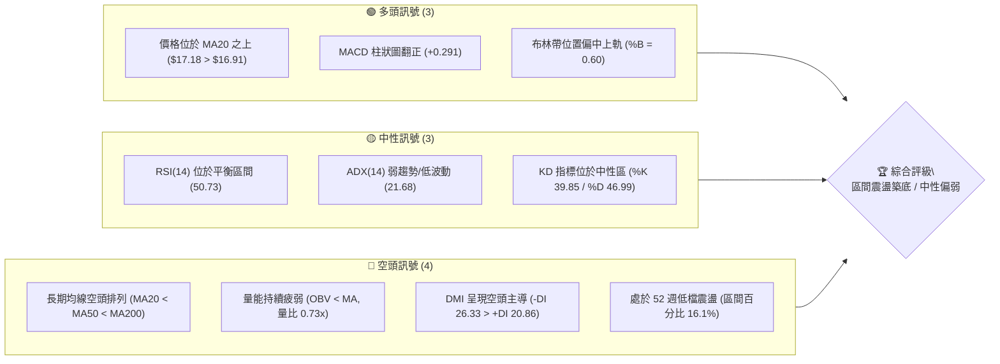
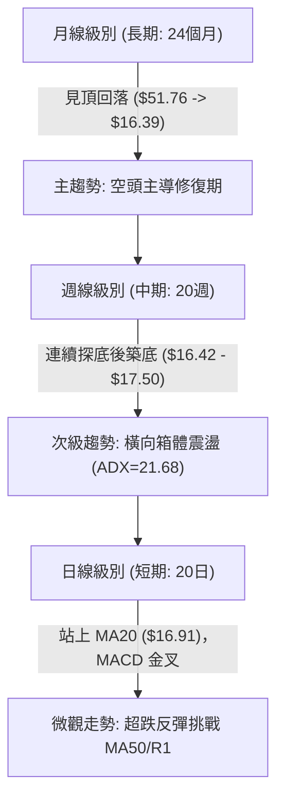
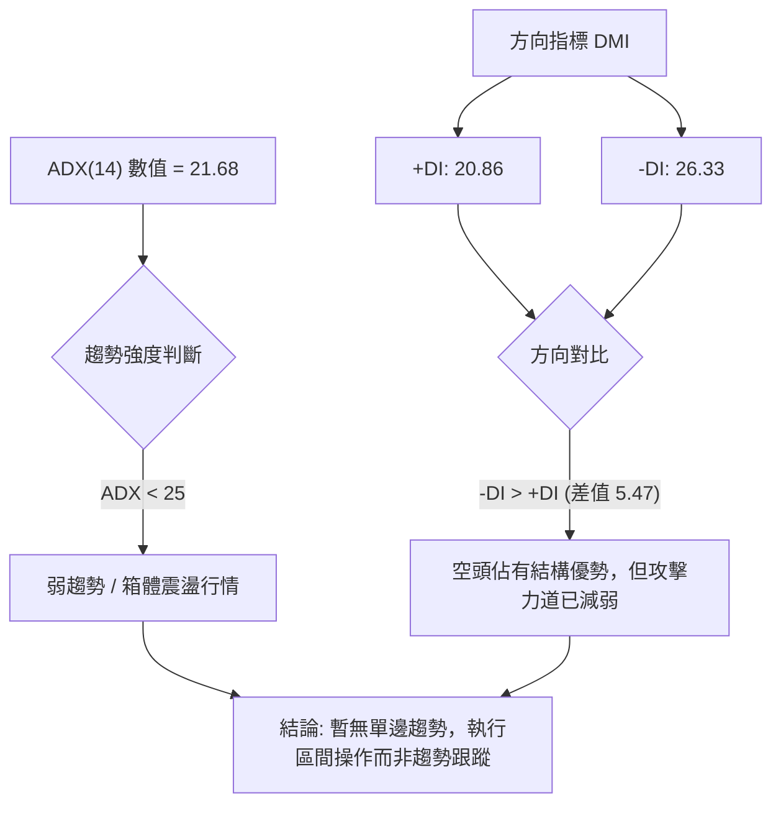
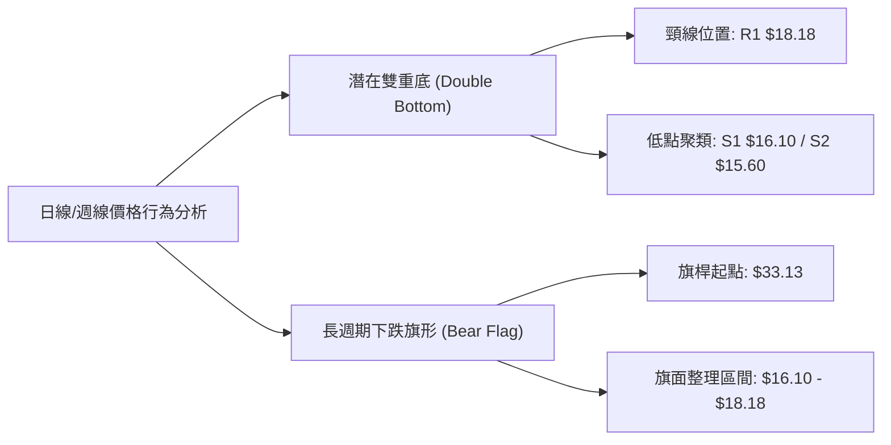
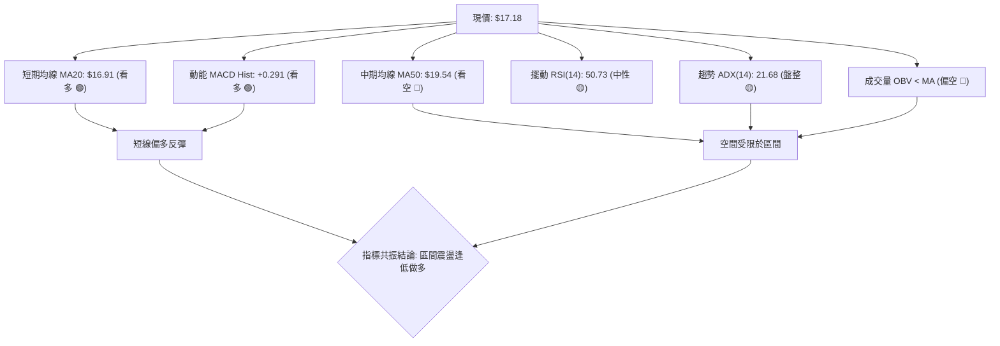
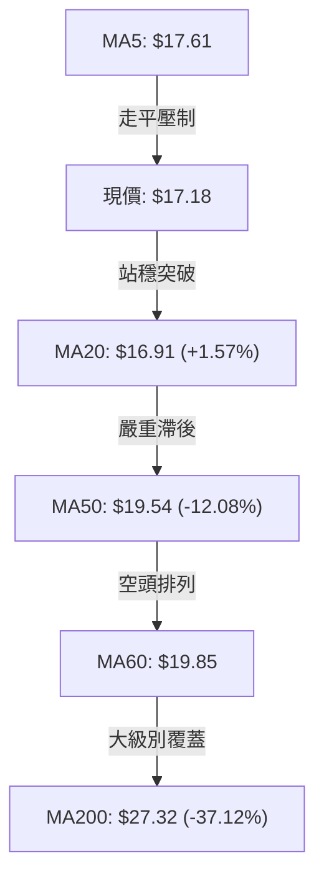
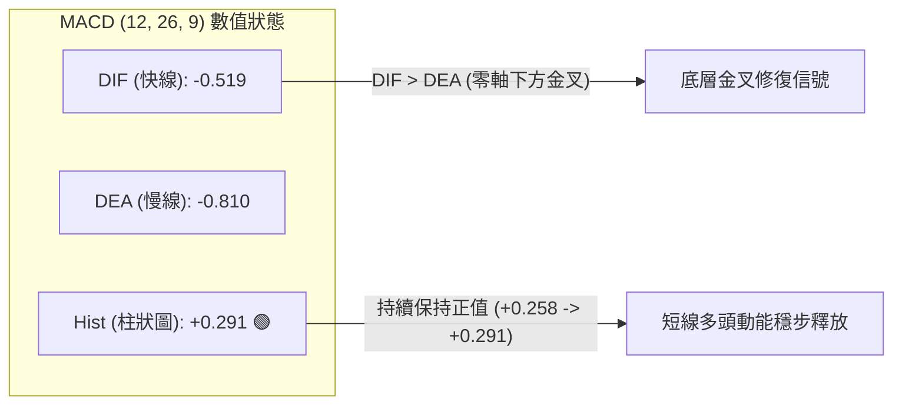
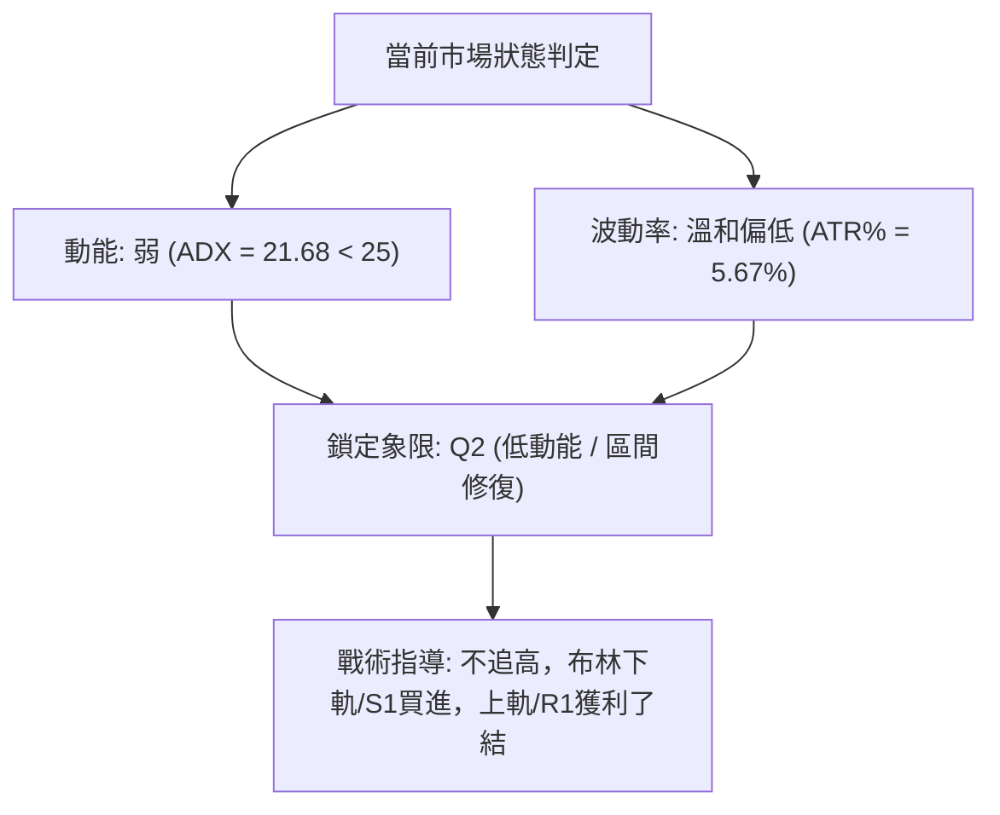
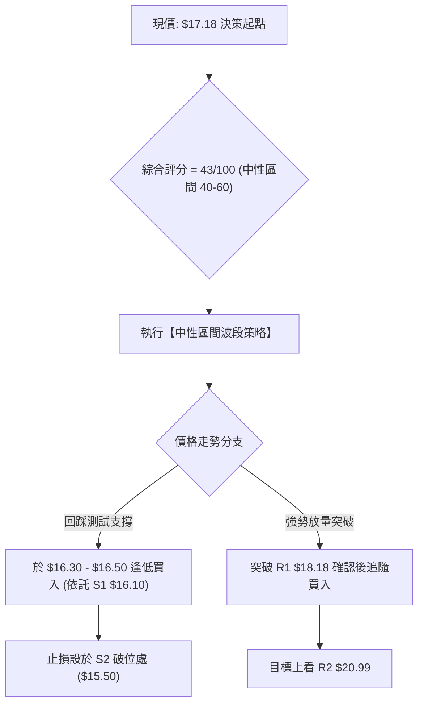
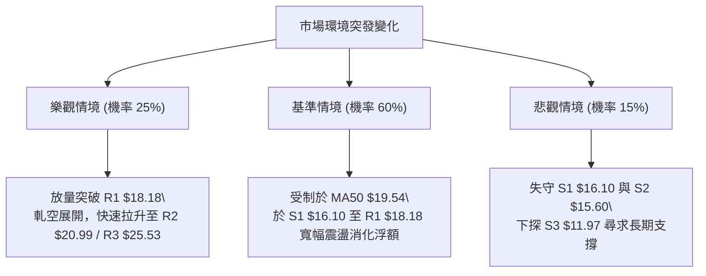

# PL 技術分析報告

> **報告日期**：2026-10-12 ｜ **語言**：繁體中文 ｜ **數據來源**：Yahoo Finance ｜ **當前價格**：$17.18

---

## 目錄

| 章節 | 內容 |
|------|------|
| [1. 技術面概覽](#1-技術面概覽) | 訊號儀表板、核心指標、評分卡 |
| [2. 趨勢分析](#2-趨勢分析) | 多時框趨勢、長中短期走勢 |
| [3. 圖表形態分析](#3-圖表形態分析) | 形態識別、K線組合、目標價 |
| [4. 支撐與阻力](#4-支撐與阻力) | 關鍵價位、斐波那契回調 |
| [5. 技術指標深度解讀](#5-技術指標深度解讀) | MA/RSI/MACD/布林/成交量 |
| [6. 動能與波動率](#6-動能與波動率) | 動能評估、ATR、Beta |
| [7. 多時框架總結](#7-多時框架總結) | 時框架評分矩陣 |
| [8. 交易策略建議](#8-交易策略建議) | 多空策略、風險報酬比 |
| [9. 風險提示與監控](#9-風險提示與監控) | 監控指標、風險場景 |
| [10. 報告總結](#10-報告總結) | 全文核心架構與交易清單 |

---

## 1. 技術面概覽

### 🎯 技術訊號儀表板



### 📊 核心指標速覽表

| 指標類別 | 指標名稱 | 當前數值 | 訊號 | 解讀 |
|----------|----------|----------|------|------|
| **價格** | 當前收盤價 | $17.18 | 🟡 | 位於52週區間16.1%處，脫離年內低點但受制於中期均線 |
| **短期均線** | MA20 | $16.91 | 🟢 | 現價高於MA20 (+1.57%)，短線出現止跌企穩徵兆 |
| **中期均線** | MA50 | $19.54 | 🔴 | 現價大幅低於MA50 (-12.08%)，中期反彈壓制明顯 |
| **長期均線** | MA200 | $27.32 | 🔴 | 現價遠低於MA200 (-37.12%)，中長期維持大級別空頭走勢 |
| **擺動動能** | RSI(14) | 50.73 | 🟡 | 位於50多空分水嶺附近，無超買超賣，多空動能暫時平衡 |
| **趨勢動能** | MACD (12,26,9) | Hist: +0.291 | 🟢 | 快線(-0.519)交叉慢線(-0.810)，柱狀圖呈現綠柱修復反彈 |
| **波動風險** | ATR(14) | $0.97 | 🟡 | 波動率佔股價5.67%，日均振幅溫和，有利於區間防守佈局 |
| **趨勢強度** | ADX(14) | 21.68 | 🟡 | ADX < 25 表明單邊趨勢結束，市場進入低動能橫向整理行情 |
| **成交量能** | 量比 (vs 20MA) | 0.73x | 🔴 | 單日量7.80M低於20日均量10.73M，OBV處於均線下方，動能不足 |

### 🏆 技術評分卡

```
╔════════════════════════════════════════════════════════════════╗
║                   技術評分卡 — PL (2026-10-12)                ║
╠════════════════════════════════════════════════════════════════╣
║ 趨勢強度 (Trend)      ████████░░░░░░░░░░░░  40/100  🔴 空頭/弱勢 ║
║ 動能指標 (Momentum)   ██████████░░░░░░░░░░  50/100  🟡 中性反彈 ║
║ 支撐穩定度 (Support)  ████████████░░░░░░░░  60/100  🟢 雙重支撐 ║
║ 成交量配合 (Volume)   ██████░░░░░░░░░░░░░░  30/100  🔴 量能萎縮 ║
║ 形態完整度 (Pattern)  ██████████░░░░░░░░░░  50/100  🟡 構築箱體 ║
║ 均線排列 (MA System)  ██████░░░░░░░░░░░░░░  30/100  🔴 典型空頭 ║
╠════════════════════════════════════════════════════════════════╣
║ 綜合評分 (Overall)    █████████░░░░░░░░░░░  43/100  🟡 弱勢中性 ║
╚════════════════════════════════════════════════════════════════╝
```

---

## 2. 趨勢分析

### 🌐 多時框趨勢分析



### 📈 長期趨勢 — 12個月走勢圖（Unicode）

```
PL 月線走勢圖（過去12個月：2025-11 至 2026-10）
價格軸 ($)
$52 ┤                                      ● (2026-05 高點 $51.14 / 歷史高 $51.76)
$46 ┤                                     ╱ ╲
$40 ┤                              ●     ╱   ╲
$34 ┤                             ╱ ╲   ╱     ● (2026-06 $33.13)
$28 ┤                      ●     ╱   ╲ ╱       ╲
$24 ┤             ●   ●   ╱ ╲   ╱     ●         ╲
$20 ┤     ●      ╱ ╲ ╱   ╱   ╲ ╱                 ● (2026-07 $20.48 / 08 $19.85)
$17 ┤    ╱ ╲    ╱   ●   ╱     ●                   ╲        ●← 現在 ($17.18)
$14 ┤   ╱   ╲  ╱                                   ●───────┘ (2026-09 $16.39)
$11 ┤  ●     ●─┘
     └─────────────────────────────────────────────────────────────────────────────
       11   12   01  02  03    04    05    06    07   08   09   10  (月份)
```

#### 走勢特徵分析表格

| 階段區間 | 時間跨度 | 價格起訖 | 漲跌幅 | 主要技術特徵與驅動要素 |
|----------|----------|----------|--------|------------------------|
| **第 I 階段：蓄勢突破** | 2025-11 ~ 2026-02 | $11.90 → $24.14 | +102.86% | 成交量溫和放大，突破雙位數關卡，建立中長線上行通道 |
| **第 II 階段：主升衝頂** | 2026-03 ~ 2026-05 | $27.95 → $51.14 | +82.97% | 週線 RSI 飆升至 83.2，成交量暴增至 6,148 萬股，見歷史天價 $51.76 |
| **第 III 階段：高位崩跌** | 2026-06 ~ 2026-07 | $51.14 → $20.48 | -59.95% | 巨量倒貨（單週量破億），連續跳空跌破 MA20 與 MA50，形態完全破壞 |
| **第 IV 階段：陰跌探底** | 2026-08 ~ 2026-09 | $19.85 → $16.39 | -17.43% | 週線 RSI 連續進入超賣區（低見 10.0），空頭動能逐步衰竭 |
| **第 V 階段：築底蓄勢** | 2026-09 ~ 2026-10 | $16.39 → $17.18 | +4.82% | 股價站回 MA20 ($16.91)，MACD 柱狀圖翻紅，呈現低檔橫盤整理 |

### 📊 中期趨勢（週線分析）

```
PL 近期週線壓力與支撐示意圖
阻力軸:
$25.53 ────────────────────────────── R3 (波段強阻力 / 密集換手平台)
$20.99 ────────────────────────────── R2 (MA50: $19.54 與前波反彈高點重疊區)
$18.18 ────────────────────────────── R1 (布林上軌 $18.27 壓制區)
-------------------------------------------------------------------------
$17.18 [▲ 現價] (突破 MA20 $16.91，爭奪短線定價權)
-------------------------------------------------------------------------
$16.10 ────────────────────────────── S1 (近三週波段低點收盤聚集線 $16.42~$16.45)
$15.60 ────────────────────────────── S2 (布林下軌 $15.56 支撐護城河)
$11.97 ────────────────────────────── S3 (年內極端防守底線)
```

中期週線在 2026-09-13 於 $16.45 觸底後，連續 4 週未破低，並於 2026-09-27 形成跳空長陽回升至 $17.43，隨後收盤維持在 $17.18~$17.50 窄幅整理。週線 MACD 柱狀圖已由 -0.328 收斂至 +0.291，確立中期跌勢暫告中斷。

### ⚡ 趨勢強度評估（ADX 解讀）



| 指標變量 | 數值 | 臨界標準 | 狀態判定 | 技術意涵 |
|----------|------|----------|----------|----------|
| **ADX(14)** | 21.68 | 25.00 | 弱趨勢/無方向 | 單邊做空或單邊做多動能均不足，趨勢交易法極易被雙向洗盤 |
| **+DI** | 20.86 | 20.00 | 偏弱多頭 | 買盤力量逐步回升，但尚未跨越強勢多頭門檻 (25.00) |
| **-DI** | 26.33 | 25.00 | 中度空頭 | 空方力量仍維持在中長期上方，但相較於 6 月份已明顯衰退 |
| **趨勢格局** | 盤整 | N/A | 箱體震盪 | 適用擺動指標（布林通道、支撐阻力線）進行高拋低吸 |

---

## 3. 圖表形態分析

### 🔍 形態識別系統



#### 形態識別信心度與量化依據表

| 形態名稱 | 信心度 | 判斷依據（引用具體數據） | 完成度 | 目標價（附嚴格計算式） |
|----------|--------|--------------------------|--------|------------------------|
| **短期雙重底**<br>(Double Bottom) | **65%** | 兩次低點分別落於 2026-09-13 的 $16.45 與 2026-09-20 的 $16.42（均緊扣 S1 $16.10 支撐區），隨後回升至 $17.50，MACD 柱狀圖連續三週為正 (+0.291)。 | 70% | **頸線突破目標**：<br>頸線取 R1 $18.18，形態低點取 S1 $16.10。<br>形態高度 = $18.18 - $16.10 = $2.08。<br>向上量度目標 = $18.18 + $2.08 = **$20.26**（接近 R2 $20.99 阻力位）。 |
| **中期下跌旗形**<br>(Bear Flag) | **45%** | 6月自 $51.14 暴跌至 7月 $20.48 作為旗桿，8-10月於 $16.10~$20.48 做旗面弱勢震盪。但由於成交量萎縮且 ADX 跌破 25，空頭向下續跌動能暫緩。 | 40% | *信心度 < 50%，依規則 15 不強行推導跌破目標，僅作為破位 S1/S2 時之風險預警。* |

### 🕯️ 重要K線形態分析

| 週/月份 | 收盤價 | 實體/引線形態 | 技術解讀 | 訊號 |
|---------|--------|---------------|----------|------|
| **2026-05** | $51.14 | 天量避雷針大陰長影 | 衝高至 $51.76 後遇強大獲利回吐，天量換手（6,148萬股），多頭力竭見頂 | 🔴 強烈看空 |
| **2026-06** | $33.13 | 斷頭鍘刀巨量長陰 | 週成交量破億（100.62M），直接跌穿 MA20 與多頭防守平台，主升趨勢徹底終結 | 🔴 崩盤信號 |
| **2026-09-13**| $16.45 | 縮量錘子探底線 | 週 RSI 降至 10.0 極限超賣區，下影線回踩 52 週低位支撐，空頭宣洩完畢 | 🟢 築底信號 |
| **2026-09-27**| $17.43 | 轉向吞噬中陽線 | 週線收復 MA20，週 MACD 翻紅（+0.272），確認短底 $16.42 成立 | 🟢 反彈啟動 |
| **2026-10-11**| $17.18 | 高檔窄幅十字星 | 連續兩週於 $17.18~$17.50 窄幅換手，量比下降，測試布林中軌支撐有效性 | 🟡 蓄勢待變 |

### 📉 ASCII 走勢形態示意圖

```
PL 雙重底打底結構示意圖 (2026-09 至 2026-10)
價位 ($)
$18.18 ┤               頸線阻力 (R1) ───────────────────────┐ [突破關鍵點]
       │                 ╭──────╮                          │
$17.50 ┤                 │ 頸線 │      ╭────── 現價 $17.18 ─┤ (受制中軌上方)
       │                 │ 回落 │     ╱                    │
$17.00 ┤        ╭────────╯      ╰────╯ (MA20: $16.91 支撐)  │
       │       ╱                                           │
$16.45 ┤●第一底 ($16.45)        ●第二底 ($16.42)          │
$16.10 ┤───────────────────────────────────────────────────┴ S1 支撐
       └────────────────────────────────────────────────────────────
        2026-09-13             2026-09-20        2026-10-12 (當前)
```

### 🎯 形態目標價計算

1. **短期雙底向上量度目標**：
   - 頸線壓制位：R1 = **$18.18**
   - 底部支撐基線：S1 = **$16.10**
   - 形態絕對高度 $H = \$18.18 - \$16.10 = \mathbf{\$2.08}$
   - 第一目標價（完全滿足位）：$T_1 = \$18.18 + \$2.08 = \mathbf{\$20.26}$（與數據中阻力位 R2 **$20.99** / MA50 **$19.54** 構成重合阻力帶）
2. **中期突破滿足目標**：
   - 若能以放量型態越過 R2 $20.99，進一步向上挑戰長線下降走勢之 61.8% 斐波那契壓力位，對應數據中關鍵阻力位 R3 **$25.53**。

---

## 4. 支撐與阻力

### 🗺️ 關鍵價位分布圖（Unicode）

```
PL 價位結構分布圖 (由實際 OHLCV 與斐波那契計算)
═══════════════════════════════════════════════════════════════════════════
$51.76 ║████████████████████████████████████║ 52W 歷史高點 (0.0% Fib)
$42.03 ║████████████████████                ║ 斐波那契 23.6% 回調位
$36.01 ║████████████████████                ║ 斐波那契 38.2% 回調位
$31.14 ║████████████████████████            ║ 斐波那契 50.0% 中樞平衡位
$27.32 ║████████████████████████████        ║ MA200 牛熊分水嶺
$26.27 ║████████████████████████            ║ 斐波那契 61.8% 強阻力位
$25.53 ║████████████████████████████████    ║ 強阻力 R3 (波段高點聚類)
$20.99 ║████████████████████                ║ 阻力 R2 (反彈高點聚類 / MA50 區域)
$19.35 ║████████████████                    ║ 斐波那契 78.6% 回調位
$18.18 ║████████████████████████            ║ 關鍵阻力 R1 (布林上軌 / 頸線)
───────╫────────────────────────────────────╫───────────────────────────
$17.18 ╠════════════════════════════════════╣ ◄ 現價 (收盤價)
───────╫────────────────────────────────────╫───────────────────────────
$16.91 ║▓▓▓▓▓▓▓▓▓▓▓▓▓▓▓▓▓▓▓▓▓▓▓▓            ║ 短期生命線 MA20 (布林中軌)
$16.10 ║▓▓▓▓▓▓▓▓▓▓▓▓▓▓▓▓▓▓▓▓▓▓▓▓▓▓▓▓        ║ 近期核心支撐 S1 (雙底平台)
$15.60 ║████████████████████████████████    ║ 強支撐 S2 (布林下軌護城河)
$11.97 ║████████████████████████████████████║ 極限防守支撐 S3 (年內波段低點聚類)
$10.52 ║████████████████████████████████████║ 52W 歷史低點 (100.0% Fib)
═══════════════════════════════════════════════════════════════════════════
```

### 🚧 阻力位分析表

| 阻力級別 | 引用價位 | 距離現價 | 形成原因與籌碼特徵 | 突破難度 | 重要性權重 |
|----------|----------|----------|--------------------|----------|------------|
| **R1** | **$18.18** | +5.82% | 雙重底頸線、布林帶上軌 ($18.27) 密集共振區，近三週反彈高點停滯處。 | 🟡 中等 (需日成交量大於 1,000 萬) | ★★★★☆ |
| **R2** | **$20.99** | +22.18% | 8月中旬反彈波段高點 ($24.69) 回跌後的過渡平台，緊鄰 MA50 ($19.54) 與 Fib 78.6% ($19.35)。 | 🔴 較高 (空頭均線覆蓋壓制) | ★★★★★ |
| **R3** | **$25.53** | +48.60% | 歷史密集換手平台，接近斐波那契 61.8% ($26.27) 與 MA200 ($27.32) 的重壓帶。 | 🔴 極高 (需大級別基本面扭轉) | ★★★★★ |

### 🛡️ 支撐位分析表

| 支撐級別 | 引用價位 | 距離現價 | 形成原因與籌碼特徵 | 守住機率 | 重要性權重 |
|----------|----------|----------|--------------------|----------|------------|
| **S1** | **$16.10** | -6.29% | 2026年9月中下旬雙底低點收盤聚類區 ($16.42~$16.45)，空頭第一波回補防線。 | 🟢 70% | ★★★★☆ |
| **S2** | **$15.60** | -9.20% | 日線布林下軌 ($15.56) 所在處，近一年波段強支撐聚集點，超賣極值保護線。 | 🟢 85% | ★★★★★ |
| **S3** | **$11.97** | -30.33% | 2025年11月啟動主升浪前的原始突破平台，年內極端悲觀情境下之硬底。 | 🟢 95% | ★★★★★ |

### 📐 斐波那契回調位分析

依據 52 週區間之極值點（最高點 $51.76，最低點 $10.52，總落差 $41.24），精確計算之黃金分割層級如下：

| 斐波那契層級 | 精確點位 | 當前相對位置 | 技術意涵與結構判定 |
|--------------|----------|--------------|--------------------|
| **0.0% (52W High)** | **$51.76** | +201.28% | 2026-05 歷史頂部，牛市終點 |
| **23.6%** | **$42.03** | +144.65% | 頂部崩跌後之首道反彈阻力（已失效） |
| **38.2%** | **$36.01** | +109.60% | 中長期空頭修復目標 |
| **50.0%** | **$31.14** | +81.26% | 多空平衡中樞線 |
| **61.8%** | **$26.27** | +52.91% | 黃金分割強壓力帶（與 R3 $25.53 重疊） |
| **78.6%** | **$19.35** | +12.63% | **當前上方關鍵阻力天花板**（與 MA50 $19.54 構成共振） |
| **當前價格** | **$17.18** | **0.00%** | **落於 78.6% ($19.35) 與 100.0% ($10.52) 之間的深幅回撤區間** |
| **100.0% (52W Low)**| **$10.52** | -38.77% | 52 週基準起點，絕對底部 |

**解讀**：現價 $17.18 深度回吐了前期漲幅的 83.9%（位於 78.6% 回調位 $19.35 下方）。從斐波那契架構來看，跌破 78.6% 意味著原多頭推動浪結構已被徹底破壞，當前行情定性為**底部大級別盤整重建**。股價短期反彈的第一主要空間即為回抽回試 78.6% 回調位 $19.35 與 R2 $20.99。

---

## 5. 技術指標深度解讀

### 🎛️ 指標訊號總覽



### 📈 移動平均線排列分析



| 均線參數 | 數值 | 與現價偏差 | 排列狀態 | 走勢解讀 |
|----------|------|------------|----------|----------|
| **MA 5** | $17.61 | -2.44% | 下行壓制 | 短線衝高受阻，壓制今日微跌 |
| **MA 10** | $17.12 | +0.33% | 勾頭向上 | 短線提供即時動態支撐 |
| **MA 20** | $16.91 | +1.57% | 走平回升 | 股價站上20日均線，扭轉短線單邊跌勢 |
| **MA 50** | $19.54 | -12.08% | 下傾發散 | 中期均線呈空頭排列，反彈重要阻力關卡 |
| **MA 60** | $19.85 | -13.46% | 下傾發散 | 季線阻力強勁，與 MA50 形成雙重阻擋 |
| **MA 120**| $27.70 | -37.99% | 下傾發散 | 半年線持續下移，中期上方套牢盤深重 |
| **MA 200**| $27.32 | -37.12% | 空頭排列 | MA20 < MA50 < MA200，大級別熊市特徵依舊存在 |

### 📉 RSI(14) 分析

```
RSI(14) 當前水平: 50.73
超賣 (0) ──────[30]───────────●[50.73]───────────[70]────── 超買 (100)
進度條: █████████████████████░░░░░░░░░░░░░░░░░░░  50.73%
```

- **區間狀態**：RSI(14) 為 **50.73**，精確座落於 50 榮枯分水嶺之上。相較於 9 月中旬極度恐慌的 10.0，RSI 已完成強勁的超賣修復。
- **背離診斷**：
  - 價格在 2026-09-13 創低點 $16.45（RSI 10.0），2026-09-20 再探 $16.42（RSI 回升至 24.4）。
  - **結論：存在微幅底背離（價格微破低但 RSI 大幅墊高）**，該底背離已成功驅動 9 月底的反彈至 $17.43。當前 RSI 走平，無新頂背離或底背離產生。

### 📊 MACD(12/26/9) 訊號解讀



- **數值關係**：DIF (-0.519) 高於 DEA (-0.810)，柱狀圖為 **+0.291**。
- **訊號解析**：MACD 在零軸下方維持低位「黃金交叉」發散狀態，柱狀圖連續三週為正（+0.272 → +0.258 → +0.291），顯示下行動能衰竭，買盤正逢低吸收籌碼，短線多頭具備控盤優勢。

### 📦 布林通道分析

```
PL 日線布林通道結構示意圖
$18.27 ─────────────────────────────── 上軌 (Upper Band)  ── [R1 壓制區: $18.18]
       │
$17.18 ─────── ● 現價 (%B = 0.60)
       │
$16.91 ─────────────────────────────── 中軌 (Middle Band = MA20) ── [多空防守線]
       │
$15.56 ─────────────────────────────── 下軌 (Lower Band)  ── [S2 強支撐: $15.60]
```

- **通道帶寬與位置**：布林帶寬度為 $18.27 - $15.56 = $2.71，通道呈現橫向收窄特徵。
- **%B 指標**：$\%B = (17.18 - 15.56) / (18.27 - 15.56) = \mathbf{0.60}$，表明價格位於中軌至上軌之間，偏多運行。現價回踩中軌 $16.91 獲得明確支撐，短線目標為向上觸碰上軌 $18.27（與 R1 $18.18 高度重合）。

### 💹 成交量分析（量價配合度）

- **量比檢驗**：最新日成交量為 **7,801,900 股**，相較於 20 日均量 **10,730,335 股**，量比僅 **0.73x**。
- **量價背離現象**：價格自 $16.42 反彈至 $17.18，但成交量未能隨之擴大（量比 < 1.0），OBV 低於其移動平均線。
- **結論**：目前反彈屬於「縮量弱反彈」，籌碼穩定度雖高（無主動性拋盤），但缺乏增量資金進場推升，因此股價在接近 R1 $18.18 時極易遭遇動能衰竭而回檔。

---

## 6. 動能與波動率

### ⚡ 動能評估四象限

| 象限標籤 | 動能狀態 | 波動率狀態 | 當前特徵對應 | 策略評估與倉位建議 |
|----------|----------|------------|--------------|--------------------|
| **Q1：突破主升** | 強動能 (ADX>25) | 高波動 (ATR高) | 2026年5月階段 ($51.76) | 順勢加碼，追隨單邊趨勢 |
| **Q2：區間修復** | **弱動能 (ADX=21.68)** | **中低波動 (ATR=$0.97)** | **✓ 當前 PL 所處位置** | **區間震盪操作，嚴守低吸高拋** |
| **Q3：陰跌恐慌** | 強空頭動能 | 高波動 | 2026年6月階段 ($33.13) | 空手觀望，禁止左側抄底 |
| **Q4：死水整理** | 極弱動能 | 極低波動 (ATR<3%) | 歷史盤整階段 | 資金利用率低，觀望等待 |



### 📊 ATR 波動率分析

- **ATR(14) 數值**：**$0.97**（佔當前股價 $17.18 之 **5.67%**）。
- **日內期望波動區間**：
  - 日內預期上限 = $17.18 + $0.97 = **$18.15**（精確契合 R1 $18.18）
  - 日內預期下限 = $17.18 - $0.97 = **$16.21**（緊貼 S1 $16.10 支撐區）
- **止損距離建議**：
  - 震盪行情推薦使用 **1.5 × ATR** 作為安全動態止損緩衝空間：
    $$\text{止損距離} = 1.5 \times \$0.97 = \mathbf{\$1.455}$$
  - 若在現價 $17.18 進場，建議止損點置於：
    $$\$17.18 - \$1.455 = \mathbf{\$15.725} \quad (\text{略高於 S2 強支撐 } \$15.60)$$

### 📐 Beta 與市場相關性

- **Beta 係數**：**2.17**。
- **高彈性風險特徵**：PL 的系統性風險係數超過 2.0，表明該股對納斯達克及大盤波動具有超過兩倍的槓桿反應。大盤回調時其回撤幅度巨大，反之若美股科技板塊迎來反彈，PL 具備強烈的向上修復彈性。

---

## 7. 多時框架總結

### 📋 時框架評分表

| 時框架 | 趨勢方向 | 動能狀態 | 均線排列 | 圖表形態 | 綜合評分 | 戰術建議 |
|--------|----------|----------|----------|----------|----------|----------|
| **月線 (長期)** | 🔴 明顯下行 | 🔴 RSI 偏低 | 🔴 MA200 遠在上 | 大頂回落陰跌中 | **25/100** | 長線資金謹慎，切勿重倉 |
| **週線 (中期)** | 🟡 橫向盤整 | 🟢 MACD 翻紅 | 🔴 MA50 壓制 | 潛在雙底打底中 | **45/100** | 中期築底初現，等待右側確認 |
| **日線 (短期)** | 🟢 震盪反彈 | 🟡 RSI 50.73 | 🟢 站上 MA20 | 布林中上軌運行 | **60/100** | 短線區間波段，高拋低吸 |

### 🔲 綜合訊號矩陣

```
┌─────────────────┬──────────────────┬──────────────────┬──────────────────┐
│   分析維度      │    短期 (日線)   │    中期 (週線)   │    長期 (月線)   │
├─────────────────┼──────────────────┼──────────────────┼──────────────────┤
│ 趨勢方向        │ 🟢 震盪反彈      │ 🟡 橫盤整理      │ 🔴 熊市空頭      │
│ 均線系統        │ 🟢 站上 MA20     │ 🔴 壓制於 MA50   │ 🔴 破位 MA200    │
│ 擺動指標 (RSI)  │ 🟡 中性平衡(50.7)│ 🟡 脫離超賣      │ 🔴 偏空向下      │
│ 趨勢動能 (MACD) │ 🟢 零下金叉釋放  │ 🟢 綠柱翻正(+0.29│ 🔴 空頭發散      │
│ 籌碼與量能      │ 🔴 縮量 (0.73x)  │ 🔴 均量萎縮      │ 🔴 巨量套牢壓頂  │
└─────────────────┴──────────────────┴──────────────────┴──────────────────┘
```

### ⚖️ 多時框收斂結論

> **依據「嚴格要求 14」之多時框收斂規則：**
> 1. **趨勢強度定性**：當前 ADX(14) 數值為 **21.68 (< 25)**，明確定義市場處於**弱趨勢 / 盤整行情**。
> 2. **主導維度判定**：在此無單邊趨勢之盤整行情下，**以日線布林通道上下軌 ($15.56 ~ $18.27) 作為主要交易區間**，中長期均線方向則作為反彈壓制的上限邊界。
> 3. **唯一方向性結論**：**【中性觀望，區間高拋低吸操作】**。日線雖呈現微幅反彈，但由於週線空頭均線壓頂（MA50 $19.54）且量能萎縮，向上突破阻力巨大，嚴禁盲目追高；下檔依託雙底 S1 $16.10 與下軌 S2 $15.60 進行防守性波段佈局。

---

## 8. 交易策略建議

### 🗺️ 策略決策流程圖



### 🧭 策略路由（依評分卡分流）

**當前主策略方向 = 【中性區間操作，布林通道震盪逢低佈局】（依評分 43/100）**
當前綜合評分 43 分處於 40–60 之中性區間，市場缺乏單邊趨勢動能（ADX 21.68）。主推策略為**依託支撐位之高盈虧比低吸波段策略**，以布林上軌及 R1 作為止盈點，嚴禁進行趨勢性追高。

### 🎯 價格情境階梯（Price Scenarios）

| 觸發條件 | 下一目標 | 後續延伸 | 情境技術含義 |
|----------|----------|----------|--------------|
| **突破 R1 $18.18** | **R2 $20.99** | **R3 $25.53** | 雙底頸線確認突破，中期反彈全面展開，挑戰 MA50 與 78.6% Fib ($19.35) |
| **站穩現價區間** | **$17.60** | **$18.18** | 維持布林中軌 $16.91 至上軌 $18.27 窄幅震盪消化浮額 |
| **跌破 S1 $16.10** | **S2 $15.60** | **S3 $11.97** | 雙底形態失效，股價下探測試布林下軌，若失守 S2 將引發破位崩跌 |

### 📊 情境機率分佈

| 情境劇本 | 發生機率 | 主要依據（指標狀態） |
|----------|----------|----------------------|
| **情境一：區間震盪蓄勢** | **55%** | ADX 21.68 確立無趨勢行情，成交量萎縮至 0.73x，布林帶寬度收窄，維持在 $16.10~$18.18 橫盤整理機率最高。 |
| **情境二：向上突破反彈** | **30%** | MACD 柱狀圖維持紅柱 (+0.291)，價格站穩 MA20 ($16.91)，但受制於缺乏成交量確認，突破需要外部催化劑。 |
| **情境三：跌破底線再探底** | **15%** | 雖然均線空頭排列，但日線與週線 RSI 已自 10.0 超賣修復至 50.73，S1 $16.10 具備雙底防守韌性，直接破位機率較低。 |

### 🟢 主策略詳情

| 策略要素 | 策略 A：左側逢低承接（主推） | 策略 B：右側突破追買（次選） |
|----------|------------------------------|------------------------------|
| **進場條件** | 股價回踩 MA20 支撐，於 S1 附近出現止跌訊號 | 放量陽線實體有效突破 R1 阻力位 |
| **進場價格** | **$16.50** (靠近 S1 $16.10) | **$18.30** (確認突破 R1 $18.18) |
| **目標價 T1** | **$18.18** (阻力位 R1) | **$20.26** (形態目標滿足點) |
| **目標價 T2** | **$20.99** (阻力位 R2) | **$20.99** (阻力位 R2) |
| **止損價格** | **$15.50** (嚴格跌破 S2 $15.60) | **$17.40** (跌回頸線下方) |
| **風險報酬比** | **2.68 : 1** (以 T2 計算：$4.49 空間 / $1.00 風險) | **2.99 : 1** (以 T2 計算：$2.69 空間 / $0.90 風險) |
| **成功機率** | **65%** | **50%** (需量能配合) |
| **建議倉位** | **10% - 15%** (控制風險暴露) | **10%** (突破試單) |

### 🔴 反向風險觸發點（對沖提示）

- **做多邏輯失效點**：若日線收盤價帶量**跌破 S1 $16.10**，且進一步**跌破 S2 $15.60**，雙底型態徹底瓦解，必須無條件執行止損離場。
- **做空信號重啟點**：若價格反彈至 **R1 $18.18 ~ 布林上軌 $18.27** 遇阻回落，且伴隨日線出現長上影線與成交量衰竭，多頭倉位應全數獲利了結，激進投資者可考慮建立輕倉空頭對沖。

### ⭐ 整體訊號強度評星

```
做多訊號強度：★★★☆☆  (3/5星 — 短線指標偏多，但受制於量能與中期均線)
做空訊號強度：★★☆☆☆  (2/5星 — 空頭動能衰竭，超賣已修復，性價比不足)
整體可信度：  ★★★★☆  (4/5星 — 關鍵價位群聚明確，布林通道邊界清晰)
```

---

## 9. 風險提示與監控

### ✅ 關鍵監控指標 Checklist

```
╔══════════════════════════════════════════════════════════════════════════╗
║                    PL 日常交易風險監控清單 (Checklist)                  ║
╠══════════════════════════════════════════════════════════════════════════╣
║ [ ] 1. 均線生命線: 每日收盤價是否守在 MA20 ($16.91) 之上？               ║
║ [ ] 2. 頸線突破確認: 日線是否收盤突破 R1 ($18.18) 且成交量 > 1,200 萬？  ║
║ [ ] 3. 破位止損紅線: 盤中價格是否跌破 S2 ($15.60) 底線？                 ║
║ [ ] 4. 動能反轉預警: MACD 柱狀圖是否由正翻負 (跌破 0 軸)？               ║
║ [ ] 5. 趨勢爆發警戒: ADX(14) 是否突破 25（預告單邊趨勢形成）？           ║
║ [ ] 6. 籌碼異常流動: 空頭部位比例 (Short Float 11.0%) 是否引發軋空？    ║
╚══════════════════════════════════════════════════════════════════════════╝
```

### ⚠️ 風險場景分析



### 🛡️ 風險管理重要提醒

1. **高 Beta 波動防範**：PL 的 Beta 值高達 **2.17**，波動劇烈。單筆交易嚴格遵守單次虧損不得超過總帳戶資金 1.5% 的風控原則。
2. **量能未確認前嚴禁滿倉**：目前成交量僅 7.80M（量比 0.73x），縮量反彈容易出現假突破。未見單日成交量突破 1,200 萬股之前，倉位上限不得超過 15%。
3. **ATR 動態追蹤**：當前 ATR 為 $0.97，持倉過程中應以保本價加上 1.0 個 ATR 逐步上移移動止盈點，以保護既得利潤。

---

## 10. 報告總結

```
╔══════════════════════════════════════════════════════════════════════════╗
║                         PL 技術分析報告總結                              ║
╠══════════════════════════════════════════════════════════════════════════╣
║ 報告日期：2026-10-12                                                     ║
║ 當前價格：$17.18                                                         ║
║ 分析評級：⚖️ 中性觀望 / 區間波段震盪操作 (技術評分: 43/100)               ║
║                                                                          ║
║ 關鍵結論：                                                               ║
║ ├─ 長期趨勢：🔴 弱勢空頭 (月線自 $51.76 回落，MA200 $27.32 壓頂)          ║
║ ├─ 中期趨勢：🟡 築底震盪 (ADX 21.68 弱趨勢，週線 MACD 翻紅蓄勢)          ║
║ ├─ 短期趨勢：🟢 弱勢反彈 (站上 MA20 $16.91，布林 %B = 0.60)              ║
║ ├─ 關鍵支撐：S1 $16.10 ｜ S2 $15.60 ｜ S3 $11.97                         ║
║ ├─ 關鍵阻力：R1 $18.18 ｜ R2 $20.99 ｜ R3 $25.53                         ║
║ └─ 華爾街目標價：平均 $31.91 (最低 $17.00 / 最高 $50.00)                 ║
║                                                                          ║
║ 最優策略組合：                                                           ║
║ 1. 🥇 最佳機會：策略 A (回踩 $16.50 佈局低吸，止損 $15.50，目標 $20.99)   ║
║ 2. 🥈 次選機會：策略 B (放量突破 R1 $18.18 追進，止損 $17.40，目標 $20.26)║
║ 3. 🥉 保守選擇：場外觀望，等待日線放量收復 MA50 ($19.54) 後再做右側介入  ║
╚══════════════════════════════════════════════════════════════════════════╝
```

---

> ⚠️ **免責聲明**：本報告為技術分析研究，所有數據及估算均基於歷史價格與量化指標。本報告**僅供研究與學術參考**，**不構成任何投資買賣建議**。投資有風險，入市需謹慎。

---

*報告生成時間：2026-10-12 ｜ 數據來源：Yahoo Finance ｜ 分析框架：多時框技術分析*