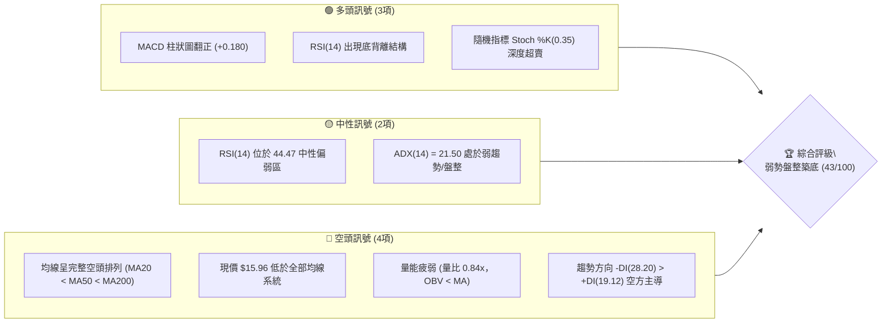
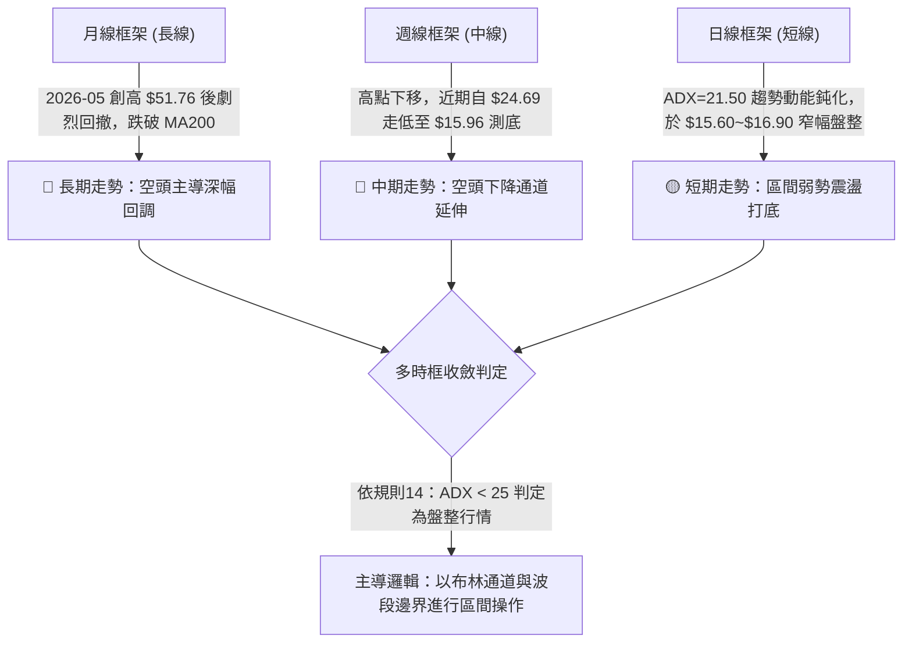
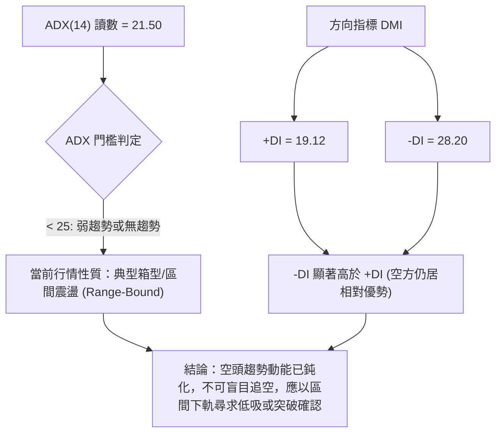
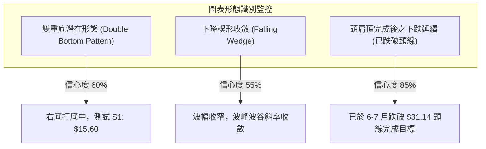
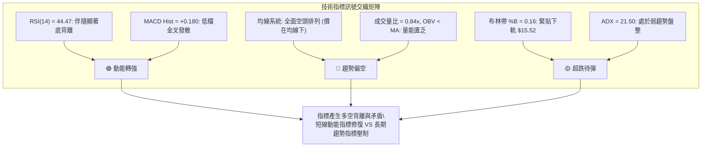
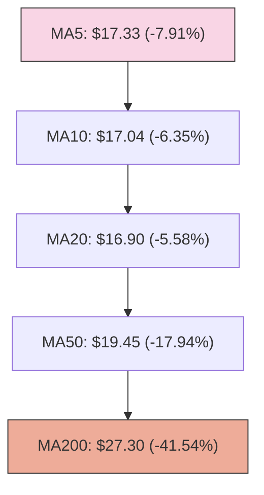
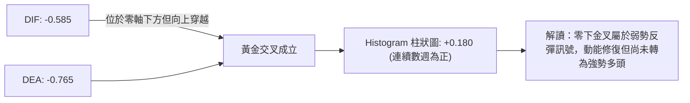
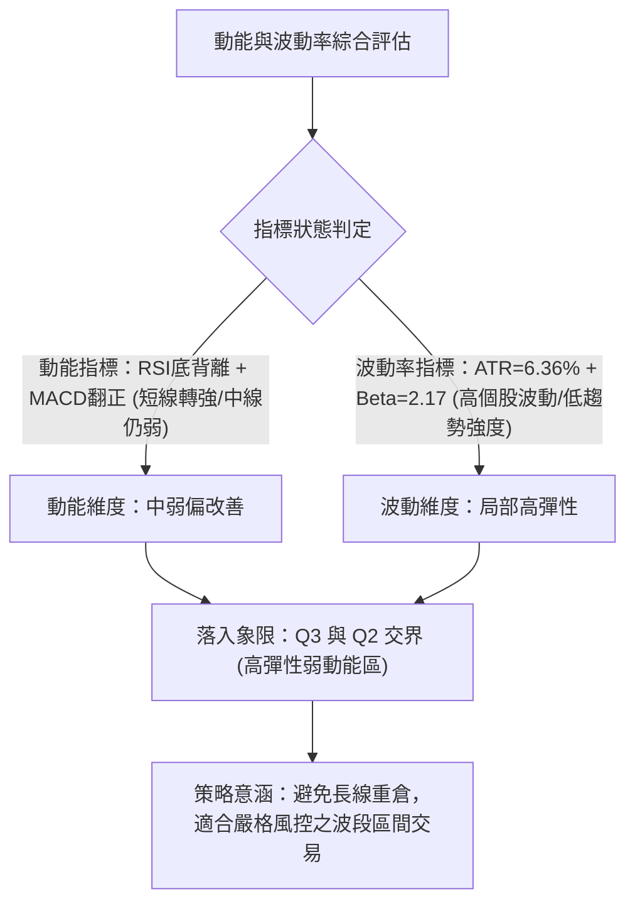
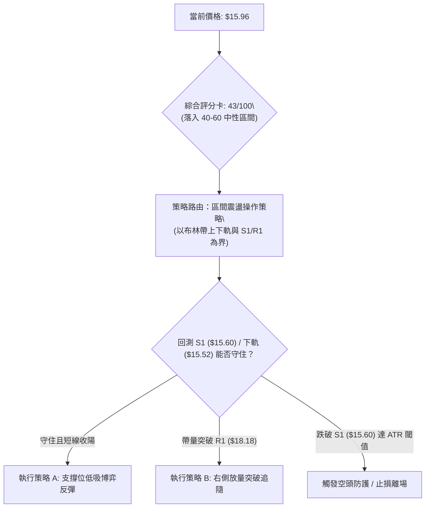
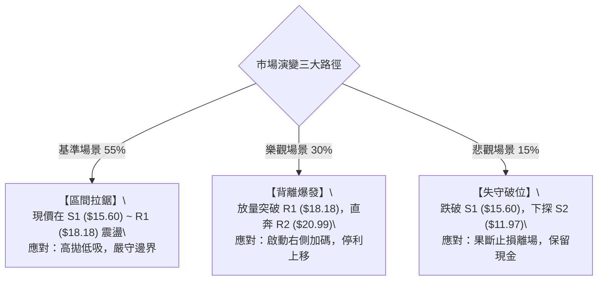

# PL 技術分析報告

> **報告日期**：2026-10-13 ｜ **語言**：繁體中文 ｜ **數據來源**：Yahoo Finance ｜ **當前價格**：$15.96

---

## 目錄

| 章節 | 內容 |
|------|------|
| [1. 技術面概覽](#1-技術面概覽) | 訊號儀表板、核心指標、評分卡 |
| [2. 趨勢分析](#2-趨勢分析) | 多時框趨勢、長中短期走勢、ADX強度 |
| [3. 圖表形態分析](#3-圖表形態分析) | 形態識別、K線組合、形態目標價 |
| [4. 支撐與阻力](#4-支撐與阻力) | 關鍵價位分布、波段聚類、斐波那契回調 |
| [5. 技術指標深度解讀](#5-技術指標深度解讀) | 均線系統、RSI背離、MACD、布林通道、OBV |
| [6. 動能與波動率](#6-動能與波動率) | 動能四象限、ATR波幅、Beta敏感度 |
| [7. 多時框架總結](#7-多時框架總結) | 時框評分矩陣、收斂規則與裁決 |
| [8. 交易策略建議](#8-交易策略建議) | 策略路由、主策略規劃、情境機率、評星 |
| [9. 風險提示與監控](#9-風險提示與監控) | 監控清單 Checklist、三行情境演變、資金管理 |
| [📋 報告總結](#-報告總結) | 總體評級與執行摘要 |

---

## 1. 技術面概覽

### 🎯 技術訊號儀表板



### 📊 核心指標速覽表

| 指標類別 | 指標名稱 | 當前數值 | 訊號 | 解讀 |
|----------|----------|----------|:----:|------|
| **價格** | 當前收盤價 | $15.96 | 🔴 | 位於 52 週區間底部 13.2% 分位，空方主導跌勢趨緩 |
| **均線** | MA20 (短天期) | $16.90 | 🔴 | 價格低於 MA20 (-5.58%)，短線反彈首道均線壓制 |
| **均線** | MA50 (中天期) | $19.45 | 🔴 | 價格低於 MA50 (-17.94%)，中期下降趨勢未扭轉 |
| **均線** | MA200 (長天期)| $27.30 | 🔴 | 價格遠低於 MA200 (-41.54%)，長期技術面處於熊市格局 |
| **動能** | RSI(14) | 44.47 | 🟢 | 數值落於中性區，但日線與價格呈現明確「底背離」訊號 |
| **動能** | MACD (12,26,9) | -0.585 / -0.765 | 🟢 | 快線位於慢線上，Histogram 為 +0.180，低檔黃金交叉 |
| **動能** | Stoch %K / %D | 0.35 / 26.81 | 🟢 | %K 進入極度超賣區，短線具備技術性抽頭反彈動能 |
| **趨勢** | ADX(14) / ±DI | 21.50 / -DI: 28.20 | 🟡 | ADX < 25 指示單邊趨勢衰竭，進入低動能區間震盪打底 |
| **通道** | 布林通道 %B | 0.16 (下軌 $15.52) | 🟡 | 價格緊貼布林下軌震盪，未跌破下軌，處於通道下緣支撐區 |
| **波動** | ATR(14) | $1.02 (6.36%) | 🟡 | 日內平均真實波幅適中，高 Beta 特性使百分比波動維持偏高 |
| **量能** | 成交量 / 20MA | 9.10M / 10.80M | 🔴 | 量比 0.84x，OBV < MA，反彈缺乏積極買盤增量推動 |

### 🏆 技術評分卡

```
╔══════════════════════════════════════════════════════════════════╗
║                   技術評分卡 — PL (2026-10-13)                   ║
╠══════════════════════════════════════════════════════════════════╣
║ 趨勢強度 (Trend)   ██████░░░░░░░░░░░░░░  30/100  🔴 空頭主導/弱盤 ║
║ 動能指標 (Momentum)███████████░░░░░░░░░  55/100  🟢 底背離+柱翻正 ║
║ 支撐穩定度 (Supp.) ██████████░░░░░░░░░░  50/100  🟡 臨近S1考驗    ║
║ 成交量配合 (Volume)███████░░░░░░░░░░░░░  35/100  🔴 量能萎縮/無買盤║
║ 形態完整度 (Patt.) █████████░░░░░░░░░░░  45/100  🟡 潛在雙底打底中║
║ 均線排列 (MA Align)████░░░░░░░░░░░░░░░░  20/100  🔴 嚴格空頭排列  ║
╠══════════════════════════════════════════════════════════════════╣
║ 綜合評分           ████████░░░░░░░░░░░░  43/100  🟡 區間震盪築底  ║
╚══════════════════════════════════════════════════════════════════╝
```

---

## 2. 趨勢分析

### 🌐 多時框趨勢分析



### 📈 長期趨勢 — 12個月走勢圖（Unicode）

```
PL 月線走勢圖（過去12個月：2025-11 至 2026-10）
價格軸 ($)
$52.00 ┤                                      ● ($51.14 峰值)
$46.00 ┤                                     / \
$40.00 ┤                                    /   \
$34.00 ┤                             ●     /     ● ($33.13)
$28.00 ┤                      ●     /     /       \
$22.00 ┤               ●     /     /     /         ● ($20.48)
$16.00 ┤              /     /     /     /           \     ● ← 現價 $15.96
$10.00 ┤ ● ($11.90)  /     /     /     /             ● ($16.39)
       └─┬──────────┬─────┬─────┬─────┬─────┬─────┬─────┬─────┬─────┬─────┬─────
       11/25      12/25 01/26 02/26 03/26 04/26 05/26 06/26 07/26 08/26 09/26 10/26
```

#### 走勢特徵分析表格

| 階段區間 | 時間區間 | 起訖價格 | 區間漲跌幅 | 主要結構與量價特徵 |
|:--------:|:--------:|:--------:|:----------:|-------------------|
| **主升推升期** | 2025-11 ~ 2026-05 | $11.90 ➔ $51.14 | **+329.7%** | 爆發性多頭主升浪，突破全部均線，量能急遽放大，創 52 週歷史高點 $51.76 |
| **高檔崩跌期** | 2026-05 ~ 2026-07 | $51.14 ➔ $20.48 | **-59.95%** | 獲利了結伴隨恐慌拋售，週線連收長陰，直接貫穿 MA20 與 MA50 支撐 |
| **次級反彈期** | 2026-07 ~ 2026-08 | $20.48 ➔ $24.69 | **+20.56%** | 跌深技術性反抽，但反彈受阻於 MA60 ($19.74 上方)，量能持續遞減 |
| **陰跌築底期** | 2026-08 ~ 2026-10 | $24.69 ➔ $15.96 | **-35.36%** | 弱勢下探，創 52 週次低波段，當前於 S1 ($15.60) 尋求支撐，ADX 降至 21.50 |

### 📊 中期趨勢（週線分析）

從近 20 週數據觀察，PL 自 2026 年 8 月中旬反彈高點 $24.69 展開新一輪下跌，至 2026-09-20 創下收盤低點 $16.42，隨後在 9 月底弱勢回升至 $17.50，最新一週（2026-10-18 當週）再度壓回至 $15.96。

```
中期週線價格波段架構示意圖：
  $24.69 (8月中波段高點) 
       \
        \──→ 下降通道中軸壓制 ($19.45 / MA50)
         \
          $17.50 (10月初反彈次高點)
               \
                $15.96 (當前收盤價，考驗前低平台)
                ───────────────────────── 支撐位 S1: $15.60
```

中期下降通道的頂部壓制線目前落在 R1 ($18.18) 與 MA20 ($16.90) 之間，中期空頭結構尚未被破壞，唯週線 MACD 柱狀圖已連續 4 週維持微幅正值（+0.180 ~ +0.291），顯示中期殺跌動能出現邊際減弱。

### ⚡ 趨勢強度評估（ADX 解讀）



#### ADX 趨勢強度狀態對照

| 數值區間 | 當前數值 | 趨勢分類 | 交易環境建議 |
|:--------:|:--------:|:--------:|--------------|
| 0 ~ 20   | —        | 極度無趨勢 | 觀望，嚴禁順勢追價 |
| **20 ~ 25** | **21.50** | **弱趨勢 / 轉入盤整** | **主要以支撐阻力邊界、布林通道操作；趨勢策略失效** |
| 25 ~ 40  | —        | 強勁單邊趨勢 | 順勢操作，拉回均線加碼 |
| 40 以上  | —        | 極端單邊 / 接近衰竭 | 提防趨勢末端消耗性行情 |

---

## 3. 圖表形態分析

### 🔍 形態識別系統



#### 形態識別與信心度評估表

| 形態名稱 | 信心度 | 判斷依據（引用數據） | 完成度 | 目標價（附精確計算式） |
|:--------:|:------:|----------------------|:------:|------------------------|
| **潛在雙重底** | 60% | 2026-09-20 收盤低點 $16.42，當前於 $15.96 測試支撐 S1 ($15.60) 形成雙低對稱 | 65% | 頸線為 10月初高點 $17.50。<br>形態高度 = $17.50 - $15.60 = $1.90<br>**破頸線目標價** = $17.50 + $1.90 = **$19.40** (吻合 MA50 $19.45) |
| **下降收斂楔形** | 55% | 8月高點 $24.69 ➔ 10月高點 $17.50，搭配 9月低點 $16.42 ➔ 10月低點 $15.96，高低點收斂且 ADX 跌破 25 | 70% | 向上突破上軌壓制線 $18.18 (R1)。<br>楔形起點回測目標 = **$20.99** (即阻力 R2) |
| **大型頭肩頂 (歷史)** | 85% | 左肩 2026-04 ($36.97)、頭部 2026-05 ($51.76)、右肩 2026-06 ($33.13)，頸線落於 $31.14 | 100% | 頸線 $31.14 - 高度 ($51.76 - $31.14 = $20.62) = **$10.52** (即 52W Low / S3，已滿足大部分跌幅) |

### 🕯️ 重要K線形態分析

| 日期 / 月份 | 收盤價 | K線形態特徵 | 技術意涵解讀 | 訊號性質 |
|:-----------:|:------:|-------------|--------------|:--------:|
| **2026-05** | $51.14 | 長上影流星陰線 | 歷史天價 $51.76 見頂，多頭動能消耗殆盡，長線反轉信號 | 🔴 強烈看空 |
| **2026-07** | $20.48 | 大陰線破位貫穿 | 連續擊穿 MA20 與 MA50，機構持倉大幅拋售，趨勢全面轉空 | 🔴 趨勢破位 |
| **2026-08** | $19.85 | 長下影紡錘線 | 探底 $19.85 後回抽，下檔初現承接買盤，但未能收復 MA20 | 🟡 多空僵持 |
| **2026-09** | $16.39 | 實體縮小陰十字 | 下跌斜率趨緩，空方拋壓明顯減弱，成交量降至低位 | 🟡 拋壓枯竭 |
| **2026-10-18週**| $15.96 | 窄幅整理小陰線 | 週波幅收縮至 ATR 附近，守在 S1 ($15.60) 上方，醞釀方向選擇 | 🟡 變盤前夕 |

### 📉 ASCII 走勢形態示意圖

```
PL 日線/週線 潛在雙底與箱體形態示意圖
價格 ($)
$18.18 ── 阻力 R1 (頸線突破觀察區) ───────────────────────────┐
         │                                                    │
$17.50 ──┼───────────● (10/04 反彈高點：雙底頸線)            │
         │          / \                                       │
$16.90 ──┼── MA20 ─/───\──────────────────────────────────────┤
         │        /     \                                     │
$15.96 ──┼───────/───────● (當前價格 $15.96)                  │
         │      /         \                                   │
$15.60 ──┴─────●           ● 潛在第二底 (當前考驗 S1 支撐) ───┘
            (09/20 低點 $16.42 / 波段支撐 S1: $15.60)
```

### 🎯 形態目標價計算

根據雙重底打底結構進行推算（若日線實體突破頸線 $17.50）：
- **基底支撐價位**：$15.60（S1 支撐位）
- **形態頸線價位**：$17.50（2026-10-04 週波段高點）
- **垂直形態高度 ($H$)**：$$\text{高度 } H = \$17.50 - \$15.60 = \$1.90$$
- **第一量度目標價 (T1)**：$$\text{頸線} + 1.0 \times H = \$17.50 + \$1.90 = \$19.40$$
  *(註：\$19.40 與中期 MA50 \$19.45 及 斐波那契 78.6% 回調位 \$19.35 高度重合，具極強技術共振)*
- **第二量度目標價 (T2)**：$$\text{頸線} + 1.82 \times H = \$17.50 + (1.82 \times \$1.90) = \$20.96 \approx \$20.99 \text{ (即阻力位 R2)}$$

---

## 4. 支撐與阻力

### 🗺️ 關鍵價位分布圖（Unicode）

```
PL 價位結構分布圖（OHLCV 聚類計算與斐波那契整合）
═════════════════════════════════════════════════════════════════
$51.76 ║██████████████████████████████║ 52W 最高點 / 斐波那契 0.0%
       ║                              ║
$27.30 ║████████████████████          ║ 長期均線 MA200 反壓
$25.53 ║████████████████████████      ║ 強阻力 R3 / 斐波那契 61.8% ($26.27)
$20.99 ║████████████████              ║ 中期波段阻力 R2
$19.45 ║██████████████████            ║ 中期均線 MA50 / 斐波那契 78.6% ($19.35)
$18.18 ║████████████████████████      ║ 關鍵短線阻力 R1 / 布林上軌 ($18.29)
$16.90 ║▓▓▓▓▓▓▓▓▓▓▓▓                  ║ 短期均線 MA20 / 布林中軌
───────╫──────────────────────────────╫─────────────────────────
$15.96 ╠══════════════════════════════╣ ◄ 當前市價 ($15.96)
───────╫──────────────────────────────╫─────────────────────────
$15.60 ║▓▓▓▓▓▓▓▓▓▓▓▓▓▓▓▓▓▓▓▓▓▓        ║ 近期波段關鍵支撐 S1
$15.52 ║▓▓▓▓▓▓▓▓▓▓▓▓▓▓▓▓              ║ 布林下軌支撐
$11.97 ║████████████████████          ║ 次級波段強支撐 S2 (2025-11 起漲點)
$10.52 ║██████████████████████████████║ 52W 最低點 / 終極強支撐 S3 (100.0%)
═════════════════════════════════════════════════════════════════
```

### 🚧 阻力位分析表

所有價位均嚴格引用 OHLCV 計算之波段高點聚類數據：

| 阻力級別 | 精確價位 | 距現價幅動 | 形成原因與技術共振 | 突破難度 | 重要性權重 |
|:--------:|:--------:|:----------:|-------------------|:--------:|:----------:|
| **R1** | **$18.18** | +13.91% | 近一年波段密集高點聚類；與日線布林通道上軌 ($18.29) 高度共振 | 🟡 中等 | ★★★★☆ |
| **R2** | **$20.99** | +31.52% | 2026年7月暴跌中繼平台下沿；若突破代表中期格局由空轉平 | 🔴 高 | ★★★☆☆ |
| **R3** | **$25.53** | +59.96% | 2026年8月中旬反彈頂部區間 ($24.69~$25.53)；臨近斐波那契 61.8% ($26.27) | 🔴 極高 | ★★★★★ |

### 🛡️ 支撐位分析表

所有價位均嚴格引用 OHLCV 計算之波段低點聚類數據：

| 支撐級別 | 精確價位 | 距現價幅動 | 形成原因與技術共振 | 守住機率 | 重要性權重 |
|:--------:|:--------:|:----------:|-------------------|:--------:|:----------:|
| **S1** | **$15.60** | -2.26% | 近一年密集低點下邊界；與布林下軌 ($15.52) 構成共振防線 | 🟡 60% | ★★★★☆ |
| **S2** | **$11.97** | -25.00% | 2025年11月大牛市主升浪起漲平台，月線級別強支撐密集區 | 🟢 80% | ★★★★☆ |
| **S3** | **$10.52** | -34.09% | 52 週最低點；斐波那契 100.0% 回調位，空頭行情終極防線 | 🟢 95% | ★★★★★ |

### 📐 斐波那契回調位分析

依據 52 週極值區間（最低點 **$10.52** ➔ 最高點 **$51.76**，波幅總空間為 **$41.24**）進行精確測算：

| 回調比例 | 對應價位 | 技術地位解讀 | 當前價格相對位置判定 |
|:--------:|:--------:|--------------|---------------------|
| **0.0%** | $51.76 | 52W 歷史極值高點 | 遠在上方 (+224.31%) |
| **23.6%**| $42.03 | 初級回調支撐轉強阻力 | 遠在上方 (+163.35%) |
| **38.2%**| $36.01 | 牛市回檔分水嶺（已跌破） | 遠在上方 (+125.63%) |
| **50.0%**| $31.14 | 歷史多空平衡中軸（頭肩頂頸線）| 遠在上方 (+95.11%) |
| **61.8%**| $26.27 | 黃金分割重要防線（已跌破轉為大阻力） | 上方重要阻力區 (+64.60%) |
| **78.6%**| $19.35 | 深度回調極限防守位（空頭當前壓制帶） | 上方反彈關鍵目標 (+21.24%) |
| **100.0%**| $10.52| 52W 最低點 / 起漲點全數回吐線 | 下方終極支撐墊 (-34.09%) |

> **位置判定結論**：現價 **$15.96** 目前處於 **78.6% 回調位 ($19.35)** 與 **100.0% 回調位 ($10.52)** 之間的「深度超跌沉澱區」。現價距離 78.6% 阻力位約有 +21.24% 的反彈空間，距離 100.0% 終極支撐約有 -34.09% 的防守縱深。

---

## 5. 技術指標深度解讀

### 🎛️ 指標訊號總覽



### 📈 移動平均線排列分析



#### 均線階梯偏離度解析表

| 均線名稱 | 當前價格 | 與現價價差 ($) | 乖離率 (%) | 均線趨勢方向 | 短期技術意涵 |
|:--------:|:--------:|:--------------:|:----------:|:------------:|--------------|
| **MA5**  | $17.33   | -$1.37         | -7.91%     | 下行 (▼)     | 超短線下壓，限制日內反彈 |
| **MA10** | $17.04   | -$1.08         | -6.35%     | 下行 (▼)     | 第一動態阻力 |
| **MA20** | $16.90   | -$0.94         | -5.58%     | 下行 (▼)     | 布林中軌，短線多空分水嶺 |
| **MA60** | $19.74   | -$3.78         | -19.16%    | 下行 (▼)     | 季線重壓區，空方防線 |
| **MA120**| $27.52   | -$11.56        | -42.01%    | 下行 (▼)     | 半年線阻力 |
| **MA200**| $27.30   | -$11.34        | -41.54%    | 下行 (▼)     | 牛熊分界線，長期趨勢嚴重偏空 |
| **MA240**| $25.03   | -$9.07         | -36.23%    | 下行 (▼)     | 年線反壓 |

當前排列狀態為最典型之**空頭發散排列**（$$P < \text{MA5} < \text{MA10} < \text{MA20} < \text{MA50} < \text{MA200}$$）。均線系統尚未出現走平跡象，任何短線反彈均將面臨層層上檔套牢賣壓解套考驗。

### 📉 RSI(14) 分析與背離判定

- **當前讀數**：**44.47**
- **區間進度條**：`[ 0 ─── 超賣(30) ─── 44.47 ─── 中軸(50) ─── 超買(70) ─── 100 ]`
  - 進度指示：`██████████████████░░░░░░░░░░░░ 44.47%`

#### ⚠️ 背離分析結論：確鑿「底背離」(Bullish Divergence)

```
價格走勢 (Price) vs RSI(14) 背離示意圖：
價格:   2026-09-13: $16.45 ─── 2026-09-20: $16.42 ─── 2026-10-18: $15.96  (創波段新低 ↘)
       ────────────────────────────────────────────────────────────
RSI:    2026-09-13: 10.0   ─── 2026-09-20: 24.4   ─── 2026-10-18: 44.5   (低點大幅墊高 ↗)
```

- **背離實證**：2026 年 9 月中旬價格於 $16.45 時，RSI 曾跌至極端超賣區 **10.0**；隨後現價跌破至 **$15.96**，但 RSI 卻大幅抬升至 **44.47**。
- **背離意義**：標準的一至二重**日/週線級別底背離**。這說明下殺動能已急遽減弱，空頭賣盤衰竭，價格處於超跌鈍化後隨時引發均值回歸反彈的技術臨界點。

### 📊 MACD(12,26,9) 訊號解讀

- **MACD 快線 (DIF)**：`-0.585`
- **Signal 慢線 (DEA)**：`-0.765`
- **MACD Histogram (柱狀圖)**：`+0.180` 🟢



雖然快慢線仍位於 0 軸下方（確認中長期空頭環境），但柱狀圖在零軸上方持續擴展至 +0.180，與 RSI 底背離互相確認，提供反彈動能的短期量化依據。

### 📦 布林通道分析 (20, 2)

```
PL 布林通道與現價相對位置圖 ($)
$18.29 ┤─────────────────────────────── 布林上軌 (Upper Band)
       │
$16.90 ┤ - - - - - - - - - - - - - - - 布林中軌 (MA20 Middle Band)
       │
$15.96 ┤                 ● 現價 ($15.96，%B = 0.16)
$15.52 ┤─────────────────────────────── 布林下軌 (Lower Band)
```

- **帶寬與位置**：通道上軌 $18.29、中軌 $16.90、下軌 $15.52。
- **指標數值 %B**：`0.16`（0 代表下軌，$0.5$ 代表中軌，$1.0$ 代表上軌）。
- **解讀**：%B 為 0.16 意味著現價緊貼下軌運行。布林帶寬未出現開口放大跡象，價格並未以「破軌」形態加速下跌，而是在下軌獲得短線支撐。根據盤整行情特徵，價格存在向下軌測試後回抽中軌 ($16.90) 的高機率空間。

### 💹 成交量分析（量價配合度）

- **最新成交量**：`9,099,200`
- **20 日均量**：`10,796,265`（量比：**0.84x**）
- **50 日均量**：`9,421,676`
- **OBV (能量潮)**：`OBV < MA`（能量潮跌破其均線）

#### 量價矛盾深度剖析
1. **縮量探底**：成交量萎縮至 9.10M（低於 20MA 及 50MA），反映市場賣壓減輕，殺跌盤接近枯竭。
2. **缺乏量能推動**：OBV 持續低於均線，說明尚未有長線機構資金大規模進場建倉吸籌。當前量價配合呈現「無量緩跌、反彈乏力」的弱平衡狀態，確認突破必須依賴量比放大至 1.5x 以上。

---

## 6. 動能與波動率

### ⚡ 動能評估四象限



#### 動能與波動四象限對照定位

| 象限 | 動能狀態 | 波動水平 | 代表特徵 | PL 當前落點與評估 |
|:----:|:--------:|:--------:|:--------:|:-----------------:|
| **Q1** | 強動能 | 低波動 | 穩定上升趨勢 | ✕ 不符合 |
| **Q2** | 弱動能 | 低波動 | 底部橫盤沉澱 | ◐ 部分符合 (ADX=21.50 震盪) |
| **Q3** | **弱動能 (中長)** | **高波動 (Beta)** | **超跌反彈 / 投機性強** | **✓ 主要落點 (高Beta彈性+背離修復)** |
| **Q4** | 弱動能 | 極高破位波動 | 恐慌崩跌主跌浪 | ✕ 已過最恐慌期 (5-7月已結束) |

### 📊 ATR 波動率分析

- **ATR(14) 絕對數值**：**$1.02**
- **ATR 相對百分比**：**6.36%**（相對於收盤價 $15.96）
- **止損與區間設置指引**：
  - **超短線安全距離 (1.0 × ATR)**：`$1.02` ➔ 止損位需設於進場點下方至少 $1.02。
  - **波段交易安全緩衝 (1.5 × ATR)**：`1.5 × $1.02 = $1.53`。
  - **進場評估**：現價 $15.96 距離支撐 S1 ($15.60) 僅 **$0.36**（約 0.35 × ATR），若跌破 S1 觸發止損，虧損幅度小於 1 個 ATR，具備極佳的下檔風險控制優勢。

### 📐 Beta 與市場相關性

- **Beta 係數**：**2.17**
- **市場特徵分析**：
  - PL 屬於極高敏感度的科技成長/航太國防標的，對標普 500 指數與大盤情緒呈現 **2.17 倍**的放大波動效應。
  - 當大盤走強時，超跌反彈的爆發力極強；若大盤承壓，則個股容易出現放大下挫。
  - 結合機構持股比率 **83.1%** 與空頭比率 **11.0% (Short Ratio 2.62)**，一旦價格突破阻力 R1 ($18.18)，極易引發高 Beta 屬性疊加空頭回補（Short Squeeze）的共振急拉行情。

---

## 7. 多時框架總結

### 📋 時框架評分表

| 時框架 | 趨勢方向 | 動能狀態 | 均線排列 | 形態特徵 | 綜合評分 | 操作建議 |
|:------:|:--------:|:--------:|:--------:|:--------:|:--------:|:--------:|
| **月線 (長)** | 🔴 強烈空頭 | 🔴 弱勢超跌 | 🔴 跌破 MA200 | 52W 高檔崩跌後尋底 | **25/100** | 長線嚴禁左側無度重倉 |
| **週線 (中)** | 🔴 下降通道 | 🟡 柱狀圖翻正 | 🔴 均線空頭排列 | 下降收斂楔形形成中 | **40/100** | 中期等待反轉結構確立 |
| **日線 (短)** | 🟡 區間震盪 | 🟢 RSI底背離 | 🔴 MA20 下方壓制 | 測試 S1 潛在雙底 | **55/100** | 依托布林下軌低吸博弈 |

### 🔲 綜合訊號矩陣

```
╔══════════════════════════════════════════════════════════════════╗
║                   多時框指標共振矩陣檢驗表                       ║
╠═════════════════════╦══════════════╦══════════════╦══════════════╣
║ 分析維度            ║ 短期 (日線)  ║ 中期 (週線)  ║ 長期 (月線)  ║
╠═════════════════════╬══════════════╬══════════════╬══════════════╣
║ 趨勢方向 (Trend)    ║ 🟡 震盪盤整  ║ 🔴 下降趨勢  ║ 🔴 熊市格局  ║
║ 動能強弱 (Momentum) ║ 🟢 低檔金叉  ║ 🟡 翻正減弱  ║ 🔴 負向沉底  ║
║ 支撐強度 (Support)  ║ 🟢 臨近 S1   ║ 🟡 考驗前低  ║ 🟢 遠高於 S3 ║
║ 均線系統 (MA Align) ║ 🔴 空頭排列  ║ 🔴 空頭排列  ║ 🔴 空頭排列  ║
║ 成交量能 (Volume)   ║ 🔴 縮量不足  ║ 🔴 量能遞減  ║ 🟡 換手完畢  ║
╚═════════════════════╩══════════════╩══════════════╩══════════════╝
```

### ⚖️ 多時框收斂結論

依據【嚴格要求 14】多時框收斂規則進行裁決：
1. **行情性質判定**：當前 ADX(14) 數值為 **21.50 (< 25)**，明確定義當前市場處於**弱趨勢 / 盤整行情 (Range-Bound Market)**，而非單邊趨勢行情。
2. **時框優先權取捨**：在 ADX < 25 的環境下，趨勢指標（MA50、MA200）的單邊指引效能鈍化，中長期空頭排列不應作為即時追空的依據；**交易主導邏輯收斂至「日線布林通道上下軌與支撐阻力區間」**。
3. **唯一收斂裁決**：**【中性觀望偏短多博弈】**。主策略方向定調為「**區間下軌防守型低吸策略**」，依託布林下軌 $15.52 及波段支撐 S1 $15.60 進行區間反彈操作，目標鎖定布林中軌與 R1，並在跌破 S1 時堅決止損。

---

## 8. 交易策略建議

### 🗺️ 策略決策流程圖



### 🧭 策略路由（依評分卡分流）

> **當前主策略方向 = 區間震盪打底操作（依綜合評分 43/100，落於 40–60 區間操作帶，以布林上下軌與波段高低點為邊界，不追單邊，等待突破確認）**

### 🎯 價格情境階梯（Price Scenarios）

價位完全嚴格引用第 4 章波段計算數據：

| 觸發條件 | 下一目標價 | 後續延伸目標 | 情境技術含義與應對 |
|:--------:|:----------:|:------------:|--------------------|
| **突破 R1 $18.18** | **R2 $20.99** | **R3 $25.53** | 突破日線布林上軌與近一年密集阻力，雙底確認，短線強烈轉多 |
| **站穩現價 $15.96** | **MA20 $16.90** | **R1 $18.18** | 依托布林下軌與 S1 進行中軌修復，維持區間箱型震盪 |
| **跌破 S1 $15.60** | **S2 $11.97** | **S3 $10.52** | 跌破一年波段低點聚類，底背離失敗，中期走勢全面轉弱並下探前低 |

### 📊 情境機率分佈

| 演變情境 | 機率估算 | 主要技術依據 |
|:--------:|:--------:|--------------|
| **區間震盪打底 (基本情境)** | **55%** | ADX=21.50 指示無趨勢，布林帶走平，成交量比 0.84x 無法支撐單邊突破 |
| **超跌向上反彈 (樂觀情境)** | **30%** | RSI(14) 確鑿底背離，MACD 柱狀圖翻正 (+0.180)，Stoch %K 深度超賣 |
| **破位再探低點 (悲觀情境)** | **15%** | 均線系統嚴格空頭排列，-DI(28.20) 仍壓制多方，量能匱乏若遭大盤拖累易破位 |

### 🟢 主策略詳情（區間操作路由）

所有數值嚴格基於數據源中之 S1/S2/R1/R2/R3 及 ATR 計算：

| 策略要素 | 策略 A（左側：S1 支撐低吸策略） | 策略 B（右側：R1 突破追隨策略） |
|----------|:-------------------------------:|:-------------------------------:|
| **操作邏輯** | 依託下軌與 S1 支撐，博弈底背離修復 | 等待放量突破 R1 阻力，確認底部確立 |
| **進場條件** | 價格回踩 S1 不破，分時出現止跌紅K | 日線收盤價有效站上 R1，量比 > 1.5x |
| **進場價格** | **$15.70** (在 S1 $15.60 略上方掛單) | **$18.25** (突破 R1 $18.18 後確認) |
| **目標價 T1** | **$16.90** (布林中軌 / MA20) | **$20.99** (阻力位 R2) |
| **目標價 T2** | **$18.18** (阻力位 R1) | **$25.53** (阻力位 R3 / MA200 帶) |
| **止損價格** | **$15.18** (S1 $15.60 - 0.41×ATR $0.42) | **$17.16** ($18.18 - 1.0×ATR $1.02) |
| **下檔風險** | $0.52 (-3.31%) | $1.09 (-5.97%) |
| **上檔報酬 (至T2)** | +$2.48 (+15.80%) | +$7.28 (+39.89%) |
| **風險報酬比 (R:R)**| **1 : 4.77** | **1 : 6.68** |
| **策略勝率評估**| **55%** | **45%** |
| **建議倉位配置**| **總資金 8% - 10%** (試探型倉位) | **總資金 12% - 15%** (右側加碼) |

### 🔴 反向風險觸發點（對沖與風控提示）

若主策略執行過程中出現下列訊號，宣告主策略失效，應立即停止做多並啟動空頭風控：
1. **破位止損點**：日線收盤價跌破 **$15.60 (S1)**，且盤中跌穿 **$15.18**（虧損超過預設 ATR 閾值）。
2. **指標破位確認**：MACD Histogram 由正翻負（跌破 0 軸），且 RSI(14) 跌破 30 重新進入單邊超賣，宣告底背離失敗。
3. **極端下行目標**：若 S1 失守，下檔第一承接目標為 **$11.97 (S2)**，終極目標為 **$10.52 (S3)**。

### ⭐ 整體訊號強度評星

```
╔══════════════════════════════════════════════════════════════════╗
║ 做多訊號強度：  ★★☆☆☆  (2.5/5 星) — 僅限超跌反彈，非趨勢轉多   ║
║ 做空訊號強度：  ★★★☆☆  (3.0/5 星) — 中長偏空，但短線動能鈍化   ║
║ 整體架構可信度：★★★☆☆  (3.5/5 星) — 區間震盪特徵明確清晰       ║
╚══════════════════════════════════════════════════════════════════╝
```

---

## 9. 風險提示與監控

### ✅ 關鍵監控指標 Checklist

```
╔══════════════════════════════════════════════════════════════════╗
║                   PL 關鍵技術風控監控清單 (Checklist)            ║
╠══════════════════════════════════════════════════════════════════╣
║ [ ] 價位防守：收盤價是否嚴格守在支撐位 S1: $15.60 之上？          ║
║ [ ] 通道監控：價格是否脫離布林下軌 $15.52 並挑戰中軌 $16.90？     ║
║ [ ] 動能維護：MACD Histogram 能否維持在零軸之上 (+0.180 以上)？  ║
║ [ ] 背離確認：RSI(14) 是否穩健站上 50 分水嶺以擺脫弱勢區？       ║
║ [ ] 量能驗證：單日成交量能否放大超越 20日均量 (10,796,265 股)？   ║
║ [ ] 均線突破：日線是否能實體收復 MA20 ($16.90) 短期生命線？       ║
╚══════════════════════════════════════════════════════════════════╝
```

### ⚠️ 風險場景分析



### 🛡️ 風險管理重要提醒

1. **高 Beta 波動風險 (Beta = 2.17)**：
   PL 波動幅度為大盤的兩倍以上，ATR 高達 6.36%。單筆交易最大虧損額必須嚴格限制在總投資組合淨值的 **1.0%** 以內。
2. **財報與估值風險**：
   公司淨利率為 -95.1%，P/B 高達 10.28，尚未實現穩定公認會計準則（GAAP）盈利。基本面估值偏高，若遭遇市場流動性收緊，容易引發殺估值拋壓。
3. **空頭部位壓力 (Short Float 11.0%)**：
   較高之做空比例意味著價格向上時可能引發軋空，但向下破位時亦會引發融券借券拋售壓制，因此嚴禁在 $15.60 破位時進行攤平加碼。

---

## 📋 報告總結

```
╔══════════════════════════════════════════════════════════════════╗
║                   PL 技術分析報告總結 (Executive Summary)        ║
╠══════════════════════════════════════════════════════════════════╣
║ 報告日期：2026-10-13                                             ║
║ 當前價格：$15.96                                                 ║
║ 分析評級：⚖️ 弱勢區間震盪築底 (評分: 43/100)                     ║
║                                                                  ║
║ 關鍵結論：                                                       ║
║ ├─ 長期趨勢：🔴 熊市格局 (自 $51.76 深度回調，處於 MA200 下方)   ║
║ ├─ 中期趨勢：🔴 下降通道延伸，唯週線級別賣壓出現邊際遞減        ║
║ ├─ 短期趨勢：🟡 區間打底 (ADX=21.50 指示盤整，布林下軌獲支撐)    ║
║ ├─ 動能結構：🟢 RSI 底背離確立，MACD 柱狀圖翻正 (+0.180)         ║
║ ├─ 關鍵支撐：S1: $15.60 ｜ S2: $11.97 ｜ S3: $10.52              ║
║ ├─ 關鍵阻力：R1: $18.18 ｜ R2: $20.99 ｜ R3: $25.53              ║
║ └─ 機構共識：11 位分析師評級為 Buy，平均目標價 $31.73            ║
║                                                                  ║
║ 最優策略組合：                                                   ║
║ 1. 🥇 最佳機會：策略 A (S1 $15.70 低吸，止損 $15.18，R:R = 1:4.8)║
║ 2. 🥈 次選機會：策略 B (突破 R1 $18.25 追多，看至 R2 $20.99)     ║
║ 3. 🥉 保守選擇：空倉觀望，靜待日線實體站穩 MA20 ($16.90) 再行定奪║
╚══════════════════════════════════════════════════════════════════╝
```

---

> ⚠️ **免責聲明**：本報告為 AI 自動生成之技術分析，所有數據及估算均基於提供的歷史價格資訊。本報告**僅供研究與學術參考**，**不構成任何投資建議**。投資有風險，入市需謹慎。

---

*報告生成時間：2026-10-13 ｜ 數據來源：Yahoo Finance ｜ 分析框架：多時框技術分析*