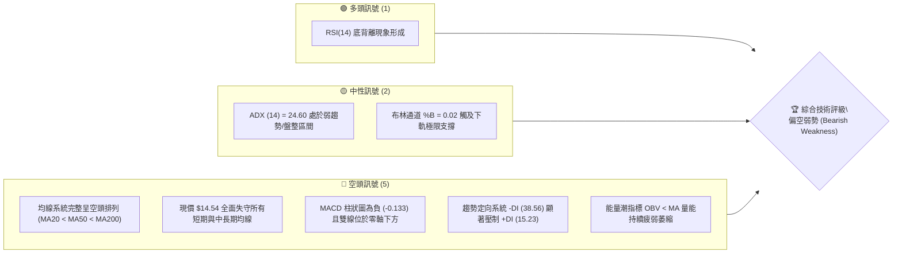
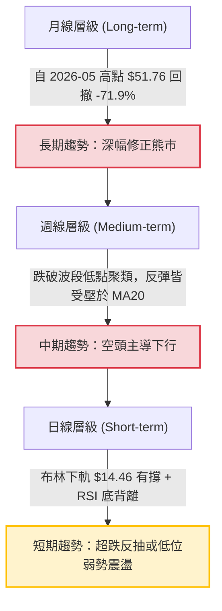
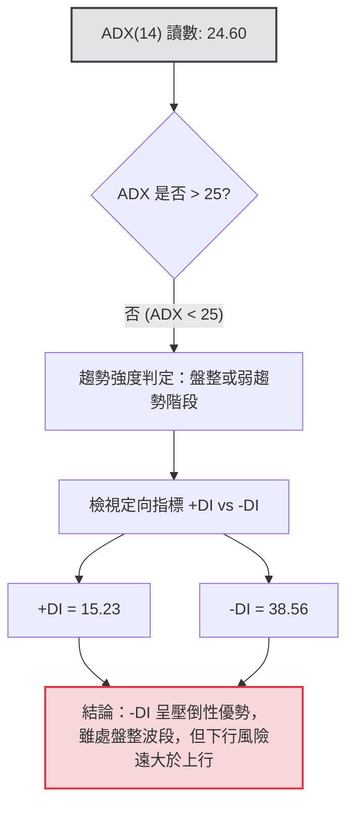
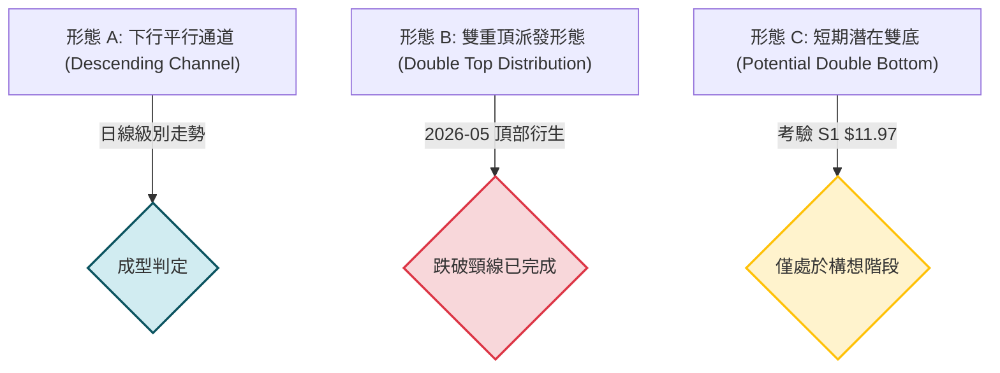
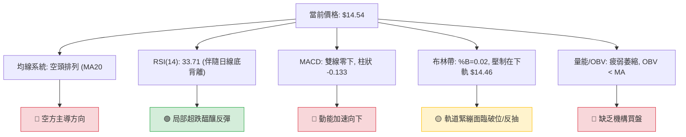
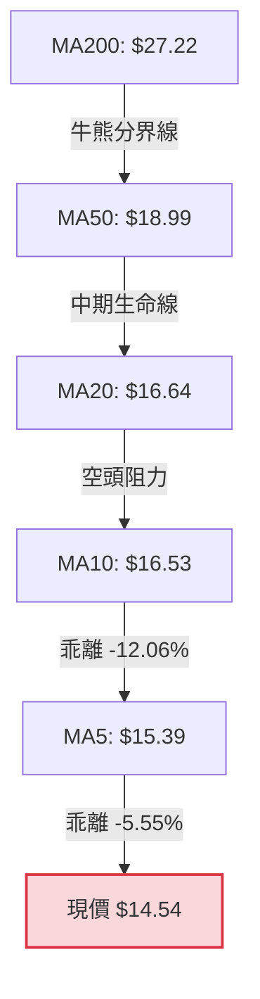
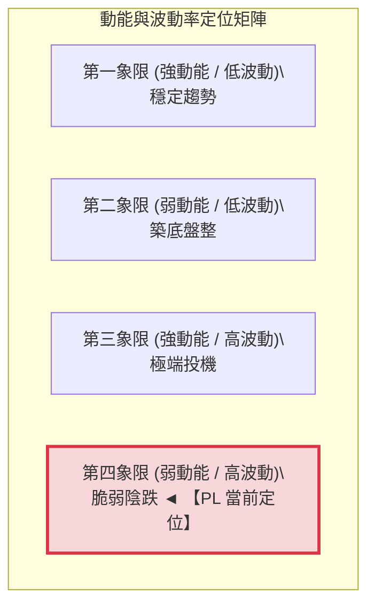
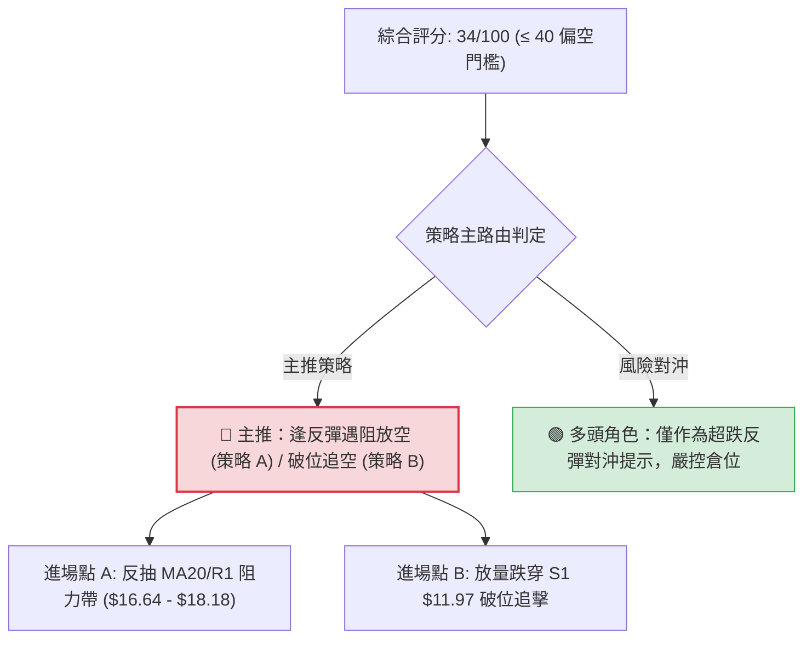
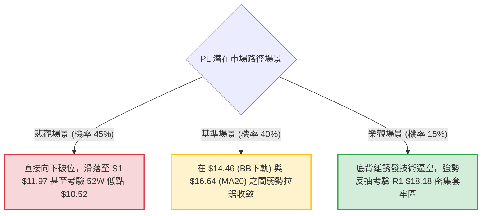

# PL 技術分析報告

> **報告日期**：2026-10-15 ｜ **語言**：繁體中文 ｜ **數據來源**：Yahoo Finance ｜ **當前價格**：$14.54

---

## 目錄

| 章節 | 內容 |
|------|------|
| [1. 技術面概覽](#1-技術面概覽) | 訊號儀表板、核心指標、評分卡 |
| [2. 趨勢分析](#2-趨勢分析) | 多時框趨勢、長中短期走勢 |
| [3. 圖表形態分析](#3-圖表形態分析) | 形態識別、K線組合、目標價 |
| [4. 支撐與阻力](#4-支撐與阻力) | 關鍵價位、斐波那契回調 |
| [5. 技術指標深度解讀](#5-技術指標深度解讀) | MA/RSI/MACD/布林/成交量 |
| [6. 動能與波動率](#6-動能與波動率) | 動能評估、ATR、Beta |
| [7. 多時框架總結](#7-多時框架總結) | 時框架評分矩陣與收斂 |
| [8. 交易策略建議](#8-交易策略建議) | 多空策略、風險報酬比 |
| [9. 風險提示與監控](#9-風險提示與監控) | 監控指標、風險場景 |
| [10. 報告總結](#10-報告總結) | 核心結論與策略彙整 |

---

## 1. 技術面概覽

### 🎯 技術訊號儀表板



### 📊 核心指標速覽表

| 指標類別 | 指標名稱 | 當前數值 | 訊號 | 解讀 |
|----------|----------|----------|------|------|
| **價格結構** | 當前價格 | $14.54 | 🔴 | 位於 52 週價格區間之 9.7% 分位，處於極度弱勢區 |
| **均線系統** | MA20 | $16.64 | 🔴 | 現價低於 MA20 達 -12.63%，短期下行斜率陡峭 |
| **均線系統** | MA50 | $18.99 | 🔴 | 現價低於 MA50 達 -23.43%，中期生命線全面失守 |
| **均線系統** | MA200 | $27.22 | 🔴 | 現價低於 MA200 達 -46.58%，長期牛熊分界線遙不可及 |
| **動能指標** | RSI(14) | 33.71 | 🟡 | 逼近超賣界限（30），日線出現明顯底背離結構 |
| **動能指標** | MACD (12,26,9) | -0.937 / -0.805 | 🔴 | 快慢線均在零軸下方運行，柱狀圖負值放大 (-0.133) |
| **趨勢強度** | ADX / DMI | 24.60 | 🔴 | ADX < 25 屬震盪整理，但 -DI (38.56) 呈壓倒性主導 |
| **通道帶寬** | 布林通道 | 下軌 $14.46 | 🟡 | %B 為 0.02，價格貼緊下軌運行，超跌隨時引發抽頭 |
| **量能系統** | 成交量 / OBV | 10.55M (0.96x) | 🔴 | 低於 20 日均量，OBV 低於均線，資金追價動能匱乏 |
| **波動風險** | ATR(14) | $1.02 | 🔴 | 日波幅佔股價比例高達 7.04%，微觀波動風險極高 |

### 🏆 技術評分卡

```
╔══════════════════════════════════════════════════════════════════╗
║               技術評分卡 — PL (Planet Labs PBC)                   ║
╠══════════════════════════════════════════════════════════════════╣
║ 評估維度         評分進度條                分值    狀態          ║
║ 趨勢方向強度     █████░░░░░░░░░░░░░░░      25/100  🔴 極度看空   ║
║ 動能擺動指標     ████████░░░░░░░░░░░░      38/100  🔴 弱勢醞釀   ║
║ 支撐防守強度     █████████░░░░░░░░░░░      45/100  🟡 考驗前低   ║
║ 成交量能配合     ███████░░░░░░░░░░░░░      35/100  🔴 量能退潮   ║
║ 形態結構完整     ████████░░░░░░░░░░░░      40/100  🟡 下行通道   ║
║ 均線排列格局     ████░░░░░░░░░░░░░░░░      20/100  🔴 典型空頭   ║
╠══════════════════════════════════════════════════════════════════╣
║ 綜合技術得分     ███████░░░░░░░░░░░░░      34/100  🔴 偏空弱勢   ║
╚══════════════════════════════════════════════════════════════════╝
```

---

## 2. 趨勢分析

### 🌐 多時框趨勢分析



### 📈 長期趨勢 — 12個月走勢圖（Unicode）

以下為 Planet Labs (PL) 過去 12 個月（2025-11 至 2026-10）之月線收盤走勢：

```
PL 月線走勢圖（過去12個月）
價格軸 ($)
$55 ┤                                  ● $51.14 (2026-05 頂部波段高點 $51.76)
$50 ┤                                 ╱ ╲
$45 ┤                                ╱   ╲
$40 ┤                               ╱     ╲
$35 ┤                         ● $36.97     ╲
$30 ┤                   ● $27.95            ● $33.13 (2026-06 破位長黑)
$25 ┤             ● $24.97                  │
$20 ┤       ● $19.72                        ● $20.48 ──● $19.85
$15 ┤ ● $11.90                                      ╲    ● $16.39
$10 ┤                                                ╲      ● $14.54 (現價)
    └─┬───────┬───────┬───────┬───────┬───────┬───────┬───────┬───────┬───────
    25-11   25-12   26-01   26-03   26-04   26-05   26-06   26-07   26-09   26-10
```

#### 長期走勢特徵分析表

| 階段區間 | 起止時間 | 價格區間 | 累計漲跌幅 | 主要技術特徵 |
|----------|----------|----------|------------|--------------|
| **瘋狂主升浪** | 2025-11 ～ 2026-05 | $11.90 → $51.14 | +329.7% | 量價齊揚，連續大陽線突破所有長期阻力，月線高點達 $51.76 |
| **高位崩解段** | 2026-05 ～ 2026-07 | $51.14 → $20.48 | -59.95% | 出現斷崖式殺跌，跌破 38.2% 與 50% 斐波那契回調位，多頭防線全面瓦解 |
| **陰跌尋底段** | 2026-07 ～ 2026-10 | $20.48 → $14.54 | -29.00% | 均線形成空頭排列，反彈波幅持續收斂，現價回落至近一年低點邊緣 |

### 📊 中期趨勢（週線分析）

從近 20 週數據觀察，PL 呈現典型的「低點持續下移、反彈不過前高」的空頭軌跡：
1. **反彈阻力密集化**：8 月中旬曾反彈至 $24.69，但迅速受制於下降的 MA50，隨後在 9 月下旬反抽至 $17.50 即宣告乏力。
2. **量能萎縮特徵**：6 月份週成交量維持在 8,900 萬至 1 億股之上，而進入 10 月後已萎縮至 4,000 萬至 5,900 萬股，顯示高位套牢籌碼沉重，機構資金抄底意願低落。

```
週線級別價格壓力與支撐示意圖：
========================================================================
[阻力 R3]  $20.99 ──────────────────────────── 8月上旬盤整平台壓力帶
               ▲
[阻力 R2]  $18.81 ──────────────────────────── 布林上軌 / 9月反彈頸線區
               ▲
[阻力 R1]  $18.18 ──────────────────────────── MA50 ($18.99) 下方反壓密集帶
               ▲
[現  價]  $14.54  ◄── (布林下軌 $14.46 弱支撐)
               ▼
[支撐 S1]  $11.97 ──────────────────────────── 2025-11 起漲點支撐
               ▼
[支撐 S2]  $10.52 ──────────────────────────── 52週絕對最低價 (100%回調位)
========================================================================
```

### ⚡ 趨勢強度評估（ADX 解讀）



#### DMI / ADX 趨勢強度對照

| 指標變量 | 數值 | 臨界標準 | 狀態說明 |
|----------|------|----------|----------|
| **ADX (14)** | 24.60 | 25.00 | 小於 25 代表單邊爆發力不足，多空進入局部拉鋸或陰跌盤整 |
| **+DI (14)** | 15.23 | 20.00 | 多頭進攻動能極端匱乏，無力發動有效攻擊 |
| **-DI (14)** | 38.56 | 25.00 | 空方壓制力道高居不下，盤面由空方完全掌控主導權 |
| **DI 差值** | -23.33 | 0.00 | 嚴重負差值，表明反彈皆屬弱勢修正，非趨勢反轉 |

---

## 3. 圖表形態分析

### 🔍 形態識別系統



#### 幾何形態信心度與目標價評估

| 形態名稱 | 信心度 | 判斷依據（嚴格引用數據） | 完成度 | 目標價（附嚴謹計算式） |
|----------|--------|--------------------------|--------|------------------------|
| **下行平行通道** | 80% | 價格受制於 MA20 ($16.64) 與 MA50 ($18.99)，下軌沿布林下軌 $14.46 移動 | 85% | 由通道上軌 $18.81 跌破推算：$18.81 - ($18.81 - $14.46) = **$10.11**（接近 S2 $10.52） |
| **巨型雙重頂** | 90% | 52W 高點 $51.76 見頂後，於 6 月跌破頸線 $33.13 | 100% | 頸線 $33.13 - 形態高度 ($51.76 - $33.13 = $18.63) = **$14.50**（現價已完全消化達標） |
| **短期反轉雙底** | 25% | 目前無兩次築底確認，僅出現 RSI 單一底背離訊號 | 15% | **數據不足，信心度低於 50%，僅做指標超跌解讀，不預設雙底目標價** |

### 🕯️ 重要K線形態分析

| 週期/時間 | 收盤價 | K線組合形態 | 技術含義解讀 | 多空訊號 |
|-----------|--------|-------------|--------------|----------|
| **2026-05** | $51.14 | 長上影流星線 (Shooting Star) | 衝擊 52W 高點 $51.76 未果，多頭力竭，極度危險之拋售訊號 | 🔴 強烈看空 |
| **2026-06** | $33.13 | 大陰吞沒破位 (Bearish Engulfing) | 月跌幅 -35.2%，帶巨量下破 MA20，確立中期頂部確立 | 🔴 空頭確認 |
| **2026-08** | $19.85 | 弱勢十字孕線 (Harami Cross) | 跌幅暫緩，多空在 $20 關口爭奪，但反彈未能越過前高 | 🟡 中性觀望 |
| **2026-09** | $16.39 | 光腳中陰線 (Bearish Candle) | 實體下破 78.6% 斐波那契回調位 $19.35，空頭加速探底 | 🔴 看空延續 |
| **2026-10-18**| $14.54 | 帶下影弱陰線 (Weekly Candle) | 測試布林下軌 $14.46，下影線微幅抗跌，但仍受壓於 MA5 ($15.39) | 🟡 止跌待確認 |

### 📉 ASCII 走勢形態示意圖

```
PL 日線級別下行通道結構示意：
========================================================================
$19.34 (MA60) ─────┐
                   ▼ [通道上軌阻力線]
$18.81 (R2) ───────╲────────● (反彈高點 $17.50)
                    ╲        ╲
$16.64 (MA20) ───────╲────────╲────────● (近期反抽高點 $17.18)
                      ╲        ╲        ╲
$14.54 (現價) ─────────╲────────╲────────● ◄── [貼著布林下軌滑落]
                        ╲        ╲        ╲
$14.46 (BB下軌) ─────────●────────●────────● ◄── [通道下軌支撐線]
                                  ╲
$11.97 (S1) ───────────────────────● ◄── [通道向下破位後第一測幅支撐]
========================================================================
```

---

## 4. 支撐與阻力

### 🗺️ 關鍵價位分布圖（Unicode）

```
PL 價位結構分布圖（嚴格依據 OHLCV 歷史計算聚類）
══════════════════════════════════════════════════════════════════
$20.99 ║████████████████████████║ 強波段阻力 R3 (8月震盪平台整理區間)
$18.81 ║████████████████████    ║ 關鍵形態阻力 R2 (布林上軌與9月高點)
$18.18 ║████████████████████████║ 近端強壓 R1 (MA50與波段高點共振帶)
───────╫────────────────────────╢
$14.54 ╠════════════════════════╣ ◄── 現價（布林下軌 $14.46 處）
───────╫────────────────────────╢
$11.97 ║▓▓▓▓▓▓▓▓▓▓▓▓▓▓▓▓        ║ 關鍵防守支撐 S1 (2025-11 波段起漲點)
$10.52 ║████████████████████████║ 核心歷史底線 S2 (52週最低價/100%回調)
══════════════════════════════════════════════════════════════════
```

### 🚧 阻力位分析表

| 阻力級別 | 準確價位 | 形成技術原因（數據聚類） | 突破難度 | 重要性權重 |
|----------|----------|--------------------------|----------|------------|
| **R1** | **$18.18** | 近一年波段高點密集區，疊加 MA50 ($18.99) 下壓趨勢阻力 | 🔴 極高 | ★★★★☆ |
| **R2** | **$18.81** | 日線布林通道上軌 ($18.82) 兼 10 月初反彈反壓高點 | 🔴 極高 | ★★★★☆ |
| **R3** | **$20.99** | 2026 年 7-8 月巨量換手成交密集區底部，籌碼解套斷層線 | 🔴 極難突破 | ★★★★★ |

### 🛡️ 支撐位分析表

| 支撐級別 | 準確價位 | 形成技術原因（數據聚類） | 守住機率 | 重要性權重 |
|----------|----------|--------------------------|----------|------------|
| **S1** | **$11.97** | 近一年波段低點聚類，2025 年 11 月主升浪發動點 | 🟡 55% | ★★★★☆ |
| **S2** | **$10.52** | 52 週最低價，一年期全週期回調 100% 終極技術底線 | 🟢 75% | ★★★★★ |

### 📐 斐波那契回調位分析

依據 52 週最高點 **$51.76** 至 52 週最低點 **$10.52** 區間（波幅達 $41.24）進行黃金分割回調測算：

```
斐波那契回調層級分布與現價落點：
0.0%  (52W High) ────────── $51.76
23.6%            ────────── $42.03
38.2%            ────────── $36.01
50.0%            ────────── $31.14
61.8% (黃金分割) ────────── $26.27
78.6% (深度回撤) ────────── $19.35
─── 現價落點區間 ────────── $14.54 (處於 78.6% 與 100.0% 之間)
100.0% (52W Low) ────────── $10.52
```

- **回調區間解讀**：現價 $14.54 已經徹底跌破 78.6%（$19.35）之最後多頭堡壘，顯示該股已經由常規回調轉變為「全面深幅熊市修正」。
- **下行空間限制**：目前價格運行於 $19.35 至 $10.52 之間，距離 100% 終極回調位 $10.52 僅剩 -$4.02（-27.65%）空間。在此極端回調區域內，空頭盈虧比逐漸遞減，但未出現實質築底形態前，不宜輕易預設支撐。

---

## 5. 技術指標深度解讀

### 🎛️ 指標訊號總覽



### 📈 移動平均線排列分析



均線呈現罕見的**完整空頭排列**（MA5 < MA10 < MA20 < MA60 < MA120 < MA200）。短期均線 MA5 ($15.39) 與 MA10 ($16.53) 下墜軌跡陡峭，任何微型反彈觸及 MA20 ($16.64) 皆成為機構與波段客之強烈出脫點。MA200 遠在 $27.22，顯示長期趨勢已被徹底破壞。

### 📉 RSI(14) 分析與背離判斷

- **當前讀數**：**33.71**
  ```
  超賣區 (0-30)          中性區 (30-70)                 超買區 (70-100)
  [████████████░░░░░░░░░░░░░░░░░░░░░░░░░░░░░░░░░░░░░░░░] 33.71%
  ```
- **底背離現象（Bullish Divergence）深度研判**：
  技術指標快照明確警示「⚠️ 底背離」。回溯近 5 週數據，2026-09-13 週收盤 $16.45 時 RSI 探至極端值 10.0；隨後價格在 2026-10-18 跌至新低 **$14.54**，但週 RSI 卻維持在 **33.71**。
  - **結論**：指標未隨價格破底而創出新低，說明**空頭殺跌力道正在衰退，邊際拋壓減輕**。這通常預示下行空間受限，隨時可能引發技術性反抽，但不能單憑此點斷定大趨勢反轉。

### 📊 MACD (12,26,9) 訊號解讀

- **MACD 快線**：-0.937
- **Signal 慢線**：-0.805
- **MACD Histogram 柱狀圖**：-0.133

```
MACD 柱狀動能示意：
  零軸線 ──────────────────────────────────────────────────────────
         │
         │ -0.133 (負動能微幅擴大)
         ▼ ▌▌▌▌▌▌▌▌▌▌
           快線 (-0.937) < 慢線 (-0.805)
```
MACD 雙線深陷於零軸下方運行，柱狀圖在連續三週小幅翻紅後於本週再度翻負 (-0.133)，顯示多頭在 $17.50 附近的抵抗宣告瓦解，空方重新取得壓制性動能。

### 📦 布林通道分析

```
布林通道當前運行態勢 ($14.46 ～ $18.82)：
══════════════════════════════════════════════════════════════════
$18.82 ───────────────────────────────────── BB 上軌
        │
$16.64 ───────────────────────────────────── BB 中軌 (MA20)
        │
$14.54 ───────────────────● 現價 (BB %B = 0.02)
$14.46 ───────────────────────────────────── BB 下軌 (極限測試)
══════════════════════════════════════════════════════════════════
```
- **帶寬與位置特徵**：布林通道上下軌間距為 $4.36，處於相對收斂後的下軌開口狀態。%B 數值僅為 **0.02**，顯示價格已經貼死在下軌線（$14.46）運行。
- **技術意義**：在盤整行情（ADX < 25）中，%B 跌破 0.05 往往形成短線「超跌下軌錨定」，若下週不能帶量跳空跌破下軌，價格極高機率會朝 BB 中軌 **$16.64** 展開回歸性抽抽。

### 💹 成交量分析（量價配合度）

- **最新成交量**：10,546,984 股
- **20 日均量**：10,966,824 股（量比 0.96x，呈溫和萎縮）
- **50 日均量**：9,691,942 股
- **OBV 趨勢**：**OBV < MA**。能量潮指標持續低於其移動平均線，且整體下行通道內未出現爆量承接棒（Capitulation Volume），這意味著當前的陰跌並非主力恐慌出清的尾聲，而是「無量陰跌」，缺乏大型機構入場接盤的跡象。

---

## 6. 動能與波動率

### ⚡ 動能評估四象限



#### 四象限特徵定位表

| 象限代號 | 動能維度 | 波動維度 | 典型市場特徵 | 當前標的狀態匹配度 |
|----------|----------|----------|--------------|--------------------|
| **Q1** | 強動能 | 低波動 | 機構鎖倉，單邊緩步推升 | 否 |
| **Q2** | 弱動能 | 低波動 | 縮量盤整，底部波瀾不驚 | 否 |
| **Q3** | 強動能 | 高波動 | 突破爆發，多空激烈搏殺 | 否 |
| **Q4 (當前)** | **弱動能 (-DI 主導)** | **高波動 (ATR 7.04%)** | **走勢脆弱，流動性差，易生下殺** | **✓ 符合 PL 表現 (極高風險區)** |

### 📊 ATR 波動率分析與止損測算

- **ATR(14) 絕對值**：**$1.02**
- **ATR 佔比 (ATR/Price)**：**7.04%**（高波動性資產，常規股票多在 2%～4%）
- **止損距離建議**：
  - 激進交易者：1.0 × ATR = **$1.02**
  - 保守波段者：1.5 × ATR = **$1.53**
  - 中期持倉者：2.0 × ATR = **$2.04**

因每日正常雜訊波幅即達 $1.02，任何低於 $1.00 的緊密止損極易被市場雜訊無效觸發。

### 📐 Beta 與市場相關性

- **Beta 係數**：**2.17**
- **市場特徵解讀**：PL 屬於「極高彈性（High-Beta）」工業/航太科技股。當標普 500 指數波動 1.0% 時，該股理論平均波動高達 2.17%。在高 Beta 與空頭趨勢疊加的背景下，市場任何系統性回調皆會對 PL 造成加倍的下行殺傷力。

---

## 7. 多時框架總結

### 📋 時框架評分表

| 時框架 | 趨勢方向 | 動能狀態 | 均線排列 | 核心形態識別 | 綜合評分 | 戰略建議 |
|--------|----------|----------|----------|--------------|----------|----------|
| **日線 (Daily)** | 偏空震盪 | 底背離醞釀 | 完全空頭排列 | 布林下軌支撐測試 | 42/100 🟡 | 嚴禁追空，等待反彈高空 |
| **週線 (Weekly)** | 空頭主導 | 負動能再起 | MA20 壓制向下 | 旗形跌破後陰跌 | 32/100 🔴 | 主導時框，順勢逢高做空 |
| **月線 (Monthly)**| 深度修正 | 自高點暴跌 | 跌破多頭防線 | 見頂流星線後破位 | 28/100 🔴 | 遠未到底部反轉階段 |

### 🔲 綜合訊號矩陣

```
訊號維度對照矩陣：
┌─────────────────┬──────────┬──────────┬──────────┐
│ 指標 / 週期     │ 日線層級 │ 週線層級 │ 月線層級 │
├─────────────────┼──────────┼──────────┼──────────┤
│ 均線趨勢 (MA)   │  🔴 看空 │  🔴 看空 │  🔴 看空 │
│ 擺動指標 (RSI)  │  🟢 背離 │  🟡 中性 │  🔴 弱勢 │
│ 趨向動能 (MACD) │  🔴 看空 │  🔴 看空 │  🔴 看空 │
│ 通道邊界 (BB)   │  🟡 觸底 │  🔴 擴張 │  🔴 走平 │
│ 資金成交量 (OBV)│  🔴 萎縮 │  🔴 疲軟 │  🔴 退潮 │
└─────────────────┴──────────┴──────────┴──────────┘
```

### ⚖️ 多時框收斂結論

依據多時框收斂規則（嚴格要求 14）：
1. **行情性質判定**：當前 ADX(14) 為 **24.60**（< 25），符合**盤整行情（Consolidation）**與弱趨勢標準；然而 -DI (38.56) 呈壓倒性優勢，且中期均線（週線 MA20、MA50）維持死叉向下擴張。
2. **多時框衝突收斂**：日線級別雖出現「RSI 底背離」與「布林下軌 $14.46 支撐」，但週線與月線之宏觀空頭結構完全未被破壞。依收斂規則，**以中長期空頭方向為主導，日線的超跌訊號僅能視為「空頭行情的技術性反抽」，而非反轉進場信號**。
3. **唯一最終方向**：**🔴 偏空弱勢（Bearish Bias）**。總體戰略鎖定「反彈遭遇均線阻力時逢高放空」，不進行逆勢抄底。

---

## 8. 交易策略建議

### 🗺️ 策略決策流程圖



### 🧭 策略路由

**當前主策略方向 = 🔴 主推空頭策略（依技術評分卡綜合得分 34/100 判定）**

由於綜合評分低於 40 分臨界點，多頭訊號不具備建立趨勢性多單的資格。交易主軸為逢反彈建立空單，或在關鍵支撐失守時順勢推進。

### 🎯 價格情境階梯（Price Scenarios）

以當前價格 **$14.54** 為基準，嚴格引用第 4 章計算之關鍵價位構建階梯：

| 觸發條件 | 下一目標價 | 後續延伸目標 | 情境含義解讀 |
|----------|------------|--------------|--------------|
| **強勢突破 R1 $18.18** | R2 $18.81 | R3 $20.99 | 短線反抽演變為中期反彈，空頭必須停損離場 |
| **弱勢反彈承壓 $16.64** | 現價 $14.54 | S1 $11.97 | 受制於 MA20 中軌，回歸弱勢陰跌軌道 |
| **跌破下軌現價區間** | S1 $11.97 | S2 $10.52 | 延續下行通道，向下尋求 52 週最低點支撐 |

### 📊 情境機率分佈

| 情境劇本 | 發生機率 | 主要技術依據 |
|----------|----------|--------------|
| **反彈受阻後再探底** | **55%** | 均線空頭排列陡峭，MACD 負動能未消，-DI 高達 38.56，反抽難越 MA20 |
| **低位區間震盪整理** | **30%** | ADX < 25 表明趨勢減速，RSI 底背離抑制短期暴跌，布林下軌提供緩衝 |
| **強勢突破反轉向上** | **15%** | 機構成交量嚴重不足 (OBV < MA)，上方套牢沉重，反轉機率極低 |

### 🔴 主策略詳情（空頭主導策略）

| 策略要素 | 策略 A：反彈逢高放空（優選策略） | 策略 B：跌破支撐追空（突破策略） |
|----------|----------------------------------|----------------------------------|
| **策略類型** | 順勢逆微波放空 (Pullback Short) | 關鍵支撐破位放空 (Breakdown Short)|
| **進場條件** | 股價弱勢反彈至 MA20 ($16.64) 附近出現上影線滯漲 | 帶量長黑實體收盤跌破關鍵支撐 S1 ($11.97) |
| **進場價格** | **$16.64** (精確錨定 MA20 / 布林中軌) | **$11.97** (精確錨定 S1 支撐位) |
| **目標價 T1** | **$14.54** (現價/布林下軌位置) | **$10.52** (52W 最低價 / S2 支撐) |
| **目標價 T2** | **$11.97** (近一年波段起漲支撐 S1) | **$10.11** (由通道形態推算目標) |
| **止損價格** | **$18.18** (向上突破關鍵阻力 R1 止損) | **$13.00** (以 S1 加上 1.0×ATR $1.02 測算) |
| **風險報酬比** | **1 : 3.03** [(16.64-11.97)/(18.18-16.64)] | **1 : 1.41** [(11.97-10.52)/(13.00-11.97)] |
| **成功機率** | **65%** | **50%** |
| **建議倉位** | **8% ～ 10%** 總投資組合權重 | **4% ～ 5%** 總投資組合權重 |

### 🟢 反向風險觸發點（多頭對沖提示）

若出現以下極端條件，主推空頭策略即刻失效，空單必須無條件止損，激進型交易者可轉為超跌短多操作：
1. **價位觸發**：日線收盤價強勢帶量站上 **$18.18 (R1)**，代表 50 日均線被有效收復。
2. **指標確認**：日線 MACD 出現零軸下方的黃金交叉，且 RSI 突破 50 中軸確立反轉。
3. **對沖操作**：此時可短線試多，目標上看 R2 **$18.81** 及 R3 **$20.99**，嚴格止損置於 **$16.64**。

### ⭐ 整體訊號強度評星

```
做多訊號強度：★☆☆☆☆  (1/5星 — 僅存日線底背離與下軌超跌，無形態支持)
做空訊號強度：★★★★☆  (4/5星 — 均線空頭排列完備，-DI 主導，中長期趨勢疲軟)
整體可信度：  ★★★★☆  (4/5星 — 指標共振程度高，多時框指向統一)
```

---

## 9. 風險提示與監控

### ✅ 關鍵監控指標 Checklist

```
╔══════════════════════════════════════════════════════════════════╗
║               PL 每日交易關鍵監控檢查清單 (Checklist)            ║
╠══════════════════════════════════════════════════════════════════╣
║ [ ] 價格是否跌破布林下軌 $14.46？ (若持續貼軌跌破，為空頭崩解訊號)║
║ [ ] 日成交量是否放大至 50 日均量 (9.69M) 之 1.5 倍以上？         ║
║ [ ] RSI(14) 底背離是否失守？ (若 RSI 跌破 30，則底背離失效)     ║
║ [ ] 空頭主導指標 -DI 是否回落至 30 以下？                         ║
║ [ ] 價格能否有效收復 MA5 ($15.39) 短期防守線？                  ║
║ [ ] 融券餘額比例 (Short % Float = 11.0%) 是否出現擠壓軋空？     ║
╚══════════════════════════════════════════════════════════════════╝
```

### ⚠️ 風險場景分析



### 🛡️ 風險管理重要提醒

1. **高 Beta 波動懲罰**：PL 的 Beta 達 **2.17**，且日波幅 ATR 高達 **$1.02**（7.04%）。在高波動標的物中建立任何單向部位，必須將單筆交易所承擔的最大帳戶風險嚴格限制在總資產之 **1.0% ～ 1.5%** 以內。
2. **空頭擠壓（Short Squeeze）防範**：目前該股 Short Float 達 **11.0%**，Short Ratio 為 2.62。若市場出現突發行業利多，高做空比例可能誘發短線無序軋空拉抬。放空交易者切忌在 $14.54 下軌極限位置盲目加碼追空，必須嚴格執行「反彈至阻力位才進場」的紀律。
3. **流動性與量能衰退風險**：近期成交量已萎縮至 1,050 萬股水平，若出現無量下挫，買盤承接深度不足會導致滑點（Slippage）擴大，下單時應盡量採用限價單（Limit Order），避免市價單引發不必要虧損。

---

## 10. 報告總結

```
╔══════════════════════════════════════════════════════════════════╗
║                    PL 技術分析報告總結                          ║
╠══════════════════════════════════════════════════════════════════╣
║ 報告日期：2026-10-15             當前價格：$14.54                ║
║ 技術評分：34/100                 總體評級：🔴 偏空弱勢 (Bearish)  ║
╠══════════════════════════════════════════════════════════════════╣
║ 關鍵技術維度結論：                                              ║
║ ├─ 長期趨勢：🔴 熊市回調，自 $51.76 見頂後回撤 -71.9%           ║
║ ├─ 中期趨勢：🔴 週線完全受制於下降均線系統，反彈皆為空頭架構   ║
║ ├─ 短期趨勢：🟡 觸及布林下軌 $14.46 伴隨 RSI 底背離，面臨震盪   ║
║ ├─ 核心支撐：S1: $11.97  ｜  S2: $10.52 (52週絕對低點)         ║
║ ├─ 核心阻力：R1: $18.18  ｜  R2: $18.81  ｜  R3: $20.99         ║
║ └─ 分析師目標中位數：$31.73 (技術面嚴重背離，基本面預期脫節)   ║
╠══════════════════════════════════════════════════════════════════╣
║ 最優交易策略組合：                                              ║
║ 1. 🥇 最佳機會：等待反彈至 MA20/布林中軌 $16.64 附近佈局空單，  ║
║                 停損設於 R1 $18.18，目標看 S1 $11.97 (風報比 3) ║
║ 2. 🥈 次選機會：若直接帶量下破 S1 $11.97，順勢追空至 S2 $10.52  ║
║ 3. 🥉 保守選擇：空手觀望，靜待日線 RSI 底背離與打底形態完全確認 ║
╚══════════════════════════════════════════════════════════════════╝
```

---

> ⚠️ **免責聲明**：本報告為技術分析專用研究報告，所有技術指標、形態分析、支撐阻力計算與價格情境測算均基於所提供之歷史 OHLCV 行情數據。本報告**僅供學術研究與交易架構參考**，**不構成任何要約、招攬或具體投資建議**。市場具有高度不確定性，交易高波動股票具有重大本金虧損風險，投資人應獨立評估自身財務狀況與風險承受能力。

---

*報告生成時間：2026-10-15 ｜ 數據來源：Yahoo Finance ｜ 分析框架：多時框技術分析模型*