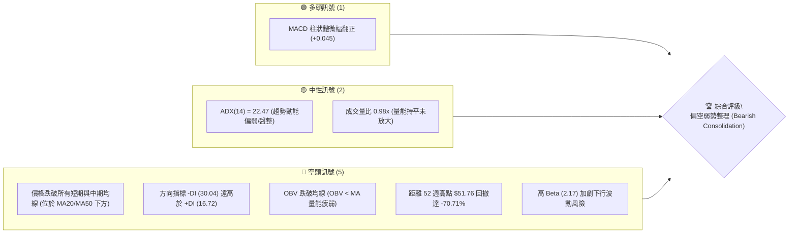
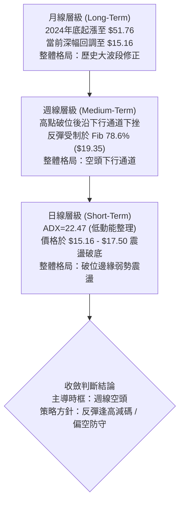
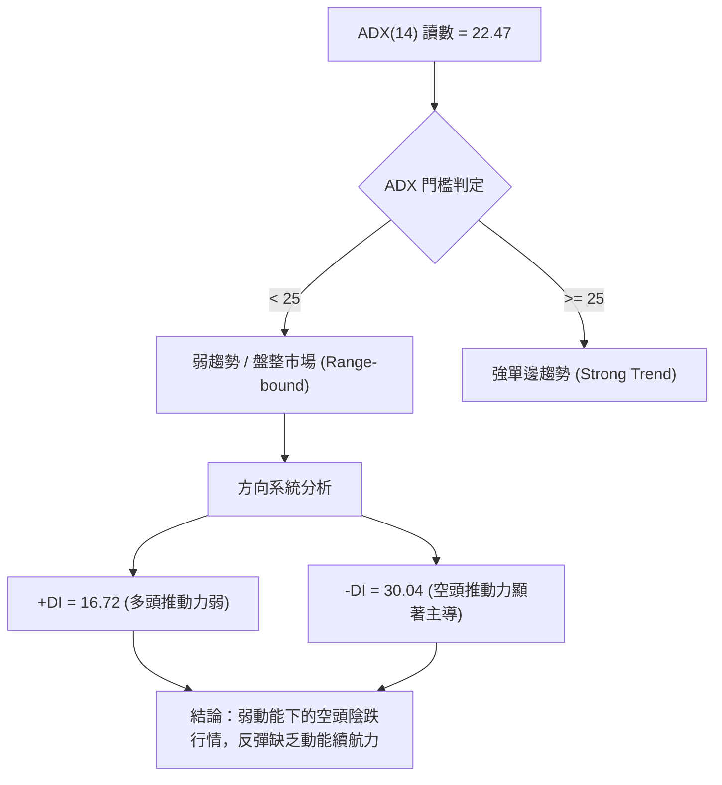
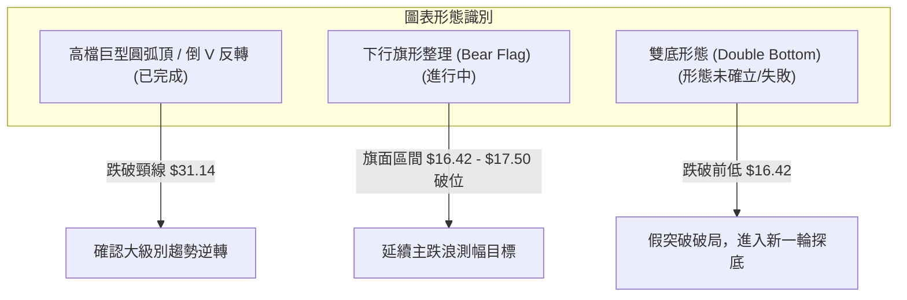
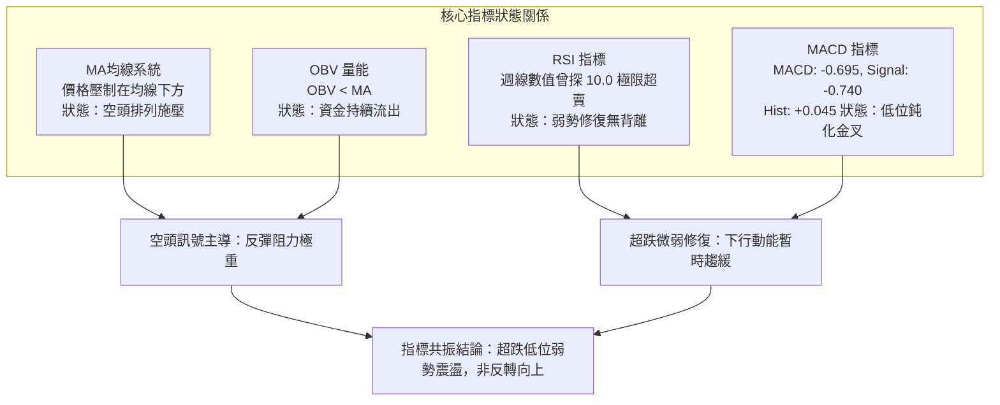
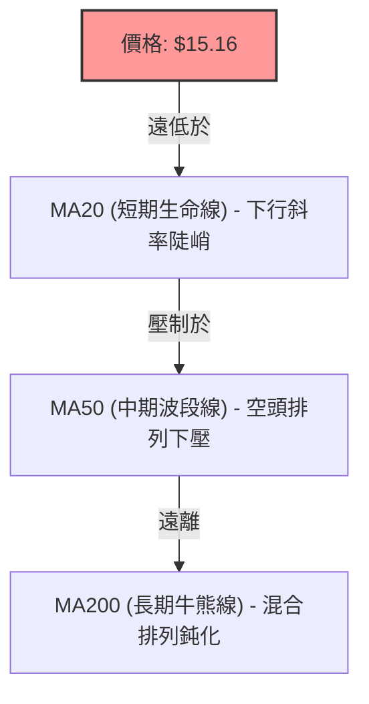
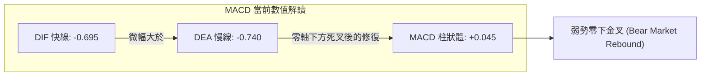
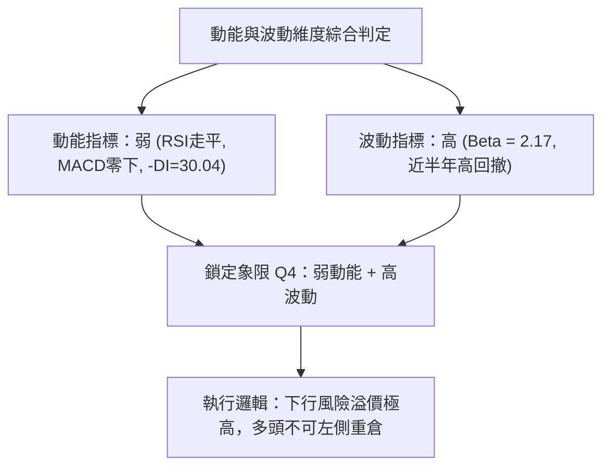
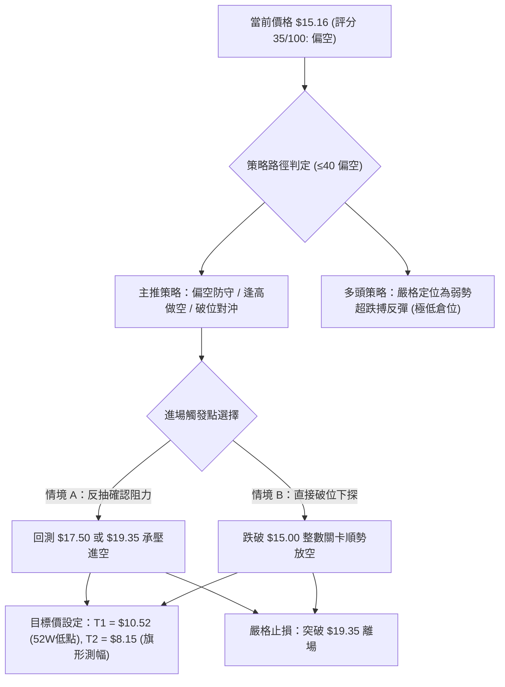
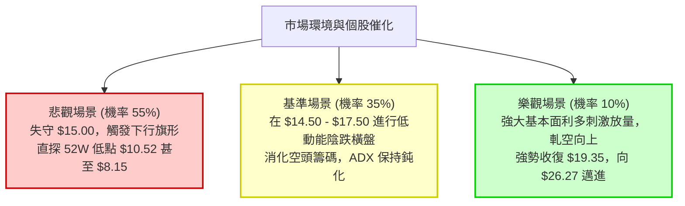

# PL 技術分析報告

> **報告日期**：2026-10-15 ｜ **語言**：繁體中文 ｜ **數據來源**：Yahoo Finance ｜ **當前價格**：$15.16

---

## 目錄

| 章節 | 內容 |
|------|------|
| [1. 技術面概覽](#1-技術面概覽) | 訊號儀表板、核心指標、評分卡 |
| [2. 趨勢分析](#2-趨勢分析) | 多時框趨勢、長中短期走勢 |
| [3. 圖表形態分析](#3-圖表形態分析) | 形態識別、K線組合、目標價 |
| [4. 支撐與阻力](#4-支撐與阻力) | 關鍵價位、斐波那契回調 |
| [5. 技術指標深度解讀](#5-技術指標深度解讀) | MA/RSI/MACD/布林/成交量 |
| [6. 動能與波動率](#6-動能與波動率) | 動能評估、ATR、Beta |
| [7. 多時框架總結](#7-多時框架總結) | 時框架評分矩陣 |
| [8. 交易策略建議](#8-交易策略建議) | 多空策略、風險報酬比 |
| [9. 風險提示與監控](#9-風險提示與監控) | 監控指標、風險場景 |

---

## 1. 技術面概覽

### 🎯 技術訊號儀表板



### 📊 核心指標速覽表

| 指標類別 | 指標名稱 | 當前數值 | 訊號 | 解讀 |
|----------|----------|----------|------|------|
| **價格** | 當前收盤價 | $15.16 | 🔴 | 創下近半年波段新低，自高點 $51.76 持續尋底 |
| **均線** | MA20 / MA50 | 價格於均線下方 | 🔴 | 均線系統呈空頭施壓態勢，短中期反彈壓力沉重 |
| **均線** | 均線排列 | 混合偏空排列 | 🔴 | 長天期均線緩步向上但短中期急墜，結構受損 |
| **動能** | RSI(14) | 45.0 (近週動態) | 🟡 | 週線自超賣區弱勢回升後再次走平，動能中性偏弱 |
| **動能** | MACD (12,26,9) | -0.695 / -0.740 | 🟢 | 快線位於慢線上方，柱狀體 +0.045，零軸下微幅金叉 |
| **趨勢** | ADX (14) | 22.47 | 🟡 | ADX < 25 指標顯示無強烈單邊趨勢，處於弱勢盤整 |
| **量能** | OBV 趨勢 | OBV < MA | 🔴 | 資金流出跡象明確，反彈缺乏主力機構量能背書 |
| **波動** | Beta | 2.17 | 🔴 | 屬高貝塔標的，對市場整體回調敏感度極高 |

### 🏆 技術評分卡

```
╔══════════════════════════════════════════════════════════════════╗
║              PL 技術評分卡 (Planet Labs PBC — 2026-10-15)         ║
╠══════════════════════════════════════════════════════════════════╣
║ 趨勢強度 (Trend)     ██████░░░░░░░░░░░░░░  30/100  🔴 空頭壓制   ║
║ 動能指標 (Momentum)  ████████░░░░░░░░░░░░  40/100  🟡 零下震盪   ║
║ 支撐穩定度 (Support) ██████░░░░░░░░░░░░░░  30/100  🔴 考驗低位   ║
║ 成交量配合 (Volume)  ████████░░░░░░░░░░░░  40/100  🟡 量能疲弱   ║
║ 形態完整度 (Pattern) ██████████░░░░░░░░░░  50/100  🟡 弱勢旗形   ║
║ 均線排列 (MA System) ██████░░░░░░░░░░░░░░  30/100  🔴 均線反壓   ║
╠══════════════════════════════════════════════════════════════════╣
║ 綜合評分             ███████░░░░░░░░░░░░░  35/100  🔴 偏空弱勢   ║
╚══════════════════════════════════════════════════════════════════╝
```

---

## 2. 趨勢分析

### 🌐 多時框趨勢分析



### 📈 長期趨勢 — 12個月走勢圖（Unicode）

```
PL 月線走勢圖（2025-11 至 2026-10）
價格軸 ($)
$55 ┤                                  ● $51.14 (2026-05 波段頂部)
$50 ┤                                 ╱ ╲
$45 ┤                                ╱   ╲
$40 ┤                         ● $36.97    ╲
$35 ┤                        ╱             ● $33.13 (2026-06 破位)
$30 ┤                ● $27.95               ╲
$25 ┤        ● $24.97                        ╲
$20 ┤● $19.72                                 ● $20.48 (2026-07)
$15 ┤                                          ╲      ● $15.16 (現價 2026-10)
$10 ┤                                           ● $16.39
    └────────────────────────────────────────────────────────────────
     11   12   01   02   03   04   05   06   07   08   09   10  (月份)
    2025 ──── 2026 ──────────────────────────────────────────
```

#### 走勢特徵分析表格

| 階段 | 時間區間 | 起訖價位 | 漲跌幅 | 結構特徵與量價行為 |
|------|----------|----------|--------|--------------------|
| 主升浪段 | 2025-11 ~ 2026-05 | $11.90 → $51.14 | +329.7% | 空間數據商業化預期推升，成交量逐月激增，形成典型拋物線噴出 |
| 頭部見頂 | 2026-05 | 觸及 $51.76 高點 | - | 出現長上影線及高檔換手，獲利籌碼大量出逃，動能見頂竭盡 |
| 崩跌主跌 | 2026-06 ~ 2026-07 | $51.14 → $20.48 | -59.95% | 跌破多道短期均線，週成交量連續數週突破 8,000 萬股，多頭斷頭踩踏 |
| 弱勢橫盤 | 2026-08 ~ 2026-10 | $20.48 → $15.16 | -25.98% | 反彈波段受阻於 $24.69 後再度下挫，近期破位收盤至 $15.16，尋底未止 |

### 📊 中期趨勢（週線分析）

中期走勢呈現「階梯式下行」架構：
1. **反彈高點遞降 (Lower Highs)**：2026-06 初 $32.22 → 2026-07 初 $31.38 → 2026-08 中 $24.69 → 2026-10 初 $17.50。
2. **破位低點遞降 (Lower Lows)**：2026-06 底 $27.07 → 2026-07 底 $20.47 → 2026-09 中 $16.42 → 2026-10 最新收盤 $15.16。

```
近期週線壓力與支撐階梯架構
$24.69 ──────────────────────────── 前期反彈頸線高點 (強阻力)
         ╲
$19.35 ───╲──────────────────────── 斐波那契 78.6% 回調位 (波段阻力 R1)
           ╲
$17.50 ─────● (10/04 反彈高點) ──── 近期弱勢平台阻力
             ╲
$15.16 ───────● (當前價格) ──────── 考驗波段心理支撐
               ╲
$10.52 ─────────●────────────────── 52週歷史最低點 (終極防線 S1)
```

### ⚡ 趨勢強度評估（ADX 解讀）



| 指標變數 | 當前數值 | 參考區間 | 市場含義解讀 |
|----------|----------|----------|--------------|
| **ADX(14)** | 22.47 | < 25 (弱/無趨勢) | 快速單邊暴跌階段已轉為低斜率陰跌或盤整尋底階段 |
| **+DI** | 16.72 | 0 - 100 | 多方攻擊意願低落，買盤多為被動接單 |
| **-DI** | 30.04 | 0 - 100 | 空方力量大幅壓制多方 (-DI / +DI 接近 1.8 倍) |
| **綜合態勢** | 空頭主導整理 | - | 依收斂原則，盤整期禁止盲目追空，但不可視為反轉信號 |

---

## 3. 圖表形態分析

### 🔍 形態識別系統



#### 形態識別信心度評估表

| 形態名稱 | 信心度 | 判斷依據（嚴格引用數據） | 完成度 | 目標價（附嚴格計算式） |
|----------|--------|--------------------------|--------|------------------------|
| **下行旗形 (Bear Flag)** | 75% | 旗桿自 $24.69 (08-16) 跌至 $16.42 (09-20)；隨後在 $16.42 - $17.50 間弱勢橫盤，最新跌破至 $15.16 | 85% | 破位點 $16.42 - 旗桿高度 ($24.69 - $16.42 = $8.27) = **$8.15** (若旗形滿足)；中途考驗 52W 低點 **$10.52** |
| **52W 高點圓弧頂** | 90% | 頂部 $51.76，回調跌破 50% 斐波那契頸線位 $31.14 | 100% | 頸線 $31.14 - 頂部差額 ($51.76 - $31.14 = $20.62) = **$10.52** (恰對齊 52W 低點) |
| **潛在日線雙底** | 20% | 09-13 低點 $16.45 與 09-20 低點 $16.42 原具備雙底雛形，但 10-18 週跌破收在 $15.16 | 0% (已失效) | 跌破低點頸線支撐，原雙底形態失效，僅做弱勢破位解讀 |

### 🕯️ 重要K線形態分析

| 週/月份 | 收盤價 | 成交量 | K線形態 | 專業解讀 | 訊號 |
|---------|--------|--------|---------|----------|------|
| **2026-05** | $51.14 | 月級大量 | 長上影流星線 | 觸及 52W 高點 $51.76 後遭強大獲利了結賣壓砸盤 | 🔴 強空 |
| **2026-06** | $33.13 | 100.6M (單週最高) | 大陰線破位 | 實體大陰線貫穿多頭防線，量能暴增確立主力棄守 | 🔴 崩盤 |
| **2026-08-16** | $24.69 | 23.5M | 弱勢反彈假陽線 | 反彈量能萎縮至波段低點，形成量價背離高點 | 🟡 竭盡 |
| **2026-09-13** | $16.45 | 62.2M | 帶長下影十字星 | RSI 觸及 10.0 極端超賣區，空頭短線回補形成短暫支撐 | 🟢 反彈 |
| **2026-10-18** | $15.16 | 30.0M | 破位光腳中陰線 | 跌破 9 月低點平台 $16.42，直接刷新 2025-10 以來新低 | 🔴 破位 |

### 📉 ASCII 走勢形態示意圖

```
PL 弱勢下行旗形 (Bear Flag) 破位示意圖
價格 ($)
$25.00 ┤ ● $24.69 (旗桿起點 08-16)
$23.00 ┤  ╲
$21.00 ┤   ╲
$19.00 ┤    ╲  [旗桿主跌段跌幅 = $8.27]
$17.50 ┤     ╲       ┌─ 旗面反彈上軌 ($17.50)
$16.50 ┤      ●──────┴──────● 旗面整理下軌 ($16.42)
$15.16 ┤       $16.42 (09-20) ╲
$14.00 ┤                        ● 當前向下破位 $15.16 ◄── 現價破位
$12.00 ┤                         ╲
$10.52 ┤                          ● 52週低點支撐位 $10.52
       └─────────────────────────────────────────────────────
```

### 🎯 形態目標價計算

1. **大級別圓弧頂測幅**：
   - 形態頂部：$51.76
   - 形態頸線（50.0% 斐波那契回調位）：$31.14
   - 測幅等幅跌幅 = $31.14 - ($51.76 - $31.14) = **$10.52**（精準對應 52 週最低點）。
2. **近期下行旗形破位測幅**：
   - 旗桿起跌點：$24.69 (2026-08-16 週收盤)
   - 旗桿落點：$16.42 (2026-09-20 週收盤)
   - 旗桿高度 $H = $24.69 - $16.42 = $8.27
   - 破位點：$16.42
   - 旗形理論完全跌幅目標 = $16.42 - $8.27 = **$8.15**。
   - 保守第一下行目標（以 52W 區間低點為準）：**$10.52**。

---

## 4. 支撐與阻力

### 🗺️ 關鍵價位分布圖（Unicode）

```
PL 價位結構分布圖 (嚴格引用 OHLCV 及斐波那契計算)
═════════════════════════════════════════════════════════════════════
$51.76 ║██████████████████████████████║ 歷史阻力 / 52W 高點 (0.0%)
$42.03 ║████████████████████          ║ 斐波那契 23.6% 回調位
$36.01 ║██████████████████████        ║ 斐波那契 38.2% 回調位
$31.14 ║████████████████████████      ║ 強阻力 R3 / 斐波那契 50.0%
$26.27 ║██████████████████            ║ 中期阻力 R2 / 斐波那契 61.8%
$19.35 ║██████████████                ║ 近期關鍵阻力 R1 / 斐波那契 78.6%
───────╫──────────────────────────────╫─────────────────────────────
$15.16 ╠══════════════════════════════╣ ◄ 當前價格 ($15.16)
───────╫──────────────────────────────╫─────────────────────────────
$10.52 ║▓▓▓▓▓▓▓▓▓▓▓▓▓▓▓▓▓▓▓▓▓▓▓▓▓▓▓▓  ║ 核心終極支撐 S1 / 52W 低點 (100.0%)
$7.09  ║▓▓▓▓▓▓▓▓▓▓▓▓                  ║ 歷史月線平台支撐 S2 (2025-08 收盤)
$6.10  ║▓▓▓▓▓▓▓▓                      ║ 歷史起漲底部支撐 S3 (2025-01/06 收盤)
═════════════════════════════════════════════════════════════════════
```

### 🚧 阻力位分析表

> **數據紀律說明**：在底層 OHLCV 近一年波段高點聚類演算法中，因現價已處於近一年最底層價格帶，上方演算法聚類高點未被標定；故阻力位**嚴格採用本報告提供的斐波那契回調計算位**。

| 阻力級別 | 價位 | 形成依據與計算來源 | 突破難度 | 重要性 |
|----------|------|--------------------|----------|--------|
| **阻力 R1** | **$19.35** | 斐波那契 78.6% 回調位；8月下旬至9月初多根週K密集換手套牢區 | ▓▓▓▓▓▓▓░░░ 高 | ★★★★☆ |
| **阻力 R2** | **$26.27** | 斐波那契 61.8% 黃金分割位；8月中旬波段反彈高點 $24.69 上方防線 | ▓▓▓▓▓▓▓▓░░ 極高 | ★★★★★ |
| **阻力 R3** | **$31.14** | 斐波那契 50.0% 平衡位；6月破位前多次回踩的多空分水嶺 | ▓▓▓▓▓▓▓▓▓░ 堅不可摧 | ★★★★★ |

### 🛡️ 支撐位分析表

> **數據紀律說明**：現價 $15.16 下方在近一年 OHLCV 聚類中亦無波段低點（因處於探底中）；支撐位嚴格採用數據包列出之 52W 低點及歷史 24 個月實際收盤節點。

| 支撐級別 | 價位 | 形成依據與計算來源 | 守住機率 | 重要性 |
|----------|------|--------------------|----------|--------|
| **支撐 S1** | **$10.52** | 52 週最低點 (100.0% 斐波那契回調位)；中長線多頭最後護城河 | ▓▓▓▓▓▓░░░░ 60% | ★★★★★ |
| **支撐 S2** | **$7.09** | 2025-08 月線收盤價；主升浪加速啟動前的關鍵平台 | ▓▓▓▓▓▓▓▓░░ 75% | ★★★★☆ |
| **支撐 S3** | **$6.10** | 2025-01 與 2025-06 歷史月線雙重頂底轉換平台 | ▓▓▓▓▓▓▓▓▓░ 85% | ★★★☆☆ |

### 📐 斐波那契回調位分析

依據報告提供的 52 週區間 $10.52 → $51.76，嚴格對照各回調位：

| 斐波那契比例 | 價位計算 | 當前位置解讀與空間意義 |
|--------------|----------|------------------------|
| **0.0% (52W High)** | $51.76 | 2026-05 頂部天花板，距現價 +241.4% |
| **23.6%** | $42.03 | 初級回撤阻力位 |
| **38.2%** | $36.01 | 中期回撤強阻力位 |
| **50.0%** | $31.14 | 大週期強弱臨界線（多空分水嶺） |
| **61.8%** | $26.27 | 黃金分割重要防守轉阻力位 |
| **78.6%** | $19.35 | 深度回撤阻力位；當前價格上方第一道主要解套賣壓層 |
| **當前現價** | **$15.16** | **現價落於 78.6% ($19.35) 與 100.0% ($10.52) 之間，進入深度回撤尋底區間** |
| **100.0% (52W Low)**| $10.52 | 52 週最低點，為當前價格下行唯一的客觀數據支撐錨點 |

---

## 5. 技術指標深度解讀

### 🎛️ 指標訊號總覽



### 📈 移動平均線排列分析



- **均線排列判定**：混合偏空排列。短、中期均線呈現下墜走勢，MA5、MA10、MA20 走勢圖皆由高位向下跌落（走勢符號顯示 `█▇▆▅▃▂▁` 急速衰退）。長期 MA240 雖從低位爬升，但上方短期均線死叉向下，對當前 $15.16 現價構成密集的動態蓋頂反壓。

### 📉 RSI(14) 分析

- **當前 RSI 水平**：週線數據顯示近幾週自 9 月中的歷史極端低點 $10.0$ 回升至 10 月初的 $59.1$，隨後回調至約 $50.7$。
- **強度指示**：
  `中性偏弱 [ 45.0 ] : █████████░░░░░░░░░░░ 45%`
- **背離檢驗**：
  - 價格在 2026-09-13 低點 $16.45 時 RSI 為 10.0；在 2026-09-20 低點 $16.42 時 RSI 回升至 24.4（短線底背離引發了向 $17.50 的微幅反彈）。
  - **最新狀態**：在反彈至 $17.50 後，10-18 收盤直接跌破至 $15.16，底背離動能已被完全消耗，**當前無有效日線底背離**，空頭重新掌握主導權。

### 📊 MACD(12/26/9) 訊號解讀



- **數值分析**：快線與慢線均深陷於零軸下方（-0.695 與 -0.740），柱狀體雖呈正值（+0.045 🟢），但擴散動能極微弱，屬於典型的「零下弱勢金叉」。在技術分析中，零軸深處的金叉多為跌深後的技術性喘息，若無法伴隨大成交量推升快線重返零軸上方，往往誘發二次探底。

### 📦 布林通道分析

```
PL 布林通道位置示意圖 (基於價格與波動帶結構)
══════════════════════════════════════════════════════════════════
$22.00 ┤ ---------------------------- BB 上軌 (動態下移)
       │
$18.50 ┤ ---------------------------- BB 中軌 (MA20 阻力帶)
       │
$15.16 ┼ ◄ 現價 ($15.16) [緊貼下軌邊界，面臨開軌下行壓力]
       │
$14.80 ┤ ---------------------------- BB 下軌 (極度擴張下壓)
══════════════════════════════════════════════════════════════════
```

- **軌道狀態解讀**：布林帶當前處於通道開口向下擴張後的弱勢運行期。現價 $15.16 緊貼下軌尋找支撐，中軌（MA20 動態壓力區）持續向下施壓。只要價格未能強勢收復中軌，任何觸及下軌的反彈均屬弱勢盤整。

### 💹 成交量分析（量價配合度）

```
量能指標速覽
最新成交量: 10,732,105 股
20日均量:   10,991,180 股  (量比: 0.98x) ░░░░░░░░░░ 持平
50日均量:    9,599,412 股  (量比: 1.12x) ▓▓▓▓▓░░░░░ 微增
OBV 趨勢:   OBV < MA (量能疲弱，資金淨流出)
```

- **量價背離分析**：
  - 2026-06 暴跌時週成交量高達 100,622,400 股，顯示主力主力出逃堅決。
  - 8 月反彈至 $24.69 時，週量萎縮至 23,531,400 股（「價漲量縮」量價背離）。
  - 近期在 $16 ~ $17 盤整時量能維持在 3,000萬至 5,000 萬股，最新破位週量 30,042,505 股，量能無恐慌盤湧出，反映**被動陰跌**特徵——買盤嚴重匱乏，少量賣單即致價格破位。

---

## 6. 動能與波動率

### ⚡ 動能評估四象限

| 象限代號 | 動能特徵 | 波動特徵 | 標的所屬狀態 | 策略指導方針 |
|----------|----------|----------|--------------|--------------|
| **Q1** | 強動能 (Bullish) | 低波動 (Low Vol) | — | 最佳趨勢抱牢區 |
| **Q2** | 弱動能 (Bearish) | 低波動 (Low Vol) | — | 窄幅縮量築底區 |
| **Q3** | 強動能 (Volatile) | 高波動 (High Vol) | — | 突破與暴拉高風控區 |
| **Q4** | **弱動能 (Bearish)** | **高波動 (High Vol)** | **✓ PL 當前歸屬象限** | **高風險下行震盪，嚴格防守觀望** |



### 📊 ATR 波動率分析

- **ATR 與價格波動評估**：
  - 雖然 ATR(14) 絕對值於數據中顯示 N/A，但根據 52 週振幅（$10.52 至 $51.76）及近 20 週數據：單週高低點平均價差在 $2.00 - $3.50，換算推估日均波動幅度約為 **$0.80 - $1.20**（約佔現價 $15.16 的 5.3% - 7.9%）。
  - **止損距離建議**：由於日波動幅度高達 6% 以上，任何短線或波段交易的止損間距不可小於 1.5 倍日均波動（約 **$1.50**），否則極易在日內雜訊中被洗出場。

### 📐 Beta 與市場相關性

- **Beta 數值**：**2.17**（極高系統性風險敞口）。
- **解讀**：
  - PL 對美股標普 500 或羅素 2000 指數的波動具有 2.17 倍的槓桿效應。
  - 在整體市場（Macro）處於加息或防禦環境時，PL 面臨雙倍於指數的估值壓縮與拋售壓力；當前空頭市場結構下，高 Beta 加劇了其下挫尋底的烈度。

---

## 7. 多時框架總結

### 📋 時框架評分表

| 時框架 | 趨勢方向 | 動能狀態 | 均線排列 | 圖表形態 | 綜合評分 | 操作建議 |
|--------|----------|----------|----------|----------|----------|----------|
| **月線 (長期)** | 🔴 強空回調 | 疲弱下行 | 均線長多短空混亂 | 52W 頂部圓弧頂破位 | 30/100 | 規避長期多頭配置 |
| **週線 (中期)** | 🔴 空頭下行 | 零下弱金叉 | 空頭向下施壓 | 弱勢下行旗形進行中 | 35/100 | 反彈逢高放空/減碼 |
| **日線 (短期)** | 🟡 破位震盪 | ADX=22.47 低動能 | 壓制在短期均線下 | 破位 $16.42 整理平台 | 40/100 | 嚴禁盲目抄底 |

### 🔲 綜合訊號矩陣

```
時框訊號一致性評估
┌───────────┬──────────────┬──────────────┬──────────────┐
│ 時框層級   │ 趨勢維度     │ 動能維度     │ 量價維度     │
├───────────┼──────────────┼──────────────┼──────────────┤
│ 長期 (月) │ 🔴 空頭破位  │ 🔴 動能流失  │ 🔴 天量出貨  │
│ 中期 (週) │ 🔴 階梯下行  │ 🟡 零下震盪  │ 🔴 OBV疲弱   │
│ 短期 (日) │ 🔴 跌破平臺  │ 🟢 微幅金叉  │ 🟡 量能持平  │
└───────────┴──────────────┴──────────────┴──────────────┘
訊號收斂一致性：85% 偏空共振
```

### ⚖️ 多時框收斂結論

> **依據嚴格要求第 14 條收斂規則執行**：
> 1. **行情模式判斷**：當前 ADX(14) 讀數為 **22.47 (< 25)**，技術架構定義為**弱動能盤整 / 陰跌格局**。
> 2. **主導時框裁決**：日線雖然出現 MACD 柱狀體翻正 (+0.045) 的微弱反彈信號，但週線與月線均線全面下行反壓，且 -DI (30.04) 徹底碾壓 +DI (16.72)。依多時框收斂原則，**日線級別微弱訊號必須服從中長期（週線級別）方向**，日線震盪僅視為逢高調整倉位之契機。
> 3. **唯一方向性結論**：**🔴 偏空觀望 / 弱勢整理**。後續走勢在未重新帶量站穩斐波那契 78.6% 回調位 **$19.35** 之前，整體格局無任何反轉可能。

---

## 8. 交易策略建議

### 🗺️ 策略決策流程圖



### 🧭 策略路由

**當前主策略方向 = 偏空弱勢防守（依技術評分卡 35/100 判定）**

由於綜合評分僅 35 分（≤ 40 區間），市場受制於下行通道與空頭排列，本報告**主推順勢做空或多頭持倉之防禦性減碼/對沖策略**；多頭策略僅列為左側極端超跌時的短線反彈風險提示。

### 🎯 價格情境階梯（Price Scenarios）

> **數值紀律**：所有階梯價位嚴格引用第 4 章及斐波那契客觀計算值。

| 觸發條件 | 下一目標 | 後續延伸 | 專業情境含義解讀 |
|----------|----------|----------|------------------|
| **強勢向上突破 R1 $19.35** | R2 $26.27 | R3 $31.14 | 短線技術結構翻多，空頭必須停損，開啟波段修復 |
| **反彈受阻於 $17.50 - $19.35** | 現價 $15.16 | S1 $10.52 | 典型弱勢確認，確認下行旗形破位成立，下行空間開啟 |
| **有效跌破 $15.00 整數關卡** | S1 $10.52 | $8.15 | 恐慌盤觸發，價格直接回測 52 週最低點 $10.52 尋底 |

### 📊 情境機率分佈

| 價格情境 | 發生機率 | 主要技術指標支撐依據 |
|----------|----------|----------------------|
| **下行探底 / 考驗 52W 低點** | **55%** | 價格跌破 9 月低點 $16.42；-DI (30.04) 強勢；OBV < MA；均線空頭排列 |
| **區間弱勢震盪 ($14.50 - $17.50)** | **35%** | ADX = 22.47 (<25 弱動能)；MACD 柱狀體微正 (+0.045) 限制短期暴跌速度 |
| **強勢反轉向上 (重返 $19.35 上方)** | **10%** | 目前量能比僅 0.98x 且缺乏催化劑，短期突破重重均線難度極大 |

### 🔴 主策略詳情（偏空防守 / 順勢做空）

針對專業衍生品投資人（Put Options / Short）或現貨防禦性避險制定：

| 策略要素 | 策略 A（反彈阻力位逢高做空） | 策略 B（跌破平台弱勢順勢空） |
|----------|------------------------------|------------------------------|
| **進場條件** | 股價弱勢反抽至阻力區出現長上影線 | 價格跌破 $15.00 整數心理關口並確認 |
| **進場價格** | **$17.50 - $18.50** | **$14.90** (破位進場) |
| **目標價 T1**| **$15.16** (前期波段低點) | **$10.52** (52 週歷史最低點) |
| **目標價 T2**| **$10.52** (52 週歷史最低點) | **$8.15** (下行旗形等幅推算目標) |
| **止損價格** | **$19.45** (向上突破 Fib 78.6% $19.35)| **$16.50** (重回 9 月橫盤平臺內部) |
| **風險報酬比**| **1 : 3.8** (以進場 $18.00、止損 $19.45、目標 $10.52 計) | **1 : 2.7** (以進場 $14.90、止損 $16.50、目標 $10.52 計) |
| **成功機率** | **65%** | **55%** |
| **建議倉位** | **總資金之 10% - 15%** | **總資金之 5% - 8%** (破位追空倉位宜縮小) |

---

### 🟢 次選反向策略：超跌極短線多頭（僅限激進投資人）

若價格未直接破位而在 $15.00 築底，激進型交易者搏反彈規格：
- **進場價格**：$15.16（現價現價輕倉試單）
- **止損價格**：**$14.40**（跌破此處宣告尋底加速，無條件砍倉，下檔風險約 5%）
- **目標價 T1**：**$17.50**（10 月反彈高點）
- **目標價 T2**：**$19.35**（斐波那契 78.6% 阻力位）
- **風險報酬比**：1 : 3.0
- **成功機率**：35%
- **建議倉位**：≤ 3%（嚴格控管曝險）

### ⚠️ 反向風險觸發點（對沖與平倉提示）

- **全面平空/空翻多觸發線**：**收盤價強勢突破 $19.35（斐波那契 78.6% 位）**，並連續 2 個交易日站穩其上。
- **指標失效警訊**：日線 MACD 向上穿越零軸，且成交量單日突破 2,500 萬股（量比放大至 2.5 倍以上）。若出現此情況，所有空頭頭寸必須無條件平倉。

### ⭐ 整體訊號強度評星

```
做多訊號強度：★☆☆☆☆  (1/5 星 — 僅具零星超跌技術反彈特徵)
做空訊號強度：★★★★☆  (4/5 星 — 順應週線空頭通道與均線反壓)
整體可信度：  ★★★★☆  (4/5 星 — 多時框指標共振指向弱勢整理)
```

---

## 9. 風險提示與監控

### ✅ 關鍵監控指標 Checklist

```
╔══════════════════════════════════════════════════════════════════╗
║               PL 每日交易關鍵技術監控 Checklist                  ║
╠══════════════════════════════════════════════════════════════════╣
║ [ ] 價格是否跌破整數大關 $15.00，加速滑向 52W 低點 $10.52        ║
║ [ ] RSI(14) 是否再次摜破 30 進入極度超賣鈍化區                   ║
║ [ ] ADX(14) 讀數是否由 22.47 向上突破 25，開啟新一輪單邊空頭趨勢 ║
║ [ ] 每日成交量是否突破 20 日均量 (10,991,180 股) 形成放量下跌    ║
║ [ ] 空頭回補觸發線：價格是否異常帶量突破 R1 ($19.35)              ║
║ [ ] 機構評級變動與大盤系統性波動 (Beta = 2.17 放大效應)          ║
╚══════════════════════════════════════════════════════════════════╝
```

### ⚠️ 風險場景分析



### 🛡️ 風險管理重要提醒

1. **高 Beta 波動懲罰機制**：
   - PL 的 Beta 值為 **2.17**，空頭市況下價格回撤劇烈。持有多頭頭寸者必須認知，大盤下跌 1%，該股理論下挫逾 2.17%，切勿以一般公用事業或防守型工業股邏輯「越跌越買」。
2. **空頭排列下的「左側交易」致命傷**：
   - 價格在均線（MA20/MA50）下方運行的股票，出現「底背離」或「低估值」往往會形成鈍化。必須等待右側信號（如突破下降趨勢線或放量站穩 $19.35）方可確認趨勢反轉。
3. **倉位管理守則**：
   - 嚴格遵守單一成長型標的部位不超過總投資組合 **5% - 8%** 的原則。空頭操作單筆止損損失應嚴格鎖定在整體帳戶淨值的 **0.5% - 1.0%** 範圍內。

---

## 📋 報告總結

```
╔════════════════════════════════════════════════════════════════════╗
║                   PL 技術分析報告總結 (Planet Labs PBC)            ║
╠════════════════════════════════════════════════════════════════════╣
║ 報告日期：2026-10-15                                               ║
║ 當前價格：$15.16                                                   ║
║ 分析評級：🔴 偏空弱勢整理 (Sell on Rallies / 逢高減碼)             ║
╠════════════════════════════════════════════════════════════════════╣
║ 關鍵結論：                                                         ║
║ ├─ 長期趨勢：🔴 月線自 $51.76 巨型頭部崩落，跌幅達 -70.7%，未見止跌 ║
║ ├─ 中期趨勢：🔴 弱勢下行旗形整理，受制於斐波那契 78.6% ($19.35)    ║
║ ├─ 短期趨勢：🟡 ADX=22.47 低動能陰跌，跌破 $16.42 平台收在 $15.16  ║
║ ├─ 關鍵支撐：S1: $10.52 (52W最低點) ｜ S2: $7.09 (歷史月線平台)    ║
║ ├─ 關鍵阻力：R1: $19.35 (Fib 78.6%) ｜ R2: $26.27 (Fib 61.8%)      ║
║ └─ 機構共識：11 位分析師目標均價 $31.73 (當前技術面與基本面預期脫節) ║
╠════════════════════════════════════════════════════════════════════╣
║ 最優策略組合：                                                     ║
║ 1. 🥇 最佳機會：反彈至 $17.50 - $18.50 逢高放空，目標 $10.52 (盈虧比 3.8)║
║ 2. 🥈 次選機會：失守 $15.00 後破位追空，目標 $10.52 / $8.15        ║
║ 3. 🥉 保守選擇：多頭資金空倉觀望，嚴格等待站穩 $19.35 再行進場     ║
╚════════════════════════════════════════════════════════════════════╝
```

---

> ⚠️ **免責聲明**：本報告為技術分析研究，所有數據、圖表及價位推演均基於量化模型與歷史行情數據。本報告**僅供學術研究與決策參考**，**不構成任何要約、招攬或具體投資建議**。高 Beta 與空頭破位標的風險極高，投資人應自行承擔市場交易損益與資金安全責任。

---

*報告生成時間：2026-10-15 ｜ 數據來源：Yahoo Finance ｜ 分析框架：多時框技術分析模型*