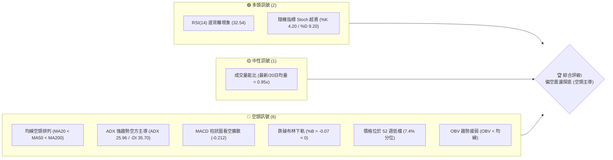
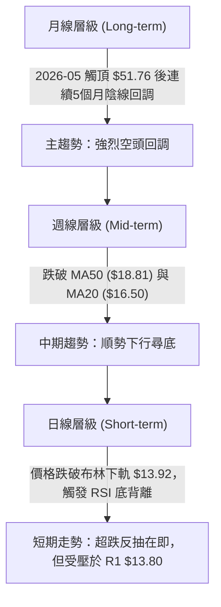
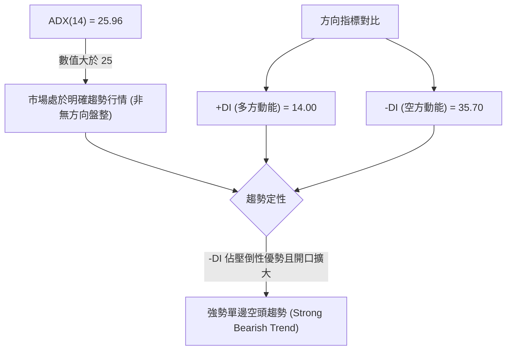
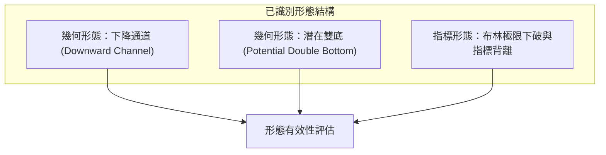
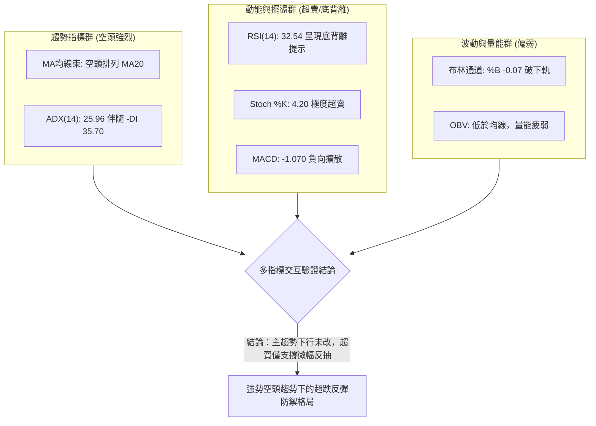
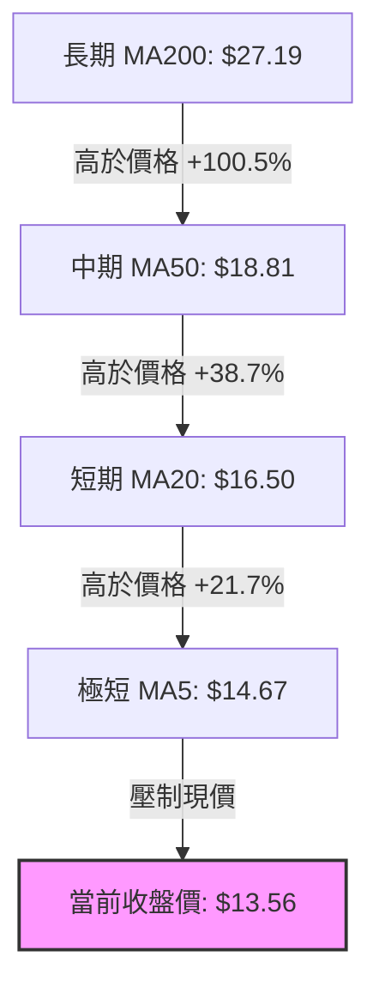
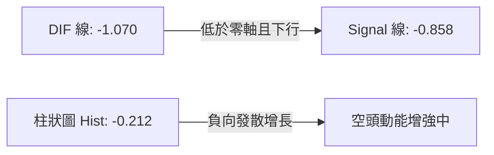
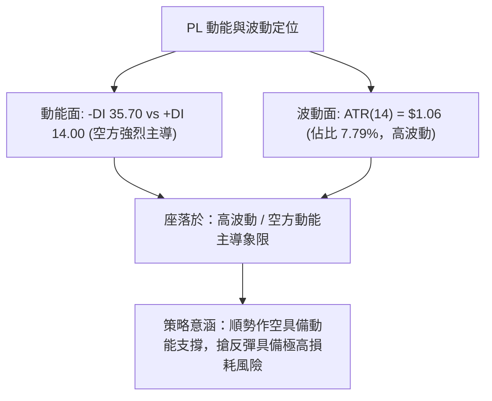
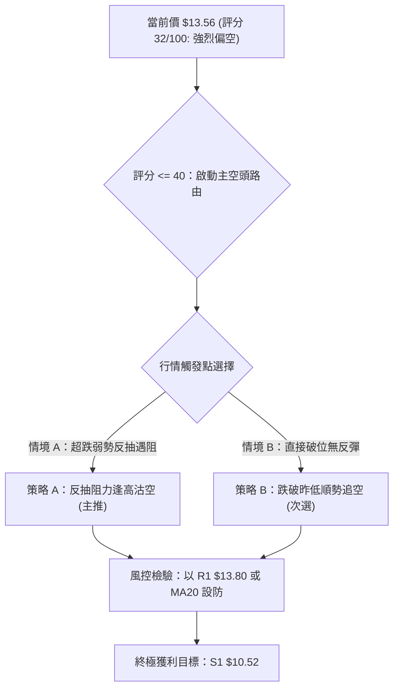
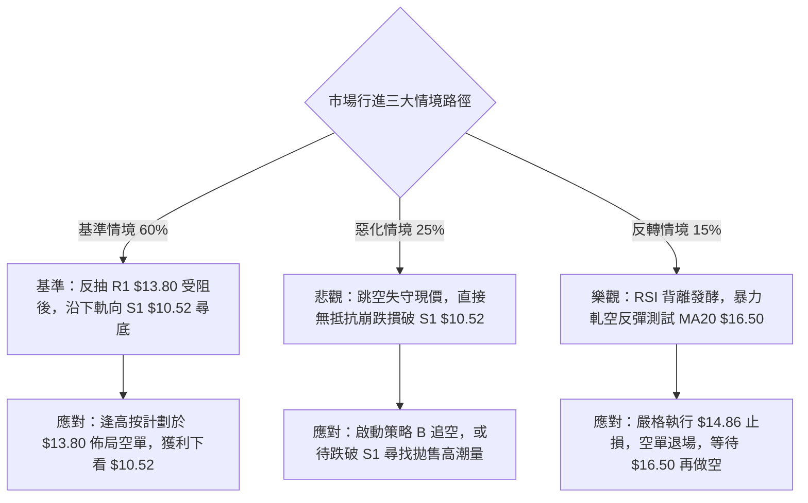

# PL 技術分析報告

> **報告日期**：2026-10-17 ｜ **語言**：繁體中文 ｜ **數據來源**：Yahoo Finance ｜ **當前價格**：$13.56

---

## 目錄

| 章節 | 內容 |
|------|------|
| [1. 技術面概覽](#1-技術面概覽) | 訊號儀表板、核心指標、評分卡 |
| [2. 趨勢分析](#2-趨勢分析) | 多時框趨勢、長中短期走勢、ADX強度 |
| [3. 圖表形態分析](#3-圖表形態分析) | 形態識別、K線組合、形態目標價 |
| [4. 支撐與阻力](#4-支撐與阻力) | 關鍵價位分布、阻力與支撐分析、斐波那契回調 |
| [5. 技術指標深度解讀](#5-技術指標深度解讀) | 均線系統、RSI背離、MACD、布林通道、成交量 |
| [6. 動能與波動率](#6-動能與波動率) | 動能四象限、ATR波動分析、Beta風險評估 |
| [7. 多時框架總結](#7-多時框架總結) | 時框架評分表、綜合矩陣、多時框收斂結論 |
| [8. 交易策略建議](#8-交易策略建議) | 策略路由、價格情境階梯、主空頭策略與對沖點 |
| [9. 風險提示與監控](#9-風險提示與監控) | 監控清單、情境分析、風險管理原則 |

---

## 1. 技術面概覽

### 🎯 技術訊號儀表板



### 📊 核心指標速覽表

| 指標類別 | 指標名稱 | 當前數值 | 訊號 | 解讀 |
|----------|----------|----------|------|------|
| **價格** | 當前收盤價 | $13.56 | 🔴 | 位於 52 週區間下緣 7.4% 位置，持續承壓 |
| **均線** | MA20 (月線) | $16.50 | 🔴 | 價格低於 MA20 達 -17.82%，短期下行趨勢顯著 |
| **均線** | MA50 (季線) | $18.81 | 🔴 | 價格低於 MA50 達 -27.91%，中期結構完全走空 |
| **均線** | MA200 (年線) | $27.19 | 🔴 | 價格低於 MA200 達 -50.13%，長期熊市格局未變 |
| **動能** | RSI(14) | 32.54 | 🟡 | 接近超賣區，存在潛在「底背離」短期反彈動能 |
| **動能** | MACD (12,26,9) | -1.070 / -0.858 | 🔴 | MACD 線低於訊號線，柱狀圖 -0.212，動能擴散向下 |
| **動能** | Stoch %K / %D | 4.20 / 9.20 | 🟢 | 極度超賣區間，醞釀超跌反抽預期 |
| **趨勢** | ADX(14) / ±DI | 25.96 | 🔴 | ADX > 25 確認趨勢行情，-DI (35.70) 遠高於 +DI (14.00) |
| **通道** | 布林通道 %B | -0.07 | 🔴 | 跌破下軌 ($13.92)，呈現超跌擴散破位特徵 |
| **波動** | ATR(14) | $1.06 | 🟡 | 佔價格 7.79%，日均振幅大，操作需嚴格設定保護止損 |
| **量能** | OBV 走勢 | OBV < MA | 🔴 | 資金持續呈現淨流出，量能未能確認價格反轉 |

### 🏆 技術評分卡

```
╔══════════════════════════════════════════════════════════════╗
║                技術評分卡 — PL (2026-10-17)                  ║
╠══════════════════════════════════════════════════════════════╣
║ 趨勢強度 (ADX/方向)   ██████████████░░░░░░  70/100  🔴 空頭強勢║
║ 動能指標 (RSI/MACD)   ███████░░░░░░░░░░░░░  35/100  🟡 醞釀背離║
║ 支撐穩定度 (價格位置) ████░░░░░░░░░░░░░░░░  20/100  🔴 逼近前低║
║ 成交量配合 (OBV/均量) ██████░░░░░░░░░░░░░░  30/100  🔴 量能渙散║
║ 形態完整度 (結構排列) █████░░░░░░░░░░░░░░░  25/100  🔴 下行通道║
║ 均線排列 (空頭均線束) ██░░░░░░░░░░░░░░░░░░  10/100  🔴 完全空頭║
╠══════════════════════════════════════════════════════════════╣
║ 綜合評分              ██████░░░░░░░░░░░░░░  32/100  🔴 強烈偏空║
╚══════════════════════════════════════════════════════════════╝
```

---

## 2. 趨勢分析

### 🌐 多時框趨勢分析



### 📈 長期趨勢 — 12個月走勢圖（Unicode）

```
PL 月線收盤走勢圖（過去12個月：2025-11 至 2026-10）
價格軸 ($)
$52.00 ┤                             ● (2026-05 $51.14 / 高點 $51.76)
$46.00 ┤                            / \
$40.00 ┤                           /   \
$34.00 ┤                    ●     /     ● (2026-06 $33.13)
$28.00 ┤              ●    / \   /       \
$22.00 ┤        ●    / \  /   ●-●         ● (2026-07 $20.48 / 08 $19.85)
$16.00 ┤       / \  /   ●                  \     ● (2026-09 $16.39)
$10.00 ┤  ●---●   ●                         \   / \
 $4.00 ┤                                     ●-●   ●← 現價 $13.56 (2026-10)
       └────────────────────────────────────────────────────────
         11   12   01   02   03   04   05   06   07   08   09   10  (月份)
        (2025)                      (2026)
```

#### 走勢特徵分析表格

| 階段 | 涵蓋期間 | 價格區間 | 累積漲跌幅 | 結構特徵與成交量狀態 |
|------|----------|----------|------------|----------------------|
| **波段主升浪** | 2025-11 至 2026-05 | $11.90 → $51.14 | +329.75% | 資金急速湧入，連續突破各級均線，於 $51.76 創 52 週歷史高點 |
| **初段崩跌期** | 2026-05 至 2026-07 | $51.14 → $20.48 | -59.95% | 拋售籌碼激增，週成交量達 1 億股，跌破 MA200 ($27.19) 水平 |
| **中繼平台整理** | 2026-07 至 2026-08 | $20.48 → $19.85 | -3.08% | 於 $20.00 整數關卡縮量整理，RSI 短暫修復至 69.4 後動能耗盡 |
| **二次破位探底** | 2026-09 至 2026-10 | $19.85 → $13.56 | -31.69% | 跌破多個波段低點，下探布林帶下軌，逼近年度低點 S1 ($10.52) |

### 📊 中期趨勢（週線分析）

```
PL 近期週線關鍵支撐阻力結構圖
$20.00 ────────────────────────────────────────── 波段整理平台頂部 (斐波那契 78.6%: $19.35)
$18.81 ══════════════════════════════════════════ 關鍵阻力 R3 / MA50 重疊處
$18.18 ------------------------------------------ 波段阻力 R2
$16.50 ------------------------------------------ 布林中軌 / MA20 下壓點
$13.80 ------------------------------------------ 立即阻力 R1 (近期小反彈頂部)
$13.56 ◄═════ 現價位置 (面臨下軌超跌)
$10.52 ══════════════════════════════════════════ 52週歷史支撐 S1 (終極多頭防線)
```

中期週線在 2026 年 8 月中旬反彈至 $24.69 遇阻回落後，連續 8 週呈現高點遞減（Lower Highs）與低點遞減（Lower Lows）的經典空頭通道結構。2026-10-18 最新週收盤下挫至 $13.56，週跌幅擴大，顯示中期賣壓依然佔據絕對優勢。

### ⚡ 趨勢強度評估（ADX 解讀）



#### ADX 指標狀態速查表

| 指標項 | 當前數值 | 門檻標準 | 結論與市場意義 |
|--------|----------|----------|----------------|
| **ADX(14)** | 25.96 | > 25.00 | 確認目前處於趨勢行情階段，策略應以順勢交易為主，避免逆勢摸底 |
| **-DI (負向動向)** | 35.70 | > 25.00 | 空方力量掌控盤面，下行動能強烈 |
| **+DI (正向動向)** | 14.00 | < 20.00 | 多方反擊動能渙散，買盤意願低迷 |
| **DI 差值差距** | 21.70 | 擴大中 | 空方優勢持續擴展，尚未見到收斂拐點 |

---

## 3. 圖表形態分析

### 🔍 形態識別系統



#### 形態信心度與目標價計算表

| 形態類別 | 信心度 | 判斷依據（引用數據） | 完成度 | 目標價（附嚴謹計算式） |
|----------|--------|----------------------|--------|------------------------|
| **下降通道 (中長期)** | **85%** | 價格沿 2026-05 高點 $51.76 回落，高點自 $24.69 → $19.98 → $17.50 持續遞減，低點由 $20.47 → $16.42 → $13.56 持續創新低 | 90% | 下軌支撐目標 = 測算下軌延伸線對應歷史最低點 S1: **$10.52** |
| **潛在雙底 (短期)** | **35%** | 價格逼近 52 週低點 S1 ($10.52)，伴隨 RSI 底背離；但尚未打出右底且距離 S1 尚有 -22.42% 空間 | 20% (未成形) | 訊號不足，無法建立有效雙底目標價（需待觸及 $10.52 築底） |
| **布林帶超賣超跌破位** | **75%** | 現價 $13.56 跌破布林下軌 $13.92 (%B = -0.07)，偏離 MA20 ($16.50) 達 -17.82% | 100% | 均值回歸短線反抽目標 = 立即阻力 R1: **$13.80**，次級為布林中軌 MA20: **$16.50** |

*依據分析規則 15：潛在雙底信心度僅 35% (< 50%)，故本報告不採用雙底多頭測幅，而以「下降通道持續」與「超賣反抽至均線」作為核心分析邏輯。*

### 🕯️ 重要K線形態分析

| 週期/月份 | 收盤價 | K線形態 | 解讀 | 訊號 |
|-----------|--------|---------|------|------|
| **2026-05** | $51.14 | 長上影流星線 (Shooting Star) | 盤中衝高至 $51.76 後遭強烈獲利了結拋售，確立歷史大頂部 | 🔴 空頭反轉 |
| **2026-06** | $33.13 | 實體大陰線 (Bearish Marubozu) | 跌幅達 -35.22%，直接貫穿多重中期均線，空方全面控盤 | 🔴 強烈看空 |
| **2026-08** | $19.85 | 窄幅十字星 (Doji) | 多空在整數關卡 $20 附近暫時平衡，量能急凍，屬下跌中繼 | 🟡 變盤觀望 |
| **2026-09** | $16.39 | 破位中陰線 | 跌破 8 月盤整平台低點，開啟第二輪殺跌浪潮 | 🔴 延續空頭 |
| **2026-10 (當前)** | $13.56 | 光腳下探陰線 | 逼近 52 週低位，週成交量放大至 51,247,200 股，探底進行中 | 🔴 慣性尋底 |

### 📉 ASCII 走勢形態示意圖

```
PL 下降通道與近期形態解析示意圖
價格 ($)
$25.00 ┤        [通道上軌]
$23.00 ┤         \   ● (2026-08-16 高點 $24.69)
$21.00 ┤          \   \
$19.00 ┤           \   ●- - - - - - - - - - - - - - - R3 ($18.81) / MA50
$17.00 ┤            \    ● (2026-10-04 高點 $17.50) - - R2 ($18.18) 區域
$15.00 ┤             \    \
$13.80 ┤- - - - - - - \ - -● - - - - - - - - - - - - R1 ($13.80)
$13.56 ┤               \    ●◄══ 現價 $13.56 (跌出布林下軌 $13.92)
$12.00 ┤                \    \
$10.52 ┤- - - - - - - - - ● - - - - - - - - - - - - S1 ($10.52 / 52W低點)
       └──────────────────────────────────────────────────────────
```

---

## 4. 支撐與阻力

### 🗺️ 關鍵價位分布圖（Unicode）

```
╔══════════════════════════════════════════════════════════════╗
║                   PL 價位結構分布圖                           ║
╠══════════════════════════════════════════════════════════════╣
║ $19.35 ║████████████████████████║ 斐波那契 78.6% 回調重壓區  ║
║ $18.81 ║████████████████████    ║ 強阻力 R3 (MA50 季線重合位)║
║ $18.18 ║████████████████        ║ 次級阻力 R2 (波段高點聚類)  ║
║ $16.50 ║████████████            ║ 趨勢轉折點 (MA20 / 布林中軌)║
║ $13.80 ║████████                ║ 短線關鍵阻力 R1            ║
║ $13.56 ╠════════════════════════╣ ◄ 現價 ($13.56)            ║
║ $10.52 ║▓▓▓▓▓▓▓▓▓▓▓▓▓▓▓▓▓▓▓▓▓▓▓▓║ 終極強支撐 S1 (52W歷史低點)║
╚══════════════════════════════════════════════════════════════╝
```

### 🚧 阻力位分析表

*註：價位嚴格引用自數據模組計算之聚類數值。*

| 阻力級別 | 價位 | 與現價差距 | 形成原因與技術意涵 | 突破難度 | 重要性 |
|----------|------|------------|--------------------|----------|--------|
| **R1** | **$13.80** | +1.77% | 近期日線反彈聚類阻力，短線多空分水嶺 | 🟡 中等 | ★★★☆☆ |
| **R2** | **$18.18** | +34.07% | 近期波段反彈高點聚類位，套牢籌碼密集區 | 🔴 極高 | ★★★★☆ |
| **R3** | **$18.81** | +38.72% | 季線 MA50 所在位置，中期趨勢多空生命線 | 🔴 難以逾越 | ★★★★★ |

### 🛡️ 支撐位分析表

*註：數據中近一年低點聚類僅偵測到 S1，數據中未偵測到 S2 與 S3。*

| 支撐級別 | 價位 | 與現價差距 | 形成原因與技術意涵 | 守住機率 | 重要性 |
|----------|------|------------|--------------------|----------|--------|
| **S1** | **$10.52** | -22.42% | 52 週歷史波段最低點，斐波那契 100.0% 完全回撤位 | 60% (首次觸碰時) | ★★★★★ |
| **S2 / S3**| *未偵測到* | — | *數據中未偵測到其他波段低點聚類數值* | — | — |

### 📐 斐波那契回調位分析

依據 52 週波動區間：低點 **$10.52** 至 高點 **$51.76**（波動絕對空間達 $41.24）：

| 回調比率 | 斐波那契價位 | 當前相對位置 | 技術意涵解讀 |
|----------|--------------|--------------|--------------|
| **0.0% (52W High)** | $51.76 | +281.71% | 歷史大頂部，牛市終點 |
| **23.6%** | $42.03 | +209.96% | 第一道回撤支撐（已徹底跌破） |
| **38.2%** | $36.01 | +165.56% | 弱勢修正回撤位（已跌破） |
| **50.0%** | $31.14 | +129.65% | 多空平衡分水嶺（已跌破） |
| **61.8%** | $26.27 | +93.73% | 黃金分割防守位，緊鄰 MA200 ($27.19)（已跌破） |
| **78.6%** | $19.35 | +42.70% | 最後深幅防禦線，此線失守意味全面轉入深度熊市 |
| **100.0% (52W Low)**| $10.52 | -22.42% | 起漲點基石，終極支撐防線 |

**斐波那契結構定性**：現價 **$13.56** 位於 **78.6% ($19.35)** 與 **100.0% ($10.52)** 之間。在技術分析理論中，當價格實質性跌破 78.6% 回調位時，極大概率將完整回補全部漲幅，走向 100% 回撤點 **$10.52**。因此，目前價格仍處於朝向 $10.52 尋底的下行磁吸通道中。

---

## 5. 技術指標深度解讀

### 🎛️ 指標訊號總覽



### 📈 移動平均線排列分析



均線系統呈現完美的「死亡空頭排列」（MA5 < MA10 < MA20 < MA60 < MA120 < MA200）：
- 短期 MA5 ($14.67) 與 MA10 ($16.14) 陡峭下行，斜率為負，對股價構成層層蓋頂態勢。
- MA20 ($16.50) 作為布林中軌，自 2026 年 8 月失守後從未被有效突破，是短期多頭無法跨越的鴻溝。
- 價格偏離 MA200 ($27.19) 達 -50.13%，長期均線發散走弱，中長線投資者處於全面套牢狀態。

### 📉 RSI(14) 分析與背離判定

- **當前數值**：32.54 
  `[██████░░░░░░░░░░░░░░] 32.54%`（黃金區間下緣，逼近 30 超賣門檻）
- **背離判斷**：⚠️ **明確底背離 (Bullish Divergence)**
  - **價格走勢**：2026-09-13 收盤 $16.45 (RSI 10.0) → 2026-10-18 收盤 $13.56，價格創下波段新低。
  - **RSI 走勢**：RSI 指標由極度超賣的 10.0 低位回升至當前的 32.54，指標低點大幅墊高。
  - **結論**：日線與週線層級存在明顯的 RSI 底背離特徵，暗示下行動能衰竭，空頭殺跌力量開始減弱，短線隨時具備向 R1 ($13.80) 甚至 MA20 ($16.50) 抽腳反彈的技術條件；但在 ADX > 25 的趨勢行情中，背離可能被以「橫盤陰跌」的方式鈍化消化。

### 📊 MACD(12,26,9) 訊號解讀



- MACD DIF (-1.070) 與 Signal (-0.858) 雙雙運行於零軸之下極深位置，確認處於空頭主導週期。
- MACD 柱狀圖在 2026-10-11 尚為 +0.291，至 2026-10-18 驟降至 -0.212，呈現由紅轉綠的空頭翻轉，顯示近期下殺帶有加速特徵，尚未出現零軸下的金叉反轉信號。

### 📦 布林通道分析

```
PL 布林通道位置示意圖 (通道寬度: $5.16)
$19.08 ┬────────────────────────────────────────── 上軌 (Upper Band)
       │
$16.50 ┼────────────────────────────────────────── 中軌 (MA20 Baseline)
       │
$13.92 ┴────────────────────────────────────────── 下軌 (Lower Band)
  ▲
$13.56 ── 現價位置 (%B = -0.07，破軌超跌)
```

- **布林帶寬**：上軌 $19.08，下軌 $13.92，頻寬比達 31.2%，處於開口放大階段。
- **%B 指標**：數值為 **-0.07**，價格跌破布林下軌（%B < 0）。技術上此現象代表極度超賣與乖離擴大，通常有兩種演化：一是引發向中軌 $16.50 的報復性反彈；二是在強烈空頭趨勢下形成「沿著下軌向下漫步 (Walking the lower band)」，後者往往伴隨陰跌走勢。

### 💹 成交量分析（量價配合度）

- **量能規模**：最新單日成交量為 10,471,100 股，相較於 20 日均量 (10,971,195) 量比為 **0.95x**，大致持平；週成交量約 5,124 萬股。
- **OBV 走勢**：當前 OBV 顯著低於其均線，呈現持續走低的淨流出狀態。
- **量價配合結論**：
  - 價格破位下行，但成交量未見恐慌性爆量拋售（Capitulation Volume），說明底部承接盤極為薄弱。
  - OBV 疲弱確認了當前的下跌是由買盤匱乏（Lack of buyers）引致，非單純的主力誘空，整體量價未出現多頭確認訊號。

---

## 6. 動能與波動率

### ⚡ 動能評估四象限

| 象限區間 | 動能特徵 | 波動率特徵 | 當前狀態判定 | 戰略操作指引 |
|----------|----------|------------|--------------|--------------|
| **第 I 象限** | 強動能 (+DI 佔優) | 低波動 (壓縮蓄勢) | — | 多頭突破買入的最佳黃金期 |
| **第 II 象限**| 弱動能 (多方低迷) | 低波動 (量縮沉澱) | — | 盤整等待方向選擇 |
| **第 III 象限**| 強動能 (+DI 擴散) | 高波動 (情緒亢奮) | — | 順勢多頭持股追擊 |
| **第 IV 象限**| **空方強動能 (-DI 佔優)** | **高波動 (ATR 7.79%)** | **✓ PL 當前定位** | **極高風險區，逢反彈做空或絕對空倉** |



### 📊 ATR 波動率分析

- **ATR(14) 絕對值**：**$1.06**
- **ATR 相對百分比**：**7.79%** ($1.06 / $13.56)
- **止損與操作空間設定建議**：
  - PL 屬於極高日內波動標的，任何技術性回踩或假突破的波動區間通常在 1.0 ~ 1.5 倍 ATR 之間。
  - **保守止損緩衝距 (1.5x ATR)**：$1.06 × 1.5 = **$1.59**
  - **極限波段止損距 (2.0x ATR)**：$1.06 × 2.0 = **$2.12**
  - **操作含義**：日內或短線交易時，進場點若不能精確卡位在阻力或支撐邊緣，極易被正常的日內噪音（$1.06）掃損出場。

### 📐 Beta 與市場相關性

- **Beta 係數**：**2.17**
  `[████████████████████░] 2.17`（超高彈性品種）
- **市場相關性分析**：
  - PL 的波動彈性是大盤（S&P 500）的 2.17 倍。在市場風險偏好（Risk-off）下行期，PL 會承受雙倍於指數的拋售壓力；反之，若大盤出現強力反彈，其超跌屬性亦可能帶來高貝塔脈衝。
  - 當前空頭結構疊加高 Beta，凸顯出空方砸盤效率極高，資金逃離意願強烈。

---

## 7. 多時框架總結

### 📋 時框架評分表

| 時框架 | 趨勢方向 | 動能狀態 | 均線排列 | 圖表形態 | 綜合評分 | 操作建議 |
|--------|----------|----------|----------|----------|----------|----------|
| **長期 (月線)** | 🔴 強烈空頭 | MACD 零軸下下行 | 完全空頭排列 | 大頂部回調 | 20/100 | 長期投資者離場觀望 |
| **中期 (週線)** | 🔴 單邊下行 | -DI 佔據絕對主導 | MA20/50 蓋頂下壓 | 下降通道運行 | 25/100 | 順勢逢高佈局空單 |
| **短期 (日線)** | 🟡 超跌反彈 | RSI 底背離/Stoch超賣 | 破下軌 (%B -0.07) | 觸軌超賣修正 | 45/100 | 短線忌追空，等反彈阻力 |

### 🔲 綜合訊號矩陣

```
╔══════════════════════════════════════════════════════════════╗
║                   PL 多時框訊號收斂矩陣                      ║
╠═════════════════╦══════════════╦══════════════╦══════════════╣
║ 分析維度        ║ 短期 (日線)  ║ 中期 (週線)  ║ 長期 (月線)  ║
╠═════════════════╬══════════════╬══════════════╬══════════════╣
║ 趨勢方向        ║ 🟡 偏空震盪  ║ 🔴 單邊空頭  ║ 🔴 熊市格局  ║
║ 動能指標        ║ 🟢 醞釀背離  ║ 🔴 負向發散  ║ 🔴 賣壓主導  ║
║ 均線結構        ║ 🔴 空頭壓制  ║ 🔴 空頭排列  ║ 🔴 跌破年線  ║
║ 量價配合        ║ 🟡 縮量下跌  ║ 🔴 籌碼鬆動  ║ 🔴 淨流出    ║
║ 支撐/阻力位置   ║ 🟢 破軌超賣  ║ 🔴 逼近 S1   ║ 🔴 破 78.6%  ║
╚═════════════════╩══════════════╩══════════════╩══════════════╣
║ 一致性判定      ║ 中長期與短期發生背離：短線具反抽動能，但中長  ║
║                 ║ 期趨勢呈現壓倒性空頭壓制。                   ║
╚══════════════════════════════════════════════════════════════╝
```

### ⚖️ 多時框收斂結論

依據多時框收斂優先級規則（規則 14）：
1. **行情定性**：當前 ADX(14) 數值為 **25.96 (> 25)**，且 -DI (35.70) 遠高於 +DI (14.00)，**確認為明確的「趨勢行情」而非「盤整行情」**。
2. **時框優先權**：在趨勢行情下，中長期（週線/MA50、MA200）方向具有最高決定權，日線指標（如 RSI 底背離、Stoch 極度超賣）僅能用於判定進場時機與反抽節奏，絕不可逆大週期方向進行趨勢性做多。
3. **最終收斂結論**：**強烈偏空（逢反彈做空為唯一主導邏輯）**。
   - 週線與均線系統顯示空頭排列不可動搖，斐波那契回調已跌破 78.6% ($19.35)，整體結構直指 52 週最低點 S1 (**$10.52**)。
   - 短線的 RSI 底背離與布林帶破下軌僅視為「誘發向上技術抽腳反抽」的契機，其反彈目標受制於 R1 (**$13.80**) 與 MA20 (**$16.50**)，反彈恰是建立空頭頭寸的防守優勢位。

---

## 8. 交易策略建議

### 🗺️ 策略決策流程圖



### 🧭 策略路由（依評分卡分流）

> **當前主策略方向 = 主推空頭策略（依綜合評分 32/100 ≤ 40 嚴格觸發）**
> 
> *多頭策略僅作為短線極端風險對沖與反轉警示，嚴禁主觀重倉逆勢摸底。*

### 🎯 價格情境階梯（Price Scenarios）

以當前價格 **$13.56** 為基準，向上與向下關鍵技術階梯如下（價位嚴格引用第四章聚類數值）：

| 觸發條件 | 下一目標 | 後續延伸 | 情境含義與操作指引 |
|----------|----------|----------|--------------------|
| **強勢突破 R1 $13.80** | MA20 $16.50 / R2 $18.18 | R3 $18.81 | 短線超跌反抽擴大，空單止損或獲利減倉，等待 $16.50 再次做空 |
| **受阻於 R1 $13.80 之下**| 現價 $13.56 橫盤陰跌 | 測試 $12.00 | 典型弱勢抵抗，空方動能蓄力，維持空頭部位 |
| **跌破現價並向下跌穿** | 直奔 S1 $10.52 | 尋找歷史新底 | 空頭加速浪展開，向 52 週低點 S1 尋求終極支撐 |

### 📊 情境機率分佈

| 情境分類 | 機率 | 主要依據（指標狀態） |
|----------|------|----------------------|
| **情境一：超跌弱反彈後再度破位下行** | **60%** | ADX > 25 且 -DI 主導；RSI 雖有底背離但受壓於下行的 MA5/MA10 與 R1 ($13.80) |
| **情境二：不作抵抗，直接慣性下探 S1** | **25%** | 布林通道下軌開口向下擴散，OBV 量能低迷無主動買盤，高 Beta 加速下跌 |
| **情境三：V型強勢反轉突破 R2** | **15%** | 僅在伴隨巨量爆發且大盤強烈逆轉時可能發生，目前缺乏基本面與量能驗證 |

### 🔴 主策略詳情（空頭交易計劃）

*註：止損點與目標價完全鎖定自關鍵價位與 ATR 計算數值。*

| 策略要素 | 策略 A（主推：反抽受阻沽空） | 策略 B（次選：破位順勢加空） |
|----------|------------------------------|------------------------------|
| **進場條件** | 盤中反抽碰觸 R1 出現上影線滯漲 | 跌破前日低點並確認放量向下 |
| **進場價格** | **$13.80** (精確掛單於 R1 阻力位) | **$13.40** (跌破現價確認支撐失守) |
| **第一目標 (T1)** | **$12.00** (整數心理關卡，波段利潤) | **$11.50** (逼近歷史低點減倉區) |
| **第二目標 (T2)** | **$10.52** (S1 歷史低點 / 100% 回撤) | **$10.52** (S1 歷史低點全部止盈) |
| **止損價格** | **$14.86** (R1 $13.80 + 1x ATR $1.06) | **$14.46** ($13.40 + 1x ATR $1.06) |
| **風險報酬比** | **1 : 3.09** (風險 $1.06 : 獲利 $3.28) | **1 : 2.72** (風險 $1.06 : 獲利 $2.88) |
| **成功機率** | **65%** | **55%** |
| **建議倉位** | **15% - 20%** (標準空頭部位) | **10%** (追動能輕倉部位) |

### 🟢 反向風險觸發點（對沖提示）

若市場出現以下訊號，主空頭策略宣告失效，應無條件平倉觀望或執行短線反手對沖：
1. **關鍵價位收復**：日線收盤價強勢站上 **R1 $13.80** 之上，且次日回踩不破，代表短期下降通道發生假跌破真反彈。
2. **均線翻揚**：MA5 ($14.67) 向上拐頭金叉 MA10 ($16.14)，且成交量放大至 20 日均量 1.5 倍以上。
3. **指標形態逆轉**：MACD 柱狀圖在零軸下方出現連續 3 日紅柱增長並形成金叉，底背離演化為實質買盤推升。

### ⭐ 整體訊號強度評星

```
做多訊號強度：★☆☆☆☆  (1.5/5 星 — 僅存極度超賣之短線博弈價值)
做空訊號強度：★★★★☆  (4.2/5 星 — 均線空頭排列 + ADX強勢引領)
整體可信度：  ★★★★☆  (4.0/5 星 — 指標共振度高，主趨勢極為清晰)
```

---

## 9. 風險提示與監控

### ✅ 關鍵監控指標 Checklist

```
╔══════════════════════════════════════════════════════════════╗
║               PL 每日交易關鍵監控指標清單                     ║
╠══════════════════════════════════════════════════════════════╣
║ [ ] 價格能否有效收復 R1 $13.80（反彈強弱核心分水嶺）         ║
║ [ ] RSI(14) 底背離是否引發指標突破 40（背離修復完成度）       ║
║ [ ] MACD 柱狀圖負值是否持續擴大（負向動能是否減速）           ║
║ [ ] 布林通道 %B 是否重回 0.00 以上（擺脫沿下軌漫步之破位格局） ║
║ [ ] 成交量是否異常放大至 1,500 萬股以上（恐慌拋售盤出籠）     ║
║ [ ] 終極支撐 S1 $10.52 的防禦力度（若觸及是否出現長下影線）    ║
╚══════════════════════════════════════════════════════════════╝
```

### ⚠️ 風險場景分析



### 🛡️ 風險管理重要提醒

1. **高 Beta 波動懲罰**：PL 的 Beta 達 2.17，且 ATR 達 $1.06 (7.79%)，意味著個股極易出現盤中 5%~10% 的無序拉扯。倉位總暴險嚴格控制在總資金的 15%~20% 以內，單筆交易虧損額度切勿超過總本金的 1.5%。
2. **融券與借貸成本考量**：Short % Float 目前為 11.0%，空頭部位具備一定擁擠度；若市場出現突發利好，可能引發軋空（Short Squeeze）回抽。因此空單防守價位必須機械化執行，切忌因「技術面完美空頭」而放棄設定止損。
3. **非對稱風險回報**：股價目前距離 52 週低點 S1 ($10.52) 僅剩約 -22.42% 空間，而上方離 MA200 空間巨大。在接近歷史底部區域做空時，應採取分批止盈策略（在 $12.00 與 $11.50 逐步回補），避免利潤回吐。

---

## 📋 報告總結

```
╔══════════════════════════════════════════════════════════════╗
║                   PL 技術分析報告總結                         ║
╠══════════════════════════════════════════════════════════════╣
║ 報告日期：2026-10-17                                          ║
║ 當前價格：$13.56                                              ║
║ 分析評級：🔴 強烈偏空（順勢做空，警惕超跌短抽）              ║
╠══════════════════════════════════════════════════════════════╣
║ 關鍵結論：                                                    ║
║ ├─ 長期趨勢：🔴 跌破年線 MA200 ($27.19)，大級別熊市主導      ║
║ ├─ 中期趨勢：🔴 下降通道下行，ADX 25.96 確認單邊趨勢行情    ║
║ ├─ 短期趨勢：🟡 RSI(14) 32.54 底背離，存在反抽 R1 $13.80 契機 ║
║ ├─ 關鍵阻力：R1: $13.80 ｜ R2: $18.18 ｜ R3: $18.81 (MA50)   ║
║ ├─ 關鍵支撐：S1: $10.52 (52週歷史低點 / 100% 斐波那契回撤)    ║
║ └─ 華爾街目標：平均 $30.27 (低標 $17.00 / 高標 $50.00)       ║
╠══════════════════════════════════════════════════════════════╣
║ 最優策略組合：                                                ║
║ 1. 🥇 最佳機會：等待反抽至 R1 $13.80 遇阻時建立空單，下看 S1 ║
║ 2. 🥈 次選機會：跌破 $13.40 順勢追空，止損設於 $14.46        ║
║ 3. 🥉 防守選擇：空倉觀望，直至價格觸及 S1 $10.52 出現止跌結構 ║
╚══════════════════════════════════════════════════════════════╝
```

---

> ⚠️ **免責聲明**：本報告為技術分析研究，所有數據與價位均基於市場歷史行情及技術指標量化模型推算。本報告**僅供研究與學術參考**，**不構成任何要約、招攬或投資建議**。高波動性標的風險極高，投資人應獨立評估風險，盈虧自負。

---

*報告生成時間：2026-10-17 ｜ 數據來源：Yahoo Finance ｜ 分析框架：多時框技術分析模型*