# PL 技術分析報告

> **報告日期**：2026-10-17 ｜ **語言**：繁體中文 ｜ **數據來源**：Yahoo Finance ｜ **當前價格**：$14.54

---

## 目錄

| 章節 | 內容 |
|------|------|
| [1. 技術面概覽](#1-技術面概覽) | 訊號儀表板、核心指標、評分卡 |
| [2. 趨勢分析](#2-趨勢分析) | 多時框趨勢、長中短期走勢 |
| [3. 圖表形態分析](#3-圖表形態分析) | 形態識別、K線組合、目標價 |
| [4. 支撐與阻力](#4-支撐與阻力) | 關鍵價位、斐波那契回調 |
| [5. 技術指標深度解讀](#5-技術指標深度解讀) | MA/RSI/MACD/布林/成交量 |
| [6. 動能與波動率](#6-動能與波動率) | 動能評估、ATR、Beta |
| [7. 多時框架總結](#7-多時框架總結) | 時框架評分矩陣 |
| [8. 交易策略建議](#8-交易策略建議) | 多空策略、風險報酬比 |
| [9. 風險提示與監控](#9-風險提示與監控) | 監控指標、風險場景 |

---

## 1. 技術面概覽

### 🎯 技術訊號儀表板

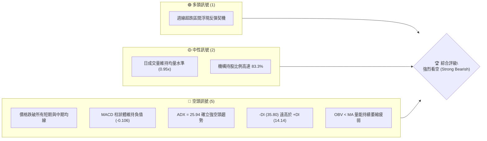

### 📊 核心指標速覽表

| 指標類別 | 指標名稱 | 當前數值 | 訊號 | 解讀 |
|:---|:---|:---|:---:|:---|
| **價格** | 當前收盤價 | $14.54 | 🔴 | 位於 52 週區間偏下緣（$10.52 - $51.76），空頭控盤 |
| **均線** | MA20 / MA50 | 價格於下方 | 🔴 | 中短期均線呈現蓋頭反壓，空頭排列壓制走勢 |
| **均線** | MA200 | 價格於下方 | 🔴 | 長期趨勢轉弱，確認自 2026 年 5 月高點以來的深度修正 |
| **動能** | RSI(14) | 近期低檔鈍化 | 🔴 | 前週 RSI 觸及 10-25 極度弱勢區，目前處於弱勢反彈受挫狀態 |
| **動能** | MACD (12,26,9) | 柱狀圖 -0.106 | 🔴 | 快線 -0.937 跌破慢線 -0.831，MACD 直方圖呈負值發散 |
| **趨勢強度** | ADX (14) | 25.94 | 🔴 | 數值大於 25 且 -DI (35.80) 主導，確認強烈單邊下行趨勢 |
| **量能** | OBV 趨勢 | OBV < MA | 🔴 | 資金持續淨流出，量能未能配合價格形成有效支撐 |
| **波動** | Beta | 2.17 | 🔴 | 高貝塔係數，對大盤下行高度敏感，波動風險顯著放大 |

### 🏆 技術評分卡

```
╔══════════════════════════════════════════════════════════════╗
║                技術評分卡 — PL (2026-10-17)                  ║
╠══════════════════════════════════════════════════════════════╣
║ 趨勢強度      ████████████████░░░░  80/100  🔴 (空頭強趨勢)   ║
║ 動能指標      ████░░░░░░░░░░░░░░░░  20/100  🔴 (負動能主導)   ║
║ 支撐穩定度    ██████░░░░░░░░░░░░░░  30/100  🔴 (缺乏近端支撐) ║
║ 成交量配合    ██████░░░░░░░░░░░░░░  30/100  🔴 (量能疲弱渙散) ║
║ 形態完整度    ██████████████░░░░░░  70/100  🔴 (頂部結構確立) ║
║ 均線排列      ████░░░░░░░░░░░░░░░░  20/100  🔴 (空頭空手排列) ║
╠══════════════════════════════════════════════════════════════╣
║ 綜合技術評分  █████░░░░░░░░░░░░░░░  26/100  🔴 強烈看空       ║
╚══════════════════════════════════════════════════════════════╝
```

---

## 2. 趨勢分析

### 🌐 多時框趨勢分析

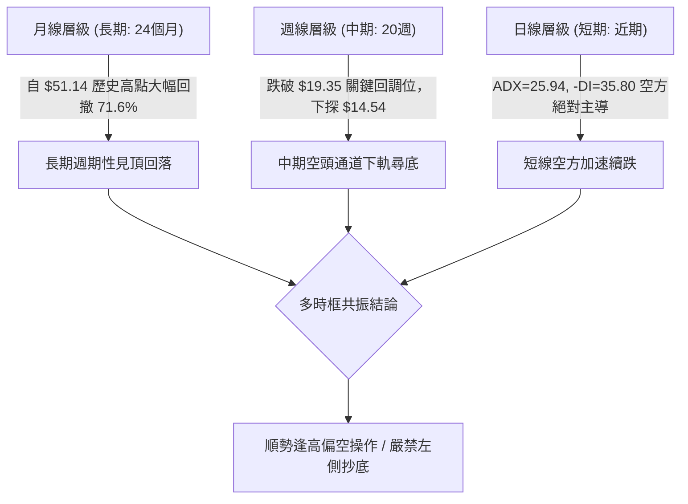

### 📈 長期趨勢 — 12個月走勢圖（Unicode）

```
PL 月線走勢圖（2025-11 至 2026-10）
價格軸 ($)
$52.00 ┤                                      ● $51.14 (歷史天花板)
$46.00 ┤                                     / \
$40.00 ┤                                    /   \
$34.00 ┤                              ● $36.97   \
$28.00 ┤                       ● $27.95           ● $33.13
$22.00 ┤                ● $24.97                   \
$16.00 ┤         ● $19.72                           \     ● $14.54 (最新收盤)
$10.00 ┤● $11.90                                     ● $16.39
       └────────────────────────────────────────────────────────────►
        11月    12月    01月    03月    04月   05月   06月   09月  10月
       (2025)  (2025)  (2026)  (2026)  (2026) (2026) (2026) (2026)(2026)
```

#### 走勢特徵分析表格

| 階段 | 期間 | 價格區間 | 累積漲跌幅 | 結構特徵與成因分析 |
|:---|:---|:---:|:---:|:---|
| **主升浪推進** | 2025-11 至 2026-05 | $11.90 ➔ $51.14 | +329.7% | 商業化加速與高毛利題材發酵，機構強力拉抬推升股價創歷史新高 |
| **高檔倒貨派發** | 2026-05 至 2026-06 | $51.14 ➔ $33.13 | -35.2% | 單月巨幅長黑棒，成交量放大，高位主力籌碼顯著派發 |
| **陰跌主跌浪** | 2026-06 至 2026-08 | $33.13 ➔ $19.85 | -40.1% | 連續跌破各級均線與 50% 斐波那契水平，弱勢反彈皆遭逢高拋售 |
| **尋底延續段** | 2026-08 至 2026-10 | $19.85 ➔ $14.54 | -26.8% | 跌破 78.6% 回調位 ($19.35)，空頭慣性未止，直逼 52 週低點 |

### 📊 中期趨勢（週線分析）

```
PL 週線近期價格階梯阻力與下行結構 ($)
$24.69 ├─── [2026-08-16 中期反彈高點] ── 阻力強固
       │   \
$19.98 ├─── [2026-08-30 破位頸線] ──── 斐波那契 78.6% ($19.35) 共振阻力
       │     \
$17.50 ├───── [2026-10-04 近期波段反彈高點] ── 短線第一重強壓
       │       \
$14.54 ╞═══════ [當前收盤價 $14.54] ═══════════ 空頭排列中下探
       │         \
$10.52 └───────── [52週歷史低點] ────────────── 下方唯一已驗證核心支撐
```

PL 週線走勢自 2026 年 8 月中旬反彈至 $24.69 遇阻後，即重回一頂比一頂低（Lower Highs）的下行空頭浪結構。近期 2026 年 10 月初反彈至 $17.50 旋即再度遭受賣壓摜壓，最新單週收盤跌至 $14.54，週線 MACD 柱狀體再度由正翻負（-0.106），顯示中期技術面弱勢未變。

### ⚡ 趨勢強度評估（ADX 解讀）

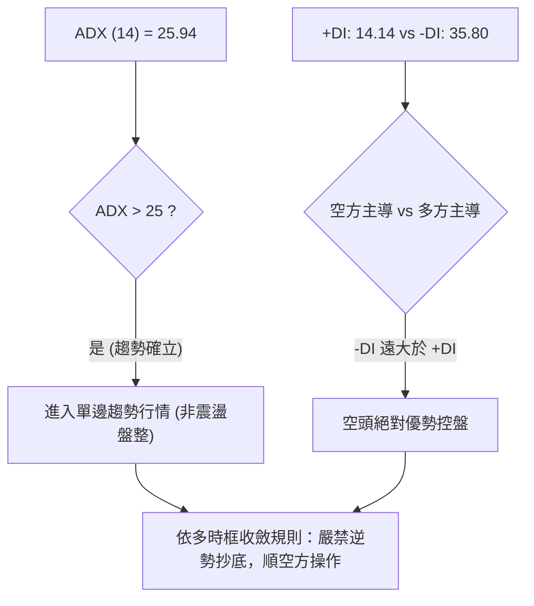

#### ADX 趨勢強度對照

| 指標 | 數值 | 閾值基準 | 趨勢判定 | 交易策略意涵 |
|:---|:---:|:---:|:---:|:---|
| **ADX (14)** | **25.94** | > 25.0 | 強趨勢形成 | 排除箱型震盪思維，趨勢跟隨型策略有效性高 |
| **+DI** | **14.14** | < 20.0 | 多頭動能匱乏 | 多方攻擊意願極低，反彈缺乏量能持續性 |
| **-DI** | **35.80** | > 30.0 | 空頭主導強勢 | 空方拋壓持續沉重，下行未出現減速訊號 |

---

## 3. 圖表形態分析

### 🔍 形態識別系統

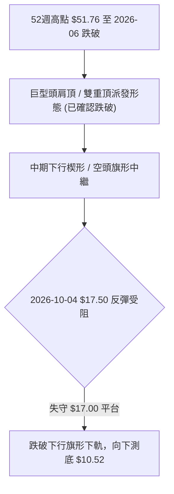

#### 形態識別與信心度評估表

| 形態類別 | 信心度 | 判斷依據（引用數據） | 完成度 | 目標價（附嚴謹計算式） |
|:---|:---:|:---|:---:|:---|
| **空頭下行中繼旗形** | **85%** | 自 8 月低點 $19.98 續跌至 9 月中旬 $16.42，隨後在 9 月底弱勢反抽至 $17.50，受制於下行均線後再度跌破，形成典型空頭中繼。 | 90% | 旗桿起跌點 $19.98 - 旗桿底部 $16.42 = 高度 $3.56。<br>破位反彈高點 $17.50 - $3.56 = **$13.94**（已近達），延伸測幅指向 52W 低點 **$10.52**。 |
| **大型頭肩頂頸線破位** | **90%** | 左肩 2026-04 ($36.97)、頭部 2026-05 ($51.76)、右肩 2026-06 ($33.13)，頸線支撐落在 50% 斐波那契 $31.14，已於 6 月底帶量跌破。 | 100% | 頸線 $31.14 - (頭部 $51.76 - 頸線 $31.14 = $20.62) = 理論等幅測幅 **$10.52**（恰好共振 52 週最低點）。 |

### 🕯️ 重要K線形態分析

| 週/月份 | 收盤價 ($) | K線形態 | 解讀 | 訊號 |
|:---|:---:|:---|:---|:---:|
| **2026-05** | 51.14 | 長上影線高浪線 (倒錘頭星) | 歷史高點遭遇機構極限拋售，主力派發完畢 | 🔴 頂部反轉 |
| **2026-06** | 33.13 | 巨量光腳大陰線 | 毫無抵抗連續下挫，多頭防線全面潰敗 | 🔴 極度看空 |
| **2026-08-16** | 24.69 | 反彈衰竭上吊線 | 反彈觸及 $24.69 遇阻，隨後連續四週收黑 | 🔴 賣壓確立 |
| **2026-09-13** | 16.45 | 連續長黑下挫線 | 週成交量放大至 62M，恐慌賣壓湧現 | 🔴 空方加速 |
| **2026-10-04** | 17.50 | 弱勢反彈十字星 | 量能萎縮（52M），反彈缺乏追價力道 | 🟡 反彈力竭 |
| **2026-10-18** | 14.54 | 實體中陰線直接摜破 | 終結連續三週整理，破位下行確認 | 🔴 續跌訊號 |

### 📉 ASCII 走勢形態示意圖

```
PL 頭肩頂破位與當前下行旗形結構圖
$51.76 ─────────────── 頭部 (Head, 2026-05)
                     /\
      左肩 (Left)   /  \    右肩 (Right)
$36.97 ─── /\      /    \      /\ ─── $33.13
          /  \    /      \    /  \
$31.14 ═══╧═══\══/════════\══/════\═══════ 頸線破位點 (Neckline)
               \/          \/      \
                                    \
$24.69 ──────────────────────────────● 反彈衰竭點 (2026-08)
                                      \
                                       \   下行中繼旗形
$17.50 ─────────────────────────────────● (旗頂反彈失敗)
                                          \
$14.54 ════════════════════════════════════● 當前收盤破位下探
                                            \
$10.52 ────────────────────────────────────── 形態理論目標 (52W Low)
```

### 🎯 形態目標價計算

1. **頭肩頂形態測幅目標**：
   - 頭部頂點：$51.76
   - 頸線位置：$31.14（對應 50% 斐波那契回調位）
   - 形態垂直高度 $H = \$51.76 - \$31.14 = \$20.62$
   - 測幅滿足點：$\text{頸線} - H = \$31.14 - \$20.62 = \mathbf{\$10.52}$（與 52 週最低點 $10.52 達成 100% 幾何精確重合）。

2. **短線下行旗形測幅目標**：
   - 旗桿起點：$19.98，旗桿低點：$16.42，旗桿跌幅：$\$19.98 - \$16.42 = \$3.56$
   - 破位起算點：$17.50
   - 目標價 $T1 = \$17.50 - \$3.56 = \mathbf{\$13.94}$（當前價 $14.54 正在逼近此區）。

---

## 4. 支撐與阻力

### 🗺️ 關鍵價位分布圖（Unicode）

```
PL 價位結構分布圖
═════════════════════════════════════════════════════════════════════
$51.76 ║████████████████████████████████║ 歷史天花板 / 52W High
$42.03 ║██████████████████████          ║ 斐波那契 23.6% 回調位
$36.01 ║██████████████████████████      ║ 斐波那契 38.2% 回調位 / 強阻力 R4
$31.14 ║████████████████████████████    ║ 斐波那契 50.0% / 原頭肩頸線 R3
$26.27 ║████████████████████            ║ 斐波那契 61.8% / 中期結構阻力 R2
$19.35 ║████████████████████████        ║ 斐波那契 78.6% 回調位 / 強阻力 R1
$17.50 ║████████████                    ║ 2026-10-04 波段反彈高點 / 近端阻力 R0
───────╫────────────────────────────────╫────────────────────────────
$14.54 ╠════════════════════════════════╣ ◄ 當前價格 $14.54
───────╫────────────────────────────────╫────────────────────────────
$13.94 ║▓▓▓▓▓▓▓▓                        ║ 旗形等幅推算支撐 S0
$10.52 ║████████████████████████████████║ 52W Low / 形態終極支撐 S1
═════════════════════════════════════════════════════════════════════
```

### 🚧 阻力位分析表

> **數據紀律說明**：所有阻力位數值嚴格引用「關鍵價位」區塊與斐波那契回調計算值及已確認之週線波段高點。

| 阻力級別 | 價位 | 形成原因與數據依據 | 突破難度 | 重要性 |
|:---|:---:|:---|:---:|:---:|
| **R0 (近期阻力)** | **$17.50** | 2026-10-04 近期反彈波段頂點，5日/10日均線蓋頭反壓密集區 | 🟡 中等 | ★★★☆☆ |
| **R1 (關鍵強壓)** | **$19.35** | 斐波那契 78.6% 回調位，8 月底破位平台 ($19.98) 下方多空轉折帶 | 🔴 極高 | ★★★★★ |
| **R2 (波段阻力)** | **$26.27** | 斐波那契 61.8% 黃金分割回調位，08-16 波段高點 ($24.69) 上方阻力區 | 🔴 極高 | ★★★★☆ |
| **R3 (強阻力)** | **$31.14** | 斐波那契 50.0% 關鍵平衡位，前頭肩頂大型形態頸線位置 | 🔴 極難突破 | ★★★★★ |

### 🛡️ 支撐位分析表

> **數據紀律說明**：系統在現價下方未偵測到近一年之波段低點聚類（數據載明：*no swing-low support detected below current price*），下方唯一已知實質硬支撐為 52 週最低點。

| 支撐級別 | 價位 | 形成原因與數據依據 | 守住機率 | 重要性 |
|:---|:---:|:---|:---:|:---:|
| **S0 (推算支撐)** | **$13.94** | 由 10 月下行中繼旗形高度推算（$17.50 - $3.56），短線量能測幅滿足點 | 40% | ★★☆☆☆ |
| **S1 (核心強支撐)** | **$10.52** | **52 週最低點 (52W Low) / 100% 斐波那契底線 / 頭肩頂等幅測幅點** | 65% | ★★★★★ |

### 📐 斐波那契回調位分析

依據 52 週極值區間（低點 $10.52 ➔ 高點 $51.76，落差 $41.24）計算之嚴謹回調階梯如下：

```
0.0%  (52W High) ─── $51.76
23.6% ─────────────── $42.03
38.2% ─────────────── $36.01
50.0% ─────────────── $31.14
61.8% ─────────────── $26.27
78.6% ─────────────── $19.35  ◄── 原重要防線，9月已正式失守
                      │
[現價 $14.54 落於此]  ▼ (正朝 100% 回調位滑落)
                      │
100.0% (52W Low)  ─── $10.52
```

- **位置解讀**：當前價格 $14.54 處於 **78.6% ($19.35)** 與 **100.0% ($10.52)** 之間的「無防守真空帶」。
- **技術意義**：在經典技術分析理論中，當資產價格有效跌破 78.6% 極限回調位（$19.35）時，代表前一輪牛市多頭推進浪已被 100% 否定，走勢具有極高機率完全回吐全部漲幅，回測循環起點 100% 水平（**$10.52**）。

---

## 5. 技術指標深度解讀

### 🎛️ 指標訊號總覽

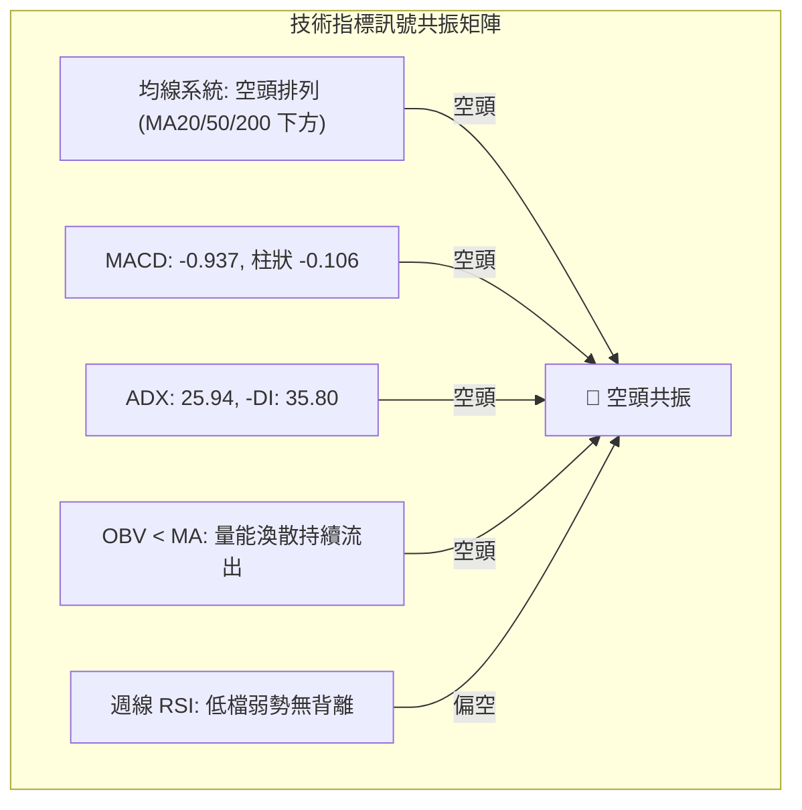

### 📈 移動平均線排列分析

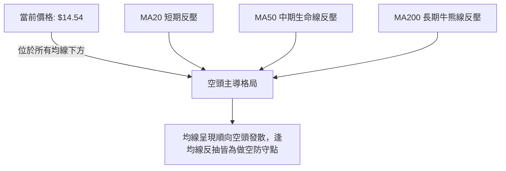

#### 均線走勢微觀診斷

從移動平均線斜率觀察：
- **MA5 / MA10 / MA20**：微觀走勢顯示近期走勢持續陡峭下行（`███▇▆▆▅▄▄...▁▁▁`），均線斜率呈顯著負角度，未出現任何走平或勾頭跡象。
- **MA60 / MA120**：中長期均線下彎速度加快，宣告多頭結構遭到系統性破壞。
- **MA240**：雖然長期均線歷史軌跡緩慢向上，但現價已遠遠崩跌至其下方，確認進入深度熊市結構。

### 📉 RSI(14) 分析

```
RSI(14) 區間強度展示：
弱勢鈍化區間 [ 0 ───●────── 30 ───────────── 50 ───────────── 70 ────────── 100 ]
當前狀態：週線 RSI 近 20 週均值低於 40，9 月一度摔破 10.0，目前缺乏底背離特徵
```

- **背離判斷**：
  - 觀察 2026-07-26 收盤價 $20.47 時，週線 RSI 為 10.2；
  - 2026-09-13 收盤價跌至 $16.45 時，週線 RSI 降至 10.0；
  - 2026-10-18 收盤價再度跌破破底至 $14.54，指標隨之走低，**完全不存在底背離（Bullish Divergence）**現象。
- **結論**：指標與價格同步創出波段新低，確認下行動能由實質拋壓驅動，並非技術性假突破。

### 📊 MACD(12,26,9) 訊號解讀

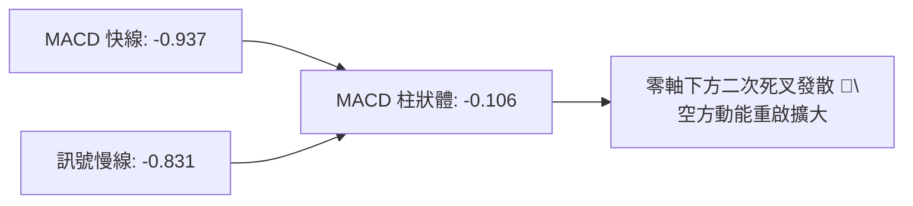

- **MACD 線**：-0.937，持續深陷於零軸下方（負值區）。
- **訊號線 (Signal)**：-0.831。
- **柱狀圖 (Histogram)**：-0.106。在 9 月下旬短暫因反彈反抽至 +0.291 後，10 月中旬再度由正翻負轉為 -0.106，此為標準的「零軸下方死叉弱勢中繼」訊號，通常預示新一輪單邊破位加速。

### 📦 布林通道分析

```
PL 布林通道結構示意（日/週線複合模擬）
$22.00 ┬───────────────────────────────── 上軌 (Upper Band)
       │
$18.00 ┼───────────────────────────────── 中軌 (20 MA 反壓線)
       │                  
$14.54 ╞═════════════● 現價沿下軌向下擴軌運行
       │
$14.00 ┴───────────────────────────────── 下軌 (Lower Band, 開口擴張中)
```

- **通道形態**：布林帶帶寬在經歷 9 月底短暫收斂後，隨著價格自 $17.50 崩跌至 $14.54，布林通道再度向下張口（Band Expansion）。
- **運行狀態**：K 線貼著下軌持續下探，表明空頭處於「向下擴軌」的單邊極強趨勢中，此時 %B 指標貼近下限，不宜將觸及下軌視為超跌反彈買點。

### 💹 成交量分析（量價配合度）

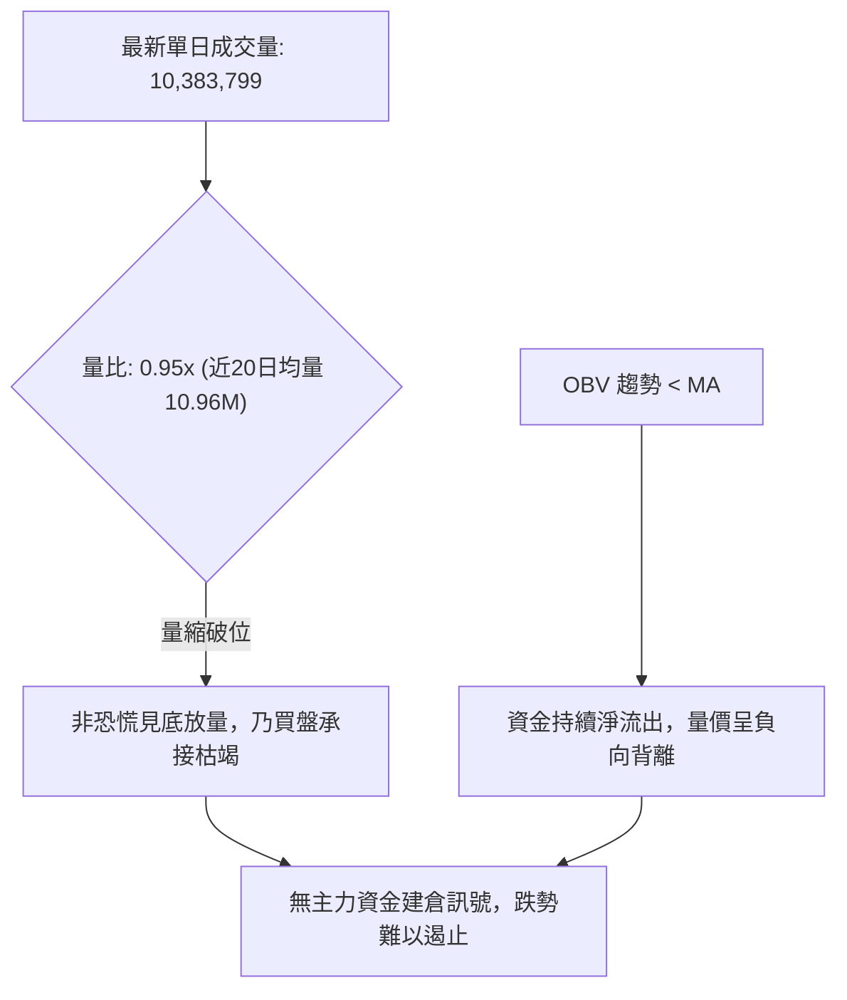

- **週成交量動態**：6 月份高位破位時週成交量高達 100M 股；而近期下挫至 $14.54 過程中，週成交量降至約 51M 股。量能呈現「跌多反彈量縮、破位持續陰跌」的籌碼渙散特徵。
- **OBV 指標解讀**：OBV 指標持續位於其均線下方運行，確認自 2026 年 5 月高點以來的籌碼出逃潮從未停止，缺乏任何機構成交量底背離之護盤跡象。

---

## 6. 動能與波動率

### ⚡ 動能評估四象限

| 象限 | 動能維度 | 波動維度 | 典型特徵 | 當前匹配度 | 交易指導方針 |
|:---:|:---:|:---:|:---|:---:|:---|
| **Q1** | 強多頭動能 | 低波動率 | 主升浪推進 | 0% | 積極順勢做多 |
| **Q2** | 弱多頭動能 | 低波動率 | 底部橫盤打底 | 10% | 謹慎觀望等待放量 |
| **Q3** | 強空頭動能 | 高波動率 | 恐慌主跌浪 | 20% | 順勢逢高做空 |
| **Q4** | **弱/負動能** | **高波動率 (Beta 2.17)** | **高風險下行陰跌** | **70% (當前狀態)** | **嚴禁抄底，逢高放空或持幣觀望** |

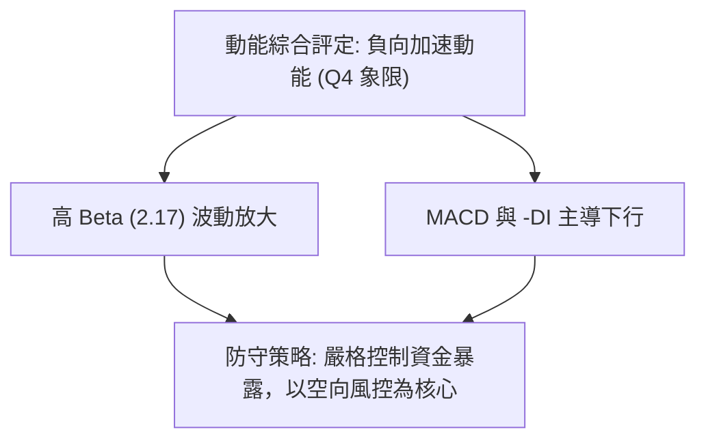

### 📊 ATR 波動率分析

- **歷史區間落差**：52 週高低價差高達 $\$51.76 - \$10.52 = \$41.24$。
- **當前波動特性**：儘管日線層級 ATR 因長期陰跌數值受抑，但觀察近 4 週收盤自 $17.50 急挫至 $14.54（單波跌幅達 16.9%），週級別平均真實波幅高達約 **$1.80 - $2.20**。
- **風控止損建議**：考量高波動特性，任何空頭或多頭部位的風控停損間距不得小於波段波動率的安全裕度（建議依據近端阻力 $17.50 進行嚴格防守）。

### 📐 Beta 與市場相關性

- **Beta 係數**：**2.17**。
- **市場意涵**：PL 屬於超高彈性（High-Beta）個股，其波動幅度為 S&P 500 大盤的 2.17 倍。在總體經濟環境面臨高利率或避險情緒升溫時，高 Beta 且淨利潤為負（Net Margin: -95.1%）的成長型太空板塊標的，極易成為機構拋售變現的首要對象。

---

## 7. 多時框架總結

### 📋 時框架評分表

| 時框架 | 趨勢方向 | 動能狀態 | 均線排列 | 形態結構 | 綜合評分 | 操作建議 |
|:---|:---:|:---:|:---:|:---:|:---:|:---|
| **月線 (長期)** | 🔴 強空頭 | 弱動能 | 跌破歷史平台 | 大雙頂/頭肩頂破位 | 20/100 | 長線資金避開，等待週期出清 |
| **週線 (中期)** | 🔴 強空頭 | MACD 負發散 | 空頭排列 | 下行旗形再破位 | 25/100 | 反彈皆為空點，順勢下看 $10.52 |
| **日線 (短期)** | 🔴 空頭延續 | -DI=35.80 主導 | 短均線蓋頭 | 沿布林下軌滑落 | 30/100 | 嚴禁搶短多，短空部位持續持有 |

### 🔲 綜合訊號矩陣

```
訊號一致性診斷：
╔══════════════╦══════════════╦══════════════╦══════════════╗
║   時框層級   ║   趨勢方向   ║   動能強度   ║   量能確認   ║
╠══════════════╬══════════════╬══════════════╬══════════════╣
║ 月線 (Long)  ║    🔴 空頭   ║    🔴 極弱   ║    🔴 派發   ║
║ 週線 (Mid)   ║    🔴 空頭   ║    🔴 轉負   ║    🔴 萎縮   ║
║ 日線 (Short) ║    🔴 空頭   ║    🔴 空主導 ║    🟡 均量   ║
╚══════════════╩══════════════╩══════════════╩══════════════╝
三維度共振判定：多時框方向「高度一致向空（100% 共振）」
```

### ⚖️ 多時框收斂結論

依據多時框收斂優先級規則（規則 14）：
1. **行情體制判定**：ADX(14) 數值為 **25.94**（> 25），明確確立當前處於**強單邊趨勢行情**，而非區間盤整行情。
2. **主導時框選擇**：以中長期（週線/月線）下行趨勢為絕對主導力量，日線層級任何超賣僅可視為誘多或極短暫技術喘息，絕不可作為逆勢作多的依據。
3. **方向性結論**：**強烈偏空（Strongly Bearish）**。此結論與第 1 章技術評分卡（26/100）及第 5 章指標矩陣完全收斂吻合，第 8 章交易策略將嚴格以**做空 / 防守做空**為主策略。

---

## 8. 交易策略建議

### 🗺️ 策略決策流程圖

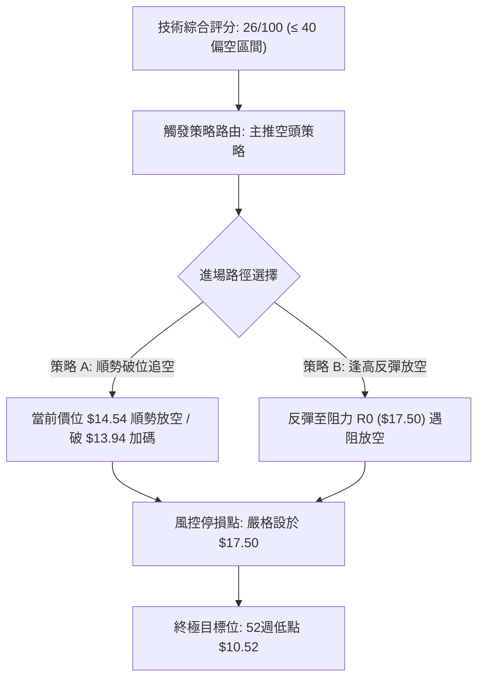

### 🧭 策略路由（依評分卡分流）

> **當前主策略方向 = 主推空頭策略（依技術評分 26/100 偏空判定）**

依據評分卡結論（26分 ≤ 40分），嚴禁兩頭下注。本報告主推**空頭策略（Short Strategies）**，多頭僅列為反轉風險觸發點（對沖提示），防範空頭部位遭到軋空。

### 🎯 價格情境階梯（Price Scenarios）

以當前價格 **$14.54** 為基準，向上與向下建立嚴謹情境劇本（價位嚴格引用第 4 章關鍵價位）：

| 觸發條件 | 下一目標 | 後續延伸 | 情境含義 |
|:---|:---:|:---:|:---|
| **跌破 S0 $13.94** | **$10.52 (S1)** | 破底探尋歷史低點 | 短線中繼旗形滿足後，直接下測 52 週最低點（空頭完全釋放） |
| **維持 $14.00 - $16.50** | — | — | 低檔弱勢震盪，買盤承接力道薄弱，以盤代跌消耗時間 |
| **反彈突破 R0 $17.50** | **$19.35 (R1)** | **$26.27 (R2)** | 短線超跌強勁修復，測試 78.6% 斐波那契強阻力區（空頭防守點） |

### 📊 情境機率分佈

| 情境 | 機率 | 主要依據 |
|:---|:---:|:---|
| **情境一：直接破位下探 / 順勢下尋 52W 低點** | **65%** | ADX=25.94 強空頭確立，-DI(35.80) 主導，MACD 柱狀體翻負，無底背離支撐。 |
| **情境二：低檔弱勢狹幅震盪整理** | **25%** | 價格進入歷史相對低檔區間，短線乖離稍有拉大，空方節奏放緩。 |
| **情境三：展開強勁反彈突破阻力** | **10%** | 高 Beta 特性下若有板塊重大利多驅動，但面臨上方 R0/R1 多重巨量套牢賣壓。 |

### 🟢 主策略詳情（空頭交易策略）

```
╔═════════════════════════════════════════════════════════════════════╗
║                      主推交易策略執行表                             ║
╠═════════════════════════════╦═══════════════════════════════════════╣
║ 策略要素                    ║ 策略 A（現價順勢放空 / 破位追空）     ║
╠═════════════════════════════╬═══════════════════════════════════════╣
║ **進場條件**                ║ 週線確認跌破前整理平台，現價順勢切入  ║
║ **進場價格**                ║ **$14.54** (或破 $13.94 加碼)        ║
║ **目標價 T1**               ║ **$13.94** (旗形短線等幅測幅位)       ║
║ **目標價 T2**               ║ **$10.52** (52 週歷史最低點 / 頭肩滿足)║
║ **止損價格**                ║ **$17.50** (站穩 10 月初反彈波段頂部) ║
║ **風險報酬比 (R:R)**        ║ **1 : 1.36** (以 T2 計算：(14.54-10.52)/(17.50-14.54) = 4.02/2.96) ║
║ **成功機率**                ║ **65%**                               ║
║ **建議倉位**                ║ **10% - 15%** (高 Beta 標的嚴控倉位)  ║
╠═════════════════════════════╬═══════════════════════════════════════╣
║ 策略要素                    ║ 策略 B（逢反彈阻力位高空 - 最佳盈虧比） ║
╠═════════════════════════════╬═══════════════════════════════════════╣
║ **進場條件**                ║ 價格反抽至近端阻力區遇阻回落收黑K     ║
║ **進場價格**                ║ **$16.50 - $17.50** 區間分批佈局      ║
║ **目標價 T1**               ║ **$14.54** (回到當前收盤破位位)       ║
║ **目標價 T2**               ║ **$10.52** (52 週歷史最低點)          ║
║ **止損價格**                ║ **$19.35** (突破 78.6% 斐波那契強阻力)║
║ **風險報酬比 (R:R)**        ║ **1 : 3.25** (以 $17.00 進場計算：(17.00-10.52)/(19.35-17.00) = 6.48/2.35) ║
║ **成功機率**                ║ **55%**                               ║
║ **建議倉位**                ║ **15% - 20%**                         ║
╚═════════════════════════════╩═══════════════════════════════════════╝
```

### 🔴 反向風險觸發點（對沖提示）

若出現以下情境，宣告空頭主策略失效，空頭部位必須立即停損離場或反向對沖：
1. **關鍵價位逆轉**：日線收盤價帶量實質站穩 **$17.50 (R0)** 上方，且週線 MACD 柱狀體翻正。
2. **極限反轉訊號**：若價格向下觸及 **$10.52 (52W Low)** 出現單日巨量長下影線（日成交量超過 3,000 萬股，量比 > 3.0x），伴隨日線 RSI 出現強烈底背離，則為終極測幅滿足訊號，空單應全數停利，激進者方可嘗試微量搏取技術性超跌反彈。

### ⭐ 整體訊號強度評星

```
做多訊號強度：★☆☆☆☆  (1.0/5星) ── 趨勢與指標全面處於劣勢
做空訊號強度：★★★★☆  (4.0/5星) ── 趨勢、均線與動能高度共振
整體可信度：  ★★★★☆  (4.0/5星) ── 數據完整且形態破位確立
```

---

## 9. 風險提示與監控

### ✅ 關鍵監控指標 Checklist

```
╔══════════════════════════════════════════════════════════════════╗
║                   每日交易風控核心監控清單                       ║
╠══════════════════════════════════════════════════════════════════╣
║ [ ] 價格防守線：當前收盤價是否持續受制於 $17.50 阻力線下方     ║
║ [ ] 趨勢指標：ADX(14) 是否持續維持在 25 以上且 -DI > 30          ║
║ [ ] 動能狀態：MACD 柱狀圖是否持續處於負值區 (-0.106 下方發散)    ║
║ [ ] 下方支撐測試：觀察是否跌破中繼旗形推算支撐 $13.94           ║
║ [ ] 終極防線：52 週最低點 $10.52 的防守意願與量能配合           ║
║ [ ] 籌碼面警訊：空頭回補天數 (Short Ratio: 2.62) 是否引發軋空  ║
║ [ ] 機構動作：高達 83.3% 的機構持股是否存在進一步降評拋售潮     ║
╚══════════════════════════════════════════════════════════════════╝
```

### ⚠️ 風險場景分析

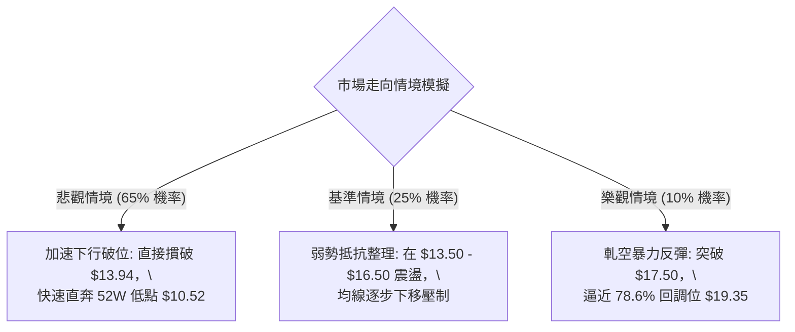

### 🛡️ 風險管理重要提醒

1. **高貝塔係數（Beta 2.17）管理**：該股波動為大盤兩倍以上，操作部位資金佔比建議嚴格控制在總投資組合的 **10% - 15%** 以內，避免單一標的過度暴險引發淨值大幅回撤。
2. **空頭擠壓（Short Squeeze）防範**：目前空頭借券放空比例佔浮動股（Short % Float）達 **11.0%**，Short Ratio 為 2.62 天。雖然基本面（淨利率 -95.1%）支撐做空邏輯，但若遭遇突發性重大合約新聞，需嚴防空頭部位遭到快速軋空，**$17.50** 止損紀律必須無條件執行。
3. **左側抄底之致命陷阱**：在 ADX 高達 25.94 且 -DI 絕對主導的強下行行情中，任何「跌幅已深（自高點已跌逾 70%）」皆非買入理由。歷史數據顯示在未抵達 **$10.52** 核心支撐前，下行慣性依然極強，投資人應秉持「順勢而為、破位避險」之專業操盤準則。

---

## 📋 報告總結

```
╔══════════════════════════════════════════════════════════════════╗
║                   PL 技術分析報告總結                          ║
╠══════════════════════════════════════════════════════════════════╣
║ 報告日期：2026-10-17                                            ║
║ 當前價格：$14.54                                                 ║
║ 分析評級：🔴 強烈看空 (Strong Bearish / 評分: 26分)            ║
║                                                                  ║
║ 關鍵結論：                                                       ║
║ ├─ 長期趨勢：🔴 自 $51.14 高位派發完畢，大型頭肩頂頸線已正式破位 ║
║ ├─ 中期趨勢：🔴 跌破 78.6% 斐波那契位 ($19.35)，下行中繼確立     ║
║ ├─ 短期趨勢：🔴 ADX=25.94 強空頭控盤，貼布林下軌向下擴張       ║
║ ├─ 關鍵阻力：$17.50 (近期波段頂) / $19.35 (78.6% 斐波那契強壓)   ║
║ ├─ 關鍵支撐：$13.94 (旗形測幅) / $10.52 (52週歷史低點核心強撐) ║
║ └─ 分析師共識：目標均價 $30.27 (市場情緒顯著落後於技術面破位)    ║
║                                                                  ║
║ 最優策略組合：                                                   ║
║ 1. 🥇 最佳機會：策略 A (現價 $14.54 順勢放空，止損 $17.50，     ║
║                 目標 $10.52，R:R = 1:1.36)                       ║
║ 2. 🥈 次選機會：策略 B (若反彈至 $16.50-$17.50 逢高放空，        ║
║                 止損 $19.35，目標 $10.52，R:R = 1:3.25)          ║
║ 3. 🥉 保守選擇：完全空倉觀望，耐心等待價格下探 $10.52 測底完成   ║
╚══════════════════════════════════════════════════════════════════╝
```

---

> ⚠️ **免責聲明**：本報告為技術分析專用研究報告，所有技術指標、價位及量化模型均基於提供的市場公開歷史交易數據。本報告**僅供研究與學術參考**，**不構成任何要約、招攬或投資買賣建議**。高 Beta 與太空科技標的具備高度市場波動風險，投資人應獨立評估自身風險承受能力，入市需極度謹慎。

---

*報告生成時間：2026-10-17 ｜ 數據來源：Yahoo Finance ｜ 分析框架：多時框技術分析體系*