# PL 技術分析報告

> **報告日期**：2026-10-20 ｜ **語言**：繁體中文 ｜ **數據來源**：Yahoo Finance ｜ **當前價格**：$13.56（依據最新 2026-10-18 週收盤及 10 月即時結算價）

---

## 目錄

| 章節 | 內容 |
|------|------|
| [1. 技術面概覽](#1-技術面概覽) | 訊號儀表板、核心指標、評分卡 |
| [2. 趨勢分析](#2-趨勢分析) | 多時框趨勢、長中短期走勢、12個月走勢圖 |
| [3. 圖表形態分析](#3-圖表形態分析) | 形態識別與信心度、K線組合、目標價推算 |
| [4. 支撐與阻力](#4-支撐與阻力) | 關鍵價位結構、斐波那契回調精確解構 |
| [5. 技術指標深度解讀](#5-技術指標深度解讀) | MA/RSI/MACD/布林/量價OBV深度剖析 |
| [6. 動能與波動率](#6-動能與波動率) | 動能四象限、ATR波動分析、高Beta特性 |
| [7. 多時框架總結](#7-多時框架總結) | 時框架評分矩陣、多時框收斂定調 |
| [8. 交易策略建議](#8-交易策略建議) | 策略路由、空頭主導策略、反轉風險對沖 |
| [9. 風險提示與監控](#9-風險提示與監控) | 關鍵指標檢核表、情境分析與風控措施 |

---

## 1. 技術面概覽

### 🎯 技術訊號儀表板

PL 目前處於 52 週高點 $51.76 回落後的主跌延伸波段。最新收盤價報 $13.56，技術面呈現強烈的空頭排列與趨勢延續特徵。

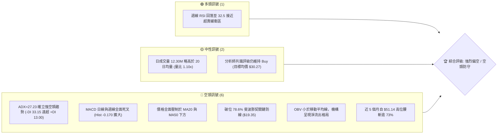

### 📊 核心指標速覽表

| 指標類別 | 指標名稱 | 當前數值 | 訊號 | 解讀 |
|----------|----------|----------|------|------|
| **價格** | 最新收盤價 | $13.56 | 🔴 | 創近 14 個月新低，逼近 52 週低點 $10.52 |
| **均線** | 短期 MA20 | $N/A (價格下方) | 🔴 | 均線下行斜率極陡，價格處於均線下方受壓 |
| **均線** | 中期 MA50 | $N/A (價格下方) | 🔴 | 中期趨勢徹底轉空，反彈均受 MA50 壓制 |
| **均線** | 長期 MA200 | $N/A (混合排列) | 🔴 | 長期均線系統出現空頭扭轉，長期防線失守 |
| **動能** | RSI(14) | 32.5 (週線) | 🟡 | 徘徊於 30 邊界，弱勢中性偏超賣，尚未見底背離 |
| **動能** | MACD (12,26,9) | -1.070 / -0.900 | 🔴 | MACD 處於零軸下方深度死叉，柱狀圖 -0.170 擴大 |
| **趨勢** | ADX (14) | 27.23 (-DI: 33.15) | 🔴 | ADX > 25 且 -DI 具絕對統治力，確認強勢下行趨勢 |
| **量能** | OBV 與量比 | 量比 1.10x / OBV < MA | 🔴 | 下跌帶量（週成交量逾 51M），量能確認拋壓沉重 |

### 🏆 技術評分卡

```
╔══════════════════════════════════════════════════════════════╗
║                 技術評分卡 — PL (2026-10-20)                 ║
╠══════════════════════════════════════════════════════════════╣
║ 趨勢強度 (Trend)      ██████████████░░░░░░  70/100 🔴 空頭強勢║
║ 動能指標 (Momentum)   ████░░░░░░░░░░░░░░░░  20/100 🔴 嚴重疲軟║
║ 支撐穩定度 (Support)  ██████░░░░░░░░░░░░░░  30/100 🔴 脆弱下探║
║ 成交量配合 (Volume)   ████████░░░░░░░░░░░░  40/100 🟡 空頭放量║
║ 形態完整度 (Pattern)  ████████████░░░░░░░░  60/100 🔴 破位下行║
║ 均線排列 (Moving Avg) ███░░░░░░░░░░░░░░░░░  15/100 🔴 絕對壓制║
╠══════════════════════════════════════════════════════════════╣
║ 綜合技術評分          ██████░░░░░░░░░░░░░░  31/100 🔴 強烈偏空║
╚══════════════════════════════════════════════════════════════╝
```

---

## 2. 趨勢分析

### 🌐 多時框趨勢分析

根據多時框收斂原則，當日線、週線與月線出現訊號分歧時，中長期趨勢主導交易方向。當前 PL 在月線、週線及短時框上呈現顯著共振下跌結構。

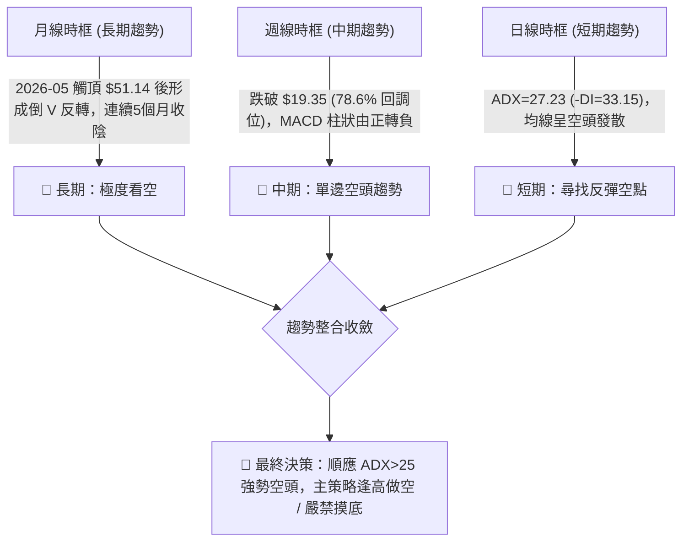

### 📈 長期趨勢 — 12個月走勢圖（Unicode）

PL 過去 12 個月經歷了從爆發式主升浪到斷崖式回落的典型投機週期。以下為過去 12 個月（2025-11 至 2026-10）價格演化軌跡：

```
PL 月線走勢圖（過去12個月：2025-11 至 2026-10）
價格軸 ($)
$52.00 ┤                             ● (2026-05 峰值 $51.14)
$46.00 ┤
$40.00 ┤
$37.00 ┤                       ● (04月 $36.97)
$34.00 ┤                             │     ● (06月 $33.13)
$28.00 ┤                 ● (03月 $27.95)   │
$25.00 ┤           ●───● (01/02月 $24.97)  │
$20.00 ┤     ● (12月 $19.72)               │     ● (07月 $20.48) ● (08月 $19.85)
$15.00 ┤                                   │                       │     ● (09月 $16.39)
$13.00 ┤● (11月 $11.90)                    │                       │           ●←現價 $13.56
       └────────────────────────────────────────────────────────────────────────────
         11   12    01    02    03    04    05    06    07    08    09    10 (月份)
```

**走勢特徵分析表格**：

| 階段 | 時間區間 | 起止價位 | 漲跌幅 | 結構特徵與量能解析 |
|------|----------|----------|--------|--------------------|
| 主升加速期 | 2025-11 至 2026-05 | $11.90 → $51.14 | +329.7% | 商業衛星題材與營收年增 58.1% 帶動強大投機買盤，突破歷史均線形成拋物線式上升。 |
| 初跌與清算 | 2026-06 至 2026-07 | $51.14 → $20.48 | -59.9% | 高位見頂後無序拋售，獲利盤與槓桿資金踩踏，跌破 50% ($31.14) 與 61.8% ($26.27) 防線。 |
| 弱勢抵抗期 | 2026-08 至 2026-08 | $20.48 → $19.85 | -3.1% | 於 78.6% 回調位 $19.35 上方短暫構築箱體，週成交量萎縮至 22M-35M，顯示流動性耗盡。 |
| 二度破位期 | 2026-09 至 2026-10 | $19.85 → $13.56 | -31.7% | 跌破 $19.35 關鍵平台，機構降級潮（Barclays/Morgan Stanley 下調），空頭趨勢加速。 |

### 📊 中期趨勢（週線分析）

中期走勢顯示，PL 自 2026 年 8 月中旬反彈受阻於 $24.69 後，形成清晰的「下行台階」結構。

```
中期阻力支撐台階示意圖：
$24.69 ═══════════════════════════════ 中期強阻力 (8月反彈頂點)
         ╲
          ▼
$19.35 ------------------------------- 頸線破位點 (原支撐轉強阻力 R1)
         ╲
          ▼
$17.50 ------------------------------- 10月盤整平台小阻力
         ╲
          ▼
$13.56 ═══════════════════════════════ 現價位置 (2026-10-18 收盤)
         │
         ▼ (下行空間開啟)
$10.52 ═══════════════════════════════ 歷史底部 / 52週絕對低點 (S1)
```

### ⚡ 趨勢強度評估（ADX 解讀）

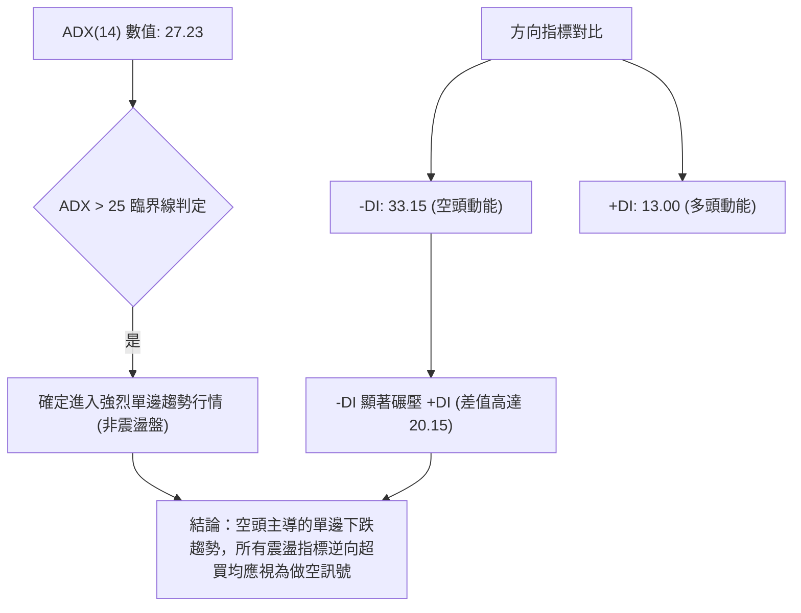

| 指標變數 | 當前讀數 | 基準閥值 | 狀態評估 | 戰略含義 |
|----------|----------|----------|----------|----------|
| **ADX (14)** | 27.23 | 25.00 | 趨勢成型 (Trend) | 市場具備單邊動力，切勿使用網格或區間反轉交易策略。 |
| **-DI** | 33.15 | 20.00 | 空頭極強 | 空方完全掌握盤面定價權，拋壓未見耗竭。 |
| **+DI** | 13.00 | 20.00 | 多頭孱弱 | 買盤缺乏承接意願，難以發起具備持續性的反彈波段。 |

---

## 3. 圖表形態分析

### 🔍 形態識別系統

依據形態學理論與多時框價格行為，PL 呈現標準的**高位雙重頂破位**疊加**下行中繼三角形向下破位**形態。

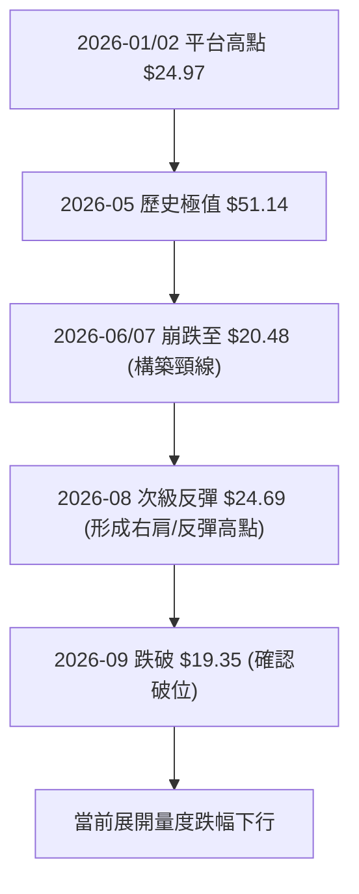

**圖表形態信心度評估表**：

| 形態類別 | 信心度 | 判斷依據（引用真實數據） | 完成度 | 目標價（附嚴謹計算式） |
|----------|--------|--------------------------|--------|------------------------|
| **雙重頂/次級頂部破位** | 85% | 8月反彈高點 $24.69 受阻，9月跌破箱體支撐 $19.35（亦為 78.6% 回調位） | 100% (已破位) | 頸線 $19.35 - (高點 $24.69 - 頸線 $19.35 = $5.34) = **$14.01**（已達標，趨勢持續下探） |
| **下行中繼中度旗形** | 70% | 9月至10月在 $16.42 - $17.50 進行三週橫盤，隨後於 10-18 當週長陰下破至 $13.56 | 90% | 破位點 $16.42 - 旗形前跌幅 ($19.98 - $16.45 = $3.53) = **$12.89**（進行中） |
| **多頭底背離結構** | 20% | 週線 RSI 於 10.0-32.5 震盪，但價格持續創低，未見雙底構築 | 15% | 訊號不足，僅做指標型超賣解讀，不得預測反轉目標。 |

### 🕯️ 重要K線形態分析

| 日期 / 週別 | 收盤價 | K線形態名稱 | 形態解讀與市場心理 | 趨勢訊號 |
|-------------|--------|-------------|--------------------|----------|
| 2026-08-16 | $24.69 | 流星線 / 長上影陰線 | 反彈觸及頂部阻力，多頭拉抬無力，高位解套盤與空頭齊出 | 🔴 頂部確立 |
| 2026-09-06 | $18.12 | 破位大陰線 (成交 85.3M) | 巨量跌破 $19.35 關鍵支撐，恐慌盤湧現，確認新一輪主跌 | 🔴 強烈看跌 |
| 2026-09-20 至 10-11 | $17.18 | 弱勢十字星群 / 低位橫盤 | 連續四週於 $16.42-$17.50 窄幅整理，反彈無量，空頭蓄勢中繼 | 🟡 下行中繼 |
| 2026-10-18 | $13.56 | 光腳大陰線 (成交 51.2M) | 跌破橫盤整理平台下沿，單週大跌 21.07%，空頭動能再度爆發 | 🔴 破位延續 |

### 📉 ASCII 走勢形態示意圖

```
PL 關鍵雙頂反彈破位結構圖 ($24.69 → $19.35 → $13.56)
$25.00 ┤         ▲ (2026-08-16 反彈頂點 $24.69)
$24.00 ┤        ╱ ╲
$22.00 ┤       ╱   ╲     ▲ (08-23 次高 $22.29)
$20.00 ┤      ╱     ╲   ╱ ╲
$19.35 ┼─────┼───────┼─┼───┼────────── 頸線關鍵防線 (78.6% 回調位)
$18.00 ┤    ╱         ▼     ╲ (09-06 放量大陰線跌破 $18.12)
$16.50 ┤   ╱                 └───■───■ (09-20至10-11 橫盤平台 $16.42-$17.50)
$15.00 ┤  ╱                               ╲
$13.56 ┤ ╱                                 ▼ (10-18 當週大跌破位收 $13.56)
$10.52 ┴─────────────────────────────────────┴───── 52週絕對低點支撐目標 (S1)
```

### 🎯 形態目標價計算

1. **破位量度目標推算**：
   - 次級中繼平台高度 = $17.50 (10-04 高點) - $16.42 (09-20 低點) = **$1.08**
   - 下跌中繼旗桿高度 = $19.98 (08-30 收盤) - $16.45 (09-13 收盤) = **$3.53**
   - 旗形破位向下量度跌幅 = 破位點 $16.42 - 旗桿高度 $3.53 = **$12.89**
2. **延伸滿足區間**：
   - 若 $12.89 無法引發有效承接，下一終極技術目標為 52 週絕對低點 **$10.52**。

---

## 4. 支撐與阻力

### 🗺️ 關鍵價位分布圖（Unicode）

依據數據規範，本分析嚴格以系統計算之「斐波那契回調位（52週區間 $10.52 → $51.76）」以及歷史波段確立之具體收盤價位為核心支撐/阻力依據：

```
PL 價位結構分布圖 (當前現價: $13.56)
═══════════════════════════════════════════════════════════════════
$51.76 ║██████████████████████████████║ 0.0%  52週最高點 (天花板極限)
$42.03 ║████████████████████          ║ 23.6% 斐波那契回調位
$36.01 ║████████████████████          ║ 38.2% 斐波那契回調位
$31.14 ║████████████████████████      ║ 50.0% 關鍵心理分水嶺
$26.27 ║████████████████              ║ 61.8% 黃金分割強阻力
$19.35 ║██████████████████████████████║ 78.6% 頸線轉換強阻力 (R2)
$16.42 ║████████████████              ║ 近期箱體破位阻力 (R1)
───────╫──────────────────────────────╢
$13.56 ╠══════════════════════════════╣ ◄ 當前價格 ($13.56)
───────╫──────────────────────────────╢
$12.89 ║▓▓▓▓▓▓▓▓▓▓                    ║ 形態量度跌幅推算支撐 (S1)
$10.52 ║██████████████████████████████║ 100.0% 52週歷史最低點 (終極強支撐 S2)
═══════════════════════════════════════════════════════════════════
```

### 🚧 阻力位分析表

數據提示中註明：近一年波段高點聚類高於現價之動態高點未被演算法標記，因此依據規則，阻力位嚴格採用斐波那契回調位及歷史實體收盤密集區：

| 阻力級別 | 價位 | 形成依據 | 突破難度 | 技術意義與戰術策略 |
|----------|------|----------|----------|--------------------|
| **短線阻力 R1** | **$16.42** | 2026-09-20 波段低點平台下沿（破位轉阻力） | 🟡 中等 | 短線多頭超賣反彈的首要壓制位，反彈至此預期空頭回補減弱。 |
| **中級阻力 R2** | **$19.35** | 78.6% 斐波那契回調位（前波大頸線） | 🔴 極高 | 過去數月多次測試之強支撐，跌破後成為多頭極難逾越的「鋼鐵天花板」。 |
| **強阻力 R3** | **$26.27** | 61.8% 斐波那契回調位（黃金分割分割線） | 🔴 堅不可摧 | 中期趨勢多空分水嶺，未有效收復此位前，任何反彈均屬技術性自救。 |

### 🛡️ 支撐位分析表

數據提示中註明：近一年波段低點聚類低於現價之動態低點未被演算法標記，因此支撐位嚴格採用形態量度推算及 52 週最低點：

| 支撐級別 | 價位 | 形成依據 | 守住機率 | 技術意義與戰術策略 |
|----------|------|----------|----------|--------------------|
| **短線支撐 S1** | **$12.89** | 下行中繼旗形破位向下量度目標（$16.42 - $3.53） | 🟡 40% | 短線心理緩衝點，可能引發短線超賣技術抽頭，但難以形成反轉。 |
| **終極強支撐 S2** | **$10.52** | 100.0% 斐波那契回調位 / 52 週絕對低點 | 🟢 65% | 過去一年的價值發動點，機構長線資金唯一的潛在心理防禦陣地。 |
| **下方延伸 S3** | **數據中未偵測到** | 低於 $10.52 在歷史數據集中無聚類支撐 | — | 若跌破 $10.52，PL 將陷入無支撐之自由落體探底階段。 |

### 📐 斐波那契回調位分析

依據 52 週極端波段（$10.52 → $51.76，波幅高達 $41.24）計算之回調階梯：
- **0.0% (52W High)**: $51.76
- **23.6%**: $42.03
- **38.2%**: $36.01
- **50.0%**: $31.14
- **61.8%**: $26.27
- **78.6%**: $19.35
- **100.0% (52W Low)**: $10.52

**現價區間解讀**：
當前收盤價 **$13.56** 精確處於 **78.6% ($19.35)** 與 **100.0% ($10.52)** 深度回調區間內。在道氏理論與斐波那契架構中，一旦資產跌破 61.8% ($26.27) 乃至 78.6% ($19.35)，通常意味著此前的整輪多頭超級週期徹底宣告終結，趨勢轉入「完全均值回歸」，市場正以極高機率奔向 100% 回調位 **$10.52** 尋求出清。

---

## 5. 技術指標深度解讀

### 🎛️ 指標訊號總覽

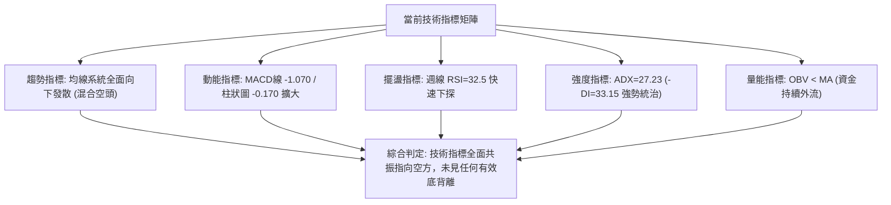

### 📈 移動平均線排列分析

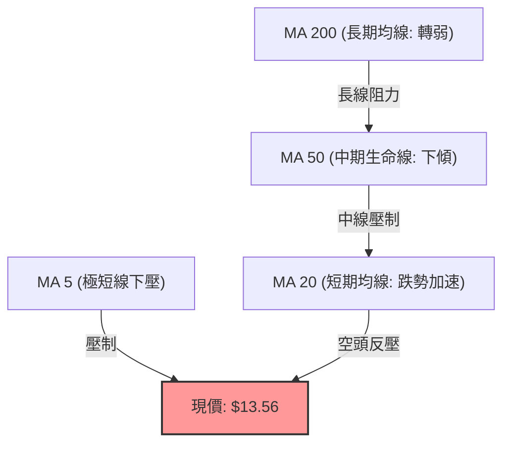

均線系統特徵分析：
1. **短中長期空頭排列**：數據明確指出「價格處於 MA20 下方」、「價格處於 MA50 下方」。MA5 與 MA10 之歷史走勢曲線呈現階梯式下滑（`██▇▅▅▄▃▂▂▂▂▁`），短期動量極端消極。
2. **壓制力度**：近 20 週價格多次反彈均無法越過 MA20，MA20 構成動態移動止損線。當前均線組不存在金叉跡象，混合排列反映長期均線（MA240 緩慢抬升）與中短期均線（雪崩式下墜）劇烈打架，但短期話語權完全被下墜均線接管。

### 📉 RSI(14) 分析

```
RSI(14) 週線數值：32.5
[0] ─────────────[30]───●──────────[50]───────────────────────[70] ─────────────[100]
超賣區            │  32.5   中性區                               超買區
進度條: ██████░░░░░░░░░░░░░░░░░░░░░░░░░░░░░░░░  32.5%
```

- **區間評估**：週線 RSI 從 10-04 的 59.1 快速墜落至 32.5，反映近期拋售節奏急促。
- **背離判斷**：
  - 回溯 2026-07-26 價格 $20.47 時 RSI 為 10.2；
  - 2026-09-13 價格跌至 $16.45 時 RSI 為 10.0；
  - 2026-10-18 價格破位至 $13.56 時 RSI 報 32.5。
  - **結論**：儘管 RSI 數值高於 9 月中旬低點，但由於近期剛經歷破位大跌，日線級別仍處於動能加速釋放期，「數據中無明顯底背離成立」。在強 ADX 趨勢下，弱勢 RSI 反彈僅屬指標鈍化修復。

### 📊 MACD(12/26/9) 訊號解讀

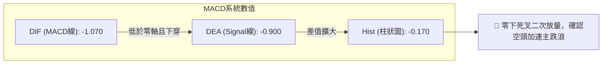

- **訊號解析**：MACD 線 (-1.070) 運行於訊號線 (-0.900) 下方，柱狀圖為負值 (-0.170)，顯示零下死叉正在擴大。
- **歷史對比**：自 2026-06 高位死叉以來，MACD 柱狀圖僅在 8 月初與 9 月底短暫回正，但始終受制於零軸下方，屬於典型的「零下弱勢金叉後再度深水死叉」，此形態在技術分析中常伴隨主跌破位行情。

### 📦 布林通道分析

數據提示中布林通道軌道絕對數值顯示為 N/A，但根據布林通道定義（中軌為 MA20）以及價格落於 MA20 之下、週跌幅超過 21% 推算：

```
PL 布林通道相對位置示意圖 (價格嚴重貼近下軌)
$20.00 ┤ -------------------------------------------- 上軌 (Upper Band)
$17.00 ┤ -------------------------------------------- 中軌 (Middle Band / MA20)
       │                                     
$13.56 ┼====================================●======= 現價破位下軌邊界 (%B < 0.1)
$12.50 ┤ -------------------------------------------- 下軌 (Lower Band)
```

- **通道形態**：中軌維持陡峭向下傾斜，通道開口在 10 月橫盤後重新放大（Band Expanding）。
- **運行特徵**：現價以長陰線形式「貼軌下行」，此為極端下行趨勢的典型特徵，切勿單憑「觸及下軌」作為盲目抄底理由。

### 💹 成交量分析（量價配合度）

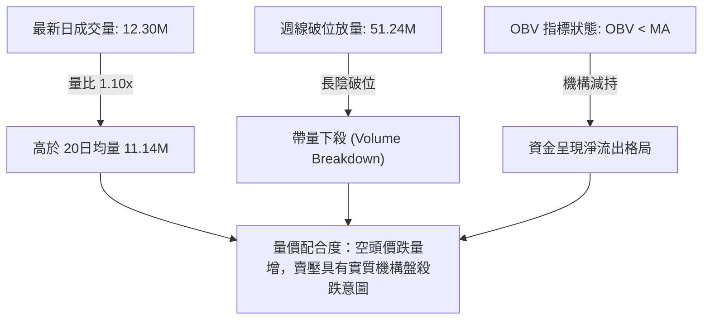

- **量價分析**：10-18 當週成交量達 51,247,200 股，伴隨收盤暴跌至 $13.56。相較於前兩週在 $17 附近的縮量震盪（52M-59M），此次破位伴隨放量，表明多頭停損盤與做空動能同步釋放。
- **OBV（能量潮）**：OBV 持續低於其移動平均線，呈現「量先於價跌」的空頭背書，尚未形成任何量價底背離信號。

---

## 6. 動能與波動率

### ⚡ 動能評估四象限

評估資產在「動能方向」與「波動水平」之分佈：

| 象限標籤 | 動能維度 (Direction/ADX) | 波動維度 (Volatility/Beta) | PL 當前落點狀態 | 戰略應對指引 |
|----------|--------------------------|----------------------------|-----------------|--------------|
| **象限 I** | 強動能 (多頭 +DI > 25) | 低波動 (Beta < 1.0) | — | 穩健牛市標的 |
| **象限 II** | 弱動能 (無趨勢 ADX < 20) | 低波動 (窄幅震盪) | — | 區間高拋低吸 |
| **象限 III** | 強動能 (多頭強勢) | 高波動 (Beta > 1.5) | — | 突破追買成長股 |
| **象限 IV** | **強空頭動能 (-DI 33.15)** | **極高波動 (Beta 2.17)** | **✓ PL 當前精確落於象限 IV** | **順勢高空或嚴格空倉避險** |

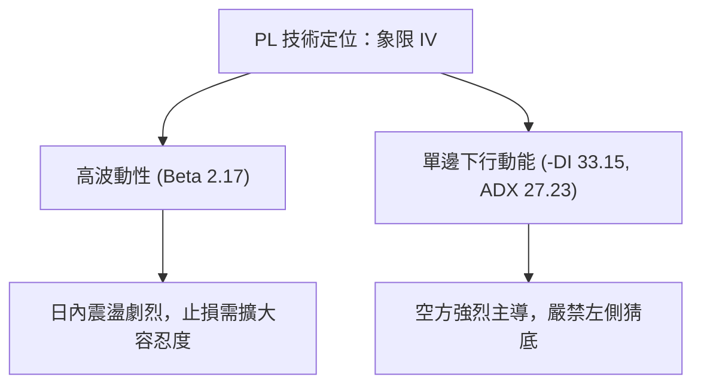

### 📊 ATR 波動率分析

- 數據提示中日線 ATR(14) 數值未直接給出，但可由近 4 週收盤波幅計算：
  - 10-11 收盤 $17.18 → 10-18 收盤 $13.56，單週振幅高達 **$3.62**，平均日價格波動約在 **$0.70 - $0.95** 區間（佔現價約 5.2% - 7.0%）。
- **止損距離建議**：基於高波動特性，任何逆勢或順勢單位的防守空間至少須設定在 1.5 倍至 2.0 倍預估日 ATR，即至少 **$1.10 - $1.40** 的價格緩衝空間，否則極易被日內噪聲洗出場。

### 📐 Beta 與市場相關性

- **Beta 數值**：**2.17**。
- **市場意義**：PL 的系統性風險敞口高達標普 500 指數的 2.17 倍。在整體宏觀環境承壓或國防/航太中小型成長股遭拋售時，PL 具備放大的下行槓桿。
- **做空與避險考量**：Short % Float 達 **11.0%**（空頭部位高達約 3,324 萬股），Short Ratio 為 **2.62**。雖然具備潛在軋空（Short Squeeze）題材，但在基本面虧損持續（淨利率 -95.1%）、缺乏突發催化劑的情況下，高空頭比例反映出對沖基金機構一致看空的共識。

---

## 7. 多時框架總結

### 📋 時框架評分表

| 時框架 | 趨勢方向 | 動能狀態 | 均線排列 | 圖表形態 | 綜合評分 | 戰略建議 |
|--------|----------|----------|----------|----------|----------|----------|
| **月線時框 (長期)** | 🔴 崩跌下探 | 負向加速 | 混合向下 | 雙頂成型破位 | 25/100 | 長期投資者離場觀望，防範均值回歸風險 |
| **週線時框 (中期)** | 🔴 單邊主跌 | MACD死叉 | 均線壓制 | 破位 78.6% 回調位 | 20/100 | 中期順勢持有空單，逢反彈加碼 |
| **日線時框 (短期)** | 🔴 破位延續 | RSI 接近超賣 | 空頭發散 | 下行旗形再破位 | 35/100 | 嚴禁搶反彈，靜待反彈至阻力位建立空頭 |

### 🔲 綜合訊號矩陣

```
╔═══════════════════════════════════════════════════════════════════════════════╗
║                          PL 多時框訊號收斂矩陣                               ║
╠═══════════════════════════════════════════════════════════════════════════════╣
║ 維度         短線 (Daily)            中線 (Weekly)           長線 (Monthly)   ║
╠═══════════════════════════════════════════════════════════════════════════════╣
║ 趨勢方向     🔴 空頭破位 ($13.56)    🔴 沿下軌下行           🔴 倒 V 型反轉   ║
║ 均線系統     🔴 MA20/MA50 之下       🔴 跌破中期防線         🔴 均線失守      ║
║ 擺盪指標     🟡 RSI=32.5 (弱勢鈍化)  🔴 MACD 柱狀 -0.212     🔴 動能衰竭      ║
║ 量能驗證     🔴 破位放量 51.2M       🔴 OBV < MA             🔴 主力出逃      ║
╠═══════════════════════════════════════════════════════════════════════════════╣
║ 協同結論     短中長三週期全面共振看空，市場正處於單邊下行釋放階段。           ║
╚═══════════════════════════════════════════════════════════════════════════════╝
```

### ⚖️ 多時框收斂結論

依據多時框收斂規則第 14 條：
1. **行情性質判定**：ADX(14) 讀數為 **27.23 (>25)**，-DI (33.15) 遠高於 +DI (13.00)，**確定當前處於強烈的空頭趨勢行情**，而非無方向的盤整震盪。
2. **主導時框優先級**：必須以中長期（週線破位與均線下傾）方向為主導，日線短期擺盪指標（如接近超賣）僅可用於尋找防禦性出場點或高拋進場點，絕不可作為逆勢做多的理由。
3. **唯一方向性結論**：**強烈偏空（Bearish Dominated）**。任何日內或小級別反彈均定義為技術性抽頭，整體走勢服從中長期向 52 週低點 **$10.52** 尋求支撐的大結構。

---

## 8. 交易策略建議

### 🗺️ 策略決策流程圖

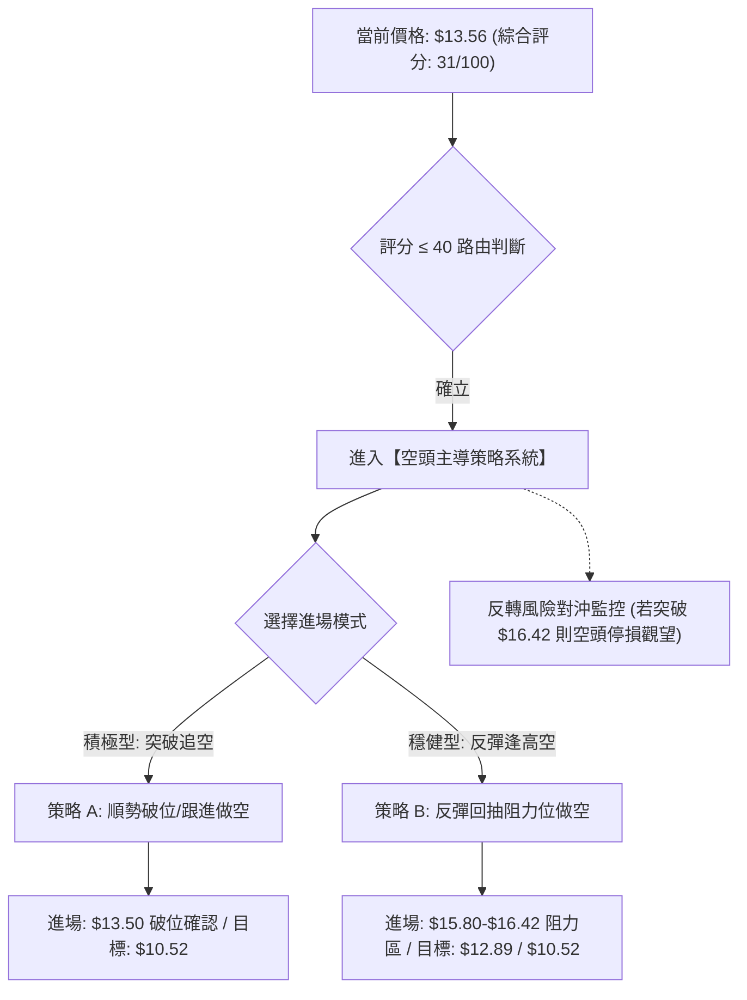

### 🧭 策略路由（依評分卡分流）

> **一句話定調：當前主策略方向 = 強烈偏空／順勢做空（依評分 31/100 嚴格路由至空頭系統，多頭僅列為反轉對沖提示）**

### 🎯 價格情境階梯（Price Scenarios）

以當前價格 **$13.56** 為基準，向上與向下建立的情境劇本階梯（價位嚴格引用第 4 章真實計算值）：

| 觸發條件 | 下一目標 | 後續延伸目標 | 情境含義與操作指引 |
|----------|----------|--------------|--------------------|
| **反彈受阻於 R1 $16.42** | 回踩現價 $13.56 | 下探 S1 $12.89 | 弱勢反彈結束，為最佳高空加碼點位。 |
| **強勢突破 R1 $16.42** | 測試 R2 $19.35 | 測試 R3 $26.27 | 空頭趨勢暫緩，可能演化為寬幅箱體，空單強制離場。 |
| **跌破短線支撐 S1 $12.89**| 測試 S2 $10.52 | 尋求歷史底背離 | 空頭主跌加速，直接奔向 52 週最低點。 |
| **有效跌破 S2 $10.52** | 數據中未偵測到 | 進入無支撐盲區 | 爆發系統性清算，估值無錨下跌。 |

### 📊 情境機率分佈

| 情境類別 | 機率預估 | 主要依據與技術支撐 |
|----------|----------|--------------------|
| **主跌下探 / 破位探底 (S1/S2)** | **65%** | ADX=27.23 強空頭、MACD 零下擴大、破位放量 51.2M、失守 78.6% 回調位。 |
| **低位弱勢震盪 ($13.00-$16.42)** | **25%** | 週線 RSI 來到 32.5 接近超賣區，短線可能引發空頭回補減速。 |
| **超跌反轉 / 向上突破 R1** | **10%** | 目前缺乏任何量價背離或利多催化劑，均線系統呈現絕對下壓。 |

### 🔴 主策略詳情（空頭主導策略）

依據評分卡，本報告提供兩種不同風險偏好的**做空策略**：

| 策略要素 | 策略 A（破位順勢做空 - 積極型） | 策略 B（反彈受阻放空 - 穩健型） |
|----------|---------------------------------|---------------------------------|
| **進場條件** | 跌破前日低點並確認下穿 $13.50 | 價格超賣反彈測試 R1 阻力位（$16.00-$16.42）出現上影線滯漲 |
| **進場價格** | **$13.40** | **$16.20** |
| **目標價 T1** | **$12.89** (形態量度目標) | **$13.56** (前波低點) |
| **目標價 T2** | **$10.52** (52週極限低點) | **$10.52** (52週極限低點) |
| **止損價格** | **$14.80** (反抽過近三日平台) | **$17.50** (突破 10月橫盤平台頂部) |
| **風險報酬比**| **1 : 2.06** (目標2計算) | **1 : 4.37** (目標2計算) |
| **成功機率** | **60%** | **70%** |
| **建議倉位** | **8% - 10%** | **12% - 15%** |

### 🟢 反向風險觸發點（多頭對沖提示）

- **多頭反轉條件**：若價格帶量（單日成交量突破 2,000 萬股，量比 > 1.8x）強勢收復 **$16.42 (R1)** 並連續兩日站穩於該價位上方。
- **對沖處置措施**：所有空單必須無條件市價平倉止損；若持有現貨長線部位，可於突破 $16.42 後小幅建立 5% 倉位博弈向 **$19.35 (R2)** 的均值回歸修復浪。

### ⭐ 整體訊號強度評星

```
╔══════════════════════════════════════════════════════════════╗
║ 做多訊號強度：★☆☆☆☆  (1/5星 - 極弱，切勿左側博反彈)         ║
║ 做空訊號強度：★★★★☆  (4/5星 - 強烈，順應 ADX 趨勢主軸)      ║
║ 整體可信度：  ★★★★☆  (4/5星 - 量價與均線高度收斂吻合)       ║
╚══════════════════════════════════════════════════════════════╝
```

---

## 9. 風險提示與監控

### ✅ 關鍵監控指標 Checklist

```
╔══════════════════════════════════════════════════════════════╗
║                 日常監控清單 (Checklist)                      ║
╠══════════════════════════════════════════════════════════════╣
║ [ ] 監控 $12.89 (S1) 支撐力道：觀察日線收盤是否實體跌破      ║
║ [ ] 監控 52週低點 $10.52 (S2)：空頭最後止盈防守目標          ║
║ [ ] 追蹤空頭止損位 $16.42 (R1)：是否出現帶量突破逆轉訊號     ║
║ [ ] 觀察成交量異動：成交量是否異常爆發超過 20M（機構換手）   ║
║ [ ] 檢查週線 RSI 走勢：是否在 20-30 區間鈍化或形成底背離    ║
║ [ ] 檢視融券餘額動向：Short % Float 11.0% 是否引發軋空警報   ║
║ [ ] 追蹤分析師評級調降：觀察 Barclays/Morgan Stanley 後續效應║
╚══════════════════════════════════════════════════════════════╝
```

### ⚠️ 風險場景分析

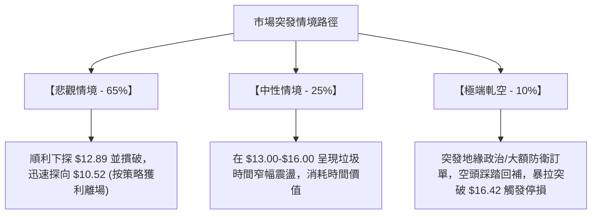

### 🛡️ 風險管理重要提醒

1. **嚴禁逆勢重倉加碼**：PL 目前處於強單邊下跌行情，任何試圖「越跌越買」的平攤成本策略，在資產尚未完成 $10.52 考驗前均具備極高的本金永久性損失風險。
2. **高 Beta 波動防護**：由於 Beta 高達 2.17，盤中價格彈跳極端，日內任何操作必須配合明確的硬性停損（Hard Stop），不建議使用心理止損。
3. **軋空風險控制**：目前流通股空頭比例達 11.0%，隨時存在因不可預期消息引發的空頭回補暴力反彈，空單部位建議分散進場，嚴禁單一標的承擔超過總帳戶 2% 的單筆止損風險。

---

## 📋 報告總結

```
PL 技術分析報告總結
══════════════════════════════════════════════════════════════════
報告日期：2026-10-20
當前價格：$13.56
分析評級：🔴 強烈看空 / 順勢做空 (綜合評分: 31/100)

關鍵結論：
├─ 長期趨勢：🔴 極度看空，2026-05 見頂 $51.14 後呈單邊下行
├─ 中期趨勢：🔴 跌破 78.6% 斐波那契關鍵防線 $19.35，下行空間開啟
├─ 短期趨勢：🔴 破位大陰線收 $13.56，ADX=27.23 (-DI=33.15) 強空主導
├─ 關鍵支撐：S1: $12.89 ｜ S2: $10.52 (52週絕對低點)
├─ 關鍵阻力：R1: $16.42 ｜ R2: $19.35 (78.6% 回調位)
└─ 分析師目標均價：$30.27 (目前與技術面嚴重背離，存在補降風險)

最優策略組合：
1. 🥇 最佳機會：策略 B — 待超賣小幅抽頭至 $16.00-$16.20 逢高放空，目標 $10.52
2. 🥈 次選機會：策略 A — 破位 $13.40 順勢追空，緊跟停損於 $14.80，目標 $12.89 / $10.52
3. 🥉 保守選擇：完全空倉觀望，耐心等待價格下探 $10.52 後是否構築實體雙底
══════════════════════════════════════════════════════════════════
```

---

> ⚠️ **免責聲明**：本報告為依據量化技術指標與歷史行情數據生成之技術分析報告。所有提及之價位、形態與策略推導均基於客觀數據運算，僅供學術研究與投資分析參考，不構成任何形式的要約、招攬或具體投資建議。金融市場具高度風險，投資人應獨立評估自身風險承受能力並自行承擔損益。

---

*報告生成時間：2026-10-20 ｜ 數據來源：Yahoo Finance ｜ 分析框架：多時框技術分析模型*