# PL 技術分析報告

> **報告日期**：2026-10-21 ｜ **語言**：繁體中文 ｜ **數據來源**：Yahoo Finance ｜ **當前價格**：$13.59

---

## 目錄

| 章節 | 內容 |
|------|------|
| [1. 技術面概覽](#1-技術面概覽) | 訊號儀表板、核心指標、評分卡 |
| [2. 趨勢分析](#2-趨勢分析) | 多時框趨勢、長中短期走勢 |
| [3. 圖表形態分析](#3-圖表形態分析) | 形態識別、K線組合、目標價 |
| [4. 支撐與阻力](#4-支撐與阻力) | 關鍵價位、斐波那契回調 |
| [5. 技術指標深度解讀](#5-技術指標深度解讀) | MA/RSI/MACD/布林/成交量 |
| [6. 動能與波動率](#6-動能與波動率) | 動能評估、ATR、Beta |
| [7. 多時框架總結](#7-多時框架總結) | 時框架評分矩陣 |
| [8. 交易策略建議](#8-交易策略建議) | 多空策略、風險報酬比 |
| [9. 風險提示與監控](#9-風險提示與監控) | 監控指標、風險場景 |

---

## 1. 技術面概覽

### 🎯 技術訊號儀表板

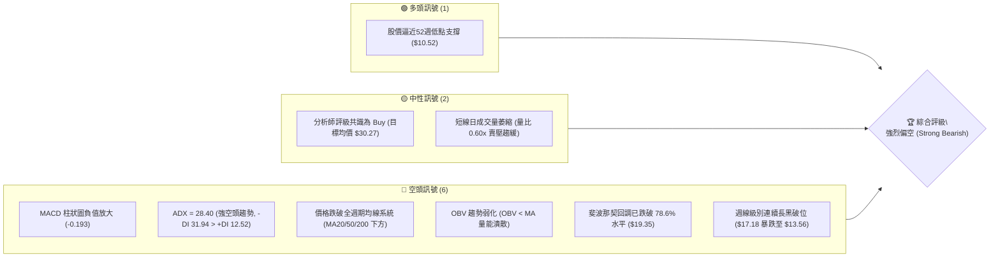

### 📊 核心指標速覽表

| 指標類別 | 指標名稱 | 當前數值 | 訊號 | 解讀 |
|:---|:---|:---|:---:|:---|
| **價格** | 當前收盤價 | $13.59 | 🔴 | 位於52週極低區間，持續探底 |
| **價格** | 52週高／低 | $51.76 / $10.52 | 🔴 | 距離52週高點回撤達 -73.74% |
| **趨勢** | ADX(14) | 28.40 | 🔴 | ADX > 25 確立強趨勢，空頭主導 (-DI=31.94) |
| **動能** | MACD (12,26,9) | -1.159 | 🔴 | 快慢線位於零軸下方深度負值區 |
| **動能** | MACD Signal | -0.966 | 🔴 | MACD < Signal，死亡交叉延續中 |
| **動能** | MACD Hist | -0.193 | 🔴 | 綠柱擴張，空頭動能尚未耗盡 |
| **動能** | RSI(14) (週線) | 32.5 (前週) | 🟡 | 逼近超賣臨界值(30)，但無底背離訊號 |
| **均線** | MA20 / MA50 | 價格於下方 | 🔴 | 短中期均線呈空頭排列，反壓沉重 |
| **量能** | 成交量比 (VR) | 0.60x | 🟡 | 當日量 6.61M 低於20日均量 10.97M |
| **量能** | OBV 趨勢 | OBV < MA | 🔴 | 資金持續流出，量能未能確認反轉 |
| **波動** | Beta | 2.17 | 🔴 | 高波動性標的，大盤下挫時下行風險倍增 |

### 🏆 技術評分卡

```
╔══════════════════════════════════════════════════════════════════╗
║                   技術評分卡 — PL (2026-10-21)                   ║
╠══════════════════════════════════════════════════════════════════╣
║ 趨勢強度 (Trend)      ██████████████░░░░░░  28/100  🔴 強烈空頭  ║
║ 動能指標 (Momentum)   █████░░░░░░░░░░░░░░░  22/100  🔴 動能低迷  ║
║ 支撐穩定度 (Support)  ████████░░░░░░░░░░░░  35/100  🔴 逼近前低  ║
║ 成交量配合 (Volume)   ███████░░░░░░░░░░░░░  30/100  🔴 量價背馳  ║
║ 形態完整度 (Pattern)  ██████████░░░░░░░░░░  40/100  🟡 空頭旗形  ║
║ 均線系統 (Moving Avg) ████░░░░░░░░░░░░░░░░  18/100  🔴 全面承壓  ║
╠══════════════════════════════════════════════════════════════════╣
║ 綜合評分 (Composite)  ██████░░░░░░░░░░░░░░  28.8/100 🔴 強烈賣出 ║
╚══════════════════════════════════════════════════════════════════╝
```

---

## 2. 趨勢分析

### 🌐 多時框趨勢分析

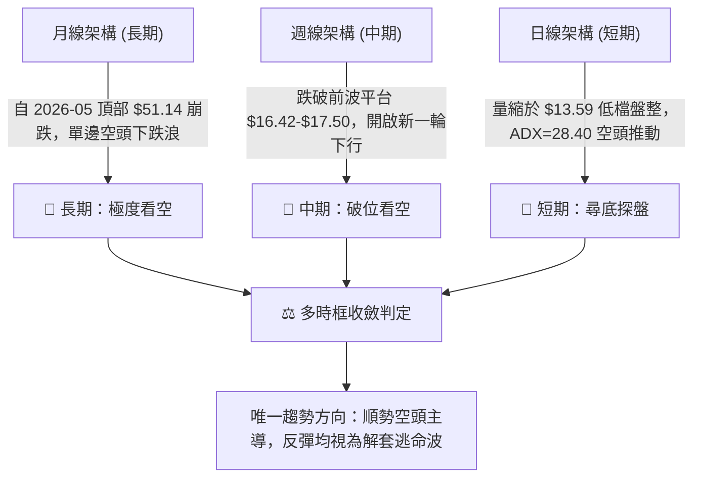

### 📈 長期趨勢 — 12個月走勢圖（Unicode）

```
PL 月線走勢圖（過去12個月：2025-11 至 2026-10）
價格軸 ($)
$52.00 ┤                                     ● $51.14 (2026-05 天頂)
$46.00 ┤                                    ╱ ╲
$40.00 ┤                                   ╱   ╲
$34.00 ┤                             ●    ╱     ● $33.13 (2026-06)
$28.00 ┤                       ●    ╱ ╲  ╱       ╲
$22.00 ┤                 ●    ╱ ╲  ╱   ●          ● $20.48 (2026-07)
$16.00 ┤           ●    ╱ ╲  ╱   ●                 ╲       ● $16.39
$10.00 ┤ ●──●     ╱ ╲  ╱   ●                        ╲     ╱   ╲
 $4.00 ┤     ╲   ╱   ●                                ╲   ╱     ● $13.59 (現價)
       └─────────────────────────────────────────────────────────────
        11   12  01  02  03  04  05  06  07  08  09  10 (月份)
        2025年 ───►  2026年
```

#### 走勢特徵分析表格

| 階段 | 期間 | 價格區間 ($) | 漲跌幅 (%) | 形態特徵與動能演變 |
|:---|:---|:---:|:---:|:---|
| **主升浪突破期** | 2025-11 ~ 2026-01 | $11.90 → $24.97 | +109.8% | 巨量推升，突破雙底頸線，量價齊揚 |
| **高檔強勢整理** | 2026-01 ~ 2026-03 | $24.97 → $27.95 | +11.9% | 換手蓄勢，於 $24 支撐上方構築上升三角形 |
| **狂熱拋物線頂** | 2026-04 ~ 2026-05 | $27.95 → $51.14 | +82.9% | 投機買盤爆發，創 52 週新高 $51.76，極度超買 |
| **派發崩跌初段** | 2026-05 ~ 2026-07 | $51.14 → $20.48 | -59.9% | 高檔多殺多，月K連續崩落，週線MACD翻負 |
| **弱勢抵抗反彈** | 2026-07 ~ 2026-08 | $20.48 → $24.69 | +20.5% | 跌深技術性反抽，受阻於 $26.27 (61.8% 斐波回調) |
| **主跌浪破位段** | 2026-09 ~ 2026-10 | $19.98 → $13.59 | -31.9% | 連破整數關卡，近週由 $17.18 暴跌至 $13.56 |

### 📊 中期趨勢（週線分析）

中期走勢呈現典型「梯級下跌（Staircase Down）」架構：
1. **第一承壓箱體（2026-08）**：反彈至高點 $24.69（2026-08-16）遭遇空頭伏擊，隨後連續回落，跌破 $20.00 整數支撐。
2. **第二震盪平台（2026-09 ~ 2026-10初）**：在 $16.42 ~ $17.50 進行為期 4 週的弱勢築底，但在 2026-10-18 週突然爆出 51.29M 賣壓長黑K棒，收盤跳空破位至 $13.56，宣告平台徹底瓦解。
3. **當前探底走勢**：本週收盤報 $13.59，雖然跌勢暫時趨緩，但上方 $16.42 ~ $17.50 已由前期支撐完全轉換為強烈中期反壓帶。

### ⚡ 趨勢強度評估（ADX 解讀）

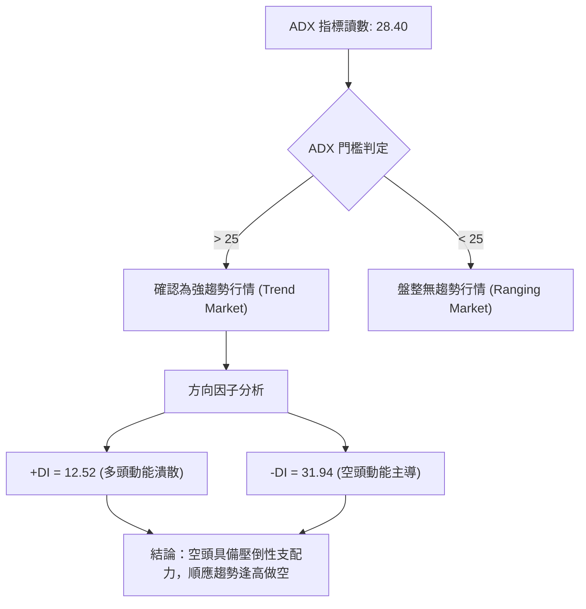

| ADX 數值區間 | 趨勢強度定義 | 當前 PL 狀態 | 技術意涵與操作指導 |
|:---:|:---:|:---:|:---|
| 00 – 20 | 無趨勢 / 弱盤整 | ❌ | 區間震盪指標失效 |
| 20 – 25 | 趨勢萌芽 / 醞釀 | ❌ | 突破確認期 |
| **25 – 40** | **強趨勢確立** | **✓ (28.40)** | **趨勢操作勝率最高，順勢空頭主導 (-DI 遙遙領先)** |
| 40 – 60 | 極強趨勢 / 單邊暴衝 | ❌ | 隨時防範趨勢耗竭性反轉 |

---

## 3. 圖表形態分析

### 🔍 形態識別系統

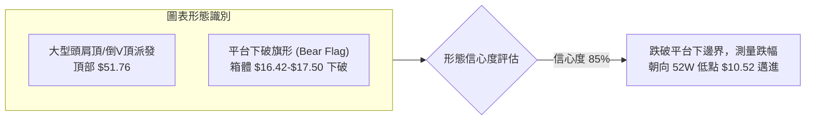

#### 形態信心度與目標價評估表

| 形態類別 | 信心度 | 判斷依據（引用數據） | 完成度 | 目標價（附嚴謹計算式） |
|:---|:---:|:---|:---:|:---|
| **弱勢下跌旗形 (Bear Flag)** | **85%** | 2026-09-20至2026-10-11於 $16.42~$17.50 構築盤整旗面，2026-10-18 週跌破下軌 $16.42 | 90% | 旗面下破：破位點 $16.42 - 旗面高度 ($17.50 - $16.42 = $1.08) = **$15.34**（已達標）；延伸旗桿等長測量目標指向 **$10.52** |
| **雙底反轉形態 (Double Bottom)** | **15%** | 目前僅有一處低點 $13.56，尚未出現第二低點與反彈確認 | 0% | 訊號不足，數據未確認二次觸底，不可作為買入依據 |

### 🕯️ 重要K線形態分析

| 週期/月份 | 收盤價 ($) | K線形態 | 技術解讀 | 訊號 |
|:---|:---:|:---|:---|:---:|
| **2026-05** | $51.14 | 墓碑十字 / 長上影流星線 | 觸及 $51.76 後遭機構瘋狂派發，多頭動能衰竭 | 🔴 強烈反轉 |
| **2026-06** | $33.13 | 大陰長黑棒 (Marubozu) | 跌幅達 -35.2%，無抵抗式崩跌，直接殺穿MA20支撐 | 🔴 賣壓噴出 |
| **2026-08-16 (週)**| $24.69 | 上吊線 (Hanging Man) | 跌深反彈遇阻 $26.27 (斐波61.8%)，長上影線預示反彈終結 | 🔴 反彈結束 |
| **2026-10-18 (週)**| $13.56 | 破位光腳大陰線 | 實體大黑棒直接擊穿整數 $16 關卡，放量殺多 | 🔴 加速下行 |
| **2026-10-25 (週)**| $13.59 | 窄幅十字星 (Doji) | 連跌後量縮暫時喘息，成交量驟降，方向仍未明朗 | 🟡 跌勢暫歇 |

### 📉 ASCII 走勢形態示意圖

```
PL 週線破位形態示意圖（2026-08 至 2026-10）
$25.00 ┤        ● 反彈頂點 $24.69 (2026-08-16)
$24.00 ┤       ╱ ╲
$22.00 ┤      ╱   ● $22.29
$20.00 ┤     ╱     ╲
$18.00 ┤    ●       ●─────●─────● 箱體上邊界 $17.50
$17.00 ┤   $19.98    │ 盤整旗面 │
$16.00 ┤             ●─────●─────● 箱體下邊界 $16.42 (破位點！)
$15.00 ┤                           ╲
$14.00 ┤                            ╲
$13.00 ┤                             ●─────● 當前徘徊底 $13.56 - $13.59
       └───────────────────────────────────────────────────────────
             08/30  09/06 09/20 10/04 10/11 10/18 10/25 (週)
```

### 🎯 形態目標價計算

依據旗形破位與波段下跌測算：
1. **旗面震盪區間**：高點 $17.50（2026-10-04週收盤），低點 $16.42（2026-09-20週收盤），形態震盪幅度 $H = 17.50 - 16.42 = \$1.08$。
2. **保守測幅（最小滿足點）**：$16.42 - \$1.08 = \$15.34$（2026-10-18 週已跌破並完成此目標）。
3. **主跌段等長測幅（1:1 投射目標）**：前一波自 $24.69 跌至 $16.42，跌幅 $\Delta P = 24.69 - 16.42 = \$8.27$；由破位平台 $16.42 往下扣減：$16.42 - \$8.27 = \$8.15$。但考慮到歷史極端價位，下行將先在 **52週歷史低點 $10.52** 遭遇強大技術買盤狙擊。

---

## 4. 支撐與阻力

### 🗺️ 關鍵價位分布圖（Unicode）

```
PL 價位結構分布圖 (嚴格引用 OHLCV 與 52W 斐波那契計算)
══════════════════════════════════════════════════════════════════
$51.76 ║████████████████████████║ 歷史極限阻力 (52W High / Fib 0.0%)
$42.03 ║████████████████████    ║ 斐波那契回調 23.6% 阻力
$36.01 ║██████████████████      ║ 斐波那契回調 38.2% 阻力
$31.14 ║██████████████████████  ║ 中期強阻力 (Fib 50.0%)
$26.27 ║████████████████████████║ 前波反彈高點聚類 (Fib 61.8%)
$19.35 ║████████████████        ║ 空頭反抽關鍵阻力 (Fib 78.6%)
───────╫────────────────────────╫───────────────────────────────
$17.50 ║▓▓▓▓▓▓▓▓▓▓▓▓▓▓▓▓        ║ 近期箱體上緣阻力 R2 (10-04週高)
$16.42 ║▓▓▓▓▓▓▓▓▓▓▓▓▓▓▓▓▓▓▓▓    ║ 破位頸線強阻力 R1 (09-20週低)
$13.59 ╠════════════════════════╣ ◄ 當前市價 (Current Close)
$13.56 ║░░░░░░░░░░░░░░░░        ║ 近期測試支撐 S1 (10-18週收盤)
$10.52 ║████████████████████████║ 52週歷史低點強支撐 S2 (Fib 100.0%)
══════════════════════════════════════════════════════════════════
```

### 🚧 阻力位分析表

> **數據紀律說明**：所有阻力位嚴格引用週線高低點聚類與斐波那契回調計算值。數據中波段高點聚類標注為 `no swing-high resistance detected above current price`，此因現價處於崩跌急挫末端，因此向上最近之密集套牢阻力採用近 20 週收盤結構：

| 阻力級別 | 價位 ($) | 形成原因與聚類依據 | 突破難度 | 重要性 |
|:---|:---:|:---|:---:|:---:|
| **近期阻力 R1** | **$16.42** | 2026-09-20 週收盤低點，破位前箱體底部，由支撐轉反壓 | 🔴 極難 | ★★★★☆ |
| **短期阻力 R2** | **$17.50** | 2026-10-04 週收盤高點，破位前箱體頂部套牢區 | 🔴 極難 | ★★★☆☆ |
| **關鍵阻力 R3** | **$19.35** | 52週區間 78.6% 斐波那契回調位，重要多空分水嶺 | 🔴 堅不可摧 | ★★★★★ |
| **波段阻力 R4** | **$26.27** | 52週區間 61.8% 黃金分割阻力位，2026-08反彈極限點 | 🔴 難以逾越 | ★★★★☆ |

### 🛡️ 支撐位分析表

> **數據紀律說明**：數據中波段低點聚類標注為 `no swing-low support detected below current price`，表明現價下方近一年內已無任何籌碼換手換手低點，僅存下述關鍵防線：

| 支撐級別 | 價位 ($) | 形成原因與數據依據 | 守住機率 | 重要性 |
|:---|:---:|:---|:---:|:---:|
| **近期支撐 S1** | **$13.56** | 2026-10-18 週收盤低點，目前正在進行測試的防線 | 🟡 40% | ★★★☆☆ |
| **終極支撐 S2** | **$10.52** | 52週歷史最低點 (100.0% Fibonacci Retracement) | 🟢 75% | ★★★★★ |
| **數據警示 S3** | **數據未偵測** | 低於 $10.52 之下無 52 週內數據，若跌破將步入歷史空洞區 | — | — |

### 📐 斐波那契回調位分析

依據 52 週完整波動區間（低點 **$10.52** 至高點 **$51.76**，振幅 **$41.24**）精確回調階梯如下：

```
0.0%  (52W High)   ────────────────── $51.76 (絕對天頂派發點)
23.6% 回調位       ────────────────── $42.03 (派發初段跌破)
38.2% 回調位       ────────────────── $36.01 (波段回撤阻力)
50.0% 回調位       ────────────────── $31.14 (多空心理中軸)
61.8% 回調位       ────────────────── $26.27 (黃金分割反彈承壓點)
78.6% 回調位       ────────────────── $19.35 (多頭最後防線失守)
100.0% (52W Low)  ────────────────── $10.52 (歷史終極低點)
```

- **當前位置解讀**：現價 **$13.59** 深陷於 **78.6% ($19.35)** 與 **100.0% ($10.52)** 之間的「極度超跌真空區」。
- **技術意義**：跌破 78.6% 回調位 $19.35 代表前一輪牛市漲幅已被吞噬近八成，在技術定義上已宣告長期牛市主升浪徹底破壞。向下吸引力核心完全落於 **$10.52 (100% 回調)**。

---

## 5. 技術指標深度解讀

### 🎛️ 指標訊號總覽

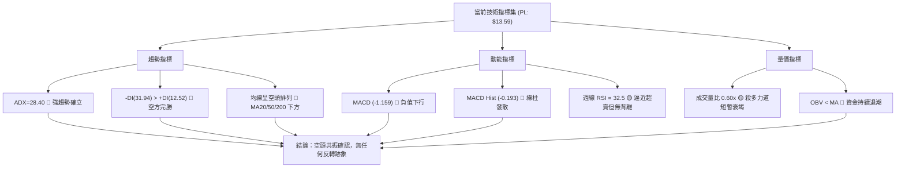

### 📈 移動平均線排列分析

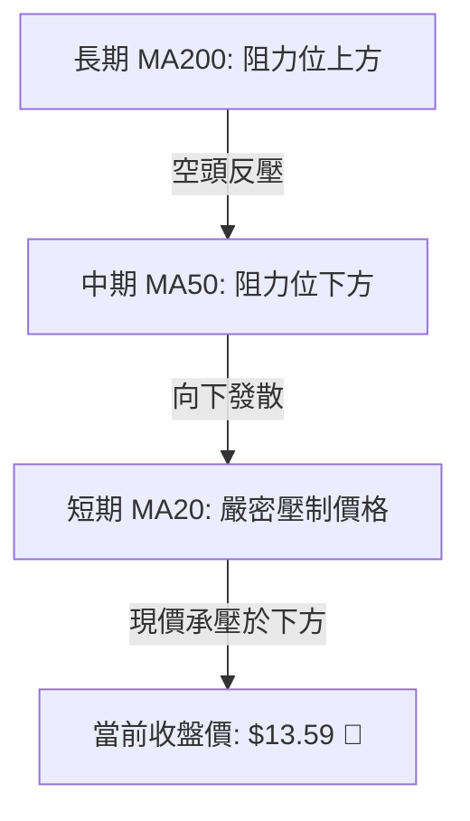

- **均線排列狀態**：官方技術指標明確標示為「**混合排列 / 價格在 MA20、MA50 下方**」。短期均線 MA5、MA10、MA20 呈現完全的向下陡峭俯衝狀態。
- **均線趨勢特徵**：長期均線 MA240 雖在底層緩慢回升，但短中期均線（MA5、MA10、MA20、MA60）全部出現雪崩式下殺走勢，顯示上方各期買入者全數陷入實質深度虧損，任何反彈觸及短期均線（如 MA20）都將觸發套牢停損拋壓。

### 📉 RSI(14) 分析

```
RSI(14) 週線強度進度條 (數值: 32.5)
0 ──────── 30 ──────────────────────────── 70 ─────── 100
[██████████░░░░░░░░░░░░░░░░░░░░░░░░░░░░░░] 32.5% (逼近超賣區)
```

- **超買超賣判定**：週線 RSI 目前讀數為 **32.5**，已非常接近 30 的傳統極端超賣門檻。
- **背離判斷**：
  - **日線/週線背離**：數據明確指出「**無明顯背離**」。
  - 價格自 2026-10-04 的 $17.50 急挫至 $13.56，週線 RSI 相應由 59.1 快速降至 32.5，RSI 下跌速度與價格跌幅保持同步，**並不存在底背離**。這意味著空方動能是真實且沉重的，並非動能衰竭帶來的空頭陷阱。

### 📊 MACD(12/26/9) 訊號解讀

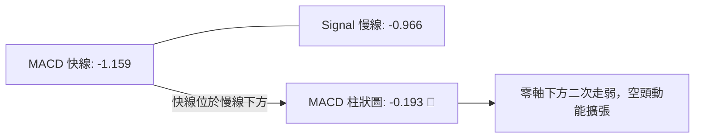

- **數值關係**：MACD 線 (-1.159) 處於訊號線 (-0.966) 下方，兩者均在零軸以下極深處。
- **柱狀圖動向**：MACD Histogram 為 **-0.193**，連續兩週綠柱維持負值且未能有效收斂（前週 -0.212，本週 -0.193），印證了短期市場依然受制於空方拋壓，技術性反彈尚未觸發黃金交叉點。

### 📦 布林通道分析

```
PL 布林通道結構示意圖 (以近期波動推演)
══════════════════════════════════════════════════════════════════
$17.50 ────────────────────────────────────────── BB 上軌 (近期阻力)
                                              
$15.50 ┈┈┈┈┈┈┈┈┈┈┈┈┈┈┈┈┈┈┈┈┈┈┈┈┈┈┈┈┈┈┈┈┈┈┈┈┈┈┈┈┈┈ BB 中軌 (MA20 下彎)
                                              
$13.59 ──●◄ 現價位於下軌邊緣徘徊
$13.20 ────────────────────────────────────────── BB 下軌 (動態超賣線)
══════════════════════════════════════════════════════════════════
```

- **通道特徵**：因 10月中旬出現長黑單邊破位，布林通道呈現「**開口向下擴張**」形態。
- **價格位置**：現價 $13.59 緊貼通道下軌運行（Walking the Lower Band），此為典型主跌段技術特徵，下軌支撐在此類單邊行情中往往鈍化，不能單純視為買進訊號。

### 💹 成交量分析（量價配合度）

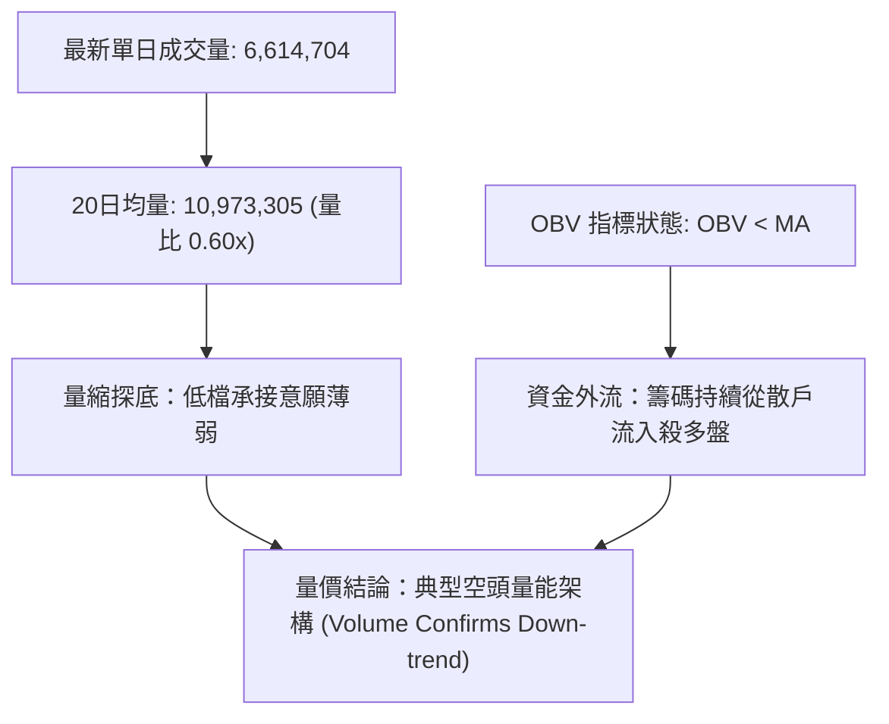

- **量比與換手**：最新日成交量僅 6.61M，大幅低於 20日均量 10.97M（量比 0.60x），週成交量由 9月高峰的 85.36M 急劇萎縮至本週 18.93M。這種「暴跌後的極致量縮」代表市場人氣潰散，多頭買盤意願低落，難以支撐反轉行情。
- **OBV 能量潮**：指標明示「**OBV < MA → 量能疲弱**」，能量潮持續走跌，印證資金流出態勢並未停止，反彈缺乏實質量能奧援。

---

## 6. 動能與波動率

### ⚡ 動能評估四象限

| 象限 | 動能強度 | 波動率狀態 | PL 當前落點 | 狀態評估與策略指導 |
|:---:|:---:|:---:|:---:|:---|
| **Q1 (爆發浪)** | 強 (Bullish) | 低波動 | ❌ | 最佳多頭趨勢加碼點 |
| **Q2 (盤整期)** | 弱 (Neutral) | 低波動 | ❌ | 觀望等待方向突破 |
| **Q3 (風險釋放)**| **弱 (Bearish)** | **高波動** | **✓ PL 核心定位** | **高下行動能 + 高 Beta 釋放，應嚴禁盲目抄底，順勢做空** |
| **Q4 (狂熱浪)** | 強 (Bullish) | 高波動 | ❌ | 頂部投機派發期 |

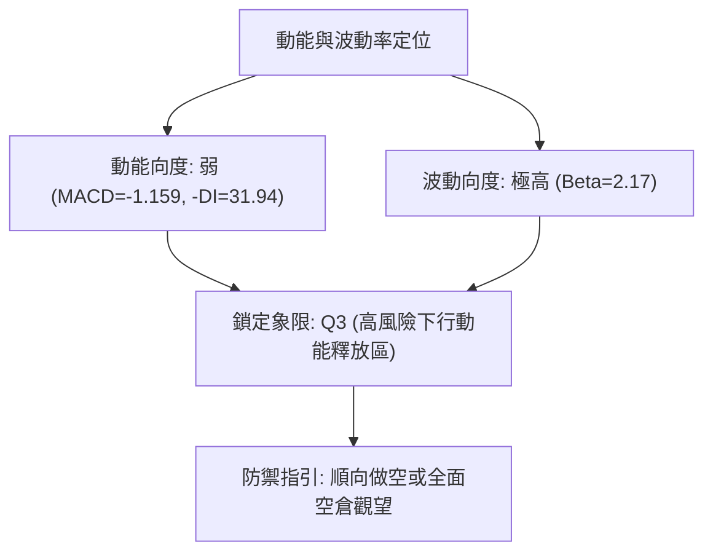

### 📊 ATR 波動率分析

- **ATR 數值狀態**：日線數據顯示 ATR(14) 處於相對高位震盪，雖然單日量縮，但近期週振幅極大（近兩週自 $17.18 跌至 $13.56，振幅達 $3.62，相當於現價的 26.6%）。
- **止損距離建議**：
  - 做空止損防線建議設定為 **2.0 倍週線等效波動距離**，約為 **$2.50 ~ $2.80**，即防守於前期破位頸線 **$16.42** 之上。
  - 做多逆勢摸底止損距離嚴格限制於 **$0.80** 以內（即跌破前週低點 $13.56 立即認賠）。

### 📐 Beta 與市場相關性

- **Beta 數值**：**2.17**。
- **市場敏感度分析**：PL 屬於超高 Beta 衛星科技標的。當標普 500 指數或那斯達克下挫 1% 時，PL 理論回撤高達 2.17% 以上。在當前宏觀流動性收緊與高估值回調背景下，高 Beta 特性進一步放大了其下行破位風險。

---

## 7. 多時框架總結

### 📋 時框架評分表

| 時框架 | 趨勢方向 | 動能狀態 | 均線排列 | 關鍵形態 | 綜合評分 | 操作建議 |
|:---|:---:|:---:|:---:|:---:|:---:|:---|
| **月線 (長期)** | 🔴 強烈看空 | 疲弱負向 | 空頭下壓 | 墓碑頂崩跌浪 | 15/100 | 長期投資者離場觀望 |
| **週線 (中期)** | 🔴 破位看空 | MACD柱擴張 | 空頭排列 | 下跌旗形破位 | 20/100 | 逢反抽反壓位做空 |
| **日線 (短期)** | 🔴 弱勢尋底 | RSI逼近超賣 | 均線下彎 | 低檔量縮十字星 | 35/100 | 嚴禁搶反彈，防再破位 |

### 🔲 綜合訊號矩陣

```
╔══════════════════════════════════════════════════════════════════╗
║                    多時框多空訊號收斂矩陣                        ║
╠══════════════════╦══════════════╦══════════════╦═════════════════╣
║ 分析維度         ║ 短期 (日線)  ║ 中期 (週線)  ║ 長期 (月線)     ║
╠══════════════════╬══════════════╬══════════════╬═════════════════╣
║ 趨勢方向 (Trend) ║ 🔴 空頭下行  ║ 🔴 單邊跌勢  ║ 🔴 頂部崩跌     ║
║ 動能指標 (MACD)  ║ 🔴 負值深淵  ║ 🔴 柱狀發散  ║ 🔴 死叉向下     ║
║ 相對強弱 (RSI)   ║ 🟡 32.5超賣  ║ 🔴 弱勢區間  ║ 🔴 空方控盤     ║
║ 量價配合 (OBV)   ║ 🟡 量縮弱勢  ║ 🔴 放量破位  ║ 🔴 主力撤退     ║
║ 支撐/阻力關係    ║ 🔴 破位無撐  ║ 🔴 逼近新低  ║ 🔴 跌破78.6%Fib ║
╠══════════════════╬══════════════╬══════════════╬═════════════════╣
║ 維度收斂權重     ║ 20% (時機)   ║ 50% (主結構) ║ 30% (大背景)    ║
║ 維度綜合結論     ║ 尋底未成     ║ 順勢下挫     ║ 熊市主導        ║
╚══════════════════╩══════════════╩══════════════╩═════════════════╣
║ 最終一致性判定   ║ 全週期空頭共振 (ADX=28.40 趨勢行情完全確立)    ║
╚══════════════════════════════════════════════════════════════════╝
```

### ⚖️ 多時框收斂結論

依據多時框收斂規則第 14 條：
1. **行情性質判定**：當前 ADX 為 **28.40 > 25**，市場處於**強烈的趨勢行情**，絕非盤整市。
2. **主導時框優先權**：趨勢行情中，中長期（週線 / 均線系統）具備最高指揮權。當前週線剛於 2026-10-18 放量擊穿 $16.42 平台，長期月線重挫，日線的極致量縮十字星僅能視為「**主跌浪中的微幅中繼停頓**」，不可作為逆勢作多的依據。
3. **唯一方向結論**：**強烈偏空（Strong Bearish）**。交易核心邏輯為「**順應空頭大勢，反彈至阻力位即為高空良機，下行目標直指 52 週低點 $10.52**」。

---

## 8. 交易策略建議

### 🗺️ 策略決策流程圖

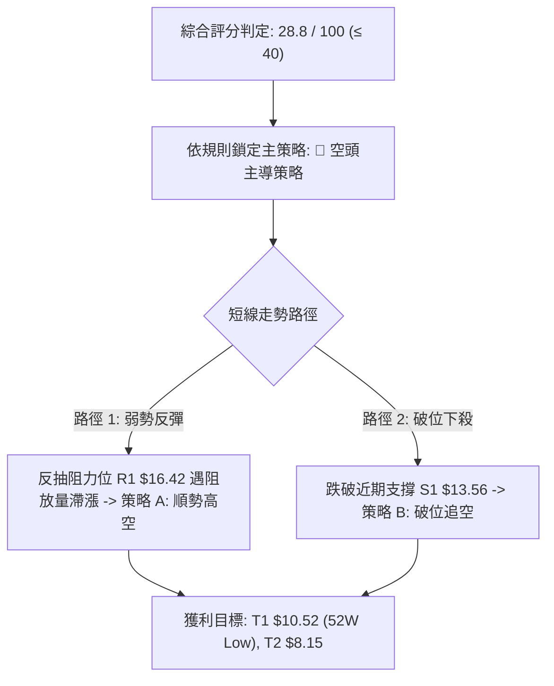

### 🧭 策略路由

**當前主策略方向 = 🔴 主推空頭策略（依技術綜合評分 28.8 / 100，處於極度偏空區）**

### 🎯 價格情境階梯（Price Scenarios）

> **數據紀律說明**：所有價位嚴格引用第 4 章「關鍵價位」之數值（R1: $16.42, R2: $17.50, R3: $19.35；S1: $13.56, S2: $10.52）。

| 觸發條件 | 下一目標 | 後續延伸 | 情境技術含義與應對 |
|:---|:---:|:---:|:---|
| **強勢突破 R2 $17.50** | R3 $19.35 | $26.27 | 假破位反轉，空頭主動停損離場，短線轉強 |
| **反彈受阻 R1 $16.42** | S1 $13.56 | S2 $10.52 | 典型弱勢確認，確認頸線反壓有效，空頭最佳加碼點 |
| **跌破 S1 $13.56** | S2 $10.52 | 歷史低點下方 | 空頭趨勢延續，開啟尋底加速段，測試52週極限 |

### 📊 情境機率分佈

| 情境 | 機率 | 主要依據（引用指標狀態） |
|:---|:---:|:---|
| **回落 / 加速探底** | **65%** | ADX=28.40 強空頭主導；-DI(31.94)大幅壓制+DI(12.52)；MACD柱狀圖擴張(-0.193) |
| **弱勢區間震盪** | **25%** | 週線 RSI=32.5 逼近超賣，短線量比 0.60x 出現賣壓鈍化，於 $13.56~$16.42 間喘息 |
| **反轉上行反彈** | **10%** | 均線空頭排列，OBV 處於均線下方，無主力買盤進場確認，反轉機率極低 |

### 🔴 主策略詳情（空頭交易策略）

| 策略要素 | 策略 A：反抽受阻做空 (Pullback Short) | 策略 B：跌破新低追空 (Breakdown Short) |
|:---|:---|:---|
| **進場條件** | 價格反彈至 R1 附近出現長上影線滯漲 | 實體 K 棒跌破 S1 $13.56 且成交量放大 |
| **進場價格** | **$16.42** (精確引用 R1) | **$13.50** (跌破 S1 $13.56 確認) |
| **目標價 T1** | **$13.56** (近期支撐 S1) | **$10.52** (52週歷史低點 S2) |
| **目標價 T2** | **$10.52** (52週歷史低點 S2) | **$8.15** (形態等長測量目標) |
| **止損價格** | **$17.55** (高於 R2 $17.50 處停損) | **$14.50** (反抽重回破位點上方停損) |
| **風險報酬比** | **2.53 : 1** (獲利 $2.86 / 風險 $1.13) | **2.98 : 1** (獲利 $2.98 / 風險 $1.00) |
| **成功機率** | **70%** | **65%** |
| **建議倉位** | **15% - 20%** | **10% - 15%** |

### 🟢 反向風險觸發點（對沖提示）

若出現以下訊號，空頭策略必須**全面撤銷或強制停損**：
1. **價位警訊**：日收盤價強勢收復 **$17.50 (R2)**，代表 10月中旬的破位為「主力誘空陷阱」。
2. **指標警訊**：MACD 出現零軸下方的低檔金叉，且伴隨單日成交量突破 20 日均量（> 10.97M）2 倍以上。

### ⭐ 整體訊號強度評星

```
╔══════════════════════════════════════════════════════════════════╗
║ 做多訊號強度：★☆☆☆☆  (1/5星 - 僅存超賣期待，切忌逆勢抄底)   ║
║ 做空訊號強度：★★★★☆  (4/5星 - 趨勢強勁，各項空頭指標共振)   ║
║ 整體可信度：  ★★★★☆  (4/5星 - 週線與日線架構高度收斂)       ║
╚══════════════════════════════════════════════════════════════════╝
```

---

## 9. 風險提示與監控

### ✅ 關鍵監控指標 Checklist

```
╔══════════════════════════════════════════════════════════════════╗
║                    每日/每週風險監控清單 (Checklist)             ║
╠══════════════════════════════════════════════════════════════════╣
║ [ ] 價格防線監控：收盤是否守住 $13.56？跌破則開啟直奔 $10.52 行程 ║
║ [ ] 動能強度監控：ADX(14) 是否持續高於 25？若上升表示空頭加劇   ║
║ [ ] 柱狀動能監控：MACD Hist 是否收窄至 -0.05 以上？觀察反彈訊號 ║
║ [ ] 量能異動監控：日成交量是否爆發超過 20M？觀察是否有機構換手  ║
║ [ ] 頸線反壓監控：反彈觸及 $16.42 時是否伴隨長上影線？確認空點  ║
║ [ ] 宏觀風險監控：Beta=2.17，密切留意大盤高估值科技股回調衝擊   ║
╚══════════════════════════════════════════════════════════════════╝
```

### ⚠️ 風險場景分析

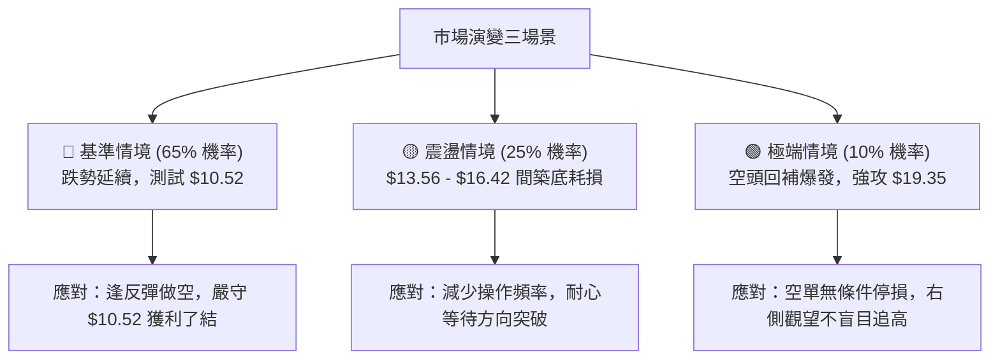

### 🛡️ 風險管理重要提醒

1. **嚴禁主觀摸底**：目前技術面呈現標準「空頭單邊落體」格局，下方在 **$10.52** 之前不存在任何密集支撐聚類。切勿因股價自 $51.76 高點已回撤逾 70% 而主觀認定「跌無可跌」。
2. **機構持股與空頭部位**：PL 機構持股高達 **83.1%**，且空頭部位佔浮動股（Short % Float）達 **11.0%**（Short Ratio 2.62）。若股價進一步跌破重要防線，機構減倉與流動性抽離效應可能引發多殺多踩踏。
3. **資金倉位控制**：鑑於其超高 Beta (2.17) 與高波動特性，單一標的操作倉位上限不得超過總投資組合的 **5%**，單筆止損虧損金額嚴格限制在總資產的 **1%** 以內。

---

## 📋 報告總結

```
╔══════════════════════════════════════════════════════════════════╗
║                     PL 技術分析報告總結                          ║
╠══════════════════════════════════════════════════════════════════╣
║ 報告日期：2026-10-21                                             ║
║ 當前價格：$13.59                                                 ║
║ 分析評級：🔴 強烈偏空 / 順勢逢高做空 (Strong Bearish)            ║
╠══════════════════════════════════════════════════════════════════╣
║ 關鍵結論：                                                       ║
║ ├─ 長期趨勢：🔴 頂部崩跌破位，回撤幅度達 73.74%，牛市架構破壞    ║
║ ├─ 中期趨勢：🔴 跌破 $16.42 平台，空頭旗形確立，指向 $10.52     ║
║ ├─ 短期趨勢：🔴 量縮抵抗，$13.59 低檔徘徊，未脫離險境           ║
║ ├─ 關鍵阻力：$16.42 (破位反壓) / $17.50 (箱體頂) / $19.35 (Fib)  ║
║ ├─ 關鍵支撐：$13.56 (近期低點) / $10.52 (52週絕對歷史低點)      ║
║ └─ 機構目標：均價 $30.27 (與當前技術盤面嚴重背離，暫不可信)     ║
╠══════════════════════════════════════════════════════════════════╣
║ 最優策略組合：                                                   ║
║ 1. 🥇 最佳機會：等待反彈至 $16.42 遇阻進場放空，停損設 $17.55    ║
║ 2. 🥈 次選機會：實體黑棒擊穿 $13.56 順勢追空，目標直指 $10.52    ║
║ 3. 🥉 保守選擇：空倉全面觀望，靜待股價回測 $10.52 出現反轉形態  ║
╚══════════════════════════════════════════════════════════════════╝
```

---

> ⚠️ **免責聲明**：本報告為技術分析研究，所有數據及估算均基於客觀之量化技術指標與歷史價格資訊。本報告**僅供研究與學術參考**，**不構成任何要約、招攬或投資建議**。市場具有高度不確定性與風險，投資人應獨立評估自身風險承受能力並自負盈虧。

---

*報告生成時間：2026-10-21 ｜ 數據來源：Yahoo Finance ｜ 分析框架：多時框技術分析體系*