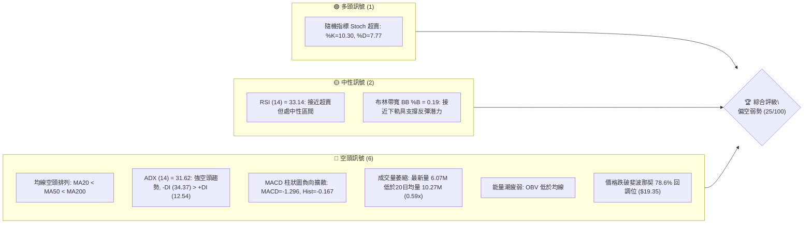
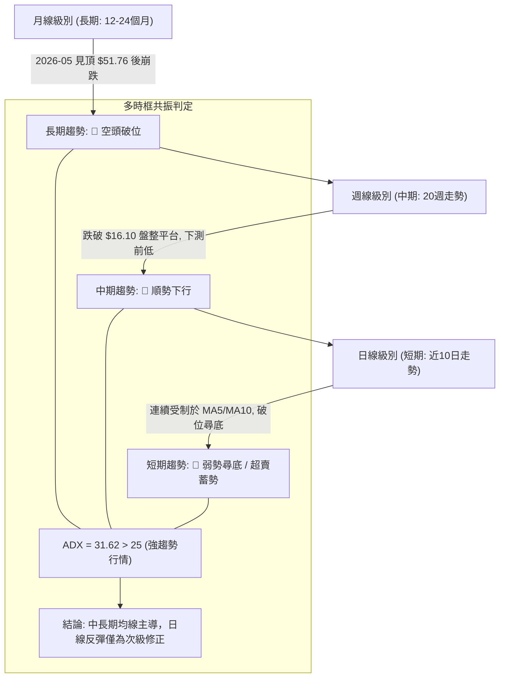
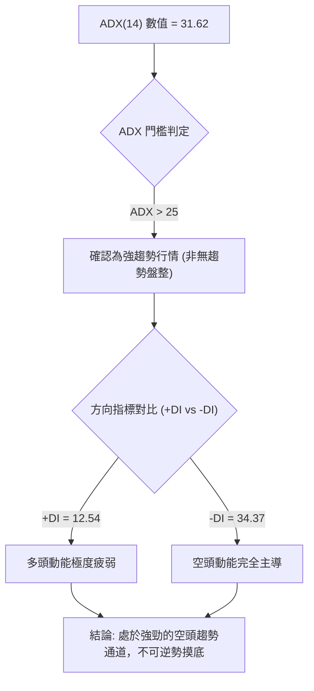
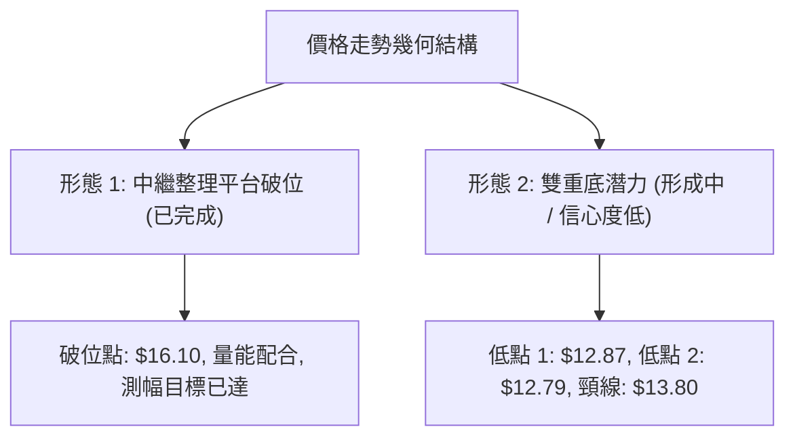
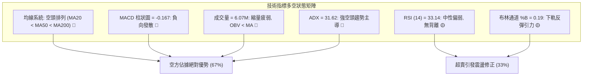
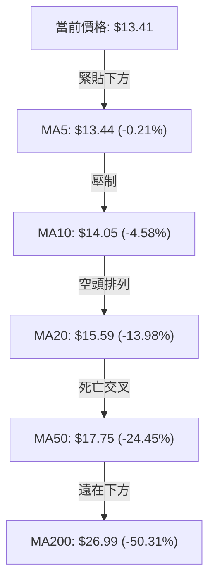
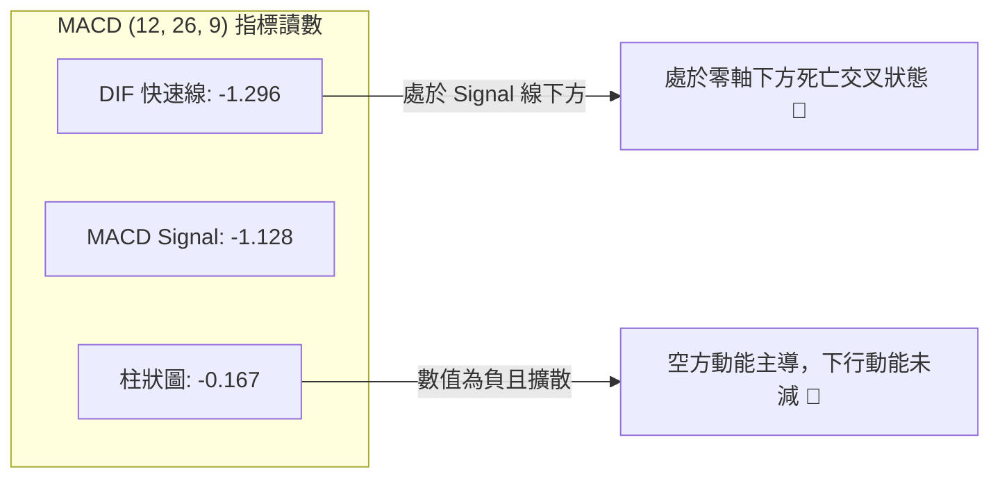
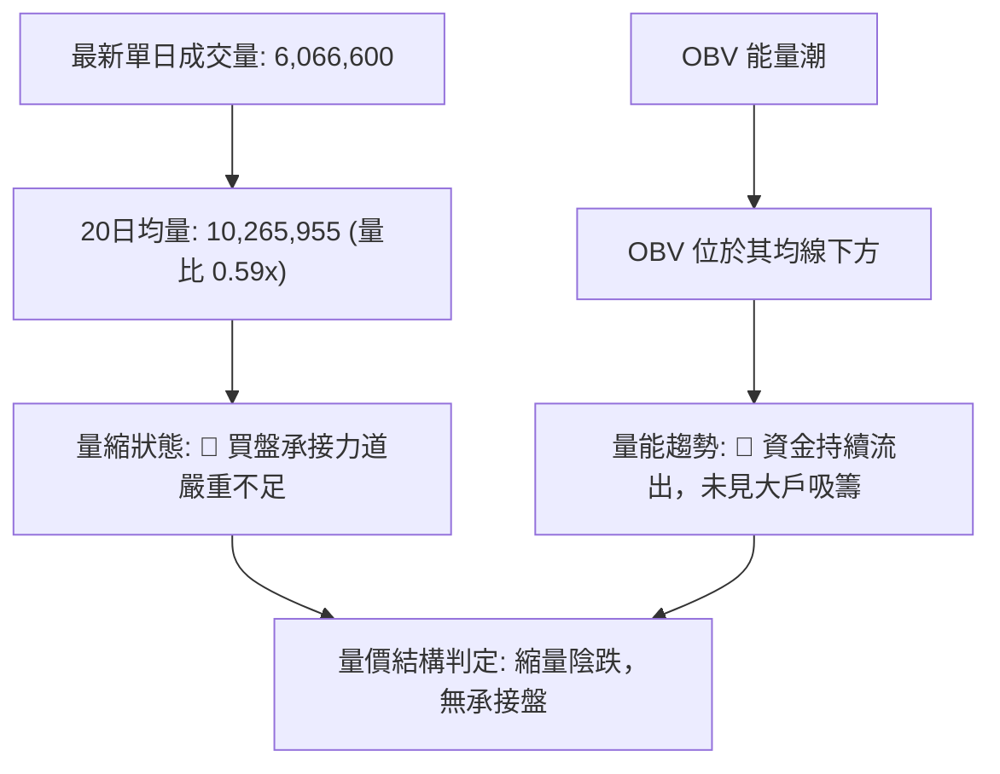
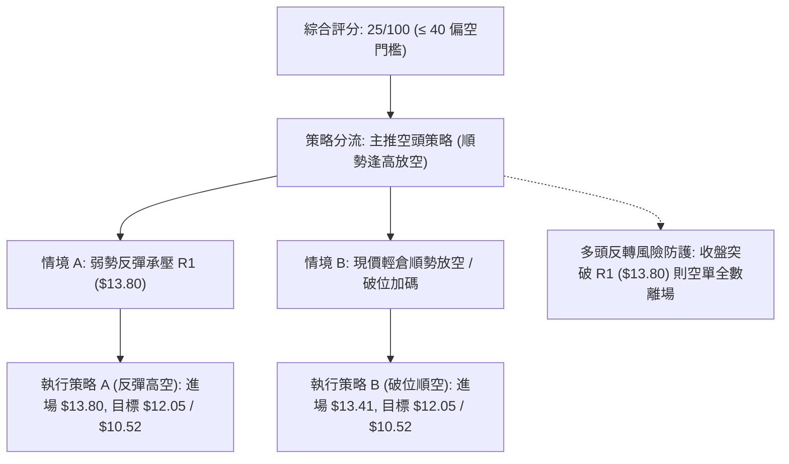
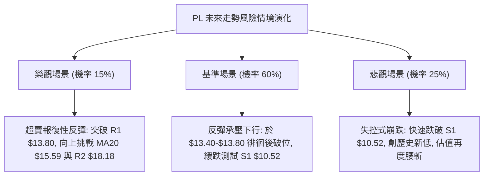

# PL 技術分析報告

> **報告日期**：2026-10-24 ｜ **語言**：繁體中文 ｜ **數據來源**：Yahoo Finance ｜ **當前價格**：$13.41 USD

---

## 目錄

| 章節 | 內容 |
|------|------|
| [1. 技術面概覽](#1-技術面概覽) | 訊號儀表板、核心指標、評分卡 |
| [2. 趨勢分析](#2-趨勢分析) | 多時框趨勢、長中短期走勢 |
| [3. 圖表形態分析](#3-圖表形態分析) | 形態識別、K線組合、目標價 |
| [4. 支撐與阻力](#4-支撐與阻力) | 關鍵價位、斐波那契回調 |
| [5. 技術指標深度解讀](#5-技術指標深度解讀) | MA/RSI/MACD/布林/成交量 |
| [6. 動能與波動率](#6-動能與波動率) | 動能評估、ATR、Beta |
| [7. 多時框架總結](#7-多時框架總結) | 時框架評分矩陣 |
| [8. 交易策略建議](#8-交易策略建議) | 多空策略、風險報酬比 |
| [9. 風險提示與監控](#9-風險提示與監控) | 監控指標、風險場景 |

---

## 1. 技術面概覽

### 🎯 技術訊號儀表板



---

### 📊 核心指標速覽表

| 指標類別 | 指標名稱 | 當前數值 | 訊號 | 解讀 |
|----------|----------|----------|------|------|
| **價格** | 當前價格 | $13.41 | 🔴 | 位於 52 週高低區間 7.0% 處，極度弱勢 |
| **均線** | MA20 | $15.59 | 🔴 | 價格在 MA20 下方 -13.98%，短期下行趨勢顯著 |
| **均線** | MA50 | $17.75 | 🔴 | 價格在 MA50 下方 -24.45%，中期結構完全走空 |
| **均線** | MA200 | $26.99 | 🔴 | 價格在 MA200 下方 -50.31%，長期空頭熊市壓制 |
| **動能** | RSI(14) | 33.14 | 🟡 | 中性偏弱（30-70），尚未進入極度超賣（<30） |
| **動能** | MACD (12,26,9) | -1.296 / -1.128 | 🔴 | DIF 線低於 Signal 線，柱狀圖 -0.167 持續向下發散 |
| **動能** | Stoch %K/%D | 10.30 / 7.77 | 🟢 | 雙線進入 <20 極度超賣區，醞釀技術性反彈 |
| **趨勢強度** | ADX (14) | 31.62 | 🔴 | ADX > 25 代表強趨勢；-DI (34.37) 主導，屬強空頭行情 |
| **通道** | 布林通道下軌 | $12.05 (%B: 0.19) | 🟡 | 價格靠近下軌，存在短線均值回歸拉力 |
| **量能** | 成交量比率 | 0.59x (6.07M) | 🔴 | 成交量遠低於 20 日均量 (10.27M)，買盤承接力道薄弱 |
| **波動** | ATR(14) | $0.96 | 🔴 | 日波幅佔股價 7.12%，市場波動劇烈，下行風險偏高 |

---

### 🏆 技術評分卡

```
╔════════════════════════════════════════════════════════════════╗
║                   技術評分卡 — PL (2026-10-24)                 ║
╠════════════════════════════════════════════════════════════════╣
║ 趨勢強度 (Trend)     ████░░░░░░░░░░░░░░░░  20/100  🔴 強烈偏空 ║
║ 動能指標 (Momentum)  ██████░░░░░░░░░░░░░░  30/100  🔴 弱勢超賣 ║
║ 支撐穩定度 (Support) █████░░░░░░░░░░░░░░░  25/100  🔴 支撐脆弱 ║
║ 成交量配合 (Volume)  ██████░░░░░░░░░░░░░░  30/100  🔴 量能匱乏 ║
║ 形態完整度 (Pattern) ███████░░░░░░░░░░░░░  35/100  🔴 破位下行 ║
║ 均線排列 (Moving Avg)██░░░░░░░░░░░░░░░░░░  10/100  🔴 空頭排列 ║
╠════════════════════════════════════════════════════════════════╣
║ 綜合評分 (Overall)   █████░░░░░░░░░░░░░░░  25/100  🔴 強烈偏空 ║
╚════════════════════════════════════════════════════════════════╝
（註：綜合評分 = 六項子評分之算術平均 (20+30+25+30+35+10) ÷ 6 = 25.0，四捨五入為 25/100）
```

---

## 2. 趨勢分析

### 🌐 多時框趨勢分析



---

### 📈 長期趨勢 — 12個月走勢圖（Unicode）

以下圖表依據過去 12 個月（2025-11 至 2026-10）之月線收盤價繪製，完整反映本輪行情的暴漲與暴跌：

```
PL 月線走勢圖（過去12個月：2025-11 至 2026-10）
價格軸 ($)
$52 ┤                                      ● $51.14 (高點 2026-05)
$46 ┤                                     / \
$40 ┤                                    /   \
$36 ┤                             ● $36.97    \
$32 ┤                            /             ● $33.13 (2026-06)
$28 ┤                     ● $27.95              \
$24 ┤              ● $24.97   │                  \
$20 ┤       ● $19.72          ● $24.14            ● $20.48 ──● $19.85
$16 ┤      /                                              \   ● $16.39
$12 ┤● $11.90                                              \     \
$10 ┤                                                       \     ● $13.41 (現價)
     └───────────────────────────────────────────────────────────────────►
       11    12    01    02    03    04    05    06    07    08    09    10 (月份)
      (2025)                      (2026)
```

#### 走勢特徵分析表格

| 階段 | 時間區間 | 起訖價格 ($) | 漲跌幅 (%) | 趨勢特徵與結構解讀 |
|------|----------|--------------|------------|--------------------|
| **第一階段：加速主升浪** | 2025-11 至 2026-05 | $11.90 → $51.14 | +329.75% | 伴隨業績爆發與市場投機狂熱，連續突破歷史壓力，52週最高達 $51.76 |
| **第二階段：瀑布式崩跌** | 2026-05 至 2026-07 | $51.14 → $20.48 | -59.95% | 估值泡沫破裂，獲利了結盤湧出，跌破所有短期均線，週成交量暴增至近億股 |
| **第三階段：平台弱勢整理**| 2026-07 至 2026-08 | $20.48 → $19.85 | -3.08% | 於 $20.00 心理關口短暫抵抗，量能快速萎縮（23M-35M），無力反彈 |
| **第四階段：破位加速探底**| 2026-08 至 2026-10 | $19.85 → $13.41 | -32.44% | 跌破 78.6% 斐波回調位 ($19.35) 與 $16.10 平台，逼向 52 週低點 $10.52 |

---

### 📊 中期趨勢（週線分析）

從近 20 週數據觀察，PL 在 2026 年 9 月至 10 月初曾在 $16.10–$17.50 構築一個為期 5 週的中繼箱體，但隨後在 10 月 16 日當週以帶量長黑破位跌穿，引發停損賣壓。

```
PL 中期週線支撐阻力結構示意圖
$18.81 ══════════════════════════════════════ [R3 近期反彈波段頂部 2026-10-09]
             ▲
             │ (拋壓沉重)
$18.18 ────────────────────────────────────── [R2 週線密集成交區]
             ▲
$15.59 ┈┈┈┈┈┈┈┈┈┈┈┈┈┈┈┈┈┈┈┈┈┈┈┈┈┈┈┈┈┈┈┈┈┈┈┈┈┈ [MA20 / BB 中軌動態阻力]
             ▲
$13.80 -------------------------------------- [R1 短線反彈頸線阻力]
             ▲
$13.41 ───────► [當前收盤價] ◄─────────────── (弱勢盤整中)
             │
             ▼ (下行真空區)
$10.52 ══════════════════════════════════════ [S1 52週歷史絕對低點]
```

---

### ⚡ 趨勢強度評估（ADX 解讀）



#### ADX 趨勢強度指標對照表

| 指標變數 | 當前讀數 | 標準閾值區間 | 狀態評估 | 實戰交易指引 |
|----------|----------|--------------|----------|--------------|
| **ADX(14)** | **31.62** | > 25 (趨勢成立) | 🟢 強趨勢確認 | 遵循主趨勢操作，震盪逆勢指標（如超買超賣）容易鈍化 |
| **+DI** | **12.54** | < 20 (多方低迷) | 🔴 多方完全失守 | 缺乏主動買盤支撐，反彈動能衰竭 |
| **-DI** | **34.37** | > 30 (空方強盛) | 🔴 空方全面掌控 | 賣壓強烈，空單具備顯著的趨勢保護優勢 |

---

## 3. 圖表形態分析

### 🔍 形態識別系統



#### 圖表形態信心度評估表

| 形態名稱 | 信心度 | 判斷依據（引用數據） | 完成度 | 目標價（附嚴格計算式） |
|----------|--------|----------------------|--------|------------------------|
| **箱體中繼平台破位** | **85%** | 2026-09-18 至 2026-10-09 形成箱體（箱頂 $18.81 / 箱底 $16.10），於 10-16 跌破 | **100%** | 箱底 $16.10 − 箱體高度 ($18.81 − $16.10 = $2.71) = **$13.39**（已達成，現價 $13.41） |
| **日線潛在微型雙底** | **35%** | 2026-10-22 低點 $12.87 與 10-23 低點 $12.79，數據樣本過短且未突破頸線 R1 | **40%** | *訊號不足，僅做指標型解讀*。若確認突破 R1 ($13.80)：$13.80 + ($13.80 − $12.79) = **$14.81** |

---

### 🕯️ 重要K線形態分析

根據提供之「近10根日K」與「近8根週K」實際數據，分析關鍵 K 線組合：

| 日期（週期） | 開盤價 | 最高價 | 最低價 | 收盤價 | K線形態名稱 | 技術解讀 | 訊號方向 |
|--------------|--------|--------|--------|--------|-------------|----------|----------|
| **2026-10-12 (日)** | $17.00 | $17.03 | $15.95 | $15.96 | **光頭大陰線** | 開盤即最高，實體跌破 $16.10 平台，空頭全面發動破位暴跌 | 🔴 強烈看空 |
| **2026-10-15 (日)** | $13.52 | $14.61 | $13.37 | $14.54 | **低開長陽線** | 跳空低開後快速拉升，多頭進場抵抗，但未能封閉上方跳空缺口 | 🟡 短線反彈 |
| **2026-10-16 (日)** | $14.30 | $14.37 | $13.33 | $13.56 | **反包中陰線** | 吞噬前一日陽線大部漲幅，確認 10-15 僅為死貓反彈 | 🔴 空頭延續 |
| **2026-10-22 (日)** | $13.26 | $13.60 | $12.87 | $13.08 | **下影倒錘陰線** | 盤中下探 $12.87 創下階段新低，收盤收於低位，空方主導 | 🔴 弱勢尋底 |
| **2026-10-23 (日)** | $13.18 | $13.53 | $12.79 | $13.41 | **長下影錘頭小陽線**| 創 $12.79 低點後回升，收盤高於開盤，出現短線止跌跡象 | 🟢 局部止跌 |
| **2026-10-16 (週)** | $17.00 | $17.03 | $13.33 | $13.56 | **破位長陰週K** | 週跌幅 -21.07%，成交量達 51.29M，決定性跌破中期所有支撐 | 🔴 結構破壞 |
| **2026-10-23 (週)** | $13.85 | $14.09 | $12.79 | $13.41 | **低位縮量下影陰星**| 週量縮至 42.03M，長下影線顯示 $12.80 附近有初步拋壓竭盡跡象 | 🟡 跌勢趨緩 |

---

### 📉 ASCII 走勢形態示意圖

```
PL 近期平台破位與低位震盪形態示意圖 (2026-10-09 至 2026-10-23)
價格 ($)
$18.81 ┬───────┐ [雙頂 / 平台高點 2026-10-09]
       │       │
$17.18 ┼   ●   └───┐
       │  / \        │
$16.10 ┼─/───\───────┴─────────────── [箱體頸線破位點 2026-10-12]
       │/     \                       \
$14.54 ┼       \           ●(10-15)    \
       │        \         / \           \
$13.80 ┼─────────\───────/───\───────────\─────── [當前阻力 R1]
       │          \     /     \     ●(10-21)
$13.41 ┼           \   /       \   / \   ●(現價 10-23)
       │            \ /         \ /   \ /
$12.79 ┴─────────────●(10-16)────●─────● (探底回升 10-22/23)
                      $13.33    $12.87 $12.79
```

---

### 🎯 形態目標價計算

1. **破位測幅滿足點**：
   - 箱體高點聚類（R3）：$18.81
   - 箱體破位頸線：$16.10
   - 形態測幅高度：$H = \$18.81 - \$16.10 = \$2.71$
   - 破位向下等幅目標價：$Target = \$16.10 - \$2.71 = \mathbf{\$13.39}$
   - **解讀**：當前收盤價 $13.41 與測幅目標 $13.39 僅相差 2 美分，意味著**短期等幅對稱下跌目標已經完全滿足**，空頭短期下行動能可能暫時衰竭。

2. **下一個潛在下行目標（若破位延續）**：
   - 若 $12.79 支撐失守，下一級結構性目標直指近一年波段最低點：**S1: $10.52**。

---

## 4. 支撐與阻力

### 🗺️ 關鍵價位分布圖（Unicode）

```
PL 價位結構分布圖 (2026-10-24)
═══════════════════════════════════════════════════════════════════
$18.81 ║████████████████████████████████║ 強阻力 R3 (近期波段頂部)
$18.18 ║████████████████████████        ║ 阻力 R2 (週線平台密集區)
$15.59 ║▒▒▒▒▒▒▒▒▒▒▒▒▒▒▒▒▒▒▒▒            ║ 動態阻力 MA20 / 布林中軌
$13.80 ║████████████                    ║ 短線關鍵阻力 R1 (反彈頸線)
$13.41 ╠════════════════════════════════╣ ◄ 當前收盤價 ($13.41)
$12.05 ║░░░░░░░░░░░░                    ║ 動態支撐 布林下軌
$10.52 ║████████████████████████████████║ 核心強支撐 S1 (52週最低點)
       ║（註：S1下方數據中未偵測到聚類點）║
═══════════════════════════════════════════════════════════════════
```

---

### 🚧 阻力位分析表

所有價位均嚴格引用提供數據中「關鍵價位（由 OHLCV 計算）」區塊數值：

| 阻力級別 | 價位 | 與現價距離 (%) | 形成原因與籌碼解讀 | 突破難度 | 重要性評級 |
|----------|------|----------------|--------------------|----------|------------|
| **R1** | **$13.80** | **+2.91%** | 近期反彈高點聚類、10-21 日K收盤位 ($13.71) 與短期下行通道上緣 | 🟡 中等 | ★★★☆☆ (短線多空分水嶺) |
| **R2** | **$18.18** | **+35.57%** | 9月下旬反彈高點聚類、跌破前週線平台下緣，套牢解套賣壓巨大 | 🔴 極高 | ★★★★☆ (中期結構強壓力) |
| **R3** | **$18.81** | **+40.27%** | 10-09 週線衝高回落高點聚類，本輪破位前雙頂形態之右頂 | 🔴 極高 | ★★★★★ (中期多頭防守極限) |

---

### 🛡️ 支撐位分析表

所有價位均嚴格引用提供數據中「關鍵價位（由 OHLCV 計算）」區塊數值：

| 支撐級別 | 價位 | 與現價距離 (%) | 形成原因與籌碼解讀 | 守住機率 | 重要性評級 |
|----------|------|----------------|--------------------|----------|------------|
| **S1** | **$10.52** | **-21.55%** | 近一年波段低點聚類、52 週歷史最低點、100% 斐波那契基準點 | 🟡 60% | ★★★★★ (長期生命線) |
| **S2** | N/A（數據未提供） | N/A | *數據中未偵測到波段低點聚類* | N/A | N/A |
| **S3** | N/A（數據未提供） | N/A | *數據中未偵測到波段低點聚類* | N/A | N/A |

---

### 📐 斐波那契回調位分析

依據 52 週區間最高價 $51.76 至最低價 $10.52 之回調位計算如下：

| 回調比率 | 價位 ($) | 與現價距離 (%) | 技術意涵與現狀解讀 |
|----------|----------|----------------|--------------------|
| **0.0% (52W High)** | $51.76 | +285.98% | 歷史頂部，極度泡沫期 |
| **23.6%** | $42.03 | +213.42% | 強勢回檔位（早已跌破） |
| **38.2%** | $36.01 | +168.53% | 弱勢回檔位（早已跌破） |
| **50.0%** | $31.14 | +132.21% | 多空平衡分水嶺（2026-06 跌破） |
| **61.8%** | $26.27 | +95.90% | 黃金分割防守位（2026-07 跌破） |
| **78.6%** | $19.35 | +44.30% | 極限深度回調位（2026-09 跌破） |
| **當前現價** | **$13.41** | **基準點** | **現價處於 78.6% ($19.35) 與 100.0% ($10.52) 之間** |
| **100.0% (52W Low)**| $10.52 | -21.55% | 本輪牛市起漲原點，最終支撐 |

**斐波那契走勢深度解讀**：
PL 現價為 $13.41，已完全跌破 78.6% 回調位 ($19.35)。在技術分析理論中，當資產跌破 78.6% 極限回調位時，代表前一輪牛市結構已完全被破壞，價格高機率會走向 100% 回調（即回測起漲點 S1: $10.52）。目前現價距離 S1 尚有 -21.55% 空間，下方處於「支撐真空區」。

---

## 5. 技術指標深度解讀

### 🎛️ 指標訊號總覽



---

### 📈 移動平均線排列分析



#### 均線系統詳細參數與趨勢解讀

| 均線名稱 | 當前價位 ($) | 偏離度 (%) | 趨勢方向 | 均線角色與技術意涵 |
|----------|--------------|------------|----------|--------------------|
| **MA5** | $13.44 | -0.21% | ▼ 下行 | 極短線動態壓制線，現價貼近，等待方向突破 |
| **MA10** | $14.05 | -4.58% | ▼ 下行 | 短線反彈第一道天花板，近兩週未曾有效站上 |
| **MA20** | $15.59 | -13.98% | ▼ 下行 | 月線生命線，亦為布林通道中軌，中期空頭防線 |
| **MA50** | $17.75 | -24.45% | ▼ 下行 | 季線強壓，中期趨勢完全轉向空頭 |
| **MA60** | $18.62 | -27.99% | ▼ 下行 | 歷史套牢峰值區，壓制力強勁 |
| **MA120** | $25.81 | -48.04% | ▼ 下行 | 半年線，呈現陡峭向下傾斜 |
| **MA200** | $26.99 | -50.31% | ▼ 下行 | 牛熊分界線，與現價形成腰斬級負乖離 |
| **MA240** | $25.06 | -46.49% | ▼ 下行 | 年線已開始調頭向下，宣告長期上升趨勢終結 |

---

### 📉 RSI(14) 分析

```
RSI(14) 讀數：33.14 (Wilder)
0 ═══════════ 30 ════════════════════════ 70 ═══════════ 100
[ 極度超賣區 ]  [        常態波動區間       ]  [ 極度超買區 ]
░░░░░░░░░░░░░░░█▓░░░░░░░░░░░░░░░░░░░░░░░░░░░░░░░░░░░░░░░░░░░
               ▲ (33.14 現值)
```

- **超買超賣判定**：RSI 現值 33.14，處於 30–70 常態區間邊緣，尚未跌入 <30 的絕對超賣區，顯示空頭下殺動能尚未耗盡。
- **背離分析**：依據近 20 根 K 棒的首尾價格與 RSI 比對，價格自 $17.00 跌至 $13.41，RSI 亦同步自 45 跌至 33.14，**無明顯頂背離或底背離**。此現象確認目前的跌勢屬於「指標跟隨價格下行」的健康空頭走勢，未見主力暗中吸籌特徵。

---

### 📊 MACD(12/26/9) 訊號解讀



- **MACD 解讀**：快慢線皆位於零軸下方極深處（-1.296 與 -1.128），呈現標準的「水下死叉」格局。柱狀圖讀數為 -0.167，柱體並未收斂翻紅，暗示技術性反彈尚未取得動能確認。

---

### 📦 布林通道分析

```
PL 日線布林通道 (20, 2) 結構圖
價格 ($)
$19.13 ┬────────────────────────────────────────── BB 上軌 (Upper)
       │
$17.00 ┼
       │
$15.59 ┼────────────────────────────────────────── BB 中軌 (MA20)
       │
$13.41 ┼─────────────► ● 現價 ($13.41, %B = 0.19)
       │
$12.05 ┴────────────────────────────────────────── BB 下軌 (Lower)
```

- **通道帶寬與位置**：BB 上軌為 $19.13，中軌為 $15.59，下軌為 $12.05。
- **%B 指標分析**：當前 %B 數值為 **0.19**，代表價格位於下軌之上、中軌之下的極低分位（接近下軌）。價格在下軌上方 $1.36 處獲得緩衝，若進一步下探碰觸下軌 $12.05，預期將引發布林通道的均值回歸彈升效應。

---

### 💹 成交量分析（量價配合度）



- **量價背離分析**：在過去 10 個交易日中，下殺破位時成交量放大至 1,000 萬股以上（10-13 至 10-16 連續放量下挫），而在 10-20 至 10-23 止跌震盪期間，成交量急劇萎縮至 606 萬–865 萬股。這呈現典型的「**放量下跌、縮量盤整**」空頭特徵，並未出現主力放量換手的大底特徵。

---

## 6. 動能與波動率

### ⚡ 動能評估四象限

| 象限 | 動能強度 | 波動率水準 | 當前歸屬 | 行情特徵與操作策略評估 |
|------|----------|------------|----------|------------------------|
| **Q1 (高動能·低波動)** | 強 | 低 | — | 穩健趨勢市，最佳順勢加碼區間 |
| **Q2 (低動能·低波動)** | 弱 | 低 | — | 窄幅盤整，市場觀望，等待變盤 |
| **Q3 (高動能·高波動)** | 強 | 高 | — | 主升或主跌浪，風險與機會並存 |
| **Q4 (低動能·高波動)** | **弱 (多頭動能)** | **高 (ATR 7.12%)** | **✓ (PL 當前位置)** | **高風險下行區：多頭動能枯竭但每日振幅劇烈，盲目搶反彈極易遭遇大幅停損，應嚴格順勢控倉** |

---

### 📊 ATR 波動率分析

- **ATR(14) 數值**：**$0.96**
- **波動率佔比**：佔當前股價之 **7.12%**（Wilder 計算）。
- **止損距離建議**：
  - 短線交易（1.5 倍 ATR）：止損緩衝應設定至少 $\$0.96 \times 1.5 = \mathbf{\$1.44}$。
  - 波段交易（2.0 倍 ATR）：止損緩衝應設定至少 $\$0.96 \times 2.0 = \mathbf{\$1.92}$。
  - **風控指引**：由於日波幅高達 7.12%，任何窄於 $1.00 的短線止損極易被市場隨機噪音打出場，建倉時必須相應降低部位規模以維持總體資金回撤控制。

---

### 📐 Beta 與市場相關性

- **Beta 係數**：**2.17**
- **市場特徵解讀**：PL 具備超高貝塔屬性，波動幅度約為標普 500 指數的 2.17 倍。在大盤下行或科技股修正環境下，PL 往往呈現放大倍數的下跌。當前空頭排列疊加 2.17 的高貝塔，意味著宏觀任何流動性緊縮事件都將對其股價造成劇烈衝擊。

---

## 7. 多時框架總結

### 📋 時框架評分表

| 時框架 | 趨勢方向 | 動能狀態 | 均線排列 | 圖表形態 | 綜合評分 | 戰術指引 |
|--------|----------|----------|----------|----------|----------|----------|
| **月線 (長期)** | 🔴 極度偏空 | 下降動能擴散 | 跌破 120/240MA | 頂部瀑布崩跌 | **15/100** | 長期投資者離場觀望，不宜逢低攤平 |
| **週線 (中期)** | 🔴 明顯走空 | MACD水下走平 | 空頭排列 (MA20<50) | 破位箱體整理 | **25/100** | 逢反彈至壓力區即為空頭加碼點 |
| **日線 (短期)** | 🔴 弱勢尋底 | Stoch 超賣/RSI 33 | 均線全面下行 | 微型雙底蓄勢中 | **35/100** | 僅允許極輕倉捕捉短線超跌反彈 |

---

### 🔲 綜合訊號矩陣

```
時框共振判定矩陣
════════════════════════════════════════════════════════════════
維度          短期 (日線)       中期 (週線)       長期 (月線)
────────────────────────────────────────────────────────────────
趨勢方向      🔴 看空           🔴 看空           🔴 看空
動能指標      🟡 中性超賣       🔴 看空           🔴 看空
均線結構      🔴 空頭排列       🔴 空頭排列       🔴 空頭排列
形態結構      🟡 潛在超跌底     🔴 破位下跌       🔴 見頂破位
籌碼量能      🔴 縮量無力       🔴 放量殺跌       🔴 高位套牢
════════════════════════════════════════════════════════════════
總結一致性    【高強度空頭共振 (一致性 80%)】
════════════════════════════════════════════════════════════════
```

---

### ⚖️ 多時框收斂結論

依據多時框收斂規則：
1. **行情性質判定**：當前 ADX(14) 讀數為 **31.62 (> 25)**，且 -DI (34.37) 遠大於 +DI (12.54)，明確判定為**空頭趨勢行情**，而非無趨勢盤整行情。
2. **優先級收斂**：在趨勢行情中，中長期（週線、MA50 $17.75、MA200 $26.99）之空頭方向擁有最高決策權重。日線出現的 Stoch 極度超賣（%K=10.30）與接近布林下軌僅能視為「次級反彈修正」訊號，不得作為中長線做多依據。
3. **唯一方向性結論**：**強烈偏空（逢反彈高空為主）**。整體綜合評分定格於 **25/100**，與第 1 章評分卡嚴格一致。

---

## 8. 交易策略建議

### 🗺️ 策略決策流程圖



---

### 🧭 策略路由（依評分卡分流）

> **當前主策略方向 = 主推空頭策略（依綜合評分 25/100 判定）**  
> 因綜合評分 ≤ 40 分，且 ADX = 31.62 確認強空頭趨勢，報告全面主推空頭順勢策略。多頭策略僅作為反向風控觸發提示，嚴禁在趨勢未扭轉前重倉逆勢摸底。

---

### 🎯 價格情境階梯（Price Scenarios）

價位嚴格引用第 4 章「關鍵價位」區塊之數據數值：

| 觸發條件 | 下一目標 | 後續延伸 | 情境含義與操作對策 |
|----------|----------|----------|--------------------|
| **強勢向上突破 R1 ($13.80)** | R2 ($18.18) | R3 ($18.81) | 短線超跌強反彈確立，空單嚴格停損，觀察均線壓力 |
| **受阻於 R1 ($13.80) 或維持現價** | BB下軌 ($12.05) | S1 ($10.52) | 順勢下行延續，維持空頭主波段，逢反彈皆為放空點 |
| **決定性跌破 S1 ($10.52)** | *數據中未偵測到* | *數據中未偵測到* | 跌入歷史絕對真空區，全面開啟新一輪無支撐下殺 |

---

### 📊 情境機率分佈

| 情境劇本 | 發生機率 | 主要技術依據（引用指標狀態） |
|----------|----------|------------------------------|
| **逢反彈回落 / 破位探底 S1** | **60%** | ADX 31.62 空方掌控、均線空頭排列、MACD 柱負向擴散、OBV 疲弱 |
| **低位區間震盪 ($12.79–$13.80)** | **25%** | Stoch %K=10.30 超賣、最新日K收出下影線、成交量萎縮至 6.07M |
| **強勢V轉突破 R1 反彈** | **15%** | 僅依賴超賣均值回歸，受制於 MA10 ($14.05) 與 MA20 ($15.59) 沉重套牢賣壓 |

---

### 🟢 主策略詳情（方向：順勢逢高做空）

依據嚴格規則計算風險報酬比：  
做空風險報酬比公式：$R:R = (\text{進場價} - \text{目標價 T1}) \div (\text{止損價} - \text{進場價})$

| 策略要素 | 策略 A（反彈高空 — 逢阻力進場） | 策略 B（現價順空 — 破位追擊） |
|----------|----------------------------------|--------------------------------|
| **策略類型** | 順勢逢高放空（左側偏右） | 順勢破位跟進（右側交易） |
| **進場條件** | 價格反彈測試 R1 遇阻回落時進場 | 週一開盤直接於現價輕倉進場 |
| **進場價格** | **$13.80** (R1 阻力位) | **$13.41** (當前收盤價) |
| **目標價 T1** | **$12.05** (布林通道下軌) | **$12.05** (布林通道下軌) |
| **目標價 T2** | **$10.52** (52週最低點 S1) | **$10.52** (52週最低點 S1) |
| **止損價格** | **$14.76** (進場價 + 1.0 ATR $0.96) | **$13.80** (向上突破 R1 阻力點) |
| **風險報酬比** | **1 : 1.82（以 T1 計）** <br> *(算式: (13.80−12.05) ÷ (14.76−13.80) = 1.75 ÷ 0.96)* <br> *另標注: 1 : 3.42 (以 T2 計)* | **1 : 3.49（以 T1 計）** <br> *(算式: (13.41−12.05) ÷ (13.80−13.41) = 1.36 ÷ 0.39)* <br> *另標注: 1 : 7.41 (以 T2 計)* |
| **成功機率** | **65%** | **55%** |
| **建議倉位** | **8%** | **5%** (輕倉試單) |

---

### 🔴 反向風險觸發點（對沖與停損提示）

若出現以下任何訊號，即代表主推之空頭策略邏輯被市場推翻，空單必須立即全數離場：
1. **收盤價突破 R1 ($13.80)**：日 K 線帶量（>1,000 萬股）實體收於 $13.80 之上，宣告微型雙底構築成功，將回補上方缺口直測 MA20 ($15.59)。
2. **MACD 柱狀圖翻紅且 RSI 突破 50**：動能指標由空轉多，超賣修正轉化為波段反彈。

---

### ⭐ 整體訊號強度評星

```
╔════════════════════════════════════════════════════════════════╗
║ 做多訊號強度：★☆☆☆☆  (1/5星 - 僅存超賣指標鈍化反彈機會)       ║
║ 做空訊號強度：★★★★☆  (4/5星 - 順應週線、均線、趨勢指標共振)   ║
║ 整體可信度：  ★★★★☆  (4/5星 - ADX>25 趨勢明確，勝率保護高)    ║
╚════════════════════════════════════════════════════════════════╝
```

---

## 9. 風險提示與監控

### ✅ 關鍵監控指標 Checklist

```
╔════════════════════════════════════════════════════════════════╗
║                   風控與關鍵盤面監控清單                       ║
╠════════════════════════════════════════════════════════════════╣
║ [ ] 價格突破監控：日收盤價是否站上 R1 ($13.80)？               ║
║ [ ] 價格破位監控：是否跌破近期低點 $12.79 並直逼 S1 ($10.52)？ ║
║ [ ] 均線動態監控：價格是否突破 MA5 ($13.44) 與 MA10 ($14.05)？  ║
║ [ ] 成交量異常監控：日成交量是否突發放大至 1,500 萬股以上？    ║
║ [ ] 空頭回補風險：空頭未平倉比例達 11.0%，防範軋空 (Squeeze)  ║
║ [ ] 波動率指標：ATR 是否持續擴大超過 $1.20 引發極端滑價？     ║
╚════════════════════════════════════════════════════════════════╝
```

---

### ⚠️ 風險場景分析



---

### 🛡️ 風險管理重要提醒

1. **高貝塔與高波動防護**：
   PL 的 Beta 值為 2.17，且 ATR 達 $0.96（日波幅 7.12%）。在如此高波動資產中，總倉位敞口不得超過個人投資組合之 8%，並採用「分批進場」原則，嚴禁單筆全倉操作。
2. **放空軋空（Short Squeeze）風險**：
   數據顯示 PL 的做空比率（Short % Float）達 **11.0%**，Short Ratio 為 2.62。雖然技術面極度偏空，但若有利多消息突發刺激（如 Pelican 衛星合約或 NASA 新進展），可能引發投機性空頭回補軋空。因此，空單必須嚴格執行 $13.80 或 $14.76 之機械化停損。
3. **無估值底保護**：
   PL 過去 12 個月淨利率為 -95.1%，ROE 為 -72.0%，且 EV/EBITDA 為負值，屬於未盈利成長股。技術面一旦跌破重要支撐，往往缺乏基本面價值投資者的買盤承接，下跌過程將呈現「無量陰跌」，切忌過早進行主觀摸底。

---

## 📋 報告總結

```
╔════════════════════════════════════════════════════════════════╗
║                   PL 技術分析報告總結                          ║
╠════════════════════════════════════════════════════════════════╣
║ 報告日期：2026-10-24                                          ║
║ 當前價格：$13.41 USD                                           ║
║ 分析評級：🔴 強烈偏空 / 順勢逢高放空 (綜合評分: 25/100)        ║
╠════════════════════════════════════════════════════════════════╣
║ 關鍵結論：                                                     ║
║ ├─ 長期趨勢：🔴 極度走空，自 $51.76 見頂崩跌，破位 78.6% 斐波  ║
║ ├─ 中期趨勢：🔴 週線箱體破位，測幅滿足點 $13.39 已達，仍受阻   ║
║ ├─ 短期趨勢：🔴 弱勢尋底，Stoch 雖超賣但成交量萎縮無承接盤     ║
║ ├─ 關鍵阻力：R1: $13.80 ｜ R2: $18.18 ｜ R3: $18.81            ║
║ ├─ 關鍵支撐：S1: $10.52 (52週最低點) ｜ S2: 數據中未偵測到     ║
║ └─ 分析師目標：均價 $30.27 (低標 $17.00 / 高標 $50.00)         ║
╠════════════════════════════════════════════════════════════════╣
║ 最優策略組合：                                                 ║
║ 1. 🥇 最佳機會：策略 A (反彈至 R1 $13.80 放空，風報比 1:1.82)  ║
║ 2. 🥈 次選機會：策略 B (現價 $13.41 輕倉順勢空，風報比 1:3.49)║
║ 3. 🥉 保守選擇：持幣觀望，等待股價觸及 S1 $10.52 再評估雙底    ║
╚════════════════════════════════════════════════════════════════╝
```

---

> ⚠️ **免責聲明**：本報告為資深技術分析模型生成之研究報告，所有數據及估算均基於市場歷史行情與既定演算法計算。本報告**僅供研究與學術參考**，**不構成任何要約、招攬或投資建議**。市場具有極高風險，投資人應自行承擔交易決策之所有損益。

---

*報告生成時間：2026-10-24 ｜ 數據來源：Yahoo Finance ｜ 分析框架：多時框技術分析體系*