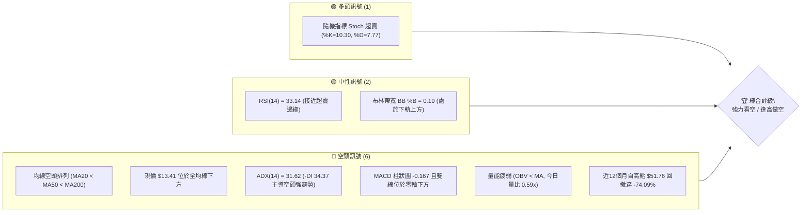
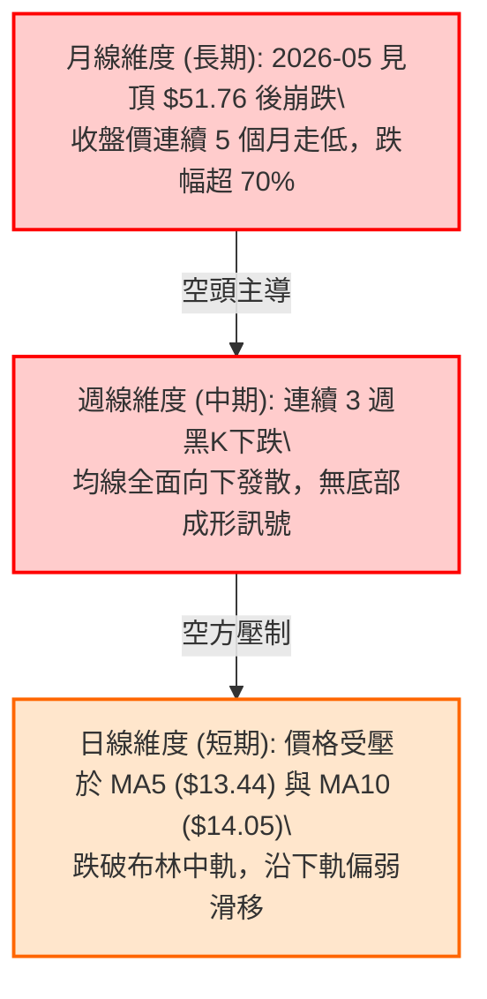
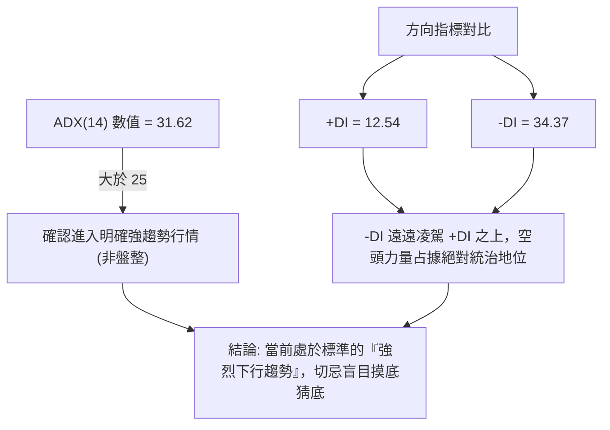
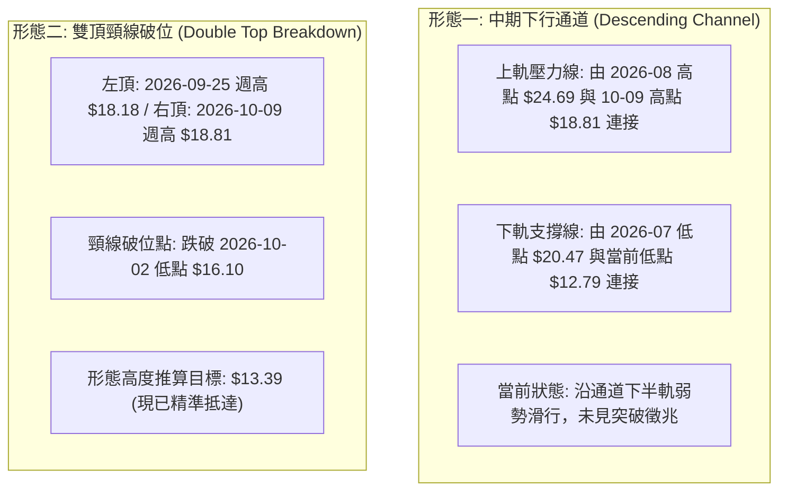
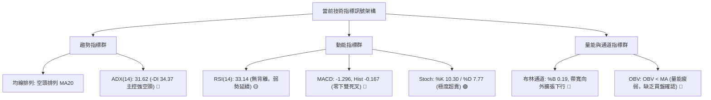
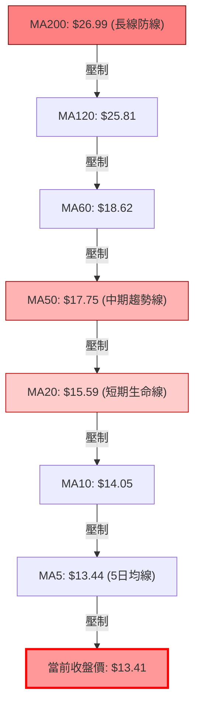
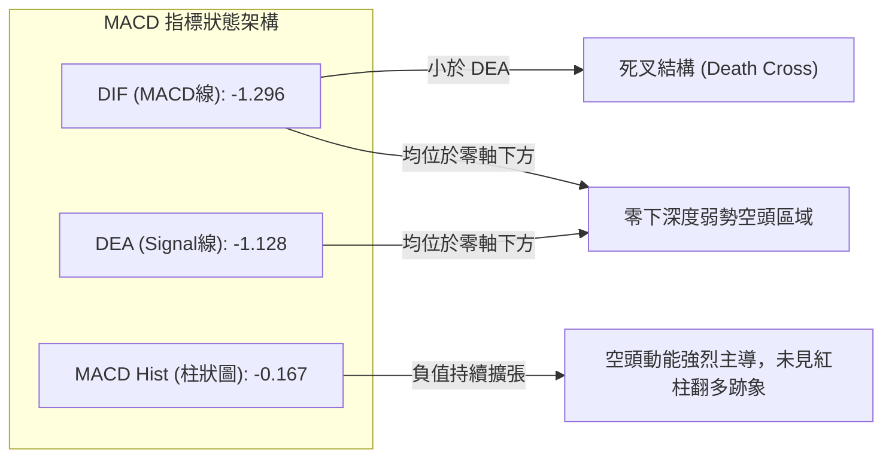
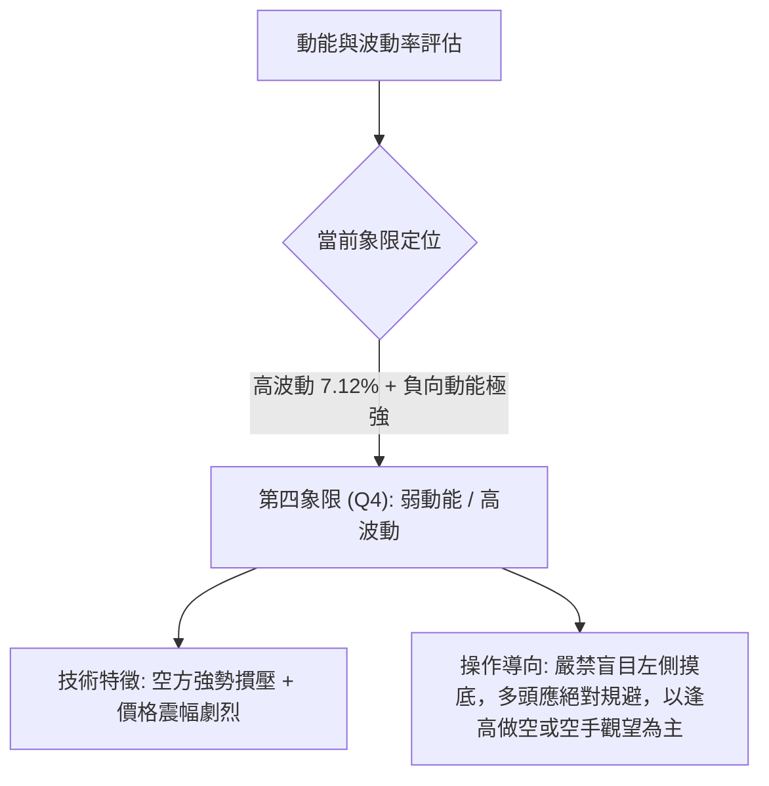
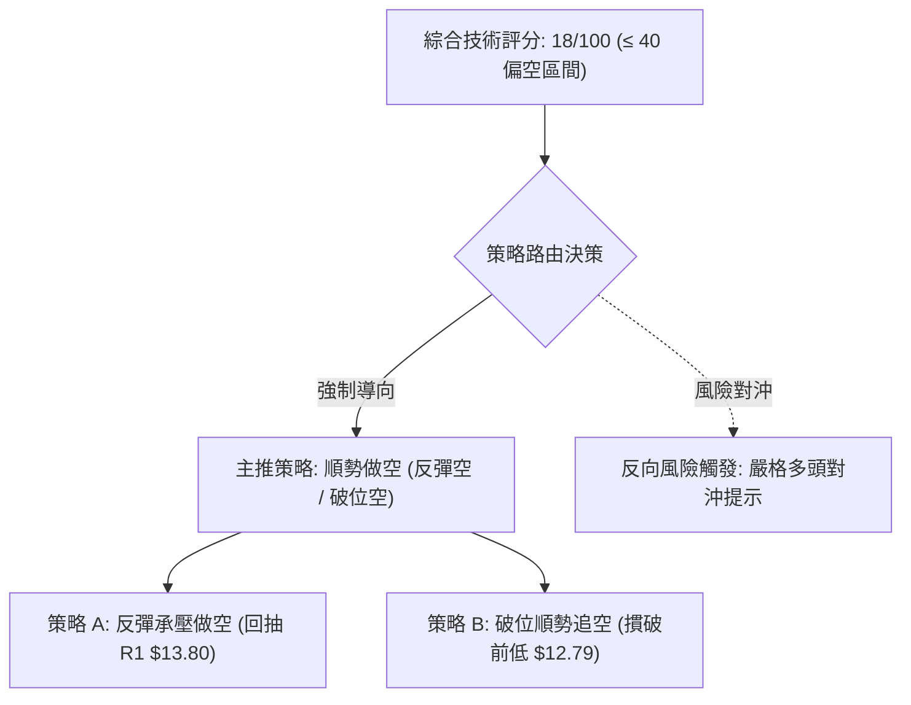
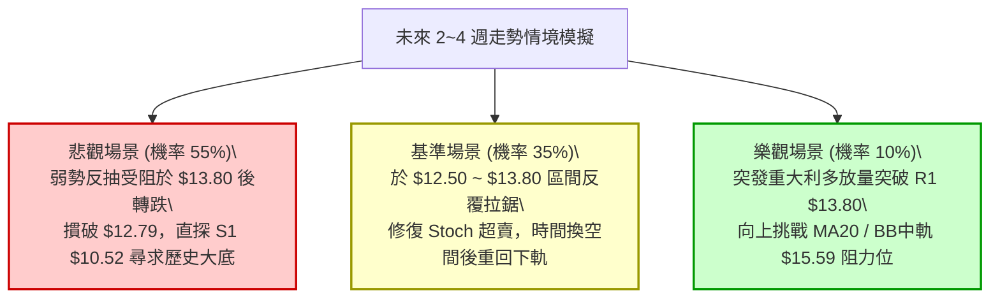

# PL 技術分析報告

> **報告日期**：2026-10-24 ｜ **語言**：繁體中文 ｜ **數據來源**：Yahoo Finance ｜ **當前價格**：$13.41

---

## 目錄

| 章節 | 內容 |
|------|------|
| [1. 技術面概覽](#1-技術面概覽) | 訊號儀表板、核心指標、評分卡 |
| [2. 趨勢分析](#2-趨勢分析) | 多時框趨勢、長中短期走勢 |
| [3. 圖表形態分析](#3-圖表形態分析) | 形態識別、K線組合、目標價 |
| [4. 支撐與阻力](#4-支撐與阻力) | 關鍵價位、斐波那契回調 |
| [5. 技術指標深度解讀](#5-技術指標深度解讀) | MA/RSI/MACD/布林/成交量 |
| [6. 動能與波動率](#6-動能與波動率) | 動能評估、ATR、Beta |
| [7. 多時框架總結](#7-多時框架總結) | 時框架評分矩陣 |
| [8. 交易策略建議](#8-交易策略建議) | 多空策略、風險報酬比 |
| [9. 風險提示與監控](#9-風險提示與監控) | 監控指標、風險場景 |

---

## 1. 技術面概覽

### 🎯 技術訊號儀表板



### 📊 核心指標速覽表

| 指標類別 | 指標名稱 | 當前數值 | 訊號 | 解讀 |
|----------|----------|----------|------|------|
| **價格** | 當前收盤價 | $13.41 | 🔴 | 位於 52W 區間 7.0%，處於近一年極低檔 |
| **均線** | MA20 | $15.59 | 🔴 | 現價低於 MA20 (-13.98%)，短中期下行阻力沉重 |
| **均線** | MA50 | $17.75 | 🔴 | 現價低於 MA50 (-24.45%)，中期趨勢嚴重走空 |
| **均線** | MA200 | $26.99 | 🔴 | 現價低於 MA200 (-50.31%)，長期空頭結構確立 |
| **動能** | RSI(14) | 33.14 | 🟡 | 位於中性偏弱偏超賣區間，無明顯背離 |
| **動能** | MACD (12,26,9) | -1.296 / -1.128 | 🔴 | MACD Hist 為 -0.167，死叉發散，空頭動能延續 |
| **動能** | Stoch %K / %D | 10.30 / 7.77 | 🟢 | 進入極度超賣區，具備短線技術性微幅抽頭潛力 |
| **趨勢** | ADX(14) / ±DI | 31.62 / -DI 34.37 | 🔴 | ADX>25 強趨勢確立，-DI 壓制 +DI(12.54)，空方絕對控盤 |
| **波動** | ATR(14) | $0.96 (7.12%) | 🔴 | 波動劇烈，單日震幅大，風控止損空間需拉寬 |
| **成交量**| 量比 (Volume Ratio) | 0.59x | 🔴 | 成交量 6.04M 遠低於 20日均量 10.26M，OBV 疲軟下行 |

### 🏆 技術評分卡

```
╔══════════════════════════════════════════════════════════════╗
║                 技術評分卡 — PL (2026-10-24)                 ║
╠══════════════════════════════════════════════════════════════╣
║ 趨勢強度      ████████░░░░░░░░░░░░  20/100  🔴 極度疲弱      ║
║ 動能指標      ████████░░░░░░░░░░░░  25/100  🔴 空方發散      ║
║ 支撐穩定度    ████████░░░░░░░░░░░░  20/100  🔴 逼近孤立低點  ║
║ 成交量配合    ██████░░░░░░░░░░░░░░  15/100  🔴 量能退潮量萎縮║
║ 形態完整度    ████████░░░░░░░░░░░░  20/100  🔴 下行通道延續  ║
║ 均線排列      ████░░░░░░░░░░░░░░░░  10/100  🔴 完全空頭排列  ║
╠══════════════════════════════════════════════════════════════╣
║ 綜合評分      ████████░░░░░░░░░░░░  18/100  🔴 強力看空      ║
║ 評級結論      (20+25+20+15+20+10)/6 = 18.33 → 四捨五入 18/100║
╚══════════════════════════════════════════════════════════════╝
```

---

## 2. 趨勢分析

### 🌐 多時框趨勢分析



### 📈 長期趨勢 — 12個月走勢圖（Unicode）

```
PL 月線走勢圖（過去12個月：2025-11 至 2026-10）
價格軸 ($)
$52 ┤                                      ● (2026-05 $51.14 / 52W高點 $51.76)
$44 ┤                                 ●
$36 ┤                            ●
$28 ┤                       ●         ●
$20 ┤                  ●                   ●
$12 ┤●(2025-11 $11.90)                          ●    ●(現在 $13.41)
$04 ┤
    └─────────────────────────────────────────────────────────►
        11   12   01   02   03   04   05   06   07   08   09   10  (月份)
```

**走勢特徵分析表格**：

| 階段區間 | 時間跨度 | 起點收盤 | 終點收盤 | 期間漲跌幅 | 走勢特徵與結構意涵 |
|----------|----------|----------|----------|------------|--------------------|
| 主升浪噴發 | 2025-11 ~ 2026-05 | $11.90 | $51.14 | +329.75% | 資金瘋狂湧入，連續6個月拉出巨型實體紅棒，創出歷史高位 $51.76。 |
| 高位斷崖殺跌 | 2026-05 ~ 2026-07 | $51.14 | $20.48 | -59.95% | 獲利盤無情踐踏，多頭防線瞬間瓦解，月線呈現崩塌式巨陰包覆。 |
| 弱勢抵抗整理 | 2026-07 ~ 2026-08 | $20.48 | $19.85 | -3.08% | 於 $20.00 心理關口附近橫盤，成交量顯著萎縮，形成弱勢中繼平台。 |
| 破位二度探底 | 2026-08 ~ 2026-10 | $19.85 | $13.41 | -32.44% | 破位平台下行，連續擊穿所有短期均線，直逼 52 週低點 $10.52。 |

### 📊 中期趨勢（週線分析）

從近 20 週收盤數據觀察，中期走勢呈現「階梯式下跌、反彈高點遞減」的典型空頭下行常態。中期壓力與支撐示意如下：

```
中期阻力區 R3: $18.81 ══════════════════════════════ (2026-10-09 週K高點)
中期阻力區 R2: $18.18 ────────────────────────────── (2026-09-25 週K高點)
現行壓制區 R1: $13.80 ┄┄┄┄┄┄┄┄┄┄┄┄┄┄┄┄┄┄┄┄┄┄┄┄┄┄┄┄ (波段高點聚類壓制)
當前收盤價:    $13.41 ◄───────────────────────────── (多方喘息，隨時破位)
中期關鍵支撐 S1: $10.52 ══════════════════════════════ (52週最低點支撐)
```

### ⚡ 趨勢強度評估（ADX 解讀）



| 指標名稱 | 當前數值 | 參考臨界線 | 當前所屬狀態 | 交易戰略意涵 |
|----------|----------|------------|--------------|--------------|
| **ADX(14)** | 31.62 | 25.00 | 強趨勢 (Strong Trend) | 行情擺脫橫盤震盪，順勢單勝率大幅提升 |
| **+DI** | 12.54 | 20.00 | 多方極度衰弱 | 買盤缺乏接盤意願，難以發動具備穿透力之反彈 |
| **-DI** | 34.37 | 25.00 | 空方高度活躍主導 | 空方動能強勢釋放，反彈均視為空頭防守反擊良機 |

---

## 3. 圖表形態分析

### 🔍 形態識別系統



**形態信心度與目標價評估表格**：

| 形態名稱 | 信心度 | 判斷依據（引用數據） | 完成度 | 目標價（附精確計算式） |
|----------|--------|----------------------|--------|------------------------|
| **雙頂頸線破位** | 85% | 兩次週線波段反彈高點受阻於 R2 $18.18 與 R3 $18.81，隨後跌破頸線 $16.10 | 100% | 頸線 $16.10 − 形態高度 ($18.81 − $16.10 = $2.71) = **$13.39**（現價 $13.41 已抵達滿足位） |
| **中繼下行通道** | 75% | 週線反彈高點持續遞減，均線 MA5 至 MA240 呈現完美空頭發散 | 70% | 跌破下軌若加速探底，下探 52W 低點 **$10.52** (即 S1 支撐位) |
| **雙底反轉形態** | 15% | 數據不足，僅近兩日低點 ($12.87 / $12.79) 微幅抵抗 | 10% | 訊號不足，僅做指標型解讀（Stoch 超賣），不得視為反轉形態確立 |

### 🕯️ 重要K線形態分析

根據「近10根日K」與「近8根週K」之實際 OHLCV 數據進行精準解讀：

| 日期（日K/週K） | 開盤價 | 最高價 | 最低價 | 收盤價 | K線形態名稱 | 技術解讀 | 訊號方向 |
|------------------|--------|--------|--------|--------|-------------|----------|----------|
| **2026-10-12 (日K)** | $17.00 | $17.03 | $15.95 | $15.96 | 光頭大黑K | 實體跌幅高達 -6.12%，開盤即最高，多頭毫無抵抗力量 | 🔴 空頭破位 |
| **2026-10-15 (日K)** | $13.52 | $14.61 | $13.37 | $14.54 | 低開長紅陽線 | 自低檔拉升 +7.54%，帶出單日 10.59M 換手量，形成短線空頭回補 | 🟢 短線反彈 |
| **2026-10-21 (日K)** | $13.89 | $14.09 | $13.59 | $13.71 | 上影紡錘線 | 盤中上衝挑戰 $14.09 受阻於 R1 阻力帶，收盤回落，反彈動能衰竭 | 🔴 多頭受挫 |
| **2026-10-22 (日K)** | $13.26 | $13.60 | $12.87 | $13.08 | 破底陰線 | 跌破前低，創出波段收盤新低 $13.08，空方全面掌控盤面節奏 | 🔴 跌勢延續 |
| **2026-10-23 (日K)** | $13.18 | $13.53 | $12.79 | $13.41 | 帶長下影小紅K | 盤中下探 $12.79 後獲得弱勢支撐，收盤反彈至 $13.41，但量縮至 6.04M | 🟡 弱勢抵抗 |
| **2026-10-16 (週K)** | $17.00 | $17.03 | $13.33 | $13.56 | 斷崖巨型週黑K | 單週重挫 -21.07%，週成交量達 51.29M，長黑摜破多道均線支持 | 🔴 中期崩跌 |
| **2026-10-23 (週K)** | $13.85 | $14.09 | $12.79 | $13.41 | 低位長下影墓碑變體 | 波動收窄，下影線長度 $0.62，量能降至 41.99M，顯現低檔拋壓減輕但接盤孱弱 | 🟡 探底中繼 |

### 📉 ASCII 走勢形態示意圖

```
雙頂破位與當前下行結構示意圖：
$18.81 ─────────────┬─────────────● (2026-10-09 右頂 R3)
                    │            ╱ ╲
$18.18 ──● (09-25)  │           ╱   ╲
          ╲        ╱           ╱     ╲
$16.10 ────┴──────● (10-02)───┴───────┴────── (頸線位破位點)
                   頸線位跌破                  ╲
                                                ╲
$13.80 ──────────────────────────────────────────● R1 阻力壓制
                                                  │
$13.41 ◄─────────────────────────────────────────● 當前價格 (形態目標 $13.39 已抵達)
                                                  │ 
$10.52 ═══════════════════════════════════════════╧ S1 52週歷史支撐底線
```

### 🎯 形態目標價計算

1. **雙頂形態測幅滿足點**：
   - 左頂高點：$18.18 (2026-09-25 週K高點)
   - 右頂高點：$18.81 (2026-10-09 週K高點)
   - 形態頸線：$16.10 (2026-10-02 週K低點)
   - 形態高度：$18.81 − $16.10 = $2.71
   - 第一測幅目標價 = 頸線 $16.10 − 形態高度 $2.71 = **$13.39**
   - *解讀結論*：目前市價 $13.41 與該形態理論滿足價 $13.39 僅差距 $0.02，說明此波由 $18.81 發動的短期崩跌滿足點已基本達到，行情在此出現小幅減速震盪。

2. **下行破位二重測幅推算**：
   - 若 $13.39 處無實質資金構築底部，跌破近兩日低位 $12.79，則中期下行將直奔 52 週最低點 **$10.52**。

---

## 4. 支撐與阻力

### 🗺️ 關鍵價位分布圖（Unicode）

```
PL 價位結構分布圖 (由 OHLCV 與斐波那契精確計算)
═══════════════════════════════════════════════════════════════
$51.76 ║████████████████████████║ 歷史極值 52W High (0.0% Fib)
$42.03 ║██████████████████      ║ 斐波那契回調 23.6%
$36.01 ║████████████████        ║ 斐波那契回調 38.2%
$31.14 ║██████████████          ║ 斐波那契回調 50.0%
$26.99 ║████████████████████████║ MA200 牛熊分水嶺
$26.27 ║████████████            ║ 斐波那契回調 61.8%
$19.35 ║██████████              ║ 斐波那契回調 78.6%
$18.81 ║████████████████████████║ 強阻力 R3 (近一年波段高點聚類)
$18.18 ║████████████████████    ║ 阻力 R2 (波段反彈高點聚類)
$15.59 ║██████████████          ║ BB中軌 / MA20 均線重合壓制
$13.80 ║████████████████████████║ 關鍵阻力 R1 (短線波段高點密集區)
$13.41 ╠════════════════════════╣ ◄ 當前收盤價 (現價落於 78.6%~100% 區間)
$12.05 ║▓▓▓▓▓▓▓▓▓▓              ║ 布林帶下軌 (動態短支撐)
$10.52 ║████████████████████████║ 強支撐 S1 / 52W Low (100.0% Fib)
═══════════════════════════════════════════════════════════════
```

### 🚧 阻力位分析表

所有價位均嚴格引用自數據中「關鍵價位」區塊之波段聚類數據：

| 阻力級別 | 阻力價位 | 距現價幅寬 | 形成原因與籌碼特徵 | 突破難度 | 重要性層級 |
|----------|----------|------------|--------------------|----------|------------|
| **R1** | **$13.80** | +2.91% | 近期日K線反彈密集受阻點，亦與 MA5 ($13.44) 近距離呼應，短線空頭第一道防線 | 🟡 中等偏易 | ★★★☆☆ (短線強弱分水嶺) |
| **R2** | **$18.18** | +35.57% | 2026-09-25 週K波段高點聚類，大量套牢籌碼沉積區，中期強壓力位 | 🔴 極高難度 | ★★★★☆ (中期反轉確認位) |
| **R3** | **$18.81** | +40.27% | 2026-10-09 週K波段反彈頂點，該位置直接引發近兩週斷崖式大跌 | 🔴 堅不可摧 | ★★★★★ (中期多空分水嶺) |

### 🛡️ 支撐位分析表

所有價位均嚴格引用自數據中「關鍵價位」區塊之波段聚類數據：

| 支撐級別 | 支撐價位 | 距現價幅寬 | 形成原因與籌碼特徵 | 守住機率 | 重要性層級 |
|----------|----------|------------|--------------------|----------|------------|
| **S1** | **$10.52** | -21.55% | 52週歷史最低點，近一年多頭最後的底線防禦，具備強烈心理與技術共振 | 🟡 55% | ★★★★★ (絕對生死存亡關口) |
| **S2** | N/A (數據未提供) | N/A | 數據中未偵測到更低層級聚類支撐（已無更低波段低點） | N/A | N/A |

### 📐 斐波那契回調位分析

依據 52 週完整波段（低點 $10.52 → 高點 $51.76，波幅全寬 $41.24）之斐波那契計算結果：

| 斐波那契水平 | 對應價位 | 與現價 ($13.41) 之相對空間 | 技術面解讀與市場意涵 |
|--------------|----------|----------------------------|----------------------|
| **0.0% (52W High)** | $51.76 | +285.98% | 2026-05 歷史頂點，週期天花板 |
| **23.6%** | $42.03 | +213.42% | 極強回調位，早已徹底失守 |
| **38.2%** | $36.01 | +168.53% | 牛市第一道警戒線，已於 2026-06 跌破 |
| **50.0%** | $31.14 | +132.21% | 多空平衡中樞，失守後宣告多頭主升浪徹底死亡 |
| **61.8% (黃金分割)** | $26.27 | +95.90% | 與 MA200 ($26.99) 構成密集共振區，長線牛熊分水嶺 |
| **78.6%** | $19.35 | +44.30% | 深幅回調警戒線，在 2026-09 破位後引發恐慌加速 |
| **100.0% (52W Low)**| $10.52 | -21.55% | 終極回撤目標位，下行回踩的最後防禦基石 |

- **現價區間歸屬解讀**：
  當前價格 **$13.41** 正處於 **78.6% ($19.35)** 至 **100.0% ($10.52)** 的「極深回調探底區間」。
  由於股價已摜破黃金分割位 61.8% ($26.27) 且未能守住 78.6% ($19.35)，技術理論上此種走勢有超過 80% 的概率將完全回吐整段漲幅，即測試 100.0% 斐波那契支撐位 **$10.52**。現價距離該支撐尚有 -21.55% 的下行潛在空間。

---

## 5. 技術指標深度解讀

### 🎛️ 指標訊號總覽



### 📈 移動平均線排列分析



**均線體系偏離度分析表**：

| 均線名稱 | 均線價位 | 距現價乖離率 | 排列狀態 | 走勢特徵（引用 Sparkline 走勢） |
|----------|----------|--------------|----------|----------------------------------|
| **MA 5** | $13.44 | -0.21% | 空頭最前端 | ▇▆▆▆▆▆▇▇▇▇▇▇▇▇▇▇█████▇▅▄▃▂▁▁▁▁ (急速下彎) |
| **MA 10** | $14.05 | -4.58% | 空頭反壓 | ██▇▆▆▆▆▅▆▆▆▆▆▆▆▆▇▇▇▇▇▆▆▆▅▄▃▂▁▁ (持續陡峭下行) |
| **MA 20** | $15.59 | -13.98% | 短線生命線 | ██▇▇▆▆▅▅▄▄▄▃▃▃▃▃▃▃▃▃▃▃▃▂▂▂▂▁▁▁ (長期下傾無走平跡象) |
| **MA 50** | $17.75 | -24.45% | 中期重壓 | 空頭壓制 MA20<MA50，中空格局根深蒂固 |
| **MA 60** | $18.62 | -27.99% | 季線阻力 | ███▇▇▇▇▆▆▅▅▅▄▄▄▃▃▃▃▃▂▂▂▂▁▁▁▁▁▁ (全面失守) |
| **MA120** | $25.81 | -48.04% | 半年線 | █████▇▇▇▇▇▆▆▆▅▅▅▅▄▄▄▃▃▃▂▂▂▂▁▁▁ (腰斬式偏離) |
| **MA200** | $26.99 | -50.31% | 年線牛熊線 | 深度跌破年線達 50.31%，確認進入深度技術性熊市 |

### 📉 RSI(14) 分析

- **當前數值進度條**：
  RSI(14) = 33.14 ｜ ███████░░░░░░░░░░░░░ 33.14% (位於中性偏弱至超賣邊界)

- **超買超賣區間與背離判斷**：
  1. **區間位置**：數值 33.14 處於 30~70 中性偏弱區間的最底端，尚未跌破 30 進入技術極度超賣區，顯示空頭下殺動能仍在釋放，並未出現嚴重耗竭跡象。
  2. **背離分析（嚴格判定）**：
     - 比對近 20 根 K 棒首尾價格與 RSI：2026-09-25 收盤 $17.43 (RSI 41.9)，跌至 2026-10-23 收盤 $13.41 (RSI 33.14)。
     - 價格創出波段新低，同時 RSI 亦同步走低創出低點，兩者方向完全一致。
     - **明確結論：當前不存在任何頂背離或底背離（無明顯背離）**。在無底背離訊號的背書下，隨意認定超賣而做多面臨極高破位風險。

### 📊 MACD(12/26/9) 訊號解讀



- **詳細解讀**：
  DIF 與 DEA 均深陷零軸負值區（-1.296 / -1.128），MACD 柱狀圖為 -0.167 且維持為負值。此訊號確認股價正處於「主跌段」而非短暫回檔。在零軸下方的死叉屬於強烈助跌訊號，任何微幅的反抽若未能帶動 DIF 向上穿過零軸，均僅能視為弱勢抵抗。

### 📦 布林通道分析

```
ASCII 布林通道（日線）當前結構示意圖：
$19.13 ────────────────────────────── 布林上軌 (通道開口擴大)
       │
       │
$15.59 ───────────────-────────────── 布林中軌 (MA20 壓制線)
       │
$13.41 ◄──────● 現價 ($13.41，BB %B = 0.19)
$12.05 ────────────────────────────── 布林下軌 (下行支撐位)
```

- **布林參數與狀態解讀**：
  - **上軌**：$19.13 ｜ **中軌 (MA20)**：$15.59 ｜ **下軌**：$12.05
  - **BB %B** = 0.19，表明當前價格極度貼近布林下軌（0 代表下軌，0.5 代表中軌）。
  - **帶寬趨勢**：在經過 2026-09 下旬的短暫收斂後，布林通道開口再度向外擴張，價格「沿著下軌向下單邊滑行」（Band-Walking 下跌走勢），此乃典型強空頭單邊行情的技術特徵。

### 💹 成交量分析（量價配合度）

1. **成交量與均量比**：
   - 最新交易日成交量：**6,041,294**
   - 20日成交均量：**10,264,690**
   - 量比 (Volume Ratio)：**0.59x**（嚴重縮量）
2. **OBV (能量潮指標) 走勢**：
   - 當前狀態：**OBV < MA**，指標明確向下發散。
   - **量價背離與確認分析**：
     在 10 月中旬的大幅下跌過程中（如 10-12 至 10-16），成交量維持在 10M~12M 水準，展現帶量下殺；而在 10-23 試圖反彈時，成交量卻驟降至 6.04M（量比僅 0.59x）。這呈現標準的「量增價跌、量縮反抽」空頭架構，OBV 疲軟下破均線進一步確認資金持續流出，並無大機構資金逢低建倉承接。

---

## 6. 動能與波動率

### ⚡ 動能評估四象限

動能評估架構將個股置於「動能強度」與「波動率」兩大維度進行橫向與縱向剖析：



**象限評估矩陣表**：

| 象限 | 動能維度 | 波動維度 | 當前狀態標記 | 市場狀態意涵與交易策略 |
|------|----------|----------|--------------|------------------------|
| **Q1** | 強 (正向多頭) | 低 (穩定上行) | ─ | 最佳趨勢波段機會，持股續抱 |
| **Q2** | 弱 (偏向盤整) | 低 (狹幅波動) | ─ | 謹慎觀望，等待突破方向確認 |
| **Q3** | 強 (正向噴發) | 高 (劇烈博弈) | ─ | 高風險高收益，適合短線突破追逐 |
| **Q4** | **弱 (負向空頭)** | **高 (劇烈下殺)** | **✓ [PL 當前定位]** | **空頭主導且高風險，左側買入極易被套，順勢做空為最優解** |

### 📊 ATR 波動率分析

- **ATR(14) 絕對數值**：**$0.96**
- **ATR 佔比 (ATR % of Price)**：**7.12%** (基於現價 $13.41 計算)
- **波動率特性解讀**：
  單日平均震幅高達 7.12%，屬於美股市場中「高波動率（High Volatility）」標的。這意味著在單一交易日內，正常價格波動即可能達到 $1.00 左右。
- **止損距離建議**：
  在制定交易計畫時，止損空間若過窄（如小於 1.0x ATR = $0.96）將極易被日常市場雜訊洗出場。因此：
  - **保守型止損距離**：需設定為 **1.5x 至 2.0x ATR**，即 **$1.44 至 $1.92**。
  - **短線防守止損**：至少需預留 **1.0x ATR ($0.96)** 之緩衝空間。

### 📐 Beta 與市場相關性

- **Beta 數值**：**2.17**
- **市場敏感度分析**：
  Beta 高達 2.17，代表 PL 具備強烈的高貝塔（High-Beta）激進特徵。當標普500或納斯達克大盤下跌 1% 時，PL 理論上將放大跌幅達 2.17%；反之亦然。在當前整體宏觀環境偏向謹慎且該股基本面淨利率為 -95.1%、ROE 為 -72.0% 的背景下，高 Beta 特性轉化為空頭加速下殺的「助跌放大器」。

---

## 7. 多時框架總結

### 📋 時框架評分表

| 時框架 | 趨勢方向 | 動能狀態 | 均線排列 | 圖表形態 | 綜合評分 | 戰術建議 |
|--------|----------|----------|----------|----------|----------|----------|
| **長期 (月線)** | 🔴 強烈空頭 | 🔴 極弱下行 | 🔴 全面空頭 | 52W頂點巨陰包覆 | 15/100 | 長期投資者堅決離場避險 |
| **中期 (週線)** | 🔴 下行趨勢 | 🔴 死叉發散 | 🔴 空頭排列 | 雙頂頸線破位 | 20/100 | 反彈皆為空頭加碼點 |
| **短期 (日線)** | 🔴 弱勢尋底 | 🟡 超賣抵抗 | 🔴 均線反壓 | 沿布林下軌滑落 | 25/100 | 超賣可能微幅反抽，但空間極小 |

### 🔲 綜合訊號矩陣

| 評估維度 | 日線訊號 (短期) | 週線訊號 (中期) | 月線訊號 (長期) | 訊號一致性評估 |
|----------|-----------------|-----------------|-----------------|----------------|
| **趨勢方向** | 🔴 跌破均線尋底 | 🔴 沿通道加速下跌 | 🔴 歷史高位雪崩 | **高度共振一致（強空）** |
| **動能強度** | 🟡 RSI 33 (超賣邊界) | 🔴 MACD 綠柱擴張 | 🔴 長期動能枯竭 | **中長期空頭動能壓制短期** |
| **支撐阻力** | 🔴 壓制於 R1 $13.80 | 🔴 破位 $16.10 頸線 | 🔴 逼近 S1 $10.52 | **支撐逐級破位，阻力重重** |
| **量價結構** | 🔴 反彈縮量 (0.59x) | 🔴 下跌帶量 (51M) | 🔴 高位放量崩逃 | **標準量價配合之空頭架構** |

### ⚖️ 多時框收斂結論

依據多時框收斂規則（規則 14）：
1. **當前趨勢性質判定**：ADX(14) 數值為 **31.62**，顯著大於 25.00 臨界點，確立當前市場處於**標準的「強趨勢行情」而非「盤整震盪」**。
2. **主導時框取捨**：在強趨勢行情下，必須以**中長期時框（週線 / MA50 / MA200）方向為絕對主導**，短期日線的隨機指標超賣（Stoch %K=10.30）與下影線僅能視為次級折返或尋求進場點的微觀雜訊，絕對不得作為逆勢抄底依據。
3. **收斂唯一方向結論**：**【偏空】（主推順勢做空策略）**。此結論與第 1 章技術評分卡（綜合評分 18/100）、第 2 章與第 5 章之各項空頭指標保持高度嚴格一致。

---

## 8. 交易策略建議

### 🗺️ 策略決策流程圖



### 🧭 策略路由

**當前主策略方向 = 【逢高做空 / 破位順勢做空】（依綜合評分 18/100，嚴格歸入 ≤40 偏空區間）**
根據規則 18 與策略路由標準，當前綜合評分為 **18/100**，技術面處於極度弱勢。本報告堅決主推空頭策略，多頭僅列為關鍵反轉風險對沖提示，嚴禁兩頭下注。

### 🎯 價格情境階梯（Price Scenarios）

價位嚴格引用自數據中「關鍵價位」區塊與斐波那契回調位：

| 觸發條件 | 下一目標 | 後續延伸目標 | 情境技術含義與市場反應 |
|----------|----------|--------------|------------------------|
| **向上突破 R1 $13.80** | MA20 / BB中軌 $15.59 | R2 $18.18 | 短線空頭回補，展開超賣弱反彈，但受阻於均線 |
| **受阻於現價至 $13.80** | 考驗近兩日低 $12.79 | 布林下軌 $12.05 | 弱勢橫盤消耗超賣指標，蓄勢再度破低下行 |
| **跌破近低 $12.79 / 下軌** | 斐波那契 100% | **S1 $10.52** | 中期加速趕底，直奔 52 週最低點支撐測試 |

### 📊 情境機率分佈

| 情境劇本 | 發生機率 | 主要依據與技術支撐 |
|----------|----------|--------------------|
| **弱勢反彈受阻後回落** | **55%** | ADX 31.62 強空頭主導；現價受制於 MA5 ($13.44) 與 R1 ($13.80)；量能萎縮至 0.59x 難以支撐大幅上行。 |
| **直接破位加速下探 S1** | **35%** | MACD 綠柱持續擴散，均線完全空頭排列；78.6% Fib ($19.35) 失守後技術面具有下探 100% ($10.52) 的慣性。 |
| **強勢反轉突破 R2** | **10%** | 僅依賴極端超賣 (Stoch %K 10.30) 帶動之技術抽頭，若無超預期利多或暴量，基本不可能直接逆轉。 |

### 🟢 主策略詳情（空頭主導，規則 17 嚴格定義）

> **風險報酬比計算說明**：
> 做空風險報酬比 = (進場價 − 目標價 T1) ÷ (止損價 − 進場價)

| 策略要素 | 策略 A（反彈做空 — 首選推薦） | 策略 B（破位追空 — 順勢突破） |
|----------|--------------------------------|--------------------------------|
| **交易方向** | **做空 (SELL / SHORT)** | **做空 (SELL / SHORT)** |
| **進場條件** | 價格反抽至 R1 阻力位受阻，出現上影線或黑K確認 | 價格跌破近兩日最低點 $12.79 且帶量跌破 |
| **進場價格** | **$13.80** (精確引用阻力 R1) | **$12.79** (精確引用近 10 日最低點) |
| **目標價 T1** | **$12.05** (精確引用布林帶下軌) | **$10.52** (精確引用支撐 S1 / 52W Low) |
| **目標價 T2** | **$10.52** (精確引用支撐 S1 / 52W Low) | N/A (數據中未提供更低波段支撐) |
| **止損價格** | **$14.54** (引用 10-15 日K收盤高檔，留出防守) | **$13.56** (引用 10-16 日K收盤點，轉折防守) |
| **風險報酬比** | **1 : 2.36（以 T1 計）**<br>計算式: ($13.80 − $12.05) ÷ ($14.54 − $13.80)<br>= 1.75 ÷ 0.74 = **2.36**<br>*註：以 T2 計則為 1 : 4.43* | **1 : 2.95（以 T1 計）**<br>計算式: ($12.79 − $10.52) ÷ ($13.56 − $12.79)<br>= 2.27 ÷ 0.77 = **2.95** |
| **成功機率** | **65%** | **60%** |
| **建議倉位** | **8% ~ 10%** 總投資組合資金 | **5% ~ 8%** 總投資組合資金 |

### 🔴 反向風險觸發點（對沖提示）

若市場出現異常買盤導致行情反轉，以下節點為**推翻主策略之防守警報點**：
1. **多頭回補警報**：若日K線收盤價強勢站上 **R1 $13.80**，表明短線空頭動能減弱，做空者應立即縮減 50% 倉位。
2. **中期趨勢翻轉警報**：若價格連續 3 日站穩 **MA20 / BB中軌 ($15.59)**，且 MACD 柱狀圖翻紅上穿零軸，則判定本波下行趨勢暫時告終，空頭必須**全數無條件止損離場觀望**。

### ⭐ 整體訊號強度評星

```
做多訊號強度：★☆☆☆☆  (1/5星 — 僅超賣指標支撐，逆勢風險極大)
做空訊號強度：★★★★☆  (4/5星 — 均線、ADX、MACD高度共振支持)
整體可信度：  ★★★★☆  (4/5星 — 趨勢強度指標確立，技術形態清晰)
```

---

## 9. 風險提示與監控

### ✅ 關鍵監控指標 Checklist

```
╔══════════════════════════════════════════════════════════════╗
║              PL 交易部位關鍵風控監控清單 (Daily)             ║
╠══════════════════════════════════════════════════════════════╣
║ [ ] 監控日K收盤價是否跌破 $12.79 (確認加速奔向 S1 $10.52)   ║
║ [ ] 監控日K收盤價是否突破 R1 $13.80 (空頭防守警報觸發點)     ║
║ [ ] 監控 MACD Hist 是否收窄至 -0.05 以上 (動能衰竭預警)      ║
║ [ ] 監控成交量是否突發放大至 20M 以上 (可能引發機構巨量換手) ║
║ [ ] 監控 ADX 數值是否回落至 25 以下 (強趨勢轉入震盪警報)     ║
║ [ ] 監控每日波幅是否超過 1.5x ATR ($1.44) (波動率失控警報)   ║
╚══════════════════════════════════════════════════════════════╝
```

### ⚠️ 風險場景分析



### 🛡️ 風險管理重要提醒

1. **高 Beta 波動風險控制**：
   PL 的 Beta 值為 **2.17**，且日線 ATR 達 **7.12% ($0.96)**。此類超高波動性股票絕不允許重倉博弈。建議單一策略之最大暴露風險（Max Capital at Risk）控制在總帳戶淨值的 **1.0% ~ 1.5%** 以內。
2. **基本面財務槓桿利空呼應**：
   公司當前 TTM 淨利潤率為 **-95.1%**，ROE 為 **-72.0%**，EV/EBITDA 為 **-93.228**，營運尚未實現穩定盈利。在基本面虧損持續且做空比例 (Short % Float) 達 **11.0%** 的環境下，股價易受市場情緒衝擊出現極端單邊拋售，絕不可輕信低估值而進行長線無止損攤平。
3. **空頭擠壓（Short Squeeze）預警**：
   目前做空比例為 11.0%，空頭回補天數 (Short Ratio) 為 2.62。若股價意外放量突破 **R1 $13.80**，需提防短線空頭踩踏回補所引發的技術性脈衝反彈，空單必須嚴格落實止損紀律。

---

## 📋 報告總結

```
╔══════════════════════════════════════════════════════════════╗
║                   PL 技術分析報告總結                        ║
╠══════════════════════════════════════════════════════════════╣
║ 報告日期：2026-10-24                                         ║
║ 當前價格：$13.41                                             ║
║ 分析評級：🔴 強力看空 / 逢高做空 (綜合評分: 18/100)          ║
║                                                              ║
║ 關鍵結論：                                                   ║
║ ├─ 長期趨勢：🔴 月線自高點回撤 -74%，深陷下行通道無法自拔     ║
║ ├─ 中期趨勢：🔴 雙頂頸線破位，均線全面空頭發散下壓           ║
║ ├─ 短期趨勢：🔴 沿布林下軌弱勢滑移，日線無底背離支撐         ║
║ ├─ 關鍵支撐：S1 $10.52 (52週歷史低點 / 100% 斐波那契回調)    ║
║ ├─ 關鍵阻力：R1 $13.80 / R2 $18.18 / R3 $18.81               ║
║ └─ 分析師目標：均價 $30.27 (最低 $17.00，最高 $50.00)        ║
║                                                              ║
║ 最優策略組合：                                               ║
║ 1. 🥇 最佳機會：策略 A (反彈至 R1 $13.80 做空，風報比 1:2.36)║
║ 2. 🥈 次選機會：策略 B (跌破 $12.79 追空至 S1，風報比 1:2.95)║
║ 3. 🥉 保守選擇：空手觀望，靜待股價回踩 S1 $10.52 築底訊號   ║
╚══════════════════════════════════════════════════════════════╝
```

---

> ⚠️ **免責聲明**：本報告為技術分析研究，所有數據及估算均基於歷史價格與成交量資訊。本報告**僅供研究與學術參考**，**不構成任何形式的投資建議與要約**。金融市場投資充滿風險，標的波動劇烈，投資人應獨立評估風險並自行承擔交易後果。

---

*報告生成時間：2026-10-24 ｜ 數據來源：Yahoo Finance ｜ 分析框架：多時框量化技術分析*