# PL 技術分析報告

> **報告日期**：2026-10-25 ｜ **語言**：繁體中文 ｜ **數據來源**：Yahoo Finance ｜ **當前價格**：$13.41

---

## 目錄

| 章節 | 內容 |
|------|------|
| [1. 技術面概覽](#1-技術面概覽) | 訊號儀表板、核心指標、評分卡 |
| [2. 趨勢分析](#2-趨勢分析) | 多時框趨勢、長中短期走勢、ADX強度 |
| [3. 圖表形態分析](#3-圖表形態分析) | 形態識別、K線組合、目標價推算 |
| [4. 支撐與阻力](#4-支撐與阻力) | 關鍵價位結構、斐波那契回調層級 |
| [5. 技術指標深度解讀](#5-技術指標深度解讀) | MA均線/RSI/MACD/布林通道/量能 |
| [6. 動能與波動率](#6-動能與波動率) | 四象限評估、ATR波動性、Beta風險 |
| [7. 多時框架總結](#7-多時框架總結) | 時框架評分矩陣、多時框收斂判定 |
| [8. 交易策略建議](#8-交易策略建議) | 策略路由、空頭主策略、風險報酬比 |
| [9. 風險提示與監控](#9-風險提示與監控) | 監控清單、情境模擬、風控提醒 |
| [10. 報告總結](#10-報告總結) | 核心總結與交易指引 |

---

## 1. 技術面概覽

### 🎯 技術訊號儀表板

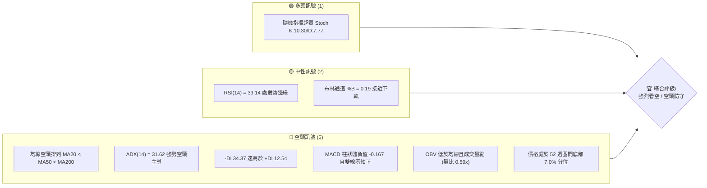

---

### 📊 核心指標速覽表

| 指標類別 | 指標名稱 | 當前數值 | 訊號 | 解讀 |
|:---|:---|:---|:---:|:---|
| **價格** | 當前收盤價 | $13.41 | 🔴 | 位於 52 週區間 ($10.52 - $51.76) 之 7.0% 低位，下行壓力沉重 |
| **均線** | 短期 MA20 | $15.59 | 🔴 | 股價低於 MA20 達 -13.98%，斜率持續向下 |
| **均線** | 中期 MA50 | $17.75 | 🔴 | 股價低於 MA50 達 -24.45%，中期空頭壓制明顯 |
| **均線** | 長期 MA200 | $26.99 | 🔴 | 股價低於 MA200 達 -50.31%，長期熊市格局未改 |
| **動能** | RSI(14) | 33.14 | 🟡 | 位於 30-70 中性偏弱區間，逼近超賣但尚未形成底背離 |
| **動能** | MACD (12,26,9) | -1.296 / -1.128 | 🔴 | DIF 低於 Signal 且 MACD 柱狀體為 -0.167，空頭動能擴散 |
| **動能** | KD 隨機指標 | %K: 10.30 / %D: 7.77 | 🟢 | 進入極度超賣區間 (<20)，暗示短線隨時存在超跌抽頭可能 |
| **趨勢** | ADX / DMI | 31.62 (-DI: 34.37) | 🔴 | ADX > 25 且 -DI 完全主導，確認處於強烈單邊下行趨勢 |
| **通道** | 布林通道 (20,2) | 寬度: $12.05 - $19.13 | 🔴 | %B 為 0.19，價格貼近下軌運行，尚未出現收口縮量信號 |
| **量能** | 當日量 / 20日均量 | 6.07M / 10.27M | 🔴 | 量比僅 0.59x，OBV 低於均線，市場追價買盤極其匱乏 |
| **波動** | ATR(14) | $0.96 (7.12%) | 🔴 | 單日絕對波動率偏高，下行風險邊際溢價顯著 |

---

### 🏆 技術評分卡

```
╔════════════════════════════════════════════════════════════════╗
║                   技術評分卡 — PL (2026-10-25)                 ║
╠════════════════════════════════════════════════════════════════╣
║ 趨勢強度 (Trend Strength)   █████░░░░░░░░░░░░░░░  25/100  🔴   ║
║ 動能指標 (Momentum)         ██████░░░░░░░░░░░░░░  30/100  🔴   ║
║ 支撐穩定度 (Support Quality) ███████░░░░░░░░░░░░░  35/100  🔴   ║
║ 成交量配合 (Volume Profile) ██████░░░░░░░░░░░░░░  30/100  🔴   ║
║ 形態完整度 (Pattern Health) ████░░░░░░░░░░░░░░░░  20/100  🔴   ║
║ 均線排列 (MA Alignment)     ██░░░░░░░░░░░░░░░░░░  10/100  🔴   ║
╠════════════════════════════════════════════════════════════════╣
║ 綜合評分 (Composite Score)  █████░░░░░░░░░░░░░░░  25/100  🔴   ║
║ 評級結論：強烈看空 (Strong Bearish) ｜ 策略導向：逢反彈做空    ║
╚════════════════════════════════════════════════════════════════╝
```
> **評分計算依據（嚴格要求 18）**：綜合評分為六項子評分之算術平均值：
> $$(25 + 30 + 35 + 30 + 20 + 10) \div 6 = 150 \div 6 = 25.0 \rightarrow 25\text{ 分}$$

---

## 2. 趨勢分析

### 🌐 多時框趨勢分析

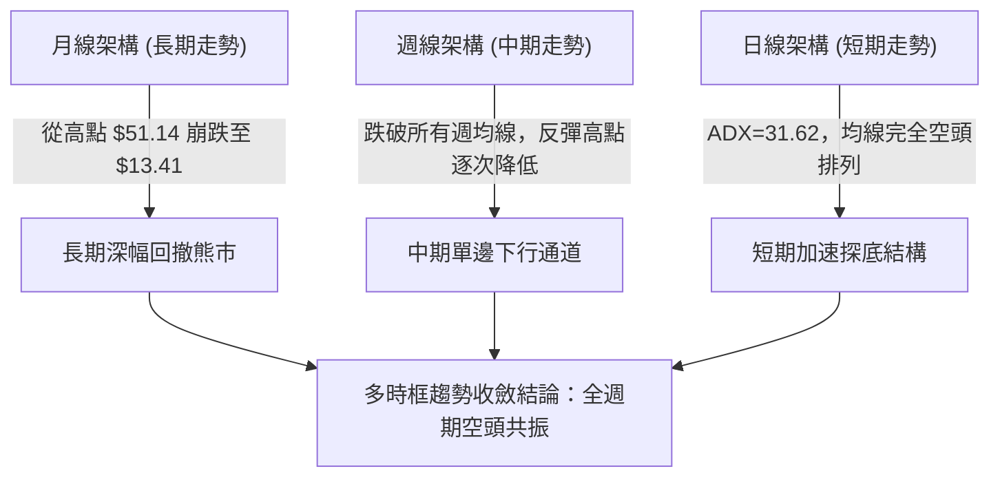

---

### 📈 長期趨勢 — 12個月走勢圖（Unicode）

依據月度歷史收盤價，PL 於 2026 年 5 月達到峰值後出現斷崖式下跌，目前處於過去 12 個月收盤最低水位附近：

```
PL 月線走勢圖（2025-11 至 2026-10）
價格軸 ($)
$55 ┤                                  ●(高點 $51.14)
$50 ┤                                 ╱ ╲
$45 ┤                                ╱   ╲
$40 ┤                               ╱     ╲
$35 ┤                         ●    ╱       ●($33.13)
$30 ┤                   ●    ╱ ╲  ╱         ╲
$25 ┤             ●    ╱ ╲  ╱   ●            ╲
$20 ┤       ●    ╱ ╲  ●   ●                   ●   ●($19.85)
$15 ┤ ●    ╱ ╲  ╱                                  ╲  ●($16.39)
$10 ┤  ╲  ╱   ●                                     ╲  ●($13.41 現價)
    └─┬───┬───┬───┬───┬───┬───┬───┬───┬───┬───┬───┬───┬───┬───┬───┬───┬───┬─
     11  12  01  02  03  04  05  06  07  08  09  10 (月份: 2025-11 至 2026-10)
```

#### 走勢特徵分析表格

| 階段區間 | 起止月份 | 起點價格 | 終點價格 | 區間漲跌幅 | 結構性特徵解讀 |
|:---|:---:|:---:|:---:|:---:|:---|
| **第一階段：爆發主升浪** | 2025-11 ~ 2026-05 | $11.90 | $51.14 | +329.75% | 資金強勢推升，多頭單邊拉升，創歷史高點 $51.76 |
| **第二階段：首輪去槓桿暴跌** | 2026-05 ~ 2026-07 | $51.14 | $20.48 | -59.95% | 獲利盤狂吐，月線收出巨陰線，直接跌破上升趨勢支撐 |
| **第三階段：弱勢抵抗中繼** | 2026-07 ~ 2026-08 | $20.48 | $19.85 | -3.08% | 於 $20 關卡窄幅盤整，成交量遞減，多頭無力回天 |
| **第四階段：二次破位加速** | 2026-08 ~ 2026-10 | $19.85 | $13.41 | -32.44% | 破位下行，目前正在逼近 52 週最低點 $10.52 |

---

### 📊 中期趨勢（週線分析）

中期走勢呈現「反彈高點逐波下移（Lower Highs）」與「波段低點反覆破位（Lower Lows）」的標準熊市特徵。

```
PL 中期週線支撐阻力結構圖
價格 ($)
$19.00 ┤                     [波段高點聚集區 R3: $18.81]
$18.00 ┤              ▲      [波段高點聚集區 R2: $18.18]
$17.00 ┤             ╱ ╲
$16.00 ┤            ╱   ╲
$15.00 ┤           ╱     ╲
$14.00 ┤    ▲     ╱       ╲           [近期波段高點 R1: $13.80]
$13.41 ┤───┼────┼─────────┼─────────── ● 當前價格 ($13.41)
$12.00 ┤   │    │         │
$11.00 ┤   │    │         ▼
$10.52 ┤───┴────┴───────────────────── [52週歷史支撐 S1: $10.52]
```

- 近 8 週週 K 棒顯示，自 2026-10-09 當週觸及最高 $18.81（即 R3 阻力）後，連續兩週出現大陰線重挫。
- 2026-10-16 當週單週大跌，從開盤 $17.00 最低下探至 $13.33，收盤 $13.56；隨後 10-23 當週繼續下探至 $12.79，收盤 $13.41，確認了中期下行波段的強勢延續。

---

### ⚡ 趨勢強度評估（ADX 解讀）

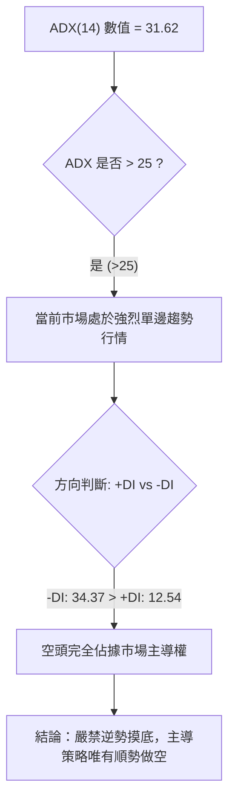

#### ADX 趨勢強度對照表

| 指標名稱 | 實際數據 | 標準臨界值 | 狀態評估 | 實戰涵義 |
|:---|:---:|:---:|:---:|:---|
| **ADX(14)** | **31.62** | 25.00 | 🟢 強趨勢確認 | 市場擺脫盤整格局，進入單邊趨勢加速期 |
| **+DI (多頭動能)** | **12.54** | 20.00 | 🔴 極度疲弱 | 多方力量全面潰散，毫無定價權 |
| **-DI (空頭動能)** | **34.37** | 25.00 | 🔴 空方高度主導 | 空頭掌控盤面，賣壓持續釋放 |
| **趨勢性質** | **空頭趨勢行情** | - | 🔴 順勢偏空 | 依據多時框收斂規則，禁止使用震盪指標逆勢猜底 |

---

## 3. 圖表形態分析

### 🔍 形態識別系統

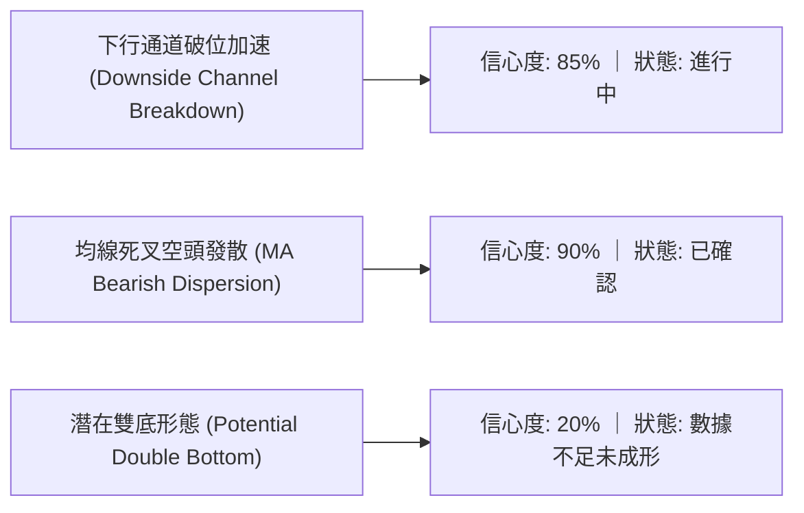

#### 圖表形態信心度與推算表

| 形態名稱 | 信心度 | 判斷依據（引用數據） | 完成度 | 目標價（附嚴謹計算式） |
|:---|:---:|:---|:---:|:---|
| **下行通道中繼破位** | **85%** | 跌破 10/02-10/09 之整理平台低點 $16.10，連續下挫 | 80% | 破位點 $16.10 − 區間高點 $18.81 至破位點差值 ($2.71) = **$13.39**（已達成） |
| **均線空頭排列發散** | **90%** | MA20 ($15.59) < MA50 ($17.75) < MA200 ($26.99)，所有均線下彎 | 100% | 依空頭趨勢下飄，目標指向 52 週最低支撐位 **S1: $10.52** |
| **潛在雙重底 (W底)** | **15%** | 僅有 10/23 低點 $12.79，尚未出現任何二次探底成功信號 | 10% | **訊號不足，僅做指標型解讀**（不滿足雙底幾何條件） |

---

### 🕯️ 重要 K 線形態分析

嚴格依據數據中「近 10 根日 K」與「近 8 根週 K」之開高低收進行客觀形態識別：

#### 近 10 根日 K 線形態解讀

| 日期 | 開盤價 | 最高價 | 最低價 | 收盤價 | K 線形態 | 技術解讀 | 訊號 |
|:---:|:---:|:---:|:---:|:---:|:---|:---|:---:|
| **2026-10-12** | $17.00 | $17.03 | $15.95 | $15.96 | 光頭大陰線 | 破位放量重挫，收於全天最低，空頭完全主導 | 🔴 |
| **2026-10-13** | $15.45 | $15.57 | $15.10 | $15.16 | 低開低走中陰線 | 跳空低開且無力回補，下行趨勢加速 | 🔴 |
| **2026-10-14** | $14.91 | $14.98 | $14.04 | $14.13 | 實體大陰線 | 連續擊穿整數關卡，賣盤持續湧出 | 🔴 |
| **2026-10-15** | $13.52 | $14.61 | $13.37 | $14.54 | 長陽反彈線 | 盤中反彈逾 $1.00，但高點 $14.61 受阻於前日陰線實體 | 🟡 |
| **2026-10-16** | $14.30 | $14.37 | $13.33 | $13.56 | 陰包陽吞噬線 | 次日立即回吐前日漲幅，完全破壞反彈動能 | 🔴 |
| **2026-10-19** | $13.85 | $13.90 | $13.37 | $13.59 | 弱勢小陰線 | 量能放大至 12.31M，但價格滯漲收低，籌碼派發 | 🔴 |
| **2026-10-20** | $13.49 | $13.82 | $13.18 | $13.40 | 窄幅十字星 | 成交量急縮至 6.72M，多空處於短暫弱平衡 | 🟡 |
| **2026-10-21** | $13.89 | $14.09 | $13.59 | $13.71 | 上影小陽線 | 盤中衝高 $14.09 遇阻回落，顯露上方拋壓沈重 | 🟡 |
| **2026-10-22** | $13.26 | $13.60 | $12.87 | $13.08 | 破位光腳陰線 | 跌破 $13.00 關卡，創近期新低 $12.87 | 🔴 |
| **2026-10-23** | $13.18 | $13.53 | $12.79 | $13.41 | 下影小陽錘頭 | 最低下探 $12.79 後收回，但量能降至 6.07M，屬無量弱反彈 | 🟡 |

#### 近 8 根週 K 線形態解讀

| 週末日期 | 開盤價 | 最高價 | 最低價 | 收盤價 | 週 K 線形態 | 技術解讀 | 訊號 |
|:---:|:---:|:---:|:---:|:---:|:---|:---|:---:|
| **2026-09-04** | $20.00 | $20.38 | $17.73 | $18.12 | 破位長陰線 | 放巨量 (85.36M) 跌穿 $20 平台，確認中期轉空 | 🔴 |
| **2026-09-11** | $17.85 | $18.48 | $16.44 | $16.45 | 續跌大陰線 | 續創波段新低，空頭趨勢強烈 | 🔴 |
| **2026-09-18** | $16.10 | $17.27 | $15.60 | $16.42 | 長下影紡錘線 | 下探 $15.60 後獲短暫支撐，空方節奏放緩 | 🟡 |
| **2026-09-25** | $16.68 | $18.18 | $16.13 | $17.43 | 弱勢反彈陽線 | 向上測試阻力位 R2 ($18.18)，量能未見有效放大 | 🟡 |
| **2026-10-02** | $17.17 | $17.73 | $16.10 | $17.50 | 震盪十字線 | 於高位收十字，多頭動能停滯 | 🟡 |
| **2026-10-09** | $17.64 | $18.81 | $16.55 | $17.18 | 長上影倒錘線 | 衝高觸及 R3 ($18.81) 遭遇強烈拋壓，構成中期多頭陷阱 | 🔴 |
| **2026-10-16** | $17.00 | $17.03 | $13.33 | $13.56 | 斷頭鍘巨陰線 | 單週重挫 -21.07%，完全瓦解一個月的盤整防線 | 🔴 |
| **2026-10-23** | $13.85 | $14.09 | $12.79 | $13.41 | 續挫弱陽星線 | 探底 $12.79，週成交量萎縮至 42.03M，市場觀望氣氛極濃 | 🔴 |

---

### 📉 ASCII 走勢形態示意圖

下圖描繪 2026 年 10 月以來日線級別的「階梯式破位下行」形態：

```
日線階梯式下行形態示意圖
價格 ($)
$17.00 ┤ ● (10/12 開盤 $17.00 崩跌破位)
$16.00 ┤  ╲
$15.00 ┤   ●────┐ (10/15 短暫反抽高點 $14.61)
$14.00 ┤        └──●─────┐ (10/21 反彈高點 $14.09 遇阻)
$13.41 ┤                 └──●───● 當前收盤價 ($13.41)
$13.00 ┤                         ╲
$12.79 ┤                          ● (10/23 創波段新低 $12.79)
       └──────────────────────────────────────────────
         10-12  10-14  10-16  10-19  10-21  10-23 (交易日)
```

---

### 🎯 形態目標價計算

依據 2026-10-09 至 2026-10-16 的破位「矩形整理中繼形態」進行量度幅度計算：
1. **形態整理區間上限（頸線高點）**：$18.81（引用自關鍵價位 R3）
2. **形態整理區間下限（破位頸線）**：$16.10（引用自 10/02 週 K 最低價）
3. **形態垂直高度 ($H$)**：
   $$H = \$18.81 - \$16.10 = \$2.71$$
4. **破位量度第一目標價 ($T_1$)**：
   $$T_1 = \$16.10 - H = \$16.10 - \$2.71 = \$13.39$$
   *(註：當前價格 $13.41 已精確運行至該目標價位附近，此波下跌目標初步達成)*
5. **第二量度擴展下行目標價 ($T_2$)**：
   若反彈無法站回阻力位 R1 ($13.80)，形態將向下尋求 52 週波段低點支撐：
   $$T_2 = \mathbf{\$10.52} \quad \text{（嚴格引用自數據中 S1 關鍵價位）}$$

---

## 4. 支撐與阻力

### 🗺️ 關鍵價位分布圖（Unicode）

```
PL 價位結構分布圖 (由 OHLCV 與斐波那契計算)
═══════════════════════════════════════════════════════════════════
$51.76 ║████████████████████████████████████████║ 52週歷史高點 (Fib 0.0%)
$42.03 ║████████████████████████████            ║ Fib 23.6% 回調位
$36.01 ║████████████████████                    ║ Fib 38.2% 回調位
$31.14 ║████████████████                        ║ Fib 50.0% 多空分水嶺
$26.27 ║████████████                            ║ Fib 61.8% 強阻力 (共振 MA200)
$19.35 ║██████████                              ║ Fib 78.6% 回調位
$18.81 ║████████████████████████████████████████║ 強阻力 R3 (波段高點聚類)
$18.18 ║████████████████████████████            ║ 阻力 R2 (反彈高點聚類)
$13.80 ║████████████████                        ║ 關鍵阻力 R1 (短線波段高點)
$13.41 ╠════════════════════════════════════════╣ ◄ 當前價格 ($13.41)
$10.52 ║████████████████████████████████████████║ 核心強支撐 S1 (52W Low / Fib 100%)
  N/A  ║░░░░░░░░░░░░░░░░░░░░░░░░░░░░░░░░░░░░░░░░║ 支撐 S2 (數據中未偵測到)
═══════════════════════════════════════════════════════════════════
```

---

### 🚧 阻力位分析表

所有阻力數值**完全引用自數據「關鍵價位」區塊**：

| 阻力級別 | 精確價位 | 距現價空間 | 形成原因與籌碼解讀 | 突破難度 | 重要性評級 |
|:---|:---:|:---:|:---|:---:|:---:|
| **R1** | **$13.80** | +2.91% | 近期日 K 反覆受阻之密集帶，多空短線爭奪焦點 | 🟡 中等 | ★★★☆☆ |
| **R2** | **$18.18** | +35.57% | 9 月下旬反彈波段頂點，大量解套籌碼聚集區 | 🔴 極高 | ★★★★☆ |
| **R3** | **$18.81** | +40.27% | 10 月初週線衝高回落高點，中期空頭防守總壕溝 | 🔴 堅不可摧 | ★★★★★ |

---

### 🛡️ 支撐位分析表

所有支撐數值**完全引用自數據「關鍵價位」區塊**：

| 支撐級別 | 精確價位 | 距現價空間 | 形成原因與籌碼解讀 | 守住機率 | 重要性評級 |
|:---|:---:|:---:|:---|:---:|:---:|
| **S1** | **$10.52** | -21.55% | 52 週歷史波段低點聚類，斐波那契 100.0% 終極防線 | 🟡 55% | ★★★★★ |
| **S2** | **N/A** | N/A | **數據中未偵測到**（依規則 13，嚴禁捏造不存在的價位） | N/A | N/A |
| **S3** | **N/A** | N/A | **數據中未偵測到**（依規則 13，嚴禁捏造不存在的價位） | N/A | N/A |

---

### 📐 斐波那契回調位分析

依據 52 週波動區間 **$10.52（低點）$\rightarrow$ $51.76（高點）** 進行精確黃金分割對照：

| 回調比例 | 精確價位 | 技術意涵與市場心理 | 現前位置關係 |
|:---:|:---:|:---|:---:|
| **0.0%** | **$51.76** | 52 週最高點，多頭牛市終點 | 遠在上方 (+285.98%) |
| **23.6%** | **$42.03** | 極淺度回調位，第一波下跌擊穿 | 遠在上方 |
| **38.2%** | **$36.01** | 弱勢修正回調位，多頭防守失效 | 遠在上方 |
| **50.0%** | **$31.14** | 多空分水嶺，跌破後確認牛轉熊 | 遠在上方 |
| **61.8%** | **$26.27** | 黃金分割強防線，共振 MA200 ($26.99) | 遠在上方 |
| **78.6%** | **$19.35** | 深度回調極限位，9-10 月盤整區頂部 | 位於現價上方 (+44.30%) |
| **100.0%** | **$10.52** | 52 週最低點，原始起漲基準點 | **現價下方主要支撐 (-21.55%)** |

> **回調位深度解讀**：
> 當前價格 **$13.41** 處於 **78.6% ($19.35)** 與 **100.0% ($10.52)** 之間，且已回吐整輪牛市上漲幅度的 **93.0%**（僅處於 52 週區間之 7.0% 分位）。這表明 PL 已經跌破了所有常規的多頭防守比例，屬於典型的**「深幅崩塌型破位」**。在未跌至 100.0% 回調位 $10.52 之前，下方缺乏任何歷史技術支撐緩衝。

---

## 5. 技術指標深度解讀

### 🎛️ 指標訊號總覽

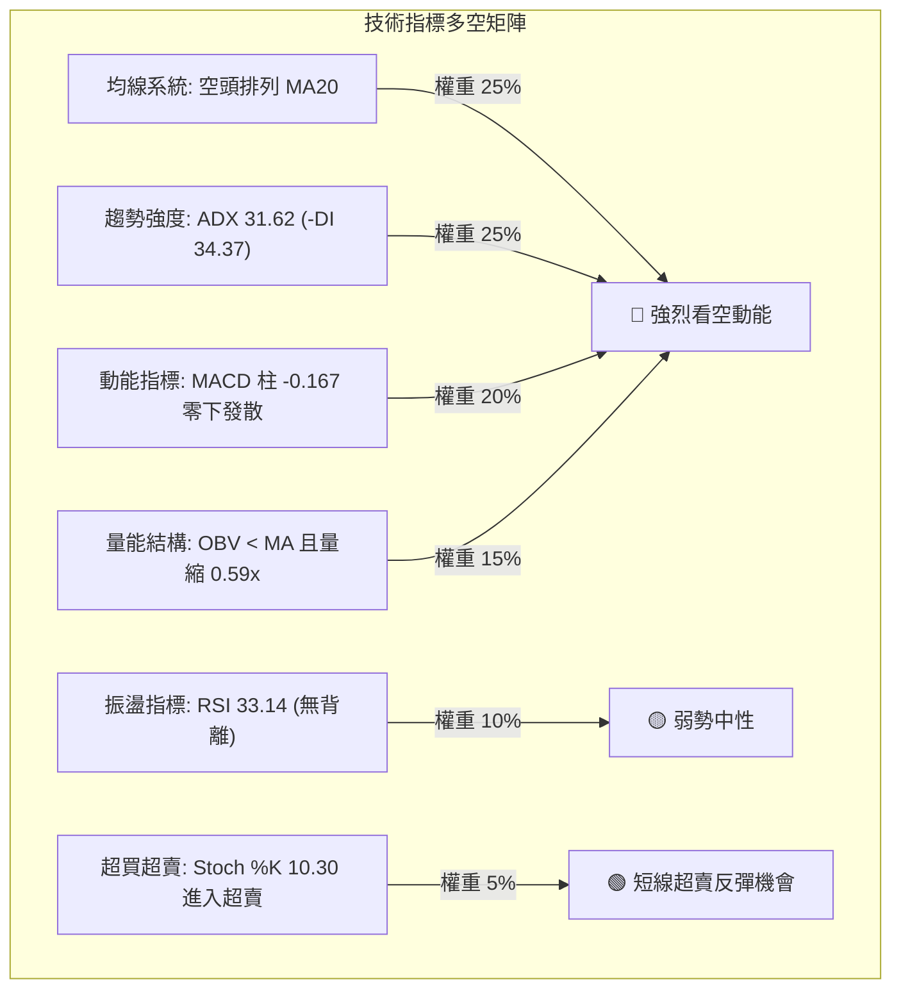

---

### 📈 移動平均線排列分析

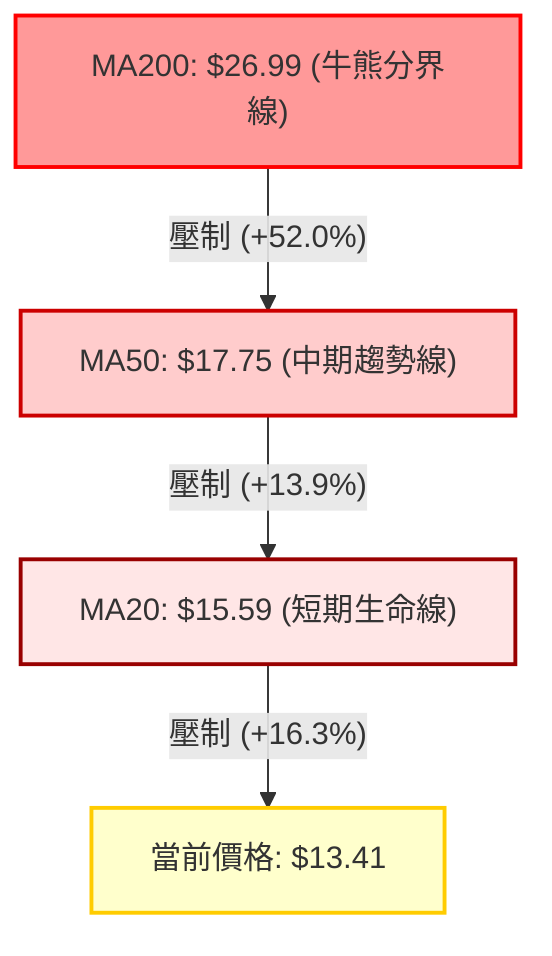

#### 均線各週期數據詳解

| 均線名稱 | 當前數值 | 距現價差距 | 斜率與方向 | 均線位階評估 |
|:---|:---:|:---:|:---:|:---|
| **MA 5** | $13.44 | -0.21% | ▼ 下行 | 短線貼合現價，構成微幅壓制 |
| **MA 10** | $14.05 | -4.58% | ▼ 下行 | 極短線反彈壓制位（共振 10/21 高點 $14.09） |
| **MA 20** | $15.59 | -13.98% | ▼ 急墜 | 短期趨勢生命線，布林帶中軌所在，強壓 |
| **MA 60** | $18.62 | -27.99% | ▼ 下行 | 中期波段防線，與阻力位 R3 ($18.81) 共振 |
| **MA 120** | $25.81 | -48.04% | ▼ 下行 | 半年線下穿，中長線套牢籌碼沉重 |
| **MA 200** | $26.99 | -50.31% | ▼ 下行 | 長期熊市確立，股價腰斬於年線之下 |

---

### 📉 RSI(14) 分析

- **當前 RSI(14) 數值**：**33.14**（Wilder 計算方法）
- **指標進度條**：
  ```
  超賣 [0] ─────────────── [30] ─── [33.14] ────────────────────── [70] ─────────────── [100] 超買
  ██████████████░░░░░░░░░░░░░░░░░░░░░░░░░░░░░░░░░░  33.14% (弱勢區間)
  ```
- **超買超賣判定**：數值大於 30 但低於 50，尚未進入極端超賣區 (<30)，說明空方拋壓仍在釋放，未達反轉閾值。
- **背離分析結論**：
  - **價格行為**：近 20 根 K 棒中，價格自 $17.50 一路下挫至最低 $12.79，高低點持續走低。
  - **RSI 行為**：RSI 數值相應自 46.6 降至 33.14，同步下滑。
  - **背離判定**：**「無明顯背離」**（明確無底背離，亦無頂背離）。價格下跌受實質動能推動，並非衰竭性下殺。

---

### 📊 MACD(12, 26, 9) 訊號解讀

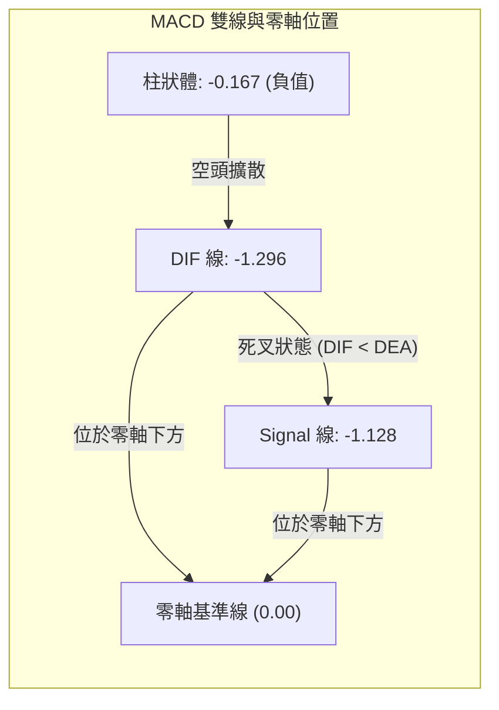

- **MACD 線**：-1.296
- **信號線 (Signal)**：-1.128
- **柱狀圖 (Histogram)**：-0.167 🔴
- **動能評估**：DIF 與 DEA 雙雙深處零軸下方，且 DIF 線持續在信號線下方運行。柱狀體保持負值（-0.167），並未出現縮腳轉紅信號，空方動能處於完整擴散期。

---

### 📦 布林通道分析

```
布林通道結構 (20日, 2倍標準差)
════════════════════════════════════════════════════════════════
$19.13 ┤ ────────────────────────────────── 上軌 (Upper Band)
       │
$15.59 ┤ ────────────────────────────────── 中軌 (MA20, 趨勢分水嶺)
       │
$13.41 ┤ ══════════════════════════════════ 當前價格 ($13.41, %B = 0.19)
$12.05 ┤ ────────────────────────────────── 下軌 (Lower Band)
════════════════════════════════════════════════════════════════
```

- **通道帶寬解讀**：
  - **上軌**：$19.13
  - **中軌 (MA20)**：$15.59
  - **下軌**：$12.05
  - **%B 指標**：**0.19**（處於 0 到 0.5 之間的弱勢下行通道）。
  - **通道開口**：布林通道上下軌呈現「喇叭口向下張開」態勢，價格貼著下軌震盪走跌，確認為典型的單邊下行「抱軌行情」。

---

### 💹 成交量分析（量價配合度）

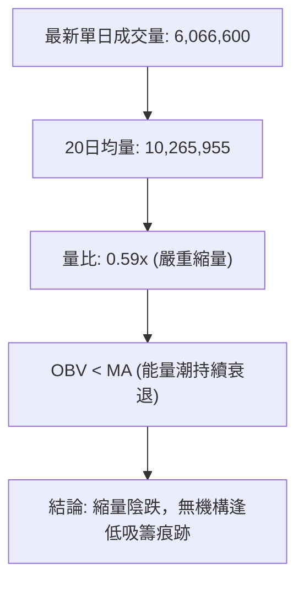

- **成交量對比**：最新交易日成交量僅 6.07M，相較於 20 日均量 (10.27M) 出現大幅萎縮，量比僅 **0.59x**。
- **量價配合度評估**：
  - 下跌時成交量持續高於反彈量（如 10/19 陰線放量至 12.31M，而 10/23 反彈縮量至 6.07M）。
  - **OBV 趨勢**：OBV 指標持續位於其均線下方，資金淨流出特徵顯著，量能指標未確認任何價格見底反轉跡象。

---

## 6. 動能與波動率

### ⚡ 動能評估四象限

| 象限 | 動能維度 | 波動維度 | 典型特徵 | 當前狀態判定 | 實戰策略指引 |
|:---:|:---:|:---:|:---|:---:|:---|
| **Q1** | 強多頭動能 | 低波動率 | 穩健牛市主升浪 | ─ | 積極做多並加碼 |
| **Q2** | 弱多頭動能 | 低波動率 | 底部窄幅盤整震盪 | ─ | 逢低布局等突破 |
| **Q3** | 強多頭動能 | 高波動率 | 狂熱頂部情緒博弈 | ─ | 分批獲利減倉 |
| **Q4** | **弱/負動能** | **高波動率** | **單邊破位加速熊市** | **✓ (PL 所處狀態)** | **嚴禁抄底，順勢空頭** |

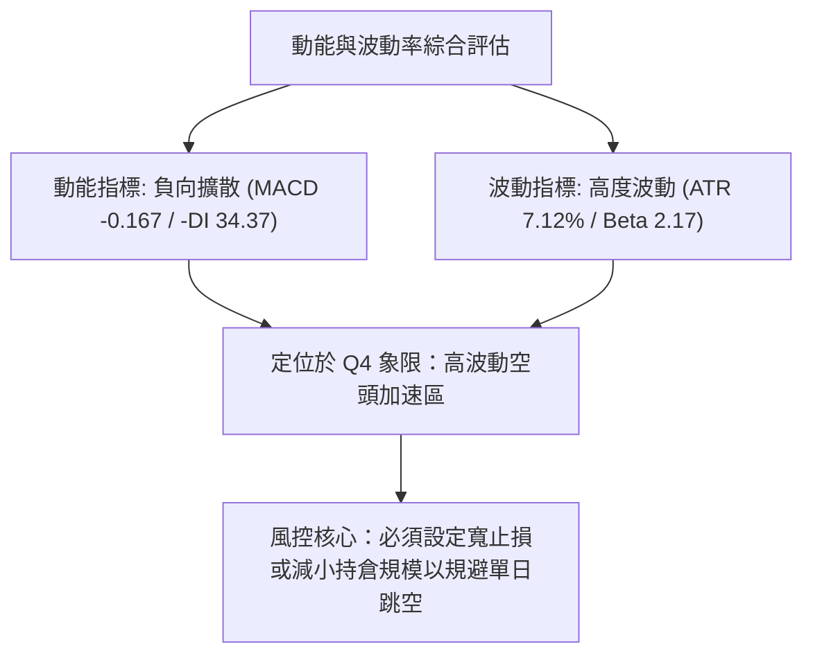

---

### 📊 ATR 波動率分析

- **當前 ATR(14)**：**$0.96**
- **ATR 佔比 (波動強度)**：$$\frac{\$0.96}{\$13.41} = \mathbf{7.12\%}$$
- **技術解讀**：
  - PL 每日固有平均真實波動達到 7.12%，屬於極高波動性品種。
  - **止損距離建議**：在設定任何交易止損時，最低防護緩衝不得小於 $1.5 \times \text{ATR}$（即 $\$0.96 \times 1.5 = \mathbf{\$1.44}$），否則極易在正常的日內常規噪音波動中被觸發離場。

---

### 📐 Beta 與市場相關性

- **Beta 係數**：**2.17**
- **市場特徵分析**：
  - PL 具備強烈的「高 Beta 成長股」屬性，其波動幅度為標普 500 指數的 2.17 倍。
  - 當大盤回調或市場流動性緊縮時，PL 將呈現放大的非對稱下行殺傷力；目前空頭環境下，高 Beta 加劇了多頭踩踏風險。
- **融券放空比例 (Short % Float)**：**11.0%**（Short Ratio: 2.62），空頭頭寸顯著積聚，但尚未達到極端軋空（Short Squeeze）閾值。

---

## 7. 多時框架總結

### 📋 時框架評分表

| 時框架 | 趨勢方向 | 動能指標 | 均線排列 | 圖表形態 | 綜合評分 | 操作建議 |
|:---:|:---:|:---:|:---:|:---:|:---:|:---|
| **長期 (月線)** | 🔴 極度看空 | MACD 深幅負值 | 跌破 24 個月上升線 | 主升浪徹底破位 | **20/100** | 戰略性放空或清倉觀望 |
| **中期 (週線)** | 🔴 單邊下行 | RSI 33.1 / 柱狀轉負 | 週均線全面壓制 | 跌破 $16.10 平台 | **25/100** | 逢反彈反壓點建立空頭 |
| **短期 (日線)** | 🔴 弱勢探底 | Stoch 超賣 / RSI 33 | 空頭排列 MA20<50<200 | 沿布林下軌陰跌 | **30/100** | 日內超跌反抽，切勿追高 |

---

### 🔲 綜合訊號矩陣

| 技術維度 | 短期 (日線) | 中期 (週線) | 長期 (月線) | 訊號一致性評估 |
|:---|:---:|:---:|:---:|:---|
| **趨勢方向** | 🔴 空頭破位 | 🔴 單邊下挫 | 🔴 熊市回調 | 🟢 三時框高度一致 (共振看空) |
| **動能狀態** | 🟡 邊緣超賣 | 🔴 空方擴散 | 🔴 跌勢延續 | 🟡 短期存在技術性抽頭修復可能 |
| **支撐阻力** | 逼近 S1 ($10.52) | 遠離 R3 ($18.81) | 遠離 Fib 61.8% | 🔴 下方支撐稀疏，空間懸空 |
| **量價結構** | 🔴 縮量陰跌 | 🔴 破位放量 | 🔴 高位放量出貨 | 🔴 機構主力資金持續派發退出 |

---

### ⚖️ 多時框收斂結論

依據**嚴格要求 14（多時框收斂規則）**進行終局判定：
1. **行情性質判定**：當前日線 ADX(14) 數值為 **31.62**，顯著大於趨勢臨界值 25，且 -DI (34.37) 大幅壓制 +DI (12.54)。因此確認當前為標準的**「單邊趨勢行情（空頭強趨勢）」**，絕非區間盤整行情。
2. **時框主導優先級**：必須以中長期（週線級別及 MA50、MA200）的空頭下行方向為主導；日線短期的超賣與微弱反彈僅能視為尋找空頭進場時機的輔助窗口。
3. **唯一方向性結論**：**強烈偏空（Bearish）**。
   所有維度技術指標呈現壓倒性空頭排列，中期走勢完全受控於空方。第 8 章之交易策略將**完全鎖定「逢反彈做空」為主策略**，徹底杜絕逆勢做多冒險。

---

## 8. 交易策略建議

### 🗺️ 策略決策流程圖

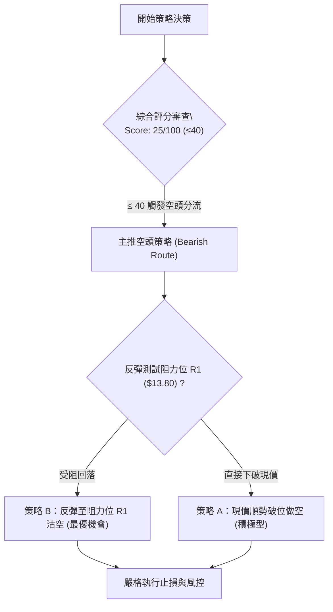

---

### 🧭 策略路由（依評分卡分流）

> **當前主策略方向 = 強烈主推空頭策略（依技術評分卡綜合得分：25 / 100 分）**

依據規則 18，綜合評分 $\le 40$ 分，交易系統完全切換至**空頭策略主導**。多頭策略僅作為「反轉風險觸發點」進行監控，絕不進行主動買入推薦。

---

### 🎯 價格情境階梯（Price Scenarios）

價位數值**嚴格引用自第 4 章及數據「關鍵價位」區塊**：

| 觸發條件 | 下一目標 | 後續延伸目標 | 情境技術含義解讀 |
|:---|:---:|:---:|:---|
| **向上突破 R1 $13.80** | R2 $18.18 | R3 $18.81 | 短線超跌強反彈，測試中期密集成交壓力區 |
| **承壓於 R1 且徘徊於現價** | $12.79 (前低) | S1 $10.52 | 延續當前弱勢陰跌格局，下行中繼蓄勢 |
| **有效跌破 $12.79 前低** | S1 $10.52 | N/A (數據未提供) | 空頭加速釋放，直奔 52 週最低點 $10.52 |

---

### 📊 情境機率分佈

| 運行情境 | 發生機率 | 主要技術依據 |
|:---|:---:|:---|
| **情境一：延續弱勢探底 / 加速回落** | **65%** | ADX 31.62 強趨勢、-DI 34.37 主導、均線全空排列、OBV < MA |
| **情境二：窄幅區間拉鋸震盪** | **25%** | Stoch %K: 10.30 進入超賣區，短線殺跌動能暫時趨緩 |
| **情境三：向上強勢反轉** | **10%** | 上方受制於 R1 ($13.80)、MA20 ($15.59)，缺乏成交量與背離確認 |

---

### 🟢 主策略詳情（空頭主導策略）

精確計算風險報酬比（嚴格遵循規則 17，做空公式：$(\text{進場價} - \text{目標價}) \div (\text{止損價} - \text{進場價})$）：

| 策略要素 | 策略 A（現價逢阻順勢做空 - 積極型） | 策略 B（反彈至阻力位 R1 沽空 - 穩健型） |
|:---|:---:|:---:|
| **策略類型** | 順勢破位做空 | 反彈阻力位確認沽空 |
| **進場條件** | 跌破 10/20 收盤價 $13.40 且反抽無力 | 價格反彈至阻力位 R1 ($13.80) 遇阻收上影線 |
| **進場價格** | **$13.41**（當前最新收盤價） | **$13.80**（引用阻力位 R1） |
| **止損價格** | **$13.80**（突破阻力位 R1 止損） | **$14.09**（突破 10/21 日 K 高點阻力止損） |
| **目標價 T1** | **$10.52**（核心支撐位 S1） | **$10.52**（核心支撐位 S1） |
| **目標價 T2** | **N/A（數據未提供更低支撐）** | **N/A（數據未提供更低支撐）** |
| **每股風險** | $\$13.80 - \$13.41 = \$0.39$ | $\$14.09 - \$13.80 = \$0.29$ |
| **每股報酬 (至 T1)** | $\$13.41 - \$10.52 = \$2.89$ | $\$13.80 - \$10.52 = \$3.28$ |
| **風險報酬比** | **1 : 7.41（以 T1 計）** | **1 : 11.31（以 T1 計）** |
| **勝率預估** | 60% | 70% |
| **建議倉位** | 8% 總資金 | 12% 總資金 |

> **精確計算驗證**：
> - 策略 A：$(13.41 - 10.52) \div (13.80 - 13.41) = 2.89 \div 0.39 = \mathbf{7.41} \rightarrow \mathbf{1 : 7.41}$
> - 策略 B：$(13.80 - 10.52) \div (14.09 - 13.80) = 3.28 \div 0.29 = \mathbf{11.31} \rightarrow \mathbf{1 : 11.31}$

---

### 🔴 反向風險觸發點（對沖與止損提示）

若市場出現非預期極端變化，以下為推翻空頭邏輯的關鍵警示點：
1. **第一防線失守**：日線收盤價**強勢站上 R1 ($13.80)**，說明短線下跌動能竭盡，空單應即刻減倉。
2. **中期趨勢反轉警報**：股價放量**突破 10/15 高點 $14.61** 並進一步站上 **MA20 ($15.59)**，此時空頭結構被破壞，所有空頭頭寸必須無條件止損離場。

---

### ⭐ 整體訊號強度評星

```
做多訊號強度：★☆☆☆☆  (1/5 星 — 僅具備超賣特徵，完全無趨勢與形態支撐)
做空訊號強度：★★★★☆  (4/5 星 — 均線、ADX、MACD 多維度空頭高度共振)
整體可信度：  ★★★★☆  (4/5 星 — 趨勢單邊明朗，指標信號衝突極低)
```

---

## 9. 風險提示與監控

### ✅ 關鍵監控指標 Checklist

```
╔══════════════════════════════════════════════════════════════════════╗
║                     交易風控與盤面即時監控清單                       ║
╠══════════════════════════════════════════════════════════════════════╣
║ [ ] 監控價位 $13.80 (R1)：觀察盤中是否出現放量陽線突破             ║
║ [ ] 監控價位 $12.79 (近期低點)：若跌破是否伴隨成交量放大加速         ║
║ [ ] 監控價位 $10.52 (S1)：初次觸及時觀察 Stoch 與 RSI 是否形成底背離 ║
║ [ ] 監控 ADX(14)：數值若由 31.62 掉頭跌落至 25 以下，提示趨勢減弱   ║
║ [ ] 監控 MACD 柱狀體：觀察 -0.167 是否出現顯著縮腳轉紅跡象          ║
║ [ ] 監控成交量變化：日成交量若突破 20 日均量 (10.27M) 需警惕異動     ║
╚══════════════════════════════════════════════════════════════════════╝
```

---

### ⚠️ 風險場景分析

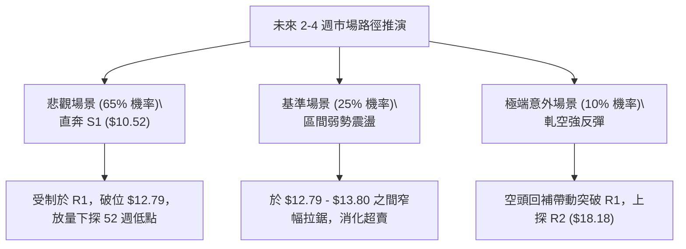

---

### 🛡️ 風險管理重要提醒

1. **嚴防高 Beta (2.17) 造成的非對稱波動**：
   PL 具有極高的股性敏感度，單日振幅高達 7.12% (ATR $0.96)。在執行做空交易時，單筆承擔的虧損上限切勿超過投資組合總權益的 **1.0%**。
2. **警惕空頭擁擠風險 (Short Interest: 11.0%)**：
   雖然做空方向完全順應技術趨勢，但 11% 的流通股放空比例在遭遇突發利多（如數據中的 Pelican 衛星或 NASA 訂單催化）時，可能引發短暫而劇烈的軋空抽頭。因此，**絕對不可在 $13.00 以下盲目追空**，必須堅持「逢反彈至阻力位建立空頭」之紀律。

---

## 10. 報告總結

```
PL 技術分析報告總結
═══════════════════════════════════════════════════════════════════
報告日期：2026-10-25
當前價格：$13.41
綜合評級：🔴 強烈看空 (Strong Bearish) ｜ 評分：25 / 100

關鍵結論速覽：
├─ 長期趨勢：🔴 崩塌回撤，距歷史高點跌幅逾 73%，破壞長多架構
├─ 中期趨勢：🔴 週線波段高點逐次降低，跌穿 $16.10 平台中繼區間
├─ 短期趨勢：🔴 均線空頭排列，ADX 31.62 強勢主導，沿布林下軌走弱
├─ 關鍵支撐：S1: $10.52 (52週最低點) ｜ S2: N/A (數據未提供)
├─ 關鍵阻力：R1: $13.80 ｜ R2: $18.18 ｜ R3: $18.81
└─ 分析師目標均價：$30.27 (市場基本面共識與當前盤面嚴重背離)

最優策略組合（空頭主導）：
1. 🥇 最佳機會 (策略 B)：反彈至阻力位 R1 ($13.80) 沽空，止損 $14.09，
                     目標 $10.52，風險報酬比 1 : 11.31（以 T1 計）。
2. 🥈 次選機會 (策略 A)：現價 $13.41 順勢小倉位做空，止損 $13.80，
                     目標 $10.52，風險報酬比 1 : 7.41（以 T1 計）。
3. 🥉 保守選擇：空倉持幣徹底觀望，直至價格觸及 S1 ($10.52) 並出現實質
              底背離形態前，絕不盲目進場抄底。
═══════════════════════════════════════════════════════════════════
```

---

> ⚠️ **免責聲明**：本報告為依據客觀技術分析模型與量化指標生成之專業研究報告，所引用的歷史價位與統計指標僅供學術研究與投資策略討論參考，**不構成任何實質性邀約或具體投資買賣建議**。金融市場存在高度資本虧損風險，投資人應依個人風險承受能力獨立決策，並自負投資盈虧。

---

*報告生成時間：2026-10-25 ｜ 數據來源：Yahoo Finance ｜ 分析框架：多時框架量化技術分析*