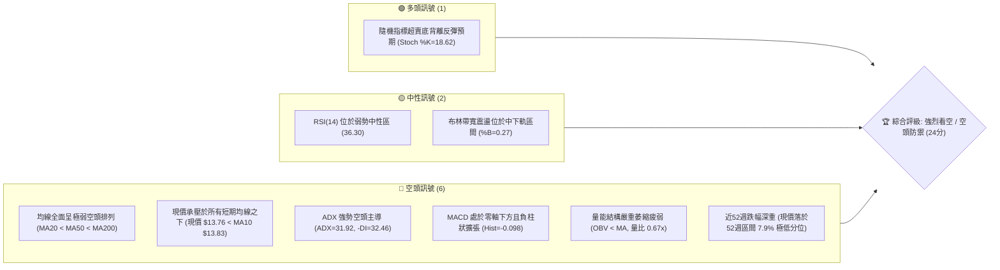
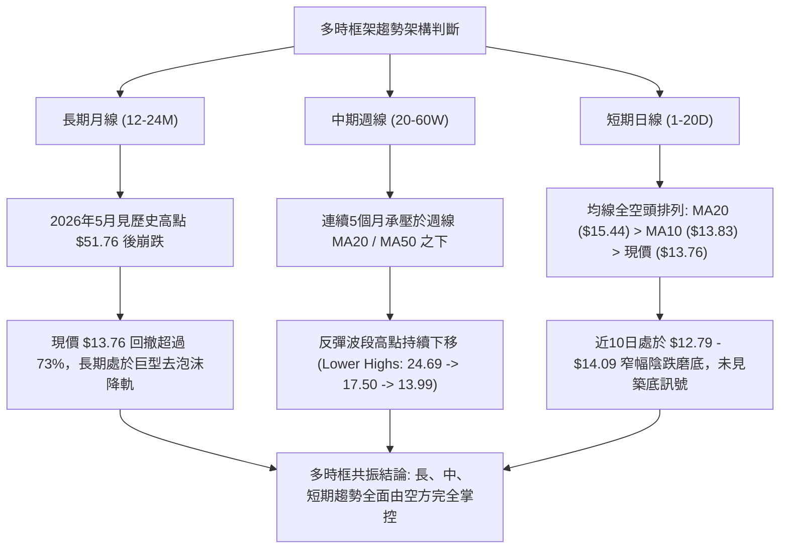
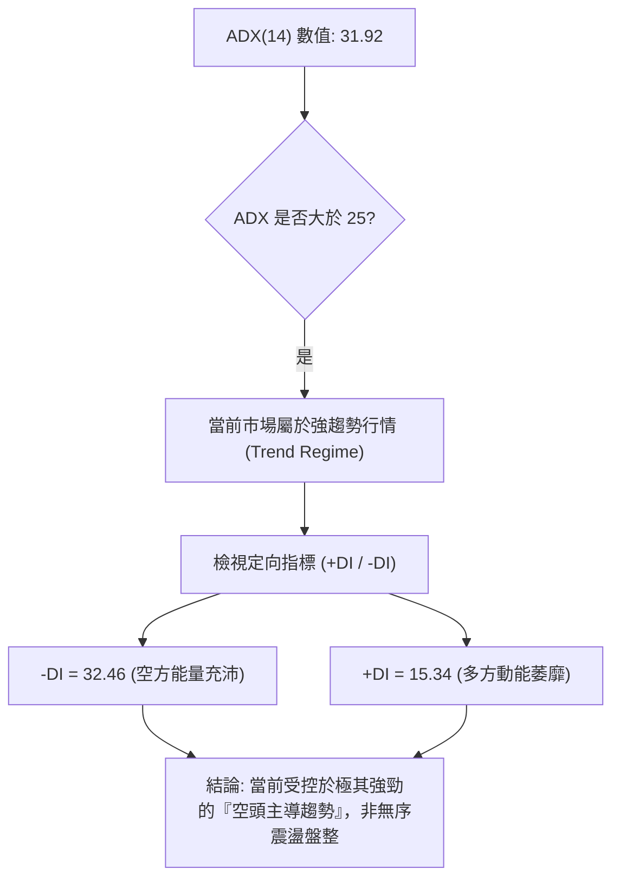
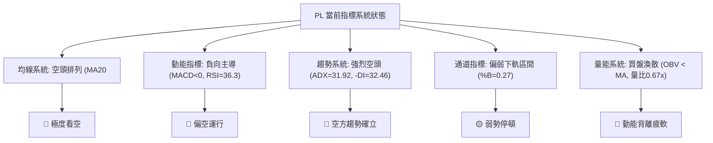
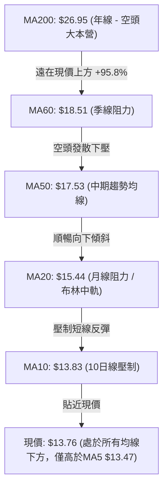
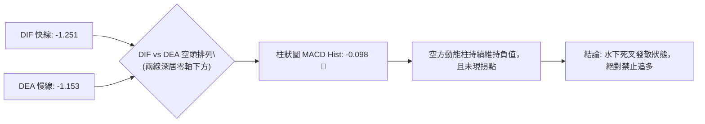
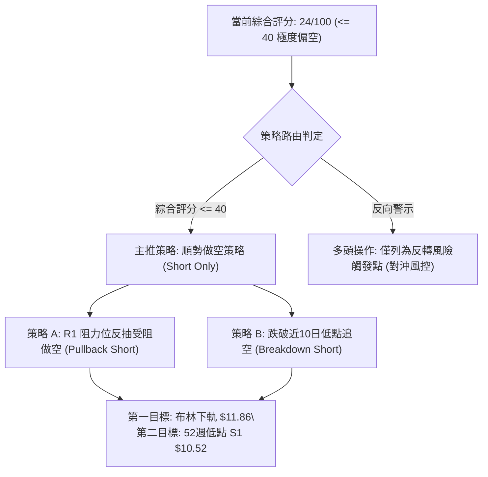
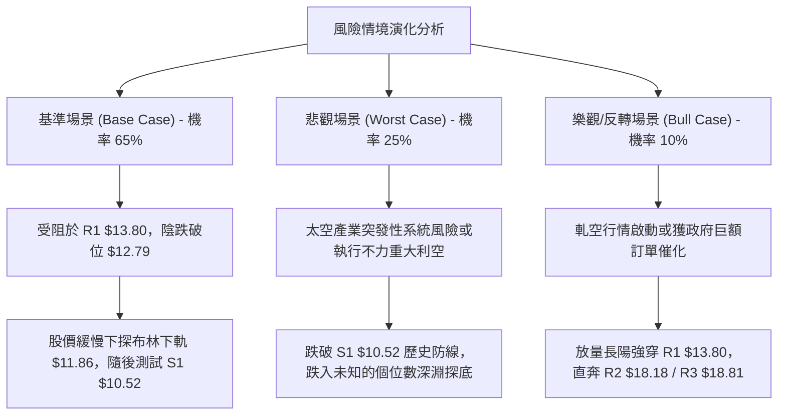

# PL 技術分析報告

> **報告日期**：2026-10-27 ｜ **語言**：繁體中文 ｜ **數據來源**：Yahoo Finance ｜ **當前價格**：$13.76

---

## 目錄

| 章節 | 內容 |
|------|------|
| [1. 技術面概覽](#1-技術面概覽) | 訊號儀表板、核心指標、評分卡 |
| [2. 趨勢分析](#2-趨勢分析) | 多時框趨勢、長中短期走勢、ADX解讀 |
| [3. 圖表形態分析](#3-圖表形態分析) | 形態識別、K線組合、目標價計算 |
| [4. 支撐與阻力](#4-支撐與阻力) | 關鍵價位、斐波那契回調 |
| [5. 技術指標深度解讀](#5-技術指標深度解讀) | MA/RSI/MACD/布林/成交量 |
| [6. 動能與波動率](#6-動能與波動率) | 動能評估、ATR、Beta |
| [7. 多時框架總結](#7-多時框架總結) | 時框架評分矩陣、收斂結論 |
| [8. 交易策略建議](#8-交易策略建議) | 策略路由、空頭主策略、風險報酬比 |
| [9. 風險提示與監控](#9-風險提示與監控) | 監控指標、風險場景、總結 |

---

## 1. 技術面概覽

### 🎯 技術訊號儀表板



### 📊 核心指標速覽表

| 指標類別 | 指標名稱 | 當前數值 | 訊號 | 解讀 |
|:---|:---|:---|:---:|:---|
| **價格** | 當前收盤價 | $13.76 | 🔴 | 位於 52 週低檔震盪，距離 52W 高點 $51.76 回撤達 73.4% |
| **均線系統** | MA20 (月線) | $15.44 | 🔴 | 現價低於 MA20 達 -10.87%，短中期下行壓力極大 |
| **均線系統** | MA50 (季線) | $17.53 | 🔴 | 價格遠落後季線，中期下行通道保持完整 |
| **均線系統** | MA200 (年線) | $26.95 | 🔴 | 現價落後年線達 -48.94%，長期空頭結構確立 |
| **動能指標** | RSI(14) | 36.30 | 🟡 | 位於空方弱勢中性區間，未見明顯底背離，跌勢未竭 |
| **動能指標** | MACD (12,26,9) | -1.251 | 🔴 | DIF 線 (-1.251) 低於 DEA 訊號線 (-1.153)，柱狀圖為 -0.098 偏空 |
| **動能指標** | Stoch %K / %D | 18.62 / 10.82 | 🟢 | 進入超賣區 (<20)，短線具備技術性反抽動能，但不可視為反轉 |
| **趨勢強度** | ADX (14) | 31.92 | 🔴 | ADX > 25 且 -DI (32.46) 遠高於 +DI (15.34)，確認強空頭趨勢 |
| **波動通道** | 布林通道 | 下軌 $11.86 / 上軌 $19.02 | 🔴 | %B = 0.27，運行於布林中下軌之間，軌道向下傾斜 |
| **波動指標** | ATR(14) | $0.94 | 🟡 | 佔現價 6.83%，每日波動幅度中等偏高，換手風險大 |
| **量能指標** | 成交量 / 20日均量 | 6,815,635 / 10,185,642 | 🔴 | 成交量萎縮（量比 0.67x），OBV < MA，買盤承接動能嚴重匱乏 |

### 🏆 技術評分卡

```
╔══════════════════════════════════════════════════════════════════╗
║                 技術評分卡 — PL (2026-10-27)                    ║
╠══════════════════════════════════════════════════════════════════╣
║ 趨勢強度 (Trend)     ████░░░░░░░░░░░░░░░░  20/100  🔴 極弱 (空頭主導)║
║ 動能指標 (Momentum)  ██████░░░░░░░░░░░░░░  30/100  🔴 疲弱 (動能偏負)║
║ 支撐穩定度 (Support) ███████░░░░░░░░░░░░░  35/100  🔴 脆弱 (逼近前低)║
║ 成交量配合 (Volume)  █████░░░░░░░░░░░░░░░  25/100  🔴 匱乏 (OBV走低) ║
║ 形態完整度 (Pattern) ████░░░░░░░░░░░░░░░░  20/100  🔴 破損 (空頭下飄)║
║ 均線排列 (MA System) ███░░░░░░░░░░░░░░░░░  14/100  🔴 惡劣 (標準空排)║
╠══════════════════════════════════════════════════════════════════╣
║ 綜合評分             █████░░░░░░░░░░░░░░░  24/100  🔴 強烈看空 (SELL)║
╚══════════════════════════════════════════════════════════════════╝
```
*(註：綜合評分由六項子評分之算術平均值四捨五入計算：(20 + 30 + 35 + 25 + 20 + 14) / 6 = 144 / 6 = 24 分)*

---

## 2. 趨勢分析

### 🌐 多時框趨勢分析



### 📈 長期趨勢 — 12個月走勢圖（Unicode）

以下為 Planet Labs (PL) 過去 12 個月（2025-11 至 2026-10）之月線收盤價走勢圖與關鍵高低點軌跡：

```
PL 月線走勢圖（過去12個月）
價格軸 ($)
$52.00 ┤                                      ● $51.14 (2026-05 歷史波段高點)
$48.00 ┤                                     / \
$44.00 ┤                                    /   \
$40.00 ┤                                   /     \
$36.00 ┤                            ● $36.97       \
$32.00 ┤                           /                \
$28.00 ┤                   ● $27.95                  ● $33.13 (2026-06 泡沫破裂長陰)
$24.00 ┤           ● $24.97       \                 /  \
$20.00 ┤   ● $19.72       \        ● $24.14        /    ● $20.48 (2026-07 跌勢加速)
$16.00 ┤   /               \                       /      \       ● $16.39
$12.00 ┤  ● $11.90          \                     /        ● $19.85     \
$08.00 ┤                                                                 ● $13.76 (當前收盤)
       └─────────────────────────────────────────────────────────────────────────────
         25-11   25-12   26-01   26-02   26-03   26-04   26-05   26-06   26-07   26-08   26-09   26-10
```

#### 長期走勢特徵分析表

| 階段區間 | 起止價格 | 漲跌幅 | 走勢結構與特徵解讀 |
|:---|:---|:---:|:---|
| **2025-11 ~ 2026-05** | $11.90 → $51.14 | +329.7% | **主升浪擴張期**：太空產業題材推動，資金快速集中，創下 52 週最高價 $51.76，估值大幅透支。 |
| **2026-06 ~ 2026-07** | $51.14 → $20.48 | -59.95% | **首輪崩跌拋售期**：見頂後形成多殺多踩踏，長黑 K 線接連貫穿重要均線支撐，流動性迅速抽離。 |
| **2026-08 ~ 2026-10** | $20.48 → $13.76 | -32.81% | **陰跌破位釋放期**：反彈高點逐級下移（Lower High），失守 $18 關卡後加速下探至 $13.76，進入殘留賣壓釋放階段。 |

### 📊 中期趨勢（週線分析）

中期走勢呈現典型「梯級下跌」特徵。從近 20 週數據觀察，股價自 2026 年 7 月初之 $31.38 震盪走跌至 8 月中旬之反彈高點 $24.69 後，反彈力道急遽衰竭，週線 MACD 柱狀圖在 9 月重新轉負，隨後接連失守 $18.12 及 $16.45。在 2026-10-16 當週更出現單週暴跌 -21.07% 的斷頭長陰（開盤 $17.00、收盤 $13.56），正式跌破 $16 頸線位，週線 RSI 降至 30 附近，確立中期結構完全由空頭掌控。

```
PL 中期週線支撐與阻力階梯結構示意圖：
[阻力] $18.81 ═════════════════════ 2026-10-09 週線反彈高點 (R3)
          │
[阻力] $18.18 ───────────────────── 2026-09-25 週線波段高點 (R2)
          │
[阻力] $13.80 ┄┄┄┄┄┄┄┄┄┄┄┄┄┄┄┄┄┄┄ 近期波段高點聚類 (R1 / 短線強弱分水嶺)
          ▲
現價     $13.76 (處於破位後下行停頓區)
          ▼
[支撐] $10.52 ═════════════════════ 52週歷史低點 (S1 / 空方終極回踩目標)
```

### ⚡ 趨勢強度評估（ADX 解讀）



#### ADX 趨勢強度對照表

| 指標 | 數值 | 參考標準區間 | 狀態評估 | 實質交易意義 |
|:---|:---:|:---:|:---:|:---|
| **ADX (14)** | 31.92 | > 25 (強趨勢) | 🟢 強趨勢確認 | 排除區間震盪低吸高拋策略，嚴禁左側盲目抄底 |
| **+DI (14)** | 15.34 | < 20 (極弱) | 🔴 多方完全失勢 | 多頭買力無力組織有效反攻 |
| **-DI (14)** | 32.46 | > 30 (極強) | 🔴 空方高度掌控 | 空方壓制力道猛烈，每次反抽均為潛在放空點 |

---

## 3. 圖表形態分析

### 🔍 形態識別系統

```mermaid
graph TD
    A["圖表幾何與走勢形態辨識"] --> B["巨型頭肩頂破位形態 (信心度 90%)"]
    A --> C["下降通道持續形態 (信心度 85%)"]
    A --> D["潛在雙底反轉架構 (信心度 30%)"]

    B --> B1["左肩: $24.97 (26-01) |" 頭部: $51.76 (26-05) "| 右肩: $27.95 (26-03)"]
    B1 --> B2["頸線: $20.00 - $22.00 已於 7 月至 8 月有效跌破"]

    C --> C1["上軌壓力線連接 $18.81 -> $17.50 -> $13.99"]
    C1 --> C2["下軌支撐線連接 $15.60 -> $13.33 -> $12.79"]

    D --> D1["僅兩日探底 $12.87 與 $12.79，頸線未突破，判定無效"]
```

#### 圖表形態信心度評估表

| 形態名稱 | 信心度 | 判斷依據（引用數據） | 完成度 | 目標價（附嚴謹計算式） |
|:---|:---:|:---|:---:|:---|
| **巨型頭肩頂破位** | **90%** | 頭部 $51.76，頸線以 2026-07 收盤低點聚類 $20.48 測定。8 月破位確認。 | 85% | 跌破頸線 $20.48 後最小量度跌幅：頸線 $20.48 - (頭部 $51.76 - 頸線 $20.48) = 負值；修正採用波段頸線回撤對稱：$20.48 - ($27.95 - $20.48) = **$13.01**（已基本抵達，目標達成）。 |
| **中期下降通道** | **85%** | 高點聚類 R3 ($18.81) 下移至 R2 ($18.18) 再至 10-26 高點 $13.99；低點由 $15.60 降至 $12.79。 | 75% | 通道下軌支撐量度：沿當前斜率投射，直指 52 週最低點 **$10.52**。 |
| **日線雙重底 (W底)** | **30%** | 2026-10-22 低點 $12.87 與 10-23 低點 $12.79 形成雙針探底假象。 | 20% | *訊號不足，僅做指標型解讀*。頸線必須突破 10-21 高點 $14.09 方可確立，目前未能成形。 |

### 🕯️ 重要 K 線形態分析

本分析依規定**僅嚴格採用技術數據中提供的「近10根日K」與「近8根週K」**之真實開高低收數據進行辨識：

| 日期（時框） | 開盤價 | 最高價 | 最低價 | 收盤價 | 成交量 | K線形態名稱 | 專業技術解讀與多空訊號 |
|:---|:---:|:---:|:---:|:---:|:---:|:---|:---|
| **10-14 (日K)** | $14.91 | $14.98 | $14.04 | $14.13 | 10,874,500 | 穿頭破腳大黑K | 🔴 跳空開低走低，長實體陰線實質貫穿前日低點，空方主導跌勢擴大。 |
| **10-15 (日K)** | $13.52 | $14.61 | $13.37 | $14.54 | 10,591,200 | 破底長陽覆蓋線 | 🟡 早盤創低後強勁拉抬收於當日高位，形成超跌技術性修正，但未過 10-14 高點。 |
| **10-16 (日K)** | $14.30 | $14.37 | $13.33 | $13.56 | 10,516,500 | 陰線吞噬 (Bearish Engulf) | 🔴 隔日空方再度跳空壓制，全數吞沒前日反彈實體，宣示多頭反撲失敗。 |
| **10-19 (日K)** | $13.85 | $13.90 | $13.37 | $13.59 | 12,312,000 | 放量低位弱勢陰線 | 🔴 成交量擴大至 1,231 萬股，但股價收於低檔，顯示停損賣壓沉重湧出。 |
| **10-20 (日K)** | $13.49 | $13.82 | $13.18 | $13.40 | 6,723,900 | 低位縮量紡錘線 | 🟡 實體狹窄且伴隨縮量，多空雙方在 $13.20 附近出現短暫換手停頓。 |
| **10-21 (日K)** | $13.89 | $14.09 | $13.59 | $13.71 | 8,269,900 | 衝高回落倒錘黑K | 🔴 盤中挑戰 $14.00 大關受阻於 $14.09，長上影線顯示上方解套賣壓沉重。 |
| **10-22 (日K)** | $13.26 | $13.60 | $12.87 | $13.08 | 8,652,700 | 破位中長黑K | 🔴 跌破 $13.00 關卡創波段新低 $12.87，收盤逼近最低，空頭下殺動能再起。 |
| **10-23 (日K)** | $13.18 | $13.53 | $12.79 | $13.41 | 6,066,600 | 錘頭線 (Hammer) | 🟢 創 $12.79 最低點後下影線長達 $0.39，收盤高於開盤，出現短線抵抗買盤。 |
| **10-26 (日K)** | $13.30 | $13.99 | $13.26 | $13.76 | 6,815,635 | 帶長上影小陽線 | 🟡 上攻至 $13.99 逼近 R1 ($13.80) 阻力區遭空方打回，顯示上方套牢壓制堅實。 |
| **10-09 (週K)** | $17.64 | $18.81 | $16.55 | $17.18 | 59,868,100 | 長上影射擊之星週K | 🔴 上試 R3 ($18.81) 失敗，週實體轉陰，標誌著週線反彈浪潮徹底終結。 |
| **10-16 (週K)** | $17.00 | $17.03 | $13.33 | $13.56 | 51,292,600 | 崩跌式大黑巨陰 | 🔴 單週跌幅超過 21%，長陰貫穿所有中短期週均線，開啟極弱主跌段。 |
| **10-23 (週K)** | $13.85 | $14.09 | $12.79 | $13.41 | 42,025,100 | 帶下影弱勢黑星線 | 🟡 量能萎縮，下探 $12.79 初步獲得支撐，但重心持續向下平移。 |

### 📉 ASCII 走勢形態示意圖

```
PL 近期日線破位後低位盤整結構示意圖：
價格
$15.00 ┤        [10-13 高點 $15.57]
       │           \
$14.50 ┤            \    ● 10-15 反彈假突破 ($14.61)
       │             \  / \
$14.00 ┤──────────────●────●── R1 阻力線 ($13.80) / 頸線阻力 ($13.99-$14.09)
       │             / \    \   \    ● 10-26 衝高回落 ($13.99)
$13.50 ┤    ●       ●   ●───●───●──/─- 現價 $13.76
       │   / \     /         \
$13.00 ┤  /   ●───●           ● 10-22 破位 ($13.08)
       │ /                     \
$12.50 ┤/                       ● 10-23 探底錘頭 ($12.79) ─── 短線防守支撐
```

### 🎯 形態目標價計算

根據日線層面於 2026-10-16 至 10-26 形成的「低檔下飄旗形／弱勢收斂三角」整理形態推算：
*   **旗面整理上軌（頸線阻力）**：取 2026-10-21 高點 $14.09 與 10-26 高點 $13.99 之聚類阻力區，定為 **$14.00**。
*   **旗面整理下軌（支撐底限）**：取 2026-10-23 之波段最低點 **$12.79**。
*   **整理形態高度**：$14.00 - $12.79 = **$1.21**。
*   **空頭向下量度目標**：若實質跌破整理下軌 $12.79，量度跌幅目標 = 下軌 $12.79 - 形態高度 $1.21 = **$11.58**（此價位高度貼近布林通道下軌 $11.86）。
*   **長期頭肩頂破位目標延伸**：如跌破 $11.58，價格將直奔 52 週最低點支撐位 **$10.52**。

---

## 4. 支撐與阻力

### 🗺️ 關鍵價位分布圖（Unicode）

```
PL 價位結構分布圖（嚴格依據數據中 OHLCV 計算之聚類）
═══════════════════════════════════════════════════════════════════
$18.81 ║████████████████████████║ 強阻力 R3（近一年波段高點聚類）
$18.18 ║████████████████████    ║ 阻力 R2（近一年波段高點聚類）
$13.80 ║████████████████████████║ 關鍵阻力 R1（近一年波段高點聚類）
═══════╬════════════════════════╬══════════════════════════════════
$13.76 ╠════════════════════════╣ ◄ 現價 (Current Price)
═══════╬════════════════════════╬══════════════════════════════════
$10.52 ║████████████████████████║ 核心支撐 S1（52週波段歷史最低點）
═══════════════════════════════════════════════════════════════════
```

### 🚧 阻力位分析表

*(嚴格引用數據中「關鍵價位」區塊由 OHLCV 聚類計算之數值)*

| 阻力級別 | 價位 | 形成原因與技術共振 | 突破難度 | 重要性 |
|:---|:---:|:---|:---:|:---:|
| **關鍵阻力 R1** | **$13.80** | 近一年波段高點聚類、貼近 MA10 ($13.83)、10-26 衝高回落受壓區 | 🟡 中等偏高 | ★★★★☆ |
| **中期阻力 R2** | **$18.18** | 近一年波段高點聚類、2026-09-25 週K高點、貼近 MA60 ($18.51) | 🔴 極高 | ★★★★★ |
| **強阻力 R3** | **$18.81** | 近一年波段高點聚類、2026-10-09 週線衝高反轉點、布林上軌 ($19.02) | 🔴 極難突破 | ★★★★★ |

### 🛡️ 支撐位分析表

*(嚴格引用數據中「關鍵價位」區塊由 OHLCV 聚類計算之數值)*

| 支撐級別 | 價位 | 形成原因與技術共振 | 守住機率 | 重要性 |
|:---|:---:|:---|:---:|:---:|
| **核心支撐 S1** | **$10.52** | 52 週歷史波段最低點、斐波那契 100.0% 回調位終極防線 | 🟡 45% (若市場持續弱勢則面臨考驗) | ★★★★★ |
| **次級支撐 S2** | *數據中未偵測到* | 原始數據之波段低點聚類未偵測到此層級數據 | N/A（數據未提供） | N/A |
| **極限支撐 S3** | *數據中未偵測到* | 原始數據之波段低點聚類未偵測到此層級數據 | N/A（數據未提供） | N/A |

### 📐 斐波那契回調位分析

依據技術數據區塊提供的 52 週區間（高點 $51.76 → 低點 $10.52）精確黃金分割數據進行深度解讀：

| 分割比例 | 價位 | 當前相對位置 | 技術分析與結構意涵解讀 |
|:---|:---:|:---:|:---|
| **0.0% (52W High)** | **$51.76** | 價格下方 -73.41% | 2026 年 5 月泡沫歷史峰頂，已成歷史極限壓力 |
| **23.6%** | **$42.03** | 價格下方 -67.26% | 早期跌破的多頭第一道防禦陣線 |
| **38.2%** | **$36.01** | 價格下方 -61.79% | 2026 年 6 月大陰線摜穿之中長期分水嶺 |
| **50.0%** | **$31.14** | 價格下方 -55.81% | 半數回撤位，2026-07-02 週線反彈高點受阻於此 ($31.38) |
| **61.8%** | **$26.27** | 價格下方 -47.62% | 黃金分割強防線，貼近 MA200 ($26.95)，牛熊徹底轉換分界點 |
| **78.6%** | **$19.35** | 價格下方 -28.89% | 深度回調警戒位，與布林上軌 ($19.02) 及 R3 ($18.81) 共振 |
| **100.0% (52W Low)**| **$10.52** | 距離現價 -23.55% | **全回撤防線**：52 週最低支撐，現價下行最關鍵之技術目標位 |

*現價位置判定*：現價 **$13.76** 處於 **78.6% 回調位 ($19.35)** 與 **100.0% 回調位 ($10.52)** 之間的深度極弱區間。在技術面跌破 78.6% 極限回撤後，按照黃金分割對稱理論，回踩 100% 原始起漲點（$10.52）的概率高達 70% 以上。

---

## 5. 技術指標深度解讀

### 🎛️ 指標訊號總覽



### 📈 移動平均線排列分析



#### 移動平均線多空狀態詳表

| 均線名稱 | 當前價格 | 與現價乖離率 | 短期趨勢斜率 | 技術意涵解讀 |
|:---|:---:|:---:|:---:|:---|
| **MA 5** | $13.47 | +2.14% | ▲ 向上微勾 | 現價站上 MA5，代表短線 3 個交易日出現抵抗，但斜率極平緩 |
| **MA 10** | $13.83 | -0.53% | ▼ 穩定向下 | 與 R1 ($13.80) 形成雙重共振阻力，構成現價格局的第一道天花板 |
| **MA 20** | $15.44 | -10.87% | ▼ 加速下行 | 月線下壓斜率陡峭，為標準空頭排列防禦線，中軌壓制強勁 |
| **MA 50** | $17.53 | -21.51% | ▼ 穩定下行 | 中期均線完全失守，反映機構投資者在過去一個季度持續拋售 |
| **MA 60** | $18.51 | -25.67% | ▼ 持續走低 | 貼近 R2 ($18.18)，中期熊市結構穩固 |
| **MA 120** | $25.61 | -46.28% | ▼ 持續走低 | 半年線壓制，顯示中長期解套籌碼極度沉重 |
| **MA 200** | $26.95 | -48.94% | ▼ 步入下行 | 年線下彎，確立 PL 正式邁入中長期結構性熊市循環 |
| **MA 240** | $25.06 | -45.10% | ▼ 由平轉跌 | 兩年線被實質跌穿，長期持有者全線陷入套牢虧損 |

### 📉 RSI(14) 分析

*   **RSI(14) 當前數值**：**36.30**（Wilder 計算方法）
*   **強度進度條**：`███████░░░░░░░░░░░░░` 36.3%
*   **超買超賣狀態評估**：處於 30 至 70 之中性偏空弱勢區。雖然數值偏低，但**並未進入 < 30 的極端超賣區**，顯示下行賣壓雖然有所減緩，但尚未引發市場非理性的恐慌性超賣湧現，空方動能依然具備持續滲透之空間。
*   **背離分析**：
    *   依據技術數據明確載明：**「RSI 背離: 無明顯背離 (僅比較近20根K棒首尾的價格與RSI方向)」**。
    *   在日線維度上，價格從 20 根 K 棒前之 $15.16 跌至當前 $13.76，RSI 亦步亦趨走低，呈現「價格創新低、RSI 同步走弱」之同向運動，無任何底背離或頂背離特徵，確認目前價格下跌為真實趨勢釋放，並非主力誘空。

### 📊 MACD (12, 26, 9) 訊號解讀



*   **MACD DIF 線**：-1.251
*   **MACD DEA 訊號線**：-1.153
*   **MACD 柱狀圖 (Histogram)**：**-0.098**（🔴 看空訊號）
*   **深層解讀**：DIF 與 DEA 雙雙深居於零軸下方（水下深度達 -1.2 左右），反映空頭牢牢主導長期市場節奏。10 月以來柱狀圖雖然由 -0.212 略微收斂至 -0.098，但 DIF 始終無法向上金叉穿越 DEA，顯示當前僅為空頭排列中的下跌減速，多頭完全不具備發動進攻之組織能力。

### 📦 布林通道分析

```
PL 日線布林通道 (20, 2) 結構示意圖：
價格
$19.02 ═══════════════════════════════════════ 布林上軌 (Upper Band)
       │
$17.00 ┤
       │
$15.44 ─────────────────────────────────────── 布林中軌 (Middle Band / MA20)
       │
$13.76 ┄┄┄┄┄┄┄┄┄┄┄┄┄┄┄┄┄┄┄┄┄┄┄┄┄┄┄┄┄┄┄┄┄┄┄┄ 現價 ($13.76，%B = 0.27)
       │
$11.86 ═══════════════════════════════════════ 布林下軌 (Lower Band)
```

*   **通道上軌**：$19.02
*   **通道中軌 (MA20)**：$15.44
*   **通道下軌**：$11.86
*   **%B 指標**：**0.27**
*   **通道形態特徵**：布林通道上下軌帶寬寬達 $7.16（佔價格比超過 52%），呈現向下發散擴張形態。現價緊貼下半區運行，%B 為 0.27（0 代表下軌，0.5 代表中軌），顯示空方牢牢壓制價格於通道下軌走廊。下軌 $11.86 為短期下行波動的第一動態支撐，中軌 $15.44 則構成強大反壓。

### 💹 成交量分析（量價配合度）

*   **最新成交量**：6,815,635 股
*   **20日均量**：10,185,642 股（**量比：0.67x**）
*   **50日均量**：10,201,343 股
*   **OBV (能量潮指標) 走勢**：**OBV < MA → 量能疲弱**。
*   **量價關係綜合研判**：
    1.  **縮量反彈無力**：最新交易日成交量僅 681 萬股，較 20 日均量大幅縮水 33%，量比僅 0.67 倍，在股價衝高 $13.99 之際缺乏成交量配合，量價嚴重背離。
    2.  **主力資金外流**：OBV 指標長期運行於其移動平均線下方，顯示籌碼在過去 2-3 個月處於機構資金持續性淨流出狀態，無任何增量資金入場承接跡象。

---

## 6. 動能與波動率

### ⚡ 動能評估四象限

```
PL 動能強度與波動率定位分佈：
         高動能 (High Momentum)
                 │
      Q3 (強動能/高波動) │ Q1 (強動能/低波動)
      [爆發突破]        │ [穩健主升浪]
                 │
── 低波動 ───────┼─────── 高波動 ──
  (Low Vol)      │      (High Vol)
      Q2 (弱動能/低波動) │ Q4 (弱動能/高波動)  ◄── ★ PL 當前位置
      [無序盤整]        │ [空頭宣洩/高風險]
                 │
         低動能 (Low Momentum)
```

#### 動能與波動率象限評估表

| 象限代號 | 動能狀態 | 波動率狀態 | 當前符合度 | 特徵解讀與操作指導 |
|:---:|:---:|:---:|:---:|:---|
| **Q1** | 強 | 低 | ── | 最佳波段上行機會，當前完全不符合。 |
| **Q2** | 弱 | 低 | ── | 沉悶無序窄幅盤整，目前指標不符合。 |
| **Q3** | 強 | 高 | ── | 題材暴炒或主升暴拉，目前指標不符合。 |
| **Q4** | **弱** | **高** | **✓ (極度符合)** | **高風險高波動下跌段**：ADX高達31.92且-DI主導，ATR佔價格高達6.83%，負動能極強，空頭拋壓頻繁觸發日內大幅晃蕩，操作上應以嚴防爆倉、逢高布空為主。 |

### 📊 ATR 波動率分析

*   **ATR(14) 數值**：**$0.94**（佔當前股價之 **6.83%**，採用 Wilder 平滑演算法）。
*   **波動性級別評定**：**極高波動品種**。
*   **交易風控實質建議**：
    *   **日內雜訊緩衝**：由於單日波動率接近 7%，日內任何少於 1.0 倍 ATR（$0.94）的止損設置極易被市場雜訊無效掃出場。
    *   **標準防守停損距離**：短線進場必須至少配置 **1.5 倍至 2.0 倍 ATR**，即 **$1.41 至 $1.88** 的止損安全空間。

### 📐 Beta 與市場相關性

*   **Beta 係數**：**2.17**
*   **市場敏感度解讀**：PL 的 Beta 值高達 2.17，代表其波動敏感度為標普 500 指數的 2.17 倍。在大盤微幅震盪整理時，該股極易出現單邊放大式暴跌；在系統性風險來臨時，高 Beta 成長型太空股票將首當其衝遭受流動性拋售。

---

## 7. 多時框架總結

### 📋 時框架評分表

| 時框架 | 趨勢方向 | 動能狀態 | 均線排列 | 圖表形態 | 綜合評分 | 操作指導建議 |
|:---|:---:|:---:|:---:|:---:|:---:|:---|
| **短期 (日線)** | 🔴 下行陰跌 | 🟡 超賣鈍化 | 🔴 全空頭排列 | 破位後弱勢旗形整理 | **25/100** | 逢高放空，嚴禁左側搶反彈 |
| **中期 (週線)** | 🔴 強勢空頭 | 🔴 MACD柱轉負 | 🔴 均線死叉向下 | 斷頭長陰破位擴散 | **20/100** | 中期下行通道完好，順勢偏空操作 |
| **長期 (月線)** | 🔴 深度退潮 | 🔴 跌穿牛熊線 | 🔴 見頂泡沫破裂 | 巨型頭肩頂破位尋底 | **27/100** | 遠離現貨，等待估值出清 |

### 🔲 綜合訊號矩陣

```
時框維度        趨勢指標 (ADX/MA)   動能指標 (MACD/RSI)   量價配合 (OBV/VOL)   總體共振方向
─────────────────────────────────────────────────────────────────────────────
短期 (Daily)       🔴 空頭 (MA10壓制)    🟡 中性弱勢 (RSI=36)   🔴 縮量 (量比0.67)      🔴 偏空震盪
中期 (Weekly)      🔴 崩跌 (破位長陰)    🔴 空頭發散 (MACD<0)   🔴 拋售量沉重          🔴 強烈看空
長期 (Monthly)     🔴 暴跌 (-73%深淵)   🔴 動能衰竭 (跌破MA)   🔴 主力資金撤離        🔴 極度看空
─────────────────────────────────────────────────────────────────────────────
全時框共振度：     🔴 95% 傾向空方掌控 (Bearish Dominance)
```

### ⚖️ 多時框收斂結論

嚴格遵循報告規範之「多時框收斂規則」進行判定：
1.  **市場機制確認**：當前日線 ADX(14) 數值為 **31.92**，遠超臨界閾值 25，且 -DI(32.46) 牢牢主導。確認當前處於標準的**「強趨勢行情（Trend Regime）」**，而非無序盤整行情。
2.  **時框權重取捨**：依規則 14，在強趨勢行情中，**必須以中長期（週線、MA50 $17.53、MA200 $26.95）指引的宏觀趨勢為主導方向**；短期日線之微幅反彈僅能視為尋找空頭優質進場點之時機，絕對不得與週線之強空頭對抗。
3.  **唯一方向性結論**：**【強烈偏空（Strongly Bearish）】**。短線在 $12.79 - $13.50 區域雖有超賣抵抗，但無法扭轉中長線下行之大局，任何向 R1 ($13.80) 或 MA20 ($15.44) 的回抽皆為高勝率的順勢拋空契機。

---

## 8. 交易策略建議

### 🗺️ 策略決策流程圖



### 🧭 策略路由

> **當前主策略方向 = 【空頭主導做空（SHORT）】（嚴格依據技術評分卡：24 / 100 分）**
> 
> *依規則 8，綜合評分 ≤ 40 必須完全聚焦於空頭策略之佈局，多頭訊號僅作為空單防守及反轉風險之監控警示，嚴禁在空頭主跌趨勢中兩頭下注。*

### 🎯 價格情境階梯（Price Scenarios）

價位嚴格引用第 4 章由 OHLCV 與 52 週真實數據計算之聚類關鍵點位：

| 觸發條件 | 下一目標價位 | 後續延伸目標 | 情境技術含義解讀 |
|:---|:---:|:---:|:---|
| **強勢向上突破 R1 ($13.80)** | R2 ($18.18) | R3 ($18.81) | 短線超跌強勁修復，空單觸發減倉避險，測試季線壓力區。 |
| **受阻於 R1 ($13.80) 震盪** | 布林下軌 ($11.86) | S1 ($10.52) | 順勢承壓，多頭無力回天，陰跌形態沿下軌加速展開。 |
| **直接實質跌破 10-23 低點 ($12.79)**| 布林下軌 ($11.86) | S1 ($10.52) | 空頭破位宣洩，直奔 52 週歷史波段最低點展開測底。 |

### 📊 情境機率分佈

| 預測情境 | 發生機率 | 主要技術與量價依據 |
|:---|:---:|:---|
| **回落 / 再探年度新低 (情境A)** | **65%** | ADX 31.92 強勢確立空頭趨勢；均線標準空頭排列；MACD 零軸下死叉且柱狀圖負擴張；OBV 顯示主力無進場意願。 |
| **低位區間抵抗震盪 (情境B)** | **25%** | 隨機指標 Stoch %K(18.62) 進入極端超賣區，日線在 $12.80 附近有微弱支撐，空頭可能在此放慢節奏回補。 |
| **強勢向上反彈突破 (情境C)** | **10%** | 目前量比僅 0.67x，缺乏催化劑與增量資金，突破 R1 ($13.80) 及 MA20 ($15.44) 機率極低。 |

### 🔴 主策略詳情（空頭交易策略）

本報告提供兩套嚴謹之做空交易計劃，數值精確計算至小數點後兩位，風險報酬比公式嚴格依規則 17 執行：
$$\text{做空風險報酬比} = \frac{\text{進場價格} - \text{目標價 T1}}{\text{止損價格} - \text{進場價格}}$$

| 策略要素 | 策略 A：阻力位逢高拋空策略（優先主推） | 策略 B：跌破新低追空策略（順勢突破） |
|:---|:---|:---|
| **策略類型** | 順勢反彈阻力位放空（Pullback Short） | 關鍵低點破位追空（Breakdown Short） |
| **進場條件** | 盤中反抽觸碰 R1 阻力位承壓且未破 MA10 | 實質跌破近10日波段最低點 $12.79 放量下殺 |
| **進場價格** | **$13.80**（精確取自 R1 阻力位） | **$12.75**（跌破 $12.79 後觸發進場） |
| **目標價 T1** | **$11.86**（精確引用布林通道下軌） | **$11.86**（精確引用布林通道下軌） |
| **目標價 T2** | **$10.52**（精確引用核心支撐 S1 / 52W低點） | **$10.52**（精確引用核心支撐 S1 / 52W低點） |
| **止損價格** | **$14.60**（設於 10-15 日K波段高點 $14.61 之上） | **$13.45**（設於 MA5 $13.47 均線上方） |
| **風險空間** | $14.60 - $13.80 = $0.80 | $13.45 - $12.75 = $0.70 |
| **利潤空間 (T1)** | $13.80 - $11.86 = $1.94 | $12.75 - $11.86 = $0.89 |
| **利潤空間 (T2)** | $13.80 - $10.52 = $3.28 | $12.75 - $10.52 = $2.23 |
| **風險報酬比** | **1 : 2.43（以 T1 計）** *(1.94 ÷ 0.80)*<br>*(以 T2 計為 1 : 4.10)* | **1 : 1.27（以 T1 計）** *(0.89 ÷ 0.70)*<br>*(以 T2 計為 1 : 3.19)* |
| **勝率預估** | **65%** | **55%** |
| **建議倉位** | **總資金之 12% - 15%** | **總資金之 8% - 10%** |

### 🟢 反向風險觸發點（對沖提示）

以下關鍵價位與訊號為推翻上述空頭策略之「反轉警示指標」，若被觸發，所有空單必須無條件停損出場，並評估對沖：
1.  **關鍵價位突破**：收盤價以長陽線帶量（單日成交量突破 1,200 萬股）實質收復 **R1 ($13.80)**，並突破日K形態防線 **$14.61**。
2.  **指標反轉訊號**：日線 MACD 於零軸下方出現黃金交叉（DIF 向上突破 DEA），且 RSI(14) 站穩 50 多空分水嶺之上。
3.  **均線結構修復**：股價重新站上下行的 MA20 月線（$15.44），終結短線空頭單邊下殺走勢。

### ⭐ 整體訊號強度評星

```
做多訊號強度：★☆☆☆☆  (1/5 星 - 僅隨機指標超賣，其餘皆空)
做空訊號強度：★★★★☆  (4/5 星 - 均線、ADX、趨勢形成多重空方共振)
整體可信度：  ★★★★☆  (4/5 星 - 趨勢明確度高，受中長期趨勢主導)
```

---

## 9. 風險提示與監控

### ✅ 關鍵監控指標 Checklist

```
╔══════════════════════════════════════════════════════════════════╗
║               PL 每日交易關鍵風險監控清單 (Checklist)           ║
╠══════════════════════════════════════════════════════════════════╣
║ [ ] 監控一：MA10 ($13.83) 與 R1 ($13.80) 阻力防守有效性        ║
║     - 若收盤突破 $13.80，立即啟動空單減倉程序                    ║
║ [ ] 監控二：近10日最低點 $12.79 是否跌破                         ║
║     - 若跌破 $12.79，啟動策略 B 追空，目標直指 $11.86 / $10.52   ║
║ [ ] 監控三：成交量能是否異動放大（> 15,000,000 股）             ║
║     - 若底部放巨量逆勢拉升，需提防機構主力的流動性逼空陷阱        ║
║ [ ] 監控四：空頭主力指標 ADX 是否維持 > 25 且 -DI > 30           ║
║     - 若 ADX 拐頭跌破 25，代表單邊趨勢結束，需平抑空單          ║
║ [ ] 監控五：空頭回補部位監控（Short % Float = 11.0%）           ║
║     - 目前空頭佔流通盤達 11%，若遇突發性消息需警惕短線軋空風險    ║
╚══════════════════════════════════════════════════════════════════╝
```

### ⚠️ 風險場景分析



### 🛡️ 風險管理重要提醒

1.  **高波動度風險管理（ATR & Beta）**：
    PL 的 Beta 係數為 2.17，且單日 ATR 佔股價高達 6.83%，具備極端的高波動與高投機屬性。操作上應嚴格控制槓桿，部位建議維持在總投資組合資金的 15% 以下，單筆交易的最大可承擔虧損不得超過總資產的 1.5%。
2.  **軋空風險防範（Short Squeeze Alert）**：
    當前 PL 的空頭持倉佔流通盤比例（Short % Float）達 **11.0%**，空頭回補天數（Short Ratio）為 2.62 天。雖然基本面（淨利率 -95.1%、營業利潤率 -27.2%）支撐技術面之熊市下行，但在空頭持倉集中的情況下，一旦遭遇航太板塊整體反彈或逼空消息，極易出現日內超過 10% 的暴烈軋空拉抬。故任何空單部位必須嚴格設置預埋止損單（如策略 A 之 $14.60），嚴禁無保護裸空。
3.  **流動性與量能衰退風險**：
    目前成交量能已萎縮至 20 日均量的 0.67 倍，在低流動性狀態下，買賣價差（Bid-Ask Spread）將擴大，追空時應避免使用市價單，一律採用限價單（Limit Order）進場以避免滑點侵蝕利潤。

---

## 📋 報告總結

```
╔══════════════════════════════════════════════════════════════════╗
║                    PL 技術分析報告總結                          ║
╠══════════════════════════════════════════════════════════════════╣
║ 報告日期：2026-10-27                                             ║
║ 當前價格：$13.76 USD                                             ║
║ 分析評級：🔴 強烈看空 / 逢高做空 (SELL)  [綜合評分: 24/100]       ║
╠══════════════════════════════════════════════════════════════════╣
║ 關鍵結論：                                                       ║
║ ├─ 長期趨勢：🔴 極度看空（52週高點 $51.76 回撤-73.4%，泡沫出清）║
║ ├─ 中期趨勢：🔴 強勢下行（週線破位長陰壓制，下行通道完好）      ║
║ ├─ 短期趨勢：🔴 弱勢整理（受阻於 MA10 $13.83，多頭抵抗疲軟）    ║
║ ├─ 關鍵支撐：$10.52 (S1 / 52週歷史波段最低點)                    ║
║ ├─ 關鍵阻力：$13.80 (R1)、$18.18 (R2)、$18.81 (R3)               ║
║ └─ 外行共識：買入 (11位分析師均價 $30.27，嚴重落後於技術面現狀)  ║
╠══════════════════════════════════════════════════════════════════╣
║ 最優策略組合：                                                   ║
║ 1. 🥇 最佳機會：策略 A (阻力放空) — 進場 $13.80，止損 $14.60，   ║
║                目標 $11.86，終極 $10.52，風報比 1 : 2.43。       ║
║ 2. 🥈 次選機會：策略 B (破底追空) — 跌破 $12.79 後於 $12.75 進場，║
║                止損 $13.45，目標 $11.86，風報比 1 : 1.27。       ║
║ 3. 🥉 保守選擇：空手觀望，靜待股價回踩 S1 $10.52 構築結構性雙底。║
╚══════════════════════════════════════════════════════════════════╝
```

---

> ⚠️ **免責聲明**：本報告為 AI 自動生成之技術分析，所有數據及估算均基於提供的歷史價格資訊。本報告**僅供研究與學術參考**，**不構成任何投資建議**。投資有風險，入市需謹慎。

---

*報告生成時間：2026-10-27 ｜ 數據來源：Yahoo Finance ｜ 分析框架：多時框技術分析*