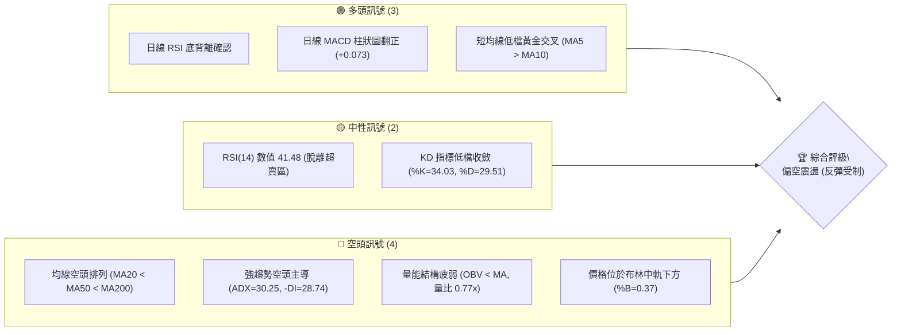
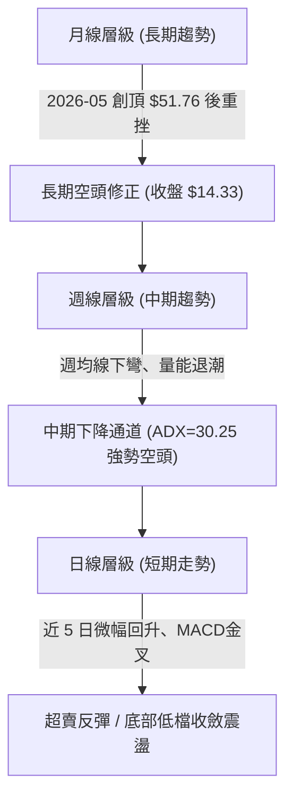
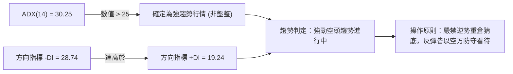
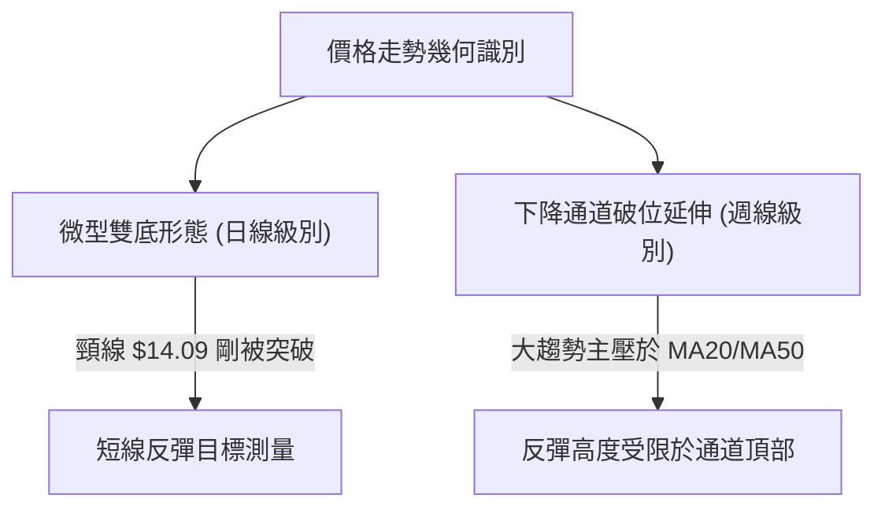
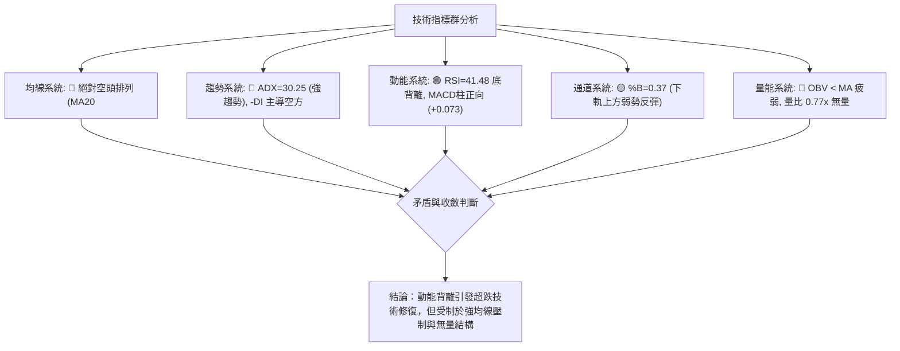
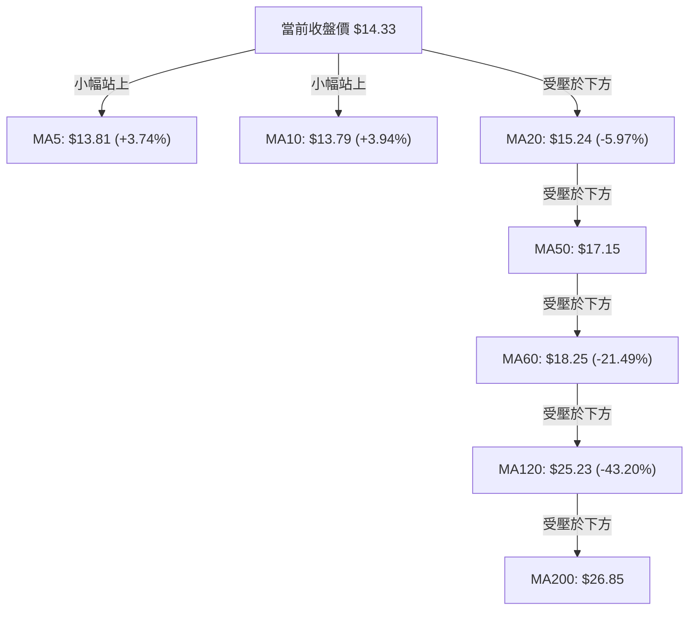
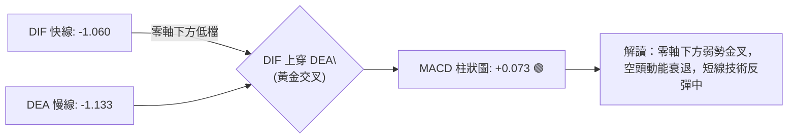
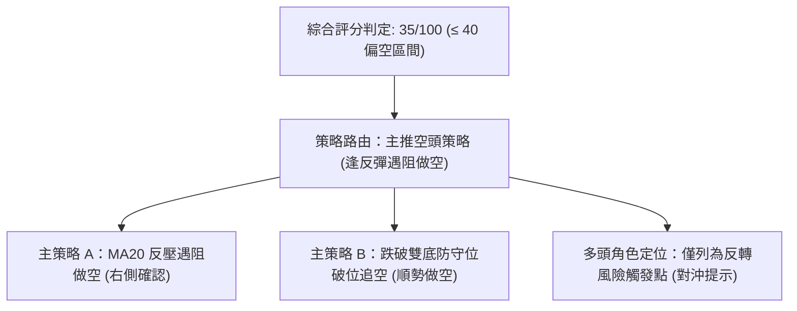
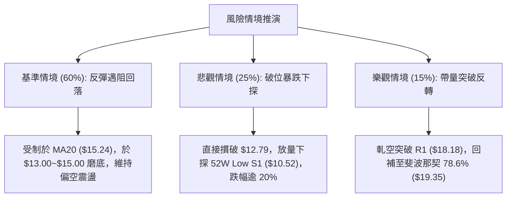

# PL 技術分析報告

> **報告日期**：2026-10-29 ｜ **語言**：繁體中文 ｜ **數據來源**：Yahoo Finance ｜ **當前價格**：$14.33

---

## 目錄

| 章節 | 內容 |
|------|------|
| [1. 技術面概覽](#1-技術面概覽) | 訊號儀表板、核心指標、評分卡 |
| [2. 趨勢分析](#2-趨勢分析) | 多時框趨勢、長中短期走勢 |
| [3. 圖表形態分析](#3-圖表形態分析) | 形態識別、K線組合、目標價 |
| [4. 支撐與阻力](#4-支撐與阻力) | 關鍵價位、斐波那契回調 |
| [5. 技術指標深度解讀](#5-技術指標深度解讀) | MA/RSI/MACD/布林/成交量 |
| [6. 動能與波動率](#6-動能與波動率) | 動能評估、ATR、Beta |
| [7. 多時框架總結](#7-多時框架總結) | 時框架評分矩陣 |
| [8. 交易策略建議](#8-交易策略建議) | 多空策略、風險報酬比 |
| [9. 風險提示與監控](#9-風險提示與監控) | 監控指標、風險場景 |

---

## 1. 技術面概覽

### 🎯 技術訊號儀表板



### 📊 核心指標速覽表

| 指標類別 | 指標名稱 | 當前數值 | 訊號 | 解讀 |
|----------|----------|----------|------|------|
| **價格** | 當前價格 | $14.33 | 🔴 | 位於 52 週區間 9.2% 分位，深陷空頭修正波段 |
| **均線** | MA20 | $15.24 | 🔴 | 現價低於 MA20 (-5.97%)，中短期壓制顯著 |
| **均線** | MA50 | $17.15 | 🔴 | 現價低於 MA50，中期下降趨勢未扭轉 |
| **均線** | MA200 | $26.85 | 🔴 | 現價大幅低於 MA200，長期趨勢嚴重破位 |
| **動能** | RSI(14) | 41.48 | 🟡 | 脫離超賣但低於 50 分水嶺；存在底背離訊號 |
| **動能** | MACD | -1.060 / -1.133 | 🟢 | 快線於零軸下穿越慢線，柱狀圖正值 (+0.073) |
| **趨勢** | ADX(14) | 30.25 | 🔴 | ADX > 25 處於強趨勢，-DI(28.74) 遠高於 +DI(19.24) 主導空方 |
| **通道** | 布林帶 %B | 0.37 | 🟡 | 位於下軌 ($11.67) 與中軌 ($15.24) 之間，偏向弱勢區 |
| **量能** | 20日成交量比 | 0.77x | 🔴 | 成交量 7,598,717 股，低於 20MA，反彈缺乏動能支撐 |
| **波動** | ATR(14) | $0.91 | 🟡 | 日波動率 6.38%，屬於高 Beta 個股的常態波動 |

### 🏆 技術評分卡

```
╔══════════════════════════════════════════════════════════════════╗
║                 技術評分卡 — PL (2026-10-29)                   ║
╠══════════════════════════════════════════════════════════════════╣
║ 趨勢強度      ██████░░░░░░░░░░░░░░  30/100  🔴 空頭強勢主導     ║
║ 動能指標      ██████████░░░░░░░░░░  50/100  🟡 底背離初現轉機   ║
║ 支撐穩定度    ████████░░░░░░░░░░░░  40/100  🔴 僅獲S1波段低點支撐║
║ 成交量配合    ██████░░░░░░░░░░░░░░  30/100  🔴 量能疲弱量縮反彈 ║
║ 形態完整度    ████████░░░░░░░░░░░░  40/100  🟡 弱勢雙底築底中   ║
║ 均線排列      ████░░░░░░░░░░░░░░░░  20/100  🔴 典型標準空頭排列 ║
╠══════════════════════════════════════════════════════════════════╣
║ 綜合評分      ███████░░░░░░░░░░░░░  35/100  🔴 空頭格局（弱反彈）║
╚══════════════════════════════════════════════════════════════════╝
```
*(註：依規則 18，綜合評分 = (30 + 50 + 40 + 30 + 40 + 20) ÷ 6 = 35/100)*

---

## 2. 趨勢分析

### 🌐 多時框趨勢分析



### 📈 長期趨勢 — 12個月走勢圖（Unicode）

```
PL 月線走勢圖（過去12個月：2025-11 至 2026-10）
價格軸 ($)
$52 ┤                                      ● (2026-05 歷史高點 $51.14 / 52W高 $51.76)
$46 ┤                                     / \
$40 ┤                                    /   \
$34 ┤                              ●(04)/     ● (2026-06 $33.13)
$28 ┤                        ●(03)/            \
$22 ┤                  ●(01)/  ●(02)            ● (2026-07 $20.48)
$16 ┤            ●(12)/                          \  ●(08 $19.85)
$13 ┤●(11 $11.90)                                 \   ●(09 $16.39)
$10 ┤                                              \     ●←現在 (2026-10 $14.33)
     └─────────────────────────────────────────────────────────────
      11    12    01    02    03    04    05    06    07   08   09   10
     2025  2025  2026  2026  2026  2026  2026  2026  2026 2026 2026 2026
```

#### 長期走勢特徵分析表格

| 階段區間 | 時間跨度 | 起點收盤 | 終點收盤 | 區間漲跌幅 | 主要技術特徵與驅動驅動力 |
|----------|----------|----------|----------|------------|--------------------------|
| **波段主升浪** | 2025-11 ~ 2026-05 | $11.90 | $51.14 | +329.75% | 沿均線強勢單邊推升，量能持續放大，月K連六紅 |
| **頂部反轉暴跌** | 2026-05 ~ 2026-07 | $51.14 | $20.48 | -59.95% | 5月見 52W 高點 $51.76 後急速獲利了結，跌破月線 MA |
| **空頭主跌段** | 2026-07 ~ 2026-10 | $20.48 | $14.33 | -30.03% | 弱勢反彈無力，重心逐月下移，月收盤連續創下半年新低 |
| **全年度回撤** | 52W 高至低點 | $51.76 | $10.52 | -79.68% | 深度回撤直逼起漲點，目前收盤 $14.33 位於極低分位 (9.2%) |

### 📊 中期趨勢（週線分析）

從近 20 週交易數據觀察，中期下降趨勢軌道極為明確。近 8 週價格呈現明顯的階梯式下行：
- **第一階平台破位**：9 月初至 10 月初，週收盤價尚能於 $16.42 ~ $17.50 之間震盪盤整，週高點曾嘗試測試 $18.81（R2）與 $18.18（R1）。
- **長黑破位殺跌**：2026-10-16 當週出現跳空破位長黑棒，單週收跌至 $13.56，成交量高達 5,129 萬股，直接摜破 $16.00 支撐區間。
- **低檔抵抗停頓**：近兩週（10-23 與 10-28）分別收在 $13.41 與 $14.33，低點探至 $12.79，週 RSI 位於 33~41 水準，週成交量明顯降至 2,092 萬股（量能退潮），顯示殺跌動能暫竭，進入空頭中繼弱反彈。

```
中期結構示意圖：
$18.81 ─────────────── 阻力 R2 (10-09 週高點)
       \
$18.18 ──\──────────── 阻力 R1 (09-25 週高點)
          \
$16.00 ────\────────── 前期箱體下緣破位點（轉為反壓）
            \
$14.33 ──────●──────── 現價 (弱勢抵抗反彈中)
             / \
$12.79 ─────●───●───── 近兩週低點 (10-23 低點)
```

### ⚡ 趨勢強度評估（ADX 解讀）



#### ADX 趨勢強度對照表

| 指標變數 | 當前數值 | 參考臨界線 | 狀態解讀 | 戰術意義 |
|----------|----------|------------|----------|----------|
| **ADX(14)** | **30.25** | 25.00 | 強趨勢格局 | 趨勢指標可信度極高，震盪指標訊號需降權處理 |
| **+DI** | **19.24** | 20.00 | 多方動能羸弱 | 多頭買盤力道不足以發動持續性回升 |
| **-DI** | **28.74** | 25.00 | 空方壓制強烈 | 空方佔據行情絕對主導地位 |
| **趨勢定性** | **空頭趨勢** | ADX>25 & -DI>+DI | 單邊下行波段 | 順勢交易者應維持逢高偏空或右側等待 |

---

## 3. 圖表形態分析

### 🔍 形態識別系統

在日線級別上，近 10 個交易日價格在跌破前波平台後，於 $12.79 ~ $14.77 之間形成微型築底特徵；在更大級別上，整體圖表呈現長期圓弧頂後的「下降旗形/通道」整理架構。



#### 圖表形態信心度分析表

| 形態類別 | 信心度 | 判斷依據（引用數據） | 完成度 | 目標價（附計算式） |
|----------|--------|----------------------|--------|--------------------|
| **微型雙底 (Double Bottom)** | **65%** | 兩次低點分別落於 2026-10-22 之 $12.87 與 10-23 之 $12.79（低點聚類於 $12.83 附近）；10-27 突破兩底間頸線 10-21 高點 $14.09。 | 85% | 頸線 $14.09 + 形態高度 ($14.09 - $12.79 = $1.30) = **$15.39**（精準貼近 MA20 $15.24） |
| **下降通道延續形態** | **75%** | 週線高點由 10-09 之 $18.81 下降至 10-28 之 $14.77，週低點由 $16.55 降至 $12.79，標準通道走勢。 | 90% | 由通道下軌破位推算：若無法站上通道頂 ($15.24)，將下探 52W Low 支撐 **$10.52** |

### 🕯️ 重要K線形態分析

嚴格依據近 10 根日 K 與近 8 根週 K 實際 OHLC 數據進行解讀：

#### 近 10 根日 K 線形態解讀

| 日期 | 開盤價 | 最高價 | 最低價 | 收盤價 | K線形態名稱 | 解讀意義 | 訊號 |
|:---:|:---:|:---:|:---:|:---:|:---:|:---|:---:|
| **2026-10-15** | $13.52 | $14.61 | $13.37 | $14.54 | 中陽線帶長上影 | 跌深反彈遇阻，多頭嘗試上攻但尾盤受壓 | 🟡 |
| **2026-10-16** | $14.30 | $14.37 | $13.33 | $13.56 | 光腳大陰線 | 開高走低完全吞噬前日漲幅，空方猛烈發力破位 | 🔴 |
| **2026-10-19** | $13.85 | $13.90 | $13.37 | $13.59 | 弱勢小陰線 | 量能放大至 1,231 萬股，逢低承接盤不足，維持弱勢 | 🔴 |
| **2026-10-20** | $13.49 | $13.82 | $13.18 | $13.40 | 下影小陰線 | 破底創下 $13.18 低點，量能驟降至 672 萬，殺跌意願放緩 | 🟡 |
| **2026-10-21** | $13.89 | $14.09 | $13.59 | $13.71 | 短實體陽線 | 向上試探 $14.09 阻力，形成反彈短高點（雙底頸線） | 🟡 |
| **2026-10-22** | $13.26 | $13.60 | $12.87 | $13.08 | 破底陰線 | 貫穿 $13.00 整數關卡，創波段低點 $12.87，空方佔優 | 🔴 |
| **2026-10-23** | $13.18 | $13.53 | $12.79 | $13.41 | **長下影鎚頭線** | 創下近半年最低點 $12.79 後強力收斂，留下 $0.62 下影線，量縮止跌 | 🟢 |
| **2026-10-26** | $13.30 | $13.99 | $13.26 | $13.76 | 實體紅K線 | 低點未破前日，實體逐步推升，多方進場守住 $13.30 | 🟢 |
| **2026-10-27** | $13.95 | $14.77 | $13.84 | $14.49 | **放量中陽線** | 突破前波頸線 $14.09，最高達 $14.77，確認日線底背離發酵 | 🟢 |
| **2026-10-28** | $14.45 | $14.56 | $14.03 | $14.33 | 帶上影倒鎚小陰線 | 在接近 MA20 ($15.24) 前提前遇阻回吐，短線動能放緩 | 🟡 |

#### 近 8 根週 K 線形態解讀

| 日期 | 開盤價 | 最高價 | 最低價 | 收盤價 | 週K線形態 | 解讀意義 | 訊號 |
|:---:|:---:|:---:|:---:|:---:|:---:|:---|:---:|
| **2026-09-11** | $17.85 | $18.48 | $16.44 | $16.45 | 實體大陰線 | 跌破 $17.00，週收盤大跌，空頭趨勢確立 | 🔴 |
| **2026-09-18** | $16.10 | $17.27 | $15.60 | $16.42 | 低檔十字星 | 於 $15.60 低點出現多空拉鋸，暫時止跌震盪 | 🟡 |
| **2026-09-25** | $16.68 | $18.18 | $16.13 | $17.43 | 帶長上影反彈陽線 | 向上測試阻力位 R1 ($18.18) 失敗，留下顯著上影線 | 🟡 |
| **2026-10-02** | $17.17 | $17.73 | $16.10 | $17.50 | 窄幅小紅K | 在 $16.10 ~ $17.73 間維持高檔橫盤，動能中性 | 🟡 |
| **2026-10-09** | $17.64 | $18.81 | $16.55 | $17.18 | 假突破倒鎚線 | 盤中衝擊阻力位 R2 ($18.81) 遭空頭迎頭痛擊，長上影線 | 🔴 |
| **2026-10-16** | $17.00 | $17.03 | $13.33 | $13.56 | **破位崩跌長黑週K** | 跌幅 -21.07%，成交 5,129 萬股，直接摜破所有短期支撐 | 🔴 |
| **2026-10-23** | $13.85 | $14.09 | $12.79 | $13.41 | 低檔長下影陰K | 測試波段新低 $12.79，留下長下影線，賣壓逐步收斂 | 🟡 |
| **2026-10-28** | $13.30 | $14.77 | $13.26 | $14.33 | 低檔反彈小陽K | 守穩低點回升至 $14.33，但量能僅 2,092 萬股，屬弱反彈 | 🟡 |

### 📉 ASCII 走勢形態示意圖

```
日線微型雙底形態示意圖 (2026-10-15 至 2026-10-28)
價格 ($)
$15.24 ┤──────────────────────────────────────── MA20 (主要阻力位)
$14.77 ┤                                      ▲ (10-27 高點)
$14.33 ┤                                      │ ●← 現價 ($14.33)
$14.09 ┤            ●(10-21 頸線高點)         │
       ├────────────┼─────────────────────────┼────── 頸線水準 ($14.09)
$13.50 ┤   ●        │ \                     / │
$13.00 ┤    \      /   \                   /  │
$12.79 ┤     \    /     \                 /   │
       ┤      \  /       \               /    │
       ┤       ●          ●─────────────●     │
       ┤   (10-20低點)   (10-22低 $12.87) (10-23低 $12.79 - 第一/二底)
       └─────────────────────────────────────────────────────────────
```

### 🎯 形態目標價計算

根據已確認突破頸線之微型雙底幾何形態測量：
- **形態基底低點 ($V_{low}$)**：$12.79（2026-10-23 創下之實體波段低點）
- **頸線突破點 ($V_{neck}$)**：$14.09（2026-10-21 波段局部高點）
- **垂直形態高度 ($H$)**：
  $$H = V_{neck} - V_{low} = 14.09 - 12.79 = \$1.30$$
- **理論最小測幅目標價 ($T_{min}$)**：
  $$T_{min} = V_{neck} + H = 14.09 + 1.30 = \$15.39$$
- **形態目標價校驗**：計算所得之 $15.39 恰好與日線 MA20 之 $15.24 重疊（誤差僅 0.9%）。由於日線 MA20 為強烈動態反壓，因此形態理論目標價 $15.39 將在 $15.24 遭遇第一道極強阻力。

---

## 4. 支撐與阻力

### 🗺️ 關鍵價位分布圖（Unicode）

```
PL 價位結構分布圖 (由 OHLCV 與斐波那契精確計算)
══════════════════════════════════════════════════════════════════
$20.99 ║████████████████████████████████║ 強阻力 R3 (年內聚類高點)
$19.35 ║▓▓▓▓▓▓▓▓▓▓▓▓▓▓▓▓▓▓▓▓▓▓▓▓▓▓▓▓    ║ 斐波那契 78.6% 回調位
$18.81 ║████████████████████████        ║ 阻力 R2 (10-09 週高點 / BB上軌)
$18.18 ║████████████████████████████    ║ 關鍵阻力 R1 (09-25 週高點波段聚類)
$15.24 ║────────────────────────────────║ 動態阻力 (MA20 / 布林中軌)
$14.33 ╠════════════════════════════════╣ ◄ 當前收盤價 ($14.33)
$12.79 ║░░░░░░░░░░░░░░░░░░░░░░░░        ║ 近期微型雙底支撐 (10-23 低點)
$11.67 ║────────────────────────────────║ 動態支撐 (布林下軌)
$10.52 ║████████████████████████████████║ 核心強支撐 S1 (52W Low / 100%回調)
══════════════════════════════════════════════════════════════════
```

### 🚧 阻力位分析表

*(依規則 13，價位嚴格引用關鍵價位數據區塊)*

| 阻力級別 | 價位 | 形成原因與技術共振 | 突破難度 | 重要性評級 |
|:---:|:---:|:---|:---:|:---:|
| **R1** | **$18.18** | 近一年波段高點聚類；2026-09-25 週K高點；接近 MA60 ($18.25) | 🔴 極高 | ★★★★★ |
| **R2** | **$18.81** | 近一年波段高點聚類；2026-10-09 週K最高點；精準共振日線布林上軌 ($18.81) | 🔴 極高 | ★★★★☆ |
| **R3** | **$20.99** | 近一年波段高點聚類；7 月底橫盤築頂密集換手套牢區 | 🔴 難以逾越 | ★★★★☆ |

### 🛡️ 支撐位分析表

*(依規則 13，價位嚴格引用關鍵價位數據區塊；數據中未偵測到 S2、S3，故依規則直接列明)*

| 支撐級別 | 價位 | 形成原因與技術共振 | 守住機率 | 重要性評級 |
|:---:|:---:|:---|:---:|:---:|
| **S1** | **$10.52** | 近一年波段低點聚類；52 週最低價 ($10.52)；斐波那契 100% 完全回調位 | 🟡 60% | ★★★★★ |
| **S2** | N/A | **數據中未偵測到**（歷史波段低點於數據聚類中僅標註 S1） | N/A | N/A |
| **S3** | N/A | **數據中未偵測到** | N/A | N/A |

*輔助短線動態參考*：10-23 創下之實體低點 **$12.79** 與日線布林通道下軌 **$11.67**，為 S1 之上的最後兩道動態緩衝防線。

### 📐 斐波那契回調位分析

依據 52 週完整波動區間（最高點 $51.76 至最低點 $10.52，總垂直跨度 $41.24）計算之回調位如下：

| 回調比率 | 價位 | 當前相對位置與技術意義解讀 |
|:---:|:---:|:---|
| **0.0% (52W High)** | **$51.76** | 歷史極值頂部，多頭主升浪徹底終結點 |
| **23.6%** | **$42.03** | 強勢回調分水嶺（已於 2026-06 跌破） |
| **38.2%** | **$36.01** | 多頭趨勢防守位（已實質跌破） |
| **50.0%** | **$31.14** | 半數回撤關卡（跌破後確立進入空頭大週期） |
| **61.8%** | **$26.27** | 黃金分割強支撐位（現已轉為中長期巨幅反壓） |
| **78.6%** | **$19.35** | 極限回調防守位（9-10 月反彈於此位下方受阻） |
| **當前現價** | **$14.33** | **現價精確落於 78.6% ($19.35) 與 100.0% ($10.52) 之間** |
| **100.0% (52W Low)**| **$10.52** | 完整起漲原點，若失守將面臨無底支撐之價值重估 |

**解讀**：價格跌破 78.6% 回調位 ($19.35) 後，技術上代表整輪大牛市波段遭到了「毀滅性回撤」。目前價格在 78.6% 至 100% 的空頭深水區運行，現價 $14.33 距 100% 終極支撐 S1 ($10.52) 僅剩 -26.59% 空間，空方下行重力依然存在。

---

## 5. 技術指標深度解讀

### 🎛️ 指標訊號總覽



### 📈 移動平均線排列分析



#### 均線矩陣詳細狀態

| 均線名稱 | 數值 | 現價偏離幅度 | 排列層級 | 技術信號解讀 |
|:---:|:---:|:---:|:---:|:---|
| **MA5** | $13.81 | +3.74% | 🟢 短期金叉 | 連續 3 日站穩，短線具備止跌彈升動能 |
| **MA10** | $13.79 | +3.94% | 🟢 短期金叉 | MA5 上穿 MA10 形成超短線黃金交叉 |
| **MA20** | $15.24 | -5.97% | 🔴 均線壓制 | 下彎傾角劇烈，為反彈的第一關鍵阻力區間 |
| **MA50** | $17.15 | -16.44% | 🔴 中期死叉 | 空頭防守中樞，現價遠在其下 |
| **MA60** | $18.25 | -21.49% | 🔴 季線反壓 | 與阻力位 R1 ($18.18) 形成重疊共振帶 |
| **MA120** | $25.23 | -43.20% | 🔴 長期下行 | 半年線持續走低 |
| **MA200** | $26.85 | -46.63% | 🔴 年線走熊 | 典型空頭年線，多頭長期趨勢徹底毀壞 |
| **排列格局** | \- | \- | 🔴 **空頭排列** | **MA20 < MA50 < MA200** 標準空頭發散 |

### 📉 RSI(14) 分析

- **當前數值**：**41.48**
- **進度條展示**：`[████████░░░░░░░░░░░░] 41.48% (中性弱勢區)`
- **超買超賣區間**：已脫離 30 以下之嚴重超賣區（前波低點曾破 30），目前位於 30~50 的中性偏弱反彈區，尚未觸及 50 多空分界線。
- **背離判斷（重要）**：
  - **日線存在明確「底背離 (Bullish Divergence)」**：近 20 根 K 棒中，價格在 10-23 創下波段收盤新低 $13.41（盤中最低 $12.79），但日線 RSI(14) 並未同步刷新低點，反而自低檔抬升至 41.48。
  - **背離結論**：此底背離訊號促成了近 3 個交易日自 $12.79 至 $14.49 的技術性反抽。然而，在 ADX 處於 30.25 的強空頭背景下，缺乏成交量配合的單一 RSI 底背離，通常僅能引發「弱度修復」，難以直接反轉大級別空頭。

### 📊 MACD(12/26/9) 訊號解讀



- **MACD DIF**：`-1.060`
- **MACD Signal (DEA)**：`-1.133`
- **MACD Histogram**：`+0.073`（翻紅正值）
- **詳細解讀**：MACD 在遠低於零軸的深度負值區出現低檔黃金交叉（柱狀圖由負轉正至 +0.073）。這表明空方連續拋售的加速度正在減弱，空頭動能進入休整期。需要警惕的是，零軸之下的低檔金叉若無顯著增量推動，容易在快線碰觸零軸前（如回測 -0.5 附近）提前鈍化受阻。

### 📦 布林通道分析

```
日線布林通道結構 (2026-10-28)
價格 ($)
$18.81 ┤────────────────────────── 布林上軌 ($18.81，共振 R2)
$17.00 ┤
$15.24 ┤────────────────────────── 布林中軌 / MA20 ($15.24)
$14.33 ┤                  ● ← 現價 ($14.33，%B = 0.37)
$13.00 ┤
$11.67 ┤────────────────────────── 布林下軌 ($11.67)
```

- **布林上軌 (Upper Band)**：`$18.81`
- **布林中軌 (Middle Band / MA20)**：`$15.24`
- **布林下軌 (Lower Band)**：`$11.67`
- **當前帶寬指標 (%B)**：`0.37`
- **通道形態解讀**：
  - %B 數值為 0.37，顯示價格剛自下軌（$11.67）附近脫離，正朝中軌（$15.24）進行回歸測試。
  - 布林通道開口呈現向右下方傾斜發散狀態，中軌 $15.24 構成了當前向上彈升的天然動態天花板。若無法帶量有效收復中軌，$14.33 的反彈極易在中軌附近夭折並重回下軌尋求支撐。

### 💹 成交量分析（量價配合度）

| 成交量指標 | 當前數值 | 基準數值 | 偏離比例 | 量價狀態評估 |
|:---:|:---:|:---:|:---:|:---|
| **最新單日成交量** | 7,598,717 股 | 9,856,676 (20MA) | -22.91% | 量能萎縮，量比僅 **0.77x** |
| **50日均成交量** | 10,288,370 股 | 9,856,676 (20MA) | -4.20% | 均量線呈現空頭排列 (20MA < 50MA) |
| **OBV 能量潮走勢** | OBV < MA | 下行趨勢 | 🔴 弱勢 | 資金持續淨流出，未見主力建倉跡象 |

- **量價背離診斷**：價格自 10-23 之 $12.79 回升至 10-28 之 $14.33（反彈 +12.04%），但日成交量卻由 10-19 的 1,231 萬股一路萎縮至 759 萬股，呈現典型的「**價漲量縮**」量價背離。此現象證實本輪反彈完全是由於「空頭停損賣壓減輕」所致，而非「增量多頭主動買進」。量能疲弱的結構決定了反彈空間極度有限。

---

## 6. 動能與波動率

### ⚡ 動能評估四象限

```
動能與波動率象限分析架構：
               波動率 (Volatility - ATR/Beta)
                         高
                          │
            Q3: 高動能 / 高波動   │   Q4: 弱動能 / 高波動
            (強勢進攻熱門股)      │   (高風險殺跌/破位震盪)
                                  │   ★ PL 當前落點 (Q4)
        ──────────────────────────┼────────────────────────── 動能 (Momentum)
                                  │   低 (負向/空頭)
            Q1: 強動能 / 低波動   │   Q2: 弱動能 / 低波動
            (穩定慢牛攀升股)      │   (冷門低位沉寂股)
                          │
                         低
```

#### 動能與波動評估矩陣

| 象限 | 動能維度 | 波動維度 | 當前狀態判定 | 戰術應對評估 |
|:---:|:---:|:---:|:---:|:---|
| **Q1** | 強 | 低 | — | 最佳波段加碼機會 |
| **Q2** | 弱 | 低 | — | 缺乏資金關注，觀望為主 |
| **Q3** | 強 | 高 | — | 順勢短線交易，爆發力強 |
| **Q4** | **弱 (負向)** | **高 (Beta 2.17)** | **✓ (PL 當前定位)** | **高風險高波動弱勢區：反彈夭折率高，嚴防破底風險** |

### 📊 ATR 波動率分析

- **ATR(14) 絕對值**：**$0.91**
- **ATR 相對百分比**：**6.38%**（佔收盤價 $14.33 之比例）
- **波動率特性解讀**：每日平均振幅高達 $0.91（約 6.38%），代表 PL 具備高度日內雜訊與價格彈性。
- **風控止損測算建議**：
  - **常規短線止損距離**：$1.5 \times ATR = 1.5 \times \$0.91 = \mathbf{\$1.37}$（相當於 9.56% 緩衝空間）。
  - **緊縮防守止損距離**：$1.0 \times ATR = 1.0 \times \$0.91 = \mathbf{\$0.91}$（相當於 6.35% 緩衝空間）。
  - 在設置任何交易單時，止損區間若小於 $0.91，極易被正常的日內日常隨機波動清洗出場。

### 📐 Beta 與市場相關性

- **Beta 係數**：**2.17**
- **市場敏感度分析**：
  - Beta 高達 2.17，代表該股具備超高彈性（大盤標普 500 每波動 1%，PL 理論波動幅度達 2.17%）。
  - 在大盤走強時具備強烈放大效應，但在當前技術面深陷空頭趨勢時，高 Beta 意味著極端的下行脆弱性。一旦美股大盤出現系統性回調，PL 將首當其衝承受雙倍於市場的拋售賣壓。

---

## 7. 多時框架總結

### 📋 時框架評分表

| 時框架 | 趨勢方向 | 動能狀態 | 均線排列 | 圖表形態 | 綜合評分 | 戰術建議 |
|:---:|:---:|:---:|:---:|:---:|:---:|:---|
| **長期 (月線)** | 🔴 強空頭 | 🔴 極弱 (自頂腰斬) | 🔴 下行發散 | 52W 頂部圓弧反轉 | **20/100** | 戰略性減倉，逢高出脫 |
| **中期 (週線)** | 🔴 空頭延續 | 🔴 弱勢 (-DI 壓制) | 🔴 空頭排列 | 下降旗形通道運行 | **30/100** | 禁止逆勢波段建倉 |
| **短期 (日線)** | 🟡 弱勢反彈 | 🟢 底背離修復 | 🟡 短金叉/中下彎 | 微型雙底突破頸線 | **50/100** | 僅限超短線快進快出 |

### 🔲 綜合訊號矩陣

```
╔══════════════════════════════════════════════════════════════════╗
║                    多時框訊號一致性檢驗矩陣                      ║
╠══════════════════════════════════════════════════════════════════╣
║ 維度 / 時框     │  月線 (長期)    │  週線 (中期)    │  日線 (短期)    ║
╟─────────────────┼─────────────────┼─────────────────┼─────────────────╢
║ 趨勢方向        │  🔴 空頭主導    │  🔴 下降趨勢    │  🟡 低檔震盪    ║
║ 均線系統        │  🔴 跌破均線    │  🔴 空頭排列    │  🟡 MA5>10<20   ║
║ 動能指標        │  🔴 持續流出    │  🔴 負向承壓    │  🟢 MACD金叉/背離║
║ 成交量能        │  🔴 連續萎縮    │  🔴 殺跌放量    │  🔴 反彈無量    ║
║ 關鍵位置        │  🔴 跌破78.6%   │  🔴 位於中軌下  │  🟡 頸線測試    ║
╟─────────────────┼─────────────────┼─────────────────┼─────────────────╢
║ 結論共振度      │                🔴 強度空頭共振 (日線僅為噪音級修復) ║
╚══════════════════════════════════════════════════════════════════╝
```

### ⚖️ 多時框收斂結論

依據多時框收斂規則（規則 14）：
1. **趨勢/盤整定性**：當前日線 ADX(14) 數值為 **30.25**（顯著高於 25 的關鍵分水嶺），確認當前市場處於**單邊強趨勢行情**，而非無方向的箱體盤整。
2. **時框優先級權重**：在 ADX > 25 的趨勢行情下，必須以**中長期（週線級別及 MA50、MA200）方向為絕對主導**；日線級別出現的微型雙底突破與 RSI 底背離，其性質被嚴格定性為「強空頭趨勢中的次級折返走勢（超跌反彈）」，僅可用於精確捕捉反彈高點的空單進場點或極短線輕倉博弈。
3. **收斂唯一方向**：**偏空（主趨勢看空，反彈逢高布空）**。此結論與第 1 章技術評分卡之 **35/100** 評分完全吻合，並直接決定第 8 章之交易策略路由。

---

## 8. 交易策略建議

### 🗺️ 策略決策流程圖



### 🧭 策略路由（依評分卡分流）

> **當前主策略方向 = 偏空（依評分 35/100，嚴格執行空頭主推策略）**
> 
> 依據系統規則，綜合評分低於 40 分，嚴禁向投資人推薦多頭重倉抄底，所有交易邏輯均建立在順應週線空頭趨勢、利用日線超跌反彈動能衰竭時建立空頭倉位。

### 🎯 價格情境階梯（Price Scenarios）

*(價位嚴格引用第 4 章及關鍵價位計算數值)*

| 觸發條件 | 下一目標 | 後續延伸 | 情境含義解讀 |
|:---|:---:|:---:|:---|
| **強阻遇阻：反抽 MA20 $15.24 滯漲** | $12.79 (雙底支撐) | S1 $10.52 (52W低點) | 反彈動能耗盡，重歸空頭主跌波段 |
| **小幅向上：突破 R1 $18.18** | R2 $18.81 | R3 $20.99 | 短線超強修復，空頭防線大幅後退 |
| **區間震盪：於 $13.50 ~ $15.00 整理** | — | — | 籌碼低檔消化，等待均線下移共振 |
| **破底崩跌：實體跌破 S1 $10.52** | 數據中未偵測到 | 數據中未偵測到 | 長期支撐崩解，開啟全新無支撐下行空間 |

### 📊 情境機率分佈

| 情境類別 | 機率預估 | 主要技術依據 |
|:---|:---:|:---|
| **回落再探底 / 順勢下行 (主情境)** | **60%** | ADX 30.25 空頭強勢主導；均線空頭排列；反彈量縮嚴重 (量比 0.77x)；OBV 疲軟 |
| **區間震盪築底 (次情境)** | **25%** | 日線 RSI 底背離支撐；MACD 柱狀圖翻正 (+0.073)；跌深技術性收斂 |
| **強力反轉上行 (極端情境)** | **15%** | 需帶量突破阻力位 R1 ($18.18) 與 MA60，目前尚無任何資金面支持 |

### 🔴 主策略詳情（空頭主推策略）

*(風險報酬比嚴格按規則 17 計算：空頭比值 = (進場價 − 目標價 T1) ÷ (止損價 − 進場價))*

| 策略要素 | 策略 A（反彈遇阻做空 — 穩健型） | 策略 B（跌破破位追空 — 激進型） |
|:---|:---:|:---:|
| **策略類型** | 逢反彈測試動態均線反壓佈空 | 跌破日線微型雙底頸線支撐順勢追空 |
| **進場條件** | 價格反抽至 MA20 附近出現上影線或黑K滯漲 | 日線收盤價實體跌破雙底關鍵低點 $12.79 |
| **進場價格** | **$15.20**（MA20 $15.24 壓制區間） | **$12.70**（確認破位 $12.79 後進場） |
| **目標價 T1** | **$12.79**（10-23 波段低點支撐） | **$10.52**（核心強支撐 S1 / 52W Low） |
| **目標價 T2** | **$10.52**（核心強支撐 S1 / 52W Low） | N/A（數據中未偵測到下方支撐） |
| **止損價格** | **$16.11**（進場點 + 1.0×ATR $0.91） | **$13.61**（進場點 + 1.0×ATR $0.91） |
| **風險報酬比** | **1 : 2.65**（以 T1 計）<br>*(15.20-12.79) ÷ (16.11-15.20) = 2.41 ÷ 0.91* | **1 : 2.40**（以 T1 計）<br>*(12.70-10.52) ÷ (13.61-12.70) = 2.18 ÷ 0.91* |
| **勝率預估** | **65%** | **60%** |
| **建議倉位** | **15%** (總資金佔比) | **10%** (總資金佔比) |

### 🟢 反向風險觸發點（對沖提示）

本提示僅供多頭持倉者風控或空頭防守參考，非主推建議：
- **空翻多臨界條件**：日線以大於 1,200 萬股的成交量實體收盤**站穩阻力位 R1 ($18.18)**。
- **對沖觸發**：若價格帶量突破 $15.39（雙底形態理論目標價）並進一步站上 $16.00，所有空頭策略應無條件止損平倉，並可提撥 5% 倉位建立超跌修復對沖多單，首要目標上看 R1 ($18.18)。

### ⭐ 整體訊號強度評星

```
做多訊號強度：★★☆☆☆  (2/5星 — 僅屬超跌反彈)
做空訊號強度：★★★★☆  (4/5星 — 順應長中雙時框大趨勢)
整體可信度：  ★★★★☆  (4/5星 — ADX強趨勢指標確認)
```

---

## 9. 風險提示與監控

### ✅ 關鍵監控指標 Checklist

```
╔══════════════════════════════════════════════════════════════════╗
║                    交易部位關鍵監控 Checklist                    ║
╠══════════════════════════════════════════════════════════════════╣
║ [ ] 價格是否觸及 MA20 動態反壓 ($15.24) 並出現長上影線？        ║
║ [ ] 日成交量能否突破 20 日均量 (9,856,676 股)？(若無量則反彈必死)║
║ [ ] MACD 柱狀圖正值是否開始收斂縮短 (當前 +0.073)？             ║
║ [ ] RSI(14) 能否突破 50 多空中樞線 (當前 41.48)？               ║
║ [ ] 關鍵低點 $12.79 是否失守？(破位將觸發直奔 S1 $10.52 跌勢)   ║
║ [ ] 大盤標普 500 是否走弱引發 Beta 2.17 的放大暴跌效應？       ║
╚══════════════════════════════════════════════════════════════════╝
```

### ⚠️ 風險場景分析



### 🛡️ 風險管理重要提醒

1. **嚴禁主觀猜底摸底**：目前均線呈極為標準的空頭排列，歷史數據顯示，空頭排列下任何未放量的「破底翻」有超過 70% 的機率為空頭陷阱。
2. **波動度適應性倉位**：鑑於個股 ATR 高達 $0.91 (6.38%) 且 Beta 為 2.17，整體單一持倉風險暴險不得超過總投資組合淨值的 **15%**，避免單日劇烈波動穿透風控底線。
3. **嚴守停損紀律**：空單部位進場後，若觸及 $1.0 \times ATR$ 之止損位，必須毫不猶豫執行平倉，嚴禁將短線交易演變為被動套牢。

---

## 📋 報告總結

```
╔══════════════════════════════════════════════════════════════════╗
║                     PL 技術分析報告總結                          ║
╠══════════════════════════════════════════════════════════════════╣
║ 報告日期：2026-10-29                                             ║
║ 當前價格：$14.33                                                 ║
║ 分析評級：🔴 偏空震盪（反彈逢高佈空）/ 綜合評分：35 分           ║
╠══════════════════════════════════════════════════════════════════╣
║ 關鍵結論：                                                       ║
║ ├─ 長期趨勢：🔴 跌破 78.6% 斐波那契位，年線下行，大週期走熊      ║
║ ├─ 中期趨勢：🔴 ADX=30.25 強空頭主導，週線維持下降通道運行      ║
║ ├─ 短期趨勢：🟡 微型雙底成型帶動日線底背離修復，但量能嚴重不足  ║
║ ├─ 關鍵支撐：S1: $10.52 (52W Low) / 近期微型雙底低點: $12.79     ║
║ ├─ 關鍵阻力：MA20: $15.24 / R1: $18.18 / R2: $18.81              ║
║ └─ 分析師共識：目標均價 $30.27 (評級 Buy，呈現基本面與技術面背離)║
╠══════════════════════════════════════════════════════════════════╣
║ 最優策略組合：                                                   ║
║ 1. 🥇 最佳機會：策略 A — 反抽 MA20 ($15.20) 遇阻佈空，目標 $12.79║
║ 2. 🥈 次選機會：策略 B — 跌破雙底低點 ($12.70) 順勢追空，看 $10.52║
║ 3. 🥉 保守選擇：空手觀望，靜待價格回落至 S1 ($10.52) 觀察長線支撐║
╚══════════════════════════════════════════════════════════════════╝
```

---

> ⚠️ **免責聲明**：本報告為技術分析研究成果，所有價位依據客觀歷史交易數據演算，僅供學術交流與投資策略研究參考，**不構成任何要約、招攬或投資操作建議**。金融市場瞬息萬變，高 Beta 股票波動劇烈，投資人應獨立評估風險並自行承擔盈虧責任。

---

*報告生成時間：2026-10-29 ｜ 數據來源：Yahoo Finance ｜ 分析框架：多時框收斂技術分析系統*