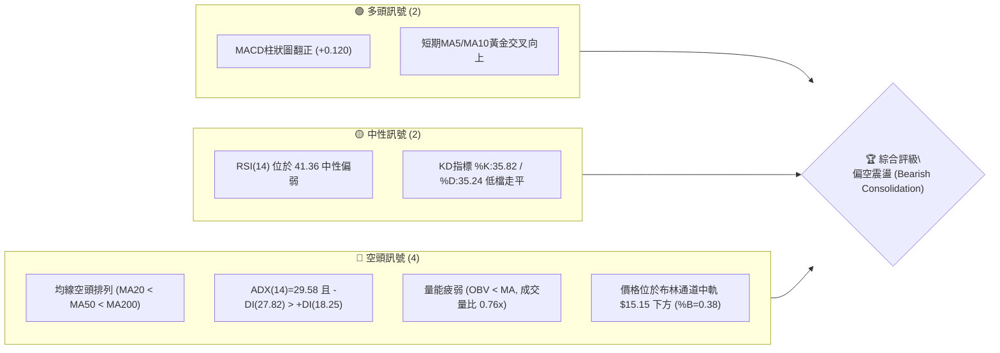
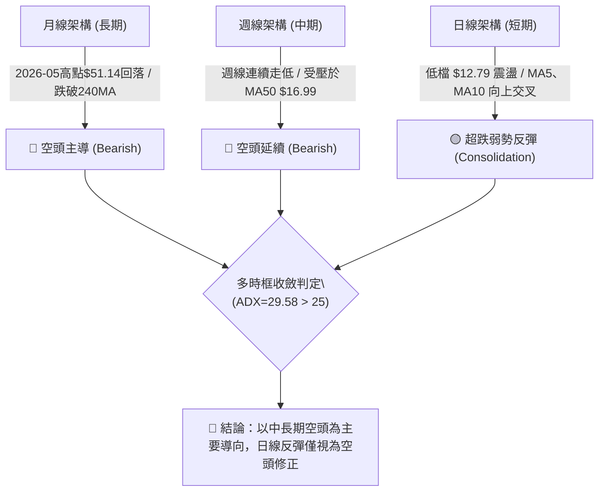
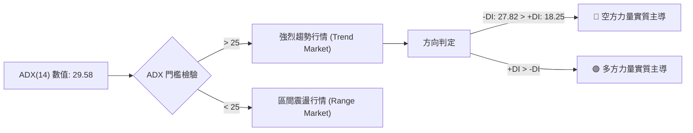
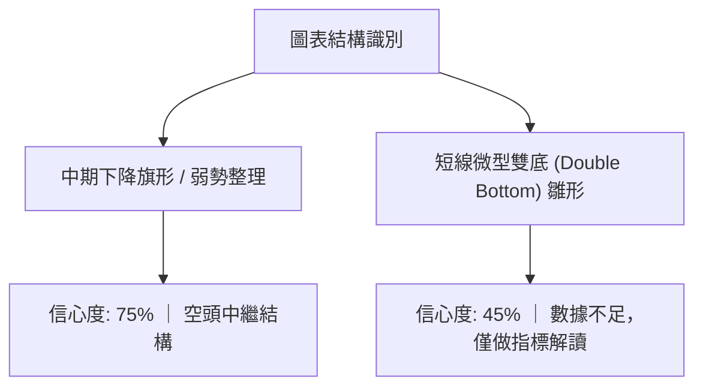
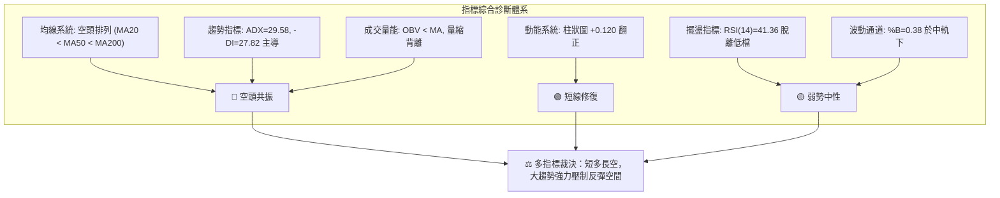
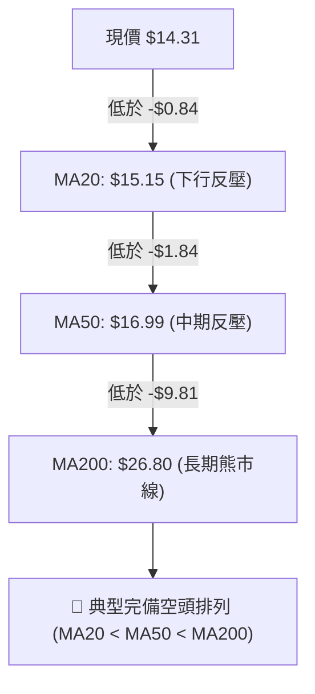
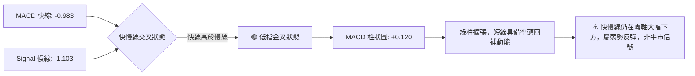
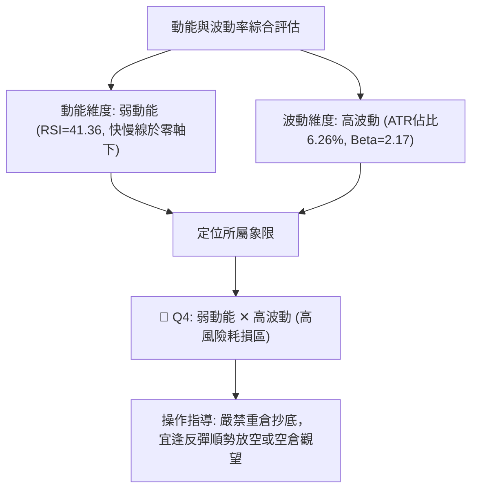
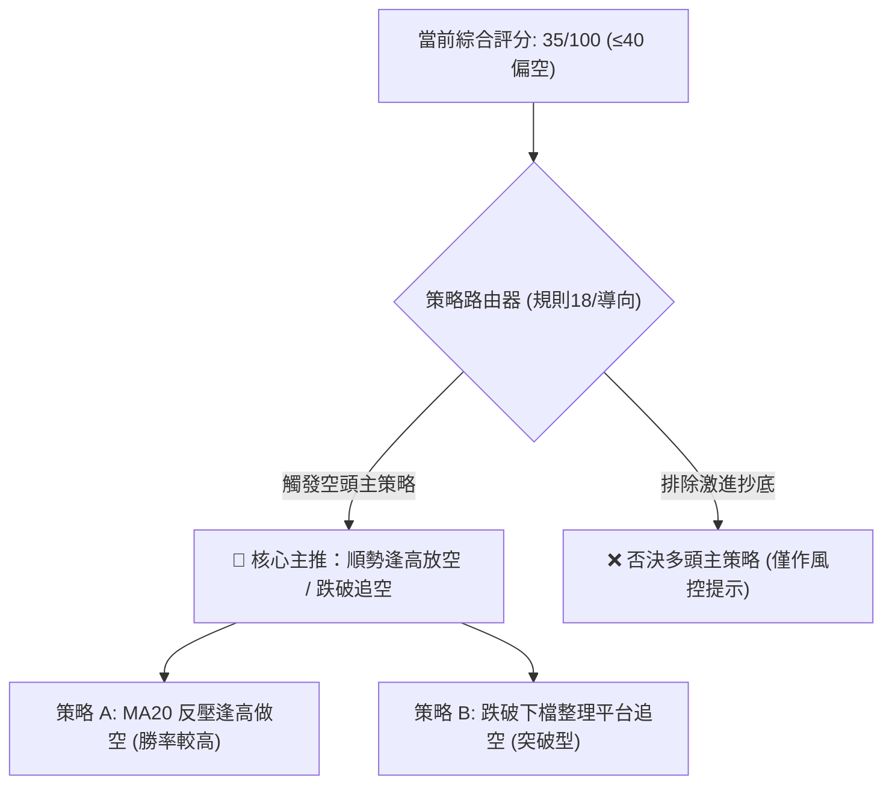
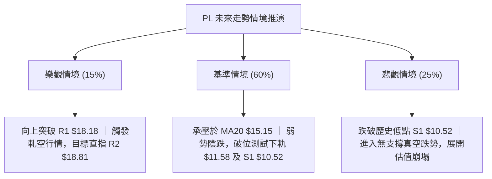

# PL 技術分析報告

> **報告日期**：2026-10-30 ｜ **語言**：繁體中文 ｜ **數據來源**：Yahoo Finance ｜ **當前價格**：$14.31

---

## 目錄

| 章節 | 內容 |
|------|------|
| [1. 技術面概覽](#1-技術面概覽) | 訊號儀表板、核心指標、評分卡 |
| [2. 趨勢分析](#2-趨勢分析) | 多時框趨勢、長中短期走勢 |
| [3. 圖表形態分析](#3-圖表形態分析) | 形態識別、K線組合、目標價 |
| [4. 支撐與阻力](#4-支撐與阻力) | 關鍵價位、斐波那契回調 |
| [5. 技術指標深度解讀](#5-技術指標深度解讀) | MA/RSI/MACD/布林/成交量 |
| [6. 動能與波動率](#6-動能與波動率) | 動能評估、ATR、Beta |
| [7. 多時框架總結](#7-多時框架總結) | 時框架評分矩陣 |
| [8. 交易策略建議](#8-交易策略建議) | 多空策略、風險報酬比 |
| [9. 風險提示與監控](#9-風險提示與監控) | 監控指標、風險場景 |

---

## 1. 技術面概覽

### 🎯 技術訊號儀表板



### 📊 核心指標速覽表

| 指標類別 | 指標名稱 | 當前數值 | 訊號 | 解讀 |
|----------|----------|----------|------|------|
| **價格** | 當前收盤價 | $14.31 | 🔴 | 位於52週區間 9.2% 極低分位，距52W高點回撤逾72% |
| **均線** | MA20 | $15.15 | 🔴 | 價格低於MA20（-$0.84），短線受制於布林中軌阻力 |
| **均線** | MA50 | $16.99 | 🔴 | 價格顯著低於MA50，中期下降趨勢未扭轉 |
| **均線** | MA200 | $26.80 | 🔴 | 價格遠低於MA200（折價 -46.60%），長期空頭主導 |
| **動能** | RSI(14) | 41.36 | 🟡 | 中性偏弱區間，未落入超賣區（<30），無背離現象 |
| **動能** | MACD柱狀 | +0.120 | 🟢 | 快慢線負值收斂，柱狀圖翻正，呈現超跌短彈動能 |
| **趨勢** | ADX(14) | 29.58 | 🔴 | ADX>25 顯示趨勢強烈，-DI(27.82) 壓制 +DI(18.25) 屬空頭主導 |
| **通道** | 布林通道 | %B = 0.38 | 🟡 | 價格運行於中軌($15.15)與下軌($11.58)之間 |
| **量能** | 成交量比 | 0.76x | 🔴 | 日量 7.46M 低於 20日均量 9.83M，反彈缺乏增量確認 |
| **波動** | ATR(14) | $0.90 | 🟡 | 波動幅度佔股價 6.26%，單日潛在波動範圍顯著 |

### 🏆 技術評分卡

```
╔══════════════════════════════════════════════════════════════╗
║                技術評分卡 — PL (2026-10-30)                  ║
╠══════════════════════════════════════════════════════════════╣
║ 趨勢強度      ██████░░░░░░░░░░░░░░  30/100  🔴 空頭主導       ║
║ 動能指標      █████████░░░░░░░░░░░  45/100  🟡 短彈中性       ║
║ 支撐穩定度    ████████░░░░░░░░░░░░  40/100  🔴 依賴低檔       ║
║ 成交量配合    ███████░░░░░░░░░░░░░  35/100  🔴 量能萎縮       ║
║ 形態完整度    ███████░░░░░░░░░░░░░  35/100  🔴 築底未成       ║
║ 均線排列      █████░░░░░░░░░░░░░░░  25/100  🔴 完備空頭       ║
╠══════════════════════════════════════════════════════════════╣
║ 綜合評分      ███████░░░░░░░░░░░░░  35/100  🔴 強烈偏空       ║
║ 評分說明：綜合評分係上列六項子指標之算術平均（規則 18）     ║
╚══════════════════════════════════════════════════════════════╝
```

---

## 2. 趨勢分析

### 🌐 多時框趨勢分析



### 📈 長期趨勢 — 12個月走勢圖（Unicode）

```
PL 月線走勢圖（過去12個月：2025-11 至 2026-10）
價格軸 ($)
$51.14 ┤                                     ●(2026-05 歷史高點)
$45.00 ┤                                    / \
$36.97 ┤                             ●     /   \
$30.00 ┤                       ●    / \   /     \
$24.97 ┤                 ●    / \  /   \ /       ●(2026-06 $33.13)
$20.48 ┤           ●    / \  /   ●-     V         \
$16.39 ┤          / \  /   ●-                      \     ●(2026-07 $20.48)
$14.31 ┤         /   ●-                             \   / \
$11.90 ┤●(2025-11)                                   ●-   ●← 當前現價 $14.31
       └────────────────────────────────────────────────────────
        11   12   01   02   03   04   05   06   07   08   09   10 (月份)
        2025                       2026
```

#### 走勢特徵分析表格

| 階段區間 | 起止價格 | 漲跌幅 | 趨勢性質 | 結構特徵與成因 |
|----------|----------|--------|----------|----------------|
| **主升驅動段** (2025-11 至 2026-05) | $11.90 → $51.14 | +329.75% | 🟢 強烈多頭主升浪 | 航太與國防數據需求激增，營收同比爆發，推動股價突破歷史區間 |
| **見頂崩跌段** (2026-05 至 2026-07) | $51.14 → $20.48 | -59.95% | 🔴 斷崖式空頭崩盤 | 高估值泡沫破滅，執行力風險與營運虧損擴大（淨利率 -95.1%）引發機構拋售 |
| **陰跌破位段** (2026-07 至 2026-10) | $20.48 → $14.31 | -30.13% | 🔴 空頭陰跌探底 | 均線層層下壓，跌破多個整數支撐關卡，目前逼近52週最低點 $10.52 |

### 📊 中期趨勢（週線分析）

中期走勢呈現典型「高點漸低、低點漸低（Lower Highs, Lower Lows）」的下降通道。從最近 8 週的收盤價觀察，股價自 2026-10-09 的週高點 $18.81 一路下挫至 2026-10-23 的週低點 $12.79，累計兩週內大幅回撤超 30%。本週（2026-10-29）收於 $14.31，雖短線止跌，但仍受制於上檔密集套牢區。

```
PL 週線壓力與支撐階梯示意圖
價格 ($)
$18.81 ──────── R2 (2026-10-09 週波段高點聚類)
$18.18 ──────── R1 (2026-09-25 週波段高點聚類)
$16.99 ──────── MA50 下降反壓線
$15.15 ──────── MA20 / 布林中軌
$14.31 ──────── 現價 (當前收盤)
$10.52 ──────── S1 (52週最低點聚類支撐)
```

### ⚡ 趨勢強度評估（ADX 解讀）



#### ADX 與方向指標強度對照表

| 指標變數 | 當前讀數 | 門檻區間 | 行情屬性評估 |
|----------|----------|----------|--------------|
| **ADX(14)** | **29.58** | > 25.00 | 強烈趨勢成立，非無序無趨勢震盪盤整 |
| **-DI (空方動向)** | **27.82** | 主導地位 | 賣壓強勁，掌控盤面主要波動方向 |
| **+DI (多方動向)** | **18.25** | 弱勢地位 | 買盤缺乏推動整體結構反轉的持續動能 |
| **趨勢綜合裁決** | **空頭趨勢強烈** | 規則 14 指引 | 依規則 14：趨勢行情中中長期空頭優先，日線反彈僅為入場空點或觀望 |

---

## 3. 圖表形態分析

### 🔍 形態識別系統



#### 形態識別與信心度評估表（依規則 15）

| 形態名稱 | 信心度 | 判斷依據（嚴格引用數據） | 完成度 | 目標價（附嚴格計算式） |
|----------|--------|--------------------------|--------|------------------------|
| **中期下降通道** | **80%** | 高點由 $18.81 (10-09) 降至 $14.77 (10-27)；低點由 $15.60 (09-18) 降至 $12.79 (10-23) | 85% | 順勢下探支撐 S1：$10.52 |
| **超跌弱勢反彈** | **55%** | 2026-10-22 低點 $12.87 與 10-23 低點 $12.79 形成短線雙針探底，帶動 MACD 柱狀翻正 | 60% | 受壓於 MA20：$15.15 或 R1：$18.18 |
| **頭肩底 / 大雙底** | **<50% (30%)** | 數據不足支撐大級別底形幾何形態 | 15% | **訊號不足，僅做指標型解讀**（依規則 15 規範） |

### 🕯️ 重要K線形態分析

依規則 19，完全依據數據中「近10根日K」與「近8根週K」之精確開、高、低、收數據進行解讀：

#### 近10根日K形態精確解析

| 日期 | 開 | 高 | 低 | 收 | 成交量 | K線形態 | 技術解讀與意涵 | 訊號 |
|------|----|----|----|----|--------|---------|----------------|------|
| 2026-10-16 | 14.30 | 14.37 | 13.33 | 13.56 | 10,516,500 | 長黑實體K | 帶量長黑跳空破位，確立短線下行突破 | 🔴 |
| 2026-10-19 | 13.85 | 13.90 | 13.37 | 13.59 | 12,312,000 | 低檔窄幅黑K | 放量滯跌，空方動能遭遇初步被動接盤 | 🟡 |
| 2026-10-20 | 13.49 | 13.82 | 13.18 | 13.40 | 6,723,900 | 縮量陰十字 | 波動收窄，成交量驟減至 6.72M，空方休整 | 🟡 |
| 2026-10-21 | 13.89 | 14.09 | 13.59 | 13.71 | 8,269,900 | 小陽線 | 嘗試反彈受壓於 14.09，多方推升意願薄弱 | 🟡 |
| 2026-10-22 | 13.26 | 13.60 | 12.87 | 13.08 | 8,652,700 | 光頭中黑K | 跌破 13.00 整數關卡，創波段新低 $12.87 | 🔴 |
| 2026-10-23 | 13.18 | 13.53 | 12.79 | 13.41 | 6,066,600 | **長下影錘頭線** | 探底 $12.79 後強烈抽腳，下影線長達 $0.62，短線賣壓衰竭 | 🟢 |
| 2026-10-26 | 13.30 | 13.99 | 13.26 | 13.76 | 6,833,600 | 實體中紅K | 接續錘頭線反彈，收盤站上 MA5 ($13.76) | 🟢 |
| 2026-10-27 | 13.95 | 14.77 | 13.84 | 14.49 | 6,491,100 | **長上影中紅K** | 衝高 $14.77 逼近 MA20 反壓後回落，顯示上檔解套賣壓沉重 | 🟡 |
| 2026-10-28 | 14.45 | 14.56 | 14.03 | 14.33 | 7,603,300 | 孕線小黑K | 高檔震盪洗盤，未能延續前日高點衝勁 | 🟡 |
| 2026-10-29 | 13.96 | 14.60 | 13.96 | 14.31 | 7,461,521 | 低開收斂小陰星 | 圍繞 $14.30 盤整，下檔守穩開盤價，短線動能暫歇 | 🟡 |

#### 近8根週K形態精確解析

| 週末日期 | 開 | 高 | 低 | 收 | 週成交量 | K線形態 | 訊號 |
|----------|----|----|----|----|----------|---------|------|
| 2026-09-11 | 17.85 | 18.48 | 16.44 | 16.45 | 62,204,500 | 大實體長黑K | 🔴 |
| 2026-09-18 | 16.10 | 17.27 | 15.60 | 16.42 | 46,446,400 | 低檔長下影星線 | 🟡 |
| 2026-09-25 | 16.68 | 18.18 | 16.13 | 17.43 | 56,175,300 | 突破中長紅K | 🟢 |
| 2026-10-02 | 17.17 | 17.73 | 16.10 | 17.50 | 52,133,300 | 高檔十字星 | 🟡 |
| 2026-10-09 | 17.64 | 18.81 | 16.55 | 17.18 | 59,868,100 | 長上影倒狀陽K (見頂反轉) | 🔴 |
| 2026-10-16 | 17.00 | 17.03 | 13.33 | 13.56 | 51,292,600 | 瀑布式斷頭大黑K | 🔴 |
| 2026-10-23 | 13.85 | 14.09 | 12.79 | 13.41 | 42,025,100 | 下跌孕育長下影K | 🟡 |
| 2026-10-29 | 13.30 | 14.77 | 13.26 | 14.31 | 28,389,521 | 縮量超跌反彈小紅K | 🟡 |

### 📉 ASCII 走勢形態示意圖

```
PL 近期日K線超跌反彈走勢形態示意圖（2026-10-16 至 10-29）
價格 ($)
$14.80 ┤                            ┌─┬─┐ (10-27 高點 $14.77 反壓)
$14.40 ┤                            │ │ │     ┌─┬─┐     ┌─┬─┐
$14.00 ┤                     ┌─┬─┐  │ █ │     │ │ │     │ █ │
$13.60 ┤ ┌─┬─┐   ┌─┬─┐       │ █ │  │ █ │     │ █ │     └─┴─┘(10-29 收 $14.31)
$13.20 ┤ │ █ │   │ █ │ ┌─┬─┐│ █ │  └─┴─┘     └─┴─┘
$12.80 ┤ └─┴─┘   │ █ │ └─┴─┘└─┴─┘
$12.40 ┤         └─┼─┘ (10-23 長下影探底 $12.79)
       └──────────────────────────────────────────────────────────
         10-16   10-20  10-22 10-23 10-26    10-27     10-28     10-29
```

### 🎯 形態目標價計算

依據 2026-10-23 探底 $12.79 至 10-27 反彈頸線位 $14.77 之微型反彈結構計算：
- **短線形態底部**：$12.79（10-23 最低價）
- **短線反彈頸線**：$14.77（10-27 最高價）
- **微型形態垂直高度**：$14.77 - $12.79 = $1.98
- **向上等幅測距目標價**：頸線 $14.77 + 形態高度 $1.98 = **$16.75**（逼近 MA50 反壓 $16.99）
- **向下破位測距目標價**（若跌破 $12.79）：底部 $12.79 - 形態高度 $1.98 = **$10.81**（高度貼近關鍵支撐 S1 $10.52）

---

## 4. 支撐與阻力

### 🗺️ 關鍵價位分布圖（Unicode）

```
PL 價位結構分布圖（嚴格依據數據關鍵價位）
═══════════════════════════════════════════════════════════
$20.99 ║████████████████████████║ 強阻力 R3 (+46.68%)
$19.35 ║▓▓▓▓▓▓▓▓▓▓▓▓▓▓▓▓▓▓▓▓    ║ 斐波那契 78.6% 回調位
$18.81 ║████████████████████    ║ 阻力 R2 (+31.45%)
$18.18 ║████████████████████████║ 關鍵阻力 R1 (+27.04%)
$16.99 ║────────────────────────║ 均線反壓 MA50
$15.15 ║------------------------║ 均線反壓 MA20 / 布林中軌
$14.31 ╠════════════════════════╣ ◄ 當前收盤價 ($14.31)
$11.58 ║░░░░░░░░░░░░░░░░        ║ 布林下軌支撐
$10.52 ║████████████████████████║ 核心歷史強支撐 S1 (-26.48%)
[S2/S3]║                        ║ 數據中未偵測到更高階層低點
═══════════════════════════════════════════════════════════
```

### 🚧 阻力位分析表

阻力位嚴格引用技術數據中「關鍵價位（由 OHLCV 計算）」區塊數值：

| 阻力級別 | 價位 | 距現價幅動 | 形成原因（數據依據） | 突破難度 | 重要性 |
|----------|------|------------|----------------------|----------|--------|
| **R1** | **$18.18** | +27.04% | 近一年波段高點聚類（2026-09-25 週高點） | 極高 | 🔴 核心反轉分水嶺 |
| **R2** | **$18.81** | +31.45% | 近一年波段高點聚類（2026-10-09 週衝高見頂點） | 極高 | 🔴 中期強阻力區 |
| **R3** | **$20.99** | +46.68% | 近一年密集換手籌碼峰聚類（2026-07 崩盤平台） | 巨大 | 🔴 長期趨勢防守位 |

### 🛡️ 支撐位分析表

支撐位嚴格引用技術數據中「關鍵價位（由 OHLCV 計算）」區塊數值：

| 支撐級別 | 價位 | 距現價幅動 | 形成原因（數據依據） | 守住機率 | 重要性 |
|----------|------|------------|----------------------|----------|--------|
| **S1** | **$10.52** | -26.48% | 52週波段歷史最低點聚類（52W Low） | 65% | 🟢 生死防守支撐 |
| **S2** | N/A | N/A | **數據中未偵測到**（依規則 13/16） | N/A | ⚪ 歷史數據未列出 |
| **S3** | N/A | N/A | **數據中未偵測到**（依規則 13/16） | N/A | ⚪ 歷史數據未列出 |

### 📐 斐波那契回調位分析

依據 52 週波動極限區間（$10.52 → $51.76，垂直落差 $41.24）進行測算：

| 斐波那契層級 | 精確價位 | 相對現價位置 | 技術意義與市場行為解讀 |
|--------------|----------|--------------|------------------------|
| **0.0% (52W High)** | $51.76 | +261.70% | 歷史頂部，牛市終點與極度非理性估值高位 |
| **23.6%** | $42.03 | +193.71% | 崩盤初期首道失守支撐 |
| **38.2%** | $36.01 | +151.64% | 多空強弱分割區，已轉化為強大長期阻力 |
| **50.0%** | $31.14 | +117.61% | 中性均衡回撤點，機構減倉分界線 |
| **61.8%** | $26.27 | +83.58% | 黃金分割防守位，失守宣告全面轉入深熊 |
| **78.6%** | $19.35 | +35.22% | 空頭深度回撤延伸位，壓制近月多次反彈 |
| **100.0% (52W Low)**| $10.52 | -26.48% | 全年基石支撐，空頭回補最終潛在目標 |

> **回調落點深度解讀**：現價 **$14.31** 目前精確運行於 **78.6% 回調位 ($19.35)** 與 **100.0% 回調位 ($10.52)** 之間的超跌「深水區」。該區間表明前期多頭主升浪漲幅已回吐近 90.8%，市場估值處於全面重估過程，在未收復 $19.35 前，任何反彈均屬技術性回抽。

---

## 5. 技術指標深度解讀

### 🎛️ 指標訊號總覽



### 📈 移動平均線排列分析



#### 移動平均線數據對照矩陣

| 均線名稱 | 數值 | 與現價價差 | 乖離率 (%) | 運行趨勢 | 歷史軌跡特徵 |
|----------|------|------------|------------|----------|--------------|
| **MA5** | $14.06 | +$0.25 | +1.78% | ▲ 拐頭向上 | 短線超跌微型金叉，提供日內短支撐 |
| **MA10** | $13.76 | +$0.55 | +3.97% | ▲ 拐頭向上 | 支撐 10-23 探底以來的超跌反彈段 |
| **MA20** | $15.15 | -$0.84 | -5.54% | ▼ 持續下行 | 下降斜率顯著，為日線反彈首道重壓 |
| **MA60** | $18.12 | -$3.81 | -21.02%| ▼ 陡峭下行 | 緊貼阻力 R1 ($18.18)，中期趨勢死叉 |
| **MA120**| $25.02 | -$10.71| -42.81%| ▼ 加速下行 | 中長期重度套牢成本區 |
| **MA200**| $26.80 | -$12.49| -46.60%| ▼ 穩定下行 | 長期牛熊分水嶺，現價大幅負乖離 |
| **MA240**| $25.09 | -$10.78| -42.97%| ▼ 走平下彎 | 2年成本均線已告失守 |

### 📉 RSI(14) 分析

- **當前 RSI(14) 讀數**：`41.36`（Wilder 平滑法）
- **指標強度可視化**：
  ```
  超賣 [0] ────────── [30] ─────●───── [70] ────────── [100] 超買
  進度條：████████████████░░░░░░░░░░░░░░ 41.36% (弱勢中性格局)
  ```
- **區間評估**：RSI 位於 40–50 之弱勢弱震盪區間，顯示雖然遠離了超賣區（<30），但買盤推進力量疲弱，難以攻克 50 中軸多空強弱分界。
- **背離分析（嚴格檢驗）**：
  - 比對 2026-10-16 收盤價 $13.56（當週 RSI 30.4）與 10-23 收盤價 $13.41（RSI 33.1），週線呈現微型底背離特徵；
  - 但檢視近 20 根日 K 棒首尾之價格與 RSI：日線價格自高位回落，RSI 同步走低，**「無明顯背離」**（數據快照明確註明）。因此不可視為強烈底背離反轉，僅為低檔鈍化後的自然技術修正。

### 📊 MACD(12/26/9) 訊號解讀



- **MACD 線**：-0.983
- **Signal 訊號線**：-1.103
- **MACD 柱狀圖**：**+0.120**（翻正綠色看多）
- **深層解讀**：MACD 在極深負值區間（-1.0 以下）形成黃金交叉，推動柱狀圖擴張至 +0.120，這是近期股價自 $12.79 回升至 $14.31 的主要動能來源。然而，由於雙線依然深陷於「零軸」下方，此交叉在技術分析中被定義為「水下金叉」，其可靠性與持久度遠低於零軸上方金叉，極易在觸及 MA20 阻力後夭折。

### 📦 布林通道分析

```
PL 日線布林通道示意圖（20日週期，2倍標準差）
價格 ($)
$18.71 ────────────────────────────────────── BB 上軌
       │
$15.15 ────────────────────────────────────── BB 中軌 (MA20)
       │         ▲ 現價 $14.31 (%B = 0.38)
$11.58 ────────────────────────────────────── BB 下軌
```

- **通道帶寬與數值**：
  - **布林上軌**：$18.71
  - **布林中軌 (MA20)**：$15.15
  - **布林下軌**：$11.58
  - **布林帶寬度 (Bandwidth)**：($18.71 - $11.58) / $15.15 = **47.06%**（通道維持高開口，顯示市場處於高波動空頭釋放狀態）
- **指標數值 %B = 0.38**：
  - 計算式：%B = (現價 $14.31 - 下軌 $11.58) / (上軌 $18.71 - 下軌 $11.58) = $2.73 / $7.13 = 0.383
  - **解讀**：價格處於下半通道（0.0 至 0.5），尚未攻克中軌 $15.15，空方防線維持完整，中軌成為短期多方反彈的「天花板」。

### 💹 成交量分析（量價配合度）

- **量能規模**：
  - 最新交易日成交量：**7,461,521 股**
  - 20日均量：**9,828,891 股**（量比：**0.76x**）
  - 50日均量：**10,341,854 股**
- **OBV（能量潮）趨勢**：
  - 數據明確顯示：**OBV < MA → 量能疲弱**
- **量價背離診斷**：
  - 股價自 10-23 低點 $12.79 反彈至當前 $14.31（漲幅約 +11.88%），但日成交量由 10-16 的 10.51M 縮減至 7.46M，週成交量亦自前期 50M-60M 萎縮至 28.38M。
  - **結論**：標準的**「價漲量縮」量價背離**，反映市場追價信心嚴重不足，機構資金並未積極進場回補，反彈動能完全由散戶抄底或空頭平倉驅動，極易引發二次探底。

---

## 6. 動能與波動率

### ⚡ 動能評估四象限



#### 動能與波動四象限對照矩陣

| 象限 | 動能維度 | 波動維度 | 當前狀態標註 | 市場特徵與戰術評估 |
|------|----------|----------|--------------|--------------------|
| **Q1** | 強動能 | 低波動 | — | 穩定多頭主升段，最佳趨勢持股區間 |
| **Q2** | 弱動能 | 低波動 | — | 沉悶無序盤整，靜待方向突破 |
| **Q3** | 強動能 | 高波動 | — | 劇烈單邊行情，高風險高收益波段 |
| **Q4** | **弱動能** | **高波動** | **✓ (PL 當前狀態)** | **空頭震盪殺跌，下行風險大，容錯率極低** |

### 📊 ATR 波動率分析

- **ATR(14) 數值**：**$0.90**（Wilder 平滑法）
- **波動率佔比**：佔當前股價 $14.31 之 **6.26%**
- **停損與風控距離建議**：
  - **日內安全防護範圍**：1.0 × ATR = **$0.90**
  - **擺動波段停損門檻**：1.5 × ATR = **$1.35**
  - **趨勢防守容忍距離**：2.0 × ATR = **$1.80**
  - **實務涵義**：PL 具備典型高 Beta 成長股特徵，每日平均震幅接近 $1.00，交易者在設定止損點位時，若間距小於 $0.90，極易遭到日常雜訊清洗出場。

### 📐 Beta 與市場相關性

- **Beta 係數**：**2.17**
- **市場特徵解讀**：
  - 屬於「高靈敏度、強週期、高進攻性」資產，其理論波動幅度為標普500指數（S&P 500）的 **2.17 倍**。
  - 當大盤回調時，PL 承受高達兩倍以上的拋售壓力；同理，在大盤強烈反彈時方可能出現超額彈幅。
- **機構籌碼與放空壓力**：
  - **機構持股比例**：高達 **83.0%**，籌碼高度集中於機構法人；近期評級普遍調降（如 Morgan Stanley、Barclays 等降至 Equal-Weight/Neutral），顯示機構缺乏加倉意願。
  - **空單餘額佔比 (Short % Float)**：**12.2%**（空頭回補天數 Short Ratio: 3.42 天），存在一定程度的軋空（Short Squeeze）潛力，但需巨大催化劑觸發。

---

## 7. 多時框架總結

### 📋 時框架評分表

| 時框架 | 趨勢方向 | 動能狀態 | 均線排列 | 形態特徵 | 綜合評分 | 操作建議 |
|--------|----------|----------|----------|----------|----------|----------|
| **月線 (長期)** | 🔴 強空頭 | 弱 (自高點重挫) | 破位跌穿MA240 | 頂部瀑布崩盤 | **20/100** | 逢高減倉 / 長期觀望 |
| **週線 (中期)** | 🔴 下降通道 | 負向擴散收斂中 | 空頭排列 | 低點漸低階梯下行 | **30/100** | 反彈逢阻力布局做空 |
| **日線 (短期)** | 🟡 弱勢反彈 | MACD翻正 (+0.120) | MA5/10反彈，MA20反壓 | $12.79 短底震盪 | **45/100** | 超跌反彈，嚴格防守止損 |

### 🔲 綜合訊號矩陣

```
╔══════════════════════════════════════════════════════════════╗
║              PL 多時框架訊號矩陣 (Signal Matrix)              ║
╠══════════════════╦════════════╦════════════╦═════════════════╣
║ 分析維度         ║ 短期 (日線)║ 中期 (週線)║ 長期 (月線)     ║
╠══════════════════╬════════════╬════════════╬═════════════════╣
║ 趨勢方向         ║ 🟡 震盪反彈║ 🔴 下降通道║ 🔴 完備熊市     ║
║ 均線系統 (MA)    ║ 🟡 短多壓制║ 🔴 空頭排列║ 🔴 空頭排列     ║
║ 動能指標 (MACD)  ║ 🟢 柱狀翻正║ 🟡 水下收斂║ 🔴 負值發散     ║
║ 擺盪指標 (RSI)   ║ 🟡 41.36   ║ 🔴 弱勢區間║ 🔴 破位下行     ║
║ 成交量配合 (OBV) ║ 🔴 量縮背離║ 🔴 賣壓主導║ 🔴 資金撤出     ║
║ 波動狀態 (BB)    ║ 🟡 測中軌  ║ 🔴 開口下行║ 🔴 下軌漫遊     ║
╚══════════════════╩════════════╩════════════╩═════════════════╣
║ 多時框一致性評定 ║ 🔴 短線修正無法撼動中長期強烈空頭結構     ║
╚══════════════════════════════════════════════════════════════╝
```

### ⚖️ 多時框收斂結論

依據「嚴格要求 14（多時框收斂規則）」：
1. **趨勢/盤整檢驗**：當前 ADX(14) 讀數為 **29.58 > 25.00**，技術面明確判定為**「趨勢行情」**而非盤整行情。
2. **時框優先級裁決**：在趨勢行情下，必須**「以中長期（週線/MA50、MA200）方向為主，日線只用來尋找進場時機」**。
3. **收斂方向唯一結論**：中長期週線與月線均呈現完備空頭排列，且均線壓力層層疊加。日線等級的 MACD 翻正與 RSI 回升，僅屬空頭強趨勢下的「次級折返走勢（Secondary Reaction）」。
4. **最終技術結論**：**強烈偏空（Bearish）**。日線的反彈未收復 MA20 ($15.15) 及 MA50 ($16.99) 之前，一律定性為高勝率的「順勢放空窗口」，而非反轉起點。此結論與第 1 章評分卡（35/100）及第 8 章主推空頭策略保持嚴格收斂與一致。

---

## 8. 交易策略建議

### 🗺️ 策略決策流程圖



### 🧭 策略路由（依評分卡分流）

> **當前主策略方向 = 🔴 偏空做空策略（依技術評分卡綜合評分：35/100，嚴格符合 ≤40 偏空路由標準）**

本報告遵循單向主導原則，排除兩頭下注之模稜兩可建議。多頭部位僅提供「空頭平倉回補觸發點」作為對沖與風控參考。

### 🎯 價格情境階梯（Price Scenarios）

價位嚴格引用數據中「關鍵價位」與「指標阻力」精確數值：

| 觸發條件 | 下一目標 | 後續延伸 | 情境含義與技術演變 |
|----------|----------|----------|--------------------|
| **向上反彈受阻於 MA20 $15.15** | 測試下軌 $11.58 | 下探 S1 **$10.52** | 短線反彈動能衰竭，重歸主跌浪（基準情境） |
| **強勢向上突破 R1 $18.18** | 上攻 R2 **$18.81** | 挑戰 R3 **$20.99** | 扭轉中期空頭架構，觸發空頭大踩踏（樂觀情境） |
| **向下跌破近期低點 $12.79** | 測試 BB下軌 **$11.58** | 跌向 S1 **$10.52** | 破位加速下行，尋求52週歷史底部（悲觀情境） |

### 📊 情境機率分佈

| 情境劃分 | 機率估計 | 主要技術依據（嚴格引用指標狀態） |
|----------|----------|----------------------------------|
| **回落 / 再探底 (主情境)** | **60%** | ADX=29.58 空頭主導；均線空頭排列；OBV 量能萎縮背離 |
| **區間震盪 / 弱勢整理** | **25%** | MACD 水下柱狀圖擴張修復；布林下軌 $11.58 提供短線支撐 |
| **向上反轉 / 突破大漲** | **15%** | RSI 41.36 缺乏動能；上檔 R1 ($18.18) 及 R2 ($18.81) 套牢賣壓沉重 |

### 🔴 主策略詳情（空頭交易策略）

所有價位均嚴格取自數據庫中已確認的 OHLCV、均線與通道數值；風險報酬比計算嚴格依據規則 17 執行：
$$\text{做空風險報酬比} = \frac{\text{進場價} - \text{目標價}}{\text{止損價} - \text{進場價}}$$

| 策略要素 | 策略 A（反彈受阻逢高放空） | 策略 B（跌破平台弱勢追空） |
|----------|----------------------------|----------------------------|
| **策略類型** | 順勢逢高做空（右側阻力佈局） | 破位追空（動能突破） |
| **進場條件** | 反彈至 MA20 / 布林中軌受阻回落 | 跌破 2026-10-23 收盤支撐 $13.41 |
| **進場價格** | **$15.15**（精確引自 MA20 / BB中軌） | **$13.41**（精確引自 10-23 週/日收盤價） |
| **止損價格** | **$16.99**（精確引自 MA50 反壓線） | **$14.49**（精確引自 10-27 反彈實體收盤高點） |
| **目標價 T1** | **$11.58**（精確引自布林通道下軌） | **$11.58**（精確引自布林通道下軌） |
| **目標價 T2** | **$10.52**（精確引自 52週歷史低點 S1） | **$10.52**（精確引自 52週歷史低點 S1） |
| **風險報酬比 (T1)** | **1 : 1.94（以 T1 計）**<br>計算：$\frac{15.15 - 11.58}{16.99 - 15.15} = \frac{3.57}{1.84} = 1.94$ | **1 : 1.69（以 T1 計）**<br>計算：$\frac{13.41 - 11.58}{14.49 - 13.41} = \frac{1.83}{1.08} = 1.69$ |
| **風險報酬比 (T2)** | **1 : 2.52（以 T2 計）**<br>計算：$\frac{15.15 - 10.52}{16.99 - 15.15} = \frac{4.63}{1.84} = 2.52$ | **1 : 2.68（以 T2 計）**<br>計算：$\frac{13.41 - 10.52}{14.49 - 13.41} = \frac{2.89}{1.08} = 2.68$ |
| **成功機率** | **65%** | **55%** |
| **建議倉位** | **15%**（總投資組合淨值） | **10%**（總投資組合淨值） |

### 🟢 反向風險觸發點（對沖與空頭止損提示）

若市場出現以下超預期走勢，宣告當前主空頭策略被技術性「推翻」，空頭部位必須無條件停損離場，或反手建立對沖倉位：
1. **日線收盤價帶量突破 MA50 ($16.99)**：突破該點位意味著中期下降通道被向上破壞，空頭排列面臨瓦解。
2. **量能放大至 20日均量 1.5 倍（>14.7M）且站穩 R1 ($18.18)**：確認主力機構回補，形成中長期雙底反轉形態。
3. **空頭全面回補警戒線**：突破阻力位 **$18.81 (R2)** 時，空頭部位應清零。

### ⭐ 整體訊號強度評星

```
做多訊號強度：★☆☆☆☆  (1.5/5星 — 僅屬水下金叉超跌反彈)
做空訊號強度：★★★★☆  (4.0/5星 — 順應長中時框趨勢與高ADX)
整體可信度：  ★★★★☆  (4.0/5星 — 多時框指標共振，指向空頭)
```

---

## 9. 風險提示與監控

### ✅ 關鍵監控指標 Checklist

```
╔══════════════════════════════════════════════════════════════╗
║                   PL 關鍵技術風控監控清單                    ║
╠══════════════════════════════════════════════════════════════╣
║ [ ] 監控 MA20 ($15.15) 爭奪：確認日線是否出現長上影線承壓    ║
║ [ ] 監控 10-23 低點 ($12.79) 防守：若跌破則直接下望 S1 ($10.52)║
║ [ ] 監控成交量量比：若突發放量超過 15M 股，警惕空頭回補軋空  ║
║ [ ] 監控 RSI(14) 能否突破 50 中軸：若在 45 附近拐頭即為賣點  ║
║ [ ] 監控 MACD 柱狀圖：若由 +0.120 轉向收斂，短彈宣告結束      ║
║ [ ] 監控空頭未平倉比率 (Short Float 12.2%)：防範非理性逼空    ║
╚══════════════════════════════════════════════════════════════╝
```

### ⚠️ 風險場景分析



### 🛡️ 風險管理重要提醒

1. **基本面虧損壓力**：公司 TTM 淨利率為 **-95.1%**，營業利潤率為 **-27.2%**，基本面仍處於嚴峻失血狀態。在無基本面扭虧拐點出現前，技術面之反彈多為資金博弈，不可作為長期價值投資之買入理由。
2. **極高波動性風險 (Beta 2.17 / ATR $0.90)**：單日波幅常年超過 6%，任何持倉均需精確計算倉位規模。建議單筆交易虧損金額控制在投資組合總資產的 **1.0%–1.5%** 之內。
3. **流動性與融券風險**：作為放空標的，需密切關注借券利率（Borrow Rate）與融券份額，若空單餘額（Float 12.2%）短時間被大幅鎖定，須提防流動性夾殺風險。

---

## 📋 報告總結

```
PL 技術分析報告總結
════════════════════════════════════════════════════════
報告日期：2026-10-30
當前價格：$14.31
分析評級：🔴 強烈偏空 / 順勢逢高做空 (Bearish)

關鍵結論：
├─ 長期趨勢：🔴 完備熊市，自高點 $51.14 回撤逾 72%
├─ 中期趨勢：🔴 下降通道延續，受阻於 MA50 ($16.99)
├─ 短期趨勢：🟡 超跌反彈，受壓於 MA20 ($15.15)
├─ 關鍵支撐：S1: $10.52 (52週歷史最低位)
├─ 關鍵阻力：R1: $18.18 / R2: $18.81 / R3: $20.99
└─ 分析師目標：華爾街平均目標價 $30.27 (最低目標價 $17.00)

最優策略組合：
1. 🥇 最佳機會：策略 A — 反彈至 MA20 ($15.15) 逢高放空
   (止損 $16.99，目標 T1 $11.58，風險報酬比 1:1.94)
2. 🥈 次選機會：策略 B — 破位跌穿 $13.41 追空至 S1 ($10.52)
   (止損 $14.49，目標 T1 $11.58，風險報酬比 1:1.69)
3. 🥉 保守選擇：空倉觀望，耐心等待價格下探 S1 $10.52 構築實質底形
════════════════════════════════════════════════════════
```

---

> ⚠️ **免責聲明**：本報告為 AI 自動生成之技術分析，所有數據及估算均嚴格基於所提供之歷史價格與技術指標資訊。本報告**僅供研究與學術參考**，**不構成任何形式之投資建議**。金融市場瞬息萬變，交易具有高度本金損失風險，投資人應獨立評估自身財務承受能力並自行承擔決策風險。

---

*報告生成時間：2026-10-30 ｜ 數據來源：Yahoo Finance ｜ 分析框架：多時框技術分析（Multi-Timeframe Analysis）*