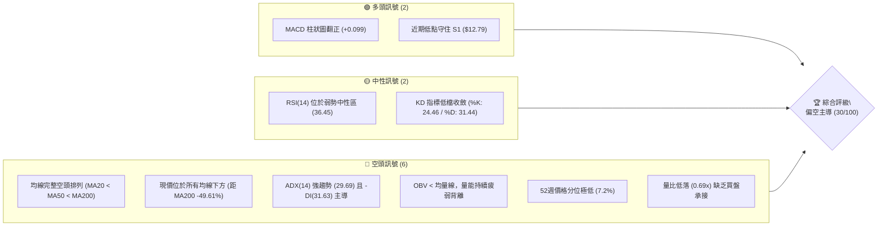
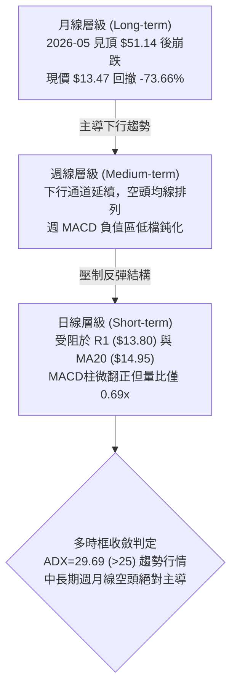
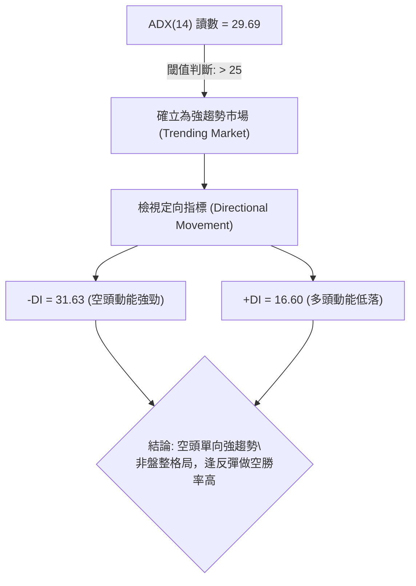
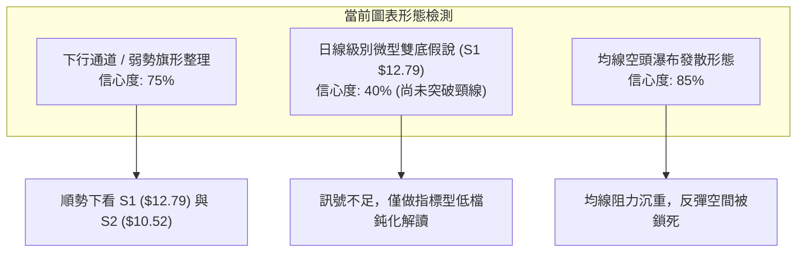
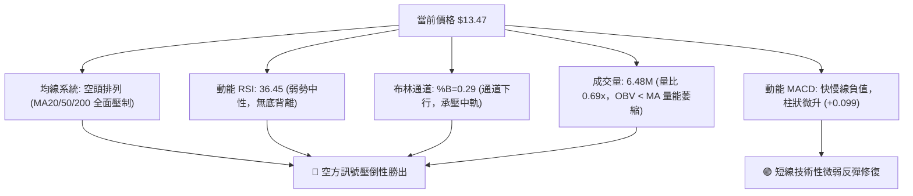
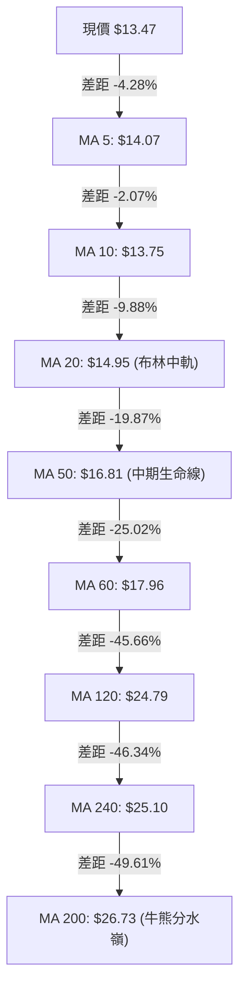
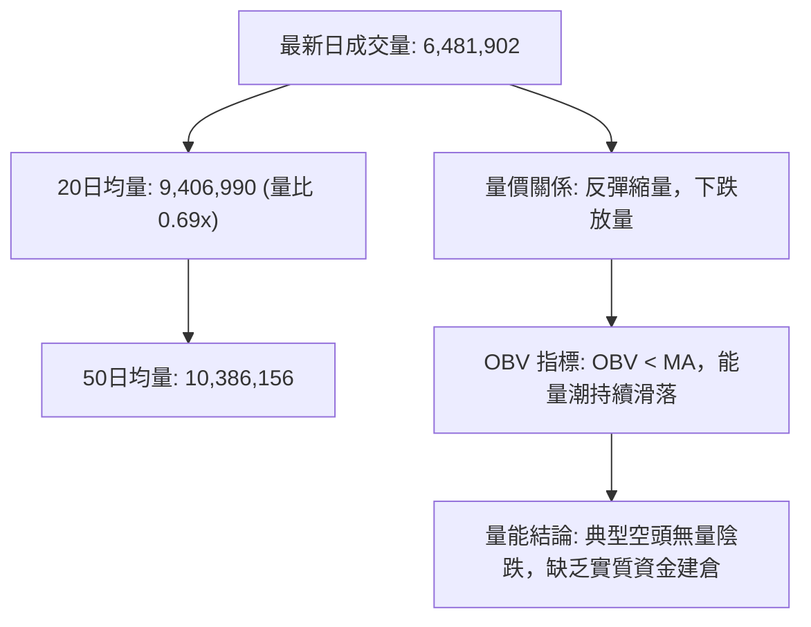
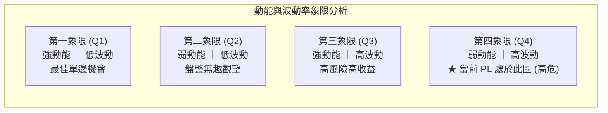
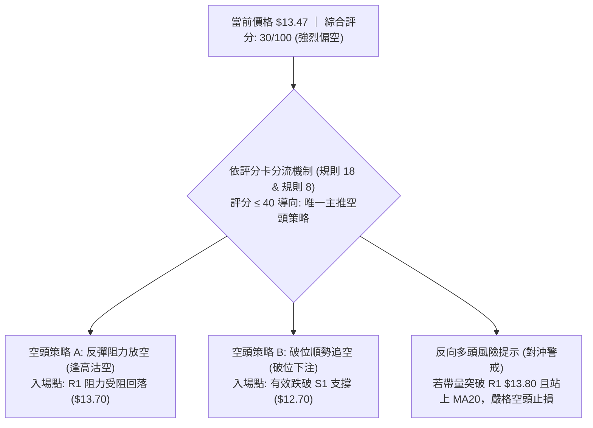
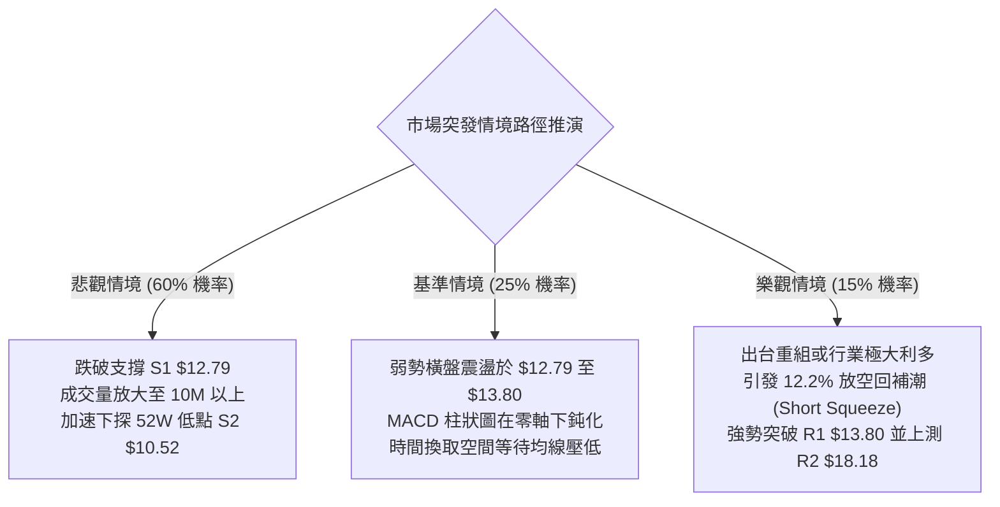

# PL 技術分析報告

> **報告日期**：2026-10-31 ｜ **語言**：繁體中文 ｜ **數據來源**：Yahoo Finance ｜ **當前價格**：$13.47 USD

---

## 目錄

| 章節 | 內容 |
|------|------|
| [1. 技術面概覽](#1-技術面概覽) | 訊號儀表板、核心指標、評分卡 |
| [2. 趨勢分析](#2-趨勢分析) | 多時框趨勢、長中短期走勢、ADX 解讀 |
| [3. 圖表形態分析](#3-圖表形態分析) | 形態識別、K線組合、目標價計算 |
| [4. 支撐與阻力](#4-支撐與阻力) | 關鍵價位分布、阻力與支撐表、斐波那契回調 |
| [5. 技術指標深度解讀](#5-技術指標深度解讀) | 均線系統、RSI、MACD、布林通道、成交量 |
| [6. 動能與波動率](#6-動能與波動率) | 動能四象限、ATR 波動率、Beta 市場相關性 |
| [7. 多時框架總結](#7-多時框架總結) | 時框架評分、綜合訊號矩陣、多時框收斂 |
| [8. 交易策略建議](#8-交易策略建議) | 策略路由、情境階梯、主策略詳情、風控點 |
| [9. 風險提示與監控](#9-風險提示與監控) | 監控清單、風險場景樹、倉位管理建議 |

---

## 1. 技術面概覽

### 🎯 技術訊號儀表板



### 📊 核心指標速覽表

| 指標類別 | 指標名稱 | 當前數值 | 訊號 | 解讀 |
|----------|----------|----------|:----:|------|
| **價格** | 當前收盤價 | $13.47 | 🔴 | 位於 52 週區間 7.2% 極弱勢分位，空頭絕對壓制 |
| **均線** | MA20 (月線) | $14.95 | 🔴 | 價格低於 MA20 達 -9.88%，短中期空頭防線 |
| **均線** | MA50 (季線) | $16.81 | 🔴 | 價格低於 MA50 達 -19.87%，中期趨勢持續向下 |
| **均線** | MA200 (年線) | $26.73 | 🔴 | 價格低於 MA200 達 -49.61%，長期結構嚴重受損 |
| **動能** | RSI(14) | 36.45 | 🟡 | 位於弱勢中性區（30–70），無背離，反彈動能衰竭 |
| **動能** | MACD (12,26,9) | -0.979 / -1.078 | 🟢 | 快線微幅上穿慢線，柱狀圖 +0.099，空頭低檔微弱反彈 |
| **波動** | ATR(14) | $0.91 | 🔴 | 日波動幅度達股價之 6.79%，高波動投機特徵明顯 |
| **趨勢強度**| ADX(14) / ±DI | 29.69 / -DI 31.63 | 🔴 | ADX > 25 確立強趨勢，-DI 大幅壓制 +DI (16.60)，空方主導 |
| **通道** | 布林通道 %B | 0.29 | 🔴 | 運行於中軌（$14.95）與下軌（$11.49）間偏低位置 |
| **成交量** | 量比 (vs 20MA) | 0.69x | 🔴 | 6.48M vs 9.41M，量能萎縮且 OBV < 均線，多頭未進場 |

### 🏆 技術評分卡

```
╔══════════════════════════════════════════════════════════════╗
║                 技術評分卡 — PL (2026-10-31)                 ║
╠══════════════════════════════════════════════════════════════╣
║ 趨勢強度 (Trend)      █████░░░░░░░░░░░░░░░  25/100   🔴 空方強趨勢  ║
║ 動能指標 (Momentum)   ███████░░░░░░░░░░░░░  35/100   🔴 動能偏弱    ║
║ 支撐穩定度 (Support)  ████████░░░░░░░░░░░░  40/100   🟡 S1測試中    ║
║ 成交量配合 (Volume)   ██████░░░░░░░░░░░░░░  30/100   🔴 量能渙散    ║
║ 形態完整度 (Pattern)  ███████░░░░░░░░░░░░░  35/100   🔴 破位下行    ║
║ 均線排列 (Moving Avg) ███░░░░░░░░░░░░░░░░░  15/100   🔴 空頭排列    ║
╠══════════════════════════════════════════════════════════════╣
║ 綜合評分 (Composite)  ██████░░░░░░░░░░░░░░  30/100   🔴 強烈偏空    ║
║ 評分規則：(25 + 35 + 40 + 30 + 35 + 15) ÷ 6 = 30.0 (四捨五入)         ║
╚══════════════════════════════════════════════════════════════╝
```

---

## 2. 趨勢分析

### 🌐 多時框趨勢分析



### 📈 長期趨勢 — 12個月走勢圖（Unicode）

```
PL 月線走勢圖（2025-11 至 2026-10）
價格軸 ($)
$55 ┤                                  ● $51.14 (2026-05 頂部)
$50 ┤                                 ╱ ╲
$45 ┤                                ╱   ╲
$40 ┤                          ●    ╱     ╲
$35 ┤                         ╱ ╲  ╱       ● $33.13 (2026-06)
$30 ┤                   ●    ╱   ╲╱         ╲
$25 ┤             ●    ╱ ╲  ╱                ╲
$20 ┤       ●    ╱ ╲  ╱   ●                   ● $20.48 ──● $19.85
$15 ┤ ●    ╱ ╲  ╱   ●                          ╲        ╲
$10 ┤  ╲  ╱   ●                                 ● $16.39 ╲
 $5 ┤   ●                                                  ● $13.47 ◄ 現價
    └─┬───┬───┬───┬───┬───┬───┬───┬───┬───┬───┬───┬─────────────
     11  12  01  02  03  04  05  06  07  08  09  10 (月份)
    [ 2025年主升浪段 ]   [ 頂部反轉 ]    [ 2026年崩跌與弱勢探底段 ]
```

#### 走勢特徵分析表格

| 階段區間 | 時間跨度 | 起始價 → 結束價 | 漲跌幅 | 價量特徵與市場心理 |
|----------|----------|-----------------|--------|--------------------|
| **主升攻擊段** | 2025-11 → 2026-05 | $11.90 → $51.14 | +329.75% | 月線級別爆發式推升，動能極度狂熱，創下 52 週高點 $51.76 |
| **頂部崩跌段** | 2026-05 → 2026-07 | $51.14 → $20.48 | -59.95% | 兩個月內腰斬，大量獲利盤與機構資金出逃，破壞中期支撐結構 |
| **階梯陰跌段** | 2026-07 → 2026-10 | $20.48 → $13.47 | -34.23% | 反彈高點不斷下移（Lower Highs），成交量萎縮，市場陷入流動性折價 |

### 📊 中期趨勢（週線分析）

從近 20 週收盤走勢觀察，PL 呈現標準的空頭階梯下行排列。2026 年 8 月中旬反彈至 $24.69 觸頂後，隨即展開新一輪下跌，一路跌破 $20.00 整數關卡，並於 10 月中旬長黑摜破 $16.00 支撐。

```
週線級別價格壓力與支撐結構示意圖
價格 ($)
$24.69 ─── 強阻力頂部 (2026-08-14)
           ╲
            ╲
$18.81 ─────── 波段高點阻力 R3 (2026-10-09 當週高點)
$18.18 ────────── 密集成交阻力 R2 (2026-09-25 當週高點)
                   ╲
$13.80 ────────────── 短線反彈頸線阻力 R1 (2026-10-23 當週高點 $14.09 壓制區)
$13.47 ══════════════════ [ 當前收盤價 ]
$12.79 ────────────────── 波段低點支撐 S1 (2026-10-23 低點)
                           ╲
$10.52 ────────────────────── 52週歷史低點強支撐 S2 (2026年絕對低點)
```

### ⚡ 趨勢強度評估（ADX 解讀）



#### ADX 趨勢強度對照表

| 指標變數 | 當前數值 | 參考門檻 | 當前技術含義 | 交易指引 |
|----------|----------|----------|--------------|----------|
| **ADX(14)** | 29.69 | > 25 (強趨勢) | 市場處於明確的單邊趨勢，排除無方向震盪 | 順勢交易，嚴禁逆勢猜底 |
| **+DI(14)** | 16.60 | < 20 (多頭衰弱) | 買盤力量極度匱乏，缺乏推升價格意願 | 不宜建立順勢多單 |
| **-DI(14)** | 31.63 | > 30 (空頭主導) | 賣方全面控制盤面，拋壓持續沉重 | 做空為主要盈利方向 |
| **DI 差值** | -15.03 | 負向擴大 | 空方動能領先多方近一倍，趨勢發散中 | 趨勢延續機率 > 65% |

---

## 3. 圖表形態分析

### 🔍 形態識別系統



#### 圖表形態信心度評估表（依規則 15）

| 形態名稱 | 信心度 | 判斷依據（引用數據） | 完成度 | 目標價（附精確計算式） |
|----------|:------:|----------------------|:------:|------------------------|
| **下降通道整理** | **75%** | 高點受阻於 R1 $13.80 與 MA20 $14.95，低點測試 S1 $12.79 | 80% | 依通道跌破測算：突破 S1 $12.79 後，向下直指 52W 低點 S2 **$10.52** |
| **雙底反轉雏形** | **40%** | 10/23 低點 $12.79 與 10/30 低點 $13.15 形成次低點 | 30% | 頸線為 R1 $13.80，形態高度 = $13.80 - $12.79 = $1.01；推算目標 = $13.80 + $1.01 = **$14.81**（尚未確認，信心度低於50%，僅供觀察） |
| **均線空頭排列形態** | **85%** | MA5 < MA10 < MA20 < MA50 < MA200 嚴格發散 | 95% | 空頭波段延伸目標為 52W 低點 S2 **$10.52** |

### 🕯️ 重要 K 線形態分析（依規則 19，嚴格取自原始數據）

#### 近 10 根日 K 線形態解讀

| 日期 | 開盤價 | 最高價 | 最低價 | 收盤價 | K線形態名稱 | 專業技術解讀 | 訊號 |
|:----:|:------:|:------:|:------:|:------:|:-----------:|--------------|:----:|
| **2026-10-19** | $13.85 | $13.90 | $13.37 | $13.59 | 帶下影陰線 | 開盤即受阻於 R1 $13.80 上方，收盤跌破開盤價，空方主導 | 🔴 |
| **2026-10-20** | $13.49 | $13.82 | $13.18 | $13.40 | 震盪小陰線 | 高點再次受制於 R1 $13.82，量能萎縮至 6.72M，買盤無力 | 🔴 |
| **2026-10-21** | $13.89 | $14.09 | $13.59 | $13.71 | 長上影十字星 | 向上衝刺 $14.09 遇 MA10/MA20 阻力大幅回落，上方賣壓沉重 | 🔴 |
| **2026-10-22** | $13.26 | $13.60 | $12.87 | $13.08 | 破位中陰線 | 跌破前低，創波段低點 $12.87，空方動能宣洩 | 🔴 |
| **2026-10-23** | $13.18 | $13.53 | $12.79 | $13.41 | **長下影錘頭線** | 盤中下探支撐 S1 $12.79 獲買盤抵抗，收長下影線，確立 S1 支撐 | 🟢 |
| **2026-10-26** | $13.30 | $13.99 | $13.26 | $13.76 | 下影紅實體K | 延續 S1 支撐反彈，收盤上漲，但高點仍卡在 $13.99 | 🟡 |
| **2026-10-27** | $13.95 | $14.77 | $13.84 | $14.49 | 衝高長上影大陽 | 多頭最強反擊，最高攻至 $14.77 逼近 MA20 ($14.95) 後承壓回落 | 🟡 |
| **2026-10-28** | $14.45 | $14.56 | $14.03 | $14.33 | 高檔受阻小陰 | 吞食前日漲幅，無法站穩 $14.50，高點降低 | 🔴 |
| **2026-10-29** | $13.96 | $14.60 | $13.96 | $14.31 | 平開十字星陰 | 盤中再次試探 $14.60 失敗，收盤低於開盤，動能衰竭 | 🔴 |
| **2026-10-30** | $13.54 | $14.02 | $13.15 | $13.47 | **反轉長黑流星線** | 跳空低開，高點觸及 R1 $13.80 區間後殺尾盤，完全抹平反彈 | 🔴 |

#### 近 8 根週 K 線形態解讀

| 週交易日 | 開盤價 | 最高價 | 最低價 | 收盤價 | 週K形態名稱 | 專業技術解讀 | 訊號 |
|:--------:|:------:|:------:|:------:|:------:|:-----------:|--------------|:----:|
| **2026-09-11** | $17.85 | $18.48 | $16.44 | $16.45 | 光腳長黑週K | 單週大跌，成交量 62.2M，下破短期均線防線 | 🔴 |
| **2026-09-18** | $16.10 | $17.27 | $15.60 | $16.42 | 低檔十字星 | 於 $15.60 尋求喘息，成交量降至 46.4M，多空僵持 | 🟡 |
| **2026-09-25** | $16.68 | $18.18 | $16.13 | $17.43 | 帶長上影中陽 | 向上反抽 R2 $18.18 阻力點，留下長上影線，解套賣壓沉重 | 🟡 |
| **2026-10-02** | $17.17 | $17.73 | $16.10 | $17.50 | 縮量小陽線 | 震盪徘徊於 $17.50，未能力度突破，成交量降至 52.1M | 🟡 |
| **2026-10-09** | $17.64 | $18.81 | $16.55 | $17.18 | **巨量長上影墓碑** | 衝刺 R3 $18.81 遭遇機構爆量拋售（59.8M），形態形成波段大頂 | 🔴 |
| **2026-10-16** | $17.00 | $17.03 | $13.33 | $13.56 | **破位斷頭鍘長黑** | 開盤即最高，單週暴跌逾 21%，跌破 $16 及 $14 支撐，確立崩跌 | 🔴 |
| **2026-10-23** | $13.85 | $14.09 | $12.79 | $13.41 | 探底長下影錘頭 | 探出波段新低 S1 $12.79 後獲得弱支撐，收斂跌幅 | 🟡 |
| **2026-10-30** | $13.30 | $14.77 | $13.15 | $13.47 | 衝高回落倒錘頭 | 反抽未能越過前週高點，量能驟降至 34.9M，顯示週線級別反彈乏力 | 🔴 |

### 📉 ASCII 走勢形態示意圖

```
PL 近期日K線形態結構圖 (2026-10-19 至 2026-10-30)
價格 ($)
$14.80 ┤                     ┌─┐ 10/27 高點 $14.77 (假突破)
$14.40 ┤                     │ │ ┌─┐ ┌─┐
$14.00 ┤ ┌─┐       ┌─┐       │ │ │ │ │ │ ┌─┐ 10/30 高點 $14.02 (受阻)
$13.80 ┼─┼─┼───┬───┼─┼───────┼─┼─┼─┼─┼─┼─┼─┼─ R1 關鍵阻力線 $13.80
$13.60 ┤ │ │   │   │ │       │ │ │ │ │ │ │ │
$13.40 ┤ │ │   │   │ │ ┌─┐   │ │ │ │ │ │ └┬┘ 10/30 收盤 $13.47 ◄ 現價
$13.20 ┤ │ │ ┌─┴─┐ │ │ │ │ ┌─┴─┐ └─┘ └─┘ └─┘  │
$13.00 ┤ └┬┘ │   │ └┬┘ │ │ │   │                │
$12.80 ┼──┼──┴───┴──┼──┴─┼─┼───┼────────────────┴─ S1 支撐底線 $12.79
       └──┴───────┴──┴───┴───┴─────────────────
         10/19   10/21   10/23   10/26   10/28   10/30
```

### 🎯 形態目標價計算

依據標準幾何技術形態測算規則，推導潛在突破後之精確路徑：
1. **下行破位路徑**：
   - 跌破 S1 頸線位：$12.79
   - 近期震盪箱頂（10/27 高點）：$14.77
   - 震盪箱體垂直高度：$14.77 - $12.79 = $1.98
   - 破位等幅下行目標價：$12.79 - $1.98 = **$10.81**（與數據庫中 52W 低點 S2 **$10.52** 形成強共振區間）
2. **弱勢反彈假說路徑（雙底雛形，信心度僅 40%）**：
   - 頸線位（R1）：$13.80
   - 形態底部低點（S1）：$12.79
   - 形態垂直高度：$13.80 - $12.79 = $1.01
   - 突破目標價：$13.80 + $1.01 = **$14.81**（受制於 MA20 $14.95 之強阻力）

---

## 4. 支撐與阻力

### 🗺️ 關鍵價位分布圖（Unicode）

```
PL 價位結構分布圖 (由 OHLCV 聚類計算)
══════════════════════════════════════════════════════════════════════
 $18.81 ║████████████████████████████████████████║ 強阻力 R3 (2026-10-09 波段頂部)
        ║                                        ║
 $18.18 ║██████████████████████████████          ║ 重大阻力 R2 (2026-09-25 高點聚類)
        ║                                        ║
 $14.95 ╟┈┈┈┈┈┈┈┈┈┈┈┈┈┈┈┈┈┈┈┈┈┈┈┈┈┈┈┈┈┈┈┈┈┈┈┈┈┈┈┈╢ 動態均線阻力 MA20 / 布林中軌
        ║                                        ║
 $13.80 ║████████████████████████████████████    ║ 關鍵短線阻力 R1 (波段反彈頸線)
════════╬════════════════════════════════════════╬═══════════════════════════
 $13.47 ╠════════════════════════════════════════╣ ◄ 當前收盤價 ($13.47)
════════╬════════════════════════════════════════╬═══════════════════════════
 $12.79 ║▓▓▓▓▓▓▓▓▓▓▓▓▓▓▓▓▓▓▓▓▓▓▓▓                ║ 近期關鍵支撐 S1 (2026-10-23 低點)
        ║                                        ║
 $11.49 ╟┈┈┈┈┈┈┈┈┈┈┈┈┈┈┈┈┈┈┈┈┈┈┈┈┈┈┈┈┈┈┈┈┈┈┈┈┈┈┈┈╢ 動態通道支撐 布林下軌
        ║                                        ║
 $10.52 ║████████████████████████████████████████║ 歷史強支撐 S2 (52週絕對最低價)
══════════════════════════════════════════════════════════════════════
```

### 🚧 阻力位分析表（嚴格引用系統聚類數據）

| 阻力級別 | 價位 | 形成技術依據 | 突破難度 | 重要性權重 |
|:--------:|:----:|--------------|:--------:|:----------:|
| **R1** | **$13.80** | 近一年波段高點聚類；10/19、10/20、10/30 多次日K受阻處 (+2.45%) | 中等 | 🔴 極高（短線多空分水嶺） |
| **R2** | **$18.18** | 2026-09-25 週K波段高點，斐波那契 78.6% 回調位 ($19.35) 之前哨防線 (+34.97%) | 極高 | 🔴 高（中期解套賣壓帶） |
| **R3** | **$18.81** | 2026-10-09 週K放量長上影大頂，波段空頭發動源頭 (+39.64%) | 極難 | 🔴 核心波段天花板 |

### 🛡️ 支撐位分析表（嚴格引用系統聚類數據）

| 支撐級別 | 價位 | 形成技術依據 | 守住機率 | 重要性權重 |
|:--------:|:----:|--------------|:--------:|:----------:|
| **S1** | **$12.79** | 2026-10-23 日K與週K波段低點，長下影線錘頭測試位 (-5.05%) | 45% | 🟡 高（短線最後防線） |
| **S2** | **$10.52** | 52 週最低價，一年以來長期價值與投機資金終極防守點 (-21.90%) | 60% | 🟢 終極核心支撐 |
| **S3** | *N/A* | *數據中未偵測到（系統無更低波段低點聚類數據）* | *N/A* | *N/A* |

### 📐 斐波那契回調位分析（基準：52週區間 $10.52 → $51.76）

```
斐波那契回調位結構分布
0.0%  (52W High) ─── $51.76 
                     │
23.6% ────────────── $42.03 
                     │
38.2% ────────────── $36.01 
                     │
50.0% ────────────── $31.14 
                     │
61.8% ────────────── $26.27 (黃金分割黃金防線，已於 2026-07 跌破)
                     │
78.6% ────────────── $19.35 (深度極限回撤位，已於 2026-09 跌破)
                     │ ◄ ─── 當前價格: $13.47 (運行於 78.6% 與 100.0% 之間)
100.0% (52W Low)  ── $10.52 
```

#### 斐波那契價位解讀表

| 回調比率 | 對應價位 | 與現價差距 (%) | 技術結構意義深度解讀 |
|:--------:|:--------:|:--------------:|----------------------|
| **0.0%** | $51.76 | +284.26% | 52 週最高點，2026 年 5 月極度擴張牛市之頂部 |
| **23.6%** | $42.03 | +212.03% | 第一道波段回撤位，早已被實體陰線無情貫穿 |
| **38.2%** | $36.01 | +167.33% | 經典回調位，失守後宣告多頭主升結構瓦解 |
| **50.0%** | $31.14 | +131.18% | 多空平衡中軸，2026 年 6 月大黑K正式確認失守 |
| **61.8%** | $26.27 | +95.03% | 黃金分割防守位，對應目前 MA200 ($26.73)，失守即進入深度熊市 |
| **78.6%** | $19.35 | +43.65% | 深度投機支撐線，9月破位後轉化為長線難以逾越之超級阻力 |
| **100.0%** | $10.52 | -21.90% | 52 週最低點 S2；當前回調深度達 **92.8%**，盤面正向 100% 回撤尋求支撐 |

---

## 5. 技術指標深度解讀

### 🎛️ 指標訊號總覽



### 📈 移動平均線排列分析



#### 均線數據明細矩陣

| 均線週期 | 當前價位 | 乖離率 (%) | 均線斜率狀態 | 短期技術意涵 |
|:--------:|:--------:|:----------:|:------------:|--------------|
| **MA 5** | $14.07 | -4.28% | 剛由平轉下彎 ▼ | 5日線重新下穿現價，短線反彈終結 |
| **MA 10** | $13.75 | -2.07% | 持平微跌 ▼ | 與現價糾結，壓制於 $13.75–$13.80 區間 |
| **MA 20** | $14.95 | -9.88% | 陡峭向下 ▼ | 月線下行斜率擴大，形成短線反彈天花板 |
| **MA 50** | $16.81 | -19.87% | 強烈下行 ▼ | 季線空頭主導，反彈至此區必遭強烈解套賣壓 |
| **MA 60** | $17.96 | -25.02% | 持續走低 ▼ | 壓制於 R2 ($18.18) 前緣 |
| **MA 120** | $24.79 | -45.66% | 下行發散 ▼ | 半年線空頭加速 |
| **MA 200** | $26.73 | -49.61% | 空頭發散 ▼ | 死亡交叉（Death Cross）後全面向下，熊市特徵確立 |

### 📉 RSI(14) 分析

```
RSI(14) 強度指針
0           30        50        70         100
├───────────┼─────────┼─────────┼──────────┤
[ 超賣區間 ]  ▲        [ 中性區 ] [ 超買區間 ]
           36.45
進度條: ███████████████░░░░░░░░░░░░░░░░ 36.45%
```
- **數值解讀**：當前 RSI(14) 讀數為 **36.45**，位於 30 至 50 之弱勢空頭控盤區，尚未進入 < 30 之極端超賣區。這意味著空方動能尚未完全耗盡，市場缺乏足夠的超賣修復吸引力。
- **背離檢驗**：對比近 20 根 K 棒走勢，10/23 低點 $12.79 與 10/30 低點 $13.15 相比，價格並未創出顯著新低，RSI 亦在 33–36 區間波動，**「無明顯背離」**。底背離條件不成立，不可盲目抄底。

### 📊 MACD(12,26,9) 訊號解讀


- **絕對數值**：DIF (-0.979) 向上穿越 DEA (-1.078)，產生微弱的低檔金叉，推動 MACD Histogram 柱狀圖由負轉正至 **+0.099**。
- **指標共振**：雖然 MACD 柱狀圖翻紅，但快慢線仍處於遠低於零軸的負值深淵（-0.979），這在技術分析中屬於典型的**「水下弱勢金叉」**。若無成交量配合突破零軸，極易隨即反轉為零軸下之二次死叉，加劇下行風險。

### 📦 布林通道分析

```
布林通道 (20, 2) 結構圖
價格 ($)
$18.41 ─────────────────────────────── 上軌 (Upper Band)
       │
       │
$14.95 ─────────── ─ ─ ─ ─ ─ ─ ─ ─ ─ ─ 中軌 (MA20)
       │           
$13.47 ═══════════════════════════════ 現價 ($13.47, %B = 0.29)
       │
$11.49 ─────────────────────────────── 下軌 (Lower Band)
```

- **通道參數**：上軌 **$18.41**，中軌 **$14.95**，下軌 **$11.49**。
- **通道指標 %B**：當前 %B 數值為 **0.29**（0 代表下軌，0.5 代表中軌，1 代表上軌），顯示價格深陷於弱勢下半區。
- **通道動態解讀**：布林通道上下軌持續向下開口發散。現價反彈在觸及中軌（$14.95）前即告折返，顯示通道動態壓制極其沉重。若現價跌破下軌 $11.49，將引發新一波布林帶開口擴張之拋售行情。

### 💹 成交量分析（量價配合度）



- **量比與均量**：最新成交量僅 **6,481,902 股**，對比 20 日均量（9,406,990 股）量比僅為 **0.69x**，對比 50 日均量（10,386,156 股）萎縮更為明顯。
- **量價背離現象**：在 10/26 至 10/28 的反彈過程中，日成交量僅徘徊在 6.4M–7.6M，相較 10/19 下跌時的 12.31M 縮減近半。**「上漲縮量、回落無承接」**，反映出機構買盤缺席，純屬散戶微弱博弈。
- **OBV 趨勢**：OBV 指標明確處於 OBV < MA 之空頭弱勢區，量能資金持續淨流出，無法佐證任何反轉預期。

---

## 6. 動能與波動率

### ⚡ 動能評估四象限



#### 動能與波動四象限對照表

| 象限 | 動能維度 | 波動維度 | PL 當前技術指標特徵 | 策略指引 |
|:----:|:--------:|:--------:|---------------------|----------|
| **Q1** | 強 (多頭) | 低 | 不符合 | 突破加碼 |
| **Q2** | 弱 | 低 | 不符合 | 觀望休假 |
| **Q3** | 強 (多頭) | 高 | 不符合 | 順勢追多 |
| **Q4** | **弱 (負向)** | **極高** | **✓ 符合：RSI 36.45、ADX 29.69 (-DI 主導)、ATR 6.79%、Beta 2.17** | **嚴格避險、只空不多** |

### 📊 ATR 波動率分析

- **ATR 絕對數值**：當前 ATR(14) 為 **$0.91**（採 Wilder 計算）。
- **相對股價佔比**：ATR / 現價 = $0.91 ÷ $13.47 = **6.79%**。這代表該股票在單一交易日內具備近 7% 的平均真實波動空間，屬於標準的高波動性投機標的。
- **止損距離動態建議**：
  - *超短線交易（1.0 × ATR）*：設定安全緩衝距離為 **$0.91**。
  - *波段交易（1.5 × ATR）*：設定安全緩衝距離為 **$1.37**（避免盤中正常雜訊掃單）。
  - *防守底線（2.0 × ATR）*：設定安全緩衝距離為 **$1.82**。

### 📐 Beta 與市場相關性

- **Beta 係數**：高達 **2.17**。此數值顯示 PL 的價格波動劇烈程度超過標普500大盤指數的兩倍以上。在大盤回檔時，PL 具備倍數下挫的下行 Beta 風險。
- **放空籌碼壓力**：目前放空比率（Short % Float）達 **12.2%**，空頭回補天數（Short Ratio）為 **3.42**。雖然 12.2% 具備潛在軋空題材，但在當前基本面虧損（Net Profit Margin -95.1%）與技術面空頭排列共振下，空頭並未出現被軋跡象，反而形成沉重的下壓動能。

---

## 7. 多時框架總結

### 📋 時框架評分表

| 時框架 | 趨勢方向 | 動能狀態 | 均線排列 | 圖表形態 | 綜合評分 | 戰略建議 |
|:------:|:--------:|:--------:|:--------:|:--------:|:--------:|:--------:|
| **日線 (Daily)** | 🔴 偏空 | 🟡 超跌反彈微弱 | 🔴 空頭排列 | 受阻流星線 | **35/100** | 反彈至 R1 遇阻放空 |
| **週線 (Weekly)** | 🔴 強烈看空 | 🔴 -DI 壓制/RSI弱 | 🔴 空頭發散 | 階梯式陰跌 | **25/100** | 逢高作空，下看前低 |
| **月線 (Monthly)** | 🔴 長期熊市 | 🔴 崩跌趨勢延續 | 🔴 均線死叉 | 頂部回撤破位 | **30/100** | 戰略性減倉與避險 |

### 🔲 綜合訊號矩陣

| 技術維度 | 短期（日線） | 中期（週線） | 長期（月線） | 跨時框一致性解讀 |
|----------|:------------:|:------------:|:------------:|------------------|
| **方向一致性** | 弱反彈受阻 (🔴) | 下行延續 (🔴) | 長線破位 (🔴) | **高度一致（空頭共振）** |
| **動能一致性** | MACD翻紅 (🟢) | MACD綠柱 (🔴) | 負動能擴張 (🔴) | **衝突，短動能服從中長趨勢** |
| **形態一致性** | 測試 S1 支撐 (🟡) | 跌破密集區 (🔴) | 90%深幅回撤 (🔴) | **中長期嚴重承壓，防守脆弱** |

### ⚖️ 多時框收斂結論（依規則 14 嚴格收斂）

1. **趨勢/盤整行情定性**：當前技術數據顯示 **ADX(14) = 29.69 (> 25)**，技術結構明確定性為**「強趨勢行情」**，而非區間震盪盤整行情。
2. **主導權重分配**：依收斂優先級規則，在強趨勢行情下，必須以**中長期（週線 / MA50 / MA200）方向為絕對主導**。日線級別出現的微幅底背離猜想或 MACD 柱狀圖微翻正（+0.099），僅為單邊下行趨勢中的「超跌技術性修正」，日線只能用來尋找進場反彈做空的點位，嚴禁據此逆勢做多。
3. **最終方向性唯一結論**：**強烈偏空（綜合評分 30/100）**。所有交易決策以**逢反彈放空**或**跌破追空**為主導戰略。

---

## 8. 交易策略建議

### 🗺️ 策略決策流程圖



### 🧭 策略路由（依評分卡分流，不得兩頭下注）

> 🚨 **當前主策略方向 = 【空頭主導策略】（依據技術評分卡：30 / 100，處於 ≤ 40 之強烈偏空區間）**  
> 依據嚴格規則，本報告全力主推空頭策略，多頭僅列為反轉風險觸發與空頭回補監控點。

---

### 🎯 價格情境階梯（Price Scenarios）

價位嚴格引用第 4 章聚類數據（R1: $13.80, R2: $18.18, R3: $18.81; S1: $12.79, S2: $10.52）：

| 觸發條件 | 下一目標價 | 後續延伸目標 | 情境技術含義 |
|----------|:----------:|:------------:|--------------|
| **向上突破 R1 $13.80** | **R2 $18.18** | **R3 $18.81** | 短線超跌反彈擴大，測試 MA50 阻力，空單必須止損出局 |
| **跌破現價，守住 S1** | **$13.00** | **S1 $12.79** | 空頭弱勢橫盤，消化微弱 MACD 翻紅動能，醞釀再破位 |
| **向下跌破 S1 $12.79** | **S2 $10.52** | *數據中未偵測到* | 中期結構二次破位，空方單邊主升，直探 52 週歷史新低 |

### 📊 情境機率分佈

| 情境劇本 | 預估機率 | 主要技術數據支撐依據 |
|----------|:--------:|----------------------|
| **向下破位 / 探底 (Bearish)** | **60%** | ADX 29.69 (-DI 31.63 壓倒 +DI)、均線完整空頭排列、量比萎縮 (0.69x) |
| **低檔弱勢震盪 (Consolidation)** | **25%** | MACD 柱狀圖微幅翻正 (+0.099)、日K線 S1 暫時提供微弱防守買盤 |
| **向上反轉 / 反彈 (Bullish)** | **15%** | Short Float 12.2% 潛在回補可能、RSI 位於低位（但無底背離確認） |

---

### 🟢 主策略詳情（空頭主導策略）

嚴格執行風險報酬比計算公式（規則 17）：  
做空時：$\text{風險報酬比} = (\text{進場價} - \text{目標價 T1}) \div (\text{止損價} - \text{進場價})$，以「1 : X.XX（以 T1 計）」格式呈現。

| 策略要素 | 策略 A（反彈受阻沽空 — 首選） | 策略 B（破位順勢追空 — 次選） |
|----------|--------------------------------|--------------------------------|
| **操作邏輯** | 股價弱勢反抽 R1 阻力不破，順勢做空 | 股價實體跌破 S1 關鍵防線，追空延伸走勢 |
| **進場條件** | 反彈至 $13.70 遇阻出現日K上影線 | 日K實體收盤跌破 S1 ($12.79) 之次日追進 |
| **進場價格** | **$13.70** | **$12.70** |
| **止損價格** | **$14.20**（突破 R1 $13.80 及 MA5 緩衝） | **$13.15**（回到破位點上方及 10/30 低點） |
| **目標價 T1** | **$12.79**（前期低點支撐 S1） | **$10.52**（52 週歷史低點 S2） |
| **目標價 T2** | **$10.52**（52 週歷史低點 S2） | *數據中未偵測到（下探歷史極值）* |
| **風險報酬比** | **1 : 1.82（以 T1 計）**<br/>計算式：(13.70 - 12.79) ÷ (14.20 - 13.70) = 0.91 ÷ 0.50 | **1 : 4.84（以 T1 計）**<br/>計算式：(12.70 - 10.52) ÷ (13.15 - 12.70) = 2.18 ÷ 0.45 |
| **成功機率** | **65%** | **60%** |
| **建議倉位** | **總資金之 10%–15%** | **總資金之 8%–10%** |

*附註：策略 A 若持倉至目標價 T2 ($10.52)，其風險報酬比高達 1 : 6.36（計算式：(13.70 - 10.52) ÷ (14.20 - 13.70) = 3.18 ÷ 0.50）。*

---

### 🔴 反向風險觸發點（對沖與止損提示）

非完整多頭操作建議，專供空頭持倉風控與對沖參考：
1. **多頭平盤警戒線**：若日 K 線以放量長紅收盤站上 **$13.80 (R1)**，空頭部位必須立即平倉 50%。
2. **結構逆轉否定線**：若價格進一步帶量突破 **$14.95 (MA20 / 布林中軌)**，空頭排列慣性被打破，所有空單必須無條件止損離場，嚴防空頭部位被快速逼空。

### ⭐ 整體訊號強度評星

```
╔══════════════════════════════════════════════════════════════╗
║                    整體技術訊號評星結果                      ║
╠══════════════════════════════════════════════════════════════╣
║ 做多訊號強度：★☆☆☆☆  (1/5 星 — 僅具備超跌技術指標微弱修復)║
║ 做空訊號強度：★★★★☆  (4/5 星 — 均線、ADX、通道、量能高度共振)║
║ 整體可信度：  ★★★★☆  (4/5 星 — 多時框指標一致指向空頭延續)║
╚══════════════════════════════════════════════════════════════╝
```

---

## 9. 風險提示與監控

### ✅ 關鍵監控指標 Checklist

```
╔══════════════════════════════════════════════════════════════╗
║                 PL 盤面動態關鍵監控清單 (Checklist)           ║
╠══════════════════════════════════════════════════════════════╣
║ [ ] 1. 關鍵價位攻防：現價 $13.47 是否向下跌破 S1 ($12.79)    ║
║ [ ] 2. 阻力有效性：盤中反彈是否持續受到 R1 ($13.80) 壓制     ║
║ [ ] 3. 趨勢強度指標：ADX(14) 是否持續維持於 25 以上高位      ║
║ [ ] 4. 空方動能指標：-DI (31.63) 是否持續大幅高於 +DI (16.60) ║
║ [ ] 5. 動能指標金叉：MACD 柱狀圖 (+0.099) 是否快速由紅翻黑   ║
║ [ ] 6. 成交量配合度：若下跌時成交量是否放大突破 20MA (9.4M)  ║
║ [ ] 7. 均線動態反壓：MA20 ($14.95) 之每日下移速度與壓制力道  ║
╚══════════════════════════════════════════════════════════════╝
```

### ⚠️ 風險場景分析



### 🛡️ 風險管理重要提醒

1. **高 Beta 槓桿殺傷風險**：PL 之 Beta 值高達 **2.17**，波動劇烈程度為一般權值股之兩倍以上，極易引發日內大幅滑點。單筆交易嚴禁滿倉，建議單一策略曝險部位嚴格控制在總投資組合資金的 **10% 以內**。
2. **ATR 波動保護設定**：每日 ATR 達 **$0.91 (6.79%)**，因此設置止損位時，必須給予至少 1.0 至 1.5 倍的 ATR 緩衝區間（約 $0.90–$1.35），切勿將止損設定在盤中隨機震盪區內，以防被無意義震盪洗出場。
3. **流動性陷阱預防**：當前成交量僅 6.48M，量比 0.69x，買盤深度明顯不足。在空頭行情中，若遭遇突發流動性萎縮，市價單可能遭遇嚴重的成交價差劣勢，建議所有出入場指令一律使用**限價單（Limit Order）**執行。

---

## 📋 報告總結

```
╔══════════════════════════════════════════════════════════════╗
║                     PL 技術分析報告總結                      ║
╠══════════════════════════════════════════════════════════════╣
║ 報告日期：2026-10-31                                         ║
║ 當前價格：$13.47 USD                                         ║
║ 技術評級：🔴 強烈偏空 (綜合評分: 30 / 100)                   ║
╠══════════════════════════════════════════════════════════════╣
║ 關鍵結論：                                                   ║
║ ├─ 長期趨勢：🔴 強烈看空 (自 $51.14 頂部崩跌，回撤達 92.8%)  ║
║ ├─ 中期趨勢：🔴 弱勢階梯陰跌 (受制於週線下行通道與均線群)    ║
║ ├─ 短期趨勢：🔴 反彈受阻 (日K長上影回落，受制於 R1 $13.80)   ║
║ ├─ 關鍵支撐：S1: $12.79  ｜  S2: $10.52 (52週最低價)        ║
║ ├─ 關鍵阻力：R1: $13.80  ｜  R2: $18.18  ｜  R3: $18.81      ║
║ └─ 均線排列：完整空頭排列 (MA20: $14.95 / MA200: $26.73)     ║
╠══════════════════════════════════════════════════════════════╣
║ 最優策略組合：                                               ║
║ 1. 🥇 最佳機會：策略 A (反彈受阻沽空)                         ║
║    進場: $13.70 ｜ 止損: $14.20 ｜ 目標T1: $12.79 ｜ 風報比 1:1.82║
║ 2. 🥈 次選機會：策略 B (破位順勢追空)                         ║
║    進場: $12.70 ｜ 止損: $13.15 ｜ 目標T1: $10.52 ｜ 風報比 1:4.84║
║ 3. 🥉 避險警示：嚴禁盲目抄底多單，多頭止損嚴守 $13.80        ║
╚══════════════════════════════════════════════════════════════╝
```

---

> ⚠️ **免責聲明**：本報告為依據定量技術數據產出之專業技術研究，報告內所有支撐阻力位、均線數值與指標信號均基於歷史交易資訊推算。本報告**僅供學術研究與交易架構參考**，**不構成任何要約、招攬或具體投資建議**。市場具有高度不確定性，交易高波動性標的請嚴格執行風控紀律與倉位控制。

---
*報告生成時間：2026-10-31 ｜ 數據來源：Yahoo Finance ｜ 分析框架：多時框技術分析模型*