# PL 技術分析報告

> **報告日期**：2026-11-01 ｜ **語言**：繁體中文 ｜ **數據來源**：Yahoo Finance ｜ **當前價格**：$13.47

---

## 目錄

| 章節 | 內容 |
|------|------|
| [1. 技術面概覽](#1-技術面概覽) | 訊號儀表板、核心指標、評分卡 |
| [2. 趨勢分析](#2-趨勢分析) | 多時框趨勢、長中短期走勢 |
| [3. 圖表形態分析](#3-圖表形態分析) | 形態識別、K線組合、目標價 |
| [4. 支撐與阻力](#4-支撐與阻力) | 關鍵價位、斐波那契回調 |
| [5. 技術指標深度解讀](#5-技術指標深度解讀) | MA/RSI/MACD/布林/成交量 |
| [6. 動能與波動率](#6-動能與波動率) | 動能評估、ATR、Beta |
| [7. 多時框架總結](#7-多時框架總結) | 時框架評分矩陣 |
| [8. 交易策略建議](#8-交易策略建議) | 多空策略、風險報酬比 |
| [9. 風險提示與監控](#9-風險提示與監控) | 監控指標、風險場景 |

---

## 1. 技術面概覽

### 🎯 技術訊號儀表板

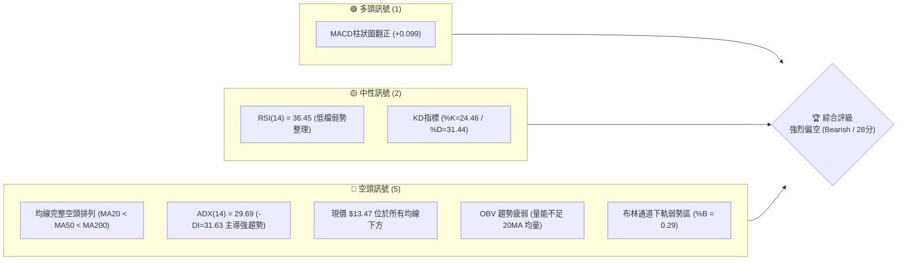

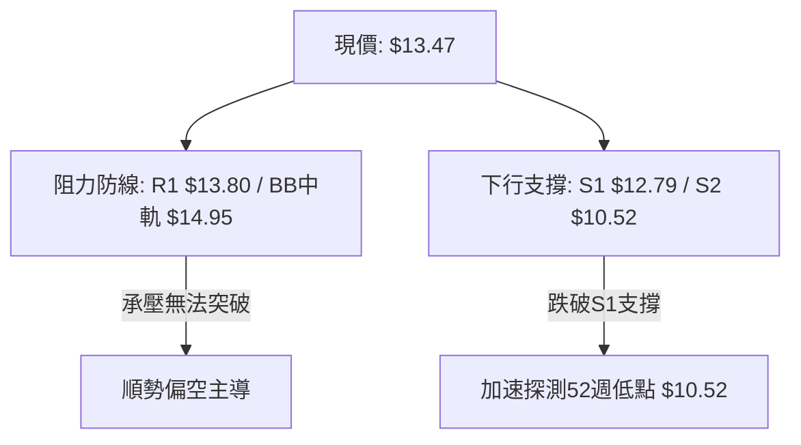

### 📊 核心指標速覽表

| 指標類別 | 指標名稱 | 當前數值 | 訊號 | 解讀 |
|:---|:---|:---|:---:|:---|
| **價格** | 當前價格 | $13.47 | 🔴 | 位於 52 週區間 7.2% 極低分位，逼近歷史底部 |
| **均線** | MA20 | $14.95 | 🔴 | 價格低於 MA20 達 -9.88%，短中期空頭主導 |
| **均線** | MA50 | $16.81 | 🔴 | 價格低於 MA50，中期下行趨勢顯著 |
| **均線** | MA200 | $26.73 | 🔴 | 價格低於 MA200 達 -49.61%，長期結構嚴重受損 |
| **動能** | RSI(14) | 36.45 | 🟡 | 位於弱勢區間（30–40），尚未進入極端超賣 |
| **動能** | MACD | -0.979 / +0.099 | 🟢 | 快慢線處零軸下方深處，但柱狀圖微幅翻正，呈現弱反彈 |
| **趨勢強度** | ADX(14) | 29.69 | 🔴 | 數值 > 25 確立趨勢行情，-DI (31.63) 遠大於 +DI (16.60) |
| **通道狀態** | 布林通道 | %B = 0.29 | 🔴 | 位於中軌 ($14.95) 與下軌 ($11.49) 間，走勢沉重 |
| **波動** | ATR(14) | $0.91 | 🔴 | 佔股價 6.79%，屬於高日線波動標的 |
| **量能** | 成交量比 | 0.70x | 🔴 | 當日量 6.55M 低於 20 日均量 9.41M，反彈動能匱乏 |

### 🏆 技術評分卡

```
╔══════════════════════════════════════════════════════════════════╗
║                   技術評分卡 — PL (2026-11-01)                   ║
╠══════════════════════════════════════════════════════════════════╣
║  趨勢強度      ████░░░░░░░░░░░░░░░░  20/100  🔴 空頭主導強趨勢   ║
║  動能指標      ████████░░░░░░░░░░░░  38/100  🟡 弱勢整理微反彈   ║
║  支撐穩定度    ███████░░░░░░░░░░░░░  35/100  🔴 逼近邊緣測試S1   ║
║  成交量配合    ██████░░░░░░░░░░░░░░  32/100  🔴 量縮量價背離     ║
║  形態完整度    ██████░░░░░░░░░░░░░░  30/100  🔴 空頭下行旗形     ║
║  均線排列      ███░░░░░░░░░░░░░░░░░  15/100  🔴 標準空頭排列     ║
╠══════════════════════════════════════════════════════════════════╣
║  綜合評分      ██████░░░░░░░░░░░░░░  28/100  評級：強烈偏空      ║
╚══════════════════════════════════════════════════════════════════╝
```
*(註：綜合評分由六項子指標算術平均計算：(20 + 38 + 35 + 32 + 30 + 15) ÷ 6 = 28.33，四捨五入取整為 28/100，評級屬顯著偏空)*

---

## 2. 趨勢分析

### 🌐 多時框趨勢分析

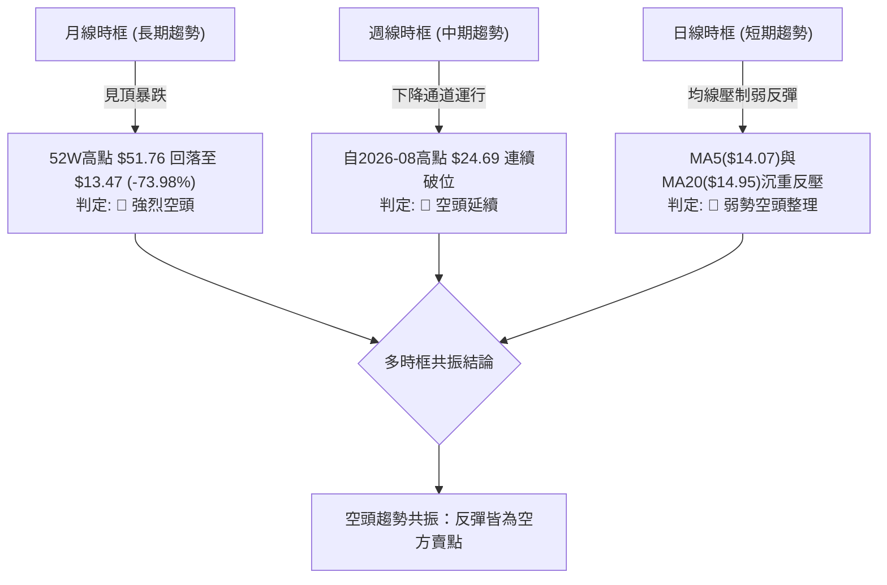

### 📈 長期趨勢 — 12個月走勢圖（Unicode）

```
PL 月線走勢圖（過去12個月：2025-11 至 2026-10）
價格軸 ($)
$52 ┤                                  ● $51.14 (2026-05 歷史高點附近)
$48 ┤                                 / \
$44 ┤                                /   \
$40 ┤                               /     \
$36 ┤                         ● $36.97     \
$32 ┤                        /              ● $33.13
$28 ┤                 ● $27.95               \
$24 ┤          ● $24.97                       \
$20 ┤   ● $19.72                               ● $20.48 ──● $19.85
$16 ┤                                                    \
$12 ┤● $11.90                                             ● $16.39
$08 ┤                                                              \
$04 ┤                                                               ● $13.47 ← 現價
    └─────────────────────────────────────────────────────────────────
       11    12    01    02    03    04    05    06    07    08    09    10 (月份)
      (2025)                      (2026)
```

#### 走勢特徵分析表格

| 階段區間 | 起止價格 | 漲跌幅 | 成交與形態特徵 | 趨勢性質 |
|:---|:---|:---:|:---|:---:|
| **2025-11 ~ 2026-01** | $11.90 → $24.97 | +109.8% | 放量主升浪起點，突破多重均線密集區 | 多頭主升 |
| **2026-02 ~ 2026-05** | $24.14 → $51.14 | +111.8% | 瘋狂主升段，於 2026-05 觸及 52W 最高點 $51.76 | 投機見頂 |
| **2026-06 ~ 2026-08** | $51.14 → $19.85 | -61.19% | 頂部雪崩式下殺，多頭停損賣壓湧現，週成交量暴增至近億股 | 空頭主跌 |
| **2026-09 ~ 2026-10** | $19.85 → $13.47 | -32.14% | 陰跌築底失敗，連續破位，逼近 52 週最低點 $10.52 | 尋底熊市 |

### 📊 中期趨勢（週線分析）

中期走勢呈現「階梯式下跌」結構。近 20 週收盤走勢顯示，自 2026-08-14 創出反彈次高點 $24.69 以來，連續跌破 $20 整數關卡，並於 10 月中旬擊穿 $16.42 關鍵頸線平台。

```
中期壓力與支撐階梯圖：
$24.69 ══════════════════════════════ [中期次高反彈頂]
           \
$18.81 ─────\──────────────────────── [關鍵高點聚類 R3]
             \
$18.18 ───────\────────────────────── [波段反彈阻力 R2]
               \
$13.80 ─────────\──────────────────── [短線反彈壓制 R1]
                 ● $13.47 (現價)
$12.79 ────────────────────────────── [近一年波段低點 S1]
$10.52 ══════════════════════════════ [52週歷史底部強支撐 S2]
```

### ⚡ 趨勢強度評估（ADX 解讀）

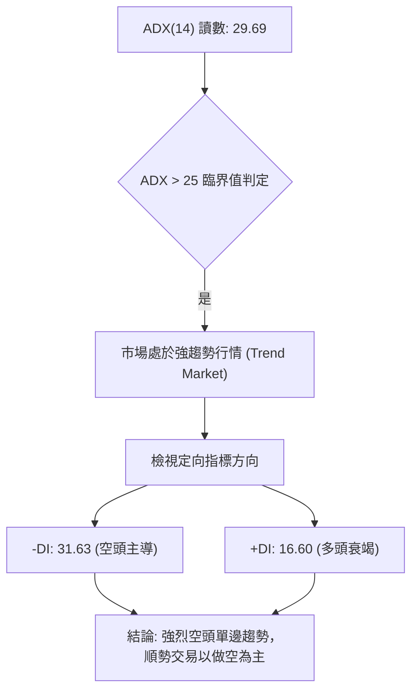

#### ADX 強度與市場狀態對照

| 指標變數 | 當前讀數 | 標準閾值區間 | 趨勢判定 | 操作指引 |
|:---|:---:|:---:|:---|:---|
| **ADX(14)** | **29.69** | > 25 為強趨勢；> 40 為極端趨勢 | 🔴 明確單邊下行趨勢 | 嚴禁逆勢摸底，順應中長期趨勢操作 |
| **-DI** | **31.63** | > 25 代表空頭動能強勁 | 🔴 空方力量佔據絕對優勢 | 賣壓強大，多頭反彈無力 |
| **+DI** | **16.60** | < 20 代表多方完全失去動能 | 🔴 多方完全缺乏進攻意志 | 買盤萎縮，缺乏承接盤 |
| **DI 差值** | **-15.03** | 負值擴大表示空頭動能加速 | 🔴 空頭拋壓擴散 | 趨勢向下發散中 |

---

## 3. 圖表形態分析

### 🔍 形態識別系統

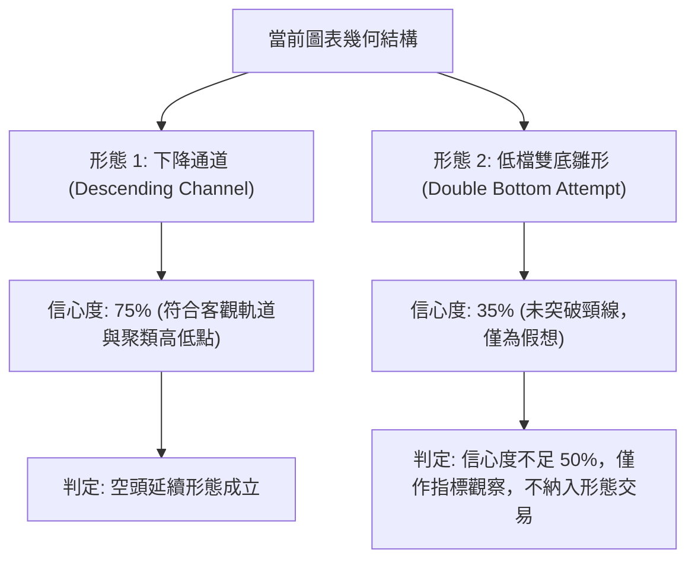

#### 形態識別信心度與目標價計算表

| 形態名稱 | 信心度 | 判斷依據（引用數據） | 完成度 | 目標價（附嚴謹計算式） |
|:---|:---:|:---|:---:|:---|
| **下降通道 (Descending Channel)** | **75%** | 高點聚類持續下移：R3 ($18.81) → R2 ($18.18) → R1 ($13.80)；低點下移：$15.60 → $13.33 → S1 ($12.79) | 85% | 跌破下軌 S1 ($12.79) 後，推算目標價為 S2 **$10.52** |
| **低檔雙底雛形 (Double Bottom)** | **35%** | 兩次低點回測 2026-10-23 低點 $12.79 與前低，但均線與量能全無配合 | 20% | *訊號不足，信心度低於50%，僅做指標型解讀，不預設多頭目標價* |

### 🕯️ 重要 K 線形態分析

嚴格依據提供的「近 10 根日 K」與「近 8 根週 K」實際數據展開 K 線語言解讀：

| 日期（週期） | 開盤價 | 最高價 | 最低價 | 收盤價 | K線形態名稱 | 技術解讀 | 訊號方向 |
|:---|:---:|:---:|:---:|:---:|:---|:---|:---:|
| **2026-10-16 (週K)** | $17.00 | $17.03 | $13.33 | $13.56 | **長黑破位大陰線** | 週跌幅巨大，直接擊穿 $16 平台支撐，奠定中期破位格局 | 🔴 極空 |
| **2026-10-23 (週K)** | $13.85 | $14.09 | $12.79 | $13.41 | **長下影線紡錘線** | 測試 S1 ($12.79) 獲得短暫支撐，空頭回補，但實體沉重 | 🟡 止跌警訊 |
| **2026-10-30 (週K)** | $13.30 | $14.77 | $13.15 | $13.47 | **長上影倒轉錘頭/墓碑星** | 上衝 R1 ($13.80) 及 MA20 遭空頭強烈阻擊，衝高回落套牢盤重 | 🔴 承壓見頂 |
| **2026-10-22 (日K)** | $13.26 | $13.60 | $12.87 | $13.08 | **破位中陰線** | 實體下挫，創出波段收盤新低，賣壓持續釋放 | 🔴 偏空 |
| **2026-10-23 (日K)** | $13.18 | $13.53 | $12.79 | $13.41 | **低檔錘頭線 (Hammer)** | 最低探至 S1 ($12.79) 觸發技術反彈，收盤接近最高點 | 🟢 短線反彈 |
| **2026-10-27 (日K)** | $13.95 | $14.77 | $13.84 | $14.49 | **帶量長陽線** | 突破短期 MA10，觸及波段高點 $14.77，但受壓於 MA20 ($14.95) | 🟢 多頭抵抗 |
| **2026-10-28 (日K)** | $14.45 | $14.56 | $14.03 | $14.33 | **高檔假陰星線** | 漲勢停滯，多頭動能無法持續擴大 | 🟡 動能衰減 |
| **2026-10-29 (日K)** | $13.96 | $14.60 | $13.96 | $14.31 | **上下影小實體線** | 呈現多空猶豫，上影線顯示 $14.60 以上拋壓沉重 | 🟡 多空僵持 |
| **2026-10-30 (日K)** | $13.54 | $14.02 | $13.15 | $13.47 | **低開破位實體黑K** | 跌破 MA5 ($14.07)，回吐前三日漲幅，反彈宣告終結 | 🔴 空方重奪主導 |

### 📉 ASCII 走勢形態示意圖

```
PL 日線近期走勢形態示意（下降旗形跌破與受阻回落）
$14.80 ┤              ● 10/27 高點 $14.77 (受制於 MA20 $14.95)
       │             / \
$14.40 ┤            /   ● 10/28 $14.33
       │           /     \
$14.00 ┤          /       ● 10/29 $14.31
       │         ● 10/26   \
$13.60 ┤        /           ● 10/30 收盤 $13.47 (跌回通道中軸)
       │  ● 10/21            \
$13.20 ┤   \                  \
       │    ● 10/22            ● 10/20 $13.40
$12.80 ┤     \
       │      ● 10/23 探底 S1 $12.79
       └──────────────────────────────────────────────────
```

### 🎯 形態目標價計算

依據標準幾何形態與關鍵價位聚類原則：
1. **反彈受阻高點**：2026-10-27 日線高點 $14.77 受阻於 MA20 ($14.95) 與阻力帶下方。
2. **形態高度**：$14.77 − S1 ($12.79) = $1.98。
3. **下行破位投射目標價**：若跌破 S1 ($12.79)，等幅下行測算價為 $12.79 − $1.98 = $10.81，此價位與關鍵價位區塊計算出的波段強支撐 **S2 ($10.52)** 高度重疊收斂。因此確認下行第一形態目標價為 **S1 ($12.79)**，破位目標價為 **S2 ($10.52)**。

---

## 4. 支撐與阻力

### 🗺️ 關鍵價位分布圖（Unicode）

```
PL 價位結構分布圖
══════════════════════════════════════════════════════════════════
$18.81 ║████████████████████████████████████████║ 強阻力 R3 (波段高點聚類)
$18.18 ║██████████████████████████████          ║ 阻力 R2 (反彈高點聚類)
$14.95 ║▓▓▓▓▓▓▓▓▓▓▓▓▓▓▓▓▓▓                      ║ 動態阻力 (MA20 / 布林中軌)
$13.80 ║████████████████████                    ║ 關鍵阻力 R1 (近期壓制線)
───────╫────────────────────────────────────────╫───────────────────────────
$13.47 ╠════════════════════════════════════════╣ ◄ 現價 (收盤價)
───────╫────────────────────────────────────────╫───────────────────────────
$12.79 ║▓▓▓▓▓▓▓▓▓▓▓▓▓▓▓▓                        ║ 近期支撐 S1 (近一年波段低點)
$10.52 ║████████████████████████████████████████║ 強支撐 S2 (52週極限低點)
══════════════════════════════════════════════════════════════════
```

### 🚧 阻力位分析表

*(註：阻力價位完全依據數據「關鍵價位」區塊波段高點聚類所計算)*

| 阻力級別 | 價位 | 與現價距離 | 形成原因與技術意義 | 突破難度 | 重要性 |
|:---|:---:|:---:|:---|:---:|:---:|
| **R1** | **$13.80** | +2.45% | 近期日 K 線密集反壓區，多根日 K（如 10/20、10/21）收盤壓制位 | 🟡 中等 | ★★★★☆ |
| **R2** | **$18.18** | +34.97% | 2026 年 9 月下旬反彈波段頂點（09-25 週 K 高點），中期結構轉折點 | 🔴 極高 | ★★★★★ |
| **R3** | **$18.81** | +39.64% | 2026-10-09 週 K 衝高受阻點，為下行波段主要聚類強阻力帶頂部 | 🔴 極高 | ★★★★☆ |

### 🛡️ 支撐位分析表

*(註：支撐價位完全依據數據「關鍵價位」區塊波段低點聚類所計算)*

| 支撐級別 | 價位 | 與現價距離 | 形成原因與技術意義 | 守住機率 | 重要性 |
|:---|:---:|:---:|:---|:---:|:---:|
| **S1** | **$12.79** | -5.05% | 2026-10-23 創出的近一年波段最低點，近期多頭防禦的最後咽喉 | 🔴 35% | ★★★★★ |
| **S2** | **$10.52** | -21.90% | 52 週最低點（歷史極限低點），斐波那契 100.0% 回調位 | 🟢 65% | ★★★★★ |
| **S3** | **N/A** | N/A | *數據中未偵測到*（依數據紀律不自行編造） | N/A | N/A |

### 📐 斐波那契回調位分析

依據 52 週完整波動區間（低點 $10.52 → 高點 $51.76，總波幅 $41.24）計算之斐波那契水平位：

```
斐波那契回調結構層級圖：
 0.0% (52W High) ─── $51.76 ════════════════════════════════════════
23.6% 回調位     ─── $42.03 ────────────────────────────────────
38.2% 回調位     ─── $36.01 ────────────────────────────────────
50.0% 回調位     ─── $31.14 ────────────────────────────────────
61.8% 黃金分割位 ─── $26.27 ──────────────────────────────────── (MA200 $26.73 匯聚處)
78.6% 極限回調位 ─── $19.35 ──────────────────────────────────── (R2/R3 下方關鍵水位)
────────────────────────────────────────────────────────────────
                    現價 $13.47 (深處 78.6% 與 100.0% 之間，弱勢空頭深淵)
────────────────────────────────────────────────────────────────
100.0% (52W Low) ─── $10.52 ════════════════════════════════════════
```

#### 斐波那契結構深度解讀
- **現價位置定位**：現價 $13.47 深跌於 78.6% 回調位 ($19.35) 之下，位於 78.6% 至 100.0% 的極端下沉區間。在技術分析理論中，跌破 78.6% 意味著先前的整輪牛市上漲結構已徹底崩解，高機率向 100% 回調位（即 52 週低點 **$10.52**）全面尋求回測。
- **上方阻力共振**：黃金分割 61.8% 位置 ($26.27) 恰好與 MA200 ($26.73) 高度重疊，構成長期牛熊分水嶺；而 78.6% 位置 ($19.35) 則與關鍵阻力 R3 ($18.81) 形成強大反壓共振區。

---

## 5. 技術指標深度解讀

### 🎛️ 指標訊號總覽

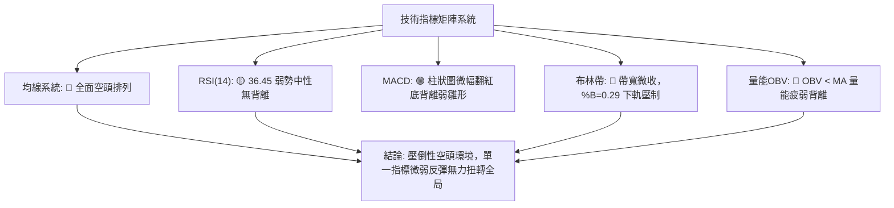

### 📈 移動平均線排列分析

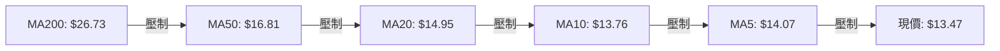

#### 移動平均線系統數據

| 週期均線 | 當前價格 | 與現價乖離率 | 短期走向趨勢 | 均線角色與信號 |
|:---|:---:|:---:|:---|:---:|
| **MA 5** | $14.07 | -4.28% | 剛由升轉跌，下穿現價 | 短線第一道動態壓制 🔴 |
| **MA 10** | $13.76 | -2.07% | 持平微跌 | 弱勢反彈生命線 🔴 |
| **MA 20** | $14.95 | -9.88% | 持續向下傾斜發散 | 月度多空分水嶺，布林中軌 🔴 |
| **MA 50** | $16.81 | -19.87% | 陡峭向下傾斜 | 季度下行防護罩 🔴 |
| **MA 60** | $17.96 | -25.02% | 穩定下行 | 中期均線反壓 🔴 |
| **MA 120** | $24.79 | -45.66% | 大角度向下滑落 | 半年線沉重套牢盤 🔴 |
| **MA 200** | $26.73 | -49.61% | 長期下行趨勢成型 | 年線牛熊分水嶺 🔴 |
| **MA 240** | $25.10 | -46.34% | 走平後開始轉折向下 | 超長期壓制 🔴 |

**均線排列研判**：當前呈現極其標準的「空頭發散排列」（Price < MA5 < MA10 < MA20 < MA50 < MA60 < MA120 < MA200），所有週期均線全數呈現負斜率下行，且現價距離 MA200 負乖離接近 -50%，表明市場處於長期深熊格局，短期任何衝高觸及均線均為機構與主力逢高減碼之賣點。

### 📉 RSI(14) 分析

- **當前數值**：**36.45** (Wilder 平滑法計算)
- **數值進度條**：
  `0 ░░░░░░░░░░░░░░░░ [████████████░░░░░░░░░░░░░░░░░░░░] 36.45 ░░░░░░░░░░░░░░░░ 100`
- **超買超賣判定**：數值介於 30 至 70 之中性偏弱區間。雖然處於 40 以下弱勢區，但並未跌破 30 達到極端「超賣（Oversold）」，意味著短期內不具備技術性「超賣恐慌底」之強制反彈條件，下行空間依然存在。
- **背離分析判斷**：數據明確標示「無明顯背離（近20根K棒首尾價格與RSI方向一致向下）」。日線價格在 10/23 創波段低點 $12.79 時，RSI 亦同步下行，未出現價格破底而指標抬高的「底背離」特徵，因此排除了多頭動能背離抄底的可能性。

### 📊 MACD(12/26/9) 訊號解讀

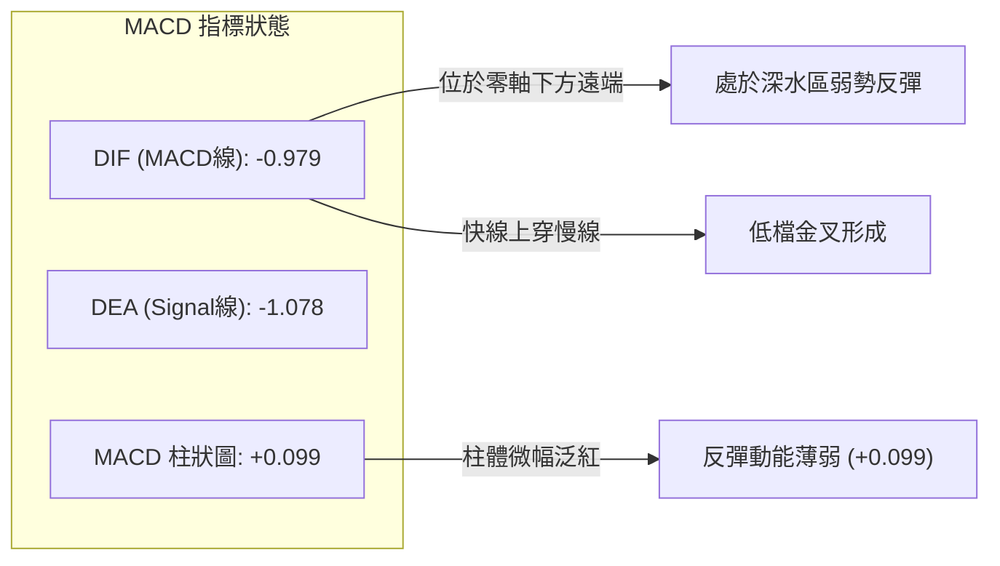

- **快慢線位置**：MACD 線 (-0.979) 與訊號線 (-1.078) 雙雙深陷於零軸下方極遠處，表明長期空頭動量依然籠罩全場。
- **微弱金叉動態**：儘管 MACD 快線微幅上穿訊號線，柱狀圖（Histogram）由負翻正至 **+0.099**，釋放出 🟢 看多信號，但由於零軸下方之金叉屬於典型的「零下弱金叉」，通常僅對應 3–5 天的弱勢橫盤或抵抗性抽腳，在缺乏量能配合下極易形成「金叉即誘多，隨後二次死叉向下加速」的熊市陷阱。

### 📦 布林通道分析

```
PL 布林通道結構示意圖（日線）
$18.41 ─────────────────────────────── 上軌 (Upper Band)
       │
$16.00 ┤
       │
$14.95 ─────────────────────────────── 中軌 (MA20) ── 空方強力防線
       │
$13.47 ┤      ● 現價 ($13.47, %B = 0.29)
       │
$11.49 ─────────────────────────────── 下軌 (Lower Band)
```

- **布林帶寬與極限位置**：
  - **上軌**：$18.41
  - **中軌 (MA20)**：$14.95
  - **下軌**：$11.49
- **%B 指標解讀**：當前 %B 讀數為 **0.29**（0 代表下軌，0.5 代表中軌，1 代表上軌）。現價位於 0.29 顯示股價顯著受壓於布林中軌下方，運行於弱勢下行通道內。
- **通道軌道演變**：近期通道並未呈現劇烈擴張，而是處於中度收斂後的下傾走勢，這表明市場缺乏充沛的多頭承接意願，股價緊貼下軌緩慢陰跌，一旦空頭再度發力擊穿下軌支撐，恐引發通道開口向下放大之單邊跌勢。

### 💹 成交量分析（量價配合度）

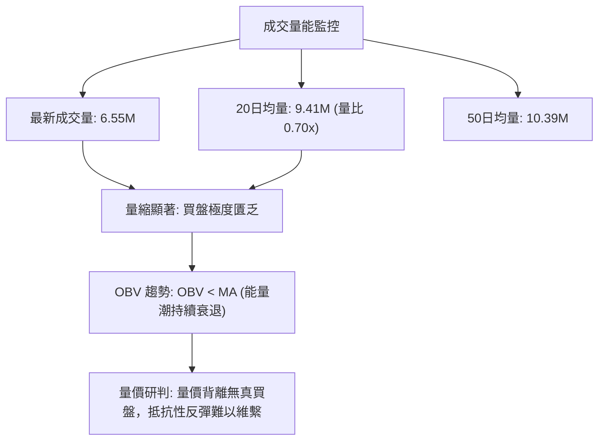

- **量比萎縮**：最新成交量僅為 6,554,100 股，相較於 20 日均量（9,410,600 股）量比僅為 **0.70x**；較 50 日均量萎縮超過 36.9%。
- **OBV 能量潮狀態**：OBV < MA 指示資金整體呈現淨流出狀態。在上週五（10/30）小幅回落時，雖然成交量沒有爆出恐慌拋壓，但關鍵在於「反彈無量、下跌有量」的特徵極為明顯（例如 10/19 大跌成交量達 12.31M，而 10/27 上漲成交量僅 6.49M）。量價背離印證了上攻缺乏機構買盤背書，僅散戶零星博弈。

---

## 6. 動能與波動率

### ⚡ 動能評估四象限

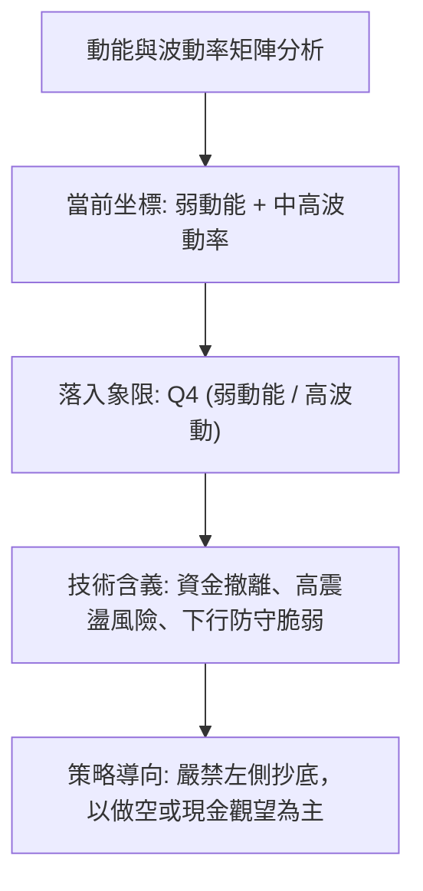

#### 動能評估四象限矩陣表

| 象限 | 動能強度 | 波動率水準 | 當前狀態標記 | 技術評估與操作導向 |
|:---:|:---:|:---:|:---:|:---|
| **Q1** | 強動能 (Bullish) | 低波動 (Low Vol) | ─ | 穩定慢牛，最佳趨勢持倉區 |
| **Q2** | 弱動能 (Bearish) | 低波動 (Low Vol) | ─ | 縮量盤整，謹慎觀望等待方向確認 |
| **Q3** | 強動能 (Bullish) | 高波動 (High Vol) | ─ | 突破爆發期，高風險高回報 |
| **Q4** | **弱動能 (Bearish)** | **中高波動 (High Vol)** | **✓ (當前PL所處位置)** | **高風險深淵，空頭拋壓主導，極易出現破位長黑，避免盲目做多** |

### 📊 ATR 波動率分析

- **ATR(14) 當前數值**：**$0.91**（基於 Wilder 平滑法計算）
- **股價波動佔比**：$0.91 ÷ $13.47 = **6.79%**。
- **波動率特性解讀**：每日平均波動區間接近 7%，代表 PL 屬於高波動性、高尾部風險標的。此等波動幅度意味著盤中震盪劇烈，若未設置寬鬆合理的止損保護，極易遭隨機雜訊掃出場。
- **風控止損距離精算**：
  - **保守型止損距離 (2.0 × ATR)**：$0.91 × 2.0 = **$1.82**（對應當前價位之 13.5%）。
  - **主動型交易止損 (1.0 ~ 1.5 × ATR)**：$0.91 ~ $1.36。在關鍵技術位防守時，應當以阻力位疊加至少 1.0 倍 ATR 做為假突破緩衝空間。

### 📐 Beta 與市場相關性

- **Beta 係數**：**2.17**
- **市場靈敏度解讀**：PL 的 Beta 值高達 2.17，表明其系統性波動幅度是大盤（S&P 500）的 2.17 倍。若標普 500 指數回調 1%，PL 理論下挫幅度將超過 2.17%。在當前總體經濟與太空航太中小型成長股流動性緊縮背景下，高 Beta 意味著脆弱的抗風險能力，一旦市場出現避險情緒，該股將承受倍數於市場的流動性拋壓。
- **空頭部位比率**：Short % Float 達 **12.2%**，Short Ratio 為 **3.42**。做空比例處於中高水平，市場空頭押注力量龐大，雖然具備潛在軋空（Short Squeeze）概念，但在機構持股比例高達 83.0% 且分析師近期頻繁下調評級（如 Morgan Stanley、Barclays、Goldman Sachs 紛紛給予 Equal-Weight 或 Neutral）的背景下，基本面與機構減碼壓力強化了空頭防線。

---

## 7. 多時框架總結

### 📋 時框架評分表

| 時框架 | 趨勢方向 | 動能狀態 | 均線排列 | 圖表形態 | 綜合評分 | 操作建議 |
|:---|:---:|:---:|:---:|:---|:---:|:---|
| **月線 (長期)** | 🔴 強烈空頭 | 極度疲弱 | 空頭下壓，遠離均線 | 自 $51.76 見頂雪崩下跌 | **15/100** | 嚴禁任何長期多頭建倉 |
| **週線 (中期)** | 🔴 明確空頭 | 弱勢反彈受阻 | 完整空頭排列發散 | 下降通道運行，受壓於 R1/R2 | **25/100** | 逢高放空，反彈皆賣點 |
| **日線 (短期)** | 🔴 偏空震盪 | 弱反彈熄火 | 價格跌破 MA5，受制於 MA20 | 旗形反彈破位，黑K吞噬 | **35/100** | 順應大趨勢尋找做空契機 |

### 🔲 綜合訊號矩陣

```
╔══════════════════════════════════════════════════════════════════╗
║                    多時框架訊號收斂矩陣                          ║
╠══════════════════════════════════════════════════════════════════╣
║  週期層級      趨勢指向      動能評估      量價特徵      一致性評估 ║
║  ────────      ────────      ────────      ────────      ────────── ║
║  長期 (月線)   🔴 熊市崩盤   🔴 動能枯竭   🔴 機構減碼   ★★★★★ 強   ║
║  中期 (週線)   🔴 下降通道   🔴 弱勢負值   🔴 放量破位   ★★★★★ 強   ║
║  短期 (日線)   🔴 阻力回落   🟡 柱狀微紅   🔴 縮量反彈   ★★★★☆ 較強 ║
╚══════════════════════════════════════════════════════════════════╝
```

### ⚖️ 多時框收斂結論

依據多時框收斂規則（Rule 14）：
1. **趨勢/盤整行情判定**：當前 ADX(14) 讀數為 **29.69**，明確大於 25 的趨勢門檻值，且 -DI (31.63) 佔據壓倒性主導，判定當前處於**典型的單邊空頭趨勢行情（Trend Market）**，而非無方向的盤整震盪。
2. **主導時框優先級**：在強趨勢行情下，交易策略必須以中長期時框（週線下降通道、MA50 $16.81 與 MA200 $26.73）為方向指引。日線時框的一切指標（如 MACD 柱狀圖微幅泛紅、日線帶下影線錘頭等）**僅能視為尋找反彈耗盡、進場放空的輔助時機**，絕對不可作為逆勢做多的理由。
3. **方向性唯一收斂結論**：**全週期指向一致強烈偏空（Bearish）**。第 1 章技術評分卡綜合評分為 **28/100**，與趨勢分析、指標解讀完全收斂一致。第 8 章之交易策略將**完全由做空策略主導**。

---

## 8. 交易策略建議

### 🗺️ 策略決策流程圖

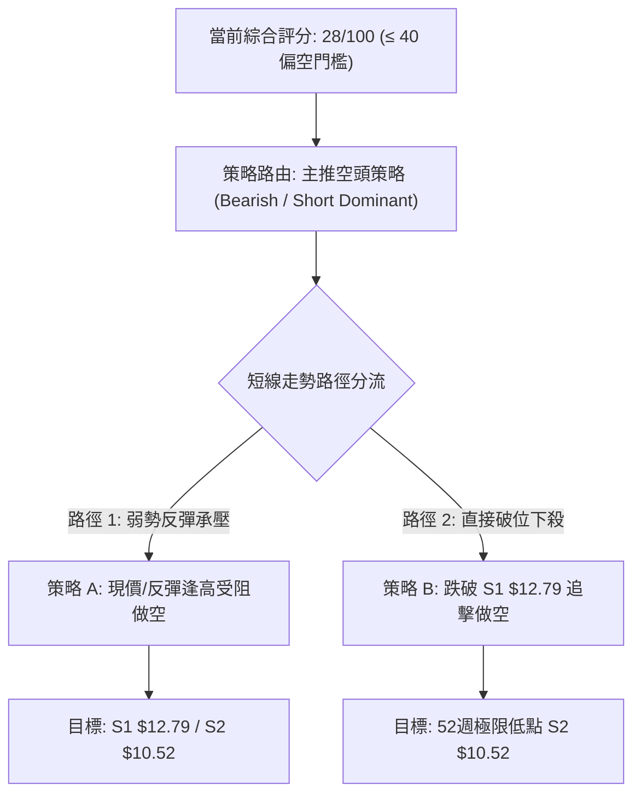

### 🧭 策略路由（依評分卡分流）

> **當前主策略方向 = 做空主導（依技術評分卡 28/100，處於 ≤ 40 之空頭策略區間）**  
> 多頭僅列為極端超賣對沖與反轉防守監控，不予推薦主動建立多頭常規倉位。

### 🎯 價格情境階梯（Price Scenarios）

*(註：所有價位完全引用「關鍵價位」區塊之客觀數值)*

| 觸發條件 | 第一目標 | 第二目標 | 情境技術含義 |
|:---|:---:|:---:|:---|
| **強勢突破 R1 ($13.80)** | R2 ($18.18) | R3 ($18.81) | 短線空頭衰竭，啟動中期對稱性回補（極低機率） |
| **受阻於現價至 R1 區間** | S1 ($12.79) | S2 ($10.52) | 順應均線下壓，弱勢反彈完畢重歸主跌浪（基準情境） |
| **有效跌破 S1 ($12.79)** | S2 ($10.52) | 數據未偵測S3 | 破位加速，探測 52 週最低點尋找終極支撐（高機率） |

### 📊 情境機率分佈

| 運行情境 | 發生機率 | 主要技術與量價依據 |
|:---|:---:|:---|
| **情境一：順勢下挫 / 破位探底 (跌破S1)** | **55%** | ADX 29.69 空頭強趨勢、均線空頭排列發散、OBV 資金持續流出、10/30 黑K反轉 |
| **情境二：區間磨底 / S1至R1低位震盪** | **30%** | S1 ($12.79) 近期具抵抗力、MACD 柱狀微幅翻正 (+0.099)、短線空頭回補 |
| **情境三：強力向上反彈 (突破R1測試R2)** | **15%** | 僅能在空頭極度踩踏引發軋空（Short Squeeze）與重大利多配合下偶發出現 |

### 🟢 主策略詳情（空頭主導策略）

嚴格遵守規則 13（僅引用關鍵價位與現價）與規則 17（風險報酬比精算公式）：

| 策略要素 | 策略 A（現價/反彈逢高放空） | 策略 B（破位順勢加碼放空） |
|:---|:---|:---|
| **操作邏輯** | 10/30 受阻回落，現價進場搏二次探底 | 跌破一年波段低點 S1 後順勢做空追擊 |
| **進場價格** | **$13.47**（當前最新收盤價） | **$12.79**（S1 支撐位確認跌破） |
| **止損價格** | **$13.80**（關鍵阻力位 R1，突破即止損） | **$13.80**（反抽突破關鍵阻力 R1） |
| **第一目標價 (T1)** | **$12.79**（近一年波段低點支撐 S1） | **$10.52**（52 週歷史最低點支撐 S2） |
| **第二目標價 (T2)** | **$10.52**（52 週最低點強支撐 S2） | **N/A（數據未提供更低支撐）** |
| **風險報酬比 (以 T1 計)** | **1 : 2.06（以 T1 計）** *(計算式見註1)* | **1 : 2.25（以 T1 計）** *(計算式見註2)* |
| **風險報酬比 (以 T2 計)** | **1 : 8.94（以 T2 計）** *(計算式見註3)* | ─ |
| **策略成功機率** | **65%** | **60%** |
| **建議配置倉位** | **10% ~ 15%** (總資金風險控制於 1% 內) | **5% ~ 10%** (破位確認加碼) |

- **註1（策略 A 之 T1 風險報酬比計算）**：
  做空獲利空間 = 進場價 ($13.47) − 目標價 T1 ($12.79) = $0.68；
  做空承擔風險 = 止損價 ($13.80) − 進場價 ($13.47) = $0.33；
  風險報酬比 = $0.68 ÷ $0.33 = 2.0606 → **1 : 2.06（以 T1 計）**。
- **註2（策略 B 之 T1 風險報酬比計算）**：
  做空獲利空間 = 進場價 ($12.79) − 目標價 T1 ($10.52) = $2.27；
  做空承擔風險 = 止損價 ($13.80) − 進場價 ($12.79) = $1.01；
  風險報酬比 = $2.27 ÷ $1.01 = 2.2475 → **1 : 2.25（以 T1 計）**。
- **註3（策略 A 之 T2 風險報酬比計算）**：
  做空獲利空間 = 進場價 ($13.47) − 目標價 T2 ($10.52) = $2.95；
  做空承擔風險 = $0.33；
  風險報酬比 = $2.95 ÷ $0.33 = 8.939 → **1 : 8.94（以 T2 計）**。

### 🔴 反向風險觸發點（對沖與風控提示）

若發生以下盤面異動，必須立即無條件推翻空頭主策略並市價平倉止損：
1. **價格強勢收復 R1 ($13.80)**：日線以高於 $13.80 收盤，意味著短線下行結構被破壞，空頭面臨軋空風險。
2. **MACD 出現帶量零下二次金叉**：若柱狀圖加速放大突破 +0.50，伴隨單日成交量突破 20 日均量（9.41M）之 1.5 倍以上。
3. **布林通道帶寬收窄後向上開口**：若價格站上布林中軌 MA20 ($14.95)，整體中期下降趨勢將轉化為寬幅震盪。

### ⭐ 整體訊號強度評星

```
做多訊號強度：★☆☆☆☆  (1/5 星 — 僅MACD微弱反彈，缺乏結構支撐)
做空訊號強度：★★★★☆  (4/5 星 — 趨勢、均線、ADX、量價高度共振)
整體可信度：  ★★★★☆  (4/5 星 — 多時框指標收斂性極佳)
```

---

## 9. 風險提示與監控

### ✅ 關鍵監控指標 Checklist

```
╔══════════════════════════════════════════════════════════════════╗
║                   每日交易風控監控清單 (Checklist)               ║
╠══════════════════════════════════════════════════════════════════╣
║ [ ] 價格是否跌破前低支撐 S1 ($12.79)？(是: 觸發策略B加碼放空)    ║
║ [ ] 價格是否向上突破關鍵阻力 R1 ($13.80)？(是: 空頭部位嚴格止損) ║
║ [ ] 成交量是否異常放大至 10.0M 以上？(是: 警惕機構換手或軋空)   ║
║ [ ] ADX(14) 是否持續維持在 25 以上？(是: 確認單邊行情未轉向)     ║
║ [ ] -DI (31.63) 是否跌破 +DI (16.60)？(是: 空頭動能衰竭信號)     ║
║ [ ] 日線 RSI(14) 是否跌破 30 超賣線？(是: 接近超賣，空頭需減碼)  ║
╚══════════════════════════════════════════════════════════════════╝
```

### ⚠️ 風險場景分析

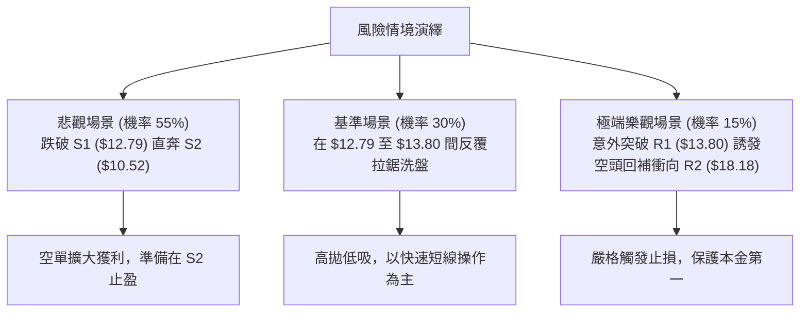

### 🛡️ 風險管理重要提醒

1. **高 Beta 波動風險控制**：PL 的 Beta 係數高達 2.17，且 ATR 達 $0.91（佔股價近 7%）。絕不可將該標的視為低波動防禦股，單一部位槓桿倍數建議控制在 1 倍以內，嚴禁重倉持股。
2. **空頭擠壓（Short Squeeze）防範**：由於該股 Short % Float 為 12.2%，雖然不及極端散戶抱團股，但在流動性偏弱的交易日，若有利多新聞刺激，極易引發日內急拉 10% 以上之惡性軋空。因此，放空部位務必嚴格設定硬性止損點於 **$13.80**，切忌心存僥倖抱單。
3. **資金曝險上限規範**：在單一賬戶中，針對 PL 的操作風險總曝險（Risk at Cost）不得超過總帳戶權益的 **1.0%**。以策略 A 為例，進場價 $13.47，止損點 $13.80，每股承擔 $0.33 風險，若帳戶規模為 $100,000 美元，最大虧損限制在 $1,000 美元，則最大放空股數應嚴格限制在 3,030 股以內。

---

## 📋 報告總結

```
╔══════════════════════════════════════════════════════════════════╗
║                   PL 技術分析報告總結                            ║
╠══════════════════════════════════════════════════════════════════╣
║ 報告日期：2026-11-01                                             ║
║ 當前價格：$13.47                                                 ║
║ 分析評級：🔴 強烈偏空（技術綜合評分：28/100）                    ║
║                                                                  ║
║ 關鍵結論：                                                       ║
║ ├─ 長期趨勢：🔴 崩盤熊市，自 52W 高點 $51.76 暴跌 74%，深陷泥潭 ║
║ ├─ 中期趨勢：🔴 下降通道壓制，空頭排列發散，均線系統全面受制   ║
║ ├─ 短期趨勢：🔴 弱勢反彈於 10/30 遭阻截，跌破 MA5 重回主跌浪   ║
║ ├─ 關鍵支撐：S1 $12.79（近期防線）/ S2 $10.52（52週終極支撐）   ║
║ ├─ 關鍵阻力：R1 $13.80（短線生死線）/ R2 $18.18（中期反彈高點） ║
║ └─ 分析師目標：均價 $30.27（基本面共識與當前技術盤面嚴重脫節）   ║
║                                                                  ║
║ 最優策略組合：                                                   ║
║ 1. 🥇 最佳機會：策略 A — 現價 $13.47 輕倉放空，止損設於 R1      ║
║                  $13.80，第一目標 S1 $12.79（風報比 1 : 2.06）   ║
║ 2. 🥈 次選機會：策略 B — 耐心等待跌破 S1 $12.79 後追擊放空，     ║
║                  目標直指 S2 $10.52（風報比 1 : 2.25）           ║
║ 3. 🥉 保守選擇：完全空倉觀望，在價格未在 S2 $10.52 形成大型放量  ║
║                  底背離雙底之前，切勿左側盲目抄底                ║
╚══════════════════════════════════════════════════════════════════╝
```

---

> ⚠️ **免責聲明**：本報告為 AI 自動生成之技術分析，所有數據及估算均基於提供的歷史價格資訊。本報告**僅供研究與學術參考**，**不構成任何投資建議**。投資有風險，入市需謹慎。

---

*報告生成時間：2026-11-01 ｜ 數據來源：Yahoo Finance ｜ 分析框架：多時框技術分析*