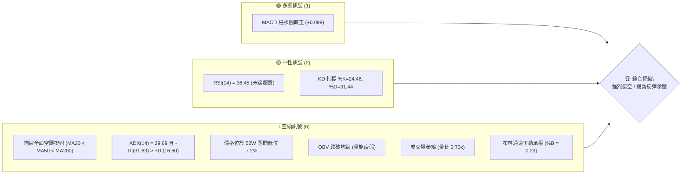
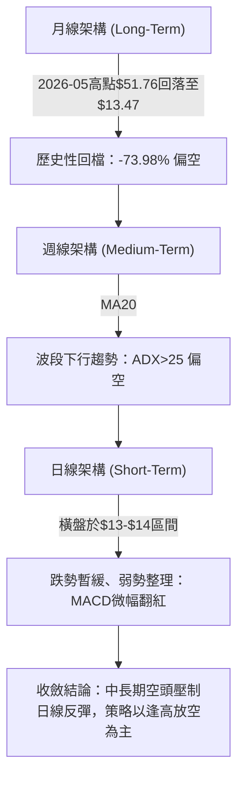
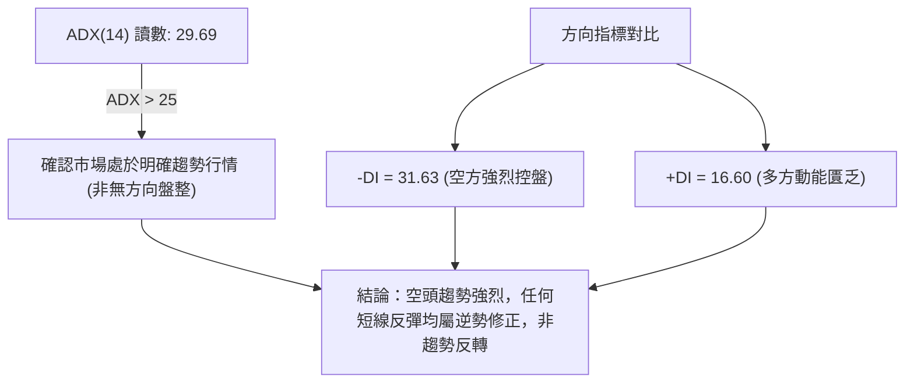
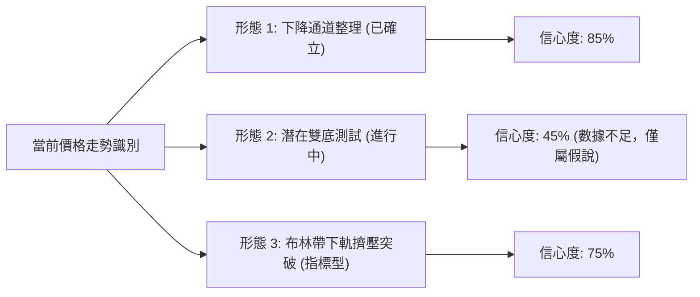
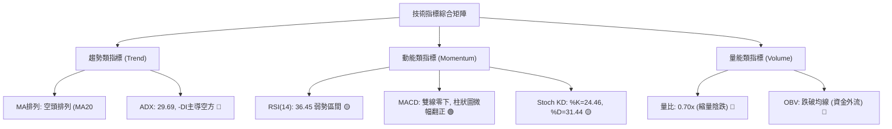
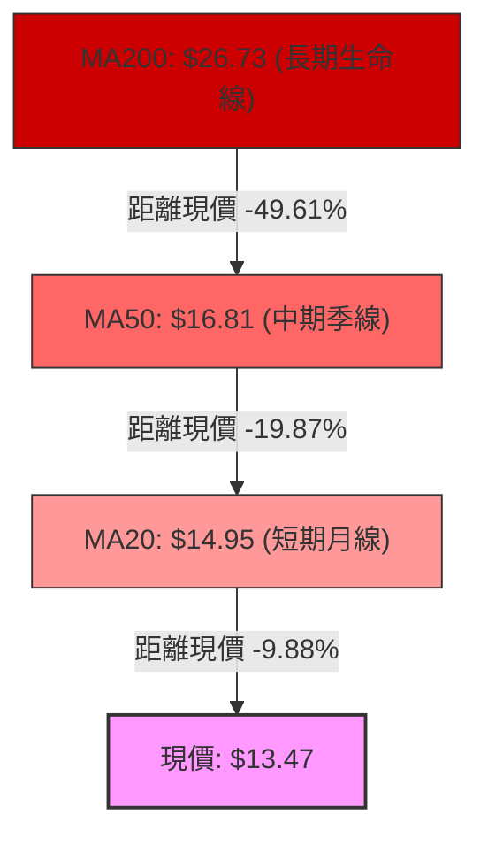
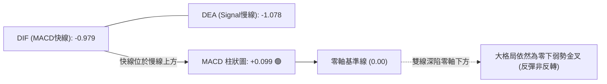
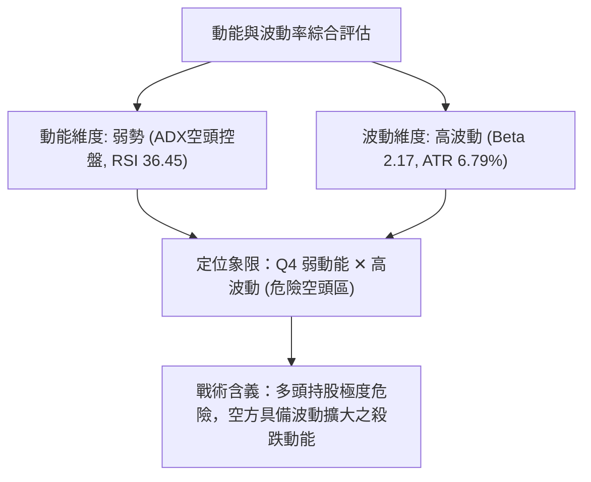
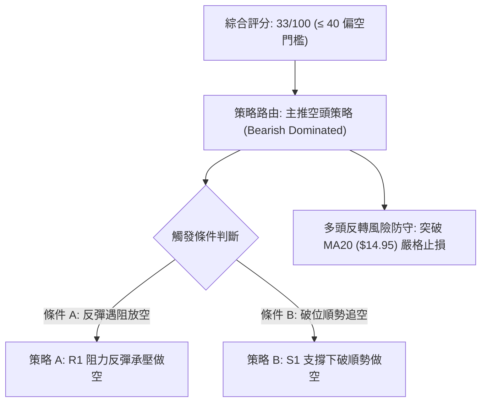
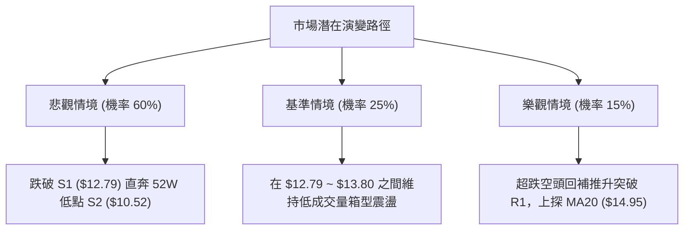

# PL 技術分析報告

> **報告日期**：2026-11-02 ｜ **語言**：繁體中文 ｜ **數據來源**：Yahoo Finance ｜ **當前價格**：$13.47

---

## 目錄

| 章節 | 內容 |
|------|------|
| [1. 技術面概覽](#1-技術面概覽) | 訊號儀表板、核心指標、評分卡 |
| [2. 趨勢分析](#2-趨勢分析) | 多時框趨勢、長中短期走勢 |
| [3. 圖表形態分析](#3-圖表形態分析) | 形態識別、K線組合、目標價 |
| [4. 支撐與阻力](#4-支撐與阻力) | 關鍵價位、斐波那契回調 |
| [5. 技術指標深度解讀](#5-技術指標深度解讀) | MA/RSI/MACD/布林/成交量 |
| [6. 動能與波動率](#6-動能與波動率) | 動能評估、ATR、Beta |
| [7. 多時框架總結](#7-多時框架總結) | 時框架評分矩陣 |
| [8. 交易策略建議](#8-交易策略建議) | 多空策略、風險報酬比 |
| [9. 風險提示與監控](#9-風險提示與監控) | 監控指標、風險場景 |
| [10. 報告總結](#10-報告總結) | 儀表板總結、最優組合 |

---

## 1. 技術面概覽

### 🎯 技術訊號儀表板



### 📊 核心指標速覽表

| 指標類別 | 指標名稱 | 當前數值 | 訊號 | 解讀 |
|----------|----------|----------|------|------|
| **價格** | 當前收盤價 | $13.47 | 🔴 | 位於52週區間底部7.2%，距離52週高點重挫-73.98% |
| **均線** | MA20 | $14.95 | 🔴 | 現價低於MA20達-9.88%，短線均線持續下彎壓制 |
| **均線** | MA50 | $16.81 | 🔴 | 現價低於MA50，中期趨勢嚴重走空 |
| **均線** | MA200 | $26.73 | 🔴 | 現價低於MA200達-49.61%，長期結構處於極端空頭 |
| **動能** | RSI(14) | 36.45 | 🟡 | 處於30-70中性偏弱區，尚未觸發超賣反彈閾值 |
| **動能** | MACD (12,26,9) | -0.979 / Sig: -1.078 | 🟢 | 雙線位於零軸深處下方，但柱狀圖微幅翻正(+0.099) |
| **趨勢** | ADX (14) | 29.69 | 🔴 | ADX>25確認強趨勢；-DI(31.63)壓制+DI(16.60)，空方主導 |
| **通道** | 布林帶 (%B) | 0.29 | 🔴 | 現價位於中軌($14.95)與下軌($11.49)之間，空頭擴張格局 |
| **量能** | 成交量 / 20日均量 | 6.55M / 9.41M | 🔴 | 量比0.70x，呈現無量陰跌，OBV弱於均線確認量能匱乏 |
| **波動** | ATR(14) | $0.91 | 🟡 | 佔股價6.79%，日間波動度偏高但處於收斂狀態 |

### 🏆 技術評分卡

```
╔══════════════════════════════════════════════════════════════╗
║                技術評分卡 — PL (2026-11-02)                  ║
╠══════════════════════════════════════════════════════════════╣
║ 趨勢強度 (Trend)     ████████░░░░░░░░░░░░  38/100  🔴 空頭強勢║
║ 動能指標 (Momentum)  ████████░░░░░░░░░░░░  40/100  🟡 弱勢企穩║
║ 支撐穩定度 (Support) ██████░░░░░░░░░░░░░░  30/100  🔴 逼近前低║
║ 成交量配合 (Volume)  ██████░░░░░░░░░░░░░░  28/100  🔴 量能背離║
║ 形態完整度 (Pattern) ████████░░░░░░░░░░░░  42/100  🟡 築底未成║
║ 均線排列 (MA System) ████░░░░░░░░░░░░░░░░  20/100  🔴 完美空頭║
╠══════════════════════════════════════════════════════════════╣
║ 綜合評分 (Overall)   ███████░░░░░░░░░░░░░  33/100  🔴 強烈偏空║
║ 評分定義：六項算術平均 (38+40+30+28+42+20)/6 = 33.0          ║
╚══════════════════════════════════════════════════════════════╝
```

---

## 2. 趨勢分析

### 🌐 多時框趨勢分析



### 📈 長期趨勢 — 12個月走勢圖（Unicode）

依據月度收盤價數據，標注自 2025-11 至 2026-10 過去 12 個月的月線演變：

```
PL 月線走勢圖（過去12個月：2025-11 至 2026-10）
價格軸 ($)
$52 ┤                                      ● (2026-05: $51.14 / 高點 $51.76)
$46 ┤                                     / \
$40 ┤                                    /   \
$34 ┤                              ●    /     ● (2026-06: $33.13)
$28 ┤                        ●    / \  /       \
$22 ┤                  ●    / \  /   ●          ● (2026-07: $20.48)
$16 ┤            ●    / \  /   ●                 \        ● (2026-09: $16.39)
$10 ┤ ●    ●    / \  /   ●                        ●───────●← 現在 ($13.47)
     └─┬────┬────┬────┬────┬────┬────┬────┬────┬────┬────┬────┘
      11   12   01   02   03   04   05   06   07   08   09   10  (月份)
     '25  '25  '26  '26  '26  '26  '26  '26  '26  '26  '26  '26
```

#### 走勢特徵分析表格

| 階段 | 期間 | 起點收盤 | 終點收盤 | 漲跌幅 | 趨勢特徵 | 量能與形態解讀 |
|------|------|----------|----------|--------|----------|----------------|
| **第1階段：主升浪爆發** | 2025-11 ~ 2026-05 | $11.90 | $51.14 | +329.75% | 垂直加速上攻 | 創下歷史高點 $51.76，月線連續拉出大陽線 |
| **第2階段：崩跌退潮** | 2026-05 ~ 2026-07 | $51.14 | $20.48 | -59.95% | 倒V型斷崖下挫 | 獲利了結盤湧出，跌破MA20及重要整數關卡 |
| **第3階段：階梯式陰跌** | 2026-07 ~ 2026-10 | $20.48 | $13.47 | -34.23% | 下降通道延伸 | 逢反彈均遭均線壓制，回吐整波多頭近90%漲幅 |

### 📊 中期趨勢（週線分析）

中期走勢呈現極度沉重的下行通道，近 20 週收盤價由 2026-06 的 $28.23 階梯式下滑至 $13.47。

```
PL 中期週線支撐與阻力階梯示意圖
$28.23 ──────────────────────────────────────── 6月整理平台
          \
$24.69 ────\─────────────────────────────────── 8月中旬次級反彈高點
            \
$18.81 ──────\─────── [R3] ──────────────────── 10月上旬波段高點聚類
$18.18 ───────\────── [R2] ──────────────────── 9月下旬波段高點聚類
               \
$14.95 ─────────\──── [BB中軌 / MA20] ───────── 中期動態下行壓力線
$13.80 ──────────\─── [R1] ──────────────────── 短線反彈頸線壓制
$13.47 ───────────●◄ 現價
$12.79 ────────────── [S1] ──────────────────── 10月波段低點支撐
$10.52 ──────────────────────────────────────── [S2] 52週歷史低點強支撐
```

### ⚡ 趨勢強度評估（ADX 解讀）



#### ADX 強度對照與市場狀態分析

| 指標名稱 | 當前數值 | 臨界基準 | 狀態評估 | 實戰交易含義 |
|----------|----------|----------|----------|--------------|
| **ADX(14)** | 29.69 | > 25.00 | 強趨勢 (Strong Trend) | 順勢交易為主，擺動指標超賣鈍化機率高 |
| **+DI(14)** | 16.60 | < 20.00 | 多方極度衰竭 | 多方無力推動波段攻擊，買盤僅具防禦性質 |
| **-DI(14)** | 31.63 | > 30.00 | 空方全面主導 | 空頭掌控盤面定價權，破底風險仍未解除 |
| **DI差值** | -15.03 | < 0.00 | 空方絕對優勢 | 趨勢擴展方向向下，不可盲目左側抄底 |

---

## 3. 圖表形態分析

### 🔍 形態識別系統



#### 圖表形態信心度評估表

| 形態名稱 | 信心度 | 判斷依據（引用數據） | 完成度 | 目標價（附計算式） |
|----------|--------|----------------------|--------|--------------------|
| **下降通道主趨勢** | 85% | 價格受制於 MA20 ($14.95) 與 MA50 ($16.81)，波段高點由 $18.81 下降至 $14.77 | 90% | 下測下軌支撐 S2: $10.52 |
| **潛在微型雙底** | 45% | 10/23 低點 $12.79 與 10/30 低點 $13.15 形成次低點抬高假說 | 35% | 訊號不足（頸線 $13.80 未有效突破）；若成立：頸線 $13.80 + ($13.80 - $12.79) = $14.81 |
| **布林帶下軌擠壓** | 75% | %B = 0.29，收盤價逼近下軌 $11.49 後反抽中軌 $14.95 | 60% | 回抽目標為 BB 中軌 $14.95 |

### 🕯️ 重要 K 線形態分析

依據數據提供的「近10根日K」與「近8根週K」實體與影線特徵進行專業解讀：

#### 近 10 根日 K 線形態解讀

| 日期 | 開盤價 | 最高價 | 最低價 | 收盤價 | K線形態 | 深度解讀 | 訊號 |
|------|--------|--------|--------|--------|---------|----------|------|
| **2026-10-19** | $13.85 | $13.90 | $13.37 | $13.59 | 帶下影短黑K | 延續前週重挫陰影，下測 $13.37 後獲短線買盤支撐 | 🔴 |
| **2026-10-20** | $13.49 | $13.82 | $13.18 | $13.40 | 紡錘十字陰線 | 實體極小，高低點收縮，市場觀望情緒濃烈 | 🟡 |
| **2026-10-21** | $13.89 | $14.09 | $13.59 | $13.71 | 衝高回落小陰 | 盤中上探 $14.09 遭空方壓制，留上影線 $0.38 | 🔴 |
| **2026-10-22** | $13.26 | $13.60 | $12.87 | $13.08 | 破底長黑K | 跌破 $13.00 整數關卡，最低 $12.87，空方動能釋放 | 🔴 |
| **2026-10-23** | $13.18 | $13.53 | $12.79 | $13.41 | 錘頭長下影陽K | 探歷史次低 $12.79 後強拉收於 $13.41，下影線長達 $0.62，形成關鍵支撐 S1 | 🟢 |
| **2026-10-26** | $13.30 | $13.99 | $13.26 | $13.76 | 實體中陽K | 延續反彈，突破 5 日均線，買盤溫和回流 | 🟢 |
| **2026-10-27** | $13.95 | $14.77 | $13.84 | $14.49 | 帶長上影大陽K | 最高上探 $14.77 逼近 MA20，但尾盤遭遇解套賣壓，留 $0.28 上影線 | 🟡 |
| **2026-10-28** | $14.45 | $14.56 | $14.03 | $14.33 | 倒轉小陰K | 高檔獲利回吐，未能力挺 $14.50 關卡 | 🔴 |
| **2026-10-29** | $13.96 | $14.60 | $13.96 | $14.31 | 平開小陽星 | 盤整於 $14.00 上方，多空爭奪激烈 | 🟡 |
| **2026-10-30** | $13.54 | $14.02 | $13.15 | $13.47 | 低開低走陰K | 低開低走跌破 5 日與 10 日均線，吞噬前三日漲幅，反彈動能告終 | 🔴 |

#### 近 8 根週 K 線形態解讀

| 週結算日 | 開盤價 | 最高價 | 最低價 | 收盤價 | 週K線形態 | 深度解讀 | 訊號 |
|----------|--------|--------|--------|--------|-----------|----------|------|
| **2026-09-11** | $17.85 | $18.48 | $16.44 | $16.45 | 光腳中長黑K | 重挫破位，收在單週最低點附近，空頭肆虐 | 🔴 |
| **2026-09-18** | $16.10 | $17.27 | $15.60 | $16.42 | 下影小紅星 | 下測 $15.60 後企穩，多空於 $16.40 附近拉鋸 | 🟡 |
| **2026-09-25** | $16.68 | $18.18 | $16.13 | $17.43 | 實體長紅K | 爆量強彈，最高見波段阻力 R2: $18.18 | 🟢 |
| **2026-10-02** | $17.17 | $17.73 | $16.10 | $17.50 | 縮量十字星 | 高檔震盪滯漲，成交量微降，多方動能停滯 | 🟡 |
| **2026-10-09** | $17.64 | $18.81 | $16.55 | $17.18 | 長上影射擊之星 | 衝高至 R3: $18.81 遇極重阻力回落，確定中期頂部成立 | 🔴 |
| **2026-10-16** | $17.00 | $17.03 | $13.33 | $13.56 | 斷頭鍘大黑K | 單週暴跌逾 -21%，直接擊穿 $16 與 $14 支撐，結構崩塌 | 🔴 |
| **2026-10-23** | $13.85 | $14.09 | $12.79 | $13.41 | 探底長下影陰K | 創本波新低 $12.79 (S1)，下檔浮現低接量 | 🟡 |
| **2026-10-30** | $13.30 | $14.77 | $13.15 | $13.47 | 長上影小陽星 | 衝高 $14.77 遭 MA20 擊退，收盤僅微漲 $0.06，弱勢未改 | 🔴 |

### 📉 ASCII 走勢形態示意圖

```
PL 日線近 10 日走勢與局部形態示意圖
價格
$14.80 ┤           ● (10/27 高點 $14.77 遇阻)
$14.40 ┤          / \   ●---● (10/28-29 震盪)
$14.00 ┤   ●     /   \ /     \
$13.60 ┤  / \   ●     ●       ●← 10/30 收盤 $13.47 (頸線 R1: $13.80 下方)
$13.20 ┤ ●   \ /
$12.80 ┤       ● (10/23 破底低點 $12.79 - S1)
       └─┬───┬───┬───┬───┬───┬───┬───┬───┬───┬─
        10/19  21  22  23  26  27  28  29  30 (交易日)
```

### 🎯 形態目標價計算

若以當前日線級別所形成的「10/27 遇阻回落區間」與「10/23 底部」計算形態延伸位：
1. **反彈頸線壓制 (R1)**：$13.80（波段密集高點聚類）
2. **形態波幅高度 (H)**：$13.80 - $12.79 (S1) = $1.01
3. **空頭順勢破位目標價 (Downside Target)**：
   - 當前價格若失守 S1 ($12.79)：
   $$\text{破位目標} = S1 - H = \$12.79 - \$1.01 = \$11.78$$
   - 該價位與布林下軌（$11.49）及 52W 低點（$10.52）形成強支撐共振區間。

---

## 4. 支撐與阻力

### 🗺️ 關鍵價位分布圖（Unicode）

```
PL 價位結構分布圖 (Resistance & Support Map)
═══════════════════════════════════════════════════════════════════
$18.81 ║██████████████████████████████║ 強阻力 R3 (10/09 波段高點)
$18.18 ║██████████████████████        ║ 次級阻力 R2 (09/25 波段高點)
$14.95 ║▓▓▓▓▓▓▓▓▓▓▓▓▓▓▓▓▓▓            ║ 動態阻力 BB中軌 / MA20
$13.80 ║████████████████              ║ 短線關鍵阻力 R1 (反彈頸線壓制)
$13.47 ╠══════════════════════════════╣ ◄ 當前收盤價 ($13.47)
$12.79 ║▓▓▓▓▓▓▓▓▓▓▓▓▓▓▓▓              ║ 近期波段支撐 S1 (10/23 低點)
$11.49 ║▒▒▒▒▒▒▒▒▒▒▒▒                  ║ 動態支撐 布林通道下軌
$10.52 ║██████████████████████████████║ 歷史強支撐 S2 (52週最低價)
═══════════════════════════════════════════════════════════════════
```

### 🚧 阻力位分析表

所有阻力數值嚴格引用自數據之「關鍵價位」與「均線指標」：

| 阻力級別 | 價位 | 與現價距離 | 形成原因與技術意義 | 突破難度 | 重要性 |
|----------|------|------------|--------------------|----------|--------|
| **R1** | $13.80 | +2.45% | 近一年波段高點聚類；近10日多根K線影線交會處（10/20、10/26開收盤密集區） | 🟡 中等 | ★★★☆☆ |
| **MA20** | $14.95 | +10.99% | 20日均線下彎壓制，且為布林通道中軌所在，為多空短線分水嶺 | 🔴 極高 | ★★★★☆ |
| **R2** | $18.18 | +34.97% | 9月25日反彈波段頂部高點聚類；成交量密集套牢區 | 🔴 極高 | ★★★★☆ |
| **R3** | $18.81 | +39.64% | 10月09日射擊之星波段高點聚類；中期下行趨勢之結構性防守點 | 🔴 極高 | ★★★★★ |

### 🛡️ 支撐位分析表

所有支撐數值嚴格引用自數據之「關鍵價位」：

| 支撐級別 | 價位 | 與現價距離 | 形成原因與技術意義 | 守住機率 | 重要性 |
|----------|------|------------|--------------------|----------|--------|
| **S1** | $12.79 | -5.05% | 近一年波段低點聚類；10月23日長下影錘頭低點，短線最後防線 | 🟡 45% | ★★★★☆ |
| **BB下軌**| $11.49 | -14.70% | 布林通道下軌動態支撐，偏離中軌之極端超跌統計邊界 | 🟢 65% | ★★★☆☆ |
| **S2** | $10.52 | -21.90% | 52週歷史最低點；波段結構終極支撐，斐波那契 100% 回調位 | 🟢 80% | ★★★★★ |

### 📐 斐波那契回調位分析

依據數據提供的 52 週完整波段（低點 $10.52 → 高點 $51.76，落差 $41.24）計算之回調位：

```
斐波那契回調結構 (52W High $51.76 → 52W Low $10.52)
0.0%  ├──────────────────────────────────────── $51.76 (52W 最高點)
23.6% ├──────────────────────────────────────── $42.03
38.2% ├──────────────────────────────────────── $36.01
50.0% ├──────────────────────────────────────── $31.14
61.8% ├──────────────────────────────────────── $26.27 (黃金分割關鍵位，MA200 $26.73 處)
78.6% ├──────────────────────────────────────── $19.35 (已實質跌破)
      │
      ▼ [當前價格區間: $13.47 處於 78.6% 與 100.0% 之間]
      │
100.0%├──────────────────────────────────────── $10.52 (52W 最低點 S2)
```

#### 斐波那契回調技術解讀
- **現價所處位置**：當前價格 $13.47 深度落入 **78.6% 回調位 ($19.35) 與 100.0% 回調位 ($10.52)** 之間的「極端回撤真空區」。
- **結構破壞性**：正常健康多頭回檔守於 61.8% ($26.27) 之上；PL 實質貫破 78.6% ($19.35)，顯示過去一年由 $10.52 發動的大牛市上漲動能已 100% 瓦解，目前技術性質屬於「全面回吐」與「重回起漲點尋求定價」過程。
- **向下引力**：因 $19.35 之下無斐波那契結構支撐，下檔重力將直接引導股價下測 100.0% 回調位 **$10.52**。

---

## 5. 技術指標深度解讀

### 🎛️ 指標訊號總覽



### 📈 移動平均線排列分析



#### 移動平均線系統詳細監控表

| 均線名稱 | 數值 | 距現價幅差 | 均線斜率與走勢特徵 | 訊號評估 |
|----------|------|------------|--------------------|----------|
| **MA5** | $14.07 | -4.28% | 快速下彎，自 $14.49 連續回落 | 🔴 短線受阻 |
| **MA10** | $13.76 | -2.07% | 平緩下傾，現價再度失守 | 🔴 短線走弱 |
| **MA20** | $14.95 | -9.88% | 穩定下行（-1.48），壓制一切中短線反彈 | 🔴 空頭排列 |
| **MA60** | $17.96 | -25.02% | 陡峭向下（-4.49），中期下行通道上軌 | 🔴 空頭排列 |
| **MA120** | $24.79 | -45.66% | 持續走低（-11.32），半年套牢區沉重 | 🔴 空頭排列 |
| **MA240** | $25.10 | -46.34% | 走平後轉向下行（-11.63） | 🔴 空頭排列 |

均線系統呈現完美的 **MA20 < MA50 < MA200** 死亡發散排列，表明從 1 個月到 1 年的時間維度內，市場平均持倉者全數處於嚴重套牢狀態，上方解套賣壓層層疊加。

### 📉 RSI(14) 分析

#### RSI 數值強度展示
```
RSI(14) 讀數: 36.45
0 ──────────── 30 ════════════════════════ 70 ──────────── 100
[███████████░░░░░░░░░░░░░░░░░░░░░░░░░░░░░░] 36.45% (弱勢空方主導區)
```

- **區間評估**：RSI 位於 36.45，既未達到 30 以下的極端超賣區，亦大幅落後於 50 多空中軸。這意味著空方動能依然主導，且並未產生極端價格失真，空頭賣壓仍有進一步釋放的空間。
- **背離分析**：
  - **日線層面**：數據明確提示「近20根K棒首尾價格與RSI方向無明顯背離」。價格於 10/23 創 $12.79 低點，RSI 保持在低位同步波動，**不存在底背離**。
  - **週線層面**：9/11 週 RSI 為 23.5（收盤 $16.45），10/23 週 RSI 為 33.1（收盤 $13.41）。雖然週線收盤破底但 RSI 數值略高，然而該現象主因在於 10 月中旬單週暴跌後的斜率修正，日線級別並未獲得量能與形態共振確認，底背離假說不成立。

### 📊 MACD(12/26/9) 訊號解讀



- **數值分析**：MACD 快線 (-0.979) 微幅穿過慢線 (-1.078)，柱狀圖呈現 +0.099 的微弱正值。
- **指標意義**：在深度零下區域出現的微幅金叉，通常僅代表「超跌引發的技術性喘息」，在缺乏成交量支持的情況下，極易演變為「零下拒絕上穿」或「貼合後二次死叉向下」，屬於高風險的弱勢多頭訊號。

### 📦 布林通道分析

```
PL 布林通道示意圖 (Bollinger Bands 20, 2)
$18.41 ┤ ═════════════════════════════════ 上軌 (Upper Band)
       │
$14.95 ┤ --------------------------------- 中軌 (Middle Band = MA20)
       │                    ● (10/27 衝刺 $14.77 逼近中軌遇阻)
$13.47 ┤               ●◄── 當前收盤價 (%B = 0.29)
       │          ● (10/23 探底 $12.79)
$11.49 ┤ ═════════════════════════════════ 下軌 (Lower Band)
```

- **通道帶寬與位置**：上軌 $18.41，下軌 $11.49，帶寬高達 $6.92（相對現價約 51% 寬度）。
- **%B 指標解讀**：當前 `%B = 0.29`，數值遠小於 0.50，說明價格被牢牢壓制在中軌下方，運行於空頭優勢通道內；未跌破 0 軸顯示尚未觸發下軌超賣反彈，市場正處於向中軌弱勢抽頭失敗後的再次尋底階段。

### 💹 成交量分析（量價配合度）

```
量能對比分析 (Volume Profile)
最新成交量 (10/30):  6,554,100  [█████████████░░░░░░░] 6.55M
20日平均量:         9,410,600  [████████████████████] 9.41M (量比: 0.70x)
50日平均量:        10,387,600  [██████████████████████] 10.39M
```

- **量價萎縮狀態**：最新成交量僅 6.55M，量比僅為 0.70x，低於 20 日均量與 50 日均量。
- **OBV 走勢背離**：數據明確指出 `OBV < MA → 量能疲弱`。OBV 能量潮持續運行於其移動平均線下方，顯示資金呈現淨流出狀態，近期由 $12.79 反彈至 $14.77 的過程中量能並未放大，屬於典型的「無量反抽」，預示後市缺乏推升動能。

---

## 6. 動能與波動率

### ⚡ 動能評估四象限



#### 動能評估四象限矩陣表

| 象限 | 動能狀態 | 波動狀態 | 代表特徵 | 當前狀態標註 | 交易評估與因應 |
|------|----------|----------|----------|--------------|----------------|
| **Q1** | 強 (多頭) | 低波動 | 穩定上升趨勢 | ─ | 最佳趨勢抱牢區 |
| **Q2** | 弱 (無方向) | 低波動 | 狹幅橫向盤整 | ─ | 區間高拋低吸觀望 |
| **Q3** | 強 (多頭) | 高波動 | 主升浪/投機狂熱 | ─ | 嚴設移動停利進取 |
| **Q4** | **弱 (空頭)** | **高波動** | **破位下挫/陰跌** | **✓ 當前 PL 定位** | **嚴格避免做多，逢反彈做空** |

### 📊 ATR 波動率分析

- **ATR(14) 數值**：**$0.91**（佔現價 $13.47 之比例為 **6.79%**）。
- **波動特性解讀**：每日平均振幅近 7%，意味著 PL 屬於高爆發、高風險品種，價格極易在短時間內觸發窄幅止損。
- **風控止損距離建議**：
  - **日內交易止損寬度**：$1.0 \times \text{ATR} = \$0.91$
  - **波段交易止損寬度**：$1.5 \times \text{ATR} = \$1.37$；$2.0 \times \text{ATR} = \$1.82$

### 📐 Beta 與市場相關性

- **Beta 係數**：**2.17**
- **市場放大效應**：PL 之 Beta 高達 2.17，代表其相對於標普 500 指數具備 2.17 倍的波動敏感度。若美股大盤回檔 1%，PL 理論跌幅將達 2.17% 以上；在整體宏觀流動性承壓或風險偏好下降時，此類高 Beta 虧損股將承受最直接的拋售打擊。
- **空頭槓桿屬性**：在弱勢下行格局中，高 Beta 賦予空頭策略極高的獲利彈性，但也要求嚴格的部位規模控管。

---

## 7. 多時框架總結

### 📋 時框架評分表

| 時框架 | 趨勢方向 | 動能狀態 | 均線排列 | 圖表形態 | 綜合評分 | 建議方向 |
|--------|----------|----------|----------|----------|----------|----------|
| **月線 (長期)** | 🔴 極空 | 🔴 崩跌退潮 | 🔴 均線死叉向下 | 倒V型反轉下跌 | 20/100 | 嚴格規避長線做多 |
| **週線 (中期)** | 🔴 強空 | 🔴 RSI=36.5 承壓 | 🔴 MA20<MA50 下行 | 下降階梯通道 | 30/100 | 逢反彈空頭波段佈局 |
| **日線 (短期)** | 🟡 震盪偏弱 | 🟢 MACD柱翻正 | 🔴 價格低於MA5/10/20 | 承壓於頸線 R1 | 42/100 | 反彈遇阻尋求放空點 |

### 🔲 綜合訊號矩陣

| 維度 | 短期 (日線) | 中期 (週線) | 長期 (月線) | 多時框一致性解讀 |
|------|-------------|-------------|-------------|------------------|
| **趨勢強度** | 弱勢整理 | 空頭強趨勢 | 深度下行趨勢 | 空方力量逐級強化，長期壓制短期 |
| **動能方向** | 短線企穩反抽 | 弱勢偏空 | 動能崩潰瓦解 | 短期反彈屬超跌修正，無中期動能支持 |
| **關鍵壓制** | R1: $13.80 | MA20: $14.95 | R3: $18.81 | 反彈每上升一階均面臨倍數賣壓阻截 |
| **結構防守** | S1: $12.79 | BB下軌: $11.49 | S2: $10.52 | 支撐結構薄弱，極易向下擊穿尋底 |

### ⚖️ 多時框收斂結論

依據多時框收斂原則進行判斷：
1. **趨勢/盤整性質定性**：當前 ADX(14) 為 **29.69 > 25.00**，且 -DI(31.63) 佔據絕對主導，**確認市場處於標準的「趨勢行情」而非「盤整震盪」**。
2. **時框優先級權重**：依規則，趨勢行情下必須以中長期（週線、MA50 $16.81、MA200 $26.73）的方向為主導，日線僅能用於定位精準進場點。日線雖然在 10/23 出現長下影線且 MACD 柱狀圖微幅翻紅，但在週線與月線全面空頭的背景下，該訊號定義為「反彈陷阱」。
3. **唯一方向性結論**：**強烈偏空（逢高做空）**。

---

## 8. 交易策略建議

### 🗺️ 策略決策流程圖



### 🧭 策略路由（依評分卡分流）

> **當前主策略方向 = 空頭主導策略（依綜合評分 33/100，評級偏空 ≤ 40）**

本策略報告依據嚴格規則，綜合評分低於 40 分，全盤由空頭主導；多頭部位僅提供風險觸發與空方平倉點，不建議任何主動買入持股行為。

### 🎯 價格情境階梯（Price Scenarios）

價位嚴格引用自「關鍵價位」與「指標計算數值」：

| 觸發條件 | 下一目標 | 後續延伸 | 情境技術含義 |
|----------|----------|----------|--------------|
| **反彈受阻於 R1 $13.80** | S1: $12.79 | S2: $10.52 | 短線弱勢整理失敗，回歸空頭主趨勢（高機率） |
| **實質擊穿 S1 $12.79** | BB下軌: $11.49 | S2: $10.52 | 形態破位，引發停損賣盤，展開新一輪殺跌（主推情境） |
| **強勢突破 R1 $13.80** | MA20: $14.95 | R2: $18.18 | 短線反彈擴大，空頭策略暫時觀望或防守離場 |

### 📊 情境機率分佈

| 情境 | 機率 | 主要技術指標依據 |
|------|------|------------------|
| **回落 / 跌破 S1 再探底** | **60%** | ADX=29.69 空方控盤、均線全面空頭排列、OBV疲弱量能衰竭 |
| **區間震盪 ($12.79 ~ $13.80)** | **25%** | 短線 MACD 柱狀微翻正 (+0.099)、RSI 36.45 尚未極度超賣 |
| **突破上行反彈 (測試 MA20)** | **15%** | 僅能在空頭回補帶動下發生，上方解套賣壓過於沉重 |

### 🔴 主策略詳情（空頭進場規劃）

所有價位均嚴格引用第 4 章關鍵價位，進場價採用區間中點計算風險報酬比（定義：`風險報酬比 = (進場價 − 目標價 T1) ÷ (止損價 − 進場價)`，以 T1 計算）：

| 策略要素 | 策略 A（反彈高空 — 逢阻力放空） | 策略 B（破位追空 — 順勢灌破進場） |
|----------|---------------------------------|-----------------------------------|
| **交易邏輯** | 趁弱勢反彈測試 R1 頸線阻力時進場放空 | 股價跌破近期波段低點 S1 時順勢追空 |
| **進場條件** | 股價回抽 $13.70 ~ $13.80 區間遇阻收上影線 | 日線實體跌破 $12.79 且成交量放大確認 |
| **進場價格** | **$13.75**（區間 $13.70-$13.80 中點） | **$12.75**（破位確認價，略低於 S1: $12.79） |
| **目標價 T1** | **$12.79** (波段低點 S1) | **$11.49** (布林通道下軌) |
| **目標價 T2** | **$10.52** (52週歷史低點 S2) | **$10.52** (52週歷史低點 S2) |
| **止損價格** | **$14.25** (突破 MA5 $14.07 及 R1 濾網) | **$13.35** (重返 S1 之上，多空轉換失敗) |
| **風險報酬比** | **1 : 1.92（以 T1 計）**<br>計算式：$(13.75-12.79) \div (14.25-13.75) = 0.96 \div 0.50$<br>另以 T2 計：1 : 6.46 | **1 : 2.10（以 T1 計）**<br>計算式：$(12.75-11.49) \div (13.35-12.75) = 1.26 \div 0.60$<br>另以 T2 計：1 : 3.72 |
| **勝率預估** | 65% | 60% |
| **建議倉位** | 10% ~ 15% | 10% |

### 🟢 反向風險觸發點（對沖與停損提示）

若發生非預期逆轉行情，多頭觸發以下關鍵點位時，空頭必須無條件平倉離場：
1. **反轉警告點**：日線收盤價突破 **R1 ($13.80)**，代表短線弱勢格局轉為反彈擴展，應將空單部位縮減 50%。
2. **全線平倉點**：日線帶量站穩 **MA20 ($14.95)**，代表短期空頭趨勢遭扭轉，原下行通道被打破，空單全數止損離場，轉入觀望。

### ⭐ 整體訊號強度評星

```
╔══════════════════════════════════════════════╗
║ 做多訊號強度：★☆☆☆☆  (1.0/5星 - 極弱無訊號)║
║ 做空訊號強度：★★★★☆  (4.0/5星 - 強烈趨勢空)║
║ 整體可信度：  ★★★★☆  (4.0/5星 - 指標共振確認)║
╚══════════════════════════════════════════════╝
```

---

## 9. 風險提示與監控

### ✅ 關鍵監控指標 Checklist

```
╔══════════════════════════════════════════════════════════════╗
║               PL 每日交易關鍵監控 Checklist                  ║
╠══════════════════════════════════════════════════════════════╣
║ [ ] 監控點 1: 日收盤價是否跌破關鍵支撐 S1 ($12.79)          ║
║ [ ] 監控點 2: RSI(14) 是否跌破 30 進入極端超賣區            ║
║ [ ] 監控點 3: 成交量是否異常放大至 10M 以上 (可能引發換手)   ║
║ [ ] 監控點 4: MACD 柱狀圖是否由紅翻綠 (終結短線企穩假象)    ║
║ [ ] 監控點 5: 價格反彈是否遭阻力 R1 ($13.80) 與 MA20 壓制   ║
║ [ ] 監控點 6: 空頭總體停損線 $14.25 (策略A) 是否被有效觸及  ║
╚══════════════════════════════════════════════════════════════╝
```

### ⚠️ 風險場景分析



### 🛡️ 風險管理重要提醒

1. **基本面虧損風險外溢**：PL 的 TTM 淨利潤率為 **-95.1%**，營業利潤率為 **-27.2%**，TTM EPS 為 **$-1.1**，高估值倍數（P/S 達 12.96x）在空頭市場極易面臨激進的估值擠壓，基本面無法對 $13.47 的現價提供安全邊際。
2. **高 Beta 波動懲罰**：Beta 達 **2.17**，單日波動極劇烈。切勿使用重倉進行空頭投機，單筆交易虧損上限應嚴格鎖定在總資金的 **1.0% ~ 1.5%** 範圍內。
3. **空頭擠壓（Short Squeeze）預防**：PL 的空頭回補天數（Short Ratio）為 **3.42**，做空比例（Short % Float）達 **12.2%**。雖然目前無軋空跡象，但若出現突發利多新聞，極易引發快速軋空抽動，故**切勿在無停損保護下進行裸空**。

---

## 10. 報告總結

```
╔══════════════════════════════════════════════════════════════════╗
║                  PL 技術分析報告總結儀表板                      ║
╠══════════════════════════════════════════════════════════════════╣
║ 報告日期：2026-11-02                                             ║
║ 當前價格：$13.47                                                 ║
║ 綜合評分：33 / 100 (算術平均) ｜ 分析評級：🔴 強烈偏空 (Sell)   ║
╠══════════════════════════════════════════════════════════════════╣
║ 關鍵結論：                                                       ║
║ ├─ 長期趨勢：🔴 極空 (自歷史高點 $51.76 回跌近 74%，深陷下行)   ║
║ ├─ 中期趨勢：🔴 強空 (ADX=29.69 確認強趨勢，均線空頭排列壓制)   ║
║ ├─ 短期趨勢：🟡 弱勢整理 (MACD 零下微紅，但受制於阻力 R1 $13.80)║
║ ├─ 關鍵支撐：S1: $12.79 ｜ S2: $10.52 (52週歷史低點)             ║
║ ├─ 關鍵阻力：R1: $13.80 ｜ 動態: $14.95 (MA20) ｜ R2: $18.18    ║
║ └─ 分析師目標均價：$30.27 (目前嚴重與技術面脫節，不具短線參考性) ║
╠══════════════════════════════════════════════════════════════════╣
║ 最優策略組合：                                                   ║
║ 1. 🥇 最佳機會：策略 A (反彈高空)                                ║
║    - 於 $13.75 附近進場放空，止損 $14.25，目標 T1 $12.79 (1:1.92)║
║ 2. 🥈 次選機會：策略 B (破位追空)                                ║
║    - 跌破 $12.79 後於 $12.75 追空，止損 $13.35，目標 T1 $11.49  ║
║ 3. 🥉 保守選擇：完全空倉觀望，耐心等待價格下測 $10.52 強支撐驗證 ║
╚══════════════════════════════════════════════════════════════════╝
```

---

> ⚠️ **免責聲明**：本報告為 AI 自動生成之技術分析，所有數據及估算均基於提供的歷史價格資訊。本報告**僅供研究與學術參考**，**不構成任何投資建議**。投資有風險，入市需謹慎。

---

*報告生成時間：2026-11-02 ｜ 數據來源：Yahoo Finance ｜ 分析框架：多時框技術分析*