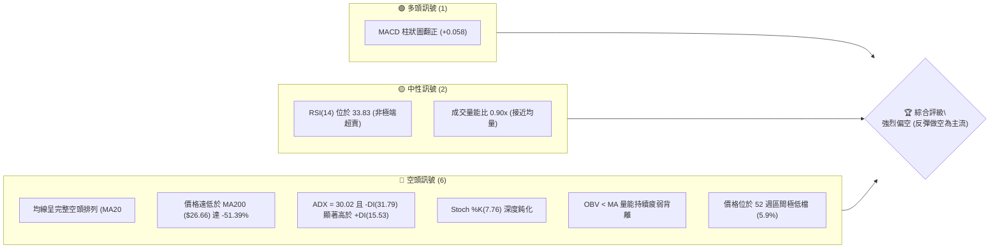
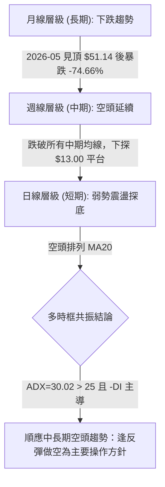
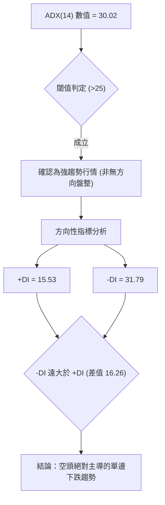
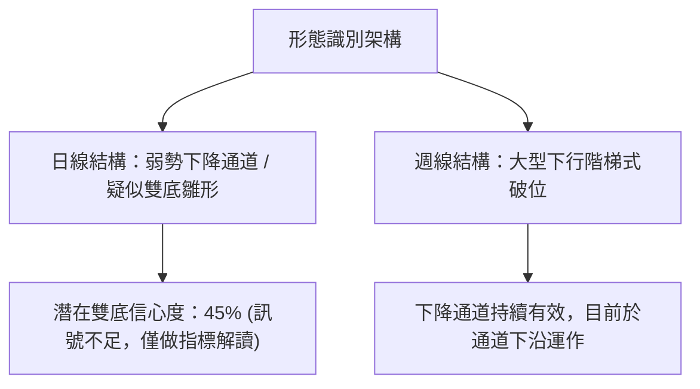
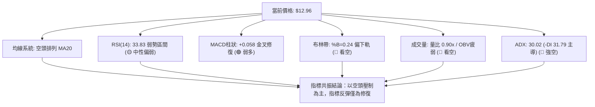
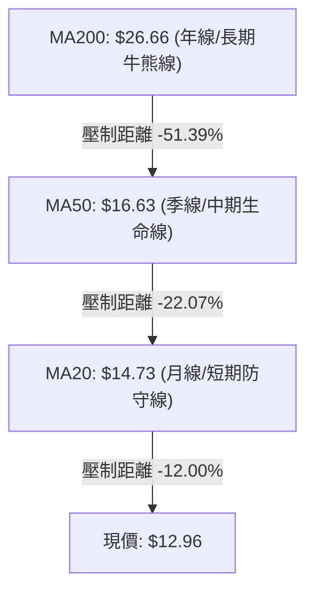
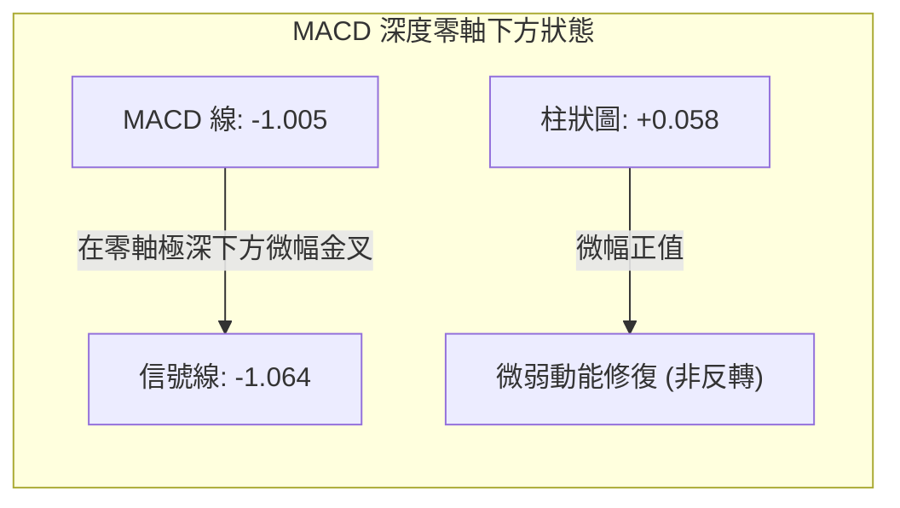
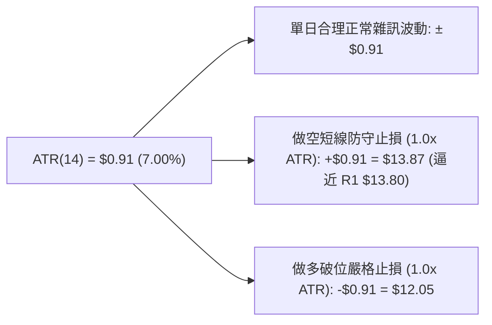
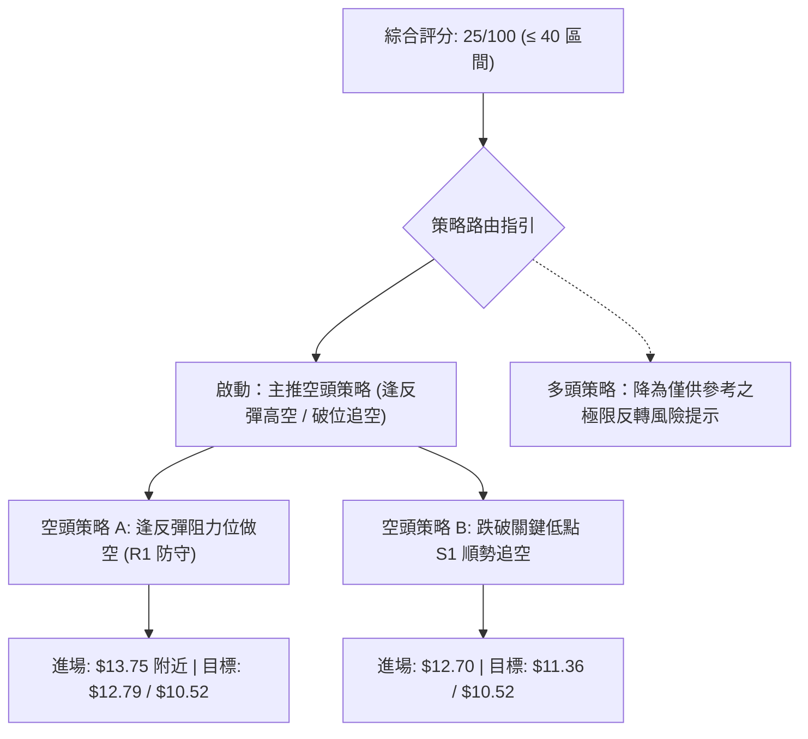
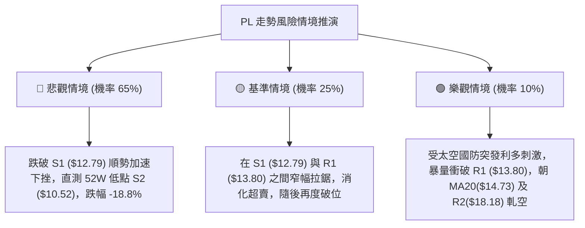

# PL 技術分析報告

> **報告日期**：2026-11-03 ｜ **語言**：繁體中文 ｜ **數據來源**：Yahoo Finance ｜ **當前價格**：$12.96

---

## 目錄

| 章節 | 內容 |
|------|------|
| [1. 技術面概覽](#1-技術面概覽) | 訊號儀表板、核心指標、評分卡 |
| [2. 趨勢分析](#2-趨勢分析) | 多時框趨勢、長中短期走勢 |
| [3. 圖表形態分析](#3-圖表形態分析) | 形態識別、K線組合、目標價 |
| [4. 支撐與阻力](#4-支撐與阻力) | 關鍵價位、斐波那契回調 |
| [5. 技術指標深度解讀](#5-技術指標深度解讀) | MA/RSI/MACD/布林/成交量 |
| [6. 動能與波動率](#6-動能與波動率) | 動能評估、ATR、Beta |
| [7. 多時框架總結](#7-多時框架總結) | 時框架評分矩陣 |
| [8. 交易策略建議](#8-交易策略建議) | 多空策略、風險報酬比 |
| [9. 風險提示與監控](#9-風險提示與監控) | 監控指標、風險場景 |

---

## 1. 技術面概覽

### 🎯 技術訊號儀表板



### 📊 核心指標速覽表

| 指標類別 | 指標名稱 | 當前數值 | 訊號 | 解讀 |
|:---|:---|:---|:---:|:---|
| **價格** | 當前收盤價 | $12.96 | 🔴 | 位於 52 週低點附近（百分位 5.9%），空頭主導 |
| **均線** | 短期 MA20 | $14.73 | 🔴 | 價格低於 MA20 達 -12.00%，短線受壓制 |
| **均線** | 中期 MA50 | $16.63 | 🔴 | 價格低於 MA50 達 -22.07%，中期空方趨勢未變 |
| **均線** | 長期 MA200 | $26.66 | 🔴 | 價格低於 MA200 達 -51.39%，長期下行趨勢嚴峻 |
| **動能** | RSI(14) | 33.83 | 🟡 | 位於弱勢區（30–70），接近超賣但未出現底背離 |
| **動能** | MACD 柱狀圖 | +0.058 | 🟢 | 快慢線負值交叉微幅反彈，柱狀圖正值，顯示微幅超跌修復 |
| **動能** | 隨機指標 (Stoch) | %K 7.76 / %D 22.68 | 🔴 | 處於深度超賣區間，短線雖有反彈需求但動能脆弱 |
| **趨勢** | ADX (14) | 30.02 (-DI 31.79) | 🔴 | ADX > 25 且 -DI 占優，確立強勢空頭趨勢行情 |
| **通道** | 布林通道 %B | 0.24 | 🔴 | 位於中軌 ($14.73) 與下軌 ($11.36) 之間，偏向弱勢下軌運行 |
| **波動** | ATR(14) | $0.91 (7.00%) | 🔴 | 高波動性資產，單日振幅高達 7.00% |
| **量能** | 20日成交量比 | 0.90x | 🟡 | 8.55M vs 9.49M，量能略有縮減，呈現陰跌特徵 |

### 🏆 技術評分卡

```
╔══════════════════════════════════════════════════════════════╗
║                 技術評分卡 — PL (2026-11-03)                 ║
╠══════════════════════════════════════════════════════════════╣
║ 趨勢強度 (空頭強)  ████████░░░░░░░░░░░░  20/100  🔴 強烈看跌  ║
║ 動能指標          ███████░░░░░░░░░░░░░  25/100  🔴 弱勢反彈  ║
║ 支撐穩定度        █████████░░░░░░░░░░░  30/100  🔴 逼近臨界  ║
║ 成交量配合        █████████░░░░░░░░░░░  30/100  🔴 量能疲弱  ║
║ 均線排列          ██░░░░░░░░░░░░░░░░░░  10/100  🔴 完美空頭  ║
║ 形態完整度        █████████░░░░░░░░░░░  35/100  🟡 弱勢築底  ║
╠══════════════════════════════════════════════════════════════╣
║ 綜合評分          ████████░░░░░░░░░░░░  25/100  🔴 強烈偏空  ║
║                               (六項算術平均：150 ÷ 6 = 25)   ║
╚══════════════════════════════════════════════════════════════╝
```

---

## 2. 趨勢分析

### 🌐 多時框趨勢分析



### 📈 長期趨勢 — 12個月走勢圖（Unicode）

```
PL 月線走勢圖（過去12個月：2025-12 至 2026-11）
價格軸 ($)
$55 ┤                                  ● $51.14 (2026-05)
$50 ┤                                 / \
$45 ┤                                /   \
$40 ┤                          ● $36.97   \
$35 ┤                         /            ● $33.13
$30 ┤                   ● $27.95            \
$25 ┤             ● $24.97 \                 \
$20 ┤       ● $19.72        ● $24.14          ● $20.48 ── ● $19.85
$15 ┤                                                      \     \
$10 ┤ ● $11.90                                              ● $16.39 ── ● $13.47 ── ● $12.96 (現價)
    └─────────────────────────────────────────────────────────────────────────────
       11    12    01    02    03    04    05    06    07    08    09    10    11  (月份)
     '25   '25   '26   '26   '26   '26   '26   '26   '26   '26   '26   '26   '26
```

#### 長期走勢階段特徵分析

| 階段區間 | 價格起訖 | 期間漲跌幅 | 走勢特徵與市場結構 |
|:---|:---|:---:|:---|
| **啟動突破期** (2025-11 ~ 2026-01) | $11.90 → $24.97 | +109.83% | 突破底部，伴隨動能急速放大，完成主升段初期擴張。 |
| **主升攻頂期** (2026-02 ~ 2026-05) | $24.14 → $51.14 | +111.85% | 形成垂直拉升，創下 52 週歷史高點 $51.76，進入極端泡沫化。 |
| **急速崩盤期** (2026-05 ~ 2026-07) | $51.14 → $20.48 | -59.95% | 兩月內遭腰斬，跌破中期均線支撐，籌碼全面套牢崩解。 |
| **弱勢陰跌期** (2026-08 ~ 2026-11) | $19.85 → $12.96 | -34.71% | 連續 4 個月走低，多頭無力反抗，逼近 52 週低點 $10.52。 |

### 📊 中期趨勢（週線分析）

從週線結構觀察，自 2026-10-09 當週見高點 $18.81（R3）後，連續數週大幅重挫，跌破 $16.00 支撐。近期三週收盤價分別為 $13.41、$13.47 與 $12.96，價格已緊貼波段低點聚類支撐 $12.79（S1）。

```
週線支撐阻力結構示意：
$18.81 ────────────────────────────── R3 (10/09 波段高點)
$18.18 ────────────────────────────── R2 (09/25 波段高點)
$14.73 ══════════════════════════════ MA20 / 布林中軌
$13.80 ────────────────────────────── R1 (近期反彈密集區高點)
$12.96 ───────◄ 當前收盤價
$12.79 ┄┄┄┄┄┄┄┄┄┄┄┄┄┄┄┄┄┄┄┄┄┄┄┄┄┄┄┄ S1 (近一年波段低點聚類)
$10.52 ══════════════════════════════ S2 (52週歷史低點 / 100% 斐波那契位)
```

### ⚡ 趨勢強度評估（ADX 解讀）



#### ADX 強度對照分析

| 指標變數 | 當前讀數 | 基準區間 | 技術含義 |
|:---|:---:|:---:|:---|
| **ADX (14)** | **30.02** | > 25 (強趨勢) | 趨勢動能充足，不可將當前走勢視為無趨勢盤整。 |
| **+DI** | **15.53** | < 20 (多方匱乏) | 多方無力推動上攻，買盤極度保守。 |
| **-DI** | **31.79** | > 30 (空方主導) | 空方拋壓維持高強度，主導市場方向。 |
| **趨勢性質** | **空頭趨勢行情** | 規則 14 判定 | 依規則 14，以中長期空頭方向為主導，日線僅作為尋找空點之依據。 |

---

## 3. 圖表形態分析

### 🔍 形態識別系統



#### 幾何圖表形態分析表（依規則 15）

| 形態名稱 | 信心度 | 判斷依據（引用數據） | 完成度 | 目標價（附精確計算式） |
|:---|:---:|:---|:---:|:---|
| **下行持續通道** | 75% | 自 10/09 高點 $18.81、10/27 反彈高點 $14.77 連線為上軌；以波段低點 $12.79 為下軌。 | 85% | 依通道跌破測算：跌破 S1($12.79) 後將直測下軌與 52W 低點 S2 = **$10.52**。 |
| **雙底形態 (雛形)** | 40% | 10/23 觸及波段低點 $12.79，11/02 再次下探低點 $12.87 測試。但信心度 < 50%，數據不足以確認頸線突破，僅做指標型超跌解讀。 | 30% | 頸線為 10/27 高點 $14.77，高差 = $14.77 - $12.79 = $1.98。若突破頸線目標為：$14.77 + $1.98 = $16.75（未確立）。 |

### 🕯️ 重要 K 線形態分析（依規則 19）

嚴格依據提供的「近10根日K」與「近8根週K」開高低收數據進行客觀解讀：

#### 近 10 根日 K 線解讀

| 日期 (日K) | 開 | 高 | 低 | 收 | 成交量 | K線形態 | 技術解讀與訊號 |
|:---|:---:|:---:|:---:|:---:|:---:|:---|:---|
| **2026-10-20** | 13.49 | 13.82 | 13.18 | 13.40 | 6,723,900 | 紡錘線 (Spinning Top) | 🟡 實體狹小，多空在 $13.50 關口拉鋸，觀望濃厚。 |
| **2026-10-21** | 13.89 | 14.09 | 13.59 | 13.71 | 8,269,900 | 衝高回落小黑K | 🔴 盤中挑戰 $14.00 承壓回落，留上影線，空頭施壓。 |
| **2026-10-22** | 13.26 | 13.60 | 12.87 | 13.08 | 8,652,700 | 中陰線 (Bearish Candle) | 🔴 跳空低開並跌破 $13.00，空方動能重燃。 |
| **2026-10-23** | 13.18 | 13.53 | 12.79 | 13.41 | 6,066,600 | 錘頭線 (Hammer) | 🟢 盤中創近期波段低點 $12.79 (S1) 後強烈抽腳，短線有支撐。 |
| **2026-10-26** | 13.30 | 13.99 | 13.26 | 13.76 | 6,833,600 | 溫和陽線 (Bullish Day) | 🟢 延續反彈，站回 $13.50，確認 $12.79 支撐有效性。 |
| **2026-10-27** | 13.95 | 14.77 | 13.84 | 14.49 | 6,491,100 | 長紅帶長上影線 | 🟡 盤中衝擊 MA20($14.73) 未果，遭空方強力反撲。 |
| **2026-10-28** | 14.45 | 14.56 | 14.03 | 14.33 | 7,603,300 | 滯漲小陰線 | 🔴 高檔盤整，無法越過前日高點，反彈動能衰竭。 |
| **2026-10-29** | 13.96 | 14.60 | 13.96 | 14.31 | 7,544,100 | 光腳小黑K | 🔴 多次上攻 $14.60 受阻，賣壓逐步湧現。 |
| **2026-10-30** | 13.54 | 14.02 | 13.15 | 13.47 | 6,554,100 | 中陰吞噬跌破線 | 🔴 低開低走跌破多根日均線，反彈宣告結束。 |
| **2026-11-02** | 13.62 | 13.69 | 12.87 | 12.96 | 8,556,200 | 光頭實體長黑K | 🔴 放量下殺跌破 $13.00，收盤逼近全日最低，極度看空。 |

#### 近 8 根週 K 線解讀

| 日期 (週K) | 開 | 高 | 低 | 收 | 週成交量 | K線形態 | 技術解讀與訊號 |
|:---|:---:|:---:|:---:|:---:|:---:|:---|:---|
| **2026-09-18** | 16.10 | 17.27 | 15.60 | 16.42 | 46,446,400 | 低檔下影紅K | 🟢 跌破 $16.00 後獲買盤拉抬，展開技術性反抽。 |
| **2026-09-25** | 16.68 | 18.18 | 16.13 | 17.43 | 56,175,300 | 帶長上影中陽線 | 🟡 測試波段阻力 R2($18.18)，量能放大但高檔遇阻。 |
| **2026-10-02** | 17.17 | 17.73 | 16.10 | 17.50 | 52,133,300 | 高檔十字星 (Doji) | 🟡 動能停滯，多空在高檔 $17.50 陷入僵局。 |
| **2026-10-09** | 17.64 | 18.81 | 16.55 | 17.18 | 59,868,100 | 倒錘頭 / 墓碑線 | 🔴 衝刺 R3($18.81) 形成波段假突破，空方高檔全面接管。 |
| **2026-10-16** | 17.00 | 17.03 | 13.33 | 13.56 | 51,292,600 | 巨幅實體長黑K | 🔴 崩盤式下跌 -21.07%，直接擊穿 $16.00 與 $14.00 兩道整數關口。 |
| **2026-10-23** | 13.85 | 14.09 | 12.79 | 13.41 | 42,025,100 | 低檔探底錘頭線 | 🟡 測試低點 S1($12.79)，量能萎縮，進入抵抗階段。 |
| **2026-10-30** | 13.30 | 14.77 | 13.15 | 13.47 | 35,026,200 | 長上影紡錘線 | 🔴 上攻 $14.77 受制於 MA20 拋壓，收盤仍被壓回原點。 |
| **2026-11-02** | 13.62 | 13.69 | 12.87 | 12.96 | 8,556,200 | 下跌破位陰K | 🔴 (單日折算) 破位下殺，收盤創 2026 年新低收盤價。 |

### 📉 ASCII 走勢形態示意圖

```
PL 日線形態結構解析（近10個交易日走勢）
價格 ($)
$14.80 ┤                        ● 10/27 高點 $14.77 (受阻於 MA20: $14.73)
$14.50 ┤                       /│\
$14.20 ┤                      / │ \   ● 10/28-29 滯漲平台 ($14.31~$14.33)
$13.90 ┤      ● 10/21 $14.09 /  │  \ /│\
$13.60 ┤     /│             /   │   X │ \
$13.30 ┤    / │  ● 10/20   /    │  /  │  ● 10/30 下破陰線 ($13.47)
$13.00 ┤───┼──┼──$13.40──●─────┼──┼───┼──────────● 11/02 收盤 $12.96
$12.70 ┤   │  ● 10/23 $12.79    │  │   ● 11/02 低點 $12.87
       └───┴──┴────────────────┴──┴────────────────────────────
          10/20  10/23        10/27  10/30       11/02
       【支撐測試】          【假突破】          【破位下殺】
```

### 🎯 形態目標價計算

根據純粹幾何形態推算：
1. **箱體下破測算**：前波震盪區間為 10/27 高點 $14.77 至 10/23 低點 $12.79，箱體高度為 $14.77 - $12.79 = $1.98。
2. **下破理論目標**：若實體跌破支撐位 S1($12.79)，等幅下跌目標價 = 突破點 $12.79 - 箱體高度 $1.98 = **$10.81**。
3. **極限目標契合**：該測算價位 $10.81 與數據中近一年波段絕對低點聚類 S2($10.52) 極為接近，具高度技術支撐共振性。

---

## 4. 支撐與阻力

### 🗺️ 關鍵價位分布圖（Unicode）

```
PL 價位結構分布圖（嚴格依據 OHLCV 計算聚類數據）
═════════════════════════════════════════════════════════════════════════════
$18.81 ║████████████████████████████████████████████████║ 強波段阻力 R3 (+45.14%)
$18.18 ║████████████████████████████████████████        ║ 次級波段阻力 R2 (+40.28%)
$16.63 ║▓▓▓▓▓▓▓▓▓▓▓▓▓▓▓▓▓▓▓▓▓▓▓▓▓▓▓▓▓▓▓▓                ║ 中期均線 MA50 壓制
$14.73 ║▓▓▓▓▓▓▓▓▓▓▓▓▓▓▓▓▓▓▓▓                            ║ 短期均線 MA20 / 布林中軌
$13.80 ║████████████████████████                        ║ 短線反彈阻力 R1 (+6.48%)
═══════╬════════════════════════════════════════════════╣ ◄ 當前收盤價 $12.96
$12.79 ║▓▓▓▓▓▓▓▓▓▓▓▓▓▓▓▓                                ║ 關鍵生命線支撐 S1 (-1.31%)
$11.36 ║▒▒▒▒▒▒▒▒▒▒                                      ║ 布林下軌支撐
$10.52 ║████████████████████████████████████████████████║ 52週歷史低點強支撐 S2 (-18.83%)
═════════════════════════════════════════════════════════════════════════════
```

### 🚧 阻力位分析表

依據提供的「關鍵價位」數據嚴格列示波段高點聚類阻力：

| 阻力級別 | 精確價位 | 距現價幅 | 形成原因與技術背景 | 突破難度 | 重要性評級 |
|:---|:---:|:---:|:---|:---:|:---:|
| **阻力一 (R1)** | **$13.80** | +6.48% | 近期日K反彈密集受阻區（10/20高點 $13.82、10/26開盤 $13.30 上衝位）。 | 中等 | 🟢 短線多空分水嶺 |
| **阻力二 (R2)** | **$18.18** | +40.28% | 2026-09-25 當週波段高點，布林通道上軌（$18.10）共振帶。 | 極高 | 🟡 中期多頭反轉點 |
| **阻力三 (R3)** | **$18.81** | +45.14% | 2026-10-09 週線衝高回落極值，大型頭部賣壓密集區。 | 極高 | 🔴 中期強阻力天花板 |

### 🛡️ 支撐位分析表

依據提供的「關鍵價位」數據嚴格列示波段低點聚類支撐：

| 支撐級別 | 精確價位 | 距現價幅 | 形成原因與技術背景 | 守住機率 | 重要性評級 |
|:---|:---:|:---:|:---|:---:|:---:|
| **支撐一 (S1)** | **$12.79** | -1.31% | 2026-10-23 日K最低點及波段低點聚類，目前僅距現價 17 美分。 | 35% | 🔴 短期生死線 (跌破即破位) |
| **支撐二 (S2)** | **$10.52** | -18.83% | 52 週最低點，斐波那契 100.0% 終極回調位，歷史籌碼起漲點。 | 75% | 🟢 長期黃金底線 |
| **支撐三 (S3)** | N/A | N/A | *數據中未偵測到低於 S2 的支撐點位*。 | N/A | ⚪ 無數據 |

### 📐 斐波那契回調位分析

依據 52 週區間極值（最低點 $10.52 至最高點 $51.76，波幅 $41.24）計算之回調位分析：

| 回調比例 | 精確價位 | 與當前價格 ($12.96) 之關係與技術解讀 |
|:---:|:---:|:---|
| **0.0% (高點)** | **$51.76** | 52 週歷史天花板，泡沫頂點。 |
| **23.6%** | **$42.03** | 早期回調位，早已失守。 |
| **38.2%** | **$36.01** | 多頭防禦警戒線，已全面崩潰。 |
| **50.0%** | **$31.14** | 多空中軸，目前價格遠在此中軸下方 -58.38%。 |
| **61.8%** | **$26.27** | 黃金分割防禦位，與 MA200($26.66) 形成強烈共振壓制帶。 |
| **78.6%** | **$19.35** | 深度回調防守位，上方 R2/R3 均處於此位置下方。 |
| **100.0% (低點)**| **$10.52** | 52 週極限低點，下行最終歸宿目標。 |

**現價落點解讀**：
當前收盤價 **$12.96** 深度下沉於 **78.6% 回調位 ($19.35)** 與 **100.0% 終極位 ($10.52)** 之間。這表明自 $51.76 起跌以來的回撤幅度已經抹平了前波牛市漲幅的 94.1%，處於極端超跌狀態。然而在未觸及 100% 位 ($10.52) 或重新站上 S1 之前，回調結構難言終結。

---

## 5. 技術指標深度解讀

### 🎛️ 指標訊號總覽



### 📈 移動平均線排列分析



#### 均線階梯偏離度表

| 均線名稱 | 週期數值 | 距現價距離 (現價-MA) | 偏離率 (%) | 排列狀態 | 技術含義 |
|:---|:---:|:---:|:---:|:---:|:---|
| **MA5** | $13.91 | -$0.95 | -6.84% | 空頭 | 短期極速承壓，日線受制 |
| **MA10** | $13.69 | -$0.73 | -5.35% | 空頭 | 扣抵高價區，持續向下發散 |
| **MA20** | $14.73 | -$1.77 | -12.00% | 空頭 | 短期空方阻力中樞（布林中軌） |
| **MA50** | $16.63 | -$3.67 | -22.07% | 空頭 | 中期生命線傾瀉向下 |
| **MA60** | $17.78 | -$4.82 | -27.11% | 空頭 | 下行斜率陡峭 |
| **MA120** | $24.56 | -$11.60 | -47.22% | 空頭 | 半年線沉重套牢盤阻力 |
| **MA200** | $26.66 | -$13.70 | -51.39% | 空頭 | 長期下行趨勢無絲毫扭轉跡象 |
| **MA240** | $25.11 | -$12.15 | -48.38% | 空頭 | 完整長期空頭發散 |

### 📉 RSI(14) 分析

當前數值：**33.83** (Wilder 演算法)

```
RSI(14) 儀表盤：
0 ───────[30 超賣]──────────────────[70 超買]─────── 100
           ▲
           33.83 (弱勢弱支撐區)
進度條展示：███████░░░░░░░░░░░░░ 33.83%
```

- **區間評估**：RSI 位於 30–70 之中性偏弱區，未跌破 30，尚未進入極端超賣鈍化區，顯示空頭下殺動能尚未釋放完畢，仍有進一步殺跌取量的空間。
- **背離判斷**：
  - 根據近 20 根 K 棒的首尾對比，價格由 $16.42(09/18) 跌至 $12.96(11/02)，跌幅 -21.07%。
  - RSI 則由 29.8 上揚至 33.83。此處雖有斜率微幅差異，但數據明確標註「**RSI 背離：無明顯背離**」。
  - 結論：技術面**不存在有效底背離**，不可盲目臆測抄底。

### 📊 MACD(12/26/9) 訊號解讀

- **MACD 快線**：-1.005
- **Signal 慢線**：-1.064
- **MACD 柱狀圖 (Histogram)**：**+0.058** 🟢



**深入解讀**：
雖然 MACD 柱狀圖為正值 (+0.058)，快線在慢線上方形成金叉，但兩者皆深陷於零軸下方（均低於 -1.000）。在技術分析中，**零軸下方的弱勢金叉通常僅為「超跌技術反抽」或「空頭中繼停頓」**，而非反轉訊號。只要雙線未向上有效貫穿零軸，任何反彈遇阻均是空方再進場的機會。

### 📦 布林通道分析

- **布林上軌**：$18.10
- **布林中軌 (MA20)**：$14.73
- **布林下軌**：$11.36
- **帶寬 (Bandwidth)**：($18.10 - $11.36) ÷ $14.73 = 45.76% (寬度持續擴張)
- **%B 指標**：**0.24**

```
布林通道當前價位結構：
$18.10 ────────────────────────────── 上軌
       │
$14.73 ══════════════════════════════ 中軌 (MA20 強阻力)
       │
$12.96 ───────◄ 現價落點 (%B = 0.24，處弱勢區)
       │
$11.36 ────────────────────────────── 下軌 (第一目標防守)
```

**解讀**：%B 為 0.24，表明價格緊貼下半區間運行，並未觸及下軌產生軌道擠壓支撐。伴隨布林帶寬高達 45.76%，市場處於擴張型下行趨勢中。若中軌 $14.73 無法站上，下軌 $11.36 將構成強大的磁吸效應。

### 💹 成交量分析（量價配合度）

- **最新成交量**：8,556,200
- **20日均量**：9,490,390 (量比: 0.90x)
- **50日均量**：10,481,654 (相對縮量)
- **OBV 趨勢**：**OBV < MA → 量能持續疲弱**

**量價解讀**：
最新成交量雖萎縮至均量以下（量比 0.90x），但 11/02 當日以 8.55M 的成交量收出長黑 K 跌破 $13.00，呈現典型的「**縮量陰跌、賣壓無對手盤承接**」特徵。OBV 位於其均線下方，顯示主力資金持續處於淨流出狀態，籌碼渙散，無大級別買盤進場鎖定籌碼。

---

## 6. 動能與波動率

### ⚡ 動能評估四象限

```
動能評估四象限定位：
           波動率 (高)
                │
     Q3 高動能/高波動 │   Q4 弱動能/高波動
                      │   ★ PL (ATR=7.00%, Beta=2.27, ADX=30.02)
   ───────────────────┼───────────────────
     Q1 高動能/低波動 │   Q2 弱動能/低波動
                      │
           波動率 (低) ── 動能強度 (多頭動能)
```

| 象限標記 | 多頭動能 | 波動率 | 當前狀態判定 | 操作評估方針 |
|:---:|:---:|:---:|:---:|:---|
| **Q1** | 強 | 低 | — | 趨勢穩健擴張，最佳做多機會 |
| **Q2** | 弱 | 低 | — | 橫盤窄幅震盪，謹慎觀望 |
| **Q3** | 強 | 高 | — | 突破性主升段，高風險高收益 |
| **Q4** | **弱** | **高** | **✓ PL 當前處於 Q4** | **高空頭波動、缺乏多頭動能，極易產生破位多殺多，避免做多** |

### 📊 ATR 波動率分析

- **ATR(14) 讀數**：**$0.91** (Wilder 平滑法)
- **ATR 佔價格比率**：**7.00%** ($0.91 ÷ $12.96)



**止損與風控建議**：
由於 PL 單日正常波動高達 7.00%，任何小於 $0.91 的止損空間皆極易被盤中常態雜訊掃出場。故交易止損距離必須預留至少 1.0 至 1.5 倍 ATR（即 $0.91 ~ $1.36），否則應降低部位規模以適應其高波動本質。

### 📐 Beta 與市場相關性

- **Beta 係數**：**2.27**
- **市場屬性**：極高波動度成長股 / 投機性太空防衛航太標的。
- **解讀**：PL 的波動幅度約為 S&P 500 大盤的 2.27 倍。在當前市場整體環境或標的自身處於空頭階段時，該股呈現出強烈的「順勢下殺槓桿放大」效應，下行衝擊力遠大於防守型類股，多頭持股承擔極端下行曝險。

---

## 7. 多時框架總結

### 📋 時框架評分表

| 時框架 | 趨勢方向 | 動能指標狀態 | 均線排列狀況 | 圖表形態表現 | 綜合評分 | 建議方向 |
|:---|:---:|:---:|:---:|:---:|:---:|:---|
| **月線層級** | 🔴 極度空頭 | RSI 下沉，高檔崩跌 | 遠低於 MA240($25.11) | 泡沫頂部崩塌形態 | **15/100** | 長期放空 / 徹底規避 |
| **週線層級** | 🔴 單邊下行 | MACD 零軸下，量縮跌 | MA20<MA50<MA200 | 下降台階式破位 | **20/100** | 反彈做空為核心 |
| **日線層級** | 🔴 弱勢探底 | RSI 33.83，短線鈍化 | MA5~MA20 陡峭下壓 | 下降通道逼近前低 | **30/100** | 逢高放空，嚴禁抄底 |

### 🔲 綜合訊號矩陣

```
時框共振矩陣圖：
┌───────────┬─────────────┬─────────────┬─────────────┐
│ 分析維度  │  短期 (日線)│  中期 (週線)│  長期 (月線)│
├───────────┼─────────────┼─────────────┼─────────────┤
│ 趨勢方向  │   🔴 看空   │   🔴 看空   │   🔴 看空   │
│ 均線系統  │   🔴 空頭   │   🔴 空頭   │   🔴 空頭   │
│ 動能強度  │   🟡 微弱修復│   🔴 空方主導│   🔴 極度衰退│
│ 成交量配合│   🔴 量能疲弱│   🔴 破位放量│   🔴 籌碼渙散│
│ 支撐有效性│   🔴 S1 瀕危 │   🔴 無實質底│   🟡 逼近 S2  │
└───────────┴─────────────┴─────────────┴─────────────┘
結論：長、中、短三週期高度空頭共振，趨勢具有極強的一致性與連續性。
```

### ⚖️ 多時框收斂結論（依規則 14）

1. **趨勢性質判定**：當前日線 ADX(14) = **30.02**，顯著高於臨界值 25，且 -DI(31.79) 絕對碾壓 +DI(15.53)。此明確確立當前為**強烈單邊趨勢行情**，而非盤整行情。
2. **多時框優先級收斂**：依據規則 14，在 ADX > 25 的趨勢行情下，交易方向必須以中長期（週線、MA50 $16.63、MA200 $26.66）為最高優先指引；日線之超賣或短線微幅 MACD 金叉，僅能視作反彈逢高尋找空頭進場點之時機，絕不可作為逆勢做多之依據。
3. **方向性最終唯一結論**：**強烈偏空（逢反彈做空為唯一主導方針）**。此結論與第 1 章評分卡（綜合 25 分）、第 2 章、第 5 章及後續第 8 章交易策略完全一致。

---

## 8. 交易策略建議

### 🗺️ 策略決策流程圖



### 🧭 策略路由（依評分卡分流，嚴格執行）

> **當前主策略方向 = 強烈偏空（依綜合評分 25/100，落於 ≤40 之強空區間）**
> 
> 依規範，本報告**主推空頭策略**，絕不兩頭下注。多頭操作僅列為空單之風險停損點與對沖提示。

### 🎯 價格情境階梯（Price Scenarios）

價位嚴格引用自數據之「關鍵價位」與斐波那契計算點：

| 觸發條件 | 下一目標 | 後續延伸 | 情境含義 |
|:---|:---:|:---:|:---|
| **強勢突破 R1 ($13.80)** | R2 ($18.18) | R3 ($18.81) | 空頭結構短線遭破壞，轉入中期寬幅反彈修正（需停損）。 |
| **承壓於現價至 R1 區間** | S1 ($12.79) | $12.00 整數 | 弱勢反彈夭折，維持沿短期均線陰跌震盪格局。 |
| **實體跌破 S1 ($12.79)** | 布林下軌 ($11.36) | S2 ($10.52) | 空頭破位加速，直測 52 週歷史低點，主跌段啟動。 |

### 📊 情境機率分佈

| 價格情境 | 機率 | 主要技術依據 |
|:---|:---:|:---|
| **回落 / 跌破 S1 再探底 (主流)** | **65%** | 均線完美空頭發散、ADX=30.02 強空主導、OBV 疲弱背離、11/02 帶量長黑破位。 |
| **區間弱勢震盪 ($12.79 ~ $13.80)** | **25%** | MACD 柱狀圖微翻正 (+0.058)、Stoch 超賣引發空頭回補抵抗。 |
| **繼續上行反彈至 R1 以上** | **10%** | 多頭動能匱乏 (+DI 僅 15.53)，上方月線 MA20($14.73) 存在重壓，逆轉難度極高。 |

### 🟢 主策略詳情（空頭主導策略）

依規則 17 定義：
*做空風險報酬比 = (進場價 − 目標價 T1) ÷ (止損價 − 進場價)*，結果呈現為 `1 : X.XX（以 T1 計）`。

| 策略要素 | 策略 A（反彈高空 — 逢阻力放空） | 策略 B（破位追空 — 順勢跌破放空） |
|:---|:---:|:---:|
| **策略類型** | 順勢逢高做空 (Pullback Short) | 關鍵破位做空 (Breakdown Short) |
| **進場條件** | 價格反彈至 R1 下方受阻，日K收出上影線時進場 | 實體跌破前低支撐位 S1($12.79) 確認破位時進場 |
| **進場價格** | **$13.70** (取自 R1 $13.80 下方緩衝處) | **$12.70** (跌破 S1 $12.79 之確認價) |
| **目標價 T1** | **$12.79** (波段低點支撐位 S1) | **$11.36** (布林通道下軌支撐) |
| **目標價 T2** | **$10.52** (52週歷史低點強支撐 S2) | **$10.52** (52週歷史低點強支撐 S2) |
| **止損價格** | **$14.15** (突破日K高點群與 ATR 緩衝) | **$13.15** (重返 S1 之上，假跌破停損) |
| **風險報酬比** | **1 : 2.02（以 T1 計）**<br>計算式：($13.70 - $12.79) ÷ ($14.15 - $13.70) = 0.91 ÷ 0.45 = 2.02<br>*另註：以 T2 計為 1 : 7.07* | **1 : 2.98（以 T1 計）**<br>計算式：($12.70 - $11.36) ÷ ($13.15 - $12.70) = 1.34 ÷ 0.45 = 2.98<br>*另註：以 T2 計為 1 : 4.84* |
| **成功機率** | **65%** | **60%** |
| **建議倉位** | **15%** (高 Beta 標的，適中部位控制) | **10%** (破位易有回抽，輕倉參與) |

### 🔴 反向風險觸發點（對沖提示）

若發生非預期之強勢利多推動價格扭轉，以下為推翻空頭主策略之警示條件：
1. **日線收盤價帶量突破 R1 ($13.80)**：此意味短線頭肩底或雙底形態可能發生異變，所有空單必須於 $14.15 執行嚴格無條件停損。
2. **站上短期中樞 MA20 ($14.73)**：若突破 MA20，空頭趨勢結構將宣告暫停，市場進入寬幅反彈修正，此時可將空單平倉並建立極小額多單對沖，回看 R2($18.18)。

### ⭐ 整體訊號強度評星

```
做多訊號強度：★☆☆☆☆  (1/5星 — 僅有超賣修復，勝率極低)
做空訊號強度：★★★★☆  (4/5星 — 多時框空頭共振，趨勢強烈)
整體可信度：  ★★★★☆  (4/5星 — 數據指標一致性極高)
```

---

## 9. 風險提示與監控

### ✅ 關鍵監控指標 Checklist

```
╔══════════════════════════════════════════════════════════════╗
║                   每日交易監控清單 (Checklist)               ║
╠══════════════════════════════════════════════════════════════╣
║ [ ] 價格是否跌破支撐 S1 ($12.79)？── 若跌破將觸發策略 B 追空  ║
║ [ ] 價格是否反抽觸及阻力 R1 ($13.80)？── 觀察是否提供高空點位  ║
║ [ ] RSI(14) 是否跌破 30 進入極度超賣鈍化區？                 ║
║ [ ] 成交量是否突破 20 日均量 (9.49M)？── 識別是否為恐慌盤殺跌 ║
║ [ ] MACD 柱狀圖是否由正轉負？── 若再度翻負，空頭動能將再爆發  ║
║ [ ] ADX 是否持續上升突破 35？── 確立單邊主跌浪延續           ║
╚══════════════════════════════════════════════════════════════╝
```

### ⚠️ 風險場景分析



### 🛡️ 風險管理重要提醒

1. **極高 Beta 槓桿效應**：PL 之 Beta 值為 **2.27**，日常波動高達 7.00% (ATR $0.91)。嚴禁使用過高保證金槓桿交易，單筆交易虧損上限應嚴格限制在總資本之 **1.0% ~ 1.5%** 以內。
2. **高放空比率軋空風險**：目前空頭部位佔流通股比例達 **12.2%**，Short Ratio 為 3.42 天。在超賣區域若出現突發性政策或合約利多，極易引發短暫而劇烈的空頭擠壓（Short Squeeze）。這正是為何空單停損必須嚴格設在 $14.15（高於 R1）的原因。
3. **無基本面估值底護航**：公司 TTM 淨利率為 -95.1%，營運利潤率為 -27.2%，尚未實現公認會計準則（GAAP）獲利。在技術面跌破 S1 進入無籌碼支撐區後，股價缺乏基本面下檔估值錨，可能出現極端非理性超跌。

---

## 📋 報告總結

```
PL 技術分析報告總結
════════════════════════════════════════════════════════
報告日期：2026-11-03
當前價格：$12.96
分析評級：🔴 強烈偏空 / 反彈做空 (技術評分: 25/100)

關鍵結論：
├─ 長期趨勢：🔴 極度看空 (自 $51.76 高點崩落，空頭排列)
├─ 中期趨勢：🔴 階梯式下破 (受制於 MA50 $16.63 與阻力 R2/R3)
├─ 短期趨勢：🔴 弱勢探底 (逼近 S1，ADX 30.02 空頭強主導)
├─ 關鍵支撐：S1 $12.79 ｜ S2 $10.52 (52週極限低點)
├─ 關鍵阻力：R1 $13.80 ｜ R2 $18.18 ｜ R3 $18.81
└─ 分析師目標：共識均價 $30.27 (市場觀點極度滯後於盤面走勢)

最優策略組合：
1. 🥇 最佳機會：策略 A — 反彈至 $13.70 附近受阻放空，止損 $14.15，目標 $12.79 / $10.52 (風報比 1:2.02)
2. 🥈 次選機會：策略 B — 帶量實體跌破 S1 ($12.79) 後追空至 $11.36 / $10.52，止損 $13.15 (風報比 1:2.98)
3. 🥉 保守選擇：全面空倉觀望，嚴禁逆勢抄底，靜待股價回測 52W 低點 S2 ($10.52) 止跌再做評估
════════════════════════════════════════════════════════
```

---

> ⚠️ **免責聲明**：本報告為 AI 自動生成之技術分析，所有數據及估算均基於提供的歷史價格資訊。本報告**僅供研究與學術參考**，**不構成任何投資建議**。投資有風險，入市需謹慎。

---

*報告生成時間：2026-11-03 ｜ 數據來源：Yahoo Finance ｜ 分析框架：多時框技術分析*