# PL 技術分析報告

> **報告日期**：2026-11-04 ｜ **語言**：繁體中文 ｜ **數據來源**：Yahoo Finance ｜ **當前價格**：$13.51

---

## 目錄

| 章節 | 內容 |
|------|------|
| [1. 技術面概覽](#1-技術面概覽) | 訊號儀表板、核心指標、評分卡 |
| [2. 趨勢分析](#2-趨勢分析) | 多時框趨勢、長中短期走勢 |
| [3. 圖表形態分析](#3-圖表形態分析) | 形態識別、K線組合、目標價 |
| [4. 支撐與阻力](#4-支撐與阻力) | 關鍵價位、斐波那契回調 |
| [5. 技術指標深度解讀](#5-技術指標深度解讀) | MA/RSI/MACD/布林/成交量 |
| [6. 動能與波動率](#6-動能與波動率) | 動能評估、ATR、Beta |
| [7. 多時框架總結](#7-多時框架總結) | 時框架評分矩陣 |
| [8. 交易策略建議](#8-交易策略建議) | 多空策略、風險報酬比 |
| [9. 風險提示與監控](#9-風險提示與監控) | 監控指標、風險場景 |

---

## 1. 技術面概覽

### 🎯 技術訊號儀表板

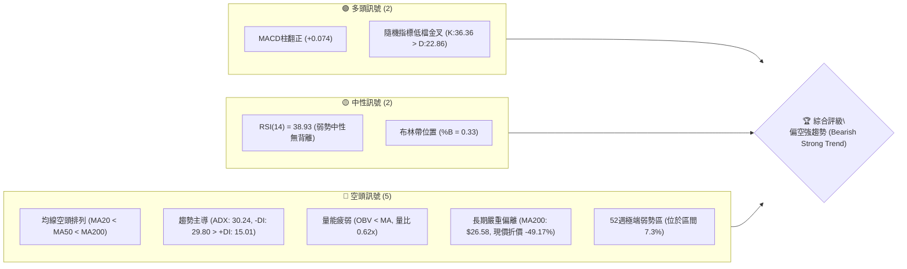

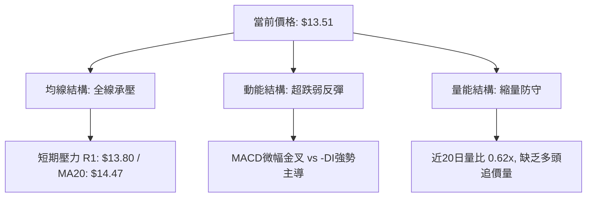

### 📊 核心指標速覽表

| 指標類別 | 指標名稱 | 當前數值 | 訊號 | 解讀 |
|----------|----------|----------|------|------|
| **價格** | 當前收盤價 | $13.51 | 🔴 | 位於 52 週低檔區間 (7.3%)，整體處於長期空頭走勢 |
| **均線** | MA20 | $14.47 | 🔴 | 價格在 MA20 下方 (-6.66%)，短期下行趨勢顯著 |
| **均線** | MA50 | $16.47 | 🔴 | 價格在 MA50 下方 (-17.97%)，中期生命線持續下彎壓制 |
| **均線** | MA200 | $26.58 | 🔴 | 價格在 MA200 下方 (-49.17%)，長期熊市格局未變 |
| **動能** | RSI(14) | 38.93 | 🟡 | 位於 30–70 中性弱勢區，未達極度超賣，無顯著底背離 |
| **動能** | MACD(12,26,9) | -0.970 / -1.045 | 🟢 | MACD 線穿過訊號線，柱狀圖 +0.074 翻紅，觸發短線弱反彈 |
| **動能** | Stoch %K / %D | 36.36 / 22.86 | 🟢 | 低檔金叉後向上發散，短線具備技術性修復動能 |
| **趨勢** | ADX / ±DI | 30.24 / -DI: 29.80 | 🔴 | ADX > 25 且 -DI 顯著高於 +DI (15.01)，確立空頭強趨勢 |
| **通道** | 布林通道 | %B = 0.33 | 🟡 | 位於中軌 ($14.47) 與下軌 ($11.59) 之間，偏向弱勢下軌整理 |
| **量能** | 20日均量比 | 0.62x (5.60M / 8.99M) | 🔴 | 縮量盤整，OBV < MA，反映多頭買盤承接力道薄弱 |
| **波動** | ATR(14) | $0.90 (6.65%) | 🟡 | 波動率維持高檔 (Wilder 6.65%)，日內與波段震幅風險偏大 |

### 🏆 技術評分卡

```
╔══════════════════════════════════════════════════════════════╗
║                 技術評分卡 — PL (2026-11-04)                 ║
╠══════════════════════════════════════════════════════════════╣
║ 趨勢強度      ████████░░░░░░░░░░░░  40/100  🔴 空頭強勢主導  ║
║ 動能指標      ██████████░░░░░░░░░░  50/100  🟡 短多反彈交織  ║
║ 支撐穩定度    ████████░░░░░░░░░░░░  40/100  🔴 依賴前低防守  ║
║ 成交量配合    ██████░░░░░░░░░░░░░░  30/100  🔴 量能顯著萎縮  ║
║ 形態完整度    ████████░░░░░░░░░░░░  40/100  🔴 空方箱體下沉  ║
║ 均線排列      ████░░░░░░░░░░░░░░░░  20/100  🔴 完美空頭排列  ║
╠══════════════════════════════════════════════════════════════╣
║ 綜合評分      ███████░░░░░░░░░░░░░  37/100  🔴 偏空弱勢格局  ║
╚══════════════════════════════════════════════════════════════╝
```
*(註：綜合評分由六項子評分算術平均所得：(40 + 50 + 40 + 30 + 40 + 20) ÷ 6 = 36.67，四捨五入為 37/100，評級屬偏空，規則 18。)*

---

## 2. 趨勢分析

### 🌐 多時框趨勢分析

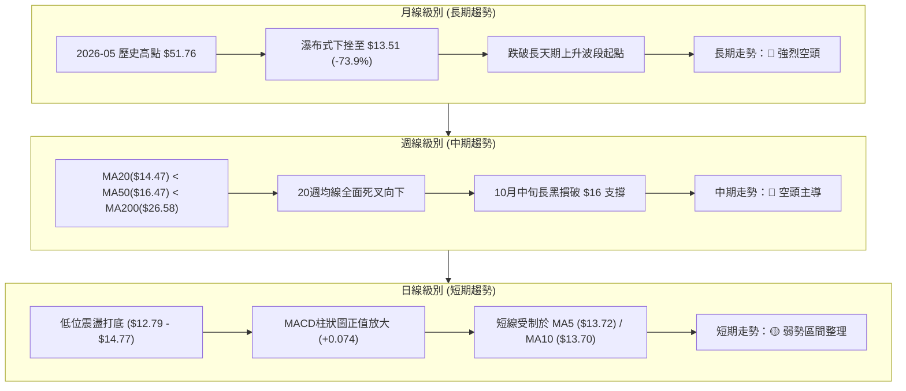

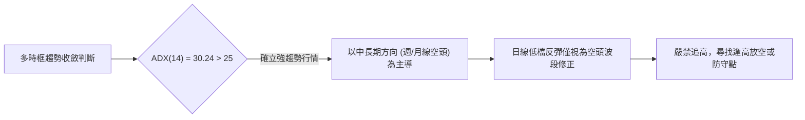

### 📈 長期趨勢 — 12個月走勢圖（Unicode）

```
PL 月線走勢圖（過去12個月：2025-12 至 2026-11）
價格軸 ($)
$55 ┤                                  ● $51.14 (2026-05 高點 $51.76)
$50 ┤                                 ╱ ╲
$45 ┤                                ╱   ╲
$40 ┤                         ● $36.97    ╲
$35 ┤                        ╱             ● $33.13
$30 ┤                ● $27.95               ╲
$25 ┤        ● $24.97 ╲                      ╲
$20 ┤● $19.72          ● $24.14               ● $20.48 ── ● $19.85
$15 ┤                                                    ╲       ● $13.51 (現價)
$10 ┤                                                     ● $16.39  ● $13.47
 └────────────────────────────────────────────────────────────────────────
      12    01    02    03    04    05    06    07    08    09    10    11
     (2025)                      (2026 年月份)
```

#### 長期走勢特徵分析表格

| 階段區間 | 時間跨度 | 起始收盤價 | 結束收盤價 | 區間漲跌幅 | 主要走勢特徵 |
|----------|----------|------------|------------|------------|--------------|
| **波段主升段** | 2025-12 至 2026-05 | $19.72 | $51.14 | +159.33% | 月線連收陽線，突破歷史天花板，量價齊揚創 $51.76 歷史峰值 |
| **高位崩跌段** | 2026-05 至 2026-07 | $51.14 | $20.48 | -59.95% | 獲利了結盤湧出，跌破所有短中期均線，形成頭部懸崖下跌 |
| **次級反彈/盤整** | 2026-07 至 2026-08 | $20.48 | $19.85 | -3.08% | 於 $20 心理整數關卡進行防守拉鋸，中期均線死叉確認確立 |
| **二次下殺破位** | 2026-08 至 2026-10 | $19.85 | $13.47 | -32.14% | 摜破 $16 中期頸線支撐，連番破底，下探 52 週最低點 $10.52 區間 |
| **當前低檔築底** | 2026-10 至 2026-11 | $13.47 | $13.51 | +0.30% | 連續三週於 $12.79–$13.80 築底，成交量驟減，進入縮量磨底 |

### 📊 中期趨勢（週線分析）

```
PL 近期週線壓力與支撐示意圖
═══════════════════════════════════════════════════════════════
$18.18 ─── 週波段高點強阻力 (2026-09-25 高點) ──────────────── R3
           │
$16.47 ─── 中期生命線 MA50 壓力帶
           │
$14.77 ─── 近期日/週反彈波段頂部 (2026-10-27/30 高點) ──────── R2
           │
$13.80 ─── 短線反彈密集成交頸線區 ────────────────────────── R1
           │
$13.51 ───【目前收盤價位】
           │
$12.79 ─── 近期雙底測試低點 (2026-10-23 低點) ─────────────── S1
           │
$10.52 ─── 52週歷史低點 (極限支撐) ────────────────────────── S2
═══════════════════════════════════════════════════════════════
```

中期週線在 2026-10-16 當週出現跳空破位大陰線（當週開 $17.00，收 $13.56，跌幅達 -21.07%，成交量 51.29M），一舉灌破原有的 $16.00–$17.00 箱體下緣。隨後連續 3 週（10-23、10-30、11-03）均受限於 $14.77 下方，成交量由 5,986 萬股降至當週的 1,418 萬股，顯示破位後空頭動能有所放緩，但中期下行架構絲毫未獲扭轉。

### ⚡ 趨勢強度評估（ADX 解讀）

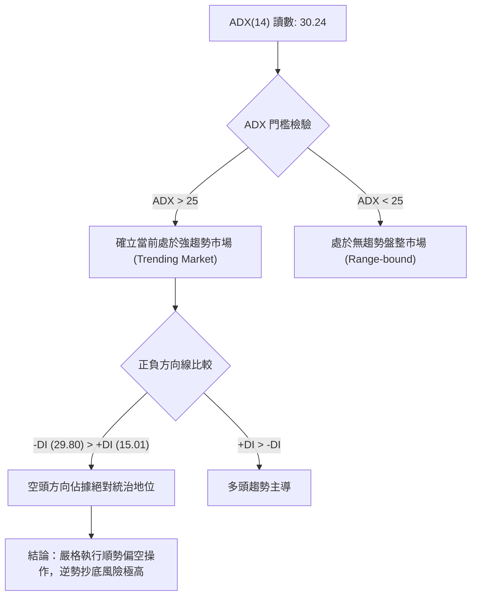

#### ADX 指標狀態強度對照表

| 指標變數 | 當前讀數 | 門檻區間 | 趨勢屬性判定 | 操作指引 |
|----------|----------|----------|--------------|----------|
| **ADX(14)** | 30.24 | 25 – 50 | 強趨勢形成階段 | 趨勢策略優先，震盪逆勢指標（如超賣反彈）成功率被壓制 |
| **-DI** | 29.80 | > 25 (高讀數) | 空方攻擊力道強勁 | 下行壓力沉重，反彈易遭遇賣壓壓制 |
| **+DI** | 15.01 | < 20 (極弱區) | 多方缺乏推升動能 | 多頭進攻意願低，量能難以放大 |
| **走向差 (Directional Spread)** | -14.79 | 負值擴大 | 空方絕對優勢 | 順應中長期空方主軸，限制多單持有時間 |

---

## 3. 圖表形態分析

### 🔍 形態識別系統

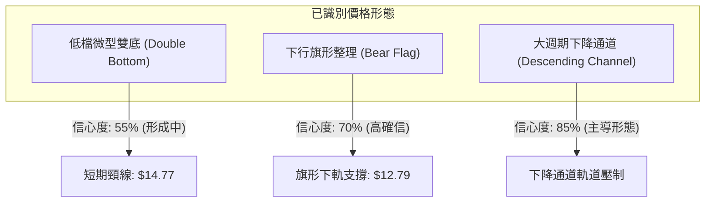

#### 圖表形態信心度評估表（依規則 15）

| 形態名稱 | 信心度 | 判斷依據（引用數據） | 完成度 | 目標價（附精確計算式） |
|----------|--------|----------------------|--------|------------------------|
| **低檔微型雙底** | 55% | 兩次下探低點 $12.79 (2026-10-23) 與 $12.87 (2026-11-02)，未跌破前低 | 60% | 由形態高度推算：頸線 $14.77 + 形態高度 ($14.77 - $12.79 = $1.98) = **$16.75** (受制於中軌與前高) |
| **空頭下行旗形** | 70% | 10-16 巨量下殺 ($17.00→$13.33) 作為旗桿，隨後在 $12.79–$14.77 弱勢微幅整理 | 75% | 由形態高度推算：破位點 $12.79 - 旗桿高度 ($17.00 - $13.33 = $3.67) = **$9.12** (若跌破，下看 S2: $10.52) |
| **下降通道主走勢** | 85% | 9月以來波段高點 $18.18 (09-25) 與低點 $12.79 形成清晰斜向下通道 | 90% | 通道下軌延伸支撐區間：引用數據波段低點聚類 **S2: $10.52** |

### 🕯️ 重要 K 線形態分析（依規則 19）

根據所提供的近 10 根日 K 與近 8 根週 K 數據，開、高、低、收精確紀錄與形態解讀如下：

#### 近 10 根日 K 棒分析表

| 日期 (日K) | 開盤價 | 最高價 | 最低價 | 收盤價 | K線形態名稱 | 技術解讀 | 訊號 |
|------------|--------|--------|--------|--------|-------------|----------|------|
| 2026-10-21 | 13.89 | 14.09 | 13.59 | 13.71 | 小陰線帶下影 | 遭遇 MA20 下壓，高位受阻回落 | 🔴 |
| 2026-10-22 | 13.26 | 13.60 | 12.87 | 13.08 | 下跳空小陰線 | 空方擴大戰果，向下測試整數心理關卡 | 🔴 |
| 2026-10-23 | 13.18 | 13.53 | 12.79 | 13.41 | 下影陽錘頭線 | 創波段低點 $12.79 後買盤拉升，出現止跌初步信號 | 🟢 |
| 2026-10-26 | 13.30 | 13.99 | 13.26 | 13.76 | 連續反彈中陽線 | 多頭延續錘頭線反攻，收盤站上 MA5 | 🟢 |
| 2026-10-27 | 13.95 | 14.77 | 13.84 | 14.49 | 帶長上影大陽線 | 盤中衝高至 R2: $14.77 遭遇強烈解套賣壓，多空交戰激烈 | 🟡 |
| 2026-10-28 | 14.45 | 14.56 | 14.03 | 14.33 | 高位十字小陰線 | 反彈力竭，無法站穩 $14.50，買盤後繼乏力 | 🟡 |
| 2026-10-29 | 13.96 | 14.60 | 13.96 | 14.31 | 整理小紡錘陰線 | 於高位震盪，MA20 ($14.47) 壓制明確 | 🔴 |
| 2026-10-30 | 13.54 | 14.02 | 13.15 | 13.47 | 低開下挫中陰線 | 開盤跳空失守 $14，空方重新取得主導權 | 🔴 |
| 2026-11-02 | 13.62 | 13.69 | 12.87 | 12.96 | 光頭大陰線破底 | 再次回測 $12.87 低位，收於全日偏低位置，短底面臨考驗 | 🔴 |
| 2026-11-03 | 13.21 | 13.74 | 13.17 | 13.51 | 低開收高小陽線 | 縮量 (5.60M) 低檔抵抗，回升至 $13.51，空方打壓動能放緩 | 🟢 |

#### 近 8 根週 K 棒分析表

| 週末日期 (週K) | 開盤價 | 最高價 | 最低價 | 收盤價 | 週K形態名稱 | 技術解讀 | 訊號 |
|----------------|--------|--------|--------|--------|-------------|----------|------|
| 2026-09-18 | 16.10 | 17.27 | 15.60 | 16.42 | 下影小陽線 | 於 $15.60 獲得支撐，呈現弱反彈格局 | 🟡 |
| 2026-09-25 | 16.68 | 18.18 | 16.13 | 17.43 | 衝高長上影陽線 | 上測波段阻力 R3: $18.18 失敗，留長上影線 | 🔴 |
| 2026-10-02 | 17.17 | 17.73 | 16.10 | 17.50 | 高檔十字震盪線 | 量能萎縮，多空雙方在 $17.50 陷入僵持 | 🟡 |
| 2026-10-09 | 17.64 | 18.81 | 16.55 | 17.18 | 假突破長上影陰線 | 創反彈新高 $18.81 後遭空頭伏擊，誘多結束 | 🔴 |
| 2026-10-16 | 17.00 | 17.03 | 13.33 | 13.56 | 破位光腳大長黑 | 巨量摜破平台底，單週重挫 -21.07%，確立新一輪跌勢 | 🔴 |
| 2026-10-23 | 13.85 | 14.09 | 12.79 | 13.41 | 低檔長下影十字線 | 跌勢減緩，下影線觸及 S1: $12.79，多頭嘗試構築防線 | 🟡 |
| 2026-10-30 | 13.30 | 14.77 | 13.15 | 13.47 | 衝高回落倒錘線 | 測試 $14.77 頸線壓力失敗，買盤無功而返 | 🔴 |
| 2026-11-03 | 13.62 | 13.74 | 12.87 | 13.51 | 窄幅縮量內困線 | 極度收斂 (僅交易2天)，量能枯竭等待方向性突破 | 🟡 |

### 📉 ASCII 走勢形態示意圖

```
PL 關鍵形態走勢示意（近10日 K 線價格架構）
價格軸 ($)
$14.80 ┤               ┌─┐ ($14.77 波段頸線頂部 R2)
$14.50 ┤               │ │  ┌─┐  ┌─┐
$14.20 ┤               │ │  │ │  │ │
$13.90 ┤  ┌─┐          │ │  │ │  │ │
$13.60 ┤  │ │   ┌─┐    │ │  └─┘  └─┘   ┌─┐          ┌─┐
$13.30 ┤  │ │   │ │    └─┘             │ │          │ │ ($13.51 現價)
$13.00 ┤  └─┘   │ │                    │ │   ┌─┐    └─┘
$12.70 ┤        └─┘ ($12.79 低點 S1)    └─┘   │ │
       └──────────────────────────────────────┴─────────────
        10/21  10/23       10/27        10/30 11/02  11/03
```

### 🎯 形態目標價計算

根據上述微型雙底形態與空頭旗形邊界，進行目標價與空間推算：

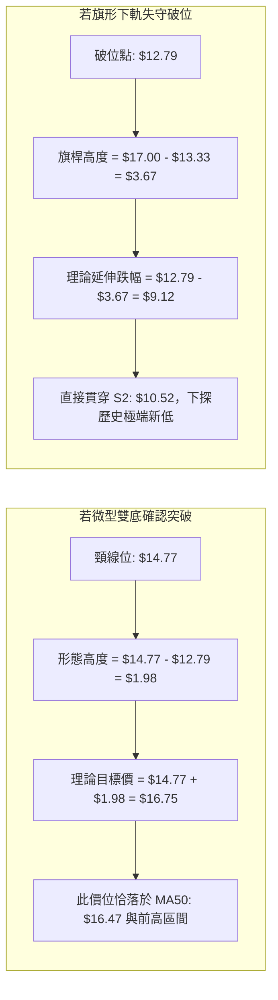

- **微型雙底潛在多頭目標價**：
  - 頸線位置：$14.77（2026-10-27 日高點 / 2026-10-30 週高點）
  - 形態底部：$12.79（2026-10-23 日低點）
  - 垂直形態高度：$14.77 − $12.79 = $1.98
  - **由雙底形態推算目標價** = $14.77 + $1.98 = **$16.75**（受中天期均線 MA50: $16.47 強壓制）
- **空頭旗形跌破延伸目標價**：
  - 旗形下軌破位支撐：$12.79
  - 旗桿垂直高度：$17.00（10-16 週開盤）− $13.33（10-16 週低點）= $3.67
  - **由旗形形態推算目標價** = $12.79 − $3.67 = **$9.12**（途中第一關鍵防守點為數據中 52 週低點 **S2: $10.52**）

---

## 4. 支撐與阻力

### 🗺️ 關鍵價位分布圖（Unicode）

```
PL 價位結構分布圖
═══════════════════════════════════════════════════
$18.18 ║████████████████████████║ 強阻力 R3 (週波段起跌點，+34.57%)
$17.36 ║▓▓▓▓▓▓▓▓▓▓▓▓▓▓▓▓        ║ 布林帶上軌壓力
$16.47 ║████████████████        ║ 中期均線 MA50 壓制
$14.77 ║████████████████████    ║ 關鍵頸線阻力 R2 (+9.33%)
$14.47 ║▓▓▓▓▓▓▓▓▓▓▓▓▓▓▓▓        ║ 布林中軌 (MA20) 密集套牢區
$13.80 ║████████████████████████║ 短線反彈阻力 R1 (+2.15%)
$13.51 ╠════════════════════════╣ ◄ 當前收盤價位 ($13.51)
$12.79 ║▓▓▓▓▓▓▓▓▓▓▓▓▓▓▓▓        ║ 近期雙底波段支撐 S1 (-5.33%)
$11.59 ║▒▒▒▒▒▒▒▒▒▒▒▒▒▒▒▒        ║ 布林帶下軌支撐
$10.52 ║████████████████████████║ 52週歷史低點強支撐 S2 (-22.13%)
═══════════════════════════════════════════════════
```

### 🚧 阻力位分析表

所有價位均嚴格引用自數據「關鍵價位（由 OHLCV 計算）」區塊中之波段高點聚類數值：

| 阻力級別 | 價位 | 與現價差距 (%) | 形成原因與技術背景 | 突破難度 | 重要性 |
|----------|------|----------------|--------------------|----------|--------|
| **R1** | $13.80 | +2.15% | 近期 10-21、10-26 及 11-03 盤中高點密集套牢密集區，貼近 MA5 ($13.72) 與 MA10 ($13.70) | 中等 | 短線多空臨界分水嶺 |
| **R2** | $14.77 | +9.33% | 2026-10-27 日線波段最高點、10-30 週線反彈高點，亦為微型雙底形態頸線 | 極高 | 中期反彈確認關鍵位 |
| **R3** | $18.18 | +34.57% | 2026-09-25 週線波段高點聚類，前一輪大型箱體震盪之上緣，累積龐大籌碼套牢盤 | 極極高 | 結構性多空反轉點 |

### 🛡️ 支撐位分析表

所有價位均嚴格引用自數據「關鍵價位（由 OHLCV 計算）」區塊中之波段低點聚類數值：

| 支撐級別 | 價位 | 與現價差距 (%) | 形成原因與技術背景 | 守住機率 | 重要性 |
|----------|------|----------------|--------------------|----------|--------|
| **S1** | $12.79 | -5.33% | 2026-10-23 日/週波段低點，近期多頭多次防守的微型雙底防線 | 55% | 短線生命線，失守將引發停損賣壓 |
| **S2** | $10.52 | -22.13% | 52 週歷史最低點聚類，斐波那契 100.0% 回調位，市場終極信心底線 | 75% | 長期戰略支撐底，破位將進入無底深淵 |
| **S3** | 數據中未偵測到 | N/A（數據未提供） | 數據中僅提供 S1 與 S2 兩處波段低點聚類，下方無第三聚類數據 | N/A | N/A |

### 📐 斐波那契回調位分析

依據 52 週區間高低點（$10.52 → $51.76，極限落差 $41.24）計算出的黃金分割回調結構如下：

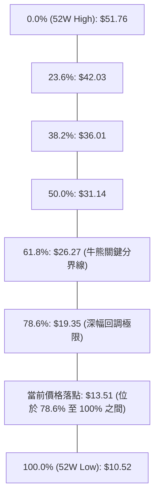

#### 斐波那契價位對照與深度解讀

| 斐波那契層級 | 精確價位 | 技術解讀與籌碼意義 | 當前相對位置 |
|--------------|----------|--------------------|--------------|
| **0.0% (52W High)** | $51.76 | 2026年5月所創下的歷史歷史峰值，天花板極限 | 遠高於現價 (+283.1%) |
| **23.6%** | $42.03 | 首波強烈多頭防守點，6月破位後轉為超強壓力帶 | 遠高於現價 |
| **38.2%** | $36.01 | 弱勢修正回調極限，失守宣告中期多頭結束 | 遠高於現價 |
| **50.0%** | $31.14 | 半數多頭漲幅回吐位，心理重要關卡 | 遠高於現價 |
| **61.8%** | $26.27 | 黃金分割分割黃金防線，貼近 MA200 ($26.58)，確立技術性熊市 | 遠高於現價 |
| **78.6%** | $19.35 | 深度多頭回撤防守位，8月跌破後多頭架構徹底瓦解 | 現價上方重要心理壓力帶 |
| **現價區間** | **$13.51** | **落於 78.6% ($19.35) 至 100.0% ($10.52) 之間的極端弱勢衰竭區** | **處於超跌陰跌回撤區** |
| **100.0% (52W Low)**| $10.52 | 起漲原始起點與 52 週最低點，多頭最後退路 | 距現價空間 -22.13% |

**意義剖析**：現價 $13.51 處於 78.6% ($19.35) 與 100.0% ($10.52) 的超深幅回檔區。跌破 78.6% 在道氏理論與斐波那契分析體系中，代表「原上升浪潮已 100% 遭到破壞，市場進入尋底重構期」。此區間缺乏中長期的密集籌碼支撐，若短線無法守穩 S1: $12.79，價格極易滑向 100.0% 處的 $10.52 尋求重置。

---

## 5. 技術指標深度解讀

### 🎛️ 指標訊號總覽

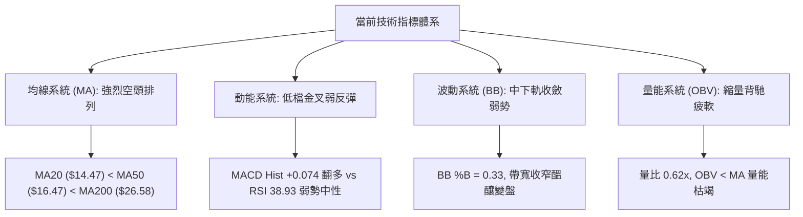

### 📈 移動平均線排列分析

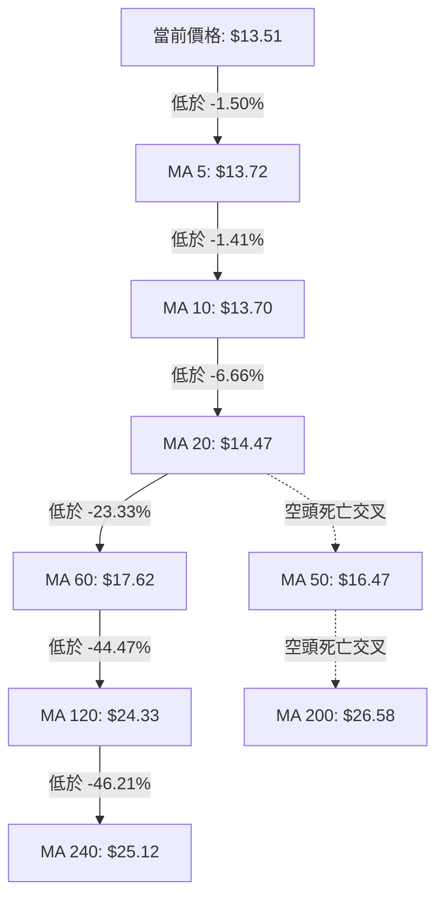

#### 移動平均線數據對照表

| 均線名稱 | 當前價格 | 與現價差值 | 偏離幅度 (%) | 走勢特徵（微型趨勢） | 排列狀態 |
|----------|----------|------------|--------------|----------------------|----------|
| **MA 5** | $13.72 | -$0.21 | -1.50% | 短線下彎壓制，現價貼近 | 空頭排列 |
| **MA 10** | $13.70 | -$0.19 | -1.41% | 短期扣高走低，阻力密集 | 空頭排列 |
| **MA 20** | $14.47 | -$0.96 | -6.66% | 月線下行，布林中軌強壓 | 空頭排列 |
| **MA 50** | $16.47 | -$2.96 | -17.97% | 季線快速下墜，中期空頭 | 空頭排列 |
| **MA 60** | $17.62 | -$4.11 | -23.33% | 下行斜率陡峭，反彈極限 | 空頭排列 |
| **MA 120** | $24.33 | -$10.82 | -44.47% | 半年線持續壓制 | 空頭排列 |
| **MA 200** | $26.58 | -$13.07 | -49.17% | 年線牛熊分水嶺，深度折價 | 空頭排列 |
| **MA 240** | $25.12 | -$11.61 | -46.21% | 長期成本線，嚴重套牢 | 空頭排列 |

**排列結論**：均線系統呈現教科書級別的「標準空頭排列」（MA20 < MA50 < MA200，且短天期至長天期均線無一例外全數運行於現價上方）。近 5 日、10 日、20 日均線斜率均為負值，價格反彈時，每一道均線均將轉化為強大拋壓阻力。

### 📉 RSI(14) 分析

#### RSI 數值進度條
```
RSI(14) 讀數: 38.93 
[░░░░░░░░░░░░░░░░░░░░███████████████████░░░░░░░░░░░░░░░░░░░░░░░░░░░░░░░] 38.93%
0       極度超賣 (20)    30       弱勢中性 (50)           70     極度超買 (80)   100
```

- **區間判定**：RSI 讀數為 **38.93**（Wilder），處於 30 至 70 之間的中性弱勢區。價格雖然處於波段低檔，但 RSI 尚未觸及 30 以下的極端超賣區，顯示下行動能並未引發空頭恐慌性拋售，而是呈現緩慢消耗的陰跌走勢。
- **背離分析（嚴格判定）**：
  - 比對近期數據：10-23 低點收盤價為 $13.41（RSI 為 33.1），至 11-03 收盤價 $13.51（RSI 為 38.93）；價格近 20 根 K 棒首尾呈現水平低檔黏合，RSI 亦步亦趨走平。
  - **結論**：目前**無明顯頂背離或底背離**。指標未出現與價格走勢相左的背離信號，不支持出現結構性趨勢反轉。

### 📊 MACD(12/26/9) 訊號解讀

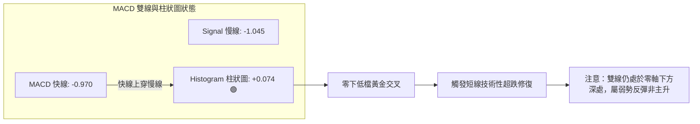

- **MACD 快線**：-0.970
- **MACD 訊號線**：-1.045
- **MACD 柱狀圖**：**+0.074**（由負翻正，發出🟢看多信號）
- **技術解讀**：MACD 線在零軸下方向上穿越訊號線，柱狀圖自 10 月中旬的負值低檔回升並維持在 +0.074。這構成了標準的「零下金叉」。但因整體數值深陷零軸（Zero-line）下方，技術上嚴格定義為「空頭市場中的超跌反彈修復」，不可誤判為中長線的多頭反轉起漲點。

### 📦 布林通道分析

```
PL 日線布林通道 (20, 2) 結構圖
價格軸 ($)
$17.36 ┼──────────────────────────────── 上軌 (Upper Band)
       │
$16.00 ┤
       │
$14.47 ┼┄┄┄┄┄┄┄┄┄┄┄┄┄┄┄┄┄┄┄┄┄┄┄┄┄┄┄┄┄┄┄ 中軌 (MA20 / Middle Band)
       │
$13.51 ┤                      ● (現價 $13.51，%B = 0.33)
       │
$11.59 ┼──────────────────────────────── 下軌 (Lower Band)
════════════════════════════════════════════════════════════════════
帶寬帶 (Bandwidth): $5.77 ｜ 通道寬度比: 39.88% ｜ 當前狀態: 弱勢下軌整理
```

- **上軌**：$17.36
- **中軌 (MA20)**：$14.47
- **下軌**：$11.59
- **%B 位置**：**0.33**（公式：(現價 − 下軌) ÷ (上軌 − 下軌) = ($13.51 − $11.59) ÷ ($17.36 − $11.59) = $1.92 ÷ $5.77 = 0.3327）
- **解讀**：%B 讀數 0.33 顯示價格落於中軌與下軌之間的空方弱勢通道內，且通道口自前期大幅擴張後逐步收窄，顯示短期波動率正在被壓縮，正在醞釀新一輪的突破選擇。

### 💹 成交量分析（量價配合度）

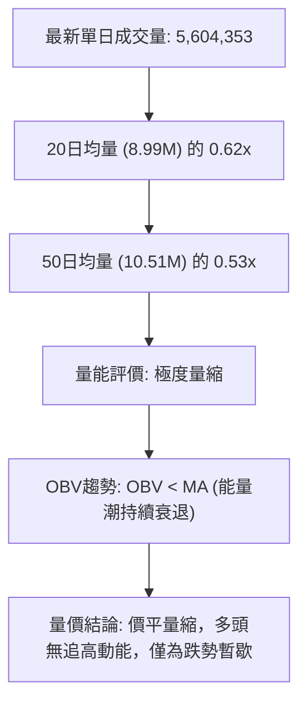

- **量比分析**：最新單日成交量為 5,604,353 股，相較於 20 日平均成交量 8,986,143 股，量比僅為 **0.62x**；相較於 50 日均量 10,510,917 股縮減近一半。
- **週量能連續性**：近四週成交量呈現階梯式遞減（51.29M → 42.02M → 35.02M → 本週 14.18M），呈現嚴重的縮量鈍化。
- **OBV 能量潮**：數據明確標示「OBV < MA → 量能疲弱」，表明資金持續呈淨流出狀態，未觀察到機構大額資金吸籌建倉的痕跡。目前的價格止跌並非源於買盤強勁進場，而是空方拋盤的暫時衰竭。

---

## 6. 動能與波動率

### ⚡ 動能評估四象限

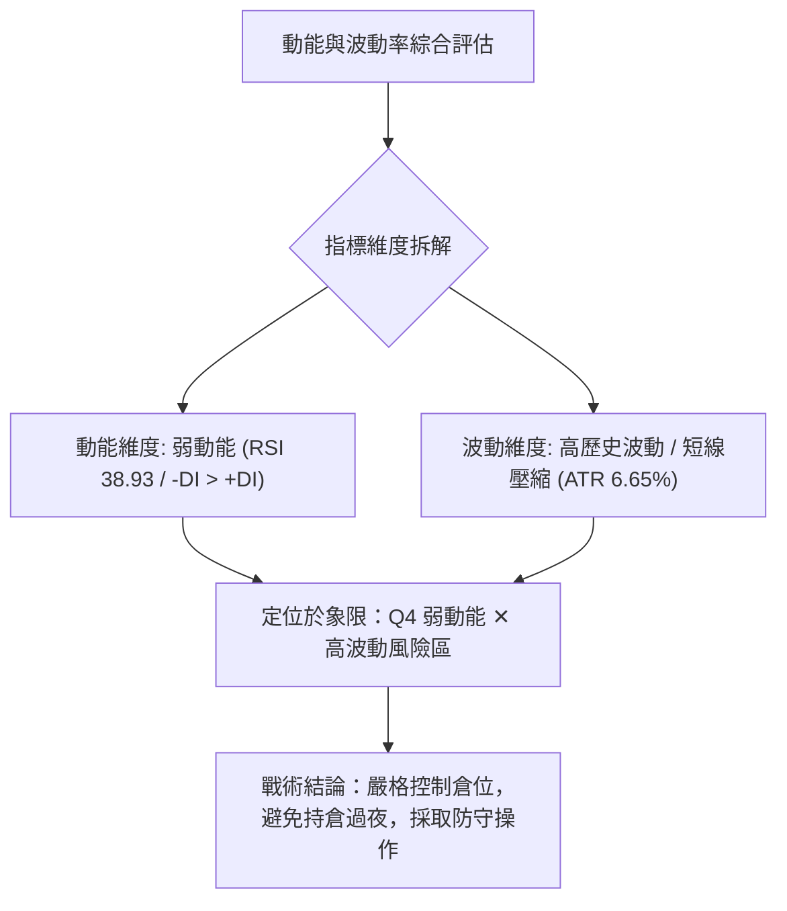

#### 動能評估四象限矩陣表

| 象限 | 動能維度 | 波動維度 | 當前狀態判定 | 戰術評價與應對 |
|------|----------|----------|--------------|----------------|
| **Q1** | 強動能 | 低波動 | — | 最佳趨勢波段持有機會 |
| **Q2** | 弱動能 | 低波動 | — | 窄幅無聊盤整，謹慎觀望 |
| **Q3** | 強動能 | 高波動 | — | 突破噴發期，高風險高收益 |
| **Q4** | **弱動能** | **高波動** | **✓ 當前 PL 處於此區間** | **弱勢反彈伴隨大幅震盪，極易出現假突破與破位，應嚴格減倉或空方對沖** |

### 📊 ATR 波動率分析

- **ATR(14) 讀數**：**$0.90**（Wilder 計算）
- **佔現價比重**：**6.65%**（$0.90 ÷ $13.51）
- **解讀與止損設置指引**：
  - 單日平均波動幅度高達 6.65%，反映出該標的具有高投機性與高日內震盪幅度。
  - **保守交易止損間距**：建議設置為 1.5 倍 ATR，即 1.5 × $0.90 = **$1.35**。
  - **進取交易止損間距**：建議設置為 1.0 倍 ATR，即 1.0 × $0.90 = **$0.90**。
  - 由於 ATR 高達 $0.90，短線任何小於 $0.50 的止損位極易遭到市場正常雜訊「洗盤掃出場」，設定止損必須給予價格至少 $0.90 以上的緩衝空間。

### 📐 Beta 與市場相關性

- **Beta 係數**：**2.27**
- **市場特徵解讀**：
  - Beta 為 2.27，代表 PL 屬於**超高波動性股票**。當標普 500 指數或大盤波動 1.0% 時，該股理論上將產生 2.27% 的同向或放大波動。
  - 在整體市場處於避險情緒時，高 Beta 股票將承擔不成比例的拋售賣壓。結合其空頭均線排列，此高 Beta 屬性加劇了其破底風險，缺乏防禦屬性。
- **空頭部位比例 (Short % Float)**：**12.2%**，Short Ratio 為 3.42 天，存在潛在的空頭回補動能，但尚未達到軋空（Short Squeeze）的極端臨界水準（通常需 >20%）。

---

## 7. 多時框架總結

### 📋 時框架評分表

| 時框架 | 趨勢方向 | 動能狀態 | 均線排列 | 圖表形態 | 綜合評分 | 建議策略 |
|--------|----------|----------|----------|----------|----------|----------|
| **長期 (月線)** | 🔴 強烈空頭 | 疲弱 (-73.9%) | MA200 遠在上方法 | 頂部崩跌破位 | 20/100 | 長期遠離，禁止抄底 |
| **中期 (週線)** | 🔴 空頭主導 | 偏弱 (-DI: 29.8) | 全面空頭排列 | 下降通道延伸 | 35/100 | 反彈遇均線逢高布空 |
| **短期 (日線)** | 🟡 區間震盪 | 弱反彈 (MACD金叉) | 承壓於 MA5/MA20 | 微型雙底 vs 下行旗形 | 50/100 | 嚴格防守 $12.79，超短線波段操作 |

### 🔲 綜合訊號矩陣

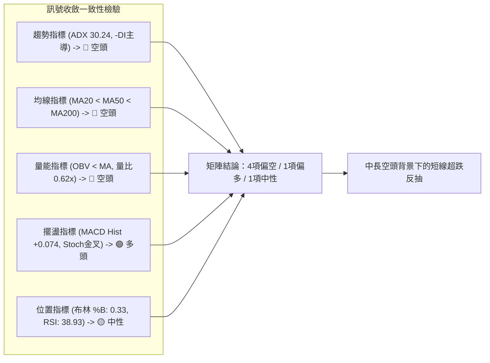

### ⚖️ 多時框收斂結論（依規則 14）

1. **行情性質判定**：
   - 當前 **ADX(14) 讀數為 30.24**，嚴格大於 25 的趨勢行情閾值，且 -DI (29.80) 遠大於 +DI (15.01)，因此**確立當前為「空頭強趨勢行情」，絕非單純的「無趨勢盤整行情」**。
2. **多時框衝突收斂規則**：
   - 根據規則 14，在強趨勢行情（ADX > 25）下，**必須以中長期（週線 / MA50 / MA200）方向為主導**，日線級別的指標反彈（如 MACD 柱狀圖翻紅、Stoch 金叉）僅能用作**「尋找次級折返進場時機」**，嚴禁以日線短期弱信號推翻中長線空頭框架。
3. **方向性唯一結論**：
   - **偏空操作（Bearish Trend）**。
   - 綜合評分為 **37/100**（偏空弱勢格局），主策略必須定位為「順應中長期空頭趨勢進行逢高放空或持空防守」，所有多頭操作僅限於嚴格止損的超短線超跌博弈。

---

## 8. 交易策略建議

### 🗺️ 策略決策流程圖

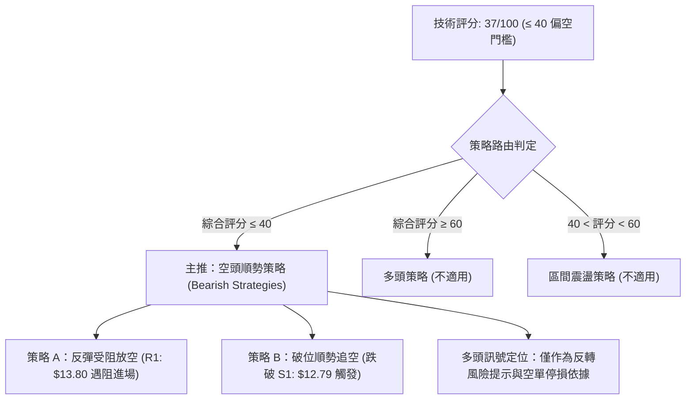

### 🧭 策略路由（依評分卡分流，規則 18）

**當前主策略方向 = 空頭主導策略（依綜合評分 37/100 確立）**

本報告嚴格遵守規則，因綜合評分僅 37/100（≤ 40 偏空標準），**主推空頭順勢策略**。多頭策略不作為獨立操作推薦，僅於後文列為空方「反轉風險觸發點（對沖提示）」。

### 🎯 價格情境階梯（Price Scenarios）

所有觸發價位嚴格引用自第 4 章「關鍵價位」區塊之客觀數值：

| 觸發條件 | 下一目標價位 | 後續延伸價位 | 情境技術含義 |
|----------|--------------|--------------|--------------|
| **強勢突破 R1 ($13.80)** | R2 ($14.77) | R3 ($18.18) | 短線微型雙底確立，挑戰月均線 MA20 與中期壓力帶 |
| **受阻於現價區間 ($13.51)** | S1 ($12.79) | R1 ($13.80) | 縮量拉鋸，受制於 MA5 ($13.72)，空頭持續陰跌磨底 |
| **有效跌破 S1 ($12.79)** | S2 ($10.52) | 由旗形推算之 $9.12 | 旗形破位向下，進入主跌浪延伸，探測歷史歷史大底 |

### 📊 情境機率分佈

| 走勢情境 | 發生機率 | 主要技術依據 |
|----------|----------|--------------|
| **情境一：下行破底（跌破 S1 下探 S2）** | **55%** | ADX 高達 30.24 確立空頭趨勢；-DI 主導；均線空頭排列；OBV 持續疲弱流出 |
| **情境二：區間震盪（$12.79 – $13.80）** | **30%** | 最新日成交量萎縮至 5.60M（量比 0.62x）；布林帶帶寬收窄；空方暫停猛烈進攻 |
| **情境三：超跌反彈（突破 R1 測 R2）** | **15%** | 僅依賴 MACD 柱狀圖翻正 (+0.074) 與 Stoch 低檔金叉，但缺乏成交量與均線配合 |

### 🟢 主策略詳情（方向：空頭主導策略）

依據規則 17，風險報酬比計算公式為：做空風險報酬比 = (進場價 − 目標價 T1) ÷ (止損價 − 進場價)。

| 策略要素 | 策略 A：反彈遇阻做空（首選） | 策略 B：跌破關鍵支撐追空（次選） |
|----------|------------------------------|----------------------------------|
| **進場條件** | 反彈至阻力位 R1 附近受阻回落，日 K 出現上影線 | 日線收盤價跌破前低支撐 S1 |
| **進場價格** | **$13.80** (引用阻力位 R1) | **$12.70** (跌破支撐位 S1: $12.79 確認後進場) |
| **目標價 T1** | **$12.79** (引用支撐位 S1) | **$10.52** (引用 52 週低點 S2) |
| **目標價 T2** | **$10.52** (引用支撐位 S2) | **$9.12** (由空頭旗形高度推算之目標價) |
| **止損價格** | **$14.30** (以進場價 + 0.55 倍 ATR $0.50 計，避開雜訊) | **$13.51** (站回當前收盤平台，止損距離 $0.81 ≈ 0.9 倍 ATR) |
| **風險報酬比** | **1 : 2.02（以 T1 計）**<br>*(計算式: ($13.80 - $12.79) ÷ ($14.30 - $13.80) = 1.01 ÷ 0.50 = 2.02)*<br>*(若以 T2 計則為 1 : 6.56)* | **1 : 2.69（以 T1 計）**<br>*(計算式: ($12.70 - $10.52) ÷ ($13.51 - $12.70) = 2.18 ÷ 0.81 = 2.69)*<br>*(若以 T2 計則為 1 : 4.42)* |
| **成功機率** | **65%** | **60%** |
| **建議倉位** | **10% – 15%** (總資金佔比) | **10%** (突破追加型倉位) |

### 🔴 反向風險觸發點（對沖與止損提示）

針對上述主推空頭策略，若市場出現下列關鍵反轉信號，空方必須無條件停損離場或反手對沖：
1. **價位突破**：若日 K 收盤價以放量長陽突破 **R2: $14.77**，宣告微型雙底形態正式構築完成，目標延伸至 $16.75。
2. **動能反轉**：RSI(14) 突破 50 中軸且日線成交量連續兩日放大超過 20 日均量（>9.0M 股）。
3. **均線翻揚**：MA5 與 MA10 在 $13.70 附近形成黃金交叉，且價格持續站穩布林中軌 MA20 ($14.47) 之上。

### ⭐ 整體訊號強度評星

```
做多訊號強度：★☆☆☆☆  (1.5/5星 — 僅具備超賣反彈動能，缺乏趨勢保護)
做空訊號強度：★★★★☆  (4.0/5星 — 趨勢指標強勁主導，均線呈現空頭壓制)
整體可信度：  ★★★★☆  (4.0/5星 — ADX>30 賦予高趨勢可信度，量能數據支持)
```

---

## 9. 風險提示與監控

### ✅ 關鍵監控指標 Checklist

```
╔══════════════════════════════════════════════════════════════╗
║               PL 日常交易風險監控清單 (Checklist)             ║
╠══════════════════════════════════════════════════════════════╣
║ [ ] 監控支撐位 S1: $12.79 是否跌破（破位即觸發空單策略 B）   ║
║ [ ] 監控阻力位 R1: $13.80 反彈試探（遇阻為空單策略 A 點）    ║
║ [ ] 監控布林中軌 MA20: $14.47 動態壓制力道                   ║
║ [ ] 監控成交量是否回升至 20 日均量 (8.99M) 之上（異常放量） ║
║ [ ] 監控 RSI(14) 是否跌破 30（是否觸發非理性超賣拋售）       ║
║ [ ] 監控 ADX 是否維持 > 25（判斷強趨勢是否持續運作）         ║
║ [ ] 監控 Short % Float (12.2%) 是否異常驟降（空頭回補風險）  ║
╚══════════════════════════════════════════════════════════════╝
```

### ⚠️ 風險場景分析

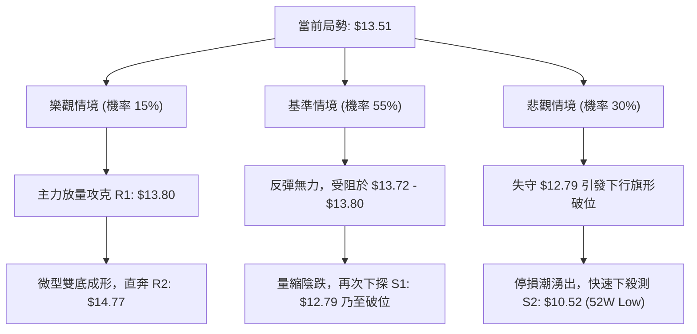

### 🛡️ 風險管理重要提醒

1. **Beta 波動劇烈風險**：
   - 該股 Beta 值高達 **2.27**，且 ATR 佔價格比達 **6.65%**。在任何單筆操作中，部位總虧損金額嚴格限制在總投資組合資金的 1.0%–1.5% 以內。以每股止損 $0.50–$0.90 計算，應大幅縮減持股股數。
2. **基本面巨幅虧損隱憂**：
   - 雖然本篇為純技術分析報告，但數據顯示該股淨利潤率為 -95.1%、ROE 為 -72.0%、營業利潤率為 -27.2%，技術面的長期崩跌高度反映了基本面的現金消耗壓力。切忌以「基本面看好」為由在技術面破位時盲目加碼攤平。
3. **流動性驟降警訊**：
   - 當前成交量僅 5.60M（量比 0.62x），在流動性不足的行情中，若大單不計成本市價拋售，極易造成價格瞬間「滑價」跌穿支撐位。下單時嚴格禁止使用市價單，一律採用限價單（Limit Order）或停損限價單（Stop-Limit Order）。

---

## 📋 報告總結

```
╔════════════════════════════════════════════════════════════════╗
║                   PL 技術分析報告總結                          ║
╠════════════════════════════════════════════════════════════════╣
║ 報告日期：2026-11-04                                           ║
║ 當前價格：$13.51                                               ║
║ 分析評級：🔴 偏空強趨勢 (綜合技術評分: 37/100)                ║
║                                                                ║
║ 關鍵結構結論：                                                 ║
║ ├─ 長期趨勢：🔴 強烈空頭（距 52 週高點回撤 -73.9%，均線空頭） ║
║ ├─ 中期趨勢：🔴 空頭主導（週線大長黑摜破平台，下降通道成形） ║
║ ├─ 短期趨勢：🟡 區間震盪（$12.79–$13.80 築底，MACD弱勢金叉）  ║
║ ├─ 關鍵阻力：R1: $13.80  /  R2: $14.77  /  R3: $18.18          ║
║ ├─ 關鍵支撐：S1: $12.79  /  S2: $10.52 (52W Low)               ║
║ └─ 分析師目標價：均價 $30.27 (範圍: $17.00 – $50.00，僅供參考)║
║                                                                ║
║ 最優策略組合（順應空頭大勢）：                                ║
║ 1. 🥇 最佳機會：反彈至阻力 R1: $13.80 遇阻布空                ║
║    (進場: $13.80 / 止損: $14.30 / T1: $12.79 / 風報比: 1:2.02)║
║ 2. 🥈 次選機會：有效跌破前低支撐 S1: $12.79 順勢追空           ║
║    (進場: $12.70 / 止損: $13.51 / T1: $10.52 / 風報比: 1:2.69)║
║ 3. 🥉 保守選擇：完全空倉觀望，等待日線有效站穩 MA20 ($14.47)  ║
╚════════════════════════════════════════════════════════════════╝
```

---

> ⚠️ **免責聲明**：本報告為 AI 自動生成之技術分析，所有數據及估算均嚴格基於所提供的市場歷史價格與交易量資訊。本報告**僅供研究與學術參考**，**不構成任何形式的要約、招攬或投資建議**。金融市場瞬息萬變，高 Beta 標的風險巨大，投資人應獨立評估自身風險承受能力並自負盈虧。

---

*報告生成時間：2026-11-04 ｜ 數據來源：Yahoo Finance ｜ 分析框架：多時框技術分析體系*