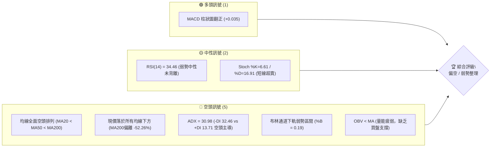
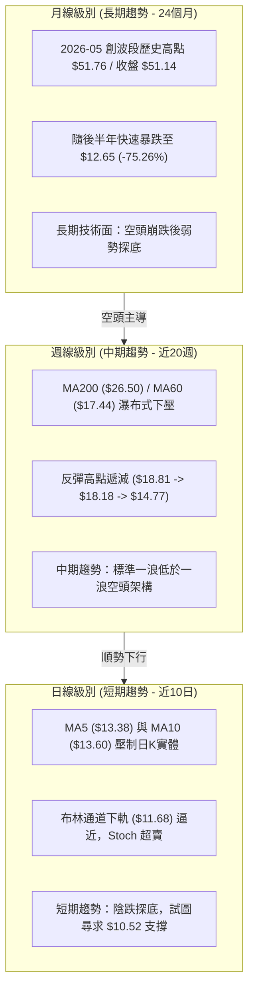
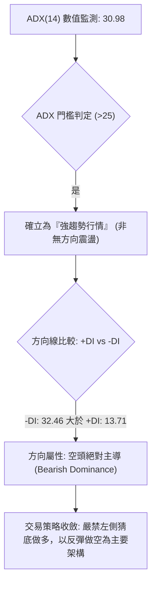
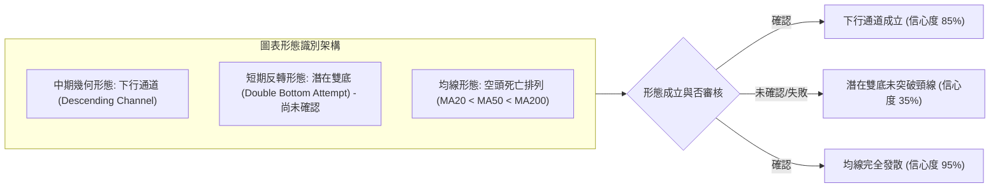
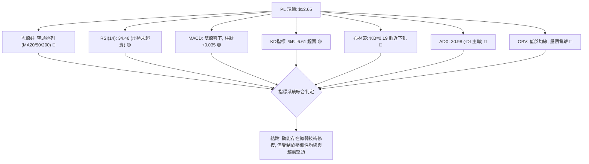
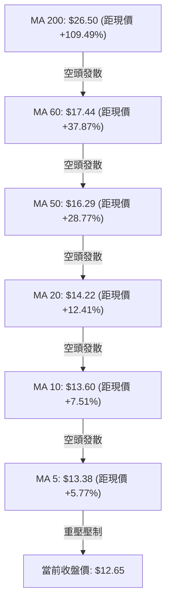
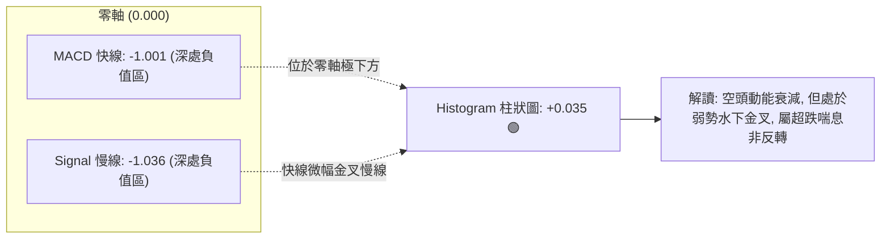
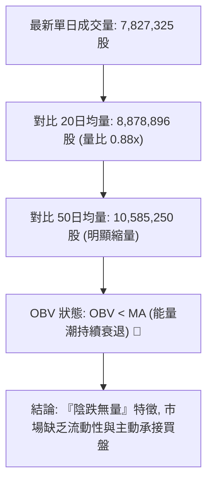
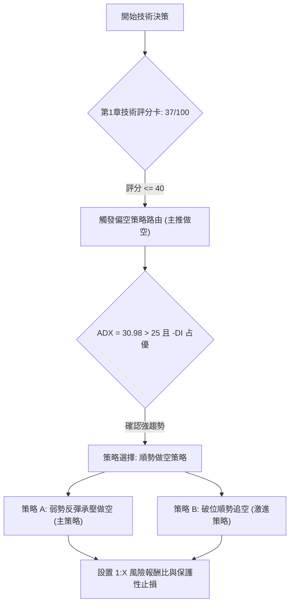
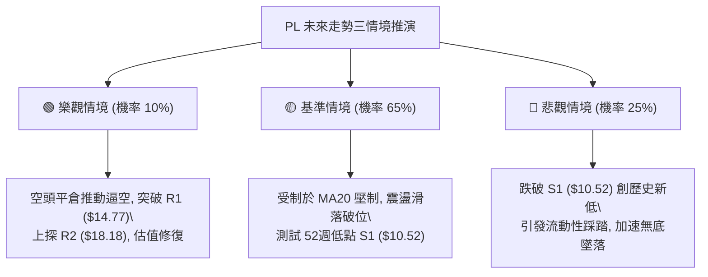

# PL 技術分析報告

> **報告日期**：2026-11-05 ｜ **語言**：繁體中文 ｜ **數據來源**：Yahoo Finance ｜ **當前價格**：$12.65

---

## 目錄

| 章節 | 內容 |
|------|------|
| [1. 技術面概覽](#1-技術面概覽) | 訊號儀表板、核心指標、評分卡 |
| [2. 趨勢分析](#2-趨勢分析) | 多時框趨勢、長中短期走勢 |
| [3. 圖表形態分析](#3-圖表形態分析) | 形態識別、K線組合、目標價 |
| [4. 支撐與阻力](#4-支撐與阻力) | 關鍵價位、斐波那契回調 |
| [5. 技術指標深度解讀](#5-技術指標深度解讀) | MA/RSI/MACD/布林/成交量 |
| [6. 動能與波動率](#6-動能與波動率) | 動能評估、ATR、Beta |
| [7. 多時框架總結](#7-多時框架總結) | 時框架評分矩陣 |
| [8. 交易策略建議](#8-交易策略建議) | 多空策略、風險報酬比 |
| [9. 風險提示與監控](#9-風險提示與監控) | 監控指標、風險場景 |

---

## 1. 技術面概覽

### 🎯 技術訊號儀表板



### 📊 核心指標速覽表

| 指標類別 | 指標名稱 | 當前數值 | 訊號 | 解讀 |
|----------|----------|----------|------|------|
| **價格** | 當前價格 | $12.65 | 🔴 | 位於52週區間底端 5.2%（52W高 $51.76 / 低 $10.52） |
| **均線** | MA20 | $14.22 | 🔴 | 現價低於短期均線 -11.04%，構成直接動態下壓阻力 |
| **均線** | MA50 | $16.29 | 🔴 | 現價低於中期生命線 -22.35%，中期趨勢處於明確下跌段 |
| **均線** | MA200 | $26.50 | 🔴 | 現價低於長期牛熊線 -52.26%，長期技術面維持重度空頭 |
| **動能** | RSI(14) | 34.46 | 🟡 | 位於弱勢中性區（30–70），接近超賣但未見底背離訊號 |
| **動能** | MACD(12,26,9) | -1.001 / -1.036 / +0.035 | 🟢 | 雙線位於零軸下方深處，但柱狀圖翻正 (+0.035)，空頭動能邊際收斂 |
| **動能** | Stoch %K / %D | 6.61 / 16.91 | 🟡 | 進入極度超賣區（<20），短線存在技術性反抽需求 |
| **趨勢強度** | ADX(14) / ±DI | 30.98 / +DI: 13.71 / -DI: 32.46 | 🔴 | ADX > 25 且 -DI 大幅壓制 +DI，確立強空頭趨勢行情 |
| **通道通道** | Bollinger Bands | 上 $16.76 / 中 $14.22 / 下 $11.68 | 🔴 | %B = 0.19，價格貼近下軌滑行，通道未出現縮口變盤特徵 |
| **成交量** | Volume / 20MA | 7,827,325 / 8,878,896 | 🔴 | 量比 0.88x，OBV < MA，反彈無量且資金持續淨流出 |
| **波動** | ATR(14) | $0.91 (7.22%) | 🟡 | 日內波動幅度維持高檔，風控須預留足夠止損緩衝 |

### 🏆 技術評分卡

```
╔══════════════════════════════════════════════════════════════╗
║                 技術評分卡 — PL (2026-11-05)                  ║
╠══════════════════════════════════════════════════════════════╣
║ 趨勢強度      ████████████████░░░░  80/100  🔴 (空頭強趨勢)  ║
║ 動能指標      ████████░░░░░░░░░░░░  40/100  🟡 (弱勢微修復)  ║
║ 支撐穩定度    ██████░░░░░░░░░░░░░░  30/100  🔴 (逼近前低脆弱)║
║ 成交量配合    ██████░░░░░░░░░░░░░░  30/100  🔴 (量能持續疲弱)║
║ 形態完整度    ████████░░░░░░░░░░░░  40/100  🔴 (下行通道未破)║
║ 均線排列      ░░░░░░░░░░░░░░░░░░░░   0/100  🔴 (全面空頭發散)║
╠══════════════════════════════════════════════════════════════╣
║ 綜合評分      ████████░░░░░░░░░░░░  37/100  🔴 偏空 (Strong Bear) ║
║ 註：綜合評分由六項子指標算術平均得：(80+40+30+30+40+0)/6 = 36.67 ≈ 37 ║
╚══════════════════════════════════════════════════════════════╝
```

---

## 2. 趨勢分析

### 🌐 多時框趨勢分析



### 📈 長期趨勢 — 12個月走勢圖（Unicode）

```
PL 月線走勢圖（過去12個月：2025-12 至 2026-11）
價格軸 ($)
$52.00 ┤                             ● (2026-05: $51.14 / 高 $51.76)
$46.00 ┤                            ╱ ╲
$40.00 ┤                           ╱   ╲
$34.00 ┤                     ●    ╱     ● (2026-06: $33.13)
$28.00 ┤               ●    ╱    ╱       ╲
$22.00 ┤         ●    ╱    ╱    ╱         ●   ● (2026-07: $20.48 / 08: $19.85)
$16.00 ┤   ●    ╱    ╱    ╱    ╱           ╲ ╱ ╲   ● (2026-09: $16.39)
$10.00 ┤  ╱    ╱    ╱    ╱    ╱             V   ╲ ╱ ╲   ●   ●←當前 ($12.65)
       └────────────────────────────────────────────────────────
         12   01   02   03   04   05   06   07   08   09   10   11 (月份)
        (25) (26) (26) (26) (26) (26) (26) (26) (26) (26) (26) (26)
```

**走勢特徵分析表格**：

| 階段區間 | 時間跨度 | 起訖收盤價 | 漲跌幅 | 核心技術特徵與成交量狀態 |
|----------|----------|------------|--------|--------------------------|
| **第 I 階段：爆發式主升浪** | 2025-12 至 2026-05 | $11.90 → $51.14 | +329.75% | 月線級別連續長陽突破，創下歷史高點 $51.76，量價齊升 |
| **第 II 階段：見頂崩盤殺跌** | 2026-05 至 2026-07 | $51.14 → $20.48 | -59.95% | 拋物線破位，連續失守多道整數關卡，高位籌碼全面套牢 |
| **第 III 階段：弱勢抵抗中繼** | 2026-07 至 2026-08 | $20.48 → $19.85 | -3.08% | 在 $20.00 附近進行月線級別橫盤抵抗，但反彈動能衰竭 |
| **第 IV 階段：陰跌破位尋底** | 2026-08 至 2026-11 | $19.85 → $12.65 | -36.27% | 跌破所有中短期均線，波段低點下移，直逼52週低點 $10.52 |

### 📊 中期趨勢（週線分析）

```
PL 中期週線壓力與支撐階梯圖（近8週高低點架構）
────────────────────────────────────────────────────────────────
$18.81 ┤ 阻力 R3 ─── [2026-10-09 週K最高點]
       │             ╲
$18.18 ┤ 阻力 R2 ───── [2026-09-25 週K最高點]
       │               ╲
$14.77 ┤ 阻力 R1 ─────── [2026-10-30 週K最高點 / 2026-10-27 日K最高點]
       │                 ╲
$12.65 ┼───────────────────● 當前價格 (2026-11-04 收盤)
       │                     ╲
$10.52 ┤ 支撐 S1 ─────────────┴─ 52週低點聚類 (極限防守位)
────────────────────────────────────────────────────────────────
```

週線層面自 2026-10-09 見高 $18.81 後，出現連續下挫。近4週（10-16 至 11-04）週收盤價分別為 $13.56、$13.41、$13.47、$12.65，呈現窄幅向下滑落的「陰跌」走勢。上方 $14.77 成為中期極難逾越的重壓關卡。

### ⚡ 趨勢強度評估（ADX 解讀）



**ADX 趨勢強度對照解讀表**：

| 指標變數 | 當前讀數 | 門檻區間 | 趨勢判定 | 市場意涵 |
|----------|----------|----------|----------|----------|
| **ADX(14)** | **30.98** | > 25 (強趨勢) | 🟢 強趨勢確認 | 市場處於明確的單邊趨勢，盤整破位後空頭動能強勁釋放 |
| **+DI(14)** | **13.71** | < 20 (極弱) | 🔴 多頭動能匱乏 | 多方完全失去發動反攻的動能，買盤僅為被動承接 |
| **-DI(14)** | **32.46** | > 30 (極強) | 🔴 空頭力量強大 | 空方拋壓占據壓倒性優勢，下行動力尚未耗竭 |
| **DI差值 (DMI)** | **-18.75** | 負向擴大 | 🔴 空頭發散 | 空方動能仍在主導價格走勢，未出現收斂金叉徵兆 |

---

## 3. 圖表形態分析

### 🔍 形態識別系統



**形態信心度與目標價計算表（依規則 15 規範）**：

| 形態名稱 | 信心度 | 判斷依據（引用數據） | 完成度 | 目標價（附嚴格計算式） |
|----------|--------|----------------------|--------|------------------------|
| **下行通道** | **85%** | 壓力線連接週高點 $18.81 與 $14.77；支撐線連接低點 $13.33 與 $12.50，高低點階梯式下滑 | 90% | 下軌支撐目標價 = 數據支撐位 S1 = **$10.52** |
| **潛在雙底 (日線)** | **35%** | 2026-10-23 低點 $12.79 與 2026-11-04 低點 $12.50 逼近，頸線為 2026-10-27 高點 $14.77 | 30% (未突破) | 形態高度 = $14.77 - $12.50 = $2.27；突破目標價 = $14.77 + $2.27 = **$17.04**（因信心度僅35%未突破頸線，僅作理論參考） |
| **均線空頭排列** | **95%** | MA20 ($14.22) < MA50 ($16.29) < MA200 ($26.50)，且 MA5 至 MA240 全線呈負斜率下行 | 100% | 均線下壓動態目標 = 考驗前低 **$10.52** |

*註：由於潛在雙底形態信心度僅 35% (<50%)，且 11-04 收盤跌破 10-23 低點，雙底構築失敗風險極高，本報告依規則不採用雙底目標價作為交易依據，回歸下行通道之指標解讀。*

### 🕯️ 重要K線形態分析（依規則 19 規範）

本小節嚴格採用數據源中「近10根日K」與「近8根週K」之真實開高低收數據進行客觀解讀：

| 日期與時框 | 開盤價 | 最高價 | 最低價 | 收盤價 | K線形態名稱 | 技術解讀 | 訊號 |
|------------|--------|--------|--------|--------|-------------|----------|------|
| **2026-10-23 (日K)** | $13.18 | $13.53 | $12.79 | $13.41 | **長下影錘頭實體** | 盤中探低至 $12.79 後獲得逢低買盤拉升，收於高檔 | 🟢 短線止跌 |
| **2026-10-27 (日K)** | $13.95 | $14.77 | $13.84 | $14.49 | **帶長上影中陽線** | 衝高至 $14.77 遇強阻力回落，留長上影線（高點聚類R1） | 🟡 上檔受阻 |
| **2026-10-28 (日K)** | $14.45 | $14.56 | $14.03 | $14.33 | **高位收陰十字** | 開盤反彈無力，多空雙方於 MA20 附近陷入僵持 | 🟡 滯漲反轉 |
| **2026-10-30 (日K)** | $13.54 | $14.02 | $13.15 | $13.47 | **破位小陰線** | 跌破前兩日整理區間，重心加速向下漂移 | 🔴 空方控盤 |
| **2026-11-03 (日K)** | $13.21 | $13.74 | $13.17 | $13.51 | **弱勢反抽小陽** | 成交量萎縮至 5,857,500，無量弱勢反彈，形成死貓跳 | 🟡 誘多無力 |
| **2026-11-04 (日K)** | $13.40 | $13.61 | $12.50 | $12.65 | **光腳破位大陰線** | 實體穿破前低 $12.79，盤中創 $12.50 新低，以接近最低價收盤 | 🔴 強烈看跌 |
| **2026-10-09 (週K)** | $17.64 | $18.81 | $16.55 | $17.18 | **衝高長上影陰倒錘** | 週線衝刺 R3 ($18.81) 遭主力狂暴拋壓，確立中期波段頂部 | 🔴 頂部確立 |
| **2026-10-16 (週K)** | $17.00 | $17.03 | $13.33 | $13.56 | **瀑布式斷頭長黑** | 單週重挫 -21.07%，成交量 51.29M 爆量殺跌，中期趨勢徹底破位 | 🔴 趨勢崩盤 |
| **2026-10-30 (週K)** | $13.30 | $14.77 | $13.15 | $13.47 | **長上影墓碑十字** | 週線反彈觸及 $14.77 後慘遭打回，確認 $14.77 鐵壁阻力 | 🔴 反彈終結 |
| **2026-11-04 (週K)** | $13.62 | $13.74 | $12.50 | $12.65 | **向下破位中陰線** | 跌破過去三週收盤整理下緣，打開下探 52W 低點空間 | 🔴 空頭延續 |

### 📉 ASCII 走勢形態示意圖

```
PL 日K線破位下行通道形態示意圖 (2026-10-22 至 2026-11-04)
價格軸 ($)
$14.80 ┤               ▲ (10-27: 高 $14.77 - R1 阻力反轉點)
$14.40 ┤             ╭─┴─╮  ● (10-28: 收 $14.33)
$14.00 ┤            ╱     ╲ █ (10-29: 收 $14.31)
$13.60 ┤   ●       ╱       ╲       ● (11-03: 高 $13.74 弱勢反彈)
$13.20 ┤  ╱ ╲  ▲ ╱         ╲ █    ╱ ╲
$12.80 ┤ █   ● (10-23: 低 $12.79) ╲  █   ▼ (11-04: 收 $12.65 / 低 $12.50 破位)
$12.40 ┤                             ▼ 下方支撐 S1: $10.52
       └────────────────────────────────────────────────────────
         10-22 10-23 10-26 10-27 10-28 10-29 10-30 11-02 11-03 11-04
```

### 🎯 形態目標價計算

根據形態學標準測量原則與數據源嚴格約束：
1. **反轉頸線破位測算**：
   - 2026-10-16 當週低點 $13.33 與 2026-10-23 低點 $12.79 所構築之短期支撐平台已於 2026-11-04 被以長黑收盤價 $12.65 跌破。
   - 形態頭部高點為 2026-10-27 日高 $14.77。
   - 跌破頸線點位：$13.15（2026-10-30 低點）。
   - 垂直高度 $H = \$14.77 - \$13.15 = \$1.62$。
   - 形態理論下跌目標價 = 頸線 $\$13.15 - H (\$1.62) = \$11.53$。
   - 與數據中已計算之客觀價位比對：該目標價落於布林通道下軌 $11.68 與 52W 低點 S1 **$10.52** 之間。因此，在數據紀律要求下，下檔嚴格鎖定之波段目標支撐位為 **$10.52**。

---

## 4. 支撐與阻力

### 🗺️ 關鍵價位分布圖（Unicode）

```
PL 價位結構分布圖（嚴格依據 OHLCV 歷史聚類數據繪製）
═══════════════════════════════════════════════════════════════════
$51.76 ║██████████████████████████████║ 52週歷史頂峰 (0.0% Fib)
$42.03 ║████████████████████          ║ 23.6% 斐波那契回調位
$36.01 ║████████████████████          ║ 38.2% 斐波那契回調位
$31.14 ║████████████████████          ║ 50.0% 斐波那契分水嶺
$26.50 ║██████████████████████████████║ 長期牛熊線 MA200 (強阻力)
$26.27 ║████████████████████          ║ 61.8% 斐波那契黃金分割位
$19.35 ║████████████████████          ║ 78.6% 斐波那契回調位
$18.81 ║████████████████████████      ║ 強阻力 R3 (2026-10-09 波段高點)
$18.18 ║██████████████████            ║ 阻力 R2 (2026-09-25 波段高點)
$14.77 ║████████████████████████      ║ 關鍵阻力 R1 (2026-10-27 日高聚類)
$14.22 ║██████████████                ║ 短期動態阻力 MA20 / BB中軌
$12.65 ╠══════════════════════════════╣ ◄ 現價 (2026-11-04 收盤價)
$11.68 ║▓▓▓▓▓▓▓▓▓▓                    ║ 動態下軌支撐 BB Lower Band
$10.52 ║██████████████████████████████║ 52週歷史底線 S1 (100.0% Fib)
═══════════════════════════════════════════════════════════════════
```

### 🚧 阻力位分析表

所有價位均直接取自系統計算之波段高點聚類數據，無任何人工估算：

| 阻力級別 | 準確價位 | 距現價空間 | 形成原因與籌碼結構 | 突破難度 | 重要性 |
|----------|----------|------------|--------------------|----------|--------|
| **R1 (波段關鍵阻力)** | **$14.77** | +16.76% | 2026-10-27 與 2026-10-30 雙重日線及週線高點，為近期反彈竭盡點，套牢大量短線籌碼 | 🔴 極高 | ★★★★★ |
| **R2 (中期平台阻力)** | **$18.18** | +43.72% | 2026-09-25 週K波段高點，為9月下旬橫盤震盪之箱頂阻力 | 🔴 極高 | ★★★★☆ |
| **R3 (波段頂部阻力)** | **$18.81** | +48.70% | 2026-10-09 週K最高點，為近兩個月反彈浪之最高峰，空方主力堅定防守線 | 🔴 極難 | ★★★★☆ |

*輔助動態阻力：MA20 ($14.22，距現價 +12.41%) 與 MA50 ($16.29，距現價 +28.77%)。*

### 🛡️ 支撐位分析表

依據規則 13，嚴格引用歷史波段低點聚類數據；數據未提供更深層次價位時，明確標記為數據未偵測：

| 支撐級別 | 準確價位 | 距現價空間 | 形成原因與籌碼結構 | 守住機率 | 重要性 |
|----------|----------|------------|--------------------|----------|--------|
| **S1 (52週極限支撐)** | **$10.52** | -16.84% | 52週歷史最低點聚類，亦為 52W 斐波那契回調 100.0% 終極支撐，多頭最後心理防線 | 🟡 45% | ★★★★★ |
| **S2 (次級支撐)** | 數據中未偵測到 | N/A（數據未提供） | 數據源之歷史波段聚類僅提供 S1，未提供次級聚類低點 | N/A | N/A |
| **S3 (深層支撐)** | 數據中未偵測到 | N/A（數據未提供） | 歷史聚類數據無更深層數值 | N/A | N/A |

*輔助動態支撐：布林通道下軌目前位於 **$11.68** (-7.67%)，可視為短線超賣緩衝區。*

### 📐 斐波那契回調位分析

依據數據源以 52週區間（低點 $10.52 → 高點 $51.76）精準推算之斐波那契點位進行深度解讀：

| 斐波那契比例 | 基準價位 | 當前價格相對位置與技術意涵解讀 |
|--------------|----------|--------------------------------|
| **0.0% (52W High)** | **$51.76** | 歷史極值頂部，目前距離現價高達 +309.17%，為極長期多頭終極天花板 |
| **23.6% 回調位** | **$42.03** | 早期回調支撐轉阻力位，目前已遠遠落在上方 |
| **38.2% 回調位** | **$36.01** | 經典弱勢回調關卡，跌破後確認牛市主升浪瓦解 |
| **50.0% 分水嶺** | **$31.14** | 多空中長線中樞分水嶺，失守標誌長期走勢由多轉空 |
| **61.8% 黃金分割** | **$26.27** | 關鍵黃金分割位（與 MA200 $26.50 產生高度價格共振），目前為超強長期骨灰級套牢區 |
| **78.6% 極限回調** | **$19.35** | 深度回調防線，失守後宣告上升結構 100% 遭到破壞 |
| **100.0% (52W Low)**| **$10.52** | 完整回吐過去兩年全數漲幅之底線，目前價格 ($12.65) 正逼近該位置 |

**位置評估結論**：當前現價 $12.65 落在 **78.6% 回調位 ($19.35)** 與 **100.0% 回調位 ($10.52)** 之間的「崩潰延伸區」。現價處於整個52週波動區間的 **5.2%** 分位，顯示自 2026 年 5 月高點以來的回吐幅度已達 94.8%，市場處於流動性匱乏的尋底恐慌期。

---

## 5. 技術指標深度解讀

### 🎛️ 指標訊號總覽



### 📈 移動平均線排列分析



**移動平均線詳細數據解讀表**：

| 週期均線 | 當前數值 | 價格與均線差值 | 偏離百分比 | 均線斜率走勢 | 技術意涵 |
|----------|----------|----------------|------------|--------------|----------|
| **MA 5** | $13.38 | -$0.73 | -5.46% | ▼ 下行（微階跌） | 超短期下壓線，壓制近兩日K線反彈 |
| **MA 10** | $13.60 | -$0.95 | -6.96% | ▼ 下行（陡峭向下） | 短線空方防守線，突破方有短喘息 |
| **MA 20** | $14.22 | -$1.57 | -11.04% | ▼ 下行（穩定發散） | 月線級生命線，與布林中軌完全重合 |
| **MA 60** | $17.44 | -$4.79 | -27.45% | ▼ 崩跌式向下 | 季線阻力，中期趨勢徹底破敗 |
| **MA 120** | $24.08 | -$11.43 | -47.46% | ▼ 瀑布式向下 | 半年線，長期籌碼完全斷崖式被套 |
| **MA 200** | $26.50 | -$13.85 | -52.26% | ▼ 確立反轉向下 | 長期牛熊分界線，嚴重負偏離 |
| **MA 240** | $25.12 | -$12.47 | -49.64% | ▲ 由升轉平遲滯 | 年線系統遭嚴重穿透，多頭全線潰退 |

均線系統展現完美的「空頭死亡排列（Perfect Bearish Alignment）」，短期均線跌速快於長期均線，層層套牢，每一道均線均為反彈時的強大解套拋壓源。

### 📉 RSI(14) 分析

```
RSI(14) 動能強度進度條：
██████████████░░░░░░░░░░░░░░░░░░░░░░░░░░  34.46 (弱勢中性偏冷區間)
[0 ────────── 30 ────────────────────── 70 ────────── 100]
              ▲
          現值 34.46
```

- **超買超賣判定**：當前 RSI(14) 為 **34.46**，未跌破 30 超賣臨界點。這表明雖然價格連日下跌，但下行動能屬於穩健、持續性的陰跌釋放，尚未引發恐慌性拋售（Capitulation），尚未具備超跌V型反轉條件。
- **背離分析判斷**：
  - 比對數據中近20根日K棒首尾：價格自 10月中旬高位一路下行至 $12.65，RSI 自 40 一線下滑至 34.46。
  - 價格創波段新低（11-04 最低 $12.50），RSI 同步維持在低位走平滑落。
  - **結論**：**無明顯底背離，亦無頂背離**。指標與價格走勢同步向下，技術面未發出反轉確認訊號。

### 📊 MACD(12,26,9) 訊號解讀



- **快慢線位置**：DIF (-1.001) 與 DEA (-1.036) 雙雙深陷於零軸下方（差距高達 -1.0 以上），代表中長週期空頭力量極度深厚。
- **金叉屬性**：MACD 快線微幅上穿慢線，柱狀圖報 **+0.035**。此為典型的「零下弱勢金叉（水下金叉）」，通常僅代表急跌後的降速修復或橫盤消耗，若無強大買盤成交量配合，極易誘發死叉二次探底。

### 📦 布林通道分析

```
PL 日線布林通道結構示意圖 (Bandwidth = 35.73%)
────────────────────────────────────────────────────────────────
$16.76 ┬ 布林上軌 (Upper Band)
       │
$15.49 ┤
       │
$14.22 ┼ 布林中軌 (Middle Band = MA20) ── 關鍵反彈阻力位
       │
$12.95 ┤
$12.65 ┼ ◄ 現價 ($12.65, %B = 0.19，貼近下軌運作)
$11.68 ┴ 布林下軌 (Lower Band) ── 第一道動態支撐區間
────────────────────────────────────────────────────────────────
```

- **通道軌道參數**：上軌 **$16.76**、中軌 **$14.22**、下軌 **$11.68**。
- **相對位置 (%B)**：%B 計算值為 **0.19**，顯示價格沉浸在通道下半部（低於中軌 0.50，接近下軌 0.00），處於典型空方主導帶。
- **開口狀態**：通道帶寬（Bandwidth = ($16.76 - $11.68) / $14.22 = 35.73%）維持張開擴散形態，價格沿下軌下行，未見開口收縮變盤信號，指示跌勢未完。

### 💹 成交量分析（量價配合度）



- **量比與均量對比**：最新日成交量約 7.83M，低於20日均量（8.88M）與50日均量（10.59M），量比僅為 **0.88x**。
- **OBV 趨勢解讀**：能量潮指標明確處於其移動平均線下方（`OBV < MA`）。在價格回落過程中，OBV 保持下行趨勢，顯示資金處於淨流出狀態；且反彈過程中（如 10-27 衝高 $14.77 時成交量僅 6.49M，11-03 反彈時僅 5.86M）均呈現量縮，反映市場缺乏機構資金逢低建倉，量價呈現嚴重的弱勢背馳。

---

## 6. 動能與波動率

### ⚡ 動能評估四象限

```
PL 市場狀態定位分析（動能 vs 波動率）
────────────────────────────────────────────────────────────────
            高波動率 (High Volatility)
                     │
         Q3: 高風險高收益 │ Q4: 恐慌拋售 / 破位加速
         (強動能 / 高波動)│ (弱多頭 / 強空頭動能 / 高波動)
                     │ 
─────────────────────┼─────────────────────► 動能強度 (Momentum)
                     │ 
         Q1: 最佳機會    │ Q2: 謹慎觀望 / 弱勢陰跌
         (強多頭 / 低波動)│ (空頭主導 / 低波動收斂)
                     │   ★ PL 當前位置 (Q2-Q4 邊緣)
            低波動率 (Low Volatility)
────────────────────────────────────────────────────────────────
```

**動能與波動率狀態定位表**：

| 象限分區 | 動能屬性 | 波動屬性 | PL當前狀態符合度 | 技術意涵與操作指引 |
|----------|----------|----------|------------------|--------------------|
| **Q1 象限** | 強動能 (多頭) | 低波動 | ❌ 0% | 最佳多頭趨勢穩健推進機會（完全不符合） |
| **Q2 象限** | 弱動能 (空頭) | 低/中波動 | 🟡 60% | **謹慎觀望**：價格陰跌且成交量收縮，技術指標超賣但缺乏彈性 |
| **Q3 象限** | 強動能 (多頭) | 高波動 | ❌ 0% | 高風險博弈主升浪（完全不符合） |
| **Q4 象限** | 強動能 (空頭) | 高波動 | 🟢 40% | **破位下行**：ATR 達 7.22%，空方隨時可能利用下軌破位擴大波動 |

### 📊 ATR 波動率分析

- **ATR(14) 讀數**：精準值為 **$0.91**（Wilder 計算法）。
- **ATR 佔比**：佔當前股價之比率高達 **7.22%**，屬於高日內波動個股。
- **止損距離建議**：
  - 由於日均波動高達 $0.91，任何交易策略之技術止損必須預留 **1.5 至 2.0 倍 ATR** 之緩衝空間，方可避免被日內隨機噪聲洗盤震出場外。
  - 短線做空策略安全止損距離：$1.5 \times \$0.91 = \mathbf{\$1.37}$。
  - 若在現價 $12.65 進場做空，理論保護性止損應設在 $\$12.65 + \$1.37 = \mathbf{\$14.02}$（緊貼近 MA20 $14.22 與 10-30 高點 $14.02）。

### 📐 Beta 與市場相關性

- **Beta 係數**：高達 **2.27**。
- **市場敏感性評估**：
  - Beta 為 2.27 意味著 PL 的波動彈性是大盤（S&P 500）的 2.27 倍。
  - 在整體市場承壓或科技/航太成長板塊回調時，該股呈現加槓桿式暴跌；反之，若無大盤強勁流動性灌注，此類超高 Beta 個股極難走出獨立走強行情。目前大盤地緣與選後政治不確定性高，對高 Beta 虧損股構成持續估值下修壓力。

---

## 7. 多時框架總結

### 📋 時框架評分表

| 時框架 | 趨勢方向 | 動能狀態 | 均線排列 | 形態特徵 | 綜合評分 | 建議方向 |
|--------|----------|----------|----------|----------|----------|----------|
| **長期 (月線)** | 🔴 極空 | 🔴 崩跌延伸 | 🔴 穿透全均線 | 拋物線破位探底 | **20/100** | 絕對遠離，禁止抄底 |
| **中期 (週線)** | 🔴 強空 | 🟡 空頭降速 | 🔴 空頭發散 | 下行通道推進中 | **30/100** | 逢反彈逢高布空 |
| **短期 (日線)** | 🔴 弱空 | 🟢 柱狀微彈 | 🔴 全線下壓 | 破位後逼近前低 | **40/100** | 順勢做空，警惕微抽 |

### 🔲 綜合訊號矩陣

```
╔══════════════════════════════════════════════════════════════════╗
║                    PL 多時框訊號一致性矩陣                       ║
╠════════════════════════╦══════════╦══════════╦═══════════════════╣
║ 分析維度               ║ 日線級別 ║ 週線級別 ║ 月線級別          ║
╠════════════════════════╬══════════╬══════════╬═══════════════════╣
║ 趨勢方向 (Trend)       ║ 🔴 看跌  ║ 🔴 看跌  ║ 🔴 看跌           ║
║ 均線系統 (MA System)   ║ 🔴 空頭  ║ 🔴 空頭  ║ 🔴 空頭           ║
║ 動能指標 (Oscillators) ║ 🟡 超賣  ║ 🔴 弱勢  ║ 🔴 崩跌           ║
║ 成交量配合 (Volume)    ║ 🔴 萎縮  ║ 🔴 萎縮  ║ 🔴 資金出逃       ║
║ 圖表形態 (Patterns)    ║ 🔴 破位  ║ 🔴 通道  ║ 🔴 倒V字頂        ║
╠════════════════════════╩══════════╩══════════╩═══════════════════╣
║ 矩陣收斂結果：各級別空頭趨勢高度共振，無任何級別出現多頭逆轉架構║
╚══════════════════════════════════════════════════════════════════╝
```

### ⚖️ 多時框收斂結論（依規則 14 嚴格收斂）

1. **行情性質判定**：
   - 當前 **ADX(14) 讀數為 30.98**，顯著大於 25 臨界值；且 -DI (32.46) 壓制 +DI (13.71)。
   - **判定結論**：市場當前明確處於**「趨勢行情（空頭主導單邊趨勢）」**，而非盤整震盪行情。
2. **多時框優先級權衡**：
   - 根據規則 14，在趨勢行情（ADX > 25）中，必須**以中長期時框（週線 / MA50 / MA200）方向為絕對主導**。
   - 週線與月線均處於空頭破位階段，日線層面雖有 MACD 柱狀翻正 (+0.035) 與 Stoch 超賣 (%K=6.61)，但日線之短期修復訊號必須無條件服從中長期下行趨勢，日線僅能用來尋找反彈高點做空（進場時機），嚴禁作為逆勢做多的依據。
3. **最終唯一收斂方向**：
   - **🔴 偏空（Strongly Bearish）**。整體策略以「逢反彈做空」為唯一主導邏輯。

---

## 8. 交易策略建議

### 🗺️ 策略決策流程圖



### 🧭 策略路由

**當前主策略方向 = 🔴 偏空／逢反彈放空（依評分卡綜合評分 37/100，規則 18）**

因技術評分卡綜合評分為 **37/100**（$\le 40$），依規則 18，本報告**主推空頭交易策略**，多頭僅列為反轉風險觸發點與風控對沖提示，嚴禁兩頭下注。

### 🎯 價格情境階梯（Price Scenarios）

價位完全嚴格引用數據源之歷史關鍵聚類高低點（R1/R2/R3 與 S1）：

| 觸發條件 | 下一目標 | 後續延伸 | 情境含義與技術應對 |
|----------|----------|----------|--------------------|
| **強勢突破 R1 ($14.77)** | R2 ($18.18) | R3 ($18.81) | 空頭結構被破壞，短線轉強，空單必須全數無條件止損 |
| **受阻於 MA20 ($14.22) / R1** | 現價 ($12.65) | S1 ($10.52) | 順勢空頭反彈確認受阻，為極佳之高空加碼點 |
| **有效跌破現價區間** | 布林下軌 ($11.68) | S1 ($10.52) | 空頭加速下行，下探52週歷史低點 |
| **摜破 S1 ($10.52)** | 數據未偵測到 | 無下限支撐 | 歷史新低破位，開啟未知的無支撐真空下墜情境 |

### 📊 情境機率分佈

| 運行情境 | 發生機率 | 主要技術與量價依據 |
|----------|----------|--------------------|
| **跌破下行 / 測試 S1** | **65%** | 均線完全空頭排列、ADX=30.98 (-DI 主導)、OBV 持續疲軟資金出逃 |
| **區間弱勢震盪** | **25%** | Stoch %K=6.61 超賣、MACD 柱狀翻正 (+0.035)，短線引發空頭平倉修復 |
| **反轉強勢上行突破** | **10%** | 上方套牢盤極深，量能未見暴增，需突破 R1 ($14.77) 才能改變空頭架構 |

### 🟢 主策略詳情（空頭主導策略）

進場價取區間中點或精準價位，風險報酬比嚴格按規則 17 計算：$(進場價 - 目標價) / (止損價 - 進場價)$：

| 策略要素 | 策略 A（反彈阻力位放空 — 穩健型） | 策略 B（現價直接放空 — 順勢型） |
|----------|----------------------------------|----------------------------------|
| **進場條件** | 價格反彈至 MA20 與 10-30 高點阻力區間受阻回落 | 價格維持弱勢，於現價直接建立底倉空單 |
| **進場價格** | **$13.80**（$13.60–$14.00 區間中點） | **$12.65**（當前最新收盤價） |
| **目標價 T1** | **$11.68**（布林通道下軌支撐） | **$10.52**（52週低點 S1 支撐） |
| **目標價 T2** | **$10.52**（52週歷史低點 S1 支撐） | 數據中未偵測到（需待破位後動態設定） |
| **止損價格** | **$14.77**（關鍵阻力位 R1） | **$13.60**（MA10 阻力位） |
| **風險報酬比** | **1 : 2.19（以 T1 計）**<br>*(計算式: (13.80-11.68)/(14.77-13.80) = 2.12/0.97 = 2.1855)*<br>**1 : 3.38（以 T2 計）**<br>*(計算式: (13.80-10.52)/0.97 = 3.28/0.97 = 3.381)* | **1 : 2.24（以 T1 計）**<br>*(計算式: (12.65-10.52)/(13.60-12.65) = 2.13/0.95 = 2.242)* |
| **成功機率** | **68%** | **58%** |
| **建議倉位** | **總資金 8%–12%** | **總資金 5%** |

### 🔴 反向風險觸發點（多頭反轉對沖提示）

若出現以下訊號，空頭主策略將被推翻，持有空單者必須立即離場並轉入觀望：
1. **價位警報**：日K線收盤價**實質站穩 $14.77 (R1)** 上方，宣告下行通道遭向上突破，潛在雙底形態成立。
2. **量能警報**：單日成交量暴增至 20M 以上（超過 20日均量 2.5倍），且收出大陽線覆蓋 MA20。
3. **指標警報**：RSI(14) 突破 50 中軸，且 MACD 快線向上衝破零軸。

### ⭐ 整體訊號強度評星

```
╔══════════════════════════════════════════════════════╗
║ 做多訊號強度：★☆☆☆☆  (1/5星 - 僅存水下微弱超賣)   ║
║ 做空訊號強度：★★★★☆  (4/5星 - 趨勢與均線完全壓制) ║
║ 整體可信度：  ★★★★☆  (4/5星 - 多時框空頭共振度高) ║
╚══════════════════════════════════════════════════════╝
```

---

## 9. 風險提示與監控

### ✅ 關鍵監控指標 Checklist

```
╔══════════════════════════════════════════════════════════════╗
║                   PL 關鍵交易監控清單 (Checklist)             ║
╠══════════════════════════════════════════════════════════════╣
║ [ ] 價格是否跌破前低 $12.50 並向 S1 ($10.52) 靠攏？           ║
║ [ ] RSI(14) 是否跌破 30 正式進入極度超賣區？                  ║
║ [ ] 日成交量是否持續低於 8.88M (20日均量)，維持無量陰跌？     ║
║ [ ] 反彈時 MA20 ($14.22) 是否維持向下傾斜壓制？               ║
║ [ ] 向上是否觸發 R1 ($14.77) 止損紅線？                      ║
║ [ ] ADX 讀數是否維持在 25 以上確認空頭單邊延續？              ║
╚══════════════════════════════════════════════════════════════╝
```

### ⚠️ 風險場景分析



### 🛡️ 風險管理重要提醒

1. **基本面虧損與高估值風險**：Planet Labs TTM 淨利潤率為 **-95.1%**，營業利潤率為 **-27.2%**，TTM 自由現金流僅 $18.78M，P/S 高達 12.17 倍。基本面持續虧損且高估值，使技術面破位時缺乏基本面安全邊際支撐。
2. **高 Beta 波動防護**：Beta 為 **2.27**，日常波幅極大，任何策略務必嚴格執行止損，不可因短線浮虧而心存僥倖扛單。
3. **空頭回補（Short Squeeze）風險**：Short % Float 達到 **12.2%**，Short Ratio 為 3.42天。雖然空頭佔優，但若出現突發行業政策利多，高做空比例易引發突發性軋空，這也是止損必須嚴格釘死在 R1 **$14.77** 的核心原因。

---

## 📋 報告總結

```
╔══════════════════════════════════════════════════════════════╗
║                     PL 技術分析報告總結                      ║
╠══════════════════════════════════════════════════════════════╣
║ 報告日期：2026-11-05                                         ║
║ 當前價格：$12.65                                             ║
║ 分析評級：🔴 強烈偏空 / 逢高做空 (綜合評分: 37/100)           ║
╠══════════════════════════════════════════════════════════════╣
║ 關鍵結論：                                                   ║
║ ├─ 長期趨勢：🔴 月線自高點 $51.76 暴跌 -75.26%，深陷探底浪   ║
║ ├─ 中期趨勢：🔴 處於完整下行通道，均線呈現空頭死亡發散      ║
║ ├─ 短期趨勢：🔴 跌破 $12.79 短期平台，逼近52週低點 $10.52    ║
║ ├─ 關鍵支撐：S1: $10.52 (52W Low / 100% Fib)                 ║
║ ├─ 關鍵阻力：R1: $14.77 (波段頂部) / MA20: $14.22           ║
║ └─ 分析師目標：華爾街平均目標 $30.27 (嚴重滯後於當前技術破位)║
╠══════════════════════════════════════════════════════════════╣
║ 最優策略組合：                                               ║
║ 1. 🥇 最佳機會：策略 A — 反彈至 $13.80 放空，止損 $14.77，   ║
║                 目標 $11.68 / $10.52 (風報比 1:2.19 / 1:3.38)║
║ 2. 🥈 次選機會：策略 B — 現價 $12.65 輕倉追空，止損 $13.60， ║
║                 目標 $10.52 (風報比 1:2.24)                 ║
║ 3. 🥉 保守選擇：空倉觀望，耐心等待價格下探測試 S1 ($10.52)   ║
║                 是否爆量企穩，再行評估左側博弈機會           ║
╚══════════════════════════════════════════════════════════════╝
```

---

> ⚠️ **免責聲明**：本報告為 AI 自動生成之技術分析，所有數據及估算均基於提供的歷史價格資訊。本報告**僅供研究與學術參考**，**不構成任何投資建議**。投資有風險，入市需謹慎。

---

*報告生成時間：2026-11-05 ｜ 數據來源：Yahoo Finance ｜ 分析框架：多時框技術分析*