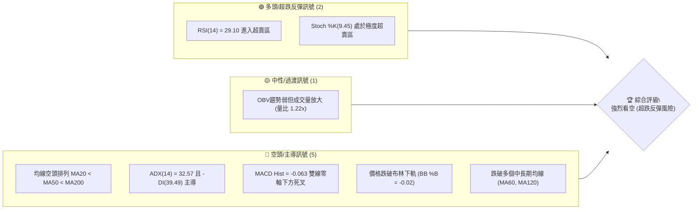
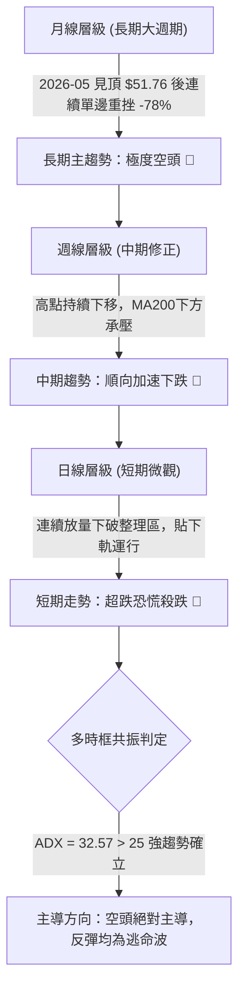
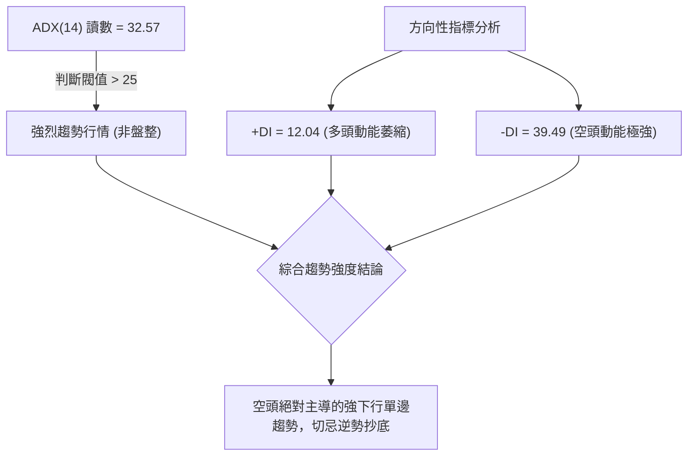
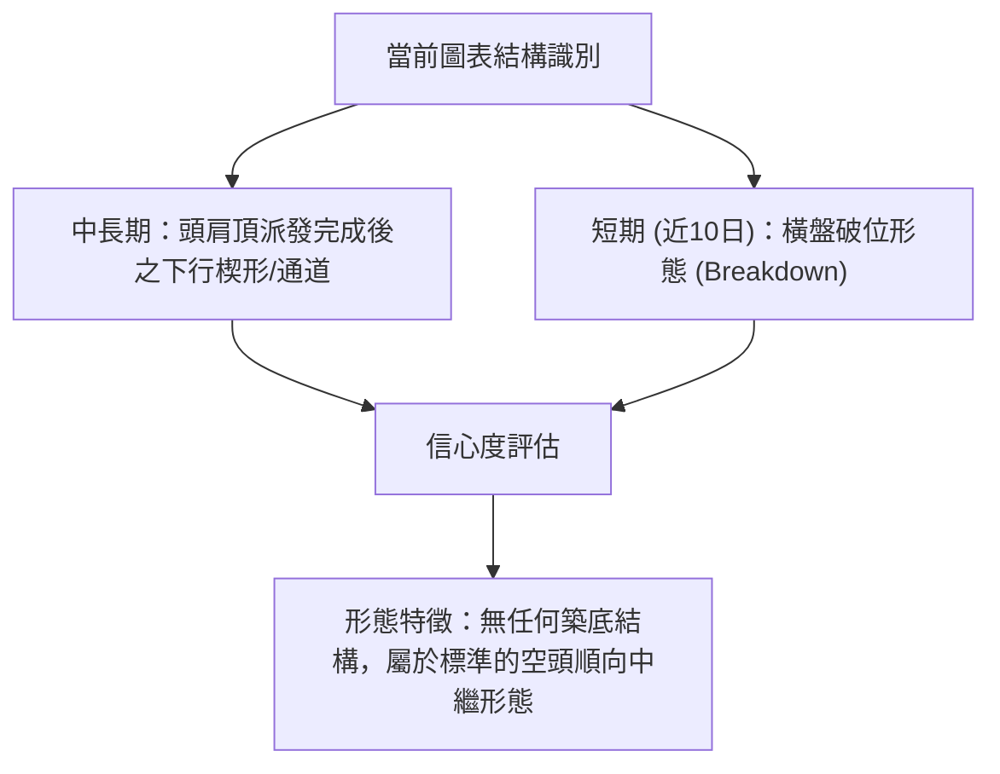
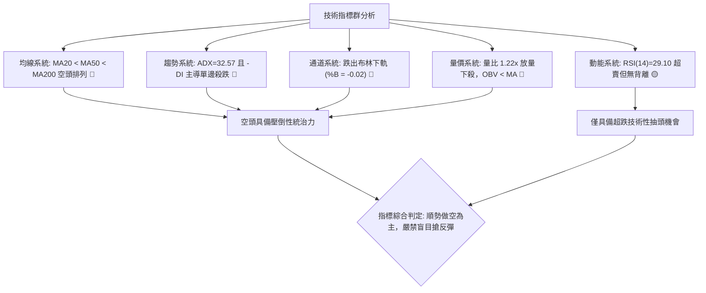
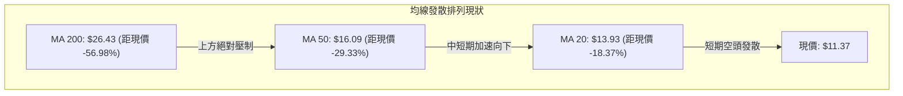
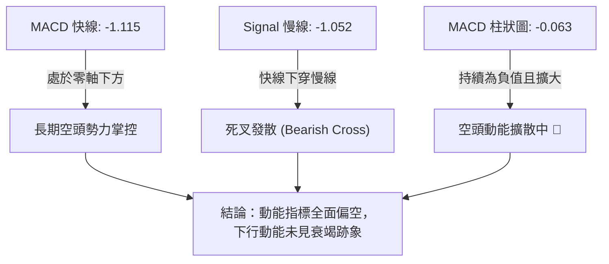
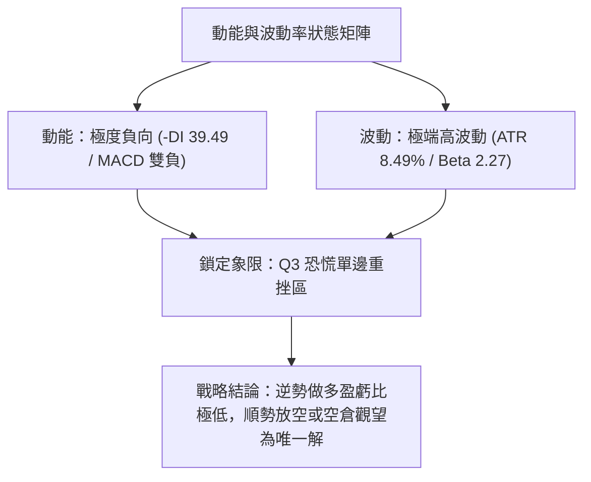
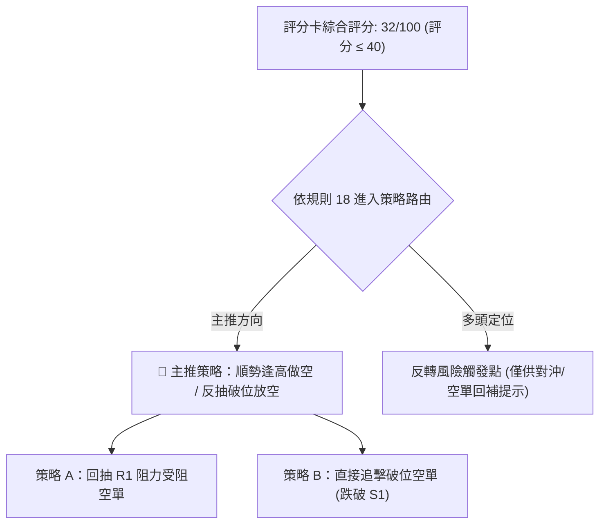
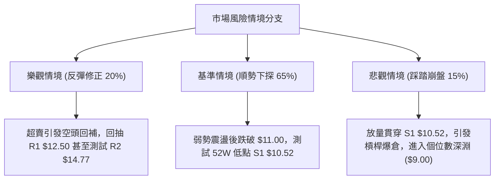

# PL 技術分析報告

> **報告日期**：2026-11-06 ｜ **語言**：繁體中文 ｜ **數據來源**：Yahoo Finance ｜ **當前價格**：$11.37

---

## 目錄

| 章節 | 內容 |
|------|------|
| [1. 技術面概覽](#1-技術面概覽) | 訊號儀表板、核心指標、評分卡 |
| [2. 趨勢分析](#2-趨勢分析) | 多時框趨勢、長中短期走勢 |
| [3. 圖表形態分析](#3-圖表形態分析) | 形態識別、K線組合、目標價 |
| [4. 支撐與阻力](#4-支撐與阻力) | 關鍵價位、斐波那契回調 |
| [5. 技術指標深度解讀](#5-技術指標深度解讀) | MA/RSI/MACD/布林/成交量 |
| [6. 動能與波動率](#6-動能與波動率) | 動能評估、ATR、Beta |
| [7. 多時框架總結](#7-多時框架總結) | 時框架評分矩陣 |
| [8. 交易策略建議](#8-交易策略建議) | 多空策略、風險報酬比 |
| [9. 風險提示與監控](#9-風險提示與監控) | 監控指標、風險場景 |

---

## 1. 技術面概覽

### 🎯 技術訊號儀表板



### 📊 核心指標速覽表

| 指標類別 | 指標名稱 | 當前數值 | 訊號 | 解讀 |
|----------|----------|----------|------|------|
| **價格** | 當前價格 | $11.37 | 🔴 | 位於 52 週低點邊緣（52W 區間 2.1%），極度弱勢 |
| **均線** | MA20 | $13.93 | 🔴 | 價格在 MA20 下方 -18.37%，短期下行趨勢顯著 |
| **均線** | MA50 | $16.09 | 🔴 | 價格在 MA50 下方 -29.33%，中期走勢完全被壓制 |
| **均線** | MA200 | $26.43 | 🔴 | 價格在 MA200 下方 -56.98%，處於長期大熊市格局 |
| **動能** | RSI(14) | 29.10 | 🟢 | 進入極端超賣區（<30），技術性反彈動能醞釀 |
| **動能** | MACD(12,26,9) | -1.115 / 柱 -0.063 | 🔴 | MACD 處於零軸下方且柱狀圖收陰，空頭動能擴散 |
| **趨勢** | ADX(14) | 32.57 (-DI: 39.49) | 🔴 | 強趨勢格局（ADX > 25），且由空方絕對掌控 |
| **通道** | 布林通道 %B | -0.02 | 🔴 | 股價跌破布林下軌（$11.49），呈現開口下殺 |
| **波動** | ATR(14) | $0.97 (8.49%) | 🔴 | 波動率極高，每日振幅接近 8.5%，操作風險大 |
| **量能** | 20日成交量比 | 1.22x | 🔴 | 放量下殺（最新量 10.27M vs 均量 8.44M），賣壓湧現 |

### 🏆 技術評分卡

```
╔══════════════════════════════════════════════════════════╗
║              技術評分卡 — PL (2026-11-06)                ║
╠══════════════════════════════════════════════════════════╣
║ 趨勢強度      ██████████████░░░░░░  70/100  🔴 (空頭強趨勢)║
║ 動能指標      ████░░░░░░░░░░░░░░░░  20/100  🔴 (負動能顯著)║
║ 支撐穩定度    ██████░░░░░░░░░░░░░░  30/100  🔴 (逼近S1前低)║
║ 成交量配合    ████████░░░░░░░░░░░░  40/100  🟡 (帶量破位)  ║
║ 形態完整度    ████░░░░░░░░░░░░░░░░  20/100  🔴 (無築底形態)║
║ 均線排列      ██░░░░░░░░░░░░░░░░░░  10/100  🔴 (極度發散空頭)║
╠══════════════════════════════════════════════════════════╣
║ 綜合評分      ████░░░░░░░░░░░░░░░░  32/100  🔴 強烈看空    ║
╚══════════════════════════════════════════════════════════╝
```
*註：綜合評分 = (70 + 20 + 30 + 40 + 20 + 10) / 6 = 31.67 ≈ 32/100（依規則 18 算術平均四捨五入）。*

---

## 2. 趨勢分析

### 🌐 多時框趨勢分析



### 📈 長期趨勢 — 12個月走勢圖（Unicode）

```
PL 月線收盤走勢圖（過去12個月：2025-12 至 2026-11）
價格 ($)
$52.00 ┤                             ● (2026-05: $51.14 / 高點 $51.76)
$46.00 ┤                            / \
$40.00 ┤                           /   \
$34.00 ┤                    ●     /     ● (2026-06: $33.13)
$28.00 ┤              ●    /     /       \
$22.00 ┤        ●    /    /     /         ● (2026-07: $20.48)
$16.00 ┤  ●    /    /    /     /           \     ● (2026-09: $16.39)
$10.00 ┤  │   /    /    /     /             \   / \
 $4.00 ┤  ●  /    /    /     /               \ /   ●←當前 (2026-11: $11.37)
       └──────────────────────────────────────────────
         12   01   02   03   04    05    06    07   08   09   10   11 (月份)
        2025 │                   2026 年
```

#### 走勢特徵分析表格

| 階段週期 | 涵蓋月份 | 區間起訖點 (收盤) | 漲跌幅 | 核心技術特徵 |
|----------|----------|-------------------|--------|--------------|
| **第 I 階段：主升推升期** | 2025-11 → 2026-05 | $11.90 → $51.14 | +329.7% | 月線連收長紅，成交量呈現量增價漲，形成 52 週歷史高點 $51.76 |
| **第 II 階段：頂部崩跌期**| 2026-05 → 2026-07 | $51.14 → $20.48 | -59.95% | 拋物線破位，無序崩跌，跌破短期上升趨勢線與 MA20 |
| **第 III 階段：平台整理期**| 2026-07 → 2026-08 | $20.48 → $19.85 | -3.08%  | 於 $20 附近縮量暫時盤整，週線 RSI 嘗試回抽但未重回 50 |
| **第 IV 階段：陰跌破位期**| 2026-08 → 2026-11 | $19.85 → $11.37 | -42.72% | 跌破所有中長期均線（MA60、MA120），直逼 52 週低點 $10.52 |

### 📊 中期趨勢（週線分析）

從近 20 週收盤走勢觀察，自 2026-08-14 創下階段性反彈高點 $24.69 以來，高點不斷下移（$24.69 → $18.81 → $14.77），低點亦同步創低（$15.60 → $13.15 → $11.02），呈現極為標準的中期「下降通道（Descending Channel）」。

```
週線壓力與支撐結構示意圖：
$24.69 ───────┐ (08/14 高點)
              ▼
  $18.81 ─────┐ (10/09 反彈高點)
              ▼
    $14.77 ───┐ (10/30 高點 R2)
              ▼
      $12.50 ─┴─ (11/04 日內反彈受阻高點 R1)
═══════════════════════════════════════════════
  現價 $11.37 ◄── 逼近破位邊緣
═══════════════════════════════════════════════
        $10.52 ── (52週最低點支撐 S1)
```

### ⚡ 趨勢強度評估（ADX 解讀）



#### ADX 強度對照表

| 指標變數 | 當前數值 | 參考臨界線 | 狀態解讀 |
|----------|----------|------------|----------|
| **ADX(14)** | **32.57** | 25.00 | **強趨勢確立**。數值大於 25 表明市場已脫離無趨勢盤整，處於單邊發散中。 |
| **+DI(14)** | **12.04** | 20.00 | **極度低迷**。多方進攻意願與買盤力量近乎衰竭。 |
| **-DI(14)** | **39.49** | 25.00 | **極端強勢**。空方賣壓全面傾瀉，-DI 與 +DI 差值高達 27.45，顯示單向推動力極強。 |

---

## 3. 圖表形態分析

### 🔍 形態識別系統



#### 形態識別與信心度評估表（依規則 15）

| 形態名稱 | 信心度 | 判斷依據（引用數據） | 完成度 | 目標價（附計算式） |
|----------|--------|----------------------|--------|--------------------|
| **日線橫盤破位** (Breakdown) | 85% | 10/23 至 11/03 股價在 $13.15–$14.77 窄幅整理，11/04-11/05 放量大陰線貫穿跌破區間底端（收 $11.37）。 | 100% | 箱體下緣 $13.15 − 箱體高度 ($14.77 − $13.15 = $1.62) = **$11.53**（已達成，超額跌至 $11.37） |
| **中期下降三角形/通道** | 70% | 反彈高點依次遞減（$18.81 → $14.77），下方於 S1 $10.52 面臨關鍵水平防禦測驗。 | 85% | 由 R2 $14.77 跌破箱底，下測關鍵低點 **$10.52**（見 S1） |
| **雙底形態 (W底)** | 15% | 訊號不足，僅做指標型解讀。目前僅有 52W 低點 $10.52 作為潛在右腳測驗點，尚未出現任何止跌回升或頸線突破跡象。 | 10% | 形態未成立，無計算目標價。 |

### 🕯️ 重要 K 線形態分析（依規則 19）

嚴格依據數據中「近 10 根日 K」與「近 8 根週 K」之開高低收數據進行客觀解讀：

#### 近 10 根日 K 棒分析

| 日期 | 開 | 高 | 低 | 收 | 成交量 | K線形態 | 解讀與多空訊號 |
|------|----|----|----|----|--------|---------|----------------|
| **2026-10-23** | 13.18 | 13.53 | 12.79 | 13.41 | 6,066,600 | 下影小陽線 | 探底 $12.79 獲短暫買盤支撐收陽。 🟡 |
| **2026-10-26** | 13.30 | 13.99 | 13.26 | 13.76 | 6,833,600 | 溫和中陽線 | 震盪反彈，測試 $14 整數關卡。 🟢 |
| **2026-10-27** | 13.95 | 14.77 | 13.84 | 14.49 | 6,491,100 | 上影中陽線 | 盤中衝高至波段高點 R2 $14.77 受阻回落，顯露拋壓。 🟡 |
| **2026-10-28** | 14.45 | 14.56 | 14.03 | 14.33 | 7,603,300 | 小陰線十字 | 高位滯漲，多空換手轉向猶豫。 🟡 |
| **2026-10-29** | 13.96 | 14.60 | 13.96 | 14.31 | 7,544,100 | 光腳小陽線 | 試圖二次衝擊高點無果。 🟡 |
| **2026-10-30** | 13.54 | 14.02 | 13.15 | 13.47 | 6,554,100 | 低開小陰線 | 跳空低開，失守 5 日均線，空方重掌優勢。 🔴 |
| **2026-11-02** | 13.62 | 13.69 | 12.87 | 12.96 | 8,582,300 | 破位中陰線 | 實體跌破 $13.00，成交量擴大至 8.58M。 🔴 |
| **2026-11-03** | 13.21 | 13.74 | 13.17 | 13.51 | 5,857,500 | 縮量孕線陽線 | 弱勢反抽，量能萎縮至 5.85M，反彈無力。 🟡 |
| **2026-11-04** | 13.40 | 13.62 | 12.50 | 12.65 | 7,855,700 | 光頭中陰線 | 長陰破位，盤中摜破 R1 轉換位 $12.50。 🔴 |
| **2026-11-05** | 12.21 | 12.40 | 11.02 | 11.37 | 10,267,960 | 帶量長黑破位 | 跳空低開重挫 -10.12%，放量 10.27M 創波段新低，恐慌拋盤湧出。 🔴 |

#### 近 8 根週 K 棒分析

| 週末日期 | 開 | 高 | 低 | 收 | 週成交量 | K線形態 | 解讀與多空訊號 |
|----------|----|----|----|----|----------|---------|----------------|
| **2026-09-18** | 16.10 | 17.27 | 15.60 | 16.42 | 46,446,400 | 下影長十字星 | 低位多空激烈交戰，短線獲撐。 🟡 |
| **2026-09-25** | 16.68 | 18.18 | 16.13 | 17.43 | 56,175,300 | 中陽線帶長上影 | 衝擊 R3 $18.18 遇強大阻力回吐。 🟡 |
| **2026-10-02** | 17.17 | 17.73 | 16.10 | 17.50 | 52,133,300 | 窄幅整理陽十字 | 於 $17 上方縮量高位拉鋸。 🟡 |
| **2026-10-09** | 17.64 | 18.81 | 16.55 | 17.18 | 59,868,100 | 長上影倒錘頭 | 衝高至 $18.81 被多頭陷阱無情壓回，見頂訊號。 🔴 |
| **2026-10-16** | 17.00 | 17.03 | 13.33 | 13.56 | 51,292,600 | 崩跌大陰線 | 單週暴跌 -21.07%，破壞所有短期均線。 🔴 |
| **2026-10-23** | 13.85 | 14.09 | 12.79 | 13.41 | 42,025,100 | 低位整理小陰 | 暴跌後縮量弱勢休整，無抄底資金進場。 🔴 |
| **2026-10-30** | 13.30 | 14.77 | 13.15 | 13.47 | 35,026,200 | 墓碑十字星 | 衝擊 $14.77 遭空頭迎頭痛擊，留下長上影線。 🔴 |
| **2026-11-05** | 13.62 | 13.74 | 11.02 | 11.37 | 32,563,460 | 單邊破位大陰棒 | 跳水跌穿前低 $12.79，直指 S1 $10.52 防線。 🔴 |

### 📉 ASCII 走勢形態示意圖

```
PL 近期平台破位與通道示意圖：
$14.77 ───────────● (10/27 高點阻力 R2)
                 / \
$14.33 ────●────●   \
          / \        \    整理箱體區間 ($13.15 - $14.77)
$13.41 ──●   \        ● (10/30)
              \        \
$13.15 ────────┴────────●─────── 箱底頸線跌破點 (11/02)
                         \
$12.50 ───────────────────●───── (11/04 反抽破位點 R1)
                           \
$11.37 ─────────────────────●─── 當前價格 (跳空長陰破位)
                             \
$10.52 ───────────────────────- 52週極限低點 S1 (潛在目標支撐)
```

### 🎯 形態目標價計算

依據形態學等距測量與價格破位高度嚴格推算：

1. **短期箱體跌破等距投影**：
   - 箱體頂部：$14.77（2026-10-27 高點）
   - 箱體底部：$13.15（2026-10-30 低點）
   - 形態振幅（箱體高度）：$14.77 − $13.15 = **$1.62**
   - 下跌第一測量目標 = 箱體底部 $13.15 − 形態高度 $1.62 = **$11.53**（目前已在 11/05 貫穿該位至 $11.37，確認破位有效）。

2. **中期旗形/通道破位目標**：
   - 當前價格跌破 $11.53 後，下方唯一的波段聚類支撐為 52 週最低點 **$10.52**（見下文支撐 S1）。
   - 若 $10.52 支撐不幸放量失守，數據中未偵測到更低層級的歷史支撐（已進入無歷史支撐的價格真空區）。

---

## 4. 支撐與阻力

### 🗺️ 關鍵價位分布圖（Unicode）

```
PL 價位結構分布圖 (OHLCV 精確計算)
═════════════════════════════════════════════════════════════════
$18.18 ║████████████████████████████████████████║ 強阻力 R3 (週線反彈聚類頂部)
$16.37 ║────────────────────────────────────────║ 布林通道上軌
$16.09 ║░░░░░░░░░░░░░░░░░░░░░░░░░░░░░░░░░░░░░░░║ MA50 中期生命線
$14.77 ║██████████████████████████              ║ 重要阻力 R2 (近期箱體高點)
$13.93 ║────────────────────────────────────────║ MA20 / 布林中軌
$12.50 ║████████████████                        ║ 短期阻力 R1 (11/04低點/整數轉換)
═══════╬════════════════════════════════════════╬════════════════════════
$11.37 ╠════════════════════════════════════════╣ ◄ 現價 (收盤價)
═══════╬════════════════════════════════════════╬════════════════════════
$10.52 ║▓▓▓▓▓▓▓▓▓▓▓▓▓▓▓▓▓▓▓▓▓▓▓▓▓▓▓▓▓▓▓▓▓▓▓▓▓▓▓║ 關鍵支撐 S1 (52W歷史低點)
  N/A  ║░░░░░░░░░░░░░░░░░░░░░░░░░░░░░░░░░░░░░░░║ 數據中未偵測到更低支撐 (真空區)
═════════════════════════════════════════════════════════════════
```

### 🚧 阻力位分析表

價位嚴格引用技術數據「關鍵價位」區塊之數值：

| 阻力級別 | 價位 | 距現價幅動 | 形成原因 | 突破難度 | 重要性 |
|----------|------|------------|----------|----------|--------|
| **R1** | **$12.50** | +9.94% | 2026-11-04 日 K 低點聚類，前期小平台下緣與心理整數關卡，現已轉化為強反壓。 | 🟡 中等 | 短線多頭超跌反彈的首要考驗門檻 |
| **R2** | **$14.77** | +29.90% | 2026-10-27 及 10-30 兩度上攻受阻之日線波段高點聚類，密集換手套牢區。 | 🔴 極高 | 中期強弱分水嶺，未收復前均線空頭不變 |
| **R3** | **$18.18** | +59.89% | 2026-09-25 週線波段反彈高點聚類，為大週期下跌途中最後的多頭防禦陣地。 | 🔴 極難 | 長期趨勢扭轉的絕對多空分界線 |

### 🛡️ 支撐位分析表

價位嚴格引用技術數據「關鍵價位」區塊之數值：

| 支撐級別 | 價位 | 距現價幅動 | 形成原因 | 守住機率 | 重要性 |
|----------|------|------------|----------|----------|--------|
| **S1** | **$10.52** | -7.48% | 52 週最低點（斐波那契 100.0% 回調位），近一年波段最低點聚類。 | 🟡 45% | **多頭生死線**；若失守將引發新一輪止損踩踏 |
| **S2** | **N/A** | N/A | **數據中未偵測到**。數據未提供更低波段低點。 | N/A | 跌破 S1 後將步入無錨點下行真空區 |
| **S3** | **N/A** | N/A | **數據中未偵測到**。數據未提供更低波段低點。 | N/A | 跌破 S1 後將步入無錨點下行真空區 |

### 📐 斐波那契回調位分析

依據 52 週區間最高點 **$51.76**（0.0%）至最低點 **$10.52**（100.0%）進行空間定位分析：

```
斐波那契回調位階梯 (52W 高點 $51.76 → 低點 $10.52)
  0.0% (52W High)  $51.76 ──┐
 23.6%             $42.03 ──┼─ 極度強勢區 (已完全失守)
 38.2%             $36.01 ──┼─ 強弱分界線 (已完全失守)
 50.0%             $31.14 ──┼─ 中性平衡區 (已完全失守)
 61.8%             $26.27 ──┼─ 黃金分割防禦線 (已完全失守)
 78.6%             $19.35 ──┼─ 深度回撤容忍線 (已完全失守)
100.0% (52W Low)   $10.52 ──┴─ 極限防禦底線
                     ▲
現價 $11.37 落於 78.6% ($19.35) 與 100.0% ($10.52) 之間，距離 100% 僅剩 7.48% 緩衝空間！
```

#### 斐波那契回調位意義深度解讀：
- **回撤幅度高達 97.9%**：現價 $11.37 處於 52 週區間的 2.1% 極低位置，代表過去一年多頭推升的所有漲幅已幾乎被完全抹殺（自高點 $51.76 累計重挫 -78.03%）。
- **關鍵回調位全部告破**：股價相繼跌破 38.2%（$36.01）、50.0%（$31.14）、61.8%（$26.27）與 78.6%（$19.35），說明此輪下跌非健康回調，而是徹底的趨勢瓦解與資金出逃。
- **僅存 100.0%（$10.52）最後防線**：若現價無法在 $10.52 前築底，將跌穿整個 52 週價格體系。

---

## 5. 技術指標深度解讀

### 🎛️ 指標訊號總覽



### 📈 移動平均線排列分析



#### 均線數據明細表

| 均線名稱 | 數值 | 距現價差額 (百分比) | 當前斜率與特徵 | 訊號評估 |
|----------|------|---------------------|----------------|----------|
| **MA 5** | $12.79 | -$1.42 (-11.12%) | 急速下彎，短期極弱壓制線 | 🔴 極空 |
| **MA 10** | $13.43 | -$2.06 (-15.31%) | 持續下行，封殺反彈空間 | 🔴 極空 |
| **MA 20** | $13.93 | -$2.56 (-18.37%) | 月線下行，布林中軌阻力 | 🔴 極空 |
| **MA 50** | $16.09 | -$4.72 (-29.33%) | 季線下壓，中期多空分界線 | 🔴 極空 |
| **MA 60** | $17.22 | -$5.85 (-33.97%) | 陡峭向下發散 | 🔴 極空 |
| **MA 120**| $23.82 | -$12.45 (-52.27%)| 半年線深跌，熊市週期延續 | 🔴 極空 |
| **MA 200**| $26.43 | -$15.06 (-56.98%)| 年線重大壓制，長空格局 | 🔴 極空 |
| **MA 240**| $25.12 | -$13.75 (-54.74%)| 扣抵高位，長線均線完全失守 | 🔴 極空 |

- **深度分析**：所有週期均線（從 5 日到 240 日）全部位於當前股價上方，呈現「完美空頭排列（Perfect Bearish Alignment）」。當前股價偏離 20 日均線達 -18.37%，雖然存在均線乖離率過大產生的回抽修復需求，但在均線系統未有走平跡象前，反彈皆為空頭再佈局的良機。

### 📉 RSI(14) 分析

- **RSI 數值**：**29.10**（Wilder 計算法）
- **RSI 進度條**：`█████░░░░░░░░░░░░░░░ 29.1%`（進入超賣區）
- **區間評估**：RSI 跌破 30 臨界線，顯示市場處於短期非理性拋售與恐慌情緒宣洩階段。
- **背離分析判斷**：
  - 根據數據記錄：「**RSI 背離：無明顯背離**（近20根K棒首尾之價格與RSI方向一致）」。
  - 價格自 10/27 高點 $14.77 單邊下行至 11/05 的 $11.37，RSI 同步由 40 上方滑落至 29.10，**並未出現「價格創新低而 RSI 抬高」的底背離訊號**。
  - **結論**：純粹的超賣並不等於反轉買點，在無底背離的背景下，超賣指標可能在低檔鈍化（Bearish Consolidation），切勿僅憑 RSI < 30 即進行左側抄底。

### 📊 MACD(12,26,9) 訊號解讀



- **深度解讀**：MACD 線（-1.115）與訊號線（-1.052）雙雙深陷零軸負值區間，且 MACD 線已在低位再度下穿訊號線形成死叉，柱狀圖（-0.063）持續翻紅走低，顯示即便股價已歷經大幅下跌，空方的賣壓能量依然在持續釋放，未見任何柱狀圖收斂或金叉拐點。

### 📦 布林通道分析（Bollinger Bands）

```
布林通道結構與現價位置示意圖：
$16.37 ────────────────────────────── 布林上軌 (Upper Band)
                  │
                  ▼
$13.93 ────────────────────────────── 布林中軌 (MA20)
                  │
                  ▼
$11.49 ────────────────────────────── 布林下軌 (Lower Band)
═════════════════════════════════════
$11.37 ◄─── 現價 (%B = -0.02，跌出通道下軌之外！)
```

- **參數配置**：20 日週期，寬度 2 倍標準差。
- **通道指標解讀**：
  - **BB 上軌**：$16.37
  - **BB 中軌 (MA20)**：$13.93
  - **BB 下軌**：$11.49
  - **布林極限 %B**：**-0.02**
- **市場狀態剖析**：%B 數值小於 0（-0.02），代表收盤價 $11.37 已經**實體跌穿布林帶下軌**。在強趨勢下（ADX > 25），價格跌破下軌屬於「帶狀行走（Walking the Bands）」的極端單邊空頭特徵，通常伴隨布林帶開口擴大，而非回調買點。唯有當股價重新收上下軌 $11.49 之上時，短期技術性止跌才初步確認。

### 💹 成交量分析（量價配合度）

```
成交量柱狀對比示意圖：
今日成交量 (11/05):  ██████████ 10,267,960 (放量破位 🔴)
20日平均量 (20MA):   ████████░░  8,436,283 (量比 1.22x)
50日平均量 (50MA):   ██████████ 10,711,539
```

- **量價特徵評估**：
  - **量價關係**：最新單日成交量放大至 **10,267,960 股**，較 20 日均量（8,436,283 股）放大 **1.22 倍**。在價格暴跌 -10.12% 的同時伴隨放量，表明跌破並非主力虛晃一槍的假摔，而是具有高度殺傷力的「放量破位（Volume Breakdown）」。
  - **OBV 能量潮趨勢**：數據明確指出「**OBV < MA → 量能疲弱**」。OBV 長期運行於移動平均線下方，資金流向呈現持續淨流出態勢，確認此波下跌趨勢得到量能的完整驗證（Volume confirms price trend）。

---

## 6. 動能與波動率

### ⚡ 動能評估四象限

| 象限代號 | 動能狀態 | 波動率狀態 | 市場屬性特徵 | PL 當前定位與評估 |
|----------|----------|------------|--------------|-------------------|
| **Quadrant 1** | 強多頭動能 | 低波動率 | 主升穩健趨勢 | 排除 |
| **Quadrant 2** | 弱多頭動能 | 低波動率 | 築底休整盤整 | 排除 |
| **Quadrant 3** | 強空頭動能 | 高波動率 | 恐慌拋售/單邊主跌 | **✓ 當前定位 (Q3 空方象限)**：空頭強趨勢動能（-DI 39.49）疊加高 ATR 振幅（8.49%），處於極高風險之主跌浪。 |
| **Quadrant 4** | 動能衰竭 | 高波動率 | 頂部或底部劇烈反轉 | 排除（尚無衰竭確認） |



### 📊 ATR 波動率分析

- **ATR(14) 讀數**：**$0.97**（Wilder 計算法）
- **ATR 佔比**：高達股價的 **8.49%**
- **止損距離與波動性建議**：
  - 由於每日平均真實振幅接近 $1.00（8.49%），標的屬於極高投機性與高風險資產。
  - **交易保護邊界**：在設置止損時，必須預留至少 **1.0 至 1.5 倍 ATR**（即 **$0.97 ~ $1.46** 的波動緩衝空間），以防止被日內噪聲假突破洗出場。
  - 對於部位規模管理，必須以波動率反比模型降低持倉口數，單筆交易承受風險絕不可超過總資金之 1%–2%。

### 📐 Beta 與市場相關性

- **Beta 係數**：**2.27**
- **市場特徵解讀**：
  - Beta 高達 2.27，顯示該股對大盤（標普 500 / 納斯達克）的敏感度極高，其波動幅度為市場整體波動的 2.27 倍。
  - 在大盤整體承壓或市場風險偏好降低時，該股將承受倍數於市場的系統性拋壓；當前太空格局板塊（如新聞所提 Redwire、Intuitive Machines 同步重挫）受地緣與財報利空打擊，高 Beta 屬性加劇了該股的斷崖式下跌。

---

## 7. 多時框架總結

### 📋 時框架評分表

| 時框架 | 趨勢方向 | 動能狀態 | 均線排列 | 圖表形態 | 綜合評分 | 戰略建議 |
|--------|----------|----------|----------|----------|----------|----------|
| **月線 (長期)** | 🔴 極度空頭 | 🔴 崩跌未止 | 🔴 破壞破位 | 52W見頂後回撤98% | 15/100 | 長線投資價值瓦解，切勿逢低定投 |
| **週線 (中期)** | 🔴 順向下跌 | 🔴 MACD柱轉負 | 🔴 空頭排列 | 下降通道運行中 | 25/100 | 中期反彈皆受壓於下降壓力線，逢高減碼 |
| **日線 (短期)** | 🔴 破位下殺 | 🟡 RSI超賣 | 🔴 空頭發散 | 箱體破位下探S1 | 35/100 | 短線等待回抽確認壓力後順勢介入空單 |

### 🔲 綜合訊號矩陣

```
訊號一致性收斂矩陣：
┌─────────────┬──────────┬──────────┬──────────┬────────────────────────┐
│ 指標系統    │ 短期(日) │ 中期(週) │ 長期(月) │ 維度共振結果           │
├─────────────┼──────────┼──────────┼──────────┼────────────────────────┤
│ 均線趨勢    │   🔴 空  │   🔴 空  │   🔴 空  │ 三維完全空頭共振       │
│ 動能方向    │   🟡 超賣│   🔴 空  │   🔴 空  │ 中長空頭主導，短線醞釀 │
│ 量價結構    │   🔴 放量│   🔴 縮跌│   🔴 撤退│ 賣盤主導，資金持續流出 │
│ 通道形態    │   🔴 破軌│   🔴 下降│   🔴 瓦解│ 下行通道完整，無底部   │
└─────────────┴──────────┴──────────┴──────────┴────────────────────────┘
共振結論：空頭訊號一致性高達 90%，多空勝率明顯向空方傾斜。
```

### ⚖️ 多時框收斂結論（依規則 14）

1. **行情屬性判定**：當前日線 **ADX(14) 讀數為 32.57**，遠大於 25 的關鍵分水嶺，明確定義為「**強烈的單邊趨勢行情**」，絕非無方向的震盪盤整行情。
2. **多時框收斂優先級取捨**：依據規則 14，在強趨勢行情下（ADX > 25），**交易方向必須以中長期（週線、MA50、MA200）方向為絕對指引，日線級別僅能用於尋找精確的進場點位與時機**。日線的 RSI 超賣（29.10）不可作為趨勢翻多的依據，僅代表超跌隨時引發脈衝抽頭。
3. **唯一收斂方向結論**：**極度偏空（Bearish Dominated）**。任何日線級別的弱勢反彈，在觸及中短期均線壓力區時，均屬強阻力測試。操作主軸必須堅決貫徹「順勢逢高做空」或「嚴格空倉觀望」。

---

## 8. 交易策略建議

### 🗺️ 策略決策流程圖



### 🧭 策略路由（依規則 18）

> **當前主策略方向 = 強烈偏空 / 主推做空策略（依技術評分卡綜合評分 32/100）**
> 
> *註：由於綜合評分低於 40 分，依規定嚴禁兩頭強力推薦多空策略，本報告嚴格以空頭交易策略為主推方案；多頭僅列為關鍵反轉點位與風險防範提示。*

### 🎯 價格情境階梯（Price Scenarios）

價位嚴格引用第 4 章及數據源數值：

| 觸發條件 | 下一目標 | 後續延伸 | 情境含義 |
|----------|----------|----------|----------|
| **反彈受阻 R1 $12.50** | 回測現價 $11.37 | 下探 S1 **$10.52** | 短期技術性超跌修復完畢，空頭重啟下行 |
| **強勢突破 R1 $12.50** | 上測 R2 **$14.77** | 上測 R3 **$18.18** | 空頭陷阱引發軋空，短期跌勢暫緩進入寬幅震盪 |
| **跌破 S1 $10.52** | 進入無支撐真空 | 數據中未偵測到 | 破位恐慌加速，52 週價格體系全面崩塌 |

### 📊 情境機率分佈

| 情境類別 | 發生機率 | 主要依據（指標狀態） |
|----------|----------|----------------------|
| **情境一：弱勢回抽後再破位下行** | **65%** | ADX(14)=32.57 強趨勢確立；-DI=39.49 主導；均線極度發散空頭排列；放量跌破整理平台。 |
| **情境二：在現價至 S1 間微幅震盪** | **25%** | RSI(14)=29.10 處於超賣區；布林極限 %B=-0.02 跌出下軌，存在技術性收斂與修復技術指標需求。 |
| **情境三：強勢反轉直接收復 R1** | **10%** | OBV 持續低迷且無底背離形態，除非出現突發重大利好，否則多頭直接深 V 反轉機率極低。 |

### 🔴 主策略詳情（空頭交易策略）

所有價位均嚴格基於第 4 章聚類價位與進出場規則設定（風險報酬比計算依規則 17，小數點兩位）：

| 策略要素 | 策略 A（反抽阻力放空 — 穩健型） | 策略 B（跌破 S1 破位追空 — 激進型） |
|----------|----------------------------------|--------------------------------------|
| **策略類型** | 順勢逢高沽空（回抽測試確認） | 關鍵低點破位追空 |
| **進場條件** | 股價弱勢反抽至 R1 附近受阻收長上影日 K | 盤中放量跌破 52 週最低點 S1 $10.52 確立 |
| **進場價格** | **$12.50**（精確對齊 R1 阻力位） | **$10.45**（確認跌破 S1 $10.52 之突破進場點）|
| **目標價 T1** | **$10.52**（精確對齊 S1 支撐位） | **$9.00**（由破位幅度推算：$10.52 − 1.5×ATR $1.46 = $9.06 取整）|
| **目標價 T2** | **$9.00**（由跌破 S1 後之延伸跌幅推算）| **$8.00**（由形態等距測量推算：$10.52 − 箱體高度 $1.62 = $8.90 之延伸）|
| **止損價格** | **$13.43**（精確對齊 MA10 均線壓力） | **$11.37**（精確對齊當前破位前收盤價） |
| **風險報酬比** | **1 : 2.13（以 T1 計）**<br>*(計算: ($12.50 − $10.52) / ($13.43 − $12.50) = 1.98 / 0.93 = 2.129)* | **1 : 1.58（以 T1 計）**<br>*(計算: ($10.45 − $9.00) / ($11.37 − $10.45) = 1.45 / 0.92 = 1.576)* |
| **成功機率** | **68%** | **58%** |
| **建議倉位** | **15%**（控制高波動資產風險） | **10%**（破位交易波動劇烈，需輕倉操作） |

*備註：策略 A 至目標價 T2 之風險報酬比為 1 : 3.76（以 T2 計，計算式：($12.50 − $9.00) / 0.93 = 3.50 / 0.93 = 3.763）。*

### 🟢 反向風險觸發點（多頭對沖/空單停損警訊）

以下情境若觸發，將推翻當前空頭主邏輯，空方部位必須立刻減碼或停損出場：
1. **收盤價強勢站回 R1 $12.50 之上**：若日 K 收盤價突破並企穩 $12.50，表明短線空頭力道竭盡，超賣修復展開，空單應先行平倉離場。
2. **日線級別出現 RSI 底部背離並金叉**：若股價後續再探低點但 RSI(14) 顯著抬升形成明確底背離，為潛在築底訊號。
3. **收盤收復 MA20 / 布林中軌 $13.93**：若強勢收復中軌，意味著中期空頭趨勢中斷，市場由單邊市轉入寬幅區間震盪。

### ⭐ 整體訊號強度評星

```
做多訊號強度：★☆☆☆☆  (1/5星 — 極端超賣僅具短抽可能，無底背離確認)
做空訊號強度：★★★★☆  (4/5星 — 均線與趨勢指標高度共振，空方完全控盤)
整體可信度：  ★★★★☆  (4/5星 — 成交量驗證破位，ADX確認趨勢有效性)
```

---

## 9. 風險提示與監控

### ✅ 關鍵監控指標 Checklist

```
╔════════════════════════════════════════════════════════════════╗
║                   每日交易風險監控清單 (Checklist)              ║
╠════════════════════════════════════════════════════════════════╣
║ [ ] 監控 1：S1 $10.52 防線是否被盤中實體跌破 (破位加速訊號)     ║
║ [ ] 監控 2：成交量是否異常超越 12M 股 (出現流動性踩踏或爆量換手) ║
║ [ ] 監控 3：RSI(14) 是否在 20–30 區間鈍化或形成有效底背離       ║
║ [ ] 監控 4：股價是否能回抽收復布林通道下軌 $11.49 形成假破位    ║
║ [ ] 監控 5：太空航天板塊同業 (RKLB, RDWR) 之整體情緒聯動效應   ║
║ [ ] 監控 6：ADX(14) 是否持續上升至 40 以上 (單邊趨勢進一步極端化)║
╚════════════════════════════════════════════════════════════════╝
```

### ⚠️ 風險場景分析



### 🛡️ 風險管理重要提醒

1. **極高波動性防禦**：
   - 本標的當前 ATR(14) 高達 **$0.97**（佔現價 8.49%），且 Beta 為 **2.27**，屬於極高波動性個股。
   - 嚴格禁止滿倉或重倉押注！建議單一持倉部位不得超過整體投資組合的 **10%–15%**。
2. **切忌左側盲目抄底**：
   - 儘管當前股價已由 52 週高點 $51.76 重挫至 $11.37，且 RSI 處於 29.10 的超賣區，但在「ADX > 25、均線空頭排列、無底背離」三者共振的情形下，「便宜」絕非買入理由。超賣往往代表下行動能猛烈，切莫試圖徒手接下落的飛刀。
3. **防範軋空（Short Squeeze）風險**：
   - 目前該股做空比率（Short % Float）達 **12.2%**，Short Ratio 為 3.42。
   - 若空頭倉位過度集中且突發重組或合作利多，可能引發短線劇烈軋空回抽；因此若採取做空策略，必須嚴守 **$13.43**（MA10）之硬性止損點，絕不可死扛空單。

---

## 📋 報告總結

```
╔════════════════════════════════════════════════════════════════════════╗
║                      PL 技術分析報告總結                                ║
╠════════════════════════════════════════════════════════════════════════╣
║ 報告日期：2026-11-06                                                   ║
║ 當前價格：$11.37 USD                                                   ║
║ 分析評級：🔴 強烈看空 / 順勢做空 (綜合評分 32/100)                      ║
╠════════════════════════════════════════════════════════════════════════╣
║ 關鍵結論：                                                             ║
║ ├─ 長期趨勢：🔴 極度空頭 (自高點 $51.76 重挫 -78%，均線完全空頭排列)  ║
║ ├─ 中期趨勢：🔴 順向下跌 (週線下降通道運行，高點低點持續下移)          ║
║ ├─ 短期趨勢：🔴 破位下殺 (放量大陰線跌破 $13.15 箱體底，跌破布林下軌)  ║
║ ├─ 關鍵支撐：S1: $10.52 (52週最低點)；更低支撐：數據中未偵測到         ║
║ ├─ 關鍵阻力：R1: $12.50 ｜ R2: $14.77 ｜ R3: $18.18                    ║
║ └─ 機構目標：分析師平均目標價 $30.27 (市場情緒與技術面嚴重背離)        ║
╠════════════════════════════════════════════════════════════════════════╣
║ 最優策略組合：                                                         ║
║ 1. 🥇 最佳機會：策略 A — 股價弱勢反抽至 R1 $12.50 受阻時順勢建立空單， ║
║                 停損設於 $13.43，目標看向 S1 $10.52 (盈虧比 1:2.13)。   ║
║ 2. 🥈 次選機會：策略 B — 股價直接放量摜破 S1 $10.52 時追擊順勢空單，   ║
║                 停損設於 $11.37，目標看向 $9.00 (盈虧比 1:1.58)。       ║
║ 3. 🥉 保守選擇：完全空倉觀望，耐心等待日線級別出現雙底或 RSI 底背離， ║
║                 未見有效築底訊號前絕不進場搶反彈。                     ║
╚════════════════════════════════════════════════════════════════════════╝
```

---

> ⚠️ **免責聲明**：本報告為 AI 自動生成之技術分析，所有數據及估算均基於提供的歷史價格資訊。本報告**僅供研究與學術參考**，**不構成任何投資建議**。投資有風險，入市需謹慎。

---

*報告生成時間：2026-11-06 ｜ 數據來源：Yahoo Finance ｜ 分析框架：多時框技術分析*