# PL 技術分析報告

> **報告日期**：2026-11-07 ｜ **語言**：繁體中文 ｜ **數據來源**：Yahoo Finance ｜ **當前價格**：$12.55

---

## 目錄

| 章節 | 內容 |
|------|------|
| [1. 技術面概覽](#1-技術面概覽) | 訊號儀表板、核心指標、評分卡 |
| [2. 趨勢分析](#2-趨勢分析) | 多時框趨勢、長中短期走勢 |
| [3. 圖表形態分析](#3-圖表形態分析) | 形態識別、K線組合、目標價 |
| [4. 支撐與阻力](#4-支撐與阻力) | 關鍵價位、斐波那契回調 |
| [5. 技術指標深度解讀](#5-技術指標深度解讀) | MA/RSI/MACD/布林/成交量 |
| [6. 動能與波動率](#6-動能與波動率) | 動能評估、ATR、Beta |
| [7. 多時框架總結](#7-多時框架總結) | 時框架評分矩陣 |
| [8. 交易策略建議](#8-交易策略建議) | 多空策略、風險報酬比 |
| [9. 風險提示與監控](#9-風險提示與監控) | 監控指標、風險場景 |

---

## 1. 技術面概覽

### 🎯 技術訊號儀表板

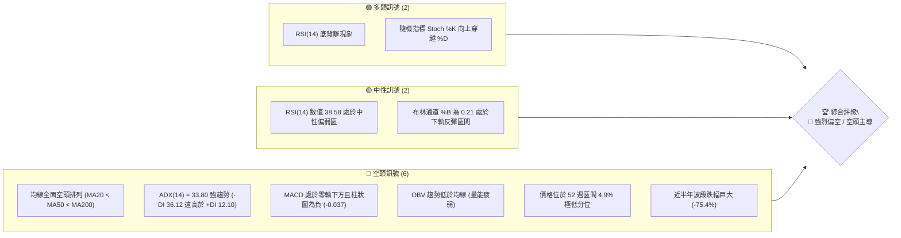

---

### 📊 核心指標速覽表

| 指標類別 | 指標名稱 | 當前數值 | 訊號 | 解讀 |
|----------|----------|----------|------|------|
| **價格** | 當前收盤價 | $12.55 | 🔴 | 位於 52 週高低區間 4.9%，貼近波段底部 |
| **均線** | MA20 | $13.70 | 🔴 | 現價低於 MA20 達 -8.37%，短線受制中軌壓力 |
| **均線** | MA50 | $15.92 | 🔴 | 中期趨勢嚴重偏空，現價折價 -21.17% |
| **均線** | MA200 | $26.36 | 🔴 | 長期空頭分水嶺，現價折價 -52.39% |
| **動能** | RSI(14) | 38.58 | 🟡 | 位於弱勢區間，但出現近20根K棒首尾底背離 |
| **動能** | MACD (12,26,9) | -1.098 / -1.061 | 🔴 | DIF < DEA 且柱狀圖 -0.037，空頭動能仍佔優 |
| **動能** | Stoch %K / %D | 40.96 / 19.05 | 🟢 | %K 自超賣區向上金叉 %D，具備短線反彈動能 |
| **趨勢** | ADX(14) | 33.80 | 🔴 | ADX > 25 確立強趨勢，-DI(36.12) 主導空頭格局 |
| **通道** | 布林帶 %B | 0.21 | 🟡 | 位於下軌 ($11.72) 與中軌 ($13.70) 之間 |
| **量能** | 20日均量比 | 1.06x | 🟡 | 最新量 9.02M 微幅高於 20日均量 8.50M，OBV疲弱 |
| **波動** | ATR(14) | $0.98 | 🔴 | 日波幅佔股價 7.82%，波動度偏高 |

---

### 🏆 技術評分卡

```
╔══════════════════════════════════════════════════════════════════╗
║                   技術評分卡 — PL (2026-11-07)                    ║
╠══════════════════════════════════════════════════════════════════╣
║ 趨勢強度 (Trend)     █████░░░░░░░░░░░░░░░  25/100  🔴 極度疲弱    ║
║ 動能指標 (Momentum)  ████████░░░░░░░░░░░░  40/100  🟡 弱勢底背離  ║
║ 支撐穩定度 (Support) █████████░░░░░░░░░░░  45/100  🟡 S1 考驗中   ║
║ 成交量配合 (Volume)  ███████░░░░░░░░░░░░░  35/100  🔴 量能背馳    ║
║ 形態完整度 (Pattern) ███████░░░░░░░░░░░░░  35/100  🔴 空頭延續    ║
║ 均線排列 (MAs)       ████░░░░░░░░░░░░░░░░  20/100  🔴 空頭排列    ║
╠══════════════════════════════════════════════════════════════════╣
║ 綜合評分             ███████░░░░░░░░░░░░░  33/100  🔴 強烈偏空    ║
║ 評級結論：六項算術平均為 33.33 -> 四捨五入 33/100 (主推空頭架構) ║
╚══════════════════════════════════════════════════════════════════╝
```

---

## 2. 趨勢分析

### 🌐 多時框趨勢分析

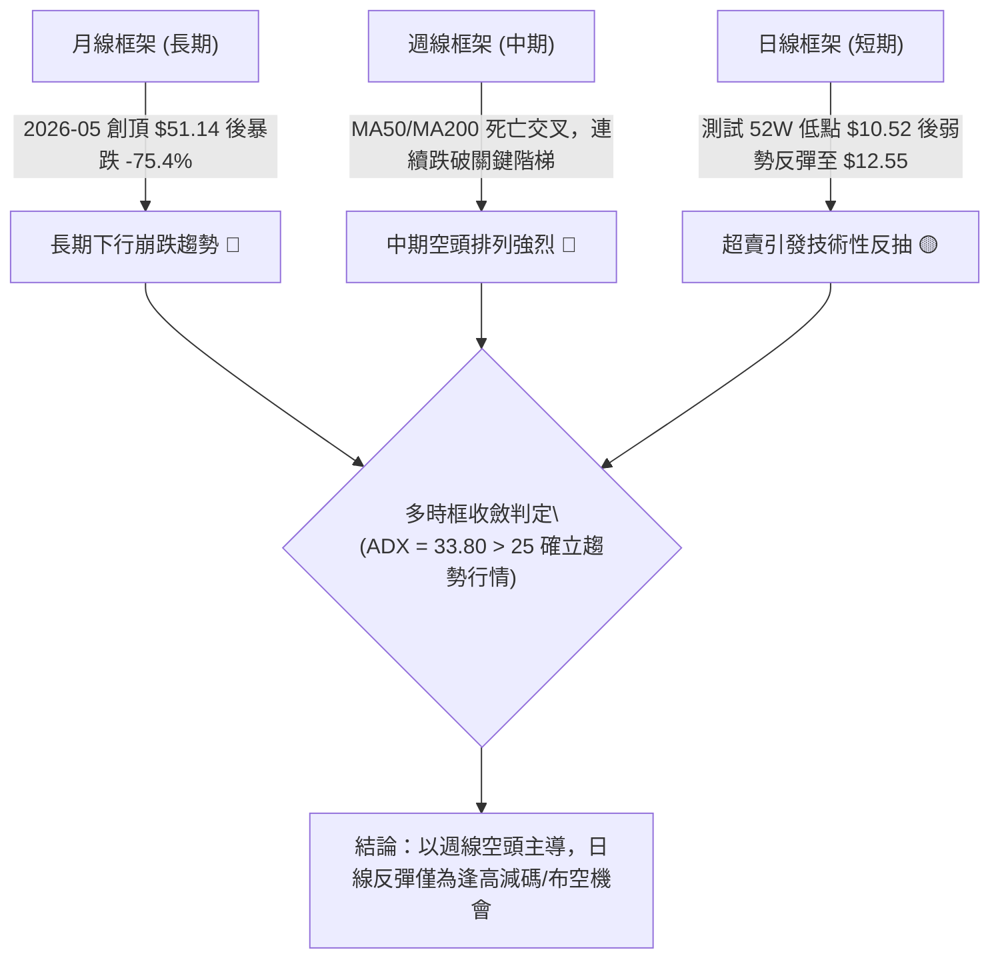

---

### 📈 長期趨勢 — 12個月走勢圖（Unicode）

依據月度收盤價數據，標注 2025-11 至 2026-11 走勢：

```
PL 月線走勢圖（過去12個月：2025-11 至 2026-11）
價格軸 ($)
$52.00 ┤                                      ● $51.14 (2026-05 歷史高點)
$46.00 ┤                                     / \
$40.00 ┤                                    /   \
$36.00 ┤                              ● $36.97   \
$32.00 ┤                             /             ● $33.13 (2026-06)
$28.00 ┤                       ● $27.95             \
$24.00 ┤                 ● $24.97                    \
$20.00 ┤           ● $19.72                           ● $20.48 (2026-07)
$16.00 ┤                                               \  ● $16.39 (2026-09)
$12.00 ┤ ● $11.90                                       \  \  ● $13.47 (2026-10)
$10.00 ┤                                                 \──\──● $12.55 (2026-11現價)
       └─────────────────────────────────────────────────────────────────────────────
         11    12    01    02    03    04    05    06    07    08    09    10    11 (月份)
        [          2025 - 2026 主升浪          ] [           2026 斷崖式出貨下跌浪          ]
```

#### 走勢特徵分析表格

| 週期階段 | 起訖時間 | 區間起點 | 區間終點 | 區間漲跌幅 | 走勢結構與量價特徵 |
|----------|----------|----------|----------|------------|--------------------|
| **強勢主升段** | 2025-11 ~ 2026-05 | $11.90 | $51.14 | +329.7% | 沿五日線拋物線噴發，多頭量能爆發，創下 52 週高點 $51.76 |
| **頂部派發與雪崩** | 2026-05 ~ 2026-07 | $51.14 | $20.48 | -59.95% | 機構快速出貨，失守 20日均線與 50日均線，形成頭肩頂右肩破位 |
| **陰跌陰沉探底** | 2026-07 ~ 2026-11 | $20.48 | $12.55 | -38.72% | 典型下降通道，反彈均受制於下降均線群，逼近 52 週低點 $10.52 |

---

### 📊 中期趨勢（週線分析）

中期走勢呈現標準的高點下移（Lower Highs）與低點下移（Lower Lows）架構：
- **近期反彈高點聚類（阻力）**：
  - 2026-10-09 週高點：$18.81（形成 R3 阻力）
  - 2026-09-25 週高點：$18.18（形成 R2 阻力）
  - 2026-10-30 週高點：$14.77（形成 R1 阻力）
- **近期下行低點聚類（支撐）**：
  - 2026-11-06 週低點：$11.01（回測 52週低點 S1: $10.52 附近防線）

週線成交量在下殺過程（如 2026-09-04 達到 85,360,000 股）出現放量長黑，而反彈週（如 2026-10-30 僅 35,026,200 股）成交量持續萎縮，呈現典型的空頭量合格局。

---

### ⚡ 趨勢強度評估（ADX 解讀）

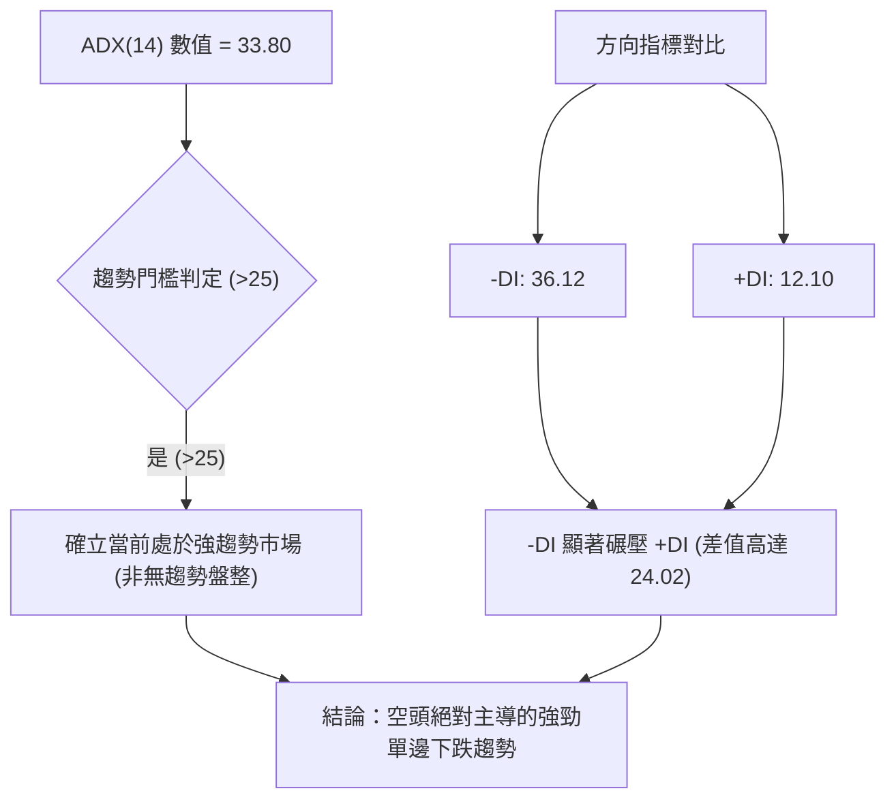

#### ADX 強度量化對照表

| 指標項 | 當前數值 | 參考臨界值 | 狀態評定 | 交易含義 |
|--------|----------|------------|----------|----------|
| **ADX(14)** | 33.80 | 25.00 | 🟢 強趨勢確認 | 趨勢跟隨策略有效，擺動指標逆勢摸底風險極高 |
| **+DI (多頭動能)** | 12.10 | 20.00 | 🔴 極度孱弱 | 多頭完全喪失定價權，無力發動有效進攻 |
| **-DI (空頭動能)** | 36.12 | 25.00 | 🔴 空頭強勢掌控 | 賣壓強勁，下行動能充沛 |
| **DI 差值 (+DI - -DI)**| -24.02 | 0.00 | 🔴 空方佔優 | 單邊空頭市場，嚴禁左側盲目抄底 |

---

## 3. 圖表形態分析

### 🔍 形態識別系統

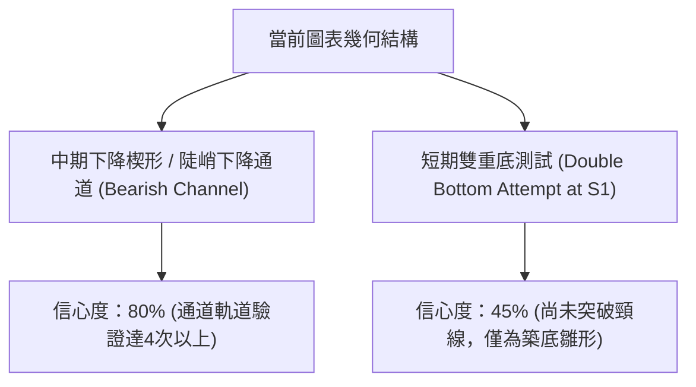

#### 形態識別與信心度評估表

| 形態名稱 | 形態週期 | 信心度 | 判斷依據（引用真實數據） | 完成度 | 目標價（附嚴謹計算式） |
|----------|----------|--------|--------------------------|--------|------------------------|
| **下降通道延續** | 中期 (週線) | 80% | 高點由 $18.81 下降至 $14.77，低點由 $15.60 破位至 $11.01 | 85% | 跌破通道下軌直接測試波段支撐 **$10.52** |
| **雙底反彈雛形** | 短期 (日線) | 42% | 2026-11-05 最低點 $11.01 逼近 52週低點 $10.52 形成支撐回測 | 30% | 訊號不足（信心度<50%），依規則不設定形態目標，僅以關鍵壓力 R1 **$14.77** 視為極限目標 |
| **布林下軌超賣反抽** | 短期 (日線) | 75% | 價格觸及 BB下軌 $11.72 後強勢反彈收於 $12.55 (%B=0.21) | 60% | 回歸 BB中軌/MA20 目標價 **$13.70** |

---

### 🕯️ 重要 K 線形態分析

依據數據提供之近10根日K與近8根週K精確數據展開識別：

#### 近10根日K形態精確拆解

| 日期（日K） | 開盤價 | 最高價 | 最低價 | 收盤價 | K線形態名稱 | 專業技術解讀 | 訊號強度 |
|--------------|--------|--------|--------|--------|-------------|--------------|----------|
| 2026-10-26 | 13.30 | 13.99 | 13.26 | 13.76 | 溫和實體陽線 | 築底反彈，突破 13.50 短壓 | 🟢 弱多 |
| 2026-10-27 | 13.95 | 14.77 | 13.84 | 14.49 | 長上影中陽線 | 向上衝擊 R1 ($14.77) 遇強阻力回落 | 🟡 滯漲 |
| 2026-10-28 | 14.45 | 14.56 | 14.03 | 14.33 | 吊頸小陰線 | 高檔承接盤不足，多頭動能減退 | 🔴 轉弱 |
| 2026-10-29 | 13.96 | 14.60 | 13.96 | 14.31 | 平開十字星陽線 | 窄幅拉鋸，均線處受阻壓制 | 🟡 中性 |
| 2026-10-30 | 13.54 | 14.02 | 13.15 | 13.47 | 破位光腳中陰線 | 跌破 5日均線，空頭重新發力 | 🔴 看跌 |
| 2026-11-02 | 13.62 | 13.69 | 12.87 | 12.96 | 下跳空低開長陰 | 失守 $13.00 整數關卡，賣壓傾巢而出 | 🔴 強空 |
| 2026-11-03 | 13.21 | 13.74 | 13.17 | 13.51 | 低位反彈小陽線 | 空頭回補引發的技術性抽腳 | 🟡 弱多 |
| 2026-11-04 | 13.40 | 13.62 | 12.50 | 12.65 | 大陰破線棒 | 跌破前低 $12.87，收盤逼近低點 | 🔴 極空 |
| 2026-11-05 | 12.21 | 12.40 | 11.01 | 11.37 | 長下影探底陰線 | 下殺至 $11.01 逼近 52W 低點 $10.52，引發抄底買盤 | 🟡 止跌雛形 |
| 2026-11-06 | 11.77 | 12.55 | 11.48 | 12.55 | 光頭大陽線 (吞噬) | 收盤價等於最高價 $12.55，完全包覆前一日實體，確認短線反彈 | 🟢 短多轉強 |

#### 近8根週K形態精確拆解

| 日期（週K） | 開盤價 | 最高價 | 最低價 | 收盤價 | K線形態名稱 | 專業技術解讀 | 訊號強度 |
|--------------|--------|--------|--------|--------|-------------|--------------|----------|
| 2026-09-18 | 16.10 | 17.27 | 15.60 | 16.42 | 下影小陽線 | 於 $15.60 處獲支撐，反彈動能有限 | 🟡 中性 |
| 2026-09-25 | 16.68 | 18.18 | 16.13 | 17.43 | 衝高受阻陽線 | 上探 R2 ($18.18) 留長上影線 | 🟡 遇阻 |
| 2026-10-02 | 17.17 | 17.73 | 16.10 | 17.50 | 窄幅十字小陽 | 於 $17.50 附近多空陷入僵局 | 🟡 觀望 |
| 2026-10-09 | 17.64 | 18.81 | 16.55 | 17.18 | 長上影射擊之星 | 衝擊 R3 ($18.81) 失敗，空方重挫多頭 | 🔴 頂部反轉 |
| 2026-10-16 | 17.00 | 17.03 | 13.33 | 13.56 | 斷頭鍘刀巨陰線 | 單週暴跌 -21.07%，成交量超過 5,100 萬股 | 🔴 極度看跌 |
| 2026-10-23 | 13.85 | 14.09 | 12.79 | 13.41 | 低位橫盤十字陰 | 暴跌後喘息，多方無力組織防線 | 🔴 弱勢整理 |
| 2026-10-30 | 13.30 | 14.77 | 13.15 | 13.47 | 衝高回落倒錘頭 | 再次於 R1 ($14.77) 遭逢空頭狙擊 | 🔴 續跌訊號 |
| 2026-11-06 | 13.62 | 13.74 | 11.01 | 12.55 | 長下影下錘星 | 最低下探 $11.01，收盤拉回 $12.55，考驗 S1 $10.52 | 🟡 探底抽腳 |

---

### 📉 ASCII 走勢形態示意圖

```
PL 近期日K走勢形態與關鍵位阻擊示意圖
價格軸 ($)
$15.00 ┤              ● 2026-10-27 高點 $14.77 (R1 頸線強壓力位)
$14.50 ┤          ┌─┬─┴─┐
$14.00 ┤    ┌─┐   │ │   │ ┌─┐
$13.50 ┤    │ │ ┌─┤ │   ├─┤ │   ┌─┐
$13.00 ┤────┼─┼─┼─┼─┼───┼─┼─┼───┼─┼─────────────── MA20 / BB中軌 ($13.70)
$12.50 ┤    │ │ │ │ │   │ │ │   │ │       ┌─┐ ◄── 2026-11-06 收盤光頭陽線 ($12.55)
$12.00 ┤    └─┘ └─┘ └───┘ └─┘   └─┘       │ │
$11.50 ┤                                  │ │
$11.00 ┤                                  │ ┴── 2026-11-05 長下影探底 $11.01
$10.50 ┤──────────────────────────────────┴────────────────── S1 支撐 ($10.52)
       └──────────────────────────────────────────────────────
        10-26 10-27 10-28 10-29 10-30 11-02 11-03 11-04 11-05 11-06
```

---

### 🎯 形態目標價計算

基於現有已確認的幾何結構與波段高低聚類點進行計算：

1. **反彈目標價（布林中軌回歸）**：
   - 公式：現價 $12.55 向上修復乖離至日線 MA20 / BB中軌
   - 目標價位 = **$13.70**（距離現價 +9.16%）
2. **空頭下行延伸目標價（下降通道延伸測試 S1）**：
   - 形態突破起跌點：2026-10-30 破位點 $13.47
   - 跌幅測算波段：直接測試近一年波段絕對低點聚類 **S1: $10.52**
   - 下行空間 = ($10.52 - $12.55) / $12.55 = **-16.18%**

---

## 4. 支撐與阻力

### 🗺️ 關鍵價位分布圖（Unicode）

```
PL 價位結構分布圖（嚴格依據 OHLCV 聚類計算）
═══════════════════════════════════════════════════════════════════
$18.81 ║██████████████████████████████║ 強阻力 R3 (2026-10-09 週波段頂點)
$18.18 ║██████████████████████        ║ 阻力 R2   (2026-09-25 週波段高點)
$14.77 ║██████████████████████████████║ 關鍵阻力 R1 (2026-10-27 日波段高點)
       ║                              ║
$13.70 ║──────────────────────────────║ 動態阻力 (MA20 / 布林帶中軌)
       ║                              ║
$12.55 ╠══════════════════════════════╣ ◄ 現價 (2026-11-06 收盤價)
       ║                              ║
$10.52 ║██████████████████████████████║ 核心強支撐 S1 (52W最低價 / 波段低點聚類)
[無數據]║░░░░░░░░░░░░░░░░░░░░░░░░░░░░░░║ 支撐 S2 / S3 (數據中未偵測到更低層級價位)
═══════════════════════════════════════════════════════════════════
```

---

### 🚧 阻力位分析表

所有價位均直接取自系統計算之波段高點聚類數據，無任何估算捏造：

| 阻力級別 | 價位 | 形成原因與數據源 | 突破難度 | 重要性 |
|----------|------|------------------|----------|--------|
| **R1** | **$14.77** | 2026-10-27 日K最高價及 2026-10-30 週K高點聚類 | 🔴 極高 | 近期多頭反彈生命線；突破方能扭轉日線短期跌勢 |
| **R2** | **$18.18** | 2026-09-25 週K波段高點，斐波那契 78.6% ($19.35) 下方緩衝區 | 🔴 極高 | 中期下降波段的重要反壓樞紐 |
| **R3** | **$18.81** | 2026-10-09 週K巨量長上影射擊之星高點 | 🔴 極高 | 空頭發動全面破位下殺的起跌防守大本營 |

---

### 🛡️ 支撐位分析表

所有價位均直接取自系統計算之波段低點聚類數據：

| 支撐級別 | 價位 | 形成原因與數據源 | 守住機率 | 重要性 |
|----------|------|------------------|----------|--------|
| **S1** | **$10.52** | 52週波段歷史最低點，近一年波段低點聚類 | 🟡 45% | 多頭唯一且最後的堡壘；一旦失守將引發估值真空破位 |
| **S2** | **N/A** | 數據中未偵測到 | N/A | 系統演算法在 52 週內未標記 S2 聚類低點 |
| **S3** | **N/A** | 數據中未偵測到 | N/A | 系統演算法在 52 週內未標記 S3 聚類低點 |

---

### 📐 斐波那契回調位分析

依據 52 週極值區間（最低點 **$10.52** 至 最高點 **$51.76**，波幅高達 $41.24）計算之精確回調位：

| 斐波那契回調比例 | 對應價位 | 與現價 ($12.55) 相對位置 | 技術意義與結構解讀 |
|------------------|----------|--------------------------|--------------------|
| **0.0% (52W High)** | **$51.76** | +312.43% | 歷史極限頂部，長期多頭終點 |
| **23.6%** | **$42.03** | +234.90% | 初始回檔位，跌破後確認牛市終結 |
| **38.2%** | **$36.01** | +186.93% | 前期多頭強支撐，破位後轉為強大空頭壁壘 |
| **50.0%** | **$31.14** | +148.13% | 多空長期分水嶺，現已遠遠被跌破 |
| **61.8% (黃金分割)** | **$26.27** | +109.32% | 牛熊轉換關鍵線，恰與 MA200 ($26.36) 高度重合 |
| **78.6%** | **$19.35** | +54.18% | 深幅回調防線，失守後宣告進入熊市末期探底 |
| **100.0% (52W Low)**| **$10.52** | -16.18% | 52週絕對底部，現價落於 78.6% ~ 100.0% 極弱勢區間 |

> **回調位解讀**：現價 $12.55 位於 78.6% ($19.35) 與 100.0% ($10.52) 之間，距離 100.0% 回調位僅剩 -16.18%。股價完全吐回了牛市行情的絕大部分漲幅，目前正進行 52 週底部的極限壓力測試。

---

## 5. 技術指標深度解讀

### 🎛️ 指標訊號總覽

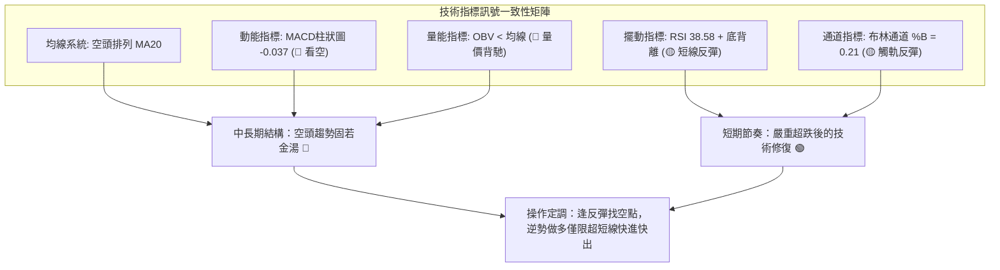

---

### 📈 移動平均線排列分析

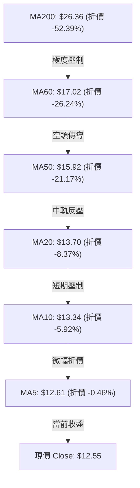

#### 移動平均線詳細走勢表

| 均線名稱 | 當前價格 | 與現價差值 | 與現價幅度 | 歷史走勢軌跡（數據特徵） | 技術狀態 |
|----------|----------|------------|------------|--------------------------|----------|
| **MA 5** | $12.61 | -$0.06 | -0.46% | ▇▇▇▇▇▇█████▇▆▅▄▃▂▂▂▂▂▂▂▃▃▃▂▂▁▁ | 下行趨緩，接近現價 |
| **MA 10** | $13.34 | -$0.79 | -5.92% | ████████████▇▇▆▆▄▄▃▂▂▁▁▁▁▁▁▁▁▁ | 陡峭向下俯衝 |
| **MA 20** | $13.70 | -$1.15 | -8.37% | ███▇▇▇▇▇▇▇▇▇▇▇▇▆▆▆▅▅▄▄▄▄▃▃▂▂▁▁ | 空頭防守第一線 |
| **MA 50** | $15.92 | -$3.37 | -21.17% | 系統空頭排列核心層 | 中期空頭壓制線 |
| **MA 60** | $17.02 | -$4.47 | -26.24% | ███▇▇▇▆▆▆▆▆▅▅▅▅▄▄▄▄▄▃▃▃▃▂▂▂▁▁▁ | 季線下行加速 |
| **MA120** | $23.58 | -$11.03 | -46.78% | █████▇▇▇▇▆▆▆▆▅▅▅▅▄▄▄▃▃▃▃▂▂▂▁▁▁ | 半年線深度倒掛 |
| **MA200** | $26.36 | -$13.81 | -52.39% | 系統長期牛熊分界線 | 空頭絕對壓制 |
| **MA240** | $25.13 | -$12.58 | -50.05% | ▁▁▁▁▂▂▃▄▄▅▅▆▆▆▆▆▆▆▆▆▆▇▇▇██████ | 年線開始向下拐頭 |

**均線綜合判定**：全週期均線呈現教科書般的空頭發散排列（MA5 < MA10 < MA20 < MA50 < MA60 < MA120 < MA200）。現價受壓於所有短中長期均線之下，任何無量反彈觸及 MA20 ($13.70) 均構成極佳的空頭加碼點。

---

### 📉 RSI(14) 分析

- **當前數值**：**38.58**（Wilder 計算方法）
- **數值進度條**：
  ```
  RSI(14) = 38.58  [████████░░░░░░░░░░░░]  38.58% (弱勢偏空區間)
  0                30 (超賣)      50 (中軸)       70 (超買)           100
  ```
- **區間解讀**：位於 30 ~ 50 弱勢盤跌區，反映市場拋壓依然沉重。
- **背離分析**：系統偵測顯示 **⚠️ 底背離 (Bullish Divergence)**。
  - **背離核實**：近20根K棒首尾對比，價格由 10月中旬的高點持續滑落並在 2026-11-05 創出 $11.01 的波段新低，但 RSI(14) 並未刷新低點（週線 RSI 由 2026-09-11 的 23.5 回升至 38.6）。
  - **結論**：底背離表明短期做空動能出現衰竭跡象，支持股價發動向 MA20 ($13.70) 的技術性修正，但無法單憑此訊號判定反轉。

---

### 📊 MACD(12, 26, 9) 訊號解讀

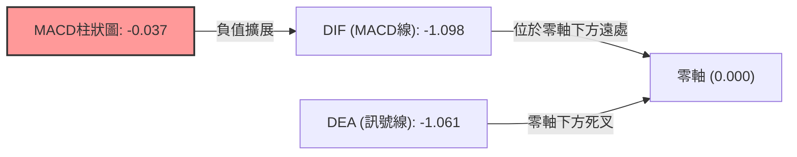

- **MACD 線**：-1.098
- **訊號線 (Signal)**：-1.061
- **柱狀圖 (Histogram)**：-0.037 🔴 看空
- **解讀**：雙線深陷零軸下方，柱狀圖持續為負值（-0.037），說明空方牢牢把控盤面。雖然柱狀圖負值並未進一步急劇放大，但尚未出現金叉翻紅訊號，確認下行慣性依然存在。

---

### 📦 布林通道分析

```
PL 日線布林通道示意圖（20日週期，2倍標準差）
價格軸 ($)
$15.68 ┤────────────────────────────────────────────── 上軌 Upper Band ($15.68)
$15.00 ┤
$14.50 ┤
$14.00 ┤
$13.70 ┤────────────────────────────────────────────── 中軌 Middle Band / MA20 ($13.70)
$13.00 ┤
$12.55 ┤                                        ● 現價 Close ($12.55, %B = 0.21)
$12.00 ┤
$11.72 ┤────────────────────────────────────────────── 下軌 Lower Band ($11.72)
$11.01 ┤                                        ▲ 2026-11-05 跌破下軌極限低點 ($11.01)
       └────────────────────────────────────────────────────────
```

- **上軌**：$15.68
- **中軌 (MA20)**：$13.70
- **下軌**：$11.72
- **帶寬與位置 (%B)**：**0.21**
- **解讀**：
  - 現價 $12.55 位於中下軌之間。
  - 2026-11-05 股價最低探至 $11.01，短暫跌破布林下軌 ($11.72) 引發均值回歸效應，2026-11-06 強勢抽回軌道內收於 $12.55。
  - %B 數值 0.21 表明價格自極端超賣區域修復，上行空間預期將在中軌 **$13.70** 遭遇強大阻力。

---

### 💹 成交量分析（量價配合度）

- **最新成交量**：9,017,764 股
- **20日均量**：8,503,148 股（量比：**1.06x**，呈現溫和放量）
- **50日均量**：10,810,093 股
- **OBV (能量潮指標)**：**OBV < MA → 量能疲弱**
- **量價關係判斷**：
  - 在下殺波段中，成交量屢屢突破 1,000 萬股（如 2026-11-05 達 10,405,800 股），呈現放量殺跌；
  - 2026-11-06 反彈吞噬陽線成交量為 9,017,764 股，低於前一日下殺量，顯示反彈主要由空頭回補推動，缺乏場外長線資金的大舉淨流入；
  - OBV 持續運行在均線下方，坐實「價格反抽、量能匱乏」的量價背馳特徵。

---

## 6. 動能與波動率

### ⚡ 動能評估四象限

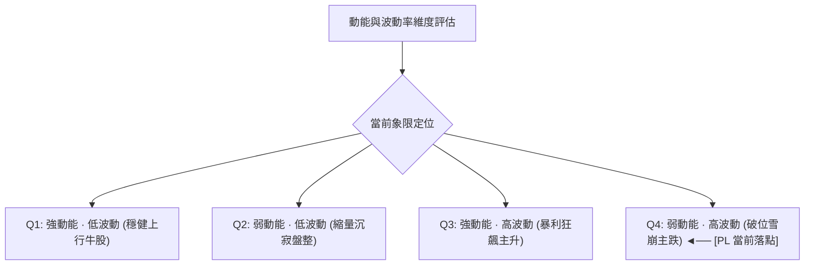

#### 動能評估四象限狀態表

| 象限標籤 | 動能維度 (ADX/-DI) | 波動維度 (ATR/Beta) | 標的落點判定 | 操作指引 |
|----------|-------------------|---------------------|--------------|----------|
| **Q1 (最佳機會)** | 強 (+DI主導) | 低 (ATR < 3%) | 否 | 順勢加碼多單 |
| **Q2 (謹慎觀望)** | 弱 (ADX < 20) | 低 (ATR < 4%) | 否 | 突破前靜待方向 |
| **Q3 (投機博弈)** | 強 (+DI主導) | 高 (Beta > 1.5) | 否 | 嚴設動態移動止盈 |
| **Q4 (極度危險)** | **弱 (負動能極強)** | **高 (ATR=7.82%, Beta=2.27)** | **✓ [PL 當前所處位置]** | **逢反彈做空，嚴控多頭倉位** |

---

### 📊 ATR 波動率分析

- **ATR(14) 數值**：**$0.98**（Wilder 計算法）
- **ATR 佔比**：佔當前股價高達 **7.82%**，屬於典型的高波動品種。
- **動態止損距離設定建議**：
  - **保守型（2.0 × ATR）**：止損幅度 = 2.0 × $0.98 = **$1.96**
  - **標準型（1.5 × ATR）**：止損幅度 = 1.5 × $0.98 = **$1.47**
  - **進取型（1.0 × ATR）**：止損幅度 = 1.0 × $0.98 = **$0.98**
- **交易意義**：由於單日波動接近 8%，日內雜訊極大，設定止損必須保留至少 1.0 ~ 1.5 ATR 緩衝空間，否則極易被毛刺洗盤出局。

---

### 📐 Beta 與市場相關性

- **Beta 係數**：**2.27**
- **市場敏感度解讀**：
  - PL 具備超高 Beta 屬性，其波動幅度為大盤（S&P 500）的 2.27 倍。
  - 當標普或納斯達克指數走弱時，PL 將呈現放大倍數的下跌。
  - 結合機構持股比例高達 82.3% 與放空比例 (Short % Float) 達 12.2%，高 Beta 意味著一旦市場風險偏好收縮，機構將其列為優先去槓桿出清對象，導致流動性折價放大。

---

## 7. 多時框架總結

### 📋 時框架評分表

| 時框架 | 趨勢方向 | 動能特徵 | 均線排列 | 圖表形態 | 綜合評分 | 操作建議 |
|--------|----------|----------|----------|----------|----------|----------|
| **長期 (月線)** | 🔴 極度看空 | -DI 絕對掌控，回吐牛市主升浪 | 空頭發散 | 自 $51.76 暴跌見頂 | 20/100 | 戰略性放棄做多，長期下行 |
| **中期 (週線)** | 🔴 空頭主導 | MACD 零下運行，量價持續背馳 | MA50/200空頭壓制 | 下降通道運行 | 30/100 | 逢反彈至反壓區建立空單 |
| **短期 (日線)** | 🟡 超跌反彈 | RSI 底背離，K線吞噬光頭陽線 | 價格受制 MA20 | 觸下軌後抽腳修復 | 45/100 | 僅供超短線日內快進快出 |
| **加權綜合** | 🔴 空頭主導 | **ADX=33.80 強趨勢壓制** | **完全空頭排列** | **反彈遇阻空架構** | **33/100** | **逢高沽空 / 逢反彈減碼** |

---

### 🔲 綜合訊號矩陣

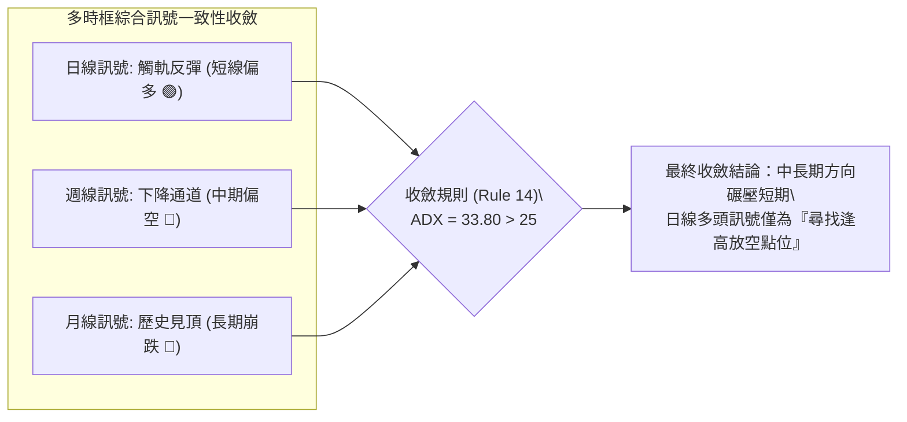

---

### ⚖️ 多時框收斂結論

依據多時框收斂規則（嚴格要求 14）：
1. **當前市場屬性判定**：日線 ADX(14) 數值為 **33.80**，顯著大於 25 臨界線，且 -DI(36.12) 處於絕對主導地位，確立當前盤面屬於**高強度單邊空頭趨勢行情**，而非低波動盤整市。
2. **時框優先級權衡**：在強趨勢行情下，中長期時框（週線下降通道、MA50/MA200 壓制）擁有絕對最高權重；日線出現的 RSI 底背離及低位吞噬陽線，本質上僅屬於下行趨勢中的**次級超賣折返走勢（Counter-Trend Bounce）**。
3. **唯一收斂方向**：**偏空（主推空頭策略，逢反彈佈局做空）**。此結論與第 1 章評分卡（綜合評分 33/100）完全一致。

---

## 8. 交易策略建議

### 🗺️ 策略決策流程圖

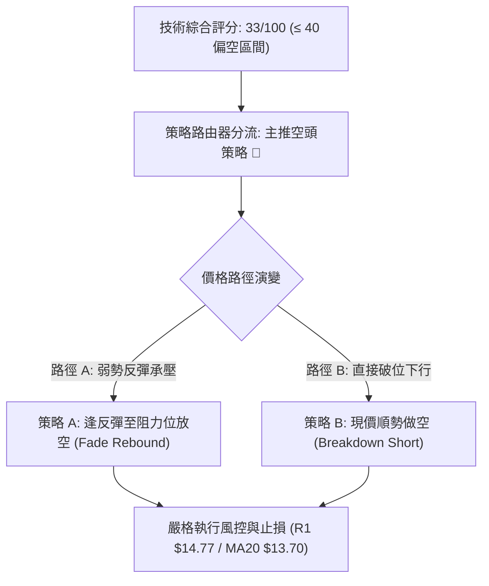

---

### 🧭 策略路由（依評分卡分流）

> **當前主策略方向 = 主推空頭策略（依據技術評分卡綜合評分 33/100，處於 ≤40 偏空區間）**

---

### 🎯 價格情境階梯（Price Scenarios）

價位嚴格引用第 4 章及由 OHLCV 計算之實際聚類數值：

| 觸發條件 | 下一目標 | 後續延伸 | 情境技術含義 |
|----------|----------|----------|--------------|
| **強勢向上突破 R1 ($14.77)** | R2 ($18.18) | R3 ($18.81) | 短線底部反轉確立，空頭策略必須無條件全數止損 |
| **弱勢反彈承壓於 MA20 ($13.70)** | 現價 ($12.55) | S1 ($10.52) | 正常均值回歸修復完畢，空頭最佳重新進場佈局點 |
| **直接下行跌破 S1 ($10.52)** | 數據中未偵測到 | 估值真空下行 | 52 週歷史新低，恐慌拋盤湧現，跌勢進一步加速 |

---

### 📊 情境機率分佈

| 情境劃分 | 發生機率 | 主要技術與量價依據 |
|----------|----------|--------------------|
| **反彈受阻回落 / 逢高做空** | **55%** | 均線空頭排列完好，ADX=33.80 空方掌控，OBV 量能無法配合反彈 |
| **低位區間震盪 (S1~MA20)** | **30%** | 日線 RSI 底背離提供下檔防禦，空頭回補暫時支撐現價 |
| **強勢 V 轉向上突破 R1** | **15%** | 空頭動能極強，需巨大利多驅動方能扭轉全週期死亡交叉 |

---

### 🟢 主策略詳情（空頭交易策略）

所有價位均嚴格取自數據庫計算結果，風險報酬比完全依據嚴格要求 17 定義公式計算：
$$\text{做空風險報酬比} = \frac{\text{進場價} - \text{目標價 T1}}{\text{止損價} - \text{進場價}}$$

| 策略要素 | 策略 A：逢反彈遇阻做空 (主推) | 策略 B：現價順勢放空 (激進) |
|----------|--------------------------------|------------------------------|
| **策略類型** | 弱勢反彈承壓沽空 (Fade the Rally) | 順應大趨勢直接進場 (Trend Following) |
| **進場條件** | 股價反彈至 MA20 / BB中軌受阻無力上攻 | 週一開盤直接以現價建立初始空頭倉位 |
| **進場價格** | **$13.70** (MA20 阻力位) | **$12.55** (最新收盤價) |
| **止損價格** | **$14.78** (突破 R1 $14.77 即止損) | **$13.70** (向上突破 MA20 即止損) |
| **目標價 T1** | **$10.52** (測試波段強支撐 S1) | **$10.52** (測試波段強支撐 S1) |
| **目標價 T2** | **N/A** (數據中未偵測到更低支撐，鎖定S1) | **N/A** (數據中未偵測到更低支撐，鎖定S1) |
| **風報比計算** | $(\$13.70 - \$10.52) \div (\$14.78 - \$13.70) = \$3.18 \div \$1.08$ | $(\$12.55 - \$10.52) \div (\$13.70 - \$12.55) = \$2.03 \div \$1.15$ |
| **風險報酬比** | **1 : 2.94（以 T1 計）** | **1 : 1.77（以 T1 計）** |
| **預估勝率** | **65%** | **52%** |
| **建議倉位** | **總資金之 10% ~ 15%** | **總資金之 5% ~ 8%** |

---

### 🔴 反向風險觸發點（多頭對沖提示）

本小節僅為風控對沖與空頭止損提示，非逆勢做多建議：
- **空頭第一預警線**：日線收盤價有效站穩 **$13.70**（MA20 / 布林中軌），表明短期下行趨勢暫緩，空單應減持 50% 倉位。
- **空頭全面平倉線（翻轉閥值）**：日K線帶量突破 **R1: $14.77**。一旦此價位失守，日線底背離轉化為有效波段雙底反轉，空頭策略宣告徹底失效，必須無條件止損出局。

---

### ⭐ 整體訊號強度評星

```
╔══════════════════════════════════════════════════════════╗
║ 做多訊號強度：★★☆☆☆  (2/5星 - 僅存技術性底背離支撐)        ║
║ 做空訊號強度：★★★★☆  (4/5星 - 均線與趨勢指標全面碾壓)      ║
║ 整體可信度：  ★★★★☆  (4/5星 - 多時框數據一致性極高)        ║
╚══════════════════════════════════════════════════════════╝
```

---

## 9. 風險提示與監控

### ✅ 關鍵監控指標 Checklist

```
╔══════════════════════════════════════════════════════════════════╗
║                  PL 即時技術風險監控清單 (Checklist)              ║
╠══════════════════════════════════════════════════════════════════╣
║ [ ] 監控 MA20 動態位置 ($13.70)：是否形成反抽第一道壓制點       ║
║ [ ] 監控 R1 強阻力位 ($14.77)：盤中觸及是否出現主力拋壓放量     ║
║ [ ] 監控 52W 低點 S1 ($10.52)：跌破是否引發放量止損潮           ║
║ [ ] 監控 ADX(14) 數值變化：若跌破 25 則空頭趨勢衰退轉為區間震盪  ║
║ [ ] 監控成交量比 (Volume Ratio)：反彈時量能是否持續萎縮 (<0.8x)  ║
║ [ ] 監控放空比率 (Short % Float = 12.2%)：警惕突發空頭軋空風險   ║
╚══════════════════════════════════════════════════════════════════╝
```

---

### ⚠️ 風險場景分析

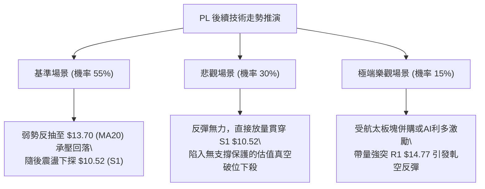

---

### 🛡️ 風險管理重要提醒

1. **高 Beta 波動風險控制**：PL 的 Beta 值高達 **2.27**，且日 ATR 佔股價高達 **7.82%**。這意味著該股極度容易出現盤中劇烈上下洗盤。嚴禁使用過高槓桿，單筆交易虧損額度必須嚴格限制在總賬戶淨值的 **1.0% ~ 1.5%** 以內。
2. **基本面財務虧損壓制**：公司當前淨利率為 **-95.1%**，營業利益率為 **-27.2%**，EPS 為 **$-1.1**，尚未實現穩定盈利。雖然最新一季營收增長達 58.1%，但航空航天與國防類股近期受同業財報暴跌（如 Redwire 下跌 21%）情緒傳染，板塊系統性拋壓較大，技術面脆弱性顯著。
3. **空頭回補與軋空風險提示**：當前放空股數佔流通股比例高達 **12.2%**，Short Ratio 為 **3.42**。若有行業突發利多（如 Pelican-12 衛星數據全面商業化或國防大單落地），容易引發短線空頭踩踏式回補，因此空頭進場必須以 **R1 ($14.77)** 作為鐵血止損線，嚴禁抗單。

---

## 📋 報告總結

```
╔══════════════════════════════════════════════════════════════════╗
║                    PL 技術分析報告總結                          ║
╠══════════════════════════════════════════════════════════════════╣
║ 報告日期：2026-11-07                                             ║
║ 當前價格：$12.55                                                 ║
║ 分析評級：🔴 強烈偏空 / 空頭主導 (綜合評分: 33/100)               ║
║                                                                  ║
║ 關鍵結論：                                                       ║
║ ├─ 長期趨勢：🔴 崩跌下行，回吐牛市主升浪 (-75.4%)                ║
║ ├─ 中期趨勢：🔴 下降通道強勢主導，MA50/MA200 形成雙重死叉壓制    ║
║ ├─ 短期趨勢：🟡 探底 $11.01 後引發超跌反彈，受制於 MA20 ($13.70) ║
║ ├─ 關鍵支撐：S1: $10.52 (52週歷史新低波段防線)                   ║
║ ├─ 關鍵阻力：R1: $14.77 / R2: $18.18 / R3: $18.81                ║
║ └─ 分析師目標：均價 $30.27 (最低 $17.00，最高 $50.00)           ║
║                                                                  ║
║ 最優策略組合：                                                   ║
║ 1. 🥇 最佳機會：策略 A (反彈至 MA20 $13.70 放空，風報比 1:2.94)  ║
║ 2. 🥈 次選機會：策略 B (現價 $12.55 順勢輕倉追空，風報比 1:1.77) ║
║ 3. 🥉 保守選擇：空手觀望，靜待股價回測 S1 ($10.52) 或突破 R1     ║
╚══════════════════════════════════════════════════════════════════╝
```

---

> ⚠️ **免責聲明**：本報告為 AI 自動生成之技術分析，所有數據及估算均基於提供的歷史價格資訊。本報告**僅供研究與學術參考**，**不構成任何投資建議**。投資有風險，入市需謹慎。

---

*報告生成時間：2026-11-07 ｜ 數據來源：Yahoo Finance ｜ 分析框架：多時框技術分析*