# PL 技術分析報告

> **報告日期**：2026-11-08 ｜ **語言**：繁體中文 ｜ **數據來源**：Yahoo Finance ｜ **當前價格**：$12.55

---

## 目錄

| 章節 | 內容 |
|------|------|
| [1. 技術面概覽](#1-技術面概覽) | 訊號儀表板、核心指標、評分卡 |
| [2. 趨勢分析](#2-趨勢分析) | 多時框趨勢、長中短期走勢 |
| [3. 圖表形態分析](#3-圖表形態分析) | 形態識別、K線組合、目標價 |
| [4. 支撐與阻力](#4-支撐與阻力) | 關鍵價位、斐波那契回調 |
| [5. 技術指標深度解讀](#5-技術指標深度解讀) | MA/RSI/MACD/布林/成交量 |
| [6. 動能與波動率](#6-動能與波動率) | 動能評估、ATR、Beta |
| [7. 多時框架總結](#7-多時框架總結) | 時框架評分矩陣 |
| [8. 交易策略建議](#8-交易策略建議) | 多空策略、風險報酬比 |
| [9. 風險提示與監控](#9-風險提示與監控) | 監控指標、風險場景 |

---

## 1. 技術面概覽

### 🎯 技術訊號儀表板

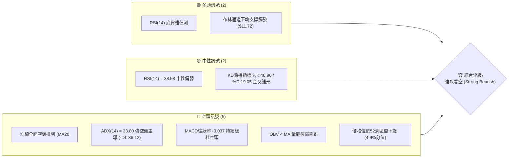

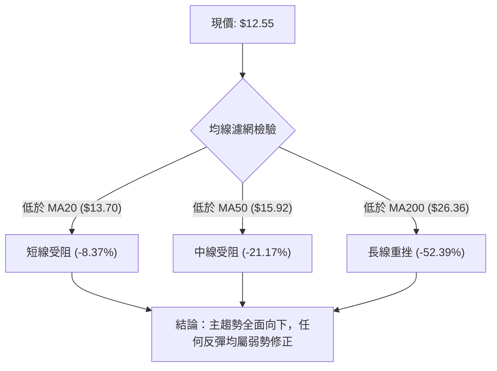

### 📊 核心指標速覽表

| 指標類別 | 指標名稱 | 當前數值 | 訊號 | 解讀 |
|----------|----------|----------|:---:|------|
| **價格** | 當前價格 | $12.55 | 🔴 | 位於52週區間4.9%極弱水位，受壓於各期均線之下 |
| **均線** | MA20 | $13.70 | 🔴 | 價格低於MA20達-8.37%，短期下行趨勢顯著 |
| **均線** | MA50 | $15.92 | 🔴 | 價格低於MA50達-21.17%，中期均線向下施壓 |
| **均線** | MA200 | $26.36 | 🔴 | 價格低於MA200達-52.39%，長期結構嚴重受損 |
| **動能** | RSI(14) | 38.58 | 🟡 | 位於30-70中性偏空區間，首尾20根K棒呈底背離 |
| **動能** | MACD(12,26,9) | -1.098 / -1.061 | 🔴 | MACD線位於訊號線下方，柱狀體為-0.037呈現空頭 |
| **趨勢** | ADX(14) | 33.80 | 🔴 | ADX>25為強趨勢，-DI(36.12)遠大於+DI(12.10)，空頭強勢主導 |
| **通道** | Bollinger %B | 0.21 | 🟡 | 位於下軌($11.72)與中軌($13.70)之間，超跌後試圖收斂 |
| **波動** | ATR(14) | $0.98 | 🔴 | 佔股價高達7.82%，顯示每日日內價格震盪幅度極高 |
| **成交量** | 量比 / OBV | 1.09x / 疲弱 | 🔴 | 成交量9.26M略高於20日均量，但OBV低於均線顯示資金淨流出 |

### 🏆 技術評分卡

```
╔══════════════════════════════════════════════════════════════════╗
║              技術評分卡 — PL (2026-11-08)                       ║
╠══════════════════════════════════════════════════════════════════╣
║ 趨勢強度 (ADX=33.80, 空方主導)  ██████░░░░░░░░░░░░░░  30/100 🔴 ║
║ 動能指標 (RSI=38.58, MACD負柱)  ████████░░░░░░░░░░░░  40/100 🟡 ║
║ 支撐穩定度 (僅依賴 S1=$10.52)   ██████░░░░░░░░░░░░░░  30/100 🔴 ║
║ 成交量配合 (OBV疲弱, 缺乏主買盤) ██████░░░░░░░░░░░░░░  30/100 🔴 ║
║ 形態完整度 (下行通道破位延續)   ██████░░░░░░░░░░░░░░  30/100 🔴 ║
║ 均線排列 (MA20<MA50<MA200空排)  ████░░░░░░░░░░░░░░░░  20/100 🔴 ║
╠══════════════════════════════════════════════════════════════════╣
║ 綜合評分 (六項算術平均：30.00)   ██████░░░░░░░░░░░░░░  30/100 🔴 ║
║ 評級結論：空頭趨勢強烈 (Strong Bearish) — 主推空頭策略          ║
╚══════════════════════════════════════════════════════════════════╝
```

---

## 2. 趨勢分析

### 🌐 多時框趨勢分析

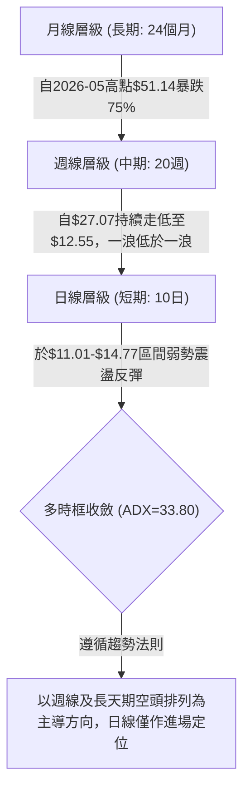

### 📈 長期趨勢 — 12個月走勢圖（Unicode）

```
PL 月線走勢圖（2025-11 至 2026-11）
價格軸 ($)
$52 ┤                                  ● $51.14 (2026-05 歷史波段高點)
$46 ┤
$40 ┤                              ●
$34 ┤                                      ●
$28 ┤                      ●
$22 ┤              ●   ●                       ●   ●
$16 ┤                                              ●
$12 ┤●(2025-11 $11.90)                                 ●   ● $12.55 (現價)
 └────────────────────────────────────────────────────────
     11   12   01   02   03   04   05   06   07   08   09   10   11 (月份)
    '25  '25  '26  '26  '26  '26  '26  '26  '26  '26  '26  '26  '26
```

**長期月線走勢特徵分析表**：

| 階段區間 | 起訖月份 | 起訖價格 ($) | 漲跌幅 (%) | 走勢特徵描述 |
|----------|----------|--------------|------------|--------------|
| **第一階段：蓄勢主升** | 2025-11 → 2026-05 | $11.90 → $51.14 | +329.75% | 多頭爆發期，連續6個月放量推升，刷新52週高點 $51.76 |
| **第二階段：急速殺跌** | 2026-05 → 2026-07 | $51.14 → $20.48 | -59.95% | 頂部迅速潰散，籌碼高位套牢，多殺多引發流動性踩踏 |
| **第三階段：陰跌探底** | 2026-07 → 2026-11 | $20.48 → $12.55 | -38.72% | 反彈無力，重心逐月下移，現價逼近52週最低位 $10.52 |

### 📊 中期趨勢（週線分析）

中期走勢呈現典型「高點降低 (Lower Highs)、低點降低 (Lower Lows)」的下降通道。

```
中期週線阻力與支撐示意圖
$18.81 ────────┬───────────────────────── 強阻力 R3 (10-09高點)
               │     $18.18 ───────────── 阻力 R2 (09-25高點)
               │            │
               ▼            ▼
               ●            ●
              / \          / \       $14.77 ───── 阻力 R1 (10-30高點)
             /   \        /   \        ▲
            /     \      /     \      / \
───────────●───────●────●───────●────●───●─────── 現價 $12.55
          (支撐跌破) (支撐跌破)
                                          ● ───── 52週低點支撐 S1 $10.52
```

從近8週的高低點變化檢視：
- 2026-10-09 週高點達到 **$18.81 (R3)** 後爆發長黑下殺。
- 2026-10-16 當週破位重挫至收盤 $13.56，成交量放大至 51.29M。
- 2026-10-30 週高點僅能觸及 **$14.77 (R1)** 即遭遇拋壓阻截。
- 2026-11-06 當週最低下探 **$11.01**，收盤於 **$12.55**，確認中短期反彈高點不斷壓低。

### ⚡ 趨勢強度評估（ADX 解讀）

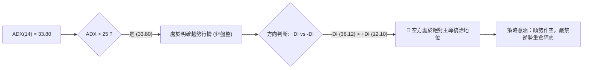

**ADX 趨勢強度對照表**：

| 指標名稱 | 數值 | 門檻區間 | 趨勢狀態判定 | 操作意涵 |
|----------|------|----------|--------------|----------|
| **ADX(14)** | **33.80** | > 25 (強趨勢) | 強烈單邊趨勢 | 趨勢跟隨策略有效，擺動指標鈍化 |
| **-DI** | **36.12** | 顯著偏高 | 空方動能強盛 | 下行動能主導市場 |
| **+DI** | **12.10** | 顯著偏低 | 多方力量潰散 | 多方缺乏主動推升意願 |
| **DI差值 (-DI - +DI)** | **+24.02** | > 15 | 空頭極度發散 | 逢反彈高空勝率遠大於搶反彈 |

---

## 3. 圖表形態分析

### 🔍 形態識別系統

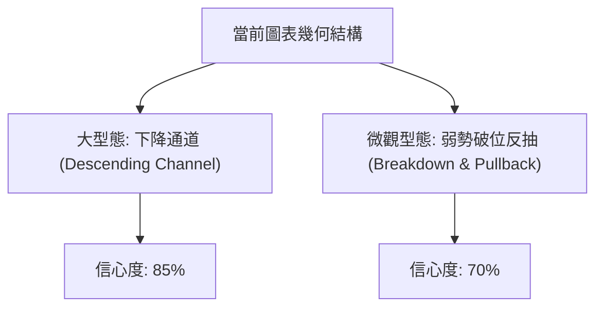

**形態識別與信心度評估表**（依規則 15）：

| 形態名稱 | 信心度 (%) | 判斷依據（引用數據） | 完成度 (%) | 目標價（附計算式） |
|----------|:---------:|----------------------|:---------:|--------------------|
| **中長期下降通道** | **85%** | 高點下移（R3: $18.81 → R2: $18.18 → R1: $14.77）；低點下移（$15.60 → $13.33 → $12.79 → $11.01） | 90% | 下軌測算低點：以通道下軌支撐測算，目標指向52W低點 **$10.52** |
| **破位橫截收斂** | **70%** | 10-16 跌破前期支撐平台 $16.42 形成跳空殺跌，於 $11.01-$14.77 進行破位後修正 | 75% | 形態向下延伸測幅：頸線 $14.77 − 形態高差 ($14.77 - $11.01 = $3.76) = 測幅低點 **$11.01**（已初次觸碰），進一步指向 **$10.52** |
| **雙底反轉形態** | **25%** | 訊號不足，僅有 11-05 單根下影線 $11.01 與 52W低點 $10.52 呼應，未形成雙底頸線突破 | 15% | 訊號不足，依規則 15 不予採納預測 |

### 🕯️ 重要K線形態分析

根據「近10根日K」與「近8根週K」實際數據進行嚴格檢視（依規則 19）：

| 日期與時框 | 開盤 ($) | 最高 ($) | 最低 ($) | 收盤 ($) | 成交量 | K線形態 | 解讀與訊號 |
|------------|----------|----------|----------|----------|--------|---------|------------|
| **2026-10-27 (日K)** | 13.95 | 14.77 | 13.84 | 14.49 | 6,491,100 | 長紅反彈線 | 觸碰波段高點阻力 R1 $14.77 後留上影線，多頭反撲受阻 🟡 |
| **2026-10-30 (日K)** | 13.54 | 14.02 | 13.15 | 13.47 | 6,554,100 | 下跌流星變形 | 開高走低破昨收，顯示 $14.00 關卡賣壓沉重 🔴 |
| **2026-11-04 (日K)** | 13.40 | 13.62 | 12.50 | 12.65 | 7,855,700 | 中長黑K棒 | 帶量長黑跌破 $13.00 整數關卡，加速尋底 🔴 |
| **2026-11-05 (日K)** | 12.21 | 12.40 | 11.01 | 11.37 | 10,405,800 | 帶長下影大陰線 | 破底爆出近期最大量10.40M，最低摜破至 $11.01，空頭釋放流動性 🔴 |
| **2026-11-06 (日K)** | 11.77 | 12.55 | 11.48 | 12.55 | 9,261,600 | 光頭中紅棒 (反彈吞噬) | 伴隨9.26M成交量，收在全日最高點，短線形成超跌反彈 🟢 |
| **2026-10-16 (週K)** | 17.00 | 17.03 | 13.33 | 13.56 | 51,292,600 | 長黑斷頭鍘 | 跌破所有中短期均線，週跌幅逾20%，確立破位主跌段 🔴 |
| **2026-10-30 (週K)** | 13.30 | 14.77 | 13.15 | 13.47 | 35,026,200 | 長上影十字倒錘頭 | 上攻 $14.77 遭無情壓回，縮量反彈確認無買盤承接 🔴 |
| **2026-11-06 (週K)** | 13.62 | 13.74 | 11.01 | 12.55 | 41,962,900 | 長下影紡錘線 | 測試 $11.01 獲得初步支撐，但收盤仍低於前週收盤，反彈性質未變 🟡 |

### 📉 ASCII 走勢形態示意圖

```
日K線近10日結構示意圖
價格
$15.00 ┤        ┌─┐ (10-27 高點 $14.77 阻力 R1)
$14.50 ┤        │ │ ┌─┐ ┌─┐
$14.00 ┤    ┌─┐ │ │ │ │ │ │
$13.50 ┤    │ │ └─┘ └─┘ └─┘ ┌─┐
$13.00 ┤ ───┴─┴─────────────│ │──────────────────── MA20: $13.70 (阻力中軌)
$12.50 ┤                     │ │ ┌─┐     ┌─┐ (11-06 收盤 $12.55)
$12.00 ┤                     └─┘ │ │     │ │
$11.50 ┤                         └─┘ ┌─┐ │ │
$11.00 ┤                             │ │─┴─┴────── 11-05 最低 $11.01
       └─────────────────────────────┴───────────
         10-26 10-27 10-28 10-29 10-30 11-02 11-03 11-04 11-05 11-06
```

### 🎯 形態目標價計算

1. **破位下行測幅（測幅滿足點）**：
   - 頸線/破位點：**$14.77**（近期震盪高點及反彈失敗點）。
   - 形態波段震盪高度：$14.77 (波段高) − $11.01 (波段低) = **$3.76**。
   - 向下等距測量目標 = 頸線破位點 $14.77 − 形態高差 $3.76 = **$11.01**（此階測幅已於 11-05 當日打到最低點確認）。
   - 次級延伸目標：若跌破 11-05 低點 $11.01，直接下探 52 週最低支撐位 **$10.52**。

---

## 4. 支撐與阻力

### 🗺️ 關鍵價位分布圖（Unicode）

```
╔══════════════════════════════════════════════════════════════════╗
║                    PL 價位結構分布圖                             ║
╠══════════════════════════════════════════════════════════════════╣
║ $18.81 ║████████████████████████║ 強阻力 R3 (10-09週高點聚類)    ║
║ $18.18 ║████████████████████    ║ 阻力 R2 (09-25週高點聚類)      ║
║ $15.92 ║────────────────────────║ 中期生命線 MA50 壓力關卡       ║
║ $14.77 ║████████████████████████║ 關鍵阻力 R1 (10-27/30波段反彈高)║
║ $13.70 ║┄┄┄┄┄┄┄┄┄┄┄┄┄┄┄┄┄┄┄┄┄┄║ 短期阻力 MA20 / 布林通道中軌   ║
║ $12.55 ╠════════════════════════╣ ◄ 現價 (當前收盤價)           ║
║ $11.72 ║┈┈┈┈┈┈┈┈┈┈┈┈┈┈┈┈┈┈┈┈┈┈┈┈║ 布林通道下軌動態支撐           ║
║ $10.52 ║████████████████████████║ 52週歷史波段絕對強支撐 S1      ║
╚══════════════════════════════════════════════════════════════════╝
```

### 🚧 阻力位分析表

依據數據「關鍵價位（由 OHLCV 計算）」區塊嚴格引用：

| 阻力級別 | 價位 ($) | 距現價幅標 (%) | 形成原因（依數據確認） | 突破難度 | 重要性 |
|:--------:|:--------:|:--------------:|------------------------|:--------:|:------:|
| **R1** | **$14.77** | +17.69% | 近期日K/週K波段高點聚類 (10-27高點、10-30週高點) | 高 🔴 | 極關鍵（反彈多空分水嶺） |
| **R2** | **$18.18** | +44.86% | 09-25 週K波段高點聚類，前波成交量逾56M之套牢密集區 | 極高 🔴 | 中期強大套牢阻力 |
| **R3** | **$18.81** | +49.88% | 10-09 週K波段高點聚類，近半年週線反彈最高峰頂部 | 固若金湯 🔴 | 長期多空分界大頂 |

*補充動態阻力參考*：MA20 位於 **$13.70**（距離現價 +9.16%），為當前反彈的第一個動態壓制位。

### 🛡️ 支撐位分析表

依據數據「關鍵價位（由 OHLCV 計算）」區塊嚴格引用：

| 支撐級別 | 價位 ($) | 距現價幅標 (%) | 形成原因（依數據確認） | 守住機率 | 重要性 |
|:--------:|:--------:|:--------------:|------------------------|:--------:|:------:|
| **S1** | **$10.52** | -16.18% | 52週波段歷史最低點 (52W Low)，長週期最終防線 | 50% 🟡 | 核心底線（破位即入無底深淵） |

*注：近一年波段低點聚類數據中僅計算出 S1 ($10.52)，更低層級之 S2/S3 數據中未偵測到，嚴禁憑空捏造。*

### 📐 斐波那契回調位分析

依據 52 週極限區間（低點 **$10.52** → 高點 **$51.76**）嚴格對照：

```
斐波那契回調階梯分布
  0.0%  (52W High) ───────────────────────── $51.76
 23.6%             ───────────────────────── $42.03
 38.2%             ───────────────────────── $36.01
 50.0%             ───────────────────────── $31.14
 61.8%             ───────────────────────── $26.27 (黃金分割位 / 近MA200 $26.36)
 78.6%             ───────────────────────── $19.35 (近阻力R3 $18.81)
                   ───────────────────────── 現價 $12.55 (落於 78.6% ~ 100.0% 之間)
100.0%  (52W Low)  ───────────────────────── $10.52
```

**斐波那契結構深度解讀**：
1. **回調深幅失守**：現價 **$12.55** 已完全跌破 78.6% 回調位（**$19.35**），代表牛市主升段已被徹底腰斬並破壞，市場進入極端深度回調。
2. **區間定位**：現價落於 **78.6% ($19.35)** 與 **100.0% ($10.52)** 之間，距離 100.0% 終極起漲原點 **$10.52** 僅剩 $2.03（-16.18%）空間。
3. **技術意涵**：當資產回吐幅度超過 78.6% 時，多頭結構已經瓦解，反彈均屬「超跌抽腳」而非「牛市延續」，若跌破 100.0% ($10.52)，將進入完全價值重估的自由落體階段。

---

## 5. 技術指標深度解讀

### 🎛️ 指標訊號總覽

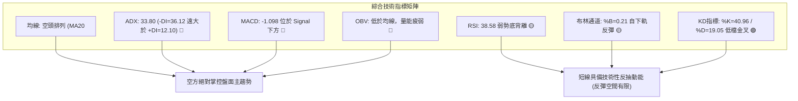

### 📈 移動平均線排列分析

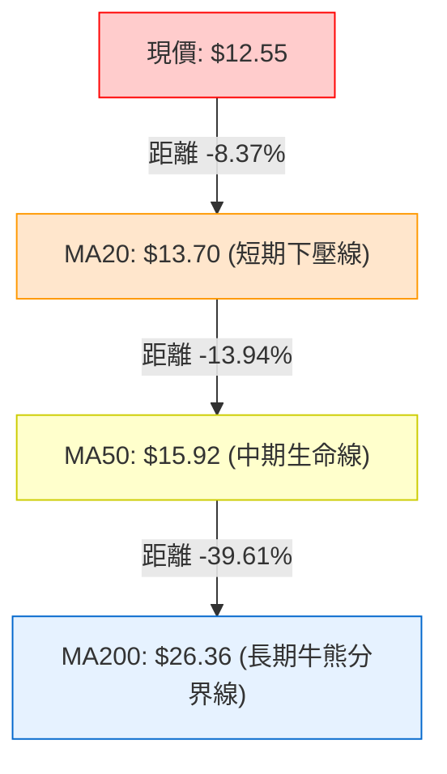

**均線詳細監控數據表**：

| 均線名稱 | 當前價格 ($) | 與現價乖離 ($) | 乖離率 (%) | 均線歷史斜率走向 | 狀態評估 |
|----------|:------------:|:--------------:|:----------:|:----------------:|:--------:|
| **MA 5** | $12.61 | -$0.06 | -0.46% | 走平微降 | 短線企圖走平纏繞 🟡 |
| **MA 10** | $13.34 | -$0.79 | -5.92% | 急劇向下 | 短線第一道蓋頭賣壓 🔴 |
| **MA 20** | $13.70 | -$1.15 | -8.37% | 持續向下發散 | 短期空頭防線 🔴 |
| **MA 60** | $17.02 | -$4.46 | -26.24% | 陡峭向下 | 中期趨勢嚴重空頭 🔴 |
| **MA 120** | $23.58 | -$11.03 | -46.78% | 大幅下傾 | 半年線沉重下壓 🔴 |
| **MA 200** | $26.36 | -$13.81 | -52.39% | 下彎走空 | 長期均線完全走空 🔴 |
| **MA 240** | $25.13 | -$12.58 | -50.05% | 逐步拱頂向下 | 年線下壓確立 🔴 |

**均線綜合研判**：
所有長中短期移動平均線（MA5、MA10、MA20、MA60、MA120、MA200、MA240）全面位於現價上方，呈現標準且教科書般的「全均線空頭排列」。上方每一條均線皆轉化為強大阻力帶，多方欲扭轉劣勢需極大成交量配合，目前難度極高。

### 📉 RSI(14) 分析

- **當前數值**：**38.58**
- **強度指示**：
  ```
  超賣 (0) ──────[30]───●──[50]──────────[70]────── 超買 (100)
  進度條：███████████████░░░░░░░░░░░░░░░░░░░░░░░░ 38.58% (偏弱空方區)
  ```
- **超買超賣評估**：位於 30 至 70 的中性區間偏下方，未達極端超賣（<30），顯示下行過程中仍有籌碼陰跌釋出，空方尚未出現竭盡耗損。
- **背離分析**：系統標註 **⚠️ 底背離 (Bullish Divergence)**。
  - *背離論證*：在近 20 根 K 棒的首尾對比中，現價在 11-05 跌破新低打到 $11.01，但 RSI(14) 卻由週線先前最低點的 23.5（09-11當週）緩步攀升至 38.58，呈現「價格破低點、指標未創新低」之底背離跡象。
  - *背離結論*：該背離屬於「弱勢震盪底背離」，易引發技術性短線反抽，但在強空頭趨勢（ADX=33.80）下，背離通常以橫盤整理或微幅反彈消耗，不應誤判為趨勢反轉。

### 📊 MACD(12,26,9) 訊號解讀

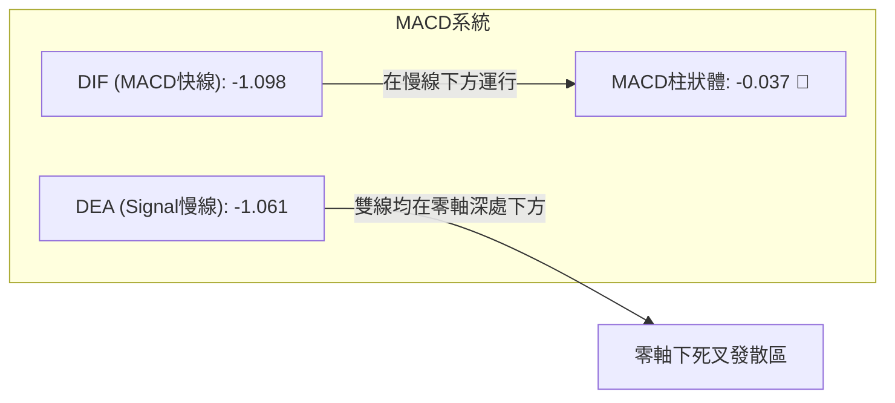

- **MACD 快線**：**-1.098**
- **訊號線 (Signal)**：**-1.061**
- **柱狀體 (Histogram)**：**-0.037**
- **解讀**：MACD 與 Signal 雙線深鎖於零軸下方（<-1.0），且快線持續低於慢線，柱狀體維持為負數（-0.037）。這代表長期空頭動能雖然加速度有所放緩，但絕對動能依舊掌握在賣方手裡，目前毫無多頭翻紅金叉訊號。

### 📦 布林通道分析

```
布林通道現狀示意圖 (寬度 = $3.96)
$15.68 ───────────────────────────── 上軌 (Upper Band)
       │
$13.70 ───────────┄┄┄┄┄┄┄┄┄───────── 中軌 (MA20) (阻力關卡)
       │
$12.55 ───────────●────────────────── 現價 (%B = 0.21)
       │
$11.72 ───────────────────────────── 下軌 (Lower Band) (短線動態支撐)
```

- **上軌**：**$15.68**
- **中軌 (MA20)**：**$13.70**
- **下軌**：**$11.72**
- **%B 指標**：**0.21**
- **深度研判**：
  1. 現價 $12.55 位於中下軌之間，%B 為 0.21，高於 0.0（下軌），脫離了 11-05 跌破下軌的極端開口態勢。
  2. 價格自下軌 $11.72 展開技術性回抽，當前正向上測試中軌 **$13.70**。中軌正是 MA20 所在，歷來是空頭趨勢中最佳的反彈做空防守點。

### 💹 成交量分析（量價配合度）

```
量能比較進度條 (百萬股)
最新成交量 (9.26M)  ████████████████████░░░░  9.26M
20日均量   (8.51M)  ██████████████████░░░░░░  8.51M (量比: 1.09x)
50日均量  (10.81M)  ███████████████████████░ 10.81M
```

- **最新量能狀況**：11-06 日成交量為 **9,261,600 股**，較 20 日均量（**8,515,340 股**）放大約 1.09 倍，但顯著低於 50 日均量（**10,814,970 股**）。
- **量價特徵**：
  1. 11-05 股價打出破底低點 $11.01 當日，成交量激增至 **10.40M**，顯示破位引發恐慌性停損盤。
  2. 11-06 股價反彈至 $12.55，成交量萎縮至 **9.26M**，呈現「下跌放量、反彈縮量」的量價背離結構。
- **OBV 能量潮解讀**：指標明示「OBV < MA → 量能疲弱」，OBV 趨勢持續在均線下方運行，資金淨流出格局未改，買盤缺乏持續追高意願。

---

## 6. 動能與波動率

### ⚡ 動能評估四象限

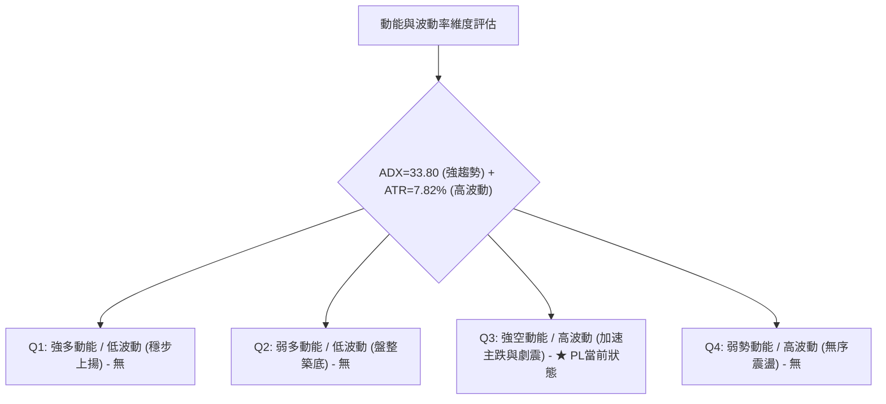

**動能評估四象限狀態表**：

| 象限 | 動能維度 | 波動維度 | 股票當前狀態 | 風險回報評估與應對 |
|:----:|:--------:|:--------:|:------------:|:-------------------|
| **Q1** | 強多頭 | 低波動 | — | 最佳波段順勢作多期（非當前） |
| **Q2** | 弱動能 | 低波動 | — | 盤整築底觀望期（非當前） |
| **Q3** | **強空頭** | **高波動** | **✓ PL 核心定位** | **高風險、高殺傷力，下行慣性強，任何多單搶反彈均屬火中取栗** |
| **Q4** | 轉向中 | 高波動 | — | 頂部或底部激烈換手期（非當前） |

### 📊 ATR 波動率分析

- **ATR(14) 絕對值**：**$0.98**
- **波動率比重**：**7.82%**（佔股價 $12.55）
- **歷史波動解讀**：每日平均震盪近 1 美元，代表單日正常價格波動區間即達正負 7.82%，屬於典型的高 Beta、高投機性小型科技/航太標的。
- **風控止損應用建議**：
  - *日內極限波幅*：$12.55 ± $0.98 = **$11.57 至 $13.53**。
  - *波動率安全保護止損帶*：設定止損應至少容納 **1.5 至 2.0 倍 ATR**（即 **$1.47 至 $1.96**），以防止日內雜訊引發無效洗盤。

### 📐 Beta 與市場相關性

- **Beta 係數**：**2.27**
- **市場特徵分析**：
  1. Beta 高達 2.27，代表該標的波動幅度為標普500指數的 2.27 倍。當大盤微跌 1%，PL 理論跌幅將逾 2.27%。
  2. **做空比率 (Short % Float)**：高達 **12.2%**，Short Ratio 為 **3.42**。這反映出機構與空方部位深重，雖然高空頭部位在極端超賣時易引發無預警的軋空反彈（Short Squeeze），但在均線完全壓制下，空頭持續主導盤面下挫。

---

## 7. 多時框架總結

### 📋 時框架評分表

| 時框架 | 趨勢方向 | 動能狀態 | 均線排列 | 圖表形態 | 綜合評分 | 操作建議 |
|:------:|:--------:|:--------:|:--------:|:--------:|:--------:|:--------:|
| **月線** (長期) | 極度看空 🔴 | 零軸下潰退 | 轉折下彎 | 高位爆跌腰斬 | 20/100 | 嚴禁長線存股買入 |
| **週線** (中期) | 強烈看空 🔴 | MACD持續負柱 | 空頭排列 | 下降通道破位下行 | 25/100 | 反彈遇均線阻力作空 |
| **日線** (短期) | 弱勢反彈 🟡 | RSI底背離/KD金叉 | MA5/MA20蓋頭 | 超跌下影線反抽 | 45/100 | 僅供極短線嚴格停損博弈 |

### 🔲 綜合訊號矩陣

```
時框架訊號收斂一致性檢視
時框        趨勢    均線    動能    量能    整體結論
長期 (月線)  🔴 空   🔴 空   🔴 空   🔴 空   🔴 全面空頭
中期 (週線)  🔴 空   🔴 空   🔴 空   🔴 空   🔴 強烈空頭
短期 (日線)  🟡 震   🔴 空   🟡 彈   🟡 平   🟡 弱勢反抽
─────────────────────────────────────────────────────────────
收斂一致性：高達 80% 偏空一致，短期微幅反彈無法逆轉中長期崩落
```

### ⚖️ 多時框收斂結論

依據「嚴格要求 14（多時框收斂規則）」進行裁決：
1. **趨勢市判定**：當前日線 **ADX(14) = 33.80**，顯著高於 25 臨界線，確認目前處於**強單邊趨勢行情**而非盤整行情。
2. **時框主導順序**：在趨勢行情下，必須嚴格以中長期（週線、MA50、MA200）方向為最高權重主導，日線僅用於尋找反彈耗盡時的最佳空方進場時機。
3. **方向性收斂**：雖然日線出現 RSI 底背離及 KD 低檔金叉等短線技術性回抽訊號，但在週線下降通道壓制與全均線空頭排列之下，此類反彈高度極度受限。
4. **唯一方向結論**：**強烈偏空（Bearish Bias）**。任何日線級別的衝高均應視為誘多與放空契機，本報告主策略全面以**空頭逢高建倉**為主導。

---

## 8. 交易策略建議

### 🗺️ 策略決策流程圖

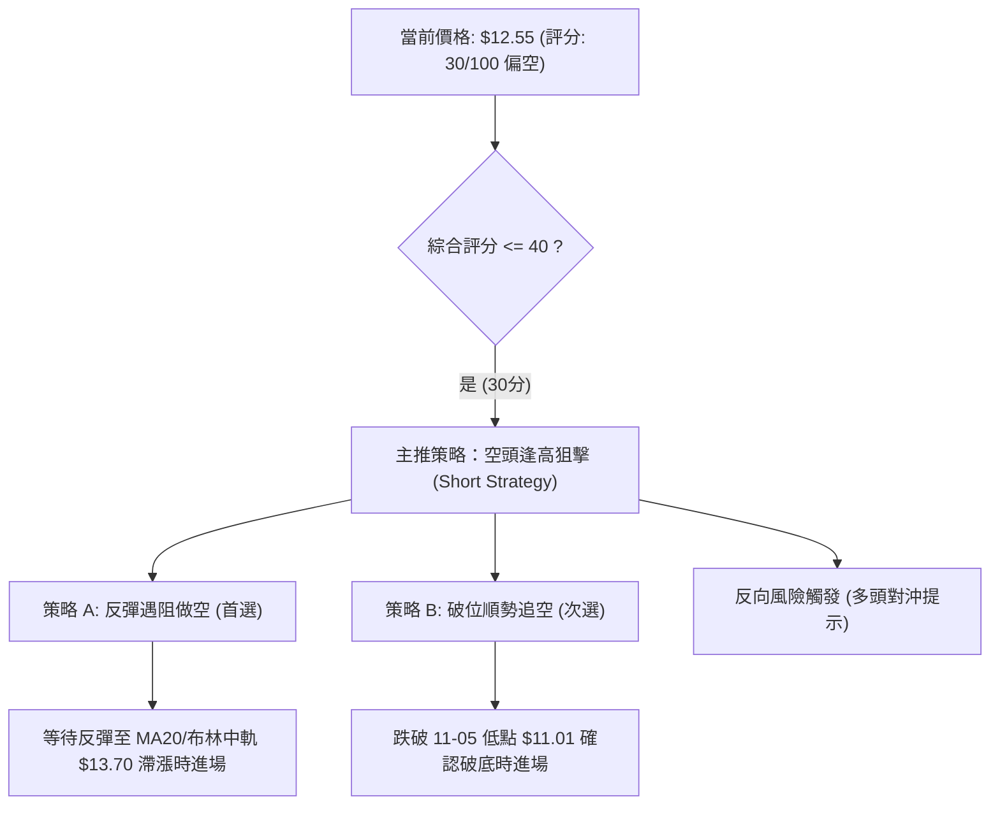

### 🧭 策略路由（依評分卡分流）

> **當前主策略方向 = 強烈空頭主導（依技術評分卡綜合評分 30/100，規則 18 判定屬於 ≤40 偏空區間，主推空頭策略）**

### 🎯 價格情境階梯（Price Scenarios）

價位嚴格引用第 4 章「關鍵價位」與「指標計算數值」：

| 觸發條件 | 下一目標 | 後續延伸 | 情境含義 | 操作應對 |
|----------|----------|----------|----------|----------|
| **強勢向上突破 R1 $14.77** | R2 $18.18 | R3 $18.81 | 短線結構反轉（空頭停損觸發） | 全面離場觀望，嚴禁加空 |
| **弱勢反彈受阻 MA20 $13.70** | 測下軌 $11.72 | 探前低 $11.01 | 空頭中繼確認（最佳加空點） | 啟動主推空頭策略 A |
| **有效跌破 11-05低點 $11.01** | S1 $10.52 | 尋找新支撐 | 破位加速探底（恐慌拋盤湧現） | 啟動主推空頭策略 B |

### 📊 情境機率分佈

| 情境劃分 | 機率 (%) | 主要依據（指標狀態） |
|----------|:-------:|----------------------|
| **情境一：反彈遇阻再下探 (主推)** | **65%** | ADX=33.80 空頭主導，均線呈空頭排列，OBV 顯示量能疲弱無實質承接 |
| **情境二：跌破支撐加速探底** | **25%** | 價格緊貼 52 週低點附近，高 Beta (2.27) 伴隨科技板塊下殺風險 |
| **情境三：強勢向上反轉突破** | **10%** | 僅依靠 RSI 底背離微弱支撐，上方阻力重重，需巨額量能逆轉難度極大 |

### 🟢 主策略詳情（方向依評分路由：做空策略）

嚴格執行規則 17 計算風險報酬比：
做空風險報酬比 = (進場價 − 目標價 T1) ÷ (止損價 − 進場價)

| 策略要素 | 策略 A（反彈受阻放空 — 首選） | 策略 B（破位順勢加空 — 次選） |
|----------|--------------------------------|--------------------------------|
| **策略類型** | 順勢高空（反彈衰竭進場） | 破底追空（動能破位進場） |
| **進場條件** | 價格反彈至 MA20 附近出現滯漲黑K | 帶量跌破 11-05 波段低點 $11.01 |
| **進場價格** | **$13.70**（精確對齊 MA20 數值） | **$10.90**（跌破 $11.01 後確認點） |
| **目標價 T1** | **$11.01**（11-05波段低點） | **$10.52**（52週波段歷史最低支撐 S1） |
| **目標價 T2** | **$10.52**（52週波段歷史最低支撐 S1） | **N/A（數據未提供更低支撐）** |
| **止損價格** | **$14.77**（關鍵阻力位 R1） | **$11.72**（布林通道下軌變阻力） |
| **風險報酬比** | **1 : 2.51（以 T1 計）**<br>計算式：(13.70 - 11.01) ÷ (14.77 - 13.70) = 2.69 ÷ 1.07 = 2.514 | **1 : 0.46（以 T1 計）**<br>計算式：(10.90 - 10.52) ÷ (11.72 - 10.90) = 0.38 ÷ 0.82 = 0.463 |
| **成功機率** | **65%** | **55%** |
| **建議倉位** | **總資金之 10% - 15%** | **總資金之 5%**（因臨近S1空間較小） |

*策略解讀*：
- 策略 A 為最佳風險報酬比設置，利用現價 $12.55 與 MA20 ($13.70) 的技術反抽空間，等待反彈高點布空，止損嚴格設於阻力 R1 ($14.77)，以 1.07 美元風險換取 2.69 美元利潤空間，風報比達 **1 : 2.51**。
- 策略 B 屬於動能突破操作，由於下方距離 52 週最低點 S1 ($10.52) 僅剩 0.38 美元空間，風報比僅 1 : 0.46，僅適合極短線動能交易者或在跌破 S1 後進一步減倉防守。

### 🔴 反向風險觸發點（對沖提示）

若發生以下任一信號，主推之空頭邏輯即刻失效，必須無條件止損或反向對沖：
1. **價位翻轉**：日K線收盤價強勢實體突破阻力位 **R1 ($14.77)**，打破下降趨勢高點遞減結構。
2. **指標轉強**：MACD 快慢線在零軸下方完成「黃金交叉」，且柱狀體顯著由負轉正翻紅。
3. **趨勢衰竭**：ADX(14) 掉頭跌破 25，且 +DI 上穿 -DI 形成多頭主導。

### ⭐ 整體訊號強度評星

```
╔══════════════════════════════════════════════════════════════════╗
║ 做多訊號強度：★☆☆☆☆  (1/5星 - 僅有極弱底背離，不具操作勝率)    ║
║ 做空訊號強度：★★★★☆  (4/5星 - 均線空排、ADX強勢主導，阻力清晰)  ║
║ 整體可信度：  ★★★★☆  (4/5星 - 多時框趨勢高度一致，量價結構吻合)║
╚══════════════════════════════════════════════════════════════════╝
```

---

## 9. 風險提示與監控

### ✅ 關鍵監控指標 Checklist

```
╔══════════════════════════════════════════════════════════════════╗
║                     每日關鍵技術監控清單                         ║
╠══════════════════════════════════════════════════════════════════╣
║ [ ] 監控一：MA20 動態位置 ($13.70) 是否成為反彈極限壓力        ║
║ [ ] 監控二：11-05 低點 ($11.01) 是否被收盤價實質跌破           ║
║ [ ] 監控三：52週最低點 S1 ($10.52) 的買盤測試與支撐防守反應    ║
║ [ ] 監控四：成交量是否突破 50日均量 (10.81M)，辨識主力放量方向 ║
║ [ ] 監控五：ADX(14) 數值是否維持於 25 以上確認單邊趨勢延續      ║
║ [ ] 監控六：做空比率 (Short % Float = 12.2%) 是否引發軋空警訊  ║
╚══════════════════════════════════════════════════════════════════╝
```

### ⚠️ 風險場景分析

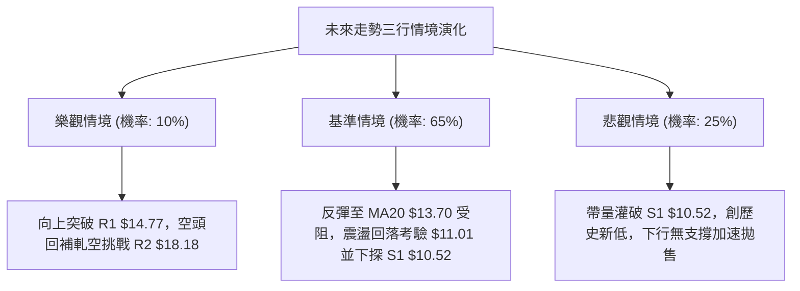

### 🛡️ 風險管理重要提醒

1. **高 Beta 波動風險 (Beta = 2.27)**：
   - PL 的市場彈性極大，單日波動劇烈（ATR 達 $0.98，佔股價 7.82%）。進場部位規模必須嚴格縮減，單筆交易虧損金額不得超過總帳戶淨值的 **1.0%**。
2. **高放空比例與軋空風險 (Short % Float = 12.2%)**：
   - 儘管趨勢極度偏空，但逾 12% 的放空比率意味著盤面存在大量潛在回補買盤。若航太防務板塊或大盤出現突發性政策利多，極易出現「開盤跳空軋空」走勢。空單必須嚴格設定限價止損單（Stop-Loss），嚴禁放任虧損硬扛。
3. **無支撐深淵風險 (Below S1 $10.52)**：
   - 當前價格距離 52 週歷史最低點 S1 ($10.52) 僅一步之遙。一旦此價位失守，下方將不存在任何歷史成交密集區作為支撐，將引發融資斷頭與演算法止損賣壓，切忌在破位後盲目摸底。

---

## 📋 報告總結

```
╔══════════════════════════════════════════════════════════════════╗
║                   PL 技術分析報告總結                            ║
╠══════════════════════════════════════════════════════════════════╣
║ 報告日期：2026-11-08                                             ║
║ 當前價格：$12.55                                                 ║
║ 分析評級：🔴 強烈看空 (Strong Bearish) — 綜合評分: 30/100         ║
╠══════════════════════════════════════════════════════════════════╣
║ 關鍵結論：                                                       ║
║ ├─ 長期趨勢：🔴 自 $51.14 歷史高點深幅回吐逾 75%，結構徹底走熊   ║
║ ├─ 中期趨勢：🔴 下降通道完好，各期均線呈典型空頭排列下壓         ║
║ ├─ 短期趨勢：🟡 自超賣邊界展開弱勢技術反抽，上方受制於 MA20     ║
║ ├─ 關鍵阻力：R1: $14.77 ｜ R2: $18.18 ｜ R3: $18.81               ║
║ ├─ 關鍵支撐：S1: $10.52 (52週最低防線)                           ║
║ └─ 分析師共識目標：$30.27 (大幅脫離現狀，短線完全由技術空方主導) ║
╠══════════════════════════════════════════════════════════════════╣
║ 最優策略組合：                                                   ║
║ 1. 🥇 最佳機會 (策略 A)：等待反抽 MA20 ($13.70) 逢高放空，        ║
║    止損設 R1 ($14.77)，目標看 $11.01，風險報酬比 1 : 2.51        ║
║ 2. 🥈 次選機會 (策略 B)：跌破 $11.01 順勢追空，下探 S1 ($10.52)   ║
║ 3. 🥉 保守選擇：空手觀望，靜待股價測試 S1 ($10.52) 之築底成效   ║
╚══════════════════════════════════════════════════════════════════╝
```

---

> ⚠️ **免責聲明**：本報告為技術分析研究成果，所有數據、圖表及價位估算均嚴格基於所提供之歷史交易資訊（Yahoo Finance）。本報告**僅供學術研究與投資策略探討參考**，**不構成任何要約、招攬或具體投資建議**。市場有風險，交易需審慎評估個人風險承受能力。

---

*報告生成時間：2026-11-08 ｜ 數據來源：Yahoo Finance ｜ 分析框架：多時框技術分析體系*