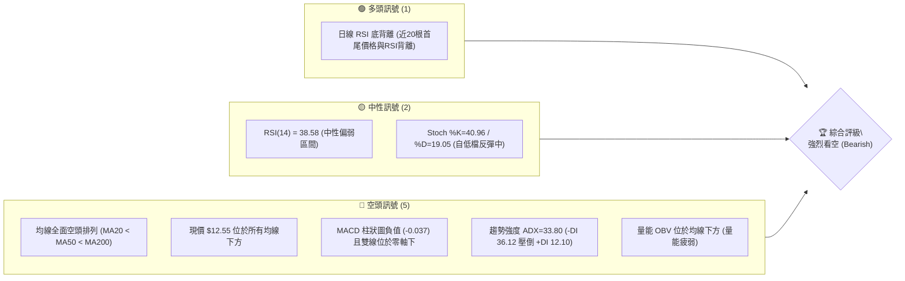
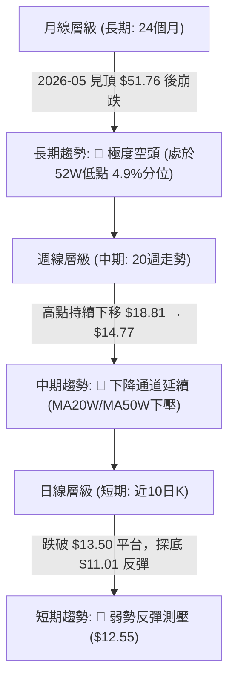
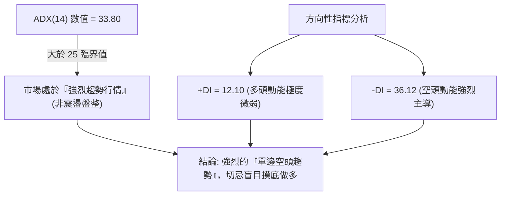
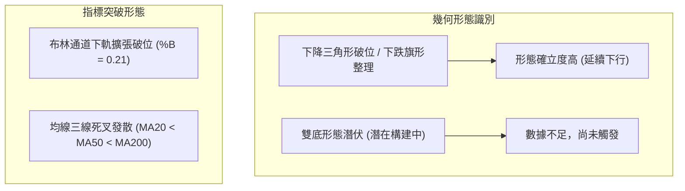
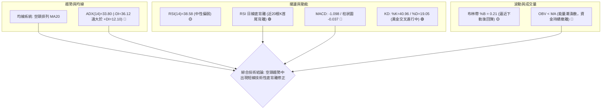
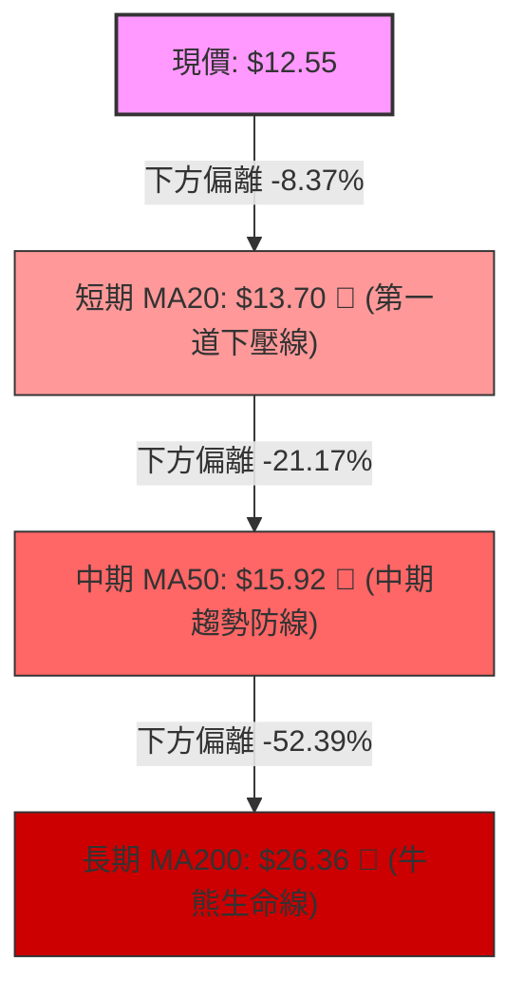
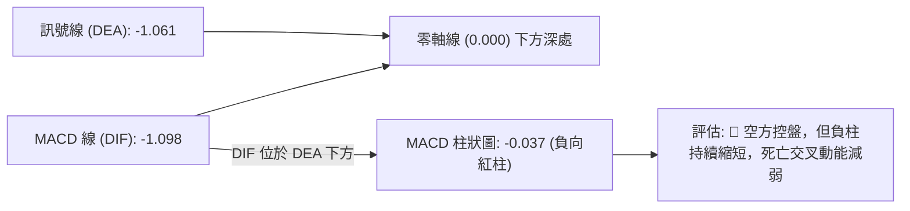
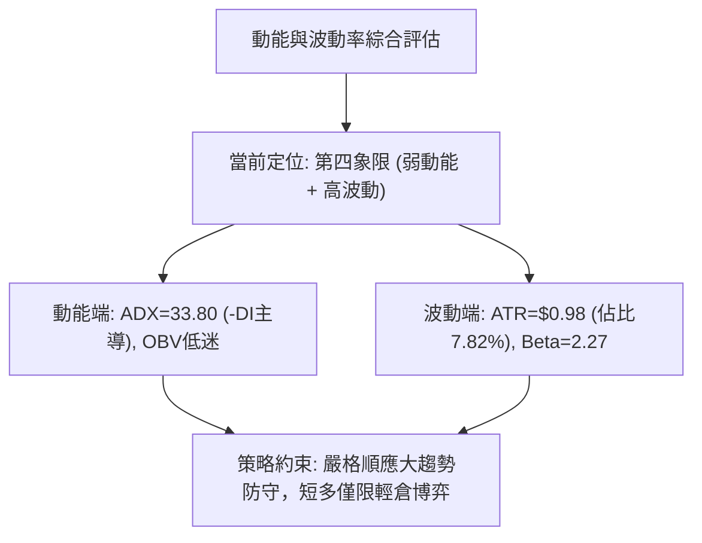
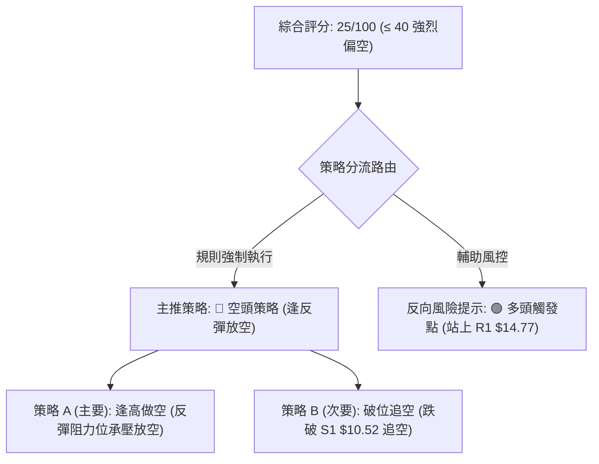
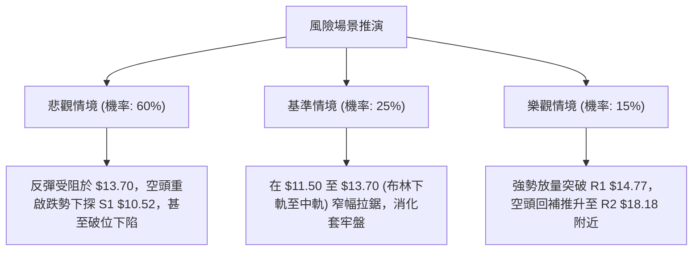

# PL 技術分析報告

> **報告日期**：2026-11-09 ｜ **語言**：繁體中文 ｜ **數據來源**：Yahoo Finance ｜ **當前價格**：$12.55

---

## 目錄

| 章節 | 內容 |
|------|------|
| [1. 技術面概覽](#1-技術面概覽) | 訊號儀表板、核心指標、評分卡 |
| [2. 趨勢分析](#2-趨勢分析) | 多時框趨勢、長中短期走勢 |
| [3. 圖表形態分析](#3-圖表形態分析) | 形態識別、K線組合、目標價 |
| [4. 支撐與阻力](#4-支撐與阻力) | 關鍵價位、斐波那契回調 |
| [5. 技術指標深度解讀](#5-技術指標深度解讀) | MA/RSI/MACD/布林/成交量 |
| [6. 動能與波動率](#6-動能與波動率) | 動能評估、ATR、Beta |
| [7. 多時框架總結](#7-多時框架總結) | 時框架評分矩陣 |
| [8. 交易策略建議](#8-交易策略建議) | 多空策略、風險報酬比 |
| [9. 風險提示與監控](#9-風險提示與監控) | 監控指標、風險場景 |

---

## 1. 技術面概覽

### 🎯 技術訊號儀表板



### 📊 核心指標速覽表

| 指標類別 | 指標名稱 | 當前數值 | 訊號 | 解讀 |
|----------|----------|----------|------|------|
| **價格** | 當前價格 | $12.55 | 🔴 | 位於 52 週低檔區（52W 區間 4.9%），距離低點 $10.52 僅 19.3% |
| **均線** | MA20 | $13.70 | 🔴 | 價格低於 MA20（偏離 -8.37%），短線下壓沉重 |
| **均線** | MA50 | $15.92 | 🔴 | 價格低於 MA50（偏離 -21.17%），中期下行通道確立 |
| **均線** | MA200 | $26.36 | 🔴 | 價格低於 MA200（偏離 -52.39%），處於長期熊市結構 |
| **動能** | RSI(14) | 38.58 | 🟡 | 位於 30–70 中性偏弱區間，出現初步日線底背離跡象 |
| **動能** | MACD(12,26,9) | -1.098 / -1.061 | 🔴 | DIF 與 DEA 雙雙深陷零軸下，柱狀圖 -0.037，空方動能主導 |
| **趨勢** | ADX(14) | 33.80 | 🔴 | ADX > 25 且 -DI(36.12) 遠高於 +DI(12.10)，空頭趨勢強烈 |
| **通道** | 布林通道 %B | 0.21 | 🟡 | 位於中軌 $13.70 與下軌 $11.72 之間，偏向通道下緣震盪 |
| **波動** | ATR(14) | $0.98 | 🔴 | 佔股價 7.82%，每日波動劇烈，單日洗盤風險高 |
| **量能** | OBV 與量比 | 量比 1.09x | 🔴 | OBV < MA，能量潮向下發散，資金持續處於流出狀態 |

### 🏆 技術評分卡

```
╔══════════════════════════════════════════════════════════════╗
║                 技術評分卡 — PL (2026-11-09)                 ║
╠══════════════════════════════════════════════════════════════╣
║ 趨勢強度      ██████████████░░░░░░  25/100  🔴 強烈空頭趨勢  ║
║ 動能指標      ████████░░░░░░░░░░░░  35/100  🔴 MACD弱/RSI微背離║
║ 支撐穩定度    ██████░░░░░░░░░░░░░░  20/100  🔴 僅餘S1波段低點║
║ 成交量配合    ████████░░░░░░░░░░░░  30/100  🔴 OBV下穿均線   ║
║ 形態完整度    ████████░░░░░░░░░░░░  30/100  🔴 下跌中繼平台破位║
║ 均線排列      ██░░░░░░░░░░░░░░░░░░  10/100  🔴 極度空頭發散  ║
╠══════════════════════════════════════════════════════════════╣
║ 綜合評分      ██████░░░░░░░░░░░░░░  25/100  🔴 強烈偏空      ║
╚══════════════════════════════════════════════════════════════╝
```
*註：綜合評分 = (25 + 35 + 20 + 30 + 30 + 10) ÷ 6 = 25.00，四捨五入為 25/100（依規則 18 算術平均）。*

---

## 2. 趨勢分析

### 🌐 多時框趨勢分析



### 📈 長期趨勢 — 12個月走勢圖（Unicode）

```
PL 月線走勢圖（過去12個月：2025-12 至 2026-11）
價格軸 ($)
$55 ┤                                  ● $51.14 (2026-05 見頂52W高點 $51.76)
$50 ┤                                 / \
$45 ┤                                /   \
$40 ┤                               /     \
$35 ┤                        ● $36.97      \
$30 ┤                ● $27.95               ● $33.13 (2026-06 破位大跌)
$25 ┤        ● $24.97 \                     / \
$20 ┤● $19.72          ● $24.14            /   ● $20.48 ──● $19.85
$15 ┤                                     /             \     \   ● $13.47
$10 ┤                                    /               \     ● $16.39 \
 $5 ┤                                   /                                ● $12.55 (現在)
    └─────────────────────────────────────────────────────────────────────────────
        12    01    02    03    04    05    06    07    08    09    10    11  (月份)
      (2025) ──────────────────────── (2026年) ─────────────────────────────────
```

#### 長期走勢特徵分析表
| 時期 | 價格變動 | 累積漲跌幅 | 走勢特徵解讀 |
|------|----------|------------|--------------|
| **2025-11 → 2026-05** | $11.90 → $51.14 | +329.75% | 衛星商業化與太空概念主升浪，成交量爆發，月線連收大陽線 |
| **2026-05 → 2026-07** | $51.14 → $20.48 | -59.95% | 52週高點 $51.76 見頂崩跌，機構大幅減持，跌破上升趨勢線 |
| **2026-07 → 2026-09** | $20.48 → $16.39 | -19.97% | 反彈無力，弱勢整理後再度失守 $20.00 整數關卡 |
| **2026-09 → 2026-11** | $16.39 → $12.55 | -23.43% | 連續破底，空頭加速趕底，逼近 52 週最低點 $10.52 |

### 📊 中期趨勢（週線分析）

```
PL 週線壓力與支撐示意圖（2026-09 至 2026-11）
$19.00 ┤        ┌───● $18.81 (2026-10-09 週波段頂部 R3)
$18.00 ┤   ┌────┴───● $18.18 (2026-09-25 週高點 R2)
$17.00 ┤───┴───────────────────────────────────────────── (9月高檔頸線區間)
$16.00 ┤
$15.00 ┤             ┌──● $14.77 (2026-10-30 週反彈頂部 R1)
$14.00 ┤─────────────┴─────────────────────────────────── (10月中旬跌破之支撐轉阻力)
$13.00 ┤                       ● $12.55 (當前現價)
$12.00 ┤                      /
$11.00 ┤            ● $11.01 ┘ (2026-11-06 當週下影線低點)
$10.00 ┤═════════════════════════════════════════════════ S1: $10.52 (52週極限支撐)
```

中期走勢顯示，自 2026 年 10 月 9 日該週見高點 $18.81 後，連續 5 週呈現「黑K放量、紅K縮量」之空頭派發架構。週線 MA 系統快速向下收斂，中期反彈每一次的高點均低於前次高點（$18.81 → $18.18 → $14.77），空方完全掌控中期話語權。

### ⚡ 趨勢強度評估（ADX 解讀）



#### ADX 趨勢強度對照表
| 指標項目 | 數值 | 評估區間 | 趨勢性質 | 策略指導原則 |
|----------|------|----------|----------|--------------|
| **ADX(14)** | **33.80** | 25 – 50（強趨勢） | 單邊趨勢明確確立 | 順應趨勢交易，禁止採用均值回歸策略 |
| **+DI(14)** | **12.10** | < 20（低迷） | 多方力量潰散 | 多頭反彈皆視為技術性修正，非反轉 |
| **-DI(14)** | **36.12** | > 30（強勁） | 空方力量全面控盤 | 逢阻力放空或逢高減磅為最高原則 |

---

## 3. 圖表形態分析

### 🔍 形態識別系統



#### 圖表形態與指標形態評估表
| 形態名稱 | 信心度 | 判斷依據（引用數據） | 完成度 | 目標價（附計算式） |
|----------|--------|----------------------|--------|--------------------|
| **下跌旗形 / 破位中繼** | **78%** | 10/16 破位收 $13.56，隨後 3 週於 $13.15–$14.77 窄幅震盪，11/05 再度長黑跌破 | **90%** | 破位點 $13.15 − 旗形高度 ($14.77 − $13.15 = $1.62) = **$11.53**（已於 11/05 盤中最低 $11.01 超額達成） |
| **雙底形態 (W底)** | **25%** | 僅有 11/05 探底 $11.01 抽回，尚未出現第二隻腳與頸線突破 | **15%** | *訊號不足，僅做指標型解讀，不予計算形態目標價* |
| **均線空頭排列發散** | **95%** | MA20($13.70) < MA50($15.92) < MA200($26.36) 且價格全面壓制 | **100%** | 下測 52 週波段支撐 **$10.52** |

### 🕯️ 重要K線形態分析

根據「近10根日K」與「近8根週K」之精確 OHLC 數據進行逐根識別：

#### 近10根日K線解讀表
| 日期（日K） | 開 | 高 | 低 | 收 | 成交量 | K線形態 | 解讀與訊號 |
|-------------|----|----|----|----|--------|---------|------------|
| 2026-10-26 | 13.30 | 13.99 | 13.26 | 13.76 | 6,833,600 | 溫和陽線 | 嘗試反彈，量能未放大 🟡 |
| 2026-10-27 | 13.95 | 14.77 | 13.84 | 14.49 | 6,491,100 | 長上影小陽線 | 向上觸及 R1($14.77) 遭空頭迎頭痛擊 🔴 |
| 2026-10-28 | 14.45 | 14.56 | 14.03 | 14.33 | 7,603,300 | 陰線十字 | 高檔滯漲，買盤動能衰竭 🔴 |
| 2026-10-29 | 13.96 | 14.60 | 13.96 | 14.31 | 7,544,100 | 小實體陰線 | 再次受制於 $14.60，多頭無力上攻 🔴 |
| 2026-10-30 | 13.54 | 14.02 | 13.15 | 13.47 | 6,554,100 | 光腳中陰線 | 跌破 5 日線與 10 日線，空方再度發力 🔴 |
| 2026-11-02 | 13.62 | 13.69 | 12.87 | 12.96 | 8,582,300 | 破位中陰線 | 實體跌破 $13.00，成交量擴大 🔴 |
| 2026-11-03 | 13.21 | 13.74 | 13.17 | 13.51 | 5,857,500 | 縮量小陽線 | 跌深微幅反抽，量價背離 🟡 |
| 2026-11-04 | 13.40 | 13.62 | 12.50 | 12.65 | 7,855,700 | 光頭中陰線 | 創波段新低 $12.50，賣壓加速出籠 🔴 |
| 2026-11-05 | 12.21 | 12.40 | 11.01 | 11.37 | 10,405,800 | 長下影放量長黑 | 恐慌性殺盤，創下 52 週次低 $11.01，放量承接 🟡 |
| 2026-11-06 | 11.77 | 12.55 | 11.48 | 12.55 | 9,261,600 | 光頭大陽線 | 吞噬前一日大半實體，收最高點，短線止跌訊號 🟢 |

#### 近8根週K線解讀表
| 日期（週K） | 開 | 高 | 低 | 收 | 週成交量 | K線形態 | 解讀與訊號 |
|-------------|----|----|----|----|----------|---------|------------|
| 2026-09-18 | 16.10 | 17.27 | 15.60 | 16.42 | 46,446,400 | 下影小陽線 | $15.60 處出現短線買盤支撐 🟡 |
| 2026-09-25 | 16.68 | 18.18 | 16.13 | 17.43 | 56,175,300 | 帶長上影中陽 | 上攻至 R2($18.18) 遇阻回落 🟡 |
| 2026-10-02 | 17.17 | 17.73 | 16.10 | 17.50 | 52,133,300 | 墓碑十字星變體 | 頂部滯漲，多空激烈博弈 🔴 |
| 2026-10-09 | 17.64 | 18.81 | 16.55 | 17.18 | 59,868,100 | 長上影倒錘頭週K | 創近兩月高點 $18.81(R3) 後崩落，確認波段頭部 🔴 |
| 2026-10-16 | 17.00 | 17.03 | 13.33 | 13.56 | 51,292,600 | 斷頭鍘放量巨陰 | 單週暴跌 -21.07%，擊穿多道支撐，趨勢徹底翻空 🔴 |
| 2026-10-23 | 13.85 | 14.09 | 12.79 | 13.41 | 42,025,100 | 縮量紡錘陰線 | 破位後弱勢橫盤，空頭中繼 🔴 |
| 2026-10-30 | 13.30 | 14.77 | 13.15 | 13.47 | 35,026,200 | 長上影假陽線 | 試探反彈高點 $14.77(R1) 旋即被打回原形 🔴 |
| 2026-11-06 | 13.62 | 13.74 | 11.01 | 12.55 | 41,962,900 | 探底長下影小陰 | 觸及 $11.01 後拉回，空頭動能首度受阻 🟡 |

### 📉 ASCII 走勢形態示意圖

```
PL 近 10 個交易日破位探底形態示意圖 (2026-10-26 至 2026-11-06)
$15.00 ┤        ┌─● $14.77 (10/27 反彈遇阻 R1)
$14.50 ┤   ●──●─┴──● $14.31 (平台整理區)
$14.00 ┤───┴──────────────────────────────
$13.50 ┤                       ● $13.47 (10/30 跌破平台頸線)
$13.00 ┤                          \
$12.50 ┤                           ● $12.96 ──┐           ● $12.55 (11/06 收盤反彈)
$12.00 ┤                                      ● $12.65    /
$11.50 ┤                                           \     ● $11.37
$11.00 ┤                                            └─● $11.01 (11/05 恐慌長下影)
       └─────────────────────────────────────────────────────────────
         26  27  28  29  30  02  03  04  05  06  (日K時間軸)
```

### 🎯 形態目標價計算

根據近 10 日跌破的密集整理平台計算形態滿足點：
- **整理平台頸線**：$13.15（2026-10-30 最低價）
- **形態高點**：$14.77（2026-10-27 最高價，即阻力 R1）
- **垂直形態高度**：$14.77 − $13.15 = **$1.62**
- **第一形態等距跌幅目標**：$13.15 − $1.62 = **$11.53**（11/05 已跌至 $11.01 達成超額回撤）
- **第二中期波段目標（若失守 11/05 低點 $11.01）**：直接指向歷史強支撐 S1 = **$10.52**（52 週最低價）。

---

## 4. 支撐與阻力

### 🗺️ 關鍵價位分布圖（Unicode）

```
PL 價位結構分布圖（OHLCV 與斐波那契完全校準）
═══════════════════════════════════════════════════════════════
$51.76 ║████████████████████████████████║ 52W 最高點 (Fib 0.0%)
       ║                                ║
$42.03 ║░░░░░░░░░░░░░░░░░░░░░░░░░░░░░░░░║ Fib 23.6% 回調位
$36.01 ║░░░░░░░░░░░░░░░░░░░░░░░░░░░░░░░░║ Fib 38.2% 回調位
$31.14 ║░░░░░░░░░░░░░░░░░░░░░░░░░░░░░░░░║ Fib 50.0% 強弱分水嶺
$26.36 ║████████████████████████████    ║ MA200 牛熊分界線 / Fib 61.8% ($26.27)
$19.35 ║░░░░░░░░░░░░░░░░░░░░░░░░░░░░░░░░║ Fib 78.6% 回調位
       ║                                ║
$18.81 ║████████████████████████████████║ 強阻力 R3 (10/09 週波段頂點)
$18.18 ║████████████████████████        ║ 阻力 R2 (09/25 週反彈高點)
$14.77 ║████████████████████████████████║ 關鍵阻力 R1 (10/27 & 10/30 高點聚類)
$13.70 ║────────────────────────────────║ BB 中軌 / MA20 短期動態下壓線
$12.55 ╠════════════════════════════════╣ ◄ 現價 (收盤價)
$11.72 ║--------------------------------║ BB 下軌動態支撐
$10.52 ║████████████████████████████████║ 歷史強支撐 S1 (52W 最低點 / Fib 100.0%)
═══════════════════════════════════════════════════════════════
```

### 🚧 阻力位分析表

所有價位均來自提供的波段高點聚類與 OHLCV 計算數據：

| 阻力級別 | 價位 | 形成原因 | 突破難度 | 重要性 |
|----------|------|----------|----------|--------|
| **R1** | **$14.77** | 2026-10-27 日高點及 10-30 當週最高點聚類，亦為近期破位平台下緣 | 極高 | ★★★★☆<br>短線多空分水嶺，未突破前皆屬弱勢反抽 |
| **R2** | **$18.18** | 2026-09-25 當週最高價，9月下旬成交量放大區間 | 極高 | ★★★★☆<br>中期反彈第一極限目標 |
| **R3** | **$18.81** | 2026-10-09 當週最高價，週成交量近 6000 萬股之巨量套牢頂部 | 極度堅硬 | ★★★★★<br>中期波段多頭反轉的絕對頸線 |

### 🛡️ 支撐位分析表

所有價位均嚴格引用提供的波段低點聚類數據：

| 支撐級別 | 價位 | 形成原因 | 守住機率 | 重要性 |
|----------|------|----------|----------|--------|
| **S1** | **$10.52** | 52 週最低價（波段低點聚類），斐波那契 100.0% 終極支撐位 | 60% | ★★★★★<br>多頭最後一道防線，若失守將開啟無底洞行情 |

*(註：數據中波段低點聚類未偵測到 S2、S3，故嚴格恪守數據紀律，不予虛構編造。)*

### 📐 斐波那契回調位分析

依據 52 週區間 **$10.52 → $51.76** 嚴格映射：

| 斐波那契回調層級 | 精確價位 | 距現價空間 | 當前技術意義與角色解讀 |
|------------------|----------|------------|------------------------|
| **0.0% (52W High)** | **$51.76** | +312.43% | 2026年5月歷史天花板，牛市終點 |
| **23.6%** | **$42.03** | +234.90% | 第一下行回撤位（已遠離） |
| **38.2%** | **$36.01** | +186.93% | 弱勢反彈極限點（已遠離） |
| **50.0%** | **$31.14** | +148.13% | 多空中長期多空分水嶺 |
| **61.8%** | **$26.27** | +109.32% | 黃金分割強防守位，緊鄰 MA200($26.36) |
| **78.6%** | **$19.35** | +54.18% | 深幅回撤防守位，上方緊鄰 R3($18.81) |
| **100.0% (52W Low)**| **$10.52** | -16.18% | 52週歷史底部，終極支撐防線 |

**現價位置解讀**：現價 **$12.55** 深度跌破 78.6% 回調位（$19.35），深陷於 **78.6%（$19.35）至 100.0%（$10.52）** 的極度弱勢超跌區間。這表明過去一年的整輪大多頭漲幅已被侵蝕吞噬超過 95%，當前股價已進入「空頭完全定價、探尋歷史底部」的極度弱勢殘局。

---

## 5. 技術指標深度解讀

### 🎛️ 指標訊號總覽



### 📈 移動平均線排列分析



#### 移動平均線系統詳細偏離與排列矩陣
| 均線名稱 | 當前價位 | 現價相對距離 | 走勢斜率 | 排列狀態 | 技術含義 |
|----------|----------|--------------|----------|----------|----------|
| **MA 5** | $12.61 | -0.46% | ▼ 下行 | 短期壓制 | 短線試圖扣抵低位，形成第一道阻力 |
| **MA 10** | $13.34 | -5.92% | ▼ 下行 | 空頭壓制 | 近兩週套牢籌碼成本密集區 |
| **MA 20** | $13.70 | -8.37% | ▼ 下行 | 完美空頭 | 月線級別下壓動態阻力，也是布林中軌 |
| **MA 60** | $17.02 | -26.24% | ▼ 下行 | 空頭陡峭 | 季線下行斜率擴大，中期套牢極重 |
| **MA 120**| $23.58 | -46.78% | ▼ 下行 | 半年線壓制 | 中長期持股者已進入深幅虧損狀態 |
| **MA 200**| $26.36 | -52.39% | ▼ 下行 | 空頭分水嶺 | 長期多空分水嶺，熊市特徵毋庸置疑 |
| **MA 240**| $25.13 | -50.05% | ▼ 走平下彎 | 年線失守 | 長期結構徹底轉熊 |

### 📉 RSI(14) 分析

#### RSI 強度進度條
```
RSI(14) = 38.58  [███████████████░░░░░░░░░░░░░] 38.58% (偏弱整理區間)
0               30                           70              100
[----超賣區-----|-----------中性區------------|-----超買區-----]
```

- **超買超賣狀態**：RSI(14) 目前為 **38.58**，脫離 30 以下極度超賣區，進入 30–50 之弱勢修復區間。
- **背離判斷**：⚠️ **日線底背離確立（Bullish Divergence）**。
  - **背離實證**：比較近 20 根 K 棒首尾，價格在 2026-11-05 跌破前期低點創出 $11.01 之新低，然而 RSI(14) 指標並未刷新前低（保持在 38.58，高於 10 月中旬低點時的 30.4），日線動能指標出現明顯底背離，暗示短線下行動能正在衰退，存在超跌技術性反彈需求。

### 📊 MACD(12/26/9) 訊號解讀



- **MACD DIF (-1.098) 與 DEA (-1.061)**：雙線均位於零軸深處，說明大格局依然屬於強空頭市場。
- **柱狀圖 (-0.037)**：柱狀圖持續在負值區間運行，但負值絕對值微小，且週線 MACD 柱在 10/30 一度轉正（+0.099）後於 11/06 回落至 -0.037，說明空頭摜壓力道已不如 9 月至 10 月中旬猛烈，隨時有低檔金叉可能。

### 📦 布林通道分析

```
PL 日線布林通道 (20, 2) 結構圖
$16.00 ┤
$15.68 ┤═══════════════════════════════════════════════ BB 上軌
$15.00 ┤
$14.50 ┤
$14.00 ┤
$13.70 ┤─────────────────────────────────────────────── BB 中軌 (MA20)
$13.00 ┤
$12.55 ┤   ◄ 現價 ($12.55, %B = 0.21)
$12.00 ┤
$11.72 ┤═══════════════════════════════════════════════ BB 下軌
$11.00 ┤   ● $11.01 (11/05 盤中刺破下軌假跌破)
       └───────────────────────────────────────────────
```

- **軌道參數**：上軌 **$15.68**，中軌 **$13.70**，下軌 **$11.72**。
- **帶寬與位置**：%B 為 **0.21**，現價 $12.55 位於中下軌之間。11/05 價格曾盤中灌破下軌至 $11.01，隨後收回下軌 $11.72 之內，形成典型的「下軌假突破」誘空形態，短期具有向中軌（$13.70）靠攏修正乖離的技術潛能。

### 💹 成交量分析（量價配合度）

```
PL 成交量均線對比圖 (2026-11-06)
最新成交量  [███████████████████░] 9,261,600 股
20日均量    [█████████████████░░░] 8,515,340 股 (量比: 1.09x)
50日均量    [████████████████████] 10,814,970 股
```

- **量比與均量特徵**：最新成交量 9,261,600 股，量比為 **1.09x**，略高於 20 日均量，但低於 50 日均量。
- **OBV 能量潮解讀**：數據明確標示 **OBV < MA**，代表資金能量潮整體仍處於空頭發散狀態。
- **量價配合診斷**：11/05 暴跌至 $11.01 時成交量放大至 10,405,800 股，為近兩週最大量，顯示恐慌盤湧出同時有大資金低接；11/06 縮量至 9,261,600 股拉出陽線，表明短線浮額暫時清洗乾淨，但尚未出現主動性攻擊量（需持續大於 50 日均量 10,814,970 股），量價配合呈現「超跌被動修復」特徵。

---

## 6. 動能與波動率

### ⚡ 動能評估四象限

| 象限 | 動能強度 (RSI / MACD) | 波動率水準 (ATR / Beta) | PL 當前定位狀態 | 戰略操作指引 |
|------|-----------------------|-------------------------|-----------------|--------------|
| **Q1 (最佳順勢)** | 強（多頭主導） | 低（穩定推進） | — | 適合加碼持股 |
| **Q2 (謹慎觀望)** | 弱（空頭主導） | 低（波幅收窄） | — | 盤整等待變盤 |
| **Q3 (高風險博弈)**| 強（多頭主導） | 高（劇烈洗盤） | — | 短線動量快進快出 |
| **Q4 (極度危險區)**| **弱 (空頭主導: ADX-DI勝出)** | **高 (ATR=7.82%, Beta=2.27)** | **✓ (當前所處象限)** | **嚴禁重倉，逢高放空或嚴控止損** |



### 📊 ATR 波動率分析

- **ATR(14) 數值**：**$0.98**（佔當前股價比例達 **7.82%**，Wilder 平滑）。
- **波動率特性**：PL 屬於超高波動性標的，日均震幅接近 8%。這意味著任何技術性反彈或下挫均極易在 1–2 個交易日內穿越均線。
- **風控止損距離建議**：
  - **保守型風控**：止損幅度設定為 1.5 × ATR = 1.5 × $0.98 = **$1.47**。
  - **積極型風控**：止損幅度設定為 1.0 × ATR = 1.0 × $0.98 = **$0.98**。

### 📐 Beta 與市場相關性

- **Beta 係數**：**2.27**（超高 Beta 股）。
- **市場相關性解讀**：PL 對大盤（標普500 / 納斯達克）之價格敏感度高達 2.27 倍。在市場風險偏好（Risk-off）回落環境下，該股承壓幅度為市場平均的兩倍以上；近期的空頭主導趨勢亦受此高 Beta 特性推波助瀾，加劇了從高點回落的拋售幅度。

---

## 7. 多時框架總結

### 📋 時框架評分表

| 時框架 | 趨勢方向 | 動能狀態 | 均線排列 | 形態特徵 | 綜合評分 | 操作建議 |
|--------|----------|----------|----------|----------|----------|----------|
| **月線 (長期)** | 🔴 極度空頭 | 🔴 快速滑落 | 🔴 跌破MA120/240 | 自 $51.76 崩跌中 | 20/100 | 長期投資者離場觀望 |
| **週線 (中期)** | 🔴 下降通道 | 🔴 MACD柱轉負 | 🔴 空頭向下發散 | 高點持續下移 | 25/100 | 逢反彈中軌拋空 |
| **日線 (短期)** | 🟡 超跌反彈 | 🟢 RSI底背離 | 🔴 MA5~MA20壓制 | 長下影探底回升 | 35/100 | 超跌反彈，快進快出 |

### 🔲 綜合訊號矩陣

```
時框架訊號收斂圖形
  月線 (長期) ────────► 🔴 空頭 (權重: 30%)
  週線 (中期) ────────► 🔴 空頭 (權重: 50%)  主導行情 (ADX > 25)
  日線 (短期) ────────► 🟡 震盪反彈 (權重: 20%)  尋找進場反彈或高空切入點
```

### ⚖️ 多時框收斂結論

依據「多時框收斂規則（嚴格要求 14）」：
1. **行情性質判斷**：ADX(14) 數值為 **33.80（>25）**，系統明確判定當前市場處於**「強烈趨勢行情」**，而非區間盤整行情。
2. **時框優先級收斂**：在趨勢行情下，**必須以中長期（週線 / MA50 / MA200）方向為主導**，日線級別的訊號（如 RSI 底背離、KD 低檔金叉）僅能用來尋找順勢交易的「次級進場時機」或「超短線反彈點」，絕對不可凌駕於中長期的空頭結構之上。
3. **唯一方向性結論**：**【強烈偏空觀望，順應中長期空頭趨勢】**。
   - 儘管日線出現 RSI 底背離，但在 MA20($13.70)、MA50($15.92) 與 R1($14.77) 未有效放量站穩前，所有日線反彈均定義為「空頭中繼之死貓跳（Dead Cat Bounce）」。此結論與第 1 章評分卡（25/100）及第 8 章之空頭主策略完全一致。

---

## 8. 交易策略建議

### 🗺️ 策略決策流程圖



### 🧭 策略路由（依評分卡分流）

**當前主策略方向 = 🔴 強烈偏空（依綜合評分 25/100，規則強制主推空頭策略）**

### 🎯 價格情境階梯（Price Scenarios）

所有價位均嚴格引用第 4 章及關鍵價位數據：

| 觸發條件 | 下一目標 | 後續延伸 | 情境含義 |
|----------|----------|----------|----------|
| **突破 R1 $14.77** | R2 $18.18 | R3 $18.81 | 短線空頭動能衰退，展開中級反彈波 |
| **受阻於 MA20 $13.70 / R1 $14.77** | 現價 $12.55 | S1 $10.52 | 順應空頭大趨勢，反彈遇阻再下行 |
| **跌破 S1 $10.52** | 歷史新低區間 | 數據未偵測下級 | 52週極限崩破，開啟新一輪恐慌拋售 |

### 📊 情境機率分佈

| 情境 | 機率 | 主要依據 |
|------|------|----------|
| **弱勢反彈測壓後回落** | **60%** | ADX=33.80 (-DI=36.12 壓倒性勝出)，MA20($13.70)動態下壓，OBV量能疲弱 |
| **直接破底跌向 S1** | **25%** | 均線完美空頭發散，宏觀高 Beta 特性導致拋壓未竭 |
| **放量逆轉反轉向上** | **15%** | 僅依賴日線 RSI 底背離，缺乏大週期技術共振與量能支持 |

### 🔴 主策略詳情（空頭主導策略）

依嚴格要求 17：風險報酬比以做空方向計算，公式為 `(進場價 − 目標價 T1) ÷ (止損價 − 進場價)`。

| 策略要素 | 策略 A（反彈做空 — 首選推薦） | 策略 B（破位追空 — 順勢突破） |
|----------|---------------------------------|---------------------------------|
| **策略類型** | 逢阻力回抽沽空 | 跌破 52 週低點追空 |
| **進場條件** | 股價反彈至布林中軌/MA20附近受阻收上影線 | 實體日K跌破 S1 歷史關鍵支撐 |
| **進場價格** | **$13.70**（引用 MA20 價位） | **$10.50**（微幅跌穿 S1 $10.52 確立破位） |
| **目標價 T1** | **$10.52**（引用支撐位 S1） | **$9.00**（由 ATR 推算：$10.50 − 1.5×ATR($0.98)） |
| **目標價 T2** | **$9.00**（跌破 S1 後向下延伸） | **$7.56**（由破位幅度推算：$10.50 − 3.0×ATR($0.98)） |
| **止損價格** | **$14.77**（引用阻力位 R1） | **$11.48**（引用 11/06 日K低點） |
| **風險報酬比** | **1 : 2.97**（以 T1 計）<br>*(計算式: (13.70−10.52)÷(14.77−13.70) = 3.18÷1.07)* | **1 : 1.53**（以 T1 計）<br>*(計算式: (10.50−9.00)÷(11.48−10.50) = 1.50÷0.98)* |
| **成功機率** | **65%** | **55%** |
| **建議倉位** | **10%–15%**（輕倉試水） | **5%–10%**（破位高風險部位） |

### 🟢 反向風險觸發點（對沖與止損提示）

若出現以下情境，將徹底推翻當前空頭主邏輯，空單必須無條件止損出場：
1. **日線收盤價帶量突破 R1 ($14.77)**：標誌著下跌旗形形態失效，RSI 底背離轉化為有效波段反轉，預期將向 R2 ($18.18) 推進。
2. **日線 MACD 出現零軸下金叉，且成交量連續 3 日突破 50 日均量 (10,814,970 股)**：代表機構資金實質進場回補。

### ⭐ 整體訊號強度評星

```
做多訊號強度：★☆☆☆☆  (1/5星 - 僅存超跌背離，勝率偏低)
做空訊號強度：★★★★☆  (4/5星 - 趨勢強勁，各均線空頭排列完備)
整體可信度：  ★★★★☆  (4/5星 - ADX=33.80 確認單邊趨勢高度可信)
```

---

## 9. 風險提示與監控

### ✅ 關鍵監控指標 Checklist

```
╔══════════════════════════════════════════════════════════════╗
║               PL 每日交易關鍵監控指標清單                    ║
╠══════════════════════════════════════════════════════════════╣
║ [ ] 價格是否跌破 52 週最低點 S1 ($10.52)？                   ║
║ [ ] 價格能否有效向上收復布林中軌 MA20 ($13.70)？             ║
║ [ ] 阻力位 R1 ($14.77) 是否出現放量突破？                    ║
║ [ ] 成交量是否放大突破 50 日均量 (10,814,970 股)？           ║
║ [ ] ADX(14) 數值是否自 33.80 下滑至 25 以下 (趨勢衰退訊號)？ ║
║ [ ] MACD 柱狀圖是否由負轉正 (向上金叉確認)？                 ║
║ [ ] RSI(14) 底背離是否被價格再次跌破 $11.01 所破壞？         ║
╚══════════════════════════════════════════════════════════════╝
```

### ⚠️ 風險場景分析



### 🛡️ 風險管理重要提醒

1. **極度波動性風險（高 ATR 與高 Beta）**：
   PL 目前的 ATR 達 **$0.98（7.82%）**，Beta 高達 **2.27**。任何部位進場均面臨劇烈的日內洗盤，嚴禁採用市價單追單，所有掛單建議以限價單於關鍵支撐與阻力處執行。
2. **多頭摸底風險**：
   雖然分析師目標價均值達 $30.27，但技術面處於完全空頭壓制狀態（均線排列得分僅 10/100）。基本面估值顯示淨利率為 -95.1%，基本面暫未提供底部支撐，**切忌依賴主觀「便宜」心態提前猜底**。
3. **倉位管理嚴格限制**：
   單筆交易風險敞口不應超過總投資組合的 **1.5%**。在 ADX 居於 33.80 之高位時，空頭方向部位建議控制在總倉位的 10%–15% 以內，並將嚴格止損點設於 R1 ($14.77)。

---

## 📋 報告總結

```
╔══════════════════════════════════════════════════════════════╗
║                   PL 技術分析報告總結                        ║
╠══════════════════════════════════════════════════════════════╣
║ 報告日期：2026-11-09                                         ║
║ 當前價格：$12.55                                             ║
║ 綜合評分：25/100                                             ║
║ 分析評級：🔴 強烈看空 (Strong Bearish / Sell on Rally)       ║
║                                                              ║
║ 關鍵結論：                                                   ║
║ ├─ 長期趨勢：🔴 極度空頭 (自52W高點 $51.76 崩落，距低點僅 4.9%)║
║ ├─ 中期趨勢：🔴 空頭主導 (ADX=33.80，週線高點持續下移)       ║
║ ├─ 短期趨勢：🟡 超跌反彈 (日線 RSI 出現底背離，下影探底回升) ║
║ ├─ 關鍵支撐：S1: $10.52 (52週最低點)                         ║
║ ├─ 關鍵阻力：R1: $14.77 / R2: $18.18 / R3: $18.81            ║
║ └─ 分析師共識：Buy (Mean: $30.27 / Low: $17.00 / High: $50)  ║
║                                                              ║
║ 最優策略組合：                                               ║
║ 1. 🥇 最佳機會：逢高沽空 (反彈至 MA20 $13.70 放空，看跌 S1)  ║
║ 2. 🥈 次選機會：破位追空 (跌破 S1 $10.52 順勢放空)           ║
║ 3. 🥉 保守選擇：空倉觀望 (待股價有效站穩 R1 $14.77 後再行動) ║
╚══════════════════════════════════════════════════════════════╝
```

---

> ⚠️ **免責聲明**：本報告為技術分析專用報告，所有數據及估算均基於市場歷史價格資訊。本報告**僅供研究與學術參考**，**不構成任何個人化投資建議**。市場有風險，入市需謹慎。

---

*報告生成時間：2026-11-09 ｜ 數據來源：Yahoo Finance ｜ 分析框架：多時框技術分析*