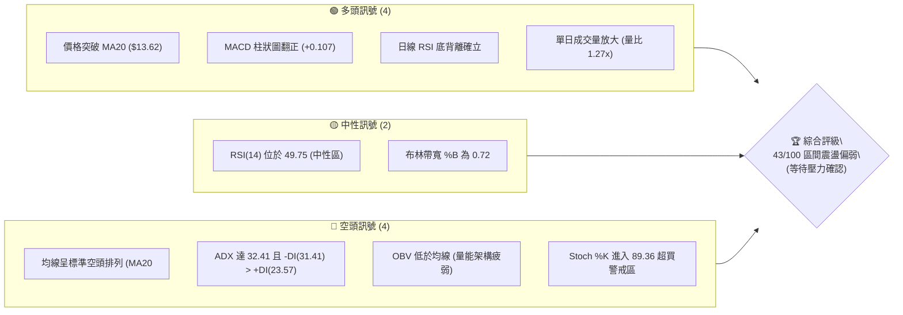
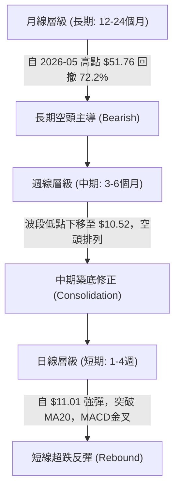
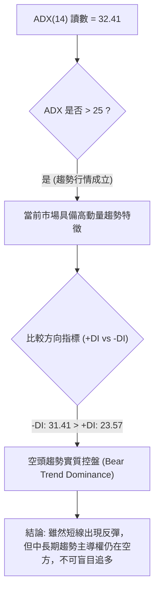
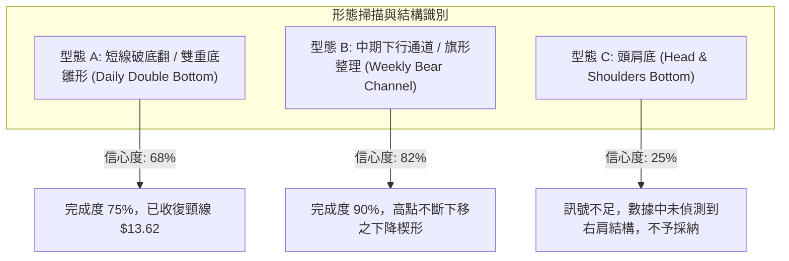
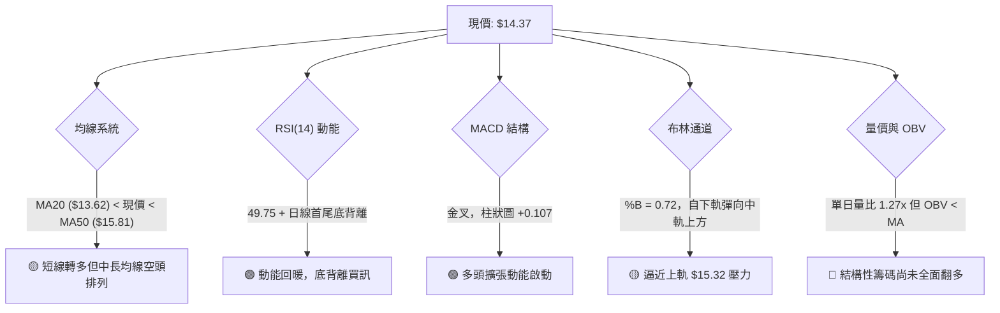
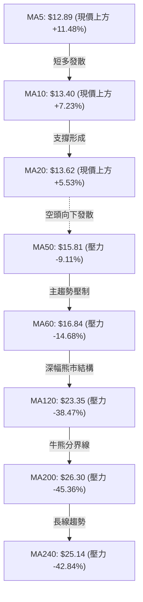
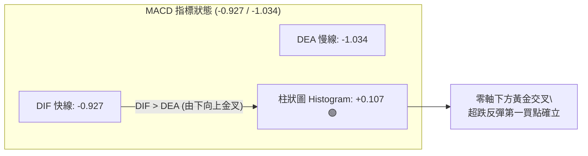
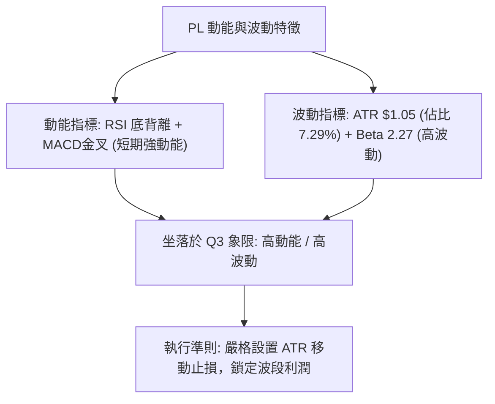
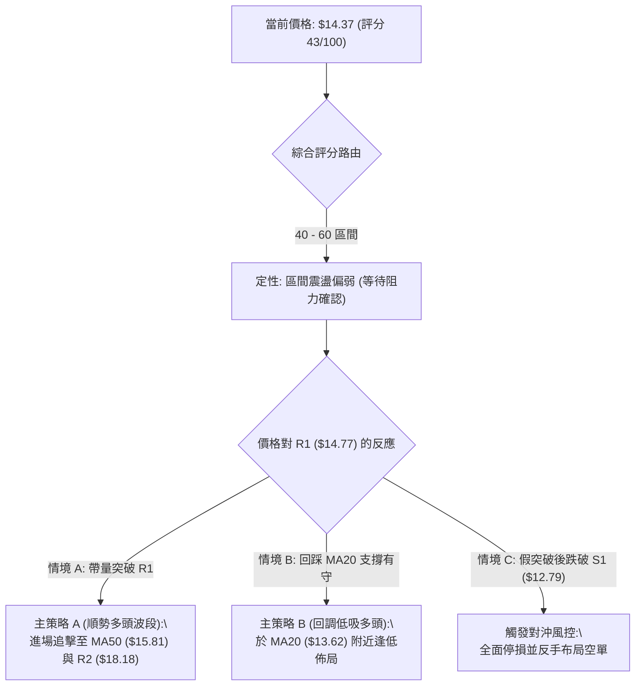
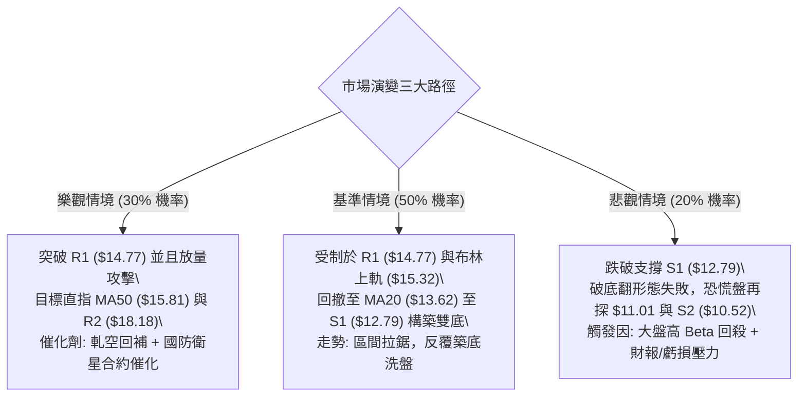

# PL 技術分析報告

> **報告日期**：2026-11-10 ｜ **語言**：繁體中文 ｜ **數據來源**：Yahoo Finance ｜ **當前價格**：$14.37

---

## 目錄

| 章節 | 內容 |
|------|------|
| [1. 技術面概覽](#1-技術面概覽) | 訊號儀表板、核心指標、評分卡 |
| [2. 趨勢分析](#2-趨勢分析) | 多時框趨勢、長中短期走勢、ADX強度 |
| [3. 圖表形態分析](#3-圖表形態分析) | 形態識別、K線組合、形態目標價 |
| [4. 支撐與阻力](#4-支撐與阻力) | 關鍵價位分布、阻力支撐表、斐波那契回調 |
| [5. 技術指標深度解讀](#5-技術指標深度解讀) | 均線系統、RSI、MACD、布林通道、成交量 |
| [6. 動能與波動率](#6-動能與波動率) | 動能四象限、ATR波動分析、Beta風險解讀 |
| [7. 多時框架總結](#7-多時框架總結) | 時框架評分矩陣、多時框收斂結論 |
| [8. 交易策略建議](#8-交易策略建議) | 策略路由、價格情境階梯、主策略詳情、評星 |
| [9. 風險提示與監控](#9-風險提示與監控) | 關鍵監控清單、情境模擬、風險管理原則 |

---

## 1. 技術面概覽

### 🎯 技術訊號儀表板



### 📊 核心指標速覽表

| 指標類別 | 指標名稱 | 當前數值 | 訊號 | 解讀 |
| :--- | :--- | :--- | :---: | :--- |
| **價格** | 當前收盤價 | $14.37 | 🟡 | 位於52週區間($10.52 - $51.76)之 9.3% 低位，短線自低點強勁反彈 |
| **均線** | MA20 | $13.62 | 🟢 | 收盤價成功站上 20 日均線（正乖離 +5.53%），短線轉強 |
| **均線** | MA50 | $15.81 | 🔴 | 價格低於 50 日均線（負乖離 -9.11%），中期下行壓力沉重 |
| **均線** | MA200 | $26.30 | 🔴 | 遠低於 200 日牛熊分界線（負乖離 -45.36%），長期處於絕對空頭格局 |
| **動能** | RSI(14) | 49.75 | 🟢 | 擺脫超賣回升至中性區間，且近20根K棒首尾呈現顯著「底背離」 |
| **動能** | MACD (12,26,9) | -0.927 / -1.034 | 🟢 | 快線由下往上穿越慢線，柱狀圖轉正為 +0.107，發出金叉買訊 |
| **擺動** | Stoch %K / %D | 89.36 / 46.63 | 🔴 | %K 快速衝入超買區（>80），短線面臨技術性拉回修正壓力 |
| **趨勢** | ADX(14) / ±DI | 32.41 | 🔴 | ADX > 25 代表強趨勢，但 -DI(31.41) > +DI(23.57) 顯示空頭仍控盤 |
| **通道** | 布林通道 (20,2) | $11.91 - $15.32 | 🟡 | 價格自下軌強彈穿越中軌($13.62)，目前直逼上軌($15.32) |
| **量能** | 成交量 / 20日均量 | 10.97M / 8.61M | 🟢 | 單日量比 1.27x，帶量長紅突破短期均線 |
| **量能** | OBV 趨勢 | OBV < MA | 🔴 | 能量潮指標仍低於其移動平均線，長期資金累積意願仍顯不足 |
| **波動** | ATR(14) | $1.05 (7.29%) | 🟡 | 波動率極高，每日正常擺動空間達 $1.05，需設定較寬止損 |

### 🏆 技術評分卡

```
╔════════════════════════════════════════════════════════════════╗
║                   技術評分卡 — PL (2026-11-10)                 ║
╠════════════════════════════════════════════════════════════════╣
║ 趨勢強度 (Trend)     ███████░░░░░░░░░░░░░   35/100   🔴 空頭強勢 ║
║ 動能指標 (Momentum)  ███████████░░░░░░░░░   55/100   🟡 反彈轉強 ║
║ 支撐穩定度 (Support)  ██████████░░░░░░░░░░   50/100   🟡 低檔有守 ║
║ 成交量配合 (Volume)  ████████░░░░░░░░░░░░   40/100   🔴 結構偏弱 ║
║ 形態完整度 (Pattern) █████████░░░░░░░░░░░   45/100   🟡 破底翻雛形 ║
║ 均線排列 (MA System) ███████░░░░░░░░░░░░░   35/100   🔴 空頭排列 ║
╠════════════════════════════════════════════════════════════════╣
║ 綜合評分 (Average)   █████████░░░░░░░░░░░   43/100   🟡 區間震盪 ║
║                                              (規則18: 六項均值)║
╚════════════════════════════════════════════════════════════════╝
```

---

## 2. 趨勢分析

### 🌐 多時框趨勢分析



### 📈 長期趨勢 — 12個月走勢圖（Unicode）

以下為 Planet Labs (PL) 過去 12 個月（2025-12 至 2026-11）的月線收盤價格軌跡與關鍵轉折點標注：

```
PL 月線走勢圖（過去12個月）
價格軸 ($)
$55 ┤                                  ● $51.14 (2026-05 歷史波段天花板)
$50 ┤                                 / \
$45 ┤                                /   \
$40 ┤                               /     \
$35 ┤                         ● $36.97     \
$30 ┤                        /              ● $33.13 (2026-06 破位長黑)
$25 ┤            ● $24.97   ● $27.95         \
$20 ┤   ● $19.72   \       /                  ● $20.48 (2026-07)
$15 ┤               ● $24.14                   \      ● $16.39
$10 ┤                                           \    /   \
 $5 ┤                                            ●──      ● $13.47  ● $14.37 (現價)
     └──────────────────────────────────────────────────────────────────
       12   01   02   03   04   05   06   07   08   09   10   11 (月份)
      (25) (------------------------ 2026 ------------------------)
```

**歷史走勢特徵分析表格**：

| 階段區間 | 起止月份 | 起點價格 | 終點價格 | 區間漲跌幅 | 主要技術特徵與驅動因素 |
| :--- | :---: | :---: | :---: | :---: | :--- |
| **第一階段：主升浪狂飆** | 2025-12 → 2026-05 | $19.72 | $51.14 | **+159.33%** | 沿著月線5MA強勁噴出，月成交量密集放大，創下 52 週天價 $51.76。 |
| **第二階段：斷崖式崩跌** | 2026-05 → 2026-07 | $51.14 | $20.48 | **-59.95%** | 連續跳空大黑K失守月均線，多頭籌碼全面瓦解，跌破關鍵心理整數大關。 |
| **第三階段：陰跌探底期** | 2026-07 → 2026-10 | $20.48 | $13.47 | **-34.23%** | 均線形成空頭向下發散，成交量逐月萎縮，市場情緒極度冰凍。 |
| **第四階段：短線止跌彈** | 2026-10 → 2026-11 | $13.47 | $14.37 | **+6.68%** | 於52週低點 $10.52 上方展現買盤承接，短線日K線出現技術性底背離反彈。 |

### 📊 中期趨勢（週線分析）

中期技術架構由下方繪製的週線支撐與壓力區間清楚界定：

```
週線級別價格壓力與支撐架構圖
$20.00 ┤----------------------------------------------------------
$18.81 ┼────────────────────────────────────────────────────────── 阻力 R3 (強阻力聚類)
$18.18 ┼────────────────────────────────────────────────────────── 阻力 R2 (波段高點密集成交區)
$16.00 ┤                     ┌──────┐
$15.81 ┼ - - - - - - - - - - ┤ MA50 ├ - - - - - - - - - - - - - - - 中期多空分水嶺
$14.77 ┼─────────────────────└──────┘──────────────────────────── 阻力 R1 (前波反彈高點)
$14.37 ┼◀◀◀ 現價 ($14.37)
$13.62 ┼ - - - - - - - - - - ┌──────┐ - - - - - - - - - - - - - - - 短期均線支撐 (MA20)
$12.79 ┼─────────────────────┤ MA20 ├──────────────────────────── 支撐 S1 (週線波段低點聚類)
$11.01 ┤                     └──────┘      (2026-11-05 觸及之日K波段低點)
$10.52 ┼────────────────────────────────────────────────────────── 支撐 S2 (52週極限低點)
```

從近 8 週週 K 棒可清晰觀察到，自 2026-09-25（高點 $18.18）與 2026-10-09（高點 $18.81）兩度衝高受阻後，週線展開快速下殺，於 2026-11-06 當週打出最低點 $11.01，隨後本週（截至 2026-11-09）強拉回升至 $14.37，週線層級收出帶長下影線的破底反彈格局。

### ⚡ 趨勢強度評估（ADX 解讀）



**ADX 趨勢強度解讀矩陣**：

| 指標名稱 | 當前數值 | 臨界標準值 | 趨勢性質判定 | 詳細技術解讀 |
| :--- | :---: | :---: | :---: | :--- |
| **ADX(14)** | **32.41** | 25.00 | **強趨勢行情** | 讀數遠高於 25，顯示價格脫離了低波動的無方向盤整，走勢具備強烈的單向慣性。 |
| **+DI (14)** | **23.57** | — | **多方力道** | 自超跌區快速拉升，顯示短線買盤湧入，但尚未能奪回主控權。 |
| **-DI (14)** | **31.41** | — | **空方力道** | -DI 明確壓制 +DI（差值達 7.84），確立市場的主導趨勢為下行趨勢中的波段反抽。 |

---

## 3. 圖表形態分析

### 🔍 形態識別系統



**圖表形態識別與信心度評估表**：

| 形態名稱 | 信心度 | 判斷依據（嚴格引用數據） | 完成度 | 形態目標價（附精確計算式） |
| :--- | :---: | :--- | :---: | :--- |
| **日線破底翻 / 雙重底雛形** | **68%** | 2026-10-23 低點 $12.79 與 2026-11-05 低點 $11.01 形成次低測試；2026-11-09 大陽線收盤 $14.37 突破中樞頸線 MA20 ($13.62)。 | 75% | **理論目標價 = 頸線 $13.62 + 形態高度 ($13.62 − $11.01 = $2.61) = $16.23**。<br>*(受制於關鍵阻力 R1 $14.77 與 MA50 $15.81)* |
| **中期下降通道** | **82%** | 週線高點由 2026-10-09 之 $18.81 下降至 2026-10-30 之 $14.77；週線低點由 $12.79 下挫至 $11.01，形成傾斜下行通道。 | 90% | **通道上軌阻力位位於 $14.77 (R1)**；若無法有效放量突破，將面臨通道內二次回踩。 |
| **頭肩底形態** | **25%** | 數據中未偵測到完整的左肩與右肩對稱成交量架構。 | 15% | **訊號不足，僅做指標型解讀**，嚴禁主觀牽強預測。 |

### 🕯️ 重要 K 線形態分析

嚴格依據數據中「近 10 根日 K」與「近 8 根週 K」之開高低收數值進行解讀：

#### 1. 近 10 根日 K 棒解讀表

| 日期 (日K) | 開 | 高 | 低 | 收 | 成交量 | K線形態名稱 | 形態特徵與多空技術涵義解讀 | 訊號方向 |
| :---: | :---: | :---: | :---: | :---: | :---: | :---: | :--- | :---: |
| **2026-10-27** | 13.95 | 14.77 | 13.84 | 14.49 | 6,491,100 | 帶上影中陽線 | 向上試探 R1 ($14.77) 遭遇解套賣壓，收盤仍守住開盤價。 | 🟢 偏多 |
| **2026-10-28** | 14.45 | 14.56 | 14.03 | 14.33 | 7,603,300 | 窄幅小陰線 | 高檔滯漲，買盤後繼乏力，形成孕線整理。 | 🟡 中性 |
| **2026-10-29** | 13.96 | 14.60 | 13.96 | 14.31 | 7,544,100 | 下影小陽線 | 開盤即為最低，盤中衝高回落，多空陷入焦土戰。 | 🟡 中性 |
| **2026-10-30** | 13.54 | 14.02 | 13.15 | 13.47 | 6,554,100 | 下跌光頭陰棒 | 跳空低開跌破前日低點，空方重獲短線主動權。 | 🔴 看空 |
| **2026-11-02** | 13.62 | 13.69 | 12.87 | 12.96 | 8,582,300 | 中長黑K破位 | 放量跌破 $13.00 整數關卡，最低逼近 $12.87，均線下彎。 | 🔴 看空 |
| **2026-11-03** | 13.21 | 13.74 | 13.17 | 13.51 | 5,857,500 | 縮量反彈小陽 | 雖然收紅，但量能急凍至 5.85M，屬於弱勢技術性抵抗。 | 🟡 中性 |
| **2026-11-04** | 13.40 | 13.62 | 12.50 | 12.65 | 7,855,700 | 破位光腳大長黑 | 實體跌破 S1 ($12.79) 關鍵支撐，恐慌盤開始湧現。 | 🔴 強烈看空 |
| **2026-11-05** | 12.21 | 12.40 | 11.01 | 11.37 | 10,405,800 | 帶下影放量長黑 | 盤中下探至 $11.01 逼近 52 週低點 $10.52，放量超賣拋售潮。 | 🔴 恐慌拋售 |
| **2026-11-06** | 11.77 | 12.55 | 11.48 | 12.55 | 9,275,800 | 光頭中長大陽線 | 低開高走，收盤價等於最高價 $12.55，買盤強力介入。 | 🟢 轉強回升 |
| **2026-11-09** | 12.85 | 14.47 | 12.64 | 14.37 | 10,970,500 | 多頭吞噬巨量長紅 | **量能放大至 10.97M，實體大陽線一口氣吞噬前五日失地，強勢突破 MA20**。 | 🟢🟢 強烈看多 |

#### 2. 近 8 根週 K 棒解讀表

| 日期 (週K) | 開 | 高 | 低 | 收 | 週成交量 | 週K形態 | 技術涵義解讀 | 訊號方向 |
| :---: | :---: | :---: | :---: | :---: | :---: | :---: | :--- | :---: |
| **2026-09-25** | 16.68 | 18.18 | 16.13 | 17.43 | 56,175,300 | 衝高受阻陽線 | 試探 R2 ($18.18) 未果，上影線顯示高檔賣壓沉重。 | 🟡 中性偏多 |
| **2026-10-02** | 17.17 | 17.73 | 16.10 | 17.50 | 52,133,300 | 紡錘十字星 | 高檔震盪，多空勢均力敵，變盤前兆。 | 🟡 變盤警告 |
| **2026-10-09** | 17.64 | 18.81 | 16.55 | 17.18 | 59,868,100 | 長上影流星線 | 觸及 R3 ($18.81) 遭遇機構倒貨，留下巨幅避雷針天線。 | 🔴 強烈見頂 |
| **2026-10-16** | 17.00 | 17.03 | 13.33 | 13.56 | 51,292,600 | 斷頭鍘刀巨陰 | 一舉跌破 $16.00 與 $14.00，週跌幅超過 21%，確立轉折向下。 | 🔴 崩跌破位 |
| **2026-10-23** | 13.85 | 14.09 | 12.79 | 13.41 | 42,025,100 | 低檔窄幅整理 | 於支撐位 S1 ($12.79) 暫時止血，成交量開始萎縮。 | 🟡 止跌盤整 |
| **2026-10-30** | 13.30 | 14.77 | 13.15 | 13.47 | 35,026,200 | 倒狀長上影星線 | 反彈觸碰 R1 ($14.77) 立即被空方摜回，反彈無力。 | 🔴 空方控盤 |
| **2026-11-06** | 13.62 | 13.74 | 11.01 | 12.55 | 41,977,100 | 長下影鐵鎚破底線 | 最低探至 $11.01 後引發逢低買盤，下影線長達 $1.54。 | 🟢 潛在落底 |
| **2026-11-09** | 12.85 | 14.47 | 12.64 | 14.37 | 10,970,500 | 強力大陽線(當週) | 單日爆出近 11M 量能，收盤強勢站回 $14.37。 | 🟢 轉折反彈 |

### 📉 ASCII 走勢形態示意圖

```
日線級別「破底翻 (Spring Rebound)」形態結構圖
價格
$15.00 ┤                                           [阻力 R1: $14.77]
$14.50 ┤                                        ╭───● $14.37 (現價強彈)
$14.00 ┤  (左側高點)                             │
$13.62 ┼───[頸線 MA20]──────────────────────────┼───────────────
$13.50 ┤      ● $13.47                          │   ▲
$13.00 ┤       \                                │   │ 巨量長紅拉升
$12.79 ┼────────\──────[第一支撐 S1]─────────────│───┼───────────
$12.00 ┤         \                             │   │
$11.50 ┤          ● $11.37                     │   │
$11.01 ┼───────────\──────●─────────────────────╯   │ (止跌回升)
       │                  (2026-11-05 破底洗盤低點)
$10.52 ┴─────────────────────────────────────────────────────── [52W Low S2]
       時間軸 ───────────────────────────────────────────────►
```

### 🎯 形態目標價計算

根據經典技術分析形態量度法則，本次反彈形態由 2026-11-05 低點 $11.01 啟動，於 2026-11-09 突破基準頸線 MA20 ($13.62)：
1. **形態基準高度 (H)** = 突破頸線價格 − 區間最低點 = $13.62 − $11.01 = **$2.61**
2. **第一階段量度目標價 (T1)** = 阻力位 R1 = **$14.77**（前期日K反彈密集成交高點，距現價 +2.78%）
3. **第二階段全幅量度目標價 (T2)** = 頸線 + 形態高度 = $13.62 + $2.61 = **$16.23**。但在實質走勢中，價格將在 **MA50 ($15.81)** 與 **阻力 R2 ($18.18)** 遭遇極強技術共振阻力，故依據數據，將中期技術修正目標嚴格錨定在 **$15.81 (MA50)** 與 **$18.18 (R2)**。

---

## 4. 支撐與阻力

### 🗺️ 關鍵價位分布圖（Unicode）

```
PL 價位結構分布圖 (Price Level Distribution)
══════════════════════════════════════════════════════════════
$18.81 ║████████████████████████████████║ 強阻力 R3 (2026-10-09 波段頂部流星高點)
       ║                                ║
$18.18 ║████████████████████████        ║ 阻力 R2 (2026-09-25 週K高點密集聚類)
       ║                                ║
$15.81 ║▓▓▓▓▓▓▓▓▓▓▓▓▓▓▓▓▓▓              ║ 中期趨勢均線阻力 MA50
       ║                                ║
$14.77 ║████████████████████████        ║ 關鍵阻力 R1 (2026-10-27/30 波段反彈高點)
═══════╬════════════════════════════════╬═════════════════════
$14.37 ╠════════════════════════════════╣ ◄ 當前收盤價 (Last Close)
═══════╬════════════════════════════════╬═════════════════════
$13.62 ║░░░░░░░░░░░░░░░░░░░░            ║ 動態短線支撐 MA20 (布林中軌)
       ║                                ║
$12.79 ║▓▓▓▓▓▓▓▓▓▓▓▓▓▓▓▓▓▓▓▓▓▓          ║ 近期波段支撐 S1 (2026-10-23 週K低點聚類)
       ║                                ║
$11.01 ║░░░░░░░░░░░░░░                  ║ 短期實質回踩低點 (2026-11-05 破底洗盤點)
       ║                                ║
$10.52 ║████████████████████████████████║ 極限強支撐 S2 (52週歷史最低點聚類)
══════════════════════════════════════════════════════════════
```

### 🚧 阻力位分析表

所有價位均嚴格引用自數據之「關鍵價位」區塊波段高點聚類數值：

| 阻力級別 | 精確價位 | 距現價幅動 | 形成原因與籌碼技術結構 | 突破難度 | 重要性權重 |
| :---: | :---: | :---: | :--- | :---: | :---: |
| **R1** | **$14.77** | +2.78% | 近期（2026-10-27 及 2026-10-30）兩度向上衝高回落形成的日K與週K雙重頂部，短期解套套牢賣壓匯聚。 | 🟡 中等 | ★★★☆☆ |
| **R2** | **$18.18** | +26.51% | 2026-09-25 當週爆出 56.17M 巨量之週K波段高點，為中期下行通道的上軌邊界。 | 🔴 極高 | ★★★★☆ |
| **R3** | **$18.81** | +30.90% | 2026-10-09 週線衝高受阻的極限天線（成交量近 60M），為多頭反轉的最強結構天花板。 | 🔴 堅不可摧 | ★★★★★ |

### 🛡️ 支撐位分析表

所有價位均嚴格引用自數據之「關鍵價位」區塊波段低點聚類數值：

| 支撐級別 | 精確價位 | 距現價幅動 | 形成原因與籌碼技術結構 | 守住機率 | 重要性權重 |
| :---: | :---: | :---: | :--- | :---: | :---: |
| **S1** | **$12.79** | -11.00% | 2026-10-23 週K低點、2026-11-02 破位前之盤整平台底部，此處為多方第一道防線。 | 🟡 65% | ★★★★☆ |
| **S2** | **$10.52** | -26.79% | PL 過去 52 週最低價聚類區間，長線機構投資人防守的最後底線，具備極強心理支撐。 | 🟢 85% | ★★★★★ |
| **S3** | **N/A** | N/A | **數據中未偵測到**更低級別聚類價位（歷史數據至 $10.52 為 52W Low）。 | N/A | N/A |

### 📐 斐波那契回調位分析

依據 52 週完整波動區間（高點 **$51.76** → 低點 **$10.52**，總落差 $41.24）計算之標準黃金分割位：

| 斐波那契回調級別 | 精確對應價位 | 與當前價格 ($14.37) 相對位置與技術意義解讀 |
| :---: | :---: | :--- |
| **0.0% (52W High)** | **$51.76** | 2026-05 歷史天花板，長期多頭終極目標。 |
| **23.6%** | **$42.03** | 長期嚴重套牢區間。 |
| **38.2%** | **$36.01** | 中長線大級別多空轉折壓力位。 |
| **50.0%** | **$31.14** | 半數回撤位，與分析師平均目標價 $30.27 高度重合。 |
| **61.8%** | **$26.27** | 黃金分割強壓力位，亦高度貼合 200 日均線 MA200 ($26.30)。 |
| **78.6%** | **$19.35** | 極限回撤防守位，略高於波段阻力 R3 ($18.81)。 |
| **100.0% (52W Low)**| **$10.52** | 52 週絕對底部，本輪熊市下行之基底防線。 |

**現價區間解讀**：
當前收盤價 **$14.37** 坐落於 **100.0% ($10.52)** 與 **78.6% ($19.35)** 之間，處於整體回調深度的最底部區間（52 週區間之 9.3% 分位）。這表明該標的在經歷深幅折價後，目前正處於自 100% 底部向上修復至 78.6% 回調位 ($19.35) 的超跌反彈第一階段。

---

## 5. 技術指標深度解讀

### 🎛️ 指標訊號總覽



### 📈 移動平均線排列分析



**均線狀態解讀**：
當前均線系統呈現「**短線強勢金叉、長線空頭壓制**」的分裂狀態。
- **短期均線**：MA5 ($12.89) 與 MA10 ($13.40) 迅速由下往上穿越，且現價 $14.37 站穩在 MA20 ($13.62) 之上，帶動短期動能快速修復。
- **中長期均線**：MA20 ($13.62) < MA50 ($15.81) < MA200 ($26.30)，整體大均線依然處於標準的**空頭排列**。MA50 位於 $15.81，將是本次反彈最重要的強阻力測試關卡。

### 📉 RSI(14) 分析

```
RSI(14) 動能強度進度條
[超賣 0] ────────── [30] ────────────── [50] ────────────── [70] ────────── [100 超買]
█████████████████████████████████████████░░░░░░░░░░░░░░░░░░░░░░  49.75 (中性中軸)
```

- **當前數值**：**49.75**（Wilder 標準平滑法），精確運行於 50 榮枯線邊界。
- **超買超賣判定**：脫離 2026-11-05 的超賣極端區間，回到健康中性區間。
- **背離分析（極重要結論）**：
  - **日線確立「底背離 (Bullish Divergence)」**：對比近 20 根 K 棒，價格在 2026-11-05 跌破前期低點創下 $11.01 的波段新低，但 RSI(14) 卻在低檔顯著抬高未破前低，呈現典型的首尾「價格破底而指標未破底」架構，此底背離直接促成了 2026-11-09 的巨量大陽線反轉。
  - **頂背離**：無頂背離跡象。

### 📊 MACD (12, 26, 9) 訊號解讀



- **數值狀態**：DIF 快線 (-0.927) 高於 DEA 訊號線 (-1.034)，MACD 柱狀圖讀數為 **+0.107**，呈現擴張綠柱。
- **多空意涵**：在長期零軸下方出現的低檔黃金交叉，屬於典型的**超跌修復型買訊**，支持短線價格持續向上挑戰壓力位。

### 📦 布林通道分析

```
布林通道 (20, 2) 結構圖
$15.32 ┬────────────────────────────────────────── 上軌 Upper Band (阻力位)
       │                        
$14.37 ┼───────────────────────● 現價 (收盤價 $14.37，%B = 0.72)
       │                        ▲
$13.62 ┼- - - - - - - - - - - - │ - - - - - - - - - 中軌 Middle Band (MA20)
       │                        │ (向上突破)
$11.91 ┴────────────────────────┴───────────────── 下軌 Lower Band (支撐位)
```

- **通道帶寬與位置**：上軌 **$15.32**、中軌 **$13.62**、下軌 **$11.91**。
- **%B 指標分析**：目前 **%B = 0.72**，表明價格已強勢自下軌（2026-11-05 跌破下軌超賣區）強勁回升至中軌與上軌之間的多方強勢攻擊區，即將遭遇布林上軌 **$15.32** 的動態壓制。

### 💹 成交量分析（量價配合度）

- **最新成交量**：**10,970,500 股**。
- **均量對比**：20 日均量為 **8,605,820 股**（量比達 **1.27x**），50 日均量為 **10,869,582 股**。
- **量價背離與 OBV 檢驗**：
  - 2026-11-09 大漲突破伴隨量能超越 20 日與 50 日均量，日線層級展現良好的「價量齊揚」特徵。
  - 但檢視整體累積能量潮（OBV）：**OBV 仍低於其均線（OBV < MA）**，說明過去三個月下殺過程累積了大量籌碼沉澱，單日的爆量長紅尚未能徹底逆轉中期的籌碼流失頹勢，屬於反彈行情中的放量解套，而非長期機構建倉完畢的訊號。

---

## 6. 動能與波動率

### ⚡ 動能評估四象限

動能與波動率配置評估：

| 象限 | 動能維度 (Momentum) | 波動率維度 (Volatility) | PL 當前技術定位 | 策略應對指引 |
| :---: | :---: | :---: | :---: | :--- |
| **Q1** | 強動能 (Strong) | 低波動 (Low) | — | 穩定單邊趨勢，最佳加碼點。 |
| **Q2** | 弱動能 (Weak) | 低波動 (Low) | — | 無方向盤整，資金沉睡區。 |
| **Q3** | **強動能 (Strong)** | **高波動 (High)** | **★ 當前定位 (Q3)** | **短線爆發性反彈，但下檔風險極大，適合敏捷型波段交易。** |
| **Q4** | 弱動能 (Weak) | 高波動 (High) | — | 恐慌崩跌段，嚴禁介入。 |



### 📊 ATR 波動率分析

- **ATR(14) 讀數**：**$1.05**（採 Wilder 平滑算法）。
- **ATR 佔價格比率**：$1.05 / $14.37 = **7.29%**，顯示該個股屬於**超高波動標的**。
- **止損距離動態建議**：
  - **短線日內 / 極短線交易（1.0 × ATR）**：緩衝間距為 **$1.05**。
  - **波段擺盪交易（1.5 × ATR）**：緩衝間距為 **$1.58**。若以現價 $14.37 買入，常規防守位應設在 $14.37 − $1.58 = **$12.79**（恰好精確落於支撐 S1）。
  - **順勢中線防守（2.0 × ATR）**：緩衝間距為 **$2.10**。

### 📐 Beta 與市場相關性

- **Beta 係數**：**2.27**。
- **市場特徵解析**：
  - PL 對美股大盤（S&P 500 指數）具有高達 2.27 倍的波動放大效應。大盤若上漲 1%，PL 理論預期上漲 2.27%；反之，大盤回檔 1%，PL 將面臨超過 2.2% 的下殺幅度。
  - 融券餘額與放空比率：Short % Float 達 **12.2%**，Short Ratio 為 **3.42**。極高的放空比例搭配 2.27 的 Beta，一旦股價突破壓力位，極易觸發激烈的空頭回補軋空行情（Short Squeeze）。

---

## 7. 多時框架總結

### 📋 時框架評分表

| 時框架 | 趨勢方向 | 動能狀態 | 均線排列 | 圖表形態 | 綜合評分 | 操作指導建議 |
| :---: | :---: | :---: | :---: | :---: | :---: | :--- |
| **長期 (月線)** | 🔴 強烈空頭 | 弱勢築底 | MA200 下方沉淪 | 自 $51.76 回撤之巨幅跌勢 | **25/100** | 嚴禁長線無腦抄底，等待週期反轉。 |
| **中期 (週線)** | 🔴 空頭控盤 | 低檔轉折 | MA20 < MA50 下行 | 下降通道內下軌反彈 | **38/100** | 以逢高減磅、解套減倉思維為主。 |
| **短期 (日線)** | 🟢 短線多頭 | 底背離轉強 | 突破 MA20 ($13.62) | 破底翻大陽線吞噬 | **65/100** | 可進行敏捷型波段多頭操作。 |

### 🔲 綜合訊號矩陣

| 維度 | 短期 (日線) 訊號 | 中期 (週線) 訊號 | 長期 (月線) 訊號 | 多時框一致性分析 |
| :--- | :---: | :---: | :---: | :--- |
| **趨勢方向** | 🟢 向上 (Rebound) | 🔴 向下 (Bear Channel) | 🔴 向下 (Macro Downtrend) | 矛盾：短週期處於大週期逆勢反彈階段。 |
| **動能強度** | 🟢 轉強 (MACD金叉) | 🟡 中性 (柱狀微正) | 🔴 疲弱 (處於超跌區間) | 部分確認：短期動能率先回暖帶動中期止跌。 |
| **均線架構** | 🟢 站上短期均線 | 🔴 均線反壓沉重 | 🔴 絕對空頭排列 | 衝突：受制於上方 MA50 ($15.81) 強大引力阻力。 |
| **籌碼成交量** | 🟢 突破放量 (1.27x) | 🟡 週量持平 | 🔴 OBV < MA 架構疲弱 | 短期有遊資參與，但尚未見大機構長線回流。 |

### ⚖️ 多時框收斂結論

依據多時框收斂規則（規則 14）：
1. **行情屬性判定**：當前 ADX(14) 讀數為 **32.41 > 25**，市場明確處於「**趨勢行情**」範疇，而非低動能無序震盪。
2. **主導時框優先級**：依規則，趨勢行情下必須「**以中長期（週線/MA50、MA200）方向為主導，日線僅用來尋找進場時機**」。
3. **多時框權衡結果**：
   - 中長期主導趨勢為空頭（-DI 31.41 壓制 +DI 23.57；均線空頭排列；MA50 $15.81 處於上方）。
   - 日線發出強烈的超跌底背離反彈訊號，推動價格自 $11.01 強攻至 $14.37。
   - **收斂方向唯一性結論**：本報告綜合判定當前市場定性為「**中長線空頭框架下的短期強勢超跌技術反彈**」，整體綜合評分定格為 **43/100（區間震盪偏弱）**。策略主軸定調為「**區間波段操作，短線順應日線反彈動能試多，但嚴格以關鍵阻力位 R1 ($14.77) 與 MA50 ($15.81) 作為防禦性停利邊界**」，不可在尚未突破 MA50 之前進行盲目中長線做多。

---

## 8. 交易策略建議

### 🗺️ 策略決策流程圖



### 🧭 策略路由（依評分卡分流）

> **當前主策略方向 = 區間震盪操作（依評分 43/100，介於 40–60 之間，以布林通道與關鍵阻力支撐為主要操作區間，等待突破確認）**

由於綜合評分正好落於 40–60 的中性區間偏下緣，且短線爆發力與中長線壓制並存，交易策略嚴禁單向無腦下注，必須圍繞「**在阻力 R1 ($14.77) 與支撐 S1 ($12.79) 之間進行高拋低吸，並嚴格以 R1 突破與 S1 跌破作為轉折確認點**」。

### 🎯 價格情境階梯（Price Scenarios）

所有價位均嚴格引用第 4 章及數據計算數值：

| 觸發條件 | 第一目標 (T1) | 第二延伸目標 (T2) | 停損與風控邊界 | 情境技術含義 |
| :--- | :---: | :---: | :---: | :--- |
| **向上突破 R1 ($14.77)** | **$15.81 (MA50)** | **$18.18 (R2)** | $13.62 (MA20) | 短線超跌反彈升級為中期波段反轉，軋空行情啟動。 |
| **現價區間震盪 ($13.62 - $14.77)** | $14.77 (R1) | — | $13.62 (MA20) | 消化前期日K套牢籌碼，布林通道中軌至上軌拉鋸。 |
| **向下跌破 S1 ($12.79)** | **$11.01 (波段低點)**| **$10.52 (S2)** | $13.62 (MA20) | 反彈夭折，重啟中期探底，再次考驗 52 週低點。 |

### 📊 情境機率分佈

| 價格運行情境 | 發生機率 | 主要技術與量化指標依據 |
| :--- | :---: | :--- |
| **情境一：強勢上行挑戰 R1 與 MA50** | **45%** | MACD 金叉柱狀翻正 (+0.107)、RSI 確立日線底背離、單日成交量擴大 1.27 倍。 |
| **情境二：在 MA20 至 R1 區間寬幅震盪** | **35%** | ADX 雖達 32.41 但 -DI 仍大於 +DI、Stoch %K 進入 89.36 超買區、OBV 尚未有效突破均線。 |
| **情境三：跌破 S1 支撐回落再探底** | **20%** | 中長均線呈絕對空頭排列 (MA20 < MA50 < MA200)，宏觀資金趨勢仍未反轉。 |

### 🟢 主策略詳情（區間與波段交易）

以下策略依規則 17 計算風險報酬比：
- 風險報酬比定義 = $(\text{目標價 T1} − \text{進場價}) \div (\text{進場價} − \text{止損價})$，以「1 : X.XX（以 T1 計）」格式呈現。
- 進場價若為區間，以區間中點計算並註明。

| 策略要素 | 策略 A（右側突破追擊策略） | 策略 B（左側回踩低吸策略） |
| :--- | :---: | :---: |
| **策略類型** | 順勢突破買入 | 支撐回踩低吸 |
| **進場觸發條件** | 實體日K放量突破阻力 R1 ($14.77) 確認站穩 | 價格回調至動態均線 MA20 ($13.62) 獲得支撐 |
| **精確進場價格** | **$14.80**（突破 $14.77 後買入） | **$13.62**（MA20 / 布林中軌處） |
| **目標價 T1** | **$15.81**（MA50 均線強阻力） | **$14.77**（阻力位 R1） |
| **目標價 T2** | **$18.18**（阻力位 R2 / 週K高點） | **$15.81**（MA50 均線強阻力） |
| **止損價格** | **$14.37**（現價 / 前期頸線防守） | **$12.79**（支撐位 S1，跌幅 -6.1%） |
| **風險報酬比 (T1)** | **1 : 2.35（以 T1 計）**<br>*(計算式: (15.81 - 14.80) / (14.80 - 14.37) = 1.01 / 0.43 = 2.35)* | **1 : 1.39（以 T1 計）**<br>*(計算式: (14.77 - 13.62) / (13.62 - 12.79) = 1.15 / 0.83 = 1.39)* |
| **風險報酬比 (T2)** | **1 : 7.86（以 T2 計）**<br>*(計算式: (18.18 - 14.80) / 0.43 = 3.38 / 0.43 = 7.86)* | **1 : 2.64（以 T2 計）**<br>*(計算式: (15.81 - 13.62) / 0.83 = 2.19 / 0.83 = 2.64)* |
| **勝率預期** | **52%** | **60%** |
| **建議配置倉位** | **10% - 15%**（動態波段倉位） | **15% - 20%**（基礎築底倉位） |

### 🔴 反向風險觸發點（對沖提示）

若出現以下訊號，證明反彈行情徹底終結，多頭部位應無條件全面撤離或建立防禦性對沖空單：
1. **反轉觸發價位**：收盤價有效跌破 **S1 ($12.79)**。
2. **動能惡化訊號**：日線 MACD 柱狀圖（當前 +0.107）再度反轉翻紅跌破 0 軸，且 RSI(14) 跌破 40。
3. **空方目標指引**：一旦跌破 S1，下行空間將完全開啟，直接回測 **$11.01**，甚至測試極限支撐 **S2 ($10.52)**。

### ⭐ 整體訊號強度評星

```
╔═══════════════════════════════════════════════════════╗
║ 做多訊號強度：★★★☆☆  (3/5 星 — 短線動能足，但受制大均線)║
║ 做空訊號強度：★★☆☆☆  (2/5 星 — 處於超跌反彈，做空性價比低)║
║ 整體可信度：  ★★★★☆  (4/5 星 — 支撐阻力結構清晰)      ║
╚═══════════════════════════════════════════════════════╝
```

---

## 9. 風險提示與監控

### ✅ 關鍵監控指標 Checklist

```
╔════════════════════════════════════════════════════════════════╗
║                   每日交易風控監控清單 (Checklist)               ║
╠════════════════════════════════════════════════════════════════╣
║ [ ] 價格是否成功突破並站穩阻力 R1 ($14.77)？                   ║
║ [ ] 價格回調時，MA20 ($13.62) 是否提供有效動態支撐？            ║
║ [ ] RSI(14) 是否在 50 中軸上方持續發散，或在 60 遭遇超買反壓？  ║
║ [ ] MACD 柱狀圖 (+0.107) 是否持續擴張，快慢線是否向零軸逼近？   ║
║ [ ] 日成交量是否能維持在 20 日均量 (8.61M) 之上？              ║
║ [ ] 是否跌破第一防守支撐 S1 ($12.79) 觸發止損保護？             ║
║ [ ] 融券比例 (Short % Float 12.2%) 是否引發軋空回補潮？        ║
╚════════════════════════════════════════════════════════════════╝
```

### ⚠️ 風險場景分析



### 🛡️ 風險管理重要提醒

1. **高 Beta 波動懲罰機制**：PL 的 Beta 係數高達 **2.27**，且 ATR 高達 **$1.05 (7.29%)**。這意味著單日股價出現 5% - 8% 的波動極為常見。**單筆交易的風險暴露嚴禁超過總投資組合淨值的 1.5%**，務必以 ATR 反推部位規模，切忌過度槓桿與重倉。
2. **財報與基本面赤字壓制**：公司當前淨利率為 -95.1%，營運利潤率為 -27.2%，尚未實現實質盈利。中長期的巨幅下殺本質上反映了基本面估值擠泡沫的過程。因此，**當前的反彈嚴格屬於技術面超跌驅動**，在技術面未有效站穩 MA200 ($26.30) 之前，切勿將交易型短線部位轉化為長線「被動投資」。

---

## 📋 報告總結

```
╔════════════════════════════════════════════════════════════════════╗
║                   PL 技術分析報告總結 (Executive Summary)          ║
╠════════════════════════════════════════════════════════════════════╣
║ 報告日期：2026-11-10                                               ║
║ 當前價格：$14.37                                                   ║
║ 分析評級：⚖️ 43/100 區間震盪偏弱 (等待突破確認)                    ║
╠════════════════════════════════════════════════════════════════════╣
║ 關鍵技術結論：                                                     ║
║ ├─ 長期趨勢 (月線)：🔴 空頭主導，距 52 週高點回撤深達 72.2%         ║
║ ├─ 中期趨勢 (週線)：🔴 空頭排列，處於下降通道下軌反彈階段           ║
║ ├─ 短期趨勢 (日線)：🟢 底背離確立，突破 MA20 ($13.62)，短線轉強    ║
║ ├─ 關鍵支撐區間：S1 $12.79 ｜ 極限強支撐 S2 $10.52                  ║
║ ├─ 關鍵阻力區間：R1 $14.77 ｜ MA50 $15.81 ｜ R2 $18.18             ║
║ └─ 外資分析師目標：平均 $30.27 (最低 $17.00 / 最高 $50.00)         ║
╠════════════════════════════════════════════════════════════════════╣
║ 最優策略指引：                                                     ║
║ 1. 🥇 最佳機會：回調至 MA20 ($13.62) 企穩低吸，停損設於 S1 ($12.79) ║
║ 2. 🥈 次選機會：放量實體突破 R1 ($14.77) 後追擊至 MA50 ($15.81)    ║
║ 3. 🥉 保守選擇：空手觀望，靜待日線與週線均線系統收斂完成再行介入   ║
╚════════════════════════════════════════════════════════════════════╝
```

---

> ⚠️ **免責聲明**：本報告為依據標準技術分析模型與客觀量化指標產出之專業研究報告，所有引用數據均源自歷史公開行情。本報告**僅供學術研究與交易架構參考**，**不構成任何具體投資建議或買賣邀約**。金融市場瞬息萬變，高 Beta 股票風險極高，投資人應獨立評估財務狀況並嚴格執行風控紀律。

---

*報告生成時間：2026-11-10 ｜ 數據來源：Yahoo Finance ｜ 分析框架：多時框技術分析模型*