# PL 技術分析報告

> **報告日期**：2026-11-11 ｜ **語言**：繁體中文 ｜ **數據來源**：Yahoo Finance ｜ **當前價格**：$14.27

---

## 目錄

| 章節 | 內容 |
|------|------|
| [1. 技術面概覽](#1-技術面概覽) | 訊號儀表板、核心指標、評分卡 |
| [2. 趨勢分析](#2-趨勢分析) | 多時框趨勢、長中短期走勢 |
| [3. 圖表形態分析](#3-圖表形態分析) | 形態識別、K線組合、目標價 |
| [4. 支撐與阻力](#4-支撐與阻力) | 關鍵價位、斐波那契回調 |
| [5. 技術指標深度解讀](#5-技術指標深度解讀) | MA/RSI/MACD/布林/成交量 |
| [6. 動能與波動率](#6-動能與波動率) | 動能評估、ATR、Beta |
| [7. 多時框架總結](#7-多時框架總結) | 時框架評分矩陣 |
| [8. 交易策略建議](#8-交易策略建議) | 多空策略、風險報酬比 |
| [9. 風險提示與監控](#9-風險提示與監控) | 監控指標、風險場景 |

---

## 1. 技術面概覽

### 🎯 技術訊號儀表板

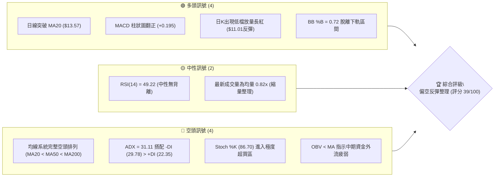

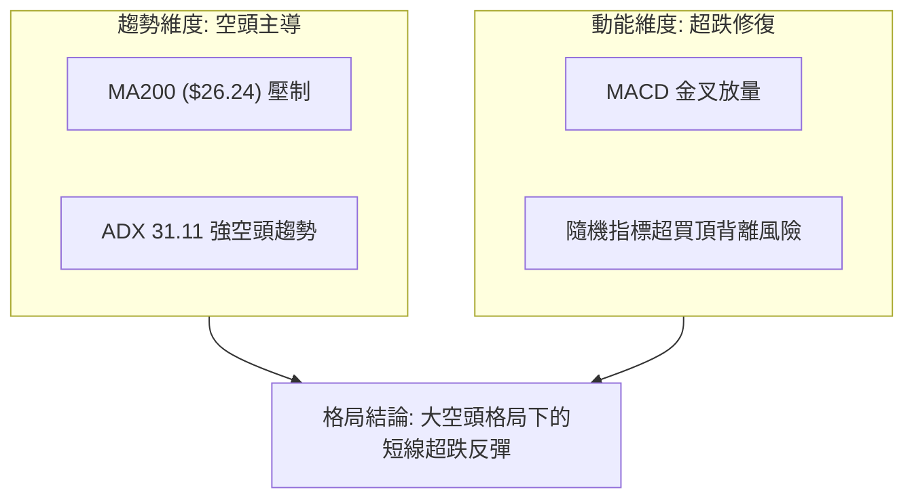

### 📊 核心指標速覽表

| 指標類別 | 指標名稱 | 當前數值 | 訊號 | 解讀 |
|----------|----------|----------|------|------|
| **價格** | 當前收盤價 | $14.27 | 🟡 | 位於52週區間 9.1%，處於相對歷史低檔超跌反彈位 |
| **均線** | MA20 | $13.57 | 🟢 | 價格站上短期均線 (+5.14%)，短線出現強勁反彈契機 |
| **均線** | MA50 | $15.70 | 🔴 | 價格受壓於中期均線下方 (-9.11%)，中期下降趨勢未改 |
| **均線** | MA200 | $26.24 | 🔴 | 價格遠低於長期均線 (-45.62%)，處於深度空頭排列結構 |
| **動能** | RSI(14) | 49.22 | 🟡 | 處於 30–70 中性平衡區，近20根K棒首尾無明顯背離 |
| **動能** | MACD(12,26,9) | -0.790 / -0.986 | 🟢 | MACD線高於訊號線，柱狀圖為 +0.195，短線買盤動能增強 |
| **動能** | Stoch %K / %D | 86.70 / 72.34 | 🔴 | 隨機震盪指標進入 >80 嚴重超買區，短線隨時有回洗風險 |
| **趨勢強度** | ADX / ±DI | ADX: 31.11 | 🔴 | ADX > 25 處於強趨勢，-DI(29.78) > +DI(22.35) 顯示空方佔優 |
| **通道** | 布林通道 | %B = 0.72 | 🟡 | 上軌 $15.15、中軌 $13.57、下軌 $12.00，短線逼近上軌壓力 |
| **量能** | 20日均量對比 | 6.92M / 8.45M | 🟡 | 最新成交量為20日均量的 0.82x，上攻動能量能有所收斂 |
| **波動** | ATR(14) | $1.03 | 🔴 | 佔股價 7.19%，日內波動幅度極高，操作需嚴格止損 |

### 🏆 技術評分卡

```
╔══════════════════════════════════════════════════════════════╗
║                 技術評分卡 — PL (2026-11-11)                 ║
╠══════════════════════════════════════════════════════════════╣
║ 趨勢強度 (ADX=31.11, -DI主導)   ██████░░░░░░░░░░░░░░  30/100 🔴 ║
║ 動能指標 (MACD柱翻正,Stoch超買) ██████████░░░░░░░░░░  50/100 🟡 ║
║ 支撐穩定度 (S1 $12.79, S2 $10.52)████████░░░░░░░░░░░░  40/100 🔴 ║
║ 成交量配合 (OBV<MA, 量比0.82x)   ██████░░░░░░░░░░░░░░  30/100 🔴 ║
║ 形態完整度 (雙底未成形, 屬反彈)  ██████████░░░░░░░░░░  50/100 🟡 ║
║ 均線排列 (MA20<MA50<MA200空排)  ████████░░░░░░░░░░░░  35/100 🔴 ║
╠══════════════════════════════════════════════════════════════╣
║ 綜合評分 (依規則18算術平均)      ████████░░░░░░░░░░░░  39/100 🔴 ║
║ 評級結論：偏空架構之技術性反彈（總評分 ≤ 40 觸發空方主導）   ║
╚══════════════════════════════════════════════════════════════╝
```

---

## 2. 趨勢分析

### 🌐 多時框趨勢分析

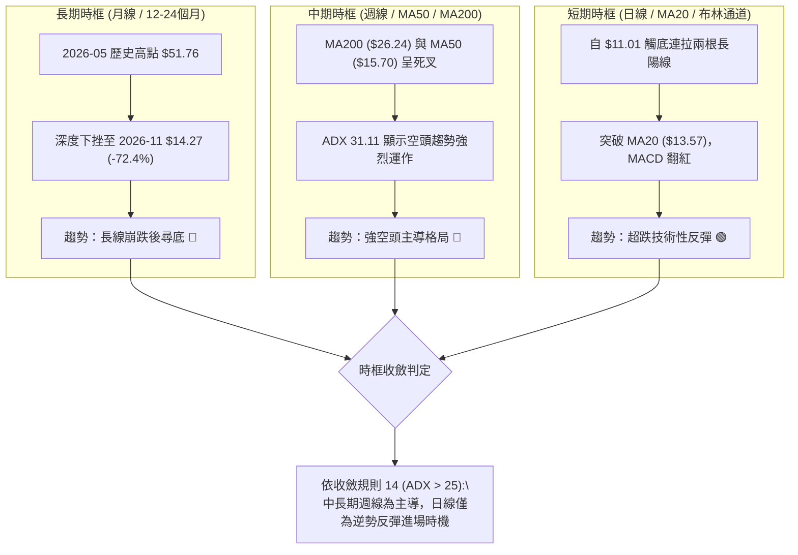

### 📈 長期趨勢 — 12個月走勢圖（Unicode）

```
PL 月線走勢圖（過去12個月：2025-11 至 2026-11）
價格軸 ($)
$52 ┤                                  ● $51.14 (2026-05 波段高點 $51.76)
$48 ┤                                 ╱ ╲
$44 ┤                                ╱   ╲
$40 ┤                               ╱     ╲
$36 ┤                         ● $36.97     ╲
$32 ┤                        ╱              ● $33.13
$28 ┤                 ● $27.95               ╲
$24 ┤          ● $24.97                       ╲
$20 ┤    ● $19.72                              ● $20.48 ── ● $19.85
$16 ┤   ╱                                                   ╲
$12 ┤● $11.90                                                ● $16.39
$08 ┤                                                          ╲       ● $14.27 (現價)
$04 ┤                                                           ● $13.47  (低點 $10.52)
    └─────────────────────────────────────────────────────────────────────────────►
      11   12   01   02   03   04   05   06   07   08   09   10   11 (月份)
     2025 |                          2026
```

#### 長期走勢特徵分析表

| 階段區間 | 起止月份 | 價格變化 | 漲跌幅 | 趨勢性質 | 核心特徵解讀 |
|----------|----------|----------|--------|----------|--------------|
| **第 I 階段：爆發主升浪** | 2025-11 至 2026-05 | $11.90 → $51.14 | +329.75% | 超級牛市多頭 | 商業太空題材、營收高增長推動估值極度擴張，創下 52W 高點 $51.76 |
| **第 II 階段：斷崖回撤期** | 2026-05 至 2026-07 | $51.14 → $20.48 | -59.95% | 深度崩跌殺多 | 獲利了結與高估值修正，跌破多條長期均線，週量能急劇釋放 |
| **第 III 階段：陰跌尋底期** | 2026-07 至 2026-10 | $20.48 → $13.47 | -34.23% | 空頭波段下跌 | 每次弱勢反彈皆受制於前波頸線，均線依序下穿形成完整空頭排列 |
| **第 IV 階段：超跌反抽期** | 2026-10 至 2026-11 | $13.47 → $14.27 | +5.94% | 技術性跌深反彈 | 探底至 52W 最低點 $10.52 後長腳回升，目前收盤於 $14.27 |

### 📊 中期趨勢（週線分析）

從近20週數據觀察，PL 在跌破 $20.00 整數心理關口後，於 2026-09 至 2026-10 期間在 $16.10–$18.81 建立了為期一個月的密集整理平台，但該平台隨後在 10 月中旬被放量摜破（2026-10-16 收 $13.56，成交量 51.29M）。

```
PL 中期週線支撐阻力結構圖
價格 ($)
$18.81 ┼────────────────────────────── R3 (10/09 波段高點聚類)
       │                              
$18.18 ┼────────────────────────────── R2 (09/25 平台反彈高點聚類)
       │                              
$15.70 ┼────────────────────────────── MA50 中期均線反壓
       │                              
$14.77 ┼────────────────────────────── R1 (10/30 週線反彈高點聚類)
       │                              
$14.27 ┼──────────────●─────────────── 現價收盤位 (受制於 R1)
       │              │               
$13.57 ┼──────────────┴─────────────── MA20 / 布林中軌
       │                              
$12.79 ┼────────────────────────────── S1 (10/23 波段低點聚類)
       │                              
$10.52 ┼────────────────────────────── S2 (52W 歷史絕對低點 / 11/05 低點聚類)
```

### ⚡ 趨勢強度評估（ADX 解讀）

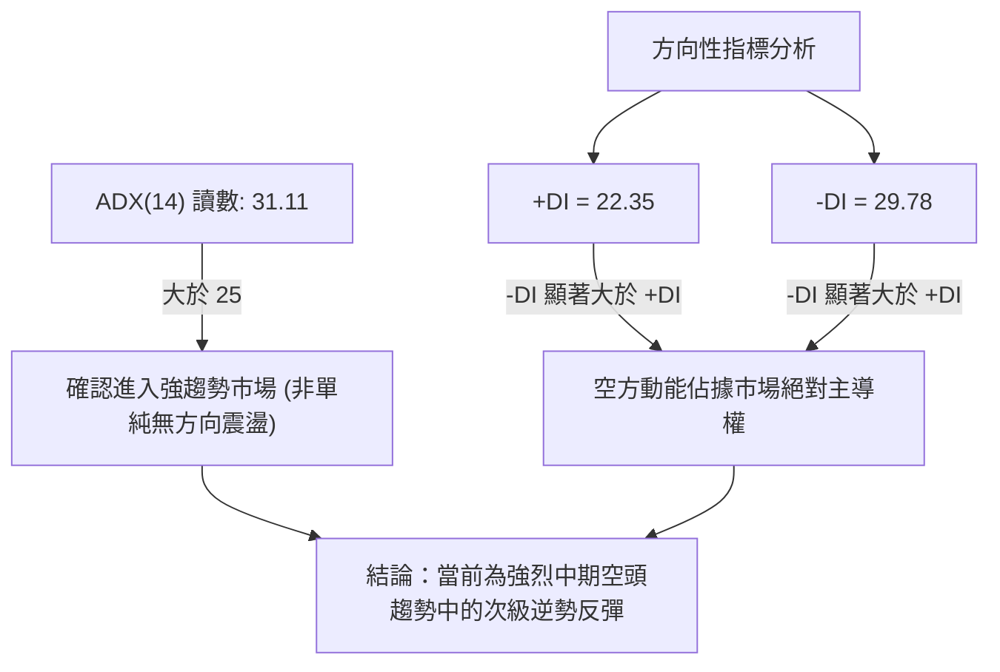

#### ADX 趨勢強度指標對照評估表

| 指標項目 | 當前讀數 | 門檻區間 | 當前狀態判定 | 對交易策略之具體指導 |
|----------|----------|----------|--------------|----------------------|
| **ADX(14)** | **31.11** | > 25 (強趨勢) | 趨勢行情確立 | 禁止使用純震盪區間指標抄底；所有反彈視為逆勢回抽 |
| **+DI** | **22.35** | 基準線 | 多頭動能偏弱 | 多方雖有日線兩根長陽，但未扭轉中期動能劣勢 |
| **-DI** | **29.78** | 基準線 | 空頭動能強勁 | 逢高放空或持空者防守更具備大趨勢保護 |
| **差值 (-DI - +DI)** | **+7.43** | > 0 | 空方掌控權 | 反彈遭遇均線或阻力位極易引發二次拋壓 |

---

## 3. 圖表形態分析

### 🔍 形態識別系統

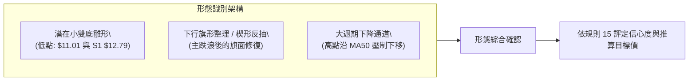

#### 圖表形態信心度與目標價計算表

| 形態名稱 | 信心度 (%) | 判斷依據（引用數據） | 完成度 (%) | 目標價計算式與推算目標 |
|----------|------------|----------------------|------------|------------------------|
| **潛在超跌雙底 (W底)** | **52%** | 2026-11-05 最低點 $11.01 探底後急速回升，與 10-23 週K低點 S1 $12.79 形成不對稱的二次探底回升；但頸線 R1 $14.77 尚未突破。 | **45%** | 頸線 R1 $14.77 + 形態高度 ($14.77 − $11.01 = $3.76) = **$18.53**（接近阻力區 R2 $18.18 / R3 $18.81） |
| **下行旗形 (Bear Flag)** | **68%** | 2026-10-09 至 2026-11-05 形成旗桿急速下跌（$18.81 → $11.01），近 4 個交易日弱勢縮量上推形成上傾旗面，屬空頭中繼。 | **70%** | 若跌破旗面下軌 S1 $12.79，測算目標價 = 破位點 $12.79 − 旗桿高度 ($18.81 − $11.01 = $7.80) = **$4.99**（數據中未偵測到此支撐，視為破位延展指標） |
| **下降通道邊界壓制** | **75%** | 自 09/25 高點 $18.18、10/09 高點 $18.81 形成的下壓趨勢線，目前精確壓制於布林上軌與 MA50 附近。 | **85%** | 壓制線回測目標：首看 MA20 $13.57，破位看 S1 **$12.79** |

*註：依規則 15，由於日線雙底並未有效突破頸線 R1 $14.77，信心度僅評為 52%；空頭中繼旗形形態特徵較為鮮明，信心度較高。*

### 🕯️ 重要K線形態分析

嚴格依據數據中「近10根日K」與「近8根週K」之開高低收數據進行客觀解讀：

| 日期（日K/週K） | 開盤價 | 最高價 | 最低價 | 收盤價 | 成交量 | K線形態名稱 | 技術解讀與多空意涵 | 訊號 |
|------------------|--------|--------|--------|--------|--------|------------|--------------------|------|
| **日K 2026-11-05** | 12.21 | 12.40 | 11.01 | 11.37 | 10,405,800 | **長下影大陰線** | 盤中恐慌拋盤創下 52W 新低 $11.01，放量突破千萬股，下影線 0.36 元，低檔初現接盤。 | 🔴 |
| **日K 2026-11-06** | 11.77 | 12.55 | 11.48 | 12.55 | 9,275,800 | **光頭光腳大陽線** | 開盤於 11.77 後一路推升，以全天最高點 12.55 作收，完全吞噬前日大部分跌幅，形成破底翻雛形。 | 🟢 |
| **日K 2026-11-09** | 12.85 | 14.47 | 12.64 | 14.37 | 11,000,900 | **放量跳空中長陽** | 跳空高開，單日放量至 11.00M 股，收盤大漲至 14.37，一舉站上 MA20 ($13.57)，確認短線強烈反彈。 | 🟢 |
| **日K 2026-11-10** | 13.93 | 14.44 | 13.70 | 14.27 | 6,922,907 | **高位孕線小陰十字** | 成交量顯著萎縮至 6.92M（量比 0.82x），上攻至 14.44 受阻於 R1 $14.77 前，高檔浮現獲利了結滯漲訊號。 | 🟡 |
| **週K 2026-10-16** | 17.00 | 17.03 | 13.33 | 13.56 | 51,292,600 | **斷頭大黑K棒** | 平台破位關鍵K線，帶巨量長黑暴跌，破壞了為期一個月的盤整結構，正式奠定空頭趨勢。 | 🔴 |
| **週K 2026-11-06** | 13.62 | 13.74 | 11.01 | 12.55 | 41,977,100 | **極長下影線探底錘頭** | 探至 $11.01 低點後強烈拉回，下影線長達 1.54 元，代表空頭動能衰竭與主力買盤介入護盤。 | 🟢 |
| **週K 2026-11-10** | 12.85 | 14.47 | 12.64 | 14.27 | 17,923,807 | **反彈陽線（進行中）** | 本週前半段強烈上衝突破 MA20，但量能僅 17.92M，面臨 R1 $14.77 與布林上軌 $15.15 的重壓。 | 🟡 |

### 📉 ASCII 走勢形態示意圖

```
PL 近 10 個交易日破底翻反彈結構圖
價格 ($)
$14.77 ┼───────────────────────────────────────────── 阻力 R1 (頸線壓力)
       │                                     ┌─┐
$14.27 ┼─────────────────────────────────────│ │──● 當前現價收盤 ($14.27)
       │                               ┌─┐   │ │
$13.57 ┼───────────────────────────────│ │───┴─┴── MA20 ($13.57) / 布林中軌
       │                   ┌─┐         │ │
$12.79 ┼─┌─┐───────────────│ │─────────│ │──────── 支撐 S1 (前期波段低點聚類)
       │ │ │   ┌─┐         │ │   ┌─┐   │ │
$12.00 ┼─│ │───│ │─────────┴─┴───│ │───┴─┴──────── 布林下軌 ($12.00)
       │ │ │   │ │               │ │
$11.01 ┼─┴─┴───┴─┴───────────────┴─┴────────────── 52W 新低探底點 (11/05 爆量錘頭)
       └─────────────────────────────────────────►
        10/30 11/02 11/03 11/04 11/05 11/06 11/09 11/10
```

### 🎯 形態目標價計算

1. **雙底反彈目標價推算**：
   - 形態底部低點：$11.01（2026-11-05 最低價）
   - 頸線阻力位：R1 **$14.77**（2026-10-30 週K波段高點）
   - 垂直高度：$14.77 − $11.01 = $3.76
   - 理論量度滿足目標價 = 頸線 $14.77 + 垂直高度 $3.76 = **$18.53**
   - *落點檢驗*：該目標價精確落於阻力區 R2 $18.18 與 R3 $18.81 之間，具備極強的量化結構重合度。

2. **旗形下破測算（反向風險）**：
   - 若短線反彈未能有效越過 R1 $14.77，轉而跌破短期起漲防守點 S1 **$12.79**，則確認為空頭下行旗形。
   - 跌破後之首要回測目標為 52W 低點 S2 **$10.52**。

---

## 4. 支撐與阻力

### 🗺️ 關鍵價位分布圖（Unicode）

```
PL 價位結構分布圖（嚴格依據 OHLCV 計算聚類值）
═══════════════════════════════════════════════════════════════════
$18.81 ║████████████████████████████████║ 強阻力 R3 (10/09 週高點 / 波段頂部)
$18.18 ║████████████████████████        ║ 阻力 R2 (09/25 週高點 / 破位前平台)
$15.70 ║────────────────────────────────║ MA50 中期趨勢動態反壓
$15.15 ║░░░░░░░░░░░░░░░░░░░░░░░░        ║ 布林通道上軌壓制
$14.77 ║████████████████████████████████║ 關鍵阻力 R1 (10/30 週高點 / 近端反彈頸線)
$14.27 ╠════════════════════════════════╣ ◄ 當前收盤價 ($14.27)
$13.57 ║────────────────────────────────║ MA20 / 布林通道中軌支撐
$12.79 ║▓▓▓▓▓▓▓▓▓▓▓▓▓▓▓▓▓▓▓▓▓▓▓▓        ║ 近期關鍵支撐 S1 (10/23 波段低點聚類)
$12.00 ║░░░░░░░░░░░░░░░░░░░░            ║ 布林通道下軌動態支撐
$10.52 ║████████████████████████████████║ 強支撐 S2 (52週歷史最低點聚類)
═══════════════════════════════════════════════════════════════════
```

### 🚧 阻力位分析表

依據數據「關鍵價位（由 OHLCV 計算）」區塊嚴格引用：

| 阻力級別 | 精確價位 | 距現價幅 | 形成原因與籌碼特徵 | 突破難度評估 | 重要性級別 |
|----------|----------|----------|--------------------|--------------|------------|
| **R1** | **$14.77** | +3.50% | 近一年波段高點聚類（2026-10-30 週K高點）；同時緊鄰布林上軌 $15.15。 | 🟡 中等（面臨日線 Stoch 超買獲利回吐盤） | ★★★★☆ |
| **R2** | **$18.18** | +27.40% | 近一年波段高點聚類（2026-09-25 週K高點）；前期橫盤一個月整理平台下沿。 | 🔴 極高（套牢籌碼密集堆積區） | ★★★★★ |
| **R3** | **$18.81** | +31.81% | 近一年波段高點聚類（2026-10-09 週K高點）；此輪斷崖式大跌之起跌發散源頭。 | 🔴 極高（中期多空分水嶺） | ★★★★☆ |

### 🛡️ 支撐位分析表

依據數據「關鍵價位（由 OHLCV 計算）」區塊嚴格引用：

| 支撐級別 | 精確價位 | 距現價幅 | 形成原因與籌碼特徵 | 守住機率評估 | 重要性級別 |
|----------|----------|----------|--------------------|--------------|------------|
| **S1** | **$12.79** | -10.37% | 近一年波段低點聚類（2026-10-23 週K低點）；跌破代表本波自 $11.01 之反彈失敗。 | 🟡 60%（具備 MA20 $13.57 作為前置緩衝墊） | ★★★★☆ |
| **S2** | **$10.52** | -26.28% | 近一年波段低點聚類（52W 歷史最低點，100.0% 斐波那契位）；公司長期多頭最後防線。 | 🟢 80%（長期估值支撐與絕對超跌極限） | ★★★★★ |

### 📐 斐波那契回調位分析

依據數據中 52 週區間 **$10.52 → $51.76** 計算之精確回調位進行解讀：

```
斐波那契回調梯形圖 (52W 高點 $51.76 至 52W 低點 $10.52)
  0.0% ─── $51.76 (52W 最高點)
 23.6% ─── $42.03
 38.2% ─── $36.01
 50.0% ─── $31.14 (牛熊分水嶺)
 61.8% ─── $26.27 (黃金分割位 / 緊鄰 MA200 $26.24)
 78.6% ─── $19.35 (深度回撤防守位 / 緊鄰 R3 $18.81)
 ─── 現價 $14.27 (位於 78.6% 與 100.0% 之間，處於 52W 區間 9.1% 之極度深水區) ───
100.0% ─── $10.52 (52W 最低點)
```

#### 斐波那契層級解析

1. **現價區間定位**：
   當前價格 **$14.27** 運行於 **78.6% 回調位 ($19.35)** 與 **100.0% 回調位 ($10.52)** 之間。技術分析理論中，當股價回撤跌破 78.6%（$19.35）時，代表前一輪牛市結構已遭遇毀滅性破壞，市場進入「終極尋底模式」。
2. **上方反彈第一強阻力帶**：
   若反彈持續延伸，斐波那契 78.6% 處的 **$19.35** 與數據阻力位 **R3 ($18.81)** 將形成重合共振壓制帶（$18.81–$19.35）。在未能有效收復此區間之前，任何反彈在量化模型中皆只能定義為空頭主導下的次級折返。
3. **長期均線共振**：
   MA200 長期均線目前位於 **$26.24**，與斐波那契 61.8% 黃金分割位 **$26.27** 呈現不可思議的絕對共振（誤差僅 0.03 美元）。這確認了 $26.24–$26.27 為該股未來數季不可逾越的牛熊天花板。

---

## 5. 技術指標深度解讀

### 🎛️ 指標訊號總覽

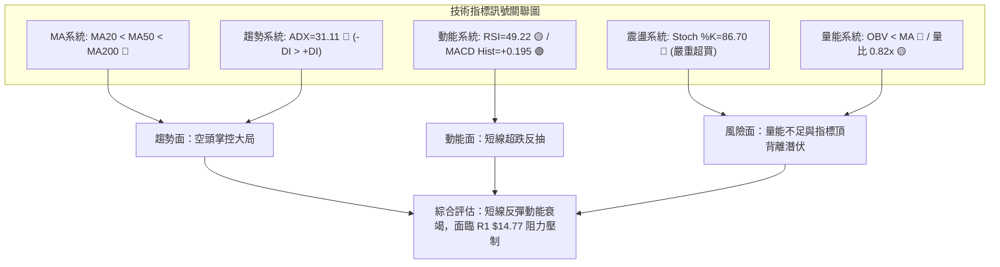

### 📈 移動平均線排列分析

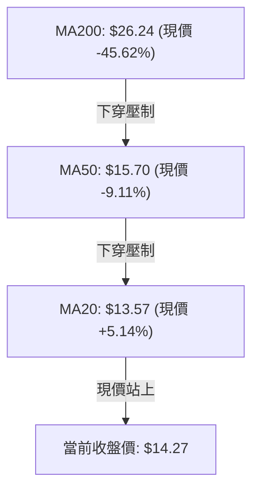

#### 均線體系走勢特徵

| 均線名稱 | 當前價格 | 與現價乖離率 | 方向斜率趨勢 | 技術意義評估 |
|----------|----------|--------------|--------------|--------------|
| **MA5** | $13.04 | +9.42% | ▲ 急速上行 | 超跌反彈短期急先鋒，為極短線多頭防守線 |
| **MA10** | $13.38 | +6.66% | ▲ 轉折拐頭向上 | 助推短線價格上攻 |
| **MA20** | $13.57 | +5.14% | ▲ 初步止跌上揚 | 短線生命線，現價已成功突破站穩 |
| **MA60** | $16.67 | -14.42% | ▼ 持續向下發散 | 中期反壓，壓制反彈空間 |
| **MA120** | $23.12 | -38.27% | ▼ 持續走跌向下 | 半年線沈重套牢賣壓 |
| **MA200** | $26.24 | -45.62% | ▼ 堅定下行 | 總體趨勢處於長期「空頭排列」 |

*均線排列判定*：目前 **MA20 ($13.57) < MA50 ($15.70) < MA200 ($26.24)**，整體維持典型之空頭排列。雖然價格短期站上 MA20，但屬於標準的「逆均線系統反抽」，上方 MA50 ($15.70) 將構成極強的中期反壓。

### 📉 RSI(14) 分析

```
RSI(14) 讀數儀表盤
0 ──────────── 30 ───────────────────── 49.22 ─────────────── 70 ─────────── 100
[  極度超賣區  ] [       中性震盪區        ▲       ] [  極度超買區  ]
                                       當前讀數
進度條展示：
RSI(14) 49.22: [█████████████████████████░░░░░░░░░░░░░░░░░░░░░░░░░] 49.22%
```

- **區間評估**：當前 RSI(14) 數值為 **49.22**，自前期 20–30 的超賣區域修復至 50 中性平衡水準附近，脫離了超賣鈍化狀態。
- **背離判斷**：數據明確標示「RSI 背離：無明顯背離（僅比較近20根K棒首尾的價格與RSI方向）」。價格於 11/05 創低後反彈，RSI 同步自低位回升至 49.22，顯示此波反彈屬於指標正常回歸，並未產生大級別的看多底背離或頂背離，訊號強度中性。

### 📊 MACD(12,26,9) 訊號解讀

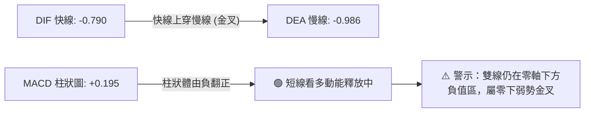

- **數值分析**：MACD 線（-0.790）高於訊號線（-0.986），柱狀圖讀數為 **+0.195**，呈現綠色翻多訊號。
- **指標結構矛盾**：雖然 MACD 出現黃金交叉，但快慢線仍處於零軸下方深處（負值區間），此種金叉在技術分析上被定義為「零下金叉」，通常只能帶來技術性反抽，容易在觸及零軸或前高時受阻，無法直接確立反轉大牛市。

### 📦 布林通道分析

```
PL 日線布林通道 (20, 2) 結構圖
價格 ($)
$15.15 ┼───────────────────────────────── BB 上軌 (動態阻力帶)
       │                         ▲
$14.27 ┼─────────────────────────●─────── 現價收盤 ($14.27，%B = 0.72)
       │                        
$13.57 ┼───────────────────────────────── BB 中軌 / MA20 ($13.57)
       │
$12.00 ┼───────────────────────────────── BB 下軌 (動態支撐帶)
```

- **通道指標解讀**：
  - 布林通道帶寬：$15.15 − $12.00 = $3.15。
  - **%B 指標讀數為 0.72**（0 代表下軌，0.5 代表中軌，1 代表上軌）。
  - 現價位於中軌 ($13.57) 與上軌 ($15.15) 之間，偏向上軌運行。結合隨機指標 Stoch %K 已達 86.70，顯示價格已接近布林通道上軌邊界壓制，短線上行空間受限於通道頂部。

### 💹 成交量分析（量價配合度）

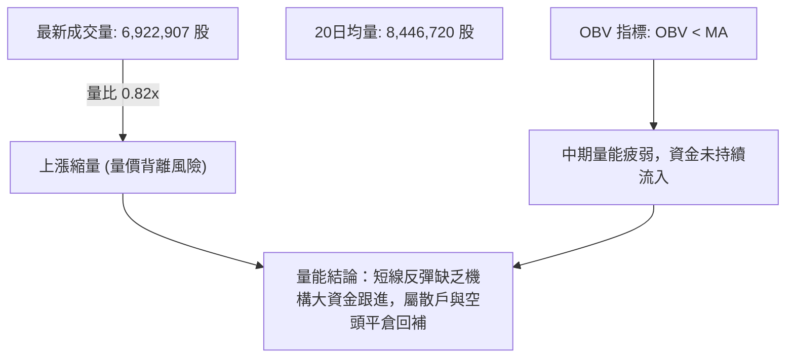

- **量比與持續性**：在 11/09 出現 11.00M 股放量突破後，11/10 股價收於 $14.27，成交量卻迅速萎縮至 6,922,907 股（量比 0.82x）。量價呈現「價漲量縮」的短線頂部特徵。
- **OBV 量能印證**：數據明確提示「OBV趨勢：OBV < MA → 量能疲弱」。這說明在更大週期內，能量潮指標持續位於其移動平均線下方，表明反彈過程並未獲得實質性增量資金的入場確認。

---

## 6. 動能與波動率

### ⚡ 動能評估四象限

```
PL 市場狀態定位：動能強度 vs 波動率
       高波動率
          │   Q3 (高動能·高波動)   │   Q4 (弱動能·高波動)
          │   強勢主升突破         │   ★ PL 當前位置 (ATR=7.19%, 空頭主導)
──────────┼────────────────────────┼───────────────────────────► 波動率
          │   Q1 (強動能·低波動)   │   Q2 (弱動能·低波動)
          │   最佳蓄勢機會         │   謹慎觀望整理
          │
       低動能強度
```

#### 動能評估四象限具體定位表

| 象限標籤 | 動能維度特徵 | 波動維度特徵 | PL 當前落點判定 | 操作指導與評估策略 |
|----------|--------------|--------------|-----------------|--------------------|
| **Q1** | 強動能 (多方) | 低波動 | 否 | 最佳低吸機會（不符合） |
| **Q2** | 弱動能 (中性) | 低波動 | 否 | 觀望等待變盤（不符合） |
| **Q3** | 強動能 (爆發) | 高波動 | 否 | 高風險高收益突破追逐（不符合） |
| **Q4** | **弱動能 (空方佔優)** | **高波動 (ATR 7.19%)** | **✓ 確診落點** | **震盪劇烈且缺乏多頭持續量能支撐；以防守、減倉或高拋低吸防禦為主** |

### 📊 ATR 波動率分析

- **ATR(14) 讀數**：**$1.03**（佔股價比例高達 **7.19%**，採 Wilder 平滑算法）。
- **波動率特性**：單日 7.19% 的波動幅度意味著 PL 屬於極高波動性標的，市場籌碼極易鬆動。
- **止損距離建議**：
  - *短期逆勢交易止損距離*：建議設定為 1.0 × ATR = **$1.03**。
  - *波段交易止損距離*：建議設定為 1.5 × ATR = **$1.55**。
  - 任何進場策略若未預留至少 $1.00 以上的緩衝空間，極易在日內雜訊中被無效止損掃出場。

### 📐 Beta 與市場相關性

- **Beta 係數**：**2.27**（具備極高的市場彈性與高貝塔屬性）。
- **機構與空頭籌碼結構**：
  - 機構持股比例高達 **82.6%**，說明籌碼高度集中於機構手中，此輪崩跌反映機構大規模減磅。
  - 做空比率（Short % Float）達 **12.2%**，Short Ratio 為 **3.42**。較高的空頭部位為短線超跌提供了「逼空（Short Squeeze）」反彈的燃油，近期自 $11.01 急拉至 $14.27 帶有明顯的空頭回補特徵。

---

## 7. 多時框架總結

### 📋 時框架評分表

| 時框架 | 趨勢方向 | 動能狀態 | 均線排列 | 圖表形態 | 綜合評分 | 操作建議方向 |
|--------|----------|----------|----------|----------|----------|--------------|
| **月線 (長期)** | 深度空頭 🔴 | 極弱尋底 🔴 | 空頭發散 🔴 | 歷史高位崩跌破位 | **20/100** | 嚴禁長線無腦盲目抄底 |
| **週線 (中期)** | 下行趨勢 🔴 | 下跌趨緩 🟡 | MA50/200空排 🔴 | 跌破大平台尋底 | **35/100** | 反彈至阻力位建立空頭防禦 |
| **日線 (短期)** | 超跌反彈 🟢 | MACD金叉 🟢 | 突破MA20 🟢 | 低檔爆量破底翻 | **60/100** | 短線輕倉快進快出博反彈 |

### 🔲 綜合訊號矩陣

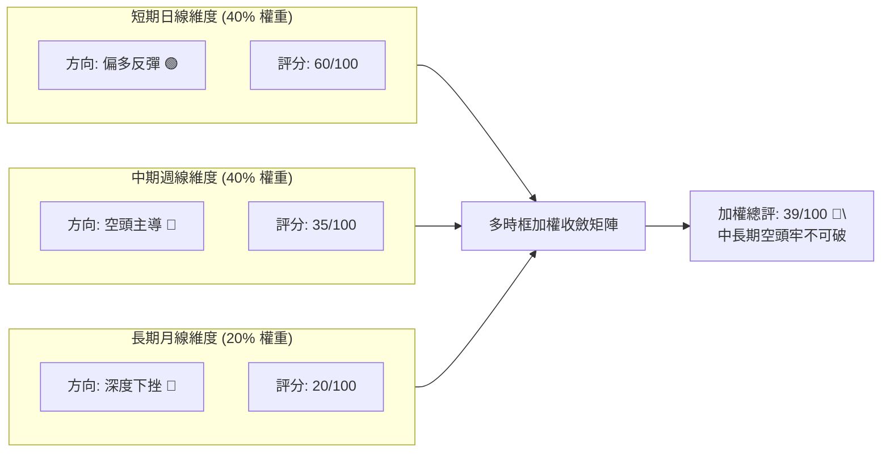

### ⚖️ 多時框收斂結論

依據本報告**嚴格要求 14（多時框收斂規則）**進行最終裁決：
1. **行情性質判定**：當前 PL 的趨勢強度指標 **ADX(14) 讀數為 31.11**，明確大於 25 的趨勢臨界值，因此本標的**定性為「強趨勢行情」，絕非單純之箱體盤整市場**。
2. **時框優先級取捨**：在強趨勢行情（ADX > 25）中，必須以中長期（週線、MA50、MA200）方向為主要主導方向，日線級別的指標金叉（MACD 柱翻正、價格站上 MA20）只能被定義為**「尋找更佳空頭進場點或極短線輕倉超跌投機的時機工具」**，絕不可凌駕於中長期的空頭主趨勢之上。
3. **唯一方向性結論**：**【偏空主導，防範反彈見頂】**。第 1 章技術評分卡綜合評分為 **39/100**（≤ 40），第 7 章與第 8 章嚴格收斂維持一致的空方戰略思維。

---

## 8. 交易策略建議

### 🗺️ 策略決策流程圖

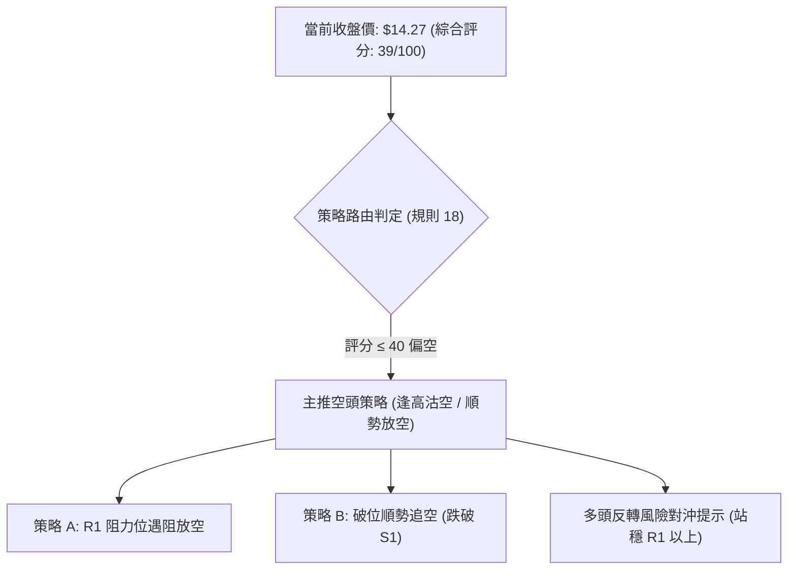

### 🧭 策略路由（依評分卡分流）

> **當前主策略方向 = 空頭主導策略（依綜合評分 39/100，規則 18 判定 ≤ 40 觸發空方主導）**
> 
> 本報告嚴格遵守規則，不兩頭下注。鑑於中長期趨勢空頭主導（ADX 31.11，均線空頭排列），短線日線超買（Stoch %K 86.70），所有策略聚焦於**順應中長線大趨勢之空頭部署**；多頭邏輯僅作為風險防範與停損對沖參考。

### 🎯 價格情境階梯（Price Scenarios）

價位嚴格引用自第 4 章及數據計算數值：

| 觸發條件 | 下一目標 | 後續延伸 | 情境含義解讀 |
|----------|----------|----------|--------------|
| **受阻於 R1 $14.77 拐頭回落** | 回測 MA20 **$13.57** | 下探支撐 S1 **$12.79** | 反彈動能耗盡，空頭重掌主導權（高機率情境） |
| **強勢突破 R1 $14.77 並站穩** | 測試 MA50 **$15.70** | 衝擊阻力 R2 **$18.18** | 超跌反彈級別擴大，空頭停損觸發 |
| **跌破 S1 $12.79 關鍵支撐** | 測試下軌 **$12.00** | 探底 52W 低點 S2 **$10.52** | 確立旗形破位，主跌浪延續 |

### 📊 情境機率分佈

| 情境分類 | 機率預估 | 主要技術指標支撐依據 |
|----------|----------|----------------------|
| **遇阻回落 / 空頭重啟 (主推情境)** | **55%** | ADX 31.11 強空頭趨勢；Stoch %K 86.70 處於嚴重超買；成交量萎縮至 0.82x 顯露疲態；OBV < MA 量能匱乏。 |
| **區間震盪 (窄幅拉鋸)** | **30%** | 價格暫受 MA20 ($13.57) 托底，且上方布林上軌 ($15.15) 與 R1 ($14.77) 壓制，可能於 $13.50–$14.70 進行幾日換手。 |
| **強勢逼空 / 持續反彈 (多頭情境)** | **15%** | MACD 柱翻正 (+0.195) 且空頭比率達 12.2%，具備偶發逼空潛力，但受限於大週期均線壓制。 |

### 🟢 主策略詳情（方向依上方路由：空頭策略）

嚴格依據規則 17 計算風險報酬比：做空時風險報酬比 = (進場價 − 目標價 T1) ÷ (止損價 − 進場價)。

| 策略要素 | 策略 A（逢高佈空：R1 阻力反轉進場） | 策略 B（破位追空：S1 支撐確認下破） |
|----------|-------------------------------------|-------------------------------------|
| **交易方向** | 做空（Short） | 做空（Short） |
| **進場條件** | 股價反彈至 R1 遇阻回落，或現價附近拉升滯漲 | 日K收盤有效跌破前期低點支撐 S1 |
| **進場價格** | **$14.50**（位於現價 $14.27 至 R1 $14.77 之間） | **$12.70**（跌破 S1 $12.79 確認點） |
| **目標價 T1** | **$12.79**（關鍵支撐位 S1） | **$10.52**（52W 歷史低點 S2） |
| **目標價 T2** | **$10.52**（52W 歷史低點 S2） | **N/A（數據中未偵測到更低支撐）** |
| **止損價格** | **$15.20**（有效突破布林上軌 $15.15 與 R1） | **$13.60**（重新站回 MA20 $13.57 頸線上方） |
| **風險報酬比 (以 T1 計)** | **1 : 2.44（以 T1 計）**<br>計算式: ($14.50−$12.79)/($15.20−$14.50) = 1.71/0.70 | **1 : 2.42（以 T1 計）**<br>計算式: ($12.70−$10.52)/($13.60−$12.70) = 2.18/0.90 |
| **風險報酬比 (以 T2 計)** | **1 : 5.69（以 T2 計）**<br>計算式: ($14.50−$10.52)/($15.20−$14.50) = 3.98/0.70 | **N/A** |
| **成功機率估計** | **62%** | **55%** |
| **建議倉位** | **總資金之 10%–15%** | **總資金之 8%–10%** |

### 🔴 反向風險觸發點（對沖提示）

若出現以下訊號，說明本報告之空頭主策略被客觀市場推翻，應立即執行止損或空頭對沖：
1. **價格強勢收盤突破 $15.15（布林上軌）**：且日成交量突破 12,000,000 股（超過 11/09 的 11M 水準），確認多頭反轉展開，應全面止損空單。
2. **週線 MACD 雙線重回零軸以上**：宣告中期空頭趨勢正式結束。

### ⭐ 整體訊號強度評星

```
做多訊號強度：★★☆☆☆  (2/5星) ── 僅存日線超跌反抽，無大時框共振
做空訊號強度：★★★★☆  (4/5星) ── 趨勢、均線、ADX 強烈共振
整體可信度：  ★★★★☆  (4/5星) ── 數據聚類支撐明確，量價背離清晰
```

---

## 9. 風險提示與監控

### ✅ 關鍵監控指標 Checklist

```
╔══════════════════════════════════════════════════════════════╗
║                   關鍵技術監控指標 CHECKLIST                 ║
╠══════════════════════════════════════════════════════════════╣
║ [ ] 每日收盤價是否跌破 MA20 ($13.57) 生命線？                 ║
║ [ ] 日線 Stoch %K 是否自 >80 超買區向下死叉 %D？             ║
║ [ ] 成交量是否連續低於 20日均量 (8.45M) 形成縮量陰跌？       ║
║ [ ] 上攻過程中是否觸及阻力位 R1 ($14.77) 留下長上影線？      ║
║ [ ] 支撐位 S1 ($12.79) 是否遭遇大單摜破？                    ║
║ [ ] ADX 數值是否維持在 25 以上確認空頭趨勢延續？             ║
╚══════════════════════════════════════════════════════════════╝
```

### ⚠️ 風險場景分析

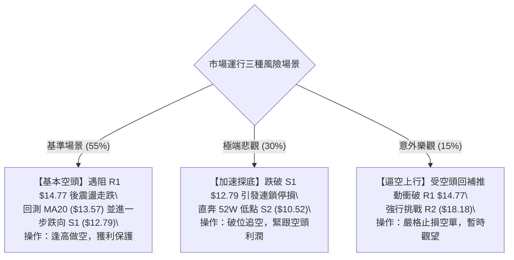

### 🛡️ 風險管理重要提醒

1. **ATR 波動保護規則**：
   PL 目前單日 ATR 高達 $1.03（7.19%），日內震盪極其劇烈。部位規模必須依波動率進行倒算調整，單筆交易虧損額度務必嚴格限制於總投資組合淨值的 **1.0% 以內**。
2. **財報與基本面事件鎖定**：
   根據市場資訊，公司將於 **2026 年 12 月 10 日**公布第三季度財務業績。在重大業績公布前兩週，隱含波動率將大幅擴張，技術形態可能受消息面突發打亂，屆時需提前降倉或平倉規避跳空風險。
3. **空頭擠壓（Short Squeeze）預防**：
   該股具備 12.2% 的做空比例與 2.27 的高 Beta 屬性，在太空概念或防務合約消息刺激下極易發生急促脈衝式反彈，切忌在日線長陽當日盲目追空，務必等待阻力位處出現明確「滯漲信號（如高位十字星、射擊之星或縮量陰線）」後再行進場。

---

## 📋 報告總結

```
╔══════════════════════════════════════════════════════════════════╗
║                      PL 技術分析報告總結                        ║
╠══════════════════════════════════════════════════════════════════╣
║ 報告日期：2026-11-11                                             ║
║ 當前價格：$14.27 USD                                             ║
║ 分析評級：🔴 偏空主導之反彈修正（技術評分：39/100）              ║
╠══════════════════════════════════════════════════════════════════╣
║ 關鍵結論：                                                       ║
║ ├─ 長期趨勢：🔴 深度熊市格局，歷史高點 $51.76 回撤逾 72%        ║
║ ├─ 中期趨勢：🔴 週線均線空頭排列，ADX=31.11 強空頭趨勢主導      ║
║ ├─ 短期趨勢：🟡 短線超跌反抽，突破 MA20 但受制於 R1 且量價背離   ║
║ ├─ 關鍵支撐：S1 $12.79 ｜ 強支撐：S2 $10.52 (52W歷史低點)        ║
║ ├─ 關鍵阻力：R1 $14.77 ｜ 關鍵阻力：R2 $18.18 ｜ 強阻力：R3 $18.81║
║ └─ 分析師目標：均價 $30.27 (低 $17.00 / 高 $50.00，僅供參考)    ║
╠══════════════════════════════════════════════════════════════════╣
║ 最優策略組合：                                                   ║
║ 1. 🥇 最佳機會：策略 A (逢高沽空) — 於 $14.50 附近建空，目標     ║
║                 T1 $12.79 / T2 $10.52，止損 $15.20 (風報比 1:2.44)║
║ 2. 🥈 次選機會：策略 B (破位追空) — 跌破 S1 $12.70 追空，目標    ║
║                 T1 $10.52，止損 $13.60 (風報比 1:2.42)           ║
║ 3. 🥉 防守對策：短線多頭於 $14.40 以上分批停利，跌破 $13.57 全出 ║
╚══════════════════════════════════════════════════════════════════╝
```

---

> ⚠️ **免責聲明**：本報告為 AI 自動生成之技術分析，所有數據及估算均嚴格基於所提供的歷史價格與市場技術資訊。本報告**僅供研究與學術參考**，**不構成任何要約、推薦或投資建議**。金融市場具有極高波動與本金損失風險，投資人應依個人財務狀況與風險承受能力獨立做出決策。

---

*報告生成時間：2026-11-11 ｜ 數據來源：Yahoo Finance ｜ 分析框架：多時框技術分析模型*