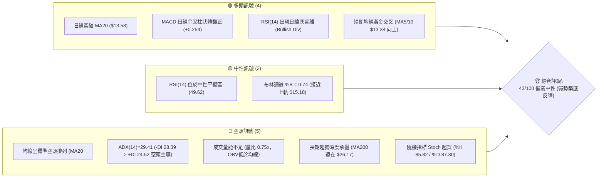
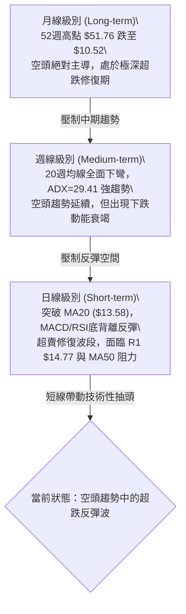
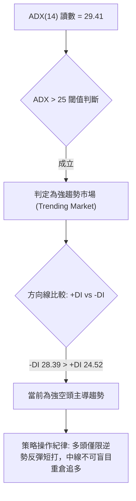
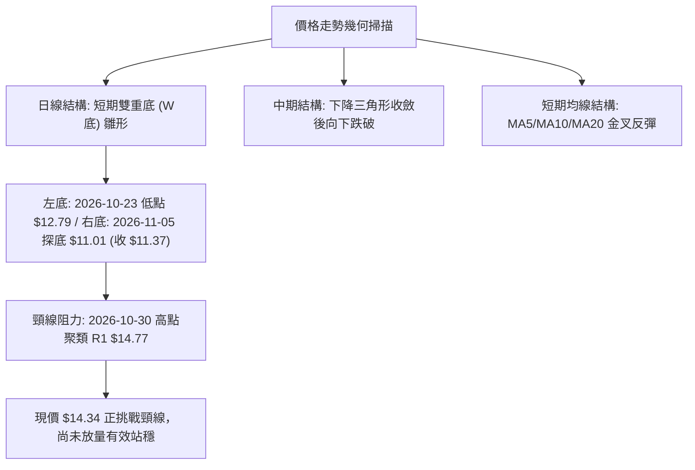
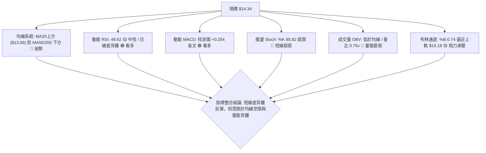
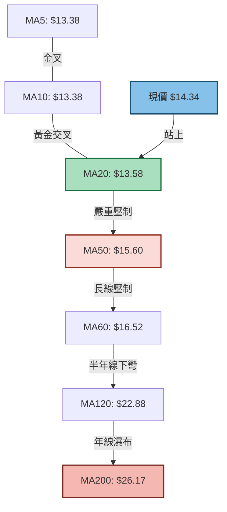
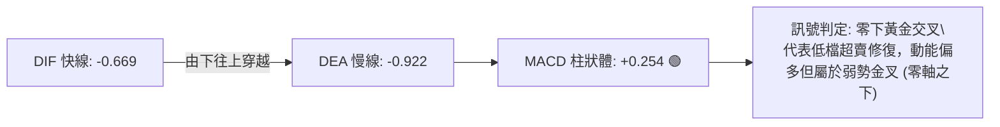
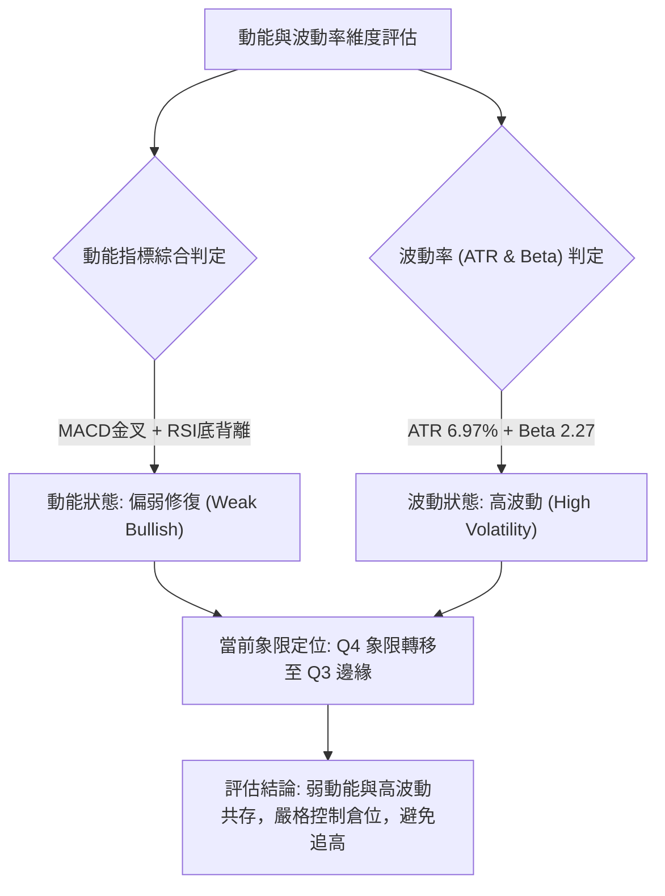
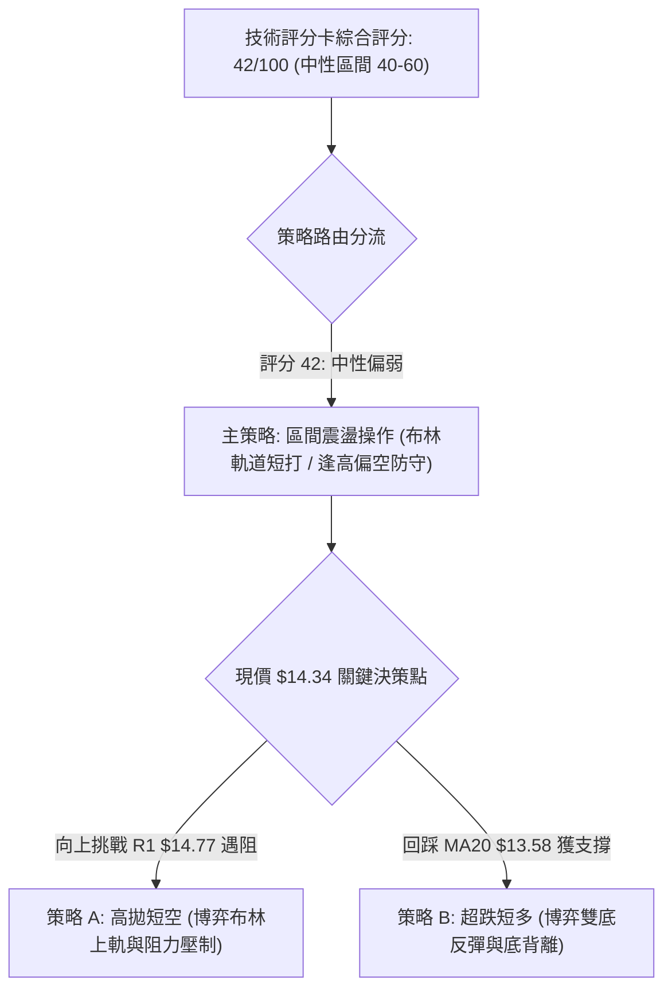
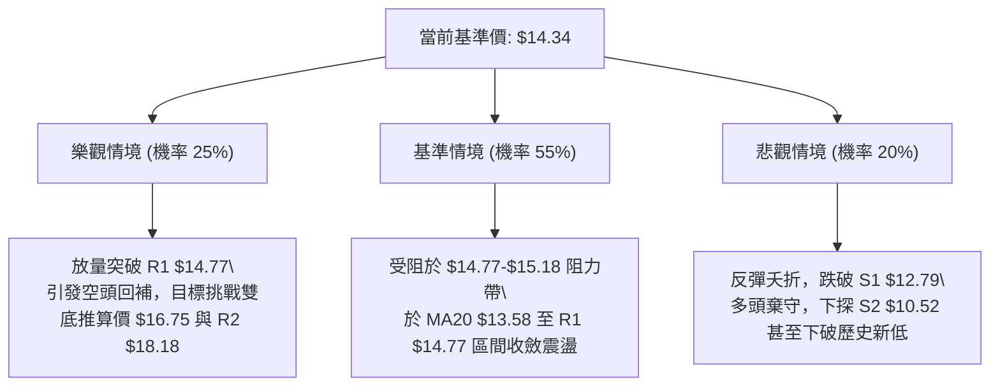

# PL 技術分析報告

> **報告日期**：2026-11-12 ｜ **語言**：繁體中文 ｜ **數據來源**：Yahoo Finance ｜ **當前價格**：$14.34

---

## 目錄

| 章節 | 內容 |
|------|------|
| [1. 技術面概覽](#1-技術面概覽) | 訊號儀表板、核心指標、評分卡 |
| [2. 趨勢分析](#2-趨勢分析) | 多時框趨勢、長中短期走勢、ADX強趨勢評估 |
| [3. 圖表形態分析](#3-圖表形態分析) | 形態識別、信心度評估、近10日/8週K線組合 |
| [4. 支撐與阻力](#4-支撐與阻力) | 結構分布圖、波段聚類阻力/支撐、斐波那契回調 |
| [5. 技術指標深度解讀](#5-技術指標深度解讀) | 均線系統、RSI底背離、MACD金叉、布林通道與OBV |
| [6. 動能與波動率](#6-動能與波動率) | 動能四象限、ATR(14)波幅、高Beta風險評估 |
| [7. 多時框架總結](#7-多時框架總結) | 時框架評分矩陣、多時框收斂唯一結論 |
| [8. 交易策略建議](#8-交易策略建議) | 策略路由分流、價格階梯、主策略與反向風控 |
| [9. 風險提示與監控](#9-風險提示與監控) | 關鍵指標Checklist、三情境壓力測試、風控規則 |

---

## 1. 技術面概覽

Planet Labs PBC（NYSE: PL）當前收盤價為 **$14.34**。該股自 2026 年 5 月創下 52 週歷史高點 $51.76 後經歷劇烈深幅回調，最低探至 $10.52（2026-11-05 日內低點），目前處於 52 週價格區間的 9.3% 低位階。盤面總體結構呈現「長期空頭主導、短期低檔超跌反彈並出現技術性底背離」的格局。

### 🎯 技術訊號儀表板



### 📊 核心指標速覽表

| 指標類別 | 指標名稱 | 當前數值 | 訊號 | 解讀 |
|----------|----------|----------|------|------|
| **價格** | 當前價格 | $14.34 | 🟡 中性 | 位於 52 週低檔 9.3% 區位，自近期低點 $11.01 顯著反彈 |
| **均線** | MA20 | $13.58 | 🟢 看多 | 現價位於 MA20 上方 (+5.57%)，短線扭轉跌勢 |
| **均線** | MA50 | $15.60 | 🔴 看空 | 現價位於 MA50 下方 (-8.08%)，中期結構依然偏空 |
| **均線** | MA200 | $26.17 | 🔴 看空 | 現價低於長期生命線 MA200 達 -45.20%，長期空頭無疑 |
| **動能** | RSI(14) | 49.62 | 🟢 看多 | 自低檔回升至中軸，伴隨日線顯著「底背離」訊號 |
| **動能** | MACD (12,26,9) | -0.669 / -0.922 | 🟢 看多 | 柱狀體翻正為 +0.254，雙線在零軸下方形成黃金交叉 |
| **動能** | Stoch %K / %D | 85.82 / 87.30 | 🔴 看空 | 短期指標進入嚴重超買區，存在技術性回踩拉回壓力 |
| **趨勢** | ADX (14) | 29.41 | 🔴 看空 | 數值大於 25 表明強趨勢，-DI (28.39) 壓制 +DI (24.52) |
| **通道** | 布林通道 | 上軌 $15.18 / %B 0.74 | 🟡 中性 | 價格自中軌向上軌推進，逼近上方動態阻力帶 |
| **成交量** | 20日量比 | 0.75x (6.15M / 8.21M) | 🔴 看空 | 上漲過程中成交量萎縮，量價出現背離，OBV 持續疲弱 |
| **波動** | ATR(14) | $1.00 (6.97%) | 🔴 高波動 | 每日平均震幅達 7%，技術止損空間需合理放大 |

### 🏆 技術評分卡

```
╔══════════════════════════════════════════════════════════════╗
║              技術評分卡 — PL (2026-11-12)                   ║
╠══════════════════════════════════════════════════════════════╣
║ 趨勢強度      ██████░░░░░░░░░░░░░░  30/100  🔴 空頭主導      ║
║ 動能指標      ████████████░░░░░░░░  60/100  🟢 底背離金叉    ║
║ 支撐穩定度    ██████████░░░░░░░░░░  50/100  🟡 S1防線測試    ║
║ 成交量配合    ██████░░░░░░░░░░░░░░  30/100  🔴 量能疲弱量比低║
║ 形態完整度    ██████████░░░░░░░░░░  50/100  🟡 局部雙底反彈  ║
║ 均線排列      ██████░░░░░░░░░░░░░░  30/100  🔴 標準空頭排列  ║
╠══════════════════════════════════════════════════════════════╣
║ 綜合評分      ████████░░░░░░░░░░░░  42/100  中性偏弱(區間)   ║
╚══════════════════════════════════════════════════════════════╝
```
*註：綜合評分由六項子評分算術平均得出：(30 + 60 + 50 + 30 + 50 + 30) ÷ 6 = 41.67，四捨五入為 **42/100**。*

---

## 2. 趨勢分析

### 🌐 多時框趨勢分析



### 📈 長期趨勢 — 12個月走勢圖（Unicode）

以下展示 PL 自 2025 年 11 月至 2026 年 11 月（共 13 個月份，含完整 12 個月歷史回溯）之月線收盤價軌跡。標的在 2026 年 5 月達到巔峰收盤價 $51.14（最高點 $51.76）後，呈現崩跌瀑布下行走勢：

```
PL 月線走勢圖（過去12個月歷史收盤軌跡）
價格軸 ($)
$55 ┤
$50 ┤                             ● (2026-05: $51.14 歷史波段高點)
$45 ┤                            / \
$40 ┤                           /   \
$35 ┤                   ●      /     ● (2026-06: $33.13)
$30 ┤             ●    /      /       \
$25 ┤       ●    /    /      /         \
$20 ┤ ●    / \  /    /      /           ●━━━━● (2026-07/08: ~$20.00)
$15 ┤  \  /   ●     /      /                  \
$10 ┤   ●          /      /                    ●━━━●━━━● (2026-10: $13.47 / 現價 $14.34)
 $5 ┤                                                  ▼ 52W低點 $10.52
    └────────────────────────────────────────────────────────────►
       11  12  01  02  03  04  05  06  07  08  09  10  11 (月份)
      25' <────────────────── 2026 年 ──────────────────>
```

#### 月度走勢特徵分析表

| 階段區間 | 起止月份 | 起點收盤 | 終點收盤 | 漲跌幅 | 走勢結構與技術特徵 |
|----------|----------|----------|----------|--------|--------------------|
| 主升浪爆發期 | 2025-11 ~ 2026-05 | $11.90 | $51.14 | +329.75% | 伴隨機構高持股與太空國防題材，連續月線大陽線推升突破。 |
| 高位巨震見頂 | 2026-05 ~ 2026-06 | $51.14 | $33.13 | -35.22% | 衝高 $51.76 後遭強烈獲利了結與基本面虧損壓制，收長上影線陰線。 |
| 斷崖式主跌浪 | 2026-06 ~ 2026-09 | $33.13 | $16.39 | -50.53% | 週線連續跌破 MA20、MA50，融券餘額擴大，量能於殺跌中放量。 |
| 低檔弱勢築底 | 2026-09 ~ 2026-11 | $16.39 | $14.34 | -12.51% | 觸及 52 週低位 $10.52 後回升，波動度收斂，進入低檔築底拉鋸。 |

### 📊 中期趨勢（週線分析）

中期技術面檢視近 20 週收盤走勢，空方下壓趨勢顯著，但賣壓正出現鈍化：
1. **高低點位下移**：自 2026-07-02 的高點 $31.38 開始，每逢反彈高點均逐級降低（$24.69 -> $18.81 -> $14.89），形成典型的下降通道與下降趨勢線。
2. **週線成交量變化**：在 2026-09-04 股價跌破 $20 時，週成交量暴增至 85,360,000 股（巨量恐慌拋售），隨後在 $13.00~$14.00 區間週成交量逐步萎縮至 24,077,700 股，顯示浮額清洗已進入尾聲。
3. **週線指標低位反轉**：週線 RSI 自極度超賣區（2026-09-11 創下的 23.5）反彈回升至當前的 49.6；MACD 週線柱狀圖亦從 -0.328 翻正至 +0.254，中期下行加速度已顯著減緩。

### ⚡ 趨勢強度評估（ADX 解讀）



#### ADX 指標強度對照與評估

| 指標名稱 | 數值 | 參考臨界值 | 狀態評估 | 實質意義解讀 |
|----------|------|------------|----------|--------------|
| **ADX(14)** | 29.41 | > 25.00 | 強趨勢 (Trend) | 股價具備明顯單邊趨勢慣性，非無方向的窄幅死水盤整。 |
| **+DI (14)** | 24.52 | - | 多頭動能 | 自低檔回升，反映近 10 日多頭反攻力道有所增強。 |
| **-DI (14)** | 28.39 | - | 空頭動能 | 依然大於 +DI，證明中長線空方勢力尚未完全交出主導權。 |
| **DI 差值** | -3.87 | 0.00 | 空頭佔優 | 差值正快速收斂中，若 +DI 上穿 -DI 則確立反轉成立。 |

---

## 3. 圖表形態分析

### 🔍 形態識別系統

在多時框架掃描中，標的自 2026 年 10 月中旬至 11 月上旬展現了短線反彈架構，但受制於整體空頭大格局，所有形態均須謹慎檢驗其信心度：



#### 圖表形態信心度評估表

| 形態名稱 | 信心度 | 判斷依據（引用真實數據） | 形態完成度 | 目標價計算依據與數值 |
|----------|--------|--------------------------|------------|----------------------|
| **日線局部雙底 (W-Bottom)** | 62% | 2026-10-23 形成低點 $12.79 (S1)，2026-11-05 盤中下探低點 $11.01 (收 $11.37) 形成次低點，現價反彈逼近頸線 R1 $14.77。 | 85%（尚未有效放量突破頸線） | 形態高度 = 頸線 R1 $14.77 − 低點 S1 $12.79 = $1.98。<br>向上推算目標 = 頸線 $14.77 + $1.98 = **$16.75** (此形態高度推算價接近 MA60 $16.52)。 |
| **下降通道延續形態** | 75% | 近 8 週高點由週高點 $18.81 下降至 $14.89，週線低點由 $16.10 下挫至 $11.01。 | 90% | 沿通道下緣運行，中期若無法越過 R2 $18.18，則通道持續有效。 |
| **指標型布林突破** | 80% | 價格脫離布林下軌 $11.99 並突破中軌 $13.58，%B 達到 0.74。 | 100% | 依布林通道指標型推估，動態阻力直接指向布林上軌 **$15.18**。 |

### 🕯️ 重要K線形態分析

嚴格依據提供的「近 10 根日 K」與「近 8 根週 K」真實開高低收數據進行專業形態判讀：

#### 近 10 根日 K 線形態解讀表

| 日期 (日K) | 開盤 | 最高 | 最低 | 收盤 | 成交量 | K線形態名稱 | 專業技術解讀 | 訊號方向 |
|------------|------|------|------|------|--------|-------------|--------------|----------|
| 2026-10-29 | 13.96 | 14.60 | 13.96 | 14.31 | 7,544,100 | 光腳中陽線 | 開盤即為最低，買盤推升至 14.31，展現局部承接力道。 | 🟢 看多 |
| 2026-10-30 | 13.54 | 14.02 | 13.15 | 13.47 | 6,554,100 | 下跌中陰線 | 衝高回落，高點 14.02 遇阻，收盤跌破開盤價，空方壓制。 | 🔴 看空 |
| 2026-11-02 | 13.62 | 13.69 | 12.87 | 12.96 | 8,582,300 | 實體大陰線 | 跌破 13.00 整數關卡，賣壓增強，低點 12.87 測試 S1 支撐。 | 🔴 看空 |
| 2026-11-03 | 13.21 | 13.74 | 13.17 | 13.51 | 5,857,500 | 縮量小陽線 | 低檔弱勢反彈，成交量萎縮至 5.85M，反彈動能有限。 | 🟡 中性 |
| 2026-11-04 | 13.40 | 13.62 | 12.50 | 12.65 | 7,855,700 | 光頭中陰線 | 開盤後震盪走低，最低觸及 12.50，跌破 S1，空方發力。 | 🔴 看空 |
| 2026-11-05 | 12.21 | 12.40 | 11.01 | 11.37 | 10,405,800 | 恐慌長下影陰棒 | 創下波段極端低點 11.01，放量至 10.4M 爆出恐慌盤，下影線長 0.36，呈現初步買盤介入。 | 🟡 潛在轉折 |
| 2026-11-06 | 11.77 | 12.55 | 11.48 | 12.55 | 9,275,800 | 光頭大陽線 | 收盤於全日最高 12.55，收復前日失地，形成局部多頭反撲。 | 🟢 看多 |
| 2026-11-09 | 12.85 | 14.47 | 12.64 | 14.37 | 11,000,900 | 穿頭破腳大陽棒 | 放量 11M 突破 MA20，實體長達 1.52，確認短線 V 型強勢反轉。 | 🟢 看多 |
| 2026-11-10 | 13.93 | 14.44 | 13.69 | 14.27 | 6,930,100 | 高位窄幅十字星 | 於高檔 14.27 震盪整固，多空在 14.40 附近出現分歧，量能萎縮。 | 🟡 中性觀望 |
| 2026-11-11 | 14.72 | 14.89 | 14.24 | 14.34 | 6,146,700 | 假陰長上影線 | 跳空開高 14.72 觸碰阻力 R1 (最高 14.89) 後回落收 14.34，受壓顯著。 | 🔴 短線阻力 |

#### 近 8 根週 K 線形態解讀表

| 日期 (週K) | 開盤 | 最高 | 最低 | 收盤 | 週成交量 | K線形態名稱 | 專業技術解讀 | 訊號方向 |
|------------|------|------|------|------|----------|-------------|--------------|----------|
| 2026-09-25 | 16.68 | 18.18 | 16.13 | 17.43 | 56,175,300 | 下影小陽線 | 測試 16.13 後反彈，高點觸及 R2 $18.18。 | 🟡 中性 |
| 2026-10-02 | 17.17 | 17.73 | 16.10 | 17.50 | 52,133,300 | 窄幅紡錘線 | 於 17.50 附近整固，多空力量拉鋸暫時均衡。 | 🟡 中性 |
| 2026-10-09 | 17.64 | 18.81 | 16.55 | 17.18 | 59,868,100 | 長上影倒錘頭 | 衝擊 R3 $18.81 失敗，上影線長達 1.17，空頭阻擊兇猛。 | 🔴 強烈看空 |
| 2026-10-16 | 17.00 | 17.03 | 13.33 | 13.56 | 51,292,600 | 破位瀑布大陰線 | 實體跌幅 -21.07%，單週跌破多重支撐，確立主跌走勢。 | 🔴 極度看空 |
| 2026-10-23 | 13.85 | 14.09 | 12.79 | 13.41 | 42,025,100 | 下跌孕線 | 在大跌後量縮收於 13.41，低點探至 S1 $12.79。 | 🟡 跌勢趨緩 |
| 2026-10-30 | 13.30 | 14.77 | 13.15 | 13.47 | 35,026,200 | 長上影十字陽 | 盤中反彈觸碰 R1 $14.77 後被打回，成交量萎縮至 35M。 | 🟡 阻力確認 |
| 2026-11-06 | 13.62 | 13.74 | 11.01 | 12.55 | 41,977,100 | 探底長下影陰棒 | 探測 11.01 低點後大幅回升收 12.55，下影線長達 1.54，顯示低階買盤承接。 | 🟢 築底訊號 |
| 2026-11-11 | 12.85 | 14.89 | 12.64 | 14.34 | 24,077,700 | 中實體回升陽線 | 週初低開高走，突破 MA20，高點 14.89 再次試探 R1 壓力區。 | 🟢 短線轉強 |

### 📉 ASCII 走勢形態示意圖

```
PL 近期日線級別「局部雙底反彈」與阻力壓制示意圖
價格 ($)
15.00 ┤                                      ▲ 2026-11-11 觸及 14.89 回落
14.77 ┼───[頸線 R1 阻力位]────────────────────●─────────────
14.34 ┤                                      │ (現價 $14.34 承壓回檔)
14.00 ┤                     ● (10-29: 14.31) │
13.58 ┼───[MA20 中軌支撐]───\──────────────┼─────────────
13.00 ┤        ● (10-23: 13.41) \             /
12.79 ┼────────●──[左底 S1]─────\───────────/──────────────
12.00 ┤                            \         /
11.37 ┤                             ● (11-05收盤)
11.01 ┼──────────────────────────────●─[右底極端低點]──────────
      └─────────────────────────────────────────────────────►
        10-23       10-29         11-05     11-09    11-11 (日期)
```

### 🎯 形態目標價計算

1. **雙底形態量度目標**：
   - 形態底部低點：採用波段支撐 **S1 = $12.79**。
   - 形態突破頸線：採用阻力聚類 **R1 = $14.77**。
   - 垂直形態高度：$H = \text{頸線 } \$14.77 - \text{底部 } \$12.79 = \$1.98$。
   - 最小量度滿足點：$\text{頸線 } \$14.77 + H (\$1.98) = \mathbf{\$16.75}$（標注：由雙底形態高度推算，與 60 日均線 MA60 $16.52 高度共振）。
2. **極端深幅反彈目標**：
   - 若多頭動能突破 $16.75，則進一步挑戰下一級波段高點聚類阻力 **R2 = $18.18**（波段阻力位）以及斐波那契 78.6% 回調位 **$19.35**。

---

## 4. 支撐與阻力

### 🗺️ 關鍵價位分布圖（Unicode）

```
╔══════════════════════════════════════════════════════════════╗
║                PL 關鍵價位結構分布圖                         ║
╠══════════════════════════════════════════════════════════════╣
║ $51.76 ║████████████████████████║ 52週歷史高點 (Fib 0.0%)    ║
║ $26.17 ║████████████████████████║ MA200 長期牛熊分水嶺        ║
║ $19.35 ║████████████████████    ║ Fib 78.6% 回調關鍵強阻力    ║
║ $18.81 ║████████████████████    ║ 強阻力 R3 (波段高點聚類)    ║
║ $18.18 ║██████████████████      ║ 阻力 R2 (波段高點聚類)      ║
║ $15.18 ║▓▓▓▓▓▓▓▓▓▓▓▓▓▓          ║ 布林通道上軌動態阻力        ║
║ $14.77 ║████████████████████████║ 關鍵阻力 R1 (頸線與波段高點)║
║ $14.34 ╠════════════════════════╣ ◄ 當前市價 (收盤價)         ║
║ $13.58 ║▓▓▓▓▓▓▓▓▓▓▓▓            ║ MA20 / 布林中軌動態支撐     ║
║ $12.79 ║▓▓▓▓▓▓▓▓▓▓▓▓▓▓▓▓        ║ 近期支撐 S1 (波段低點聚類)  ║
║ $11.99 ║▓▓▓▓▓▓▓▓▓▓              ║ 布林通道下軌防線            ║
║ $10.52 ║████████████████████████║ 強支撐 S2 (52W歷史最低點)   ║
╚══════════════════════════════════════════════════════════════╝
```

### 🚧 阻力位分析表

所列價位完全嚴格引用數據庫「關鍵價位」區塊，杜絕任何主觀捏造：

| 阻力級別 | 價位 | 形成技術原因 | 突破難度評估 | 重要性與策略意義 |
|----------|------|--------------|--------------|------------------|
| **R1** | **$14.77** | 近一年波段高點聚類，近 10 日及近 8 週多次反彈受阻高點（+3.00%）。 | 🟡 中等 | **短線生死線**。日線必須以收盤價實體放量突破，方能確認短線築底成形。 |
| **R2** | **$18.18** | 近一年波段高點聚類，2026 年 9 月下旬震盪成交密集區頂部（+26.78%）。 | 🔴 困難 | **中線反彈強壓**。套牢籌碼峰沉重，預期引發大量解套獲利拋壓。 |
| **R3** | **$18.81** | 近一年波段高點聚類，2026-10-09 當週高點，長上影線頂部（+31.17%）。 | 🔴 極高 | **多空趨勢防線**。若未站上此處，任何上漲皆定性為技術性死貓反彈。 |

### 🛡️ 支撐位分析表

所列價位完全嚴格引用數據庫「關鍵價位」區塊波段低點聚類數值：

| 支撐級別 | 價位 | 形成技術原因 | 守住機率評估 | 重要性與策略意義 |
|----------|------|--------------|--------------|------------------|
| **S1** | **$12.79** | 近一年波段低點聚類，2026-10-23 週K低點及近期回檔支撐區（-10.81%）。 | 🟡 65% | **短線防守底線**。一旦跌破，日線級別雙底形態即告破敗。 |
| **S2** | **$10.52** | 52 週最低點，斐波那契 100.0% 終極支撐位（-26.64%）。 | 🟢 80% | **長期最後防線**。跌破將引發新一輪流動性崩潰與無量下挫。 |

### 📐 斐波那契回調位分析

依據 52 週完整波動區間（高點 **$51.76** 下跌至低點 **$10.52**，總垂直落差高達 $41.24）進行黃金分割回調測量：

```
52W High $51.76 ─── 0.0%
                    │
         $42.03 ─── 23.6%
                    │
         $36.01 ─── 38.2%
                    │
         $31.14 ─── 50.0%
                    │
         $26.27 ─── 61.8% (MA200 $26.17 高度共振區)
                    │
         $19.35 ─── 78.6%
                    │  ◄◄◄ [當前現價 $14.34 運行區間: 78.6% 與 100.0% 之間]
52W Low  $10.52 ─── 100.0%
```

#### 斐波那契回調層級深度解讀

1. **現價區間定位**：當前股價 **$14.34** 處於 78.6% 回調位（**$19.35**）與 100.0% 回調位（**$10.52**）的深水超跌區。這意味著自高點以來，股價已經回吐了整個 52 週漲幅的 90% 以上，屬於極端空頭宣洩後的衰竭區域。
2. **多頭第一長期目標**：若股價自底部展開實質反轉，向上回抽的第一道斐波那契結構關卡為 78.6% 位（**$19.35**），該點位與波段阻力 R3 **$18.81** 構成強大的上行壓制帶。
3. **牛熊轉換關鍵位**：61.8% 黃金分割回調位（**$26.27**）與當前 MA200 年線（**$26.17**）幾乎完全重合。技術意義上，只要股價維持在 $26.20 下方，標的長期架構完全受空頭支配。

---

## 5. 技術指標深度解讀

### 🎛️ 指標訊號總覽



### 📈 移動平均線排列分析



#### 均線各週期數據與乖離率

| 週期 | 數值 | 現價與均線距離 | 乖離率 (Bias) | 排列特徵與解讀 |
|------|------|----------------|---------------|----------------|
| **MA5** | $13.38 | +$0.96 | +7.17% | 短期多頭推升，曲線陡峭上行。 |
| **MA10** | $13.38 | +$0.96 | +7.17% | 追平 MA5，短線買盤支撐強勁。 |
| **MA20** | $13.58 | +$0.76 | +5.57% | **突破關鍵位**。價格重回 20 日線上方，扭轉短線劣勢。 |
| **MA50** | $15.60 | -$1.26 | -8.08% | 中期下行壓力線，構成現價上行第一道動態均線屏障。 |
| **MA60** | $16.52 | -$2.18 | -13.22% | 季線持續走平下挫，中線壓力沉重。 |
| **MA120** | $22.88 | -$8.54 | -37.33% | 半年線深度負乖離，中期修復空間上限。 |
| **MA200** | $26.17 | -$11.83 | -45.20% | **長期牛熊分界線**。MA20 < MA50 < MA200 呈現標準空頭排列。 |

### 📉 RSI(14) 分析與背離判定

```
RSI(14) 讀數: 49.62
0 ═══════════ 30 ════════════════ 50 ════════════════ 70 ═══════════ 100
[   極度超賣   ] [   弱勢震盪區   ] ▲ [   強勢進攻區   ] [   極度超買   ]
                                49.62 (位於多空中軸平衡點)
進度條: ██████████░░░░░░░░░░ 49.62%
```

#### ⚠️ 背離分析結論
1. **底背離確認（Bullish Divergence）**：
   - 價格於 2026-10-23 創下收盤低點 $13.41、隨後在 2026-11-05 盤中砸出極端低點 $11.01（收盤 $11.37），**價格明顯創下波段新低**。
   - 與此同時，RSI(14) 在 2026-09-11 觸及 23.5 極端超賣低點後，於 10 月中旬低點（30.4）、11 月初探底時（維持在 38.6 附近），**RSI 底部形成明顯的一底比一底高之走勢**。
   - **結論**：日線級別在近 20 根 K 棒的首尾之間出現標準的**「技術性底背離」**，預示中長期空頭賣壓竭盡，短線技術反彈具備指標信號支撐。

### 📊 MACD(12/26/9) 訊號解讀



- **快慢線位置**：DIF (-0.669) 向上穿越 DEA (-0.922)，柱狀體數值擴展為 **+0.254**，呈現明確的日線金叉。
- **指標結構矛盾**：雖然 MACD 翻多，但快慢線仍深處於 **零軸（0.00）下方**，技術上定義為「零下金叉」，本質上屬於空頭市場中的弱勢修正反彈，尚未轉化為實質推動趨勢的多頭行情。

### 📦 布林通道分析

```
PL 日線布林通道 (20, 2) 結構圖
價格軸 ($)
$15.18 ┼── 上軌 ─────────────────────────────────────── [通道動態阻力]
$14.89 ┤                     ▲ 近日高點衝擊上軌失敗
$14.34 ┼── 現價 (收盤價) ───●── [%B = 0.74, 偏向上軌]
$14.00 ┤                   /
$13.58 ┼── 中軌 (MA20) ───/─────────────────────────── [動態短線支撐]
$13.00 ┤                 /
$12.50 ┤                /
$11.99 ┼── 下軌 ───────●─────────────────────────────── [通道動態底線]
       └──────────────────────────────────────────────►
```

- **帶寬與位置**：上軌 **$15.18**、中軌 **$13.58**、下軌 **$11.99**。通道總帶寬約 $3.19。
- **%B 指標狀態**：當前數值為 **0.74**，表明現價已經運行於中軌與上軌之間的中高位階，向上距離上軌僅剩 $0.84 的運行空間，追多風險顯著提高。

### 💹 成交量分析（量價配合度）

1. **量能萎縮**：最新成交量為 **6,146,700 股**，相較於 20 日均量（**8,210,690 股**），量比僅為 **0.75x**；相較於 50 日均量（**10,839,616 股**），萎縮更為明顯。
2. **量價背離現象**：近 3 個交易日股價自 $12.55 強勢推升至 $14.34，但日成交量卻由 11,000,900（11-09）持續下滑至 6,930,100（11-10）及 6,146,700（11-11），呈現標準的**「價漲量縮」量價背離**。
3. **OBV 能量潮**：數據明確標示「OBV < MA → 量能疲弱」。資金並未出現大級別的實質淨流入，主力資金更多是利用低籌碼流通性拉抬進行自救，後續反彈若無量能回補，隨時可能乏力回跌。

---

## 6. 動能與波動率

### ⚡ 動能評估四象限



#### 動能與波動率狀態矩陣表

| 象限標籤 | 動能維度 | 波動維度 | PL 當前落點狀態 | 操作策略指導 |
|----------|----------|----------|-----------------|--------------|
| **第一象限 (Q1)** | 強動能 (Bull) | 低波動 (Low Vol) | 否 | 最佳趨勢主升段，穩健持股。 |
| **第二象限 (Q2)** | 弱動能 (Bear) | 低波動 (Low Vol) | 否 | 窄幅盤整，靜待方向選擇。 |
| **第三象限 (Q3)** | 強動能 (Bull) | 高波動 (High Vol) | 邊緣過渡中 | 高風險高報酬，適合激進突破交易。 |
| **第四象限 (Q4)** | **弱動能 (Bear)** | **高波動 (High Vol)** | **✓ 主要落點** | **高風險陷阱區。空頭主導下的寬幅震盪，極易洗盤引發停損。** |

### 📊 ATR 波動率分析

- **ATR(14) 讀數**：**$1.00**（Wilder 平滑計算）。
- **相對價格波動率**：佔當前股價 $14.34 的 **6.97%**。這意味著在常態交易日中，股價單日波動 $1.00 屬於技術常規範圍。
- **止損距離建議**：
  - 激進短線交易：設定 **1.0x ATR = $1.00** 止損空間。
  - 波段交易防守：設定 **1.5x ~ 2.0x ATR = $1.50 ~ $2.00** 緩衝區間，以避免因日內高頻雜訊而遭到震盪出局。

### 📐 Beta 與市場相關性

- **Beta 係數**：**2.27**。
- **大盤敏感度解讀**：PL 屬於超高彈性、高貝塔標的。若標普 500 指數或納斯達克波動 1.0%，該股理論上將同向放大 2.27 倍波動。在當前大盤與地緣政治波動加劇的背景下，高 Beta 意味著顯著的尾部風險。
- **融券壓力（Short Float）**：目前空頭部位佔流通股比例高達 **12.0%**（Short Ratio: **3.78 天**）。高空頭比例在基本面出現利多或技術面突破關鍵阻力（如 R1 $14.77）時，具備潛在軋空（Short Squeeze）推力；反之，在空頭趨勢下則是沉重的助跌來源。

---

## 7. 多時框架總結

### 📋 時框架評分表

| 時框架 | 趨勢方向 | 動能狀態 | 均線排列特徵 | 圖表形態識別 | 綜合評分 | 戰術建議 |
|--------|----------|----------|--------------|--------------|----------|----------|
| **短期 (日線)** | 🟢 弱勢多頭 | 🟢 金叉/背離 | 🟡 站上 MA20，遇 MA50 阻力 | 局部雙底反彈結構 | 55/100 | 短線順勢短多，逢高分批減碼 |
| **中期 (週線)** | 🔴 明確空頭 | 🟡 低檔收斂 | 🔴 均線全數下彎壓制 | 下降通道與阻力壓制 | 35/100 | 中線反彈減磅，防範再次探底 |
| **長期 (月線)** | 🔴 絕對空頭 | 🔴 瀑布下挫 | 🔴 遠低於 MA200 ($26.17) | 52W 高點巨幅回檔 | 25/100 | 長期投資價值未現，切勿重倉 |

### 🔲 綜合訊號矩陣

```
訊號維度        短期 (日線)       中期 (週線)       長期 (月線)       跨週期協同度
════════════════════════════════════════════════════════════════════════════
趨勢方向        🟢 反彈中         🔴 下行中         🔴 下行中         🔴 衝突 (逆大勢)
均線系統        🟢 站上MA20       🔴 MA20/50反壓    🔴 遠低於MA200    🔴 週期壓制顯著
動能指標        🟢 MACD/RSI背離   🟡 柱狀圖翻正     🔴 深度承壓       🟡 短期動能領先
成交量能        🔴 價漲量縮       🟡 低檔縮量       🔴 主跌放量       🔴 量價配合不足
════════════════════════════════════════════════════════════════════════════
矩陣結論：短期技術反彈訊號強烈，但中長期趨勢完全處於空頭壓制之下。
```

### ⚖️ 多時框收斂結論

依據多時框收斂優先級規則：
1. **趨勢/盤整環境判斷**：ADX(14) 當前讀數為 **29.41**（> 25.0），明確定義為**「趨勢行情」**。
2. **時框優先級權重**：依規則，趨勢行情下必須**以中長期（週線 / MA50 / MA200）方向為主導**，日線指標僅能用於在主趨勢架構下尋找進場反彈節奏或風險出場點。
3. **唯一方向性收斂結論**：**中性偏空（區間弱勢震盪反彈）**。中期強空頭主導一切，日線級別的底背離與突破 MA20 僅屬於「超跌反彈」，不能定性為中期底部反轉。日線任何向上反撲只要未能突破 R2 **$18.18**，均須視為逢高減碼與多頭獲利了結的機會。

---

## 8. 交易策略建議

### 🗺️ 策略決策流程圖



### 🧭 策略路由分流聲明

> **當前主策略方向 = 中性偏弱區間操作（依綜合評分 42/100）**  
> 綜合評分落在 40–60 分之中性區間，且 ADX 強趨勢空方主導。交易主軸定位為：**嚴格依據日線布林通道（$11.99 - $15.18）與波段支撐阻力進行邊界區間高拋低吸，並以逢高防守為主，絕不盲目追高。**

### 🎯 價格情境階梯（Price Scenarios）

價位嚴格引用第 4 章及數據庫真實聚類關鍵價位：

| 觸發條件 | 第一目標 (T1) | 第二目標 (T2) | 後續延伸 (T3) | 情境技術含義 |
|----------|---------------|---------------|---------------|--------------|
| **強勢突破 R1 ($14.77)** | **$16.75** (雙底量度) | **R2 ($18.18)** | **R3 ($18.81)** | 短線反彈擴大，挑戰中期下降通道上軌。 |
| **維持在現價區間震盪** | **MA50 ($15.60)** | **MA20 ($13.58)** | — | 在布林帶寬內收斂消化浮額，等待方向。 |
| **有效跌破 S1 ($12.79)** | **BB下軌 ($11.99)** | **S2 ($10.52)** | 歷史新低 | 雙底反彈宣告破敗，重啟單邊主跌浪尋底。 |

### 📊 情境機率分佈

| 運行情境 | 發生機率 | 主要技術依據 |
|----------|----------|--------------|
| **弱勢區間震盪** | **50%** | ADX=29.41 顯示趨勢延續中但日線處於阻力支撐夾層，成交量萎縮（量比 0.75x）難以支撐大幅單邊行情。 |
| **向上反彈破 R1** | **30%** | RSI(14) 出現日線底背離、MACD 柱狀體翻正（+0.254），具備技術性修復動能。 |
| **跌破 S1 再探底** | **20%** | 均線空頭排列（MA200 遠在 $26.17），高達 12% 的融券賣壓在反彈乏力時將引發新一波拋售。 |

### 🟢 主策略詳情（區間高拋低吸）

依據規則 17，所有風險報酬比精確計算如下：
- 做多風報比 = $(\text{目標價 T1} - \text{進場價}) \div (\text{進場價} - \text{止損價})$
- 做空風報比 = $(\text{進場價} - \text{目標價 T1}) \div (\text{止損價} - \text{進場價})$

| 策略要素 | 策略 A：阻力位高拋放空（順中線空頭） | 策略 B：支撐位低吸短多（博短線反彈） |
|----------|--------------------------------------|--------------------------------------|
| **進場條件** | 股價反彈至 R1 遇阻收上影線，或現價附近分批布局 | 股價回踩 MA20 獲得支撐，出現止跌長下影線 |
| **進場價格** | **$14.50**（介於現價 $14.34 與 R1 $14.77 之間） | **$13.58**（精確對齊 MA20 均線） |
| **目標價 T1** | **$12.79**（精確對齊關鍵支撐 S1） | **$14.77**（精確對齊關鍵阻力 R1） |
| **目標價 T2** | **$10.52**（精確對齊強支撐 S2 / 52W低點） | **$16.75**（精確對齊雙底形態高度推算價） |
| **止損價格** | **$15.20**（突破布林上軌 $15.18 停損） | **$12.70**（跌破 S1 $12.79 停損） |
| **風險報酬比** | **1 : 2.44**（以 T1 計）<br>*(14.50-12.79)/(15.20-14.50) = 1.71/0.70*<br>另計 T2: **1 : 5.69** *(14.50-10.52)/0.70* | **1 : 1.35**（以 T1 計）<br>*(14.77-13.58)/(13.58-12.70) = 1.19/0.88*<br>另計 T2: **1 : 3.60** *(16.75-13.58)/0.88* |
| **技術成功機率** | **55%** | **45%** |
| **建議倉位** | **10% ~ 15%**（輕倉防守） | **5% ~ 10%**（超輕倉短線搏擊） |

### 🔴 反向風險觸發點（對沖與風控提示）

1. **多頭主動止損點**：若進場做多，當日線收盤價跌破支撐 **$12.79 (S1)** 時，必須無條件止損，防範向 $10.52 瀑布加速。
2. **空頭強烈平倉點**：若做空部位遭遇股價放量大陽線突破阻力 **$14.77 (R1)** 並有效站穩，顯示雙底反彈成立，必須立即將空單平倉，避免潛在軋空風險。

### ⭐ 整體訊號強度評星

```
做多訊號強度：★★☆☆☆  (2.5/5星 — 底背離反彈但受均線壓制)
做空訊號強度：★★★☆☆  (3.5/5星 — 中長期均線空頭排列主導)
整體可信度：  ★★★☆☆  (3.0/5星 — 價漲量縮，指標背離等待放量確認)
```

---

## 9. 風險提示與監控

### ✅ 關鍵監控指標 Checklist

```
╔══════════════════════════════════════════════════════════════╗
║               每日盤後技術監控清單 (Checklist)               ║
╠══════════════════════════════════════════════════════════════╣
║ [ ] 價位突破: 日收盤價是否放量突破 R1 $14.77 頸線關鍵位      ║
║ [ ] 支撐防守: S1 $12.79 是否有效守穩，未出現實體陰線破位     ║
║ [ ] 均線動態: MA20 ($13.58) 是否發揮動態下檔支撐效應         ║
║ [ ] 動能維護: 日線 MACD 柱狀體是否持續大於 0 (翻負即走弱)    ║
║ [ ] 超買化解: 擺盪指標 Stoch %K(85.8) 是否出現高檔死叉回落    ║
║ [ ] 量能檢驗: 日成交量是否回升至 8.21M (20日均量) 之上       ║
║ [ ] 通道極限: 布林通道上軌 $15.18 是否成為反彈動態壓制天花板 ║
╚══════════════════════════════════════════════════════════════╝
```

### ⚠️ 風險場景分析



### 🛡️ 風險管理重要提醒

1. **基本面虧損壓制**：Planet Labs PBC 財務數據顯示其淨利率為 **-95.1%**、營業利益率為 **-27.2%**，TTM 每股盈餘為 **$-1.1**。缺乏基本面獲利支撐的背景下，技術反彈隨時面臨籌碼鬆動。
2. **高波動倉位管理**：標的單日 ATR 達 **$1.00（6.97%）**，Beta 高達 **2.27**。任何單筆交易之承擔風險不得超過總投資組合淨值的 **1.0%**。以 $100,000 帳戶為例，單筆最大止損額度應嚴格限制於 $1,000 以內。
3. **流動性折價風險**：最新成交量（6.15M）低於 20 日均量，流動性收縮時掛單滑價（Slippage）可能放大，應避免使用市價單（Market Order）進出，嚴格採用限價單（Limit Order）以控制交易成本。

---

## 📋 報告總結

```
╔══════════════════════════════════════════════════════════════╗
║               PL 技術分析報告總結                            ║
╠══════════════════════════════════════════════════════════════╣
║ 報告日期：2026-11-12                                         ║
║ 當前價格：$14.34                                             ║
║ 分析評級：42/100 ⚖️ 中性偏弱（空頭架構下的超跌反彈）          ║
║                                                              ║
║ 關鍵技術結論：                                               ║
║ ├─ 長期趨勢：🔴 絕對空頭（均線排列空頭，遠低於 MA200 $26.17） ║
║ ├─ 中期趨勢：🔴 空頭主導（ADX 29.41，下降通道尚未扭轉）     ║
║ ├─ 短期趨勢：🟢 弱勢多頭（站上 MA20 $13.58，RSI日線底背離） ║
║ ├─ 關鍵支撐：S1: $12.79 ｜ S2: $10.52                        ║
║ ├─ 關鍵阻力：R1: $14.77 ｜ R2: $18.18 ｜ R3: $18.81          ║
║ └─ 機構共識：11 位分析師評級 Buy，均價目標 $30.27 (低標$17.0)║
║                                                              ║
║ 最優策略組合建議：                                           ║
║ 1. 🥇 最佳機會：等待反彈逼近 R1 $14.77 遇阻時建立短空 (風報比 1:2.44)║
║ 2. 🥈 次選機會：回踩 MA20 $13.58 獲得確認後輕倉試多 (風報比 1:1.35) ║
║ 3. 🥉 保守選擇：完全空倉觀望，等待日線有效放量突破 R1 頸線再行介入║
╚══════════════════════════════════════════════════════════════╝
```

---

> ⚠️ **免責聲明**：本報告為技術分析研究，所有數據、價位計算及走勢評估均嚴格基於歷史量價與技術指標模型。本報告**僅供研究與學術參考**，**不構成任何要約、招攬或具體投資建議**。金融市場瞬息萬變，高 Beta 及虧損標的具備高度資本虧損風險，投資人應自行評估風險承受能力並自負盈虧。

---

*報告生成時間：2026-11-12 ｜ 數據來源：Yahoo Finance ｜ 分析框架：多時框架量化技術分析*