# PL 技術分析報告

> **報告日期**：2026-11-13 ｜ **語言**：繁體中文 ｜ **數據來源**：Yahoo Finance ｜ **當前價格**：$13.90 USD

---

## 目錄

| 章節 | 內容 |
|------|------|
| [1. 技術面概覽](#1-技術面概覽) | 訊號儀表板、核心指標、評分卡 |
| [2. 趨勢分析](#2-趨勢分析) | 多時框趨勢、長中短期走勢、ADX 解讀 |
| [3. 圖表形態分析](#3-圖表形態分析) | 形態識別、K線組合、目標價推算 |
| [4. 支撐與阻力](#4-支撐與阻力) | 關鍵價位、斐波那契回調結構 |
| [5. 技術指標深度解讀](#5-技術指標深度解讀) | MA/RSI/MACD/布林/成交量量價關係 |
| [6. 動能與波動率](#6-動能與波動率) | 動能評估四象限、ATR、Beta 與空頭部位 |
| [7. 多時框架總結](#7-多時框架總結) | 時框架矩陣、多時框收斂定調 |
| [8. 交易策略建議](#8-交易策略建議) | 策略路由、主策略詳情、精確風險報酬比 |
| [9. 風險提示與監控](#9-風險提示與監控) | 監控 Checklist、情境路徑、風控規範 |

---

## 1. 技術面概覽

### 🎯 技術訊號儀表板

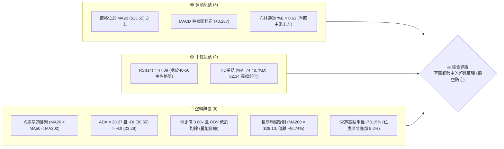

---

### 📊 核心指標速覽表

| 指標類別 | 指標名稱 | 當前數值 | 訊號 | 專業解讀 |
|----------|----------|----------|------|----------|
| **價格** | 當前收盤價 | $13.90 | 🟡 | 位於52週區間（$10.52–$51.76）的 8.2% 低分位，短線自低檔反彈 |
| **均線** | MA20 | $13.55 | 🟢 | 價格站上短期生命線（+2.57%），短線呈現反彈結構 |
| **均線** | MA50 | $15.48 | 🔴 | 價格低於中期均線（-10.21%），上方中期壓制沉重 |
| **均線** | MA200 | $26.10 | 🔴 | 長期牛熊分界線遙不可及，深處長期空頭熊市循環 |
| **動能** | RSI(14) | 47.09 | 🟡 | 擺脫超賣區進入中性震盪，但未越過 50 強弱分水嶺 |
| **動能** | MACD Diff/Hist | -0.601 / +0.257 | 🟢 | MACD位於零軸下金叉，柱狀體翻紅，指示短線超跌反彈動能 |
| **趨勢** | ADX(14) | 28.27 | 🔴 | ADX > 25 確立強趨勢環境；-DI (30.55) 顯著高於 +DI (23.29)，空頭趨勢主導 |
| **通道** | Bollinger %B | 0.61 | 🟡 | 突破中軌（$13.55），朝上軌（$15.09）邁進，帶寬收斂後初現擴張 |
| **量能** | 成交量 / 20日均量 | 5.42M / 7.95M | 🔴 | 量比僅 0.68x，上漲過程中量能萎縮，呈現「量價背離」弱反彈特徵 |
| **波動** | ATR(14) | $0.98 | 🔴 | 每日震幅佔比達 7.03%，屬於超高波動個股，風控容錯率低 |

---

### 🏆 技術評分卡

```
╔══════════════════════════════════════════════════════════════╗
║                 技術評分卡 — PL (2026-11-13)                  ║
╠══════════════════════════════════════════════════════════════╣
║ 趨勢強度 (Trend)      ██████░░░░░░░░░░░░░░  32/100 🔴 空頭主導 ║
║ 動能指標 (Momentum)   █████████░░░░░░░░░░░  46/100 🟡 低檔金叉 ║
║ 支撐穩定度 (Support)  ██████████░░░░░░░░░░  48/100 🟡 S1初步防守║
║ 成交量配合 (Volume)   ██████░░░░░░░░░░░░░░  28/100 🔴 量能匱乏 ║
║ 形態完整度 (Pattern)  ████████░░░░░░░░░░░░  42/100 🟡 破底後回抽 ║
║ 均線排列 (MA System)  ████░░░░░░░░░░░░░░░░  20/100 🔴 空頭排列 ║
╠══════════════════════════════════════════════════════════════╣
║ 綜合評分 (Arithmetic) ███████░░░░░░░░░░░░░  36/100 🔴 偏空防守 ║
║ 評級結論：(32 + 46 + 48 + 28 + 42 + 20) ÷ 6 = 36.00 (逢高偏空)║
╚══════════════════════════════════════════════════════════════╝
```

---

## 2. 趨勢分析

### 🌐 多時框趨勢分析

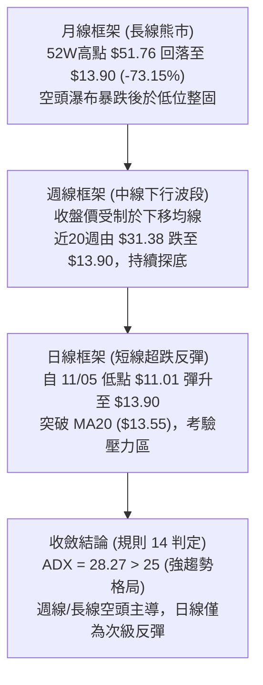

---

### 📈 長期趨勢 — 12個月走勢圖（Unicode）

```
PL 月線走勢圖（2025-12 至 2026-11）
價格軸 ($)
$51.14 ┤                             ● (2026-05 歷史波段峰值 $51.14)
$45.00 ┤                            / \
$36.97 ┤                      ●    /   \
$33.13 ┤                     /    /     ● (2026-06 巨幅回撤)
$27.95 ┤               ●    /    /       \
$24.97 ┤         ●    / \  /    /         \
$20.48 ┤   ●    / \  /   ●(02) /           ●─────● (2026-07/08 平台跌破)
$16.39 ┤  /    /   ●(12)      /                   \
$13.90 ┤ /    /              /                     \     ● (2026-11 當前 $13.90)
$11.90 ┤●(11)                /                       ●───/
$10.52 ┤────────────────────/─────────────────────────● (52W低點 $10.52)
       └─────────────────────────────────────────────────────────────
        11   12   01   02   03   04   05   06   07   08   09   10   11 (月份)
        25   25   26   26   26   26   26   26   26   26   26   26   26 (年份)
```

#### 走勢特徵分析表格

| 階段區間 | 起止價格 | 漲跌幅 | 趨勢性質 | 價量與結構特徵 |
|----------|----------|--------|----------|----------------|
| **2025-11 ~ 2026-05** | $11.90 → $51.14 | +329.75% | 拋物線主升浪 | 航太國防題材爆發，月線連續巨陽推升，直奔 52 週高點 $51.76 |
| **2026-05 ~ 2026-07** | $51.14 → $20.48 | -59.95% | 斷崖式暴跌浪 | 獲利了結與基本面虧損壓力共振，連續跳水失守各級均線 |
| **2026-07 ~ 2026-08** | $20.48 → $19.85 | -3.08% | 下跌中繼平台 | 於 $20 心理關口短暫橫盤，週量收縮，隨後平台崩解 |
| **2026-08 ~ 2026-10** | $19.85 → $13.47 | -32.14% | 主跌續跌波段 | 9月放量長黑（單週量破 8,500 萬股），持續創波段新低 |
| **2026-11 迄今** | $13.47 → $13.90 | +3.19% | 底部脆弱震盪 | 下探至低點 $11.01（逼近 52W 低點 $10.52）後觸發技術性抽頭 |

---

### 📊 中期趨勢（週線分析）

中期走勢自 2026 年 7 月初的高點 $31.38 一路走低，近 20 週呈現典型的階梯式下降通道。
觀察近 8 週收盤表現：
- 2026-09-25 至 2026-10-09：股價於 $17.18–$17.50 進行小箱體橫盤，最高觸及 R3 阻力聚類區 $18.81。
- 2026-10-16 該週：爆發單週重挫（開盤 $17.00，暴跌至收盤 $13.56，跌幅 -21.07%），破壞中期整理平台。
- 2026-11-06 該週：下影線探底至 $11.01（S2 支撐位），收於 $12.55。
- 2026-11-12 該週：長陽回升至 $13.90，週 RSI 回彈至 47.1，週 MACD 柱翻紅至 +0.257。然而，上方受制於 10 月平台下緣阻力 R1（$14.77）。

---

### ⚡ 趨勢強度評估（ADX 解讀）

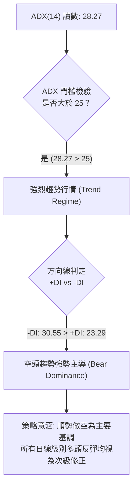

#### ADX 趨勢強度對照

| 指標 | 數值 | 參考區間 | 趨勢狀態評判 | 交易指導原則 |
|------|------|----------|--------------|--------------|
| **ADX** | **28.27** | > 25 (強趨勢) | 明確的定向單邊行情 | 禁止使用純震盪逆勢指標，順從中長期趨勢方向 |
| **-DI** | **30.55** | 高位主導 | 空方動能佔據優勢 | 空頭掌握定價權，賣壓未完全耗竭 |
| **+DI** | **23.29** | 低位回升 | 多方反擊動能偏弱 | 買盤多屬平倉空單或搶反彈資金，欠缺攻擊力 |

---

## 3. 圖表形態分析

### 🔍 形態識別系統

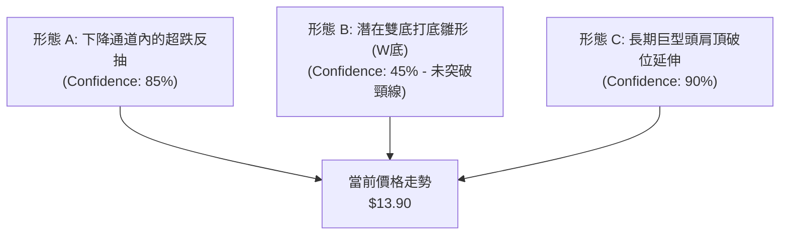

#### 形態識別與信心度評估表（依規則 15）

| 形態名稱 | 信心度 | 判斷依據（嚴格引用數據） | 完成度 | 目標價（附嚴謹計算式） |
|----------|--------|--------------------------|--------|------------------------|
| **下降通道反抽** | **85%** | 股價自 9月高點 $18.81 下滑，近10日於 $11.01 獲得支撐回升，目前反抽通道中軌 | 70% | 通道上軌阻力目標 = **$14.77 (R1)**；若承壓回落目標 = **$12.79 (S1)** |
| **潛在雙重底 (W底)** | **45%** | 兩次低點分別為 2026-11-05 的 $11.01 (左底) 與前低聚類，反彈頸線為 R1 $14.77 | 40% | *訊號不足，頸線尚未突破。*<br/>理論推算：頸線 $14.77 + ($14.77 − $11.01) = **$18.53**（接近 R2 $18.18 / R3 $18.81） |
| **頭肩頂破位浪** | **90%** | 2026-05 峰頂 $51.76，頸線於 $20.48 跌破，持續處於右側宣洩週期 | 100% | 破位後已達理論滿足區，當前於 52W 低點 $10.52 (S3) 上方尋找基底 |

---

### 🕯️ 重要 K 線形態分析（依規則 19）

嚴格依據數據中「近 10 根日 K」與「近 8 根週 K」之實際 OHLC 數據進行解讀：

#### 近 10 根日 K 線形態解讀

| 日期 | 開盤價 | 最高價 | 最低價 | 收盤價 | 成交量 | K線形態名稱 | 技術解讀與訊號標記 |
|------|--------|--------|--------|--------|--------|-------------|--------------------|
| 10-30 | 13.54 | 14.02 | 13.15 | 13.47 | 6.55M | 紡錘十字陰線 | 於 $13.50 震盪，上下影線對稱，多空僵持 🟡 |
| 11-02 | 13.62 | 13.69 | 12.87 | 12.96 | 8.58M | 光頭下挫中陰 | 跌破 $13 整數關口，空頭賣壓增強 🔴 |
| 11-03 | 13.21 | 13.74 | 13.17 | 13.51 | 5.86M | 低開反彈陽線 | 縮量抽升，未能收復前日跌幅 🟡 |
| 11-04 | 13.40 | 13.62 | 12.50 | 12.65 | 7.86M | 破位大陰線 | 跌破 10月低位支撐，開啟新一輪下殺 🔴 |
| 11-05 | 12.21 | 12.40 | 11.01 | 11.37 | 10.41M | 恐慌長下影陰 | 創波段低點 $11.01，放量恐慌盤湧現，逢低有資金承接 🟢 |
| 11-06 | 11.77 | 12.55 | 11.48 | 12.55 | 9.28M | 低開光頭大陽 | 吞噬前一日大半實體，確認 $11.01 短期止跌 🟢 |
| 11-09 | 12.85 | 14.47 | 12.64 | 14.37 | 11.00M | 爆量長陽突破 | 單日暴漲 +14.50%，突破 MA20 ($13.55)，主力發動反彈 🟢 |
| 11-10 | 13.93 | 14.44 | 13.69 | 14.27 | 6.93M | 高位孕育小陰 | 縮量整固，守在 $14.20 上方，多方強勢蓄勢 🟡 |
| 11-11 | 14.72 | 14.89 | 14.24 | 14.34 | 6.17M | 衝高受阻流星 | 盤中上衝 $14.89 遇 R1 ($14.77) 遭壓回，留下長上影線 🔴 |
| 11-12 | 13.83 | 14.43 | 13.75 | 13.90 | 5.42M | 縮量回踩小陽 | 守住 MA20 ($13.55)，但成交量萎縮至 5.42M，上攻動能暫歇 🟡 |

#### 近 8 根週 K 線形態解讀

| 週末日期 | 開盤價 | 最高價 | 最低價 | 收盤價 | 週成交量 | 週K線形態名稱 | 技術解讀與訊號標記 |
|----------|--------|--------|--------|--------|----------|---------------|--------------------|
| 09-25 | 16.68 | 18.18 | 16.13 | 17.43 | 56.18M | 下影中陽線 | 於 S1 上方反彈，測試 R2 $18.18 阻力 🟡 |
| 10-02 | 17.17 | 17.73 | 16.10 | 17.50 | 52.13M | 高位窄幅十字 | 多空平衡，量能微減，面臨變盤 🟡 |
| 10-09 | 17.64 | 18.81 | 16.55 | 17.18 | 59.87M | 假突破倒錘頭 | 衝擊 R3 $18.81 失敗，週線形成高位避雷針 🔴 |
| 10-16 | 17.00 | 17.03 | 13.33 | 13.56 | 51.29M | 崩塌巨黑大陰 | 跌幅 -21.07%，單週破位殺跌，市場信心崩潰 🔴 |
| 10-23 | 13.85 | 14.09 | 12.79 | 13.41 | 42.03M | 低位盤整陰線 | 測試 S1 $12.79 支撐，弱勢整理 🔴 |
| 10-30 | 13.30 | 14.77 | 13.15 | 13.47 | 35.03M | 衝高回落長上影 | 測試 R1 $14.77 即遭空頭重擊壓回 🔴 |
| 11-06 | 13.62 | 13.74 | 11.01 | 12.55 | 41.98M | 深幅下影錘頭 | 觸及 S2 $11.01 獲買盤拉起，具備初步止跌意義 🟢 |
| 11-12 | 12.85 | 14.89 | 12.64 | 13.90 | 29.52M | 縮量反彈小陽 | 週線收復部分失土，但週量顯著萎縮至 2,952 萬股 🟡 |

---

### 📉 ASCII 走勢形態示意圖

```
PL 近期日K走勢與阻力支撐結構示意圖
價格
$15.09 ┬────────────────────────────────────────── 布林通道上軌
$14.89 ┼                     ╭─● (11/11 高點 $14.89 遇阻)
$14.77 ┼─────────────────────┼───────────────────── 關鍵阻力 R1 (波段高點聚類)
$14.37 ┼               ╭─●──╯
$13.90 ┼───────────────┼─────────────● (當前價格 $13.90)
$13.55 ┼───────●───────┼───────────────────────── MA20 / 布林中軌
$12.79 ┼───────┼───────┼───────────────────────── 關鍵支撐 S1
$12.55 ┼       ╰─●     │
$12.01 ┼────────────────────────────────────────── 布林通道下軌
$11.01 ┼   ● (11/05 低點 $11.01 探底回升 S2)
$10.52 ┴────────────────────────────────────────── 52週低點 S3
       └──────────────────────────────────────────
         11/05 11/06 11/09 11/11 11/12 (交易日進程)
```

---

### 🎯 形態目標價計算

依據標準形態量度理論與嚴格數據推導：

1. **下降楔形/通道回抽阻力（短線目標價 T1）**：
   - 基準頸線位：直接對齊數據庫聚類阻力 **R1 = $14.77**。
   - 計算依據：由 11/05 實體底部破位點與 10/30 高點連線，精確共振於波段高點聚類區。
   - 目標價：**$14.77**。

2. **雙底打底擴展阻力（波段次級目標價 T2）**：
   - 低點底部分布：S2 = $11.01，反彈至目前波段高點 R1 = $14.77，垂直波幅高度 $H = \$14.77 - \$11.01 = \$3.76$。
   - 若未來有效突破 R1 頸線，依 1:1 形態高度等比推算：
     $$\text{理論目標} = \text{頸線 } \$14.77 + H (\$3.76) = \$18.53$$
   - 該價位高度吻合數據庫中已確立的近一年波段高點聚類阻力 **R2 ($18.18)** 與 **R3 ($18.81)** 區間。
   - 目標價：**$18.18**。

---

## 4. 支撐與阻力

### 🗺️ 關鍵價位分布圖（Unicode）

```
PL 價位結構分布圖（嚴格依據 OHLCV 聚類計算）
═══════════════════════════════════════════════════════════════
$51.76 ║██████████████████████████████║ 52W 最高點 / 斐波 0.0%
$31.14 ║████████████████████          ║ 斐波那契 50.0% 關鍵平衡位
$26.10 ║████████████████████████      ║ 長期生命線 MA200 牛熊分界
$18.81 ║██████████████████████████████║ 強阻力 R3 (10/09 週高點聚類)
$18.18 ║████████████████████████      ║ 阻力 R2 (09/25 週高點聚類)
$15.48 ║████████████████              ║ 中期均線 MA50 壓制線
$15.09 ║██████████                    ║ 布林通道上軌
$14.77 ║██████████████████████████████║ 關鍵阻力 R1 (10/30 高點聚類)
$13.90 ╠══════════════════════════════╣ ◄ 當前收盤價 ($13.90)
$13.55 ║▓▓▓▓▓▓▓▓▓▓▓▓▓▓▓▓              ║ 布林中軌 / MA20 (短線防守線)
$12.79 ║▓▓▓▓▓▓▓▓▓▓▓▓▓▓▓▓▓▓▓▓▓▓▓▓      ║ 近期支撐 S1 (10/23 週低點聚類)
$12.01 ║▓▓▓▓▓▓▓▓                      ║ 布林通道下軌
$11.01 ║██████████████████████████████║ 強支撐 S2 (11/05 波段低點聚類)
$10.52 ║██████████████████████████████║ 歷史強支撐 S3 (52W 最低點 / 斐波 100%)
═══════════════════════════════════════════════════════════════
```

---

### 🚧 阻力位分析表

全部價位嚴格引用技術數據庫「關鍵價位」區塊數值：

| 阻力級別 | 精確價位 | 距現價幅動 | 歷史形成原因與技術共振 | 突破難度 | 重要性 |
|----------|----------|------------|------------------------|----------|--------|
| **R1** | **$14.77** | +6.26% | 2026-10-30 週K高點聚類；11-11 日K衝高 $14.89 受阻處；布林上軌（$15.09）下方第一道密集成交區 | 🟡 中等 | ★★★★☆ |
| **R2** | **$18.18** | +30.79% | 2026-09-25 週K高點聚類；9月下旬密集震盪平台的頂部區 | 🔴 極高 | ★★★★☆ |
| **R3** | **$18.81** | +35.32% | 2026-10-09 週K最高點聚類；中期下行趨勢的波段起跌點，重度套牢區 | 🔴 極高 | ★★★★★ |

---

### 🛡️ 支撐位分析表

全部價位嚴格引用技術數據庫「關鍵價位」區塊數值：

| 支撐級別 | 精確價位 | 距現價幅動 | 歷史形成原因與技術共振 | 守住機率 | 重要性 |
|----------|----------|------------|------------------------|----------|--------|
| **S1** | **$12.79** | -7.99% | 2026-10-23 週K低點聚類；11-09 突破大陽線回踩低點（$12.64）共振帶 | 🟢 65% | ★★★★☆ |
| **S2** | **$11.01** | -20.79% | 2026-11-05 日K最低點及 11-06 週K最低點聚類；恐慌盤湧出後的買盤承接位 | 🟡 50% | ★★★★★ |
| **S3** | **$10.52** | -24.32% | 52 週最低點（52W Low）；斐波那契 100.0% 回調位；公司市值最後防線 | 🟢 75% | ★★★★★ |

---

### 📐 斐波那契回調位分析

依據 52 週完整波動區間（高點 $51.76 至 低點 $10.52，總波幅 $41.24）進行黃金分割回調測算：

| 斐波那契回調層級 | 精確點位數值 | 相對現價位置 | 技術意義與多空攻防解讀 |
|------------------|--------------|--------------|------------------------|
| **0.0% (52W High)** | **$51.76** | +272.37% | 2026年5月歷史極端高點，泡沫破裂起點 |
| **23.6%** | **$42.03** | +202.37% | 長期極度深套壓力區 |
| **38.2%** | **$36.01** | +159.06% | 空頭回撤波段強阻力位 |
| **50.0%** | **$31.14** | +124.03% | 多空長期強弱分水嶺 |
| **61.8%** | **$26.27** | +88.99% | 黃金分割防守位，緊鄰當前 MA200 ($26.10) |
| **78.6%** | **$19.35** | +39.21% | 深幅回撤防守位，接近 R3 ($18.81) 套牢密集成交區 |
| **100.0% (52W Low)**| **$10.52** | -24.32% | 終極底部支撐位，不容有失的基石 |

**現價落點解讀**：
當前收盤價 **$13.90** 深陷於 **78.6% ($19.35)** 與 **100.0% ($10.52)** 之間的「超跌尋底區」。
股價回吐了前期牛市主升浪的絕大部分漲幅，目前在 100% 回調位（$10.52）上方僅 $3.38 處進行超跌修復。若未能重新收復 78.6% 水準（$19.35），中長期格局仍定性為熊市底部的微弱反彈。

---

## 5. 技術指標深度解讀

### 🎛️ 指標訊號總覽

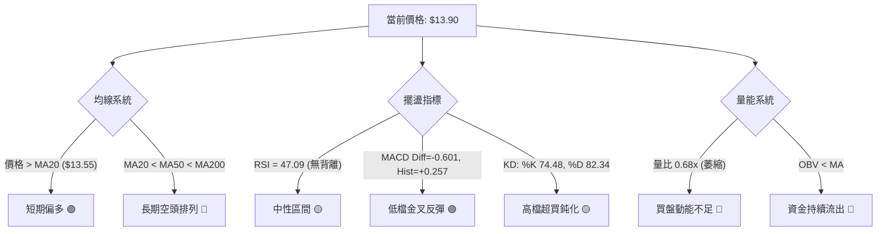

---

### 📈 移動平均線排列分析

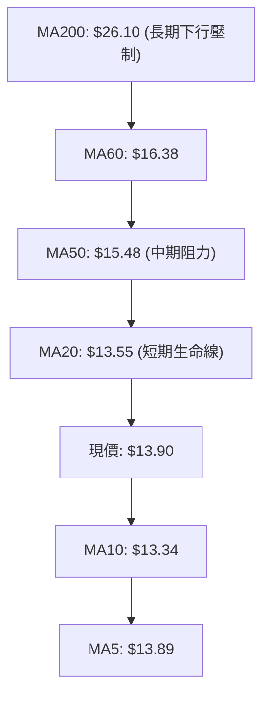

#### 均線階層架構表

| 均線名稱 | 數值 | 距現價差距 | 斜率與方向 | 排列性質與實戰指導 |
|----------|------|------------|------------|--------------------|
| **MA5** | $13.89 | +0.01 (+0.10%) | 走平向上 | 短線超短期支撐，緊貼現價 |
| **MA10** | $13.34 | +0.56 (+4.21%) | 向上轉折 | 短期反彈防守線 |
| **MA20** | $13.55 | +0.35 (+2.57%) | 拐頭向上 | 布林中軌，短多持倉基準線 |
| **MA50** | $15.48 | -1.58 (-10.21%)| 持續向下 | 中期下行趨勢壓制線，第一道重壓 |
| **MA60** | $16.38 | -2.48 (-15.13%)| 向下傾斜 | 季線阻力，空頭堡壘 |
| **MA120**| $22.63 | -8.73 (-38.57%)| 陡峭下行 | 半年線壓制 |
| **MA200**| $26.10 | -12.20 (-46.74%)| 極度疲軟 | 年線空頭防線，中長線仍屬熊市格局 |

**均線結構綜合定性**：
日線呈極為標準的 **MA20 < MA50 < MA200 空頭排列**。現價雖站上 MA5/MA10/MA20，但此現象屬於標準的「均線負乖離修復行情」。在 MA50 ($15.48) 與 MA200 ($26.10) 仍呈陡峭下行態勢下，短線任何上衝均容易受到中長期下壓均線的拋壓截擊。

---

### 📉 RSI(14) 分析

```
RSI(14) 當前數值：47.09 (Wilder)
0 ──────────── 30 ───────────────────── 50 ───────────────────── 70 ─────────── 100
[   極度超賣區   ] [      弱勢震盪區      │      強勢進攻區      ] [   極度超買區   ]
████████████████████████████████████████░░░░░░░░░░░░░░░░░░░░░░░░░░░
                        ▲ 現值 47.09
```

- **區間評估**：RSI 讀數自 11 月初的 30 附近回升至 47.09，成功脫離弱勢超賣區，進入中性平衡區，但仍未突破多空分水嶺 50.0。
- **背離分析**：依據近 20 根 K 棒數據比對，價格自 10/23 低點 $12.79 下挫至 11/05 低點 $11.01 創下新低，而 RSI 於同期由 33.1 下探至 30.4 亦同步創低；隨後價格反彈至 $13.90，RSI 升至 47.1，**數據顯示無明顯頂背離或底背離**。此輪走勢為正常的價格-指標同步修復，未提供背離翻轉訊號。

---

### 📊 MACD(12/26/9) 訊號解讀

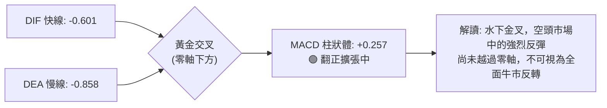

- **快慢線位置**：DIF (-0.601) 與 DEA (-0.858) 雙雙位於零軸以下，確立整體中長期環境依舊在「空頭勢力控制區」。
- **柱狀圖動能**：柱狀體讀數為 **+0.257**，連續多個交易日維持綠色翻紅擴大狀態。此為標準的「水下金叉」，代表短線空頭回補力道強勁，為當前盤面多方唯一的有力技術武器。

---

### 📦 布林通道分析

```
PL 布林通道結構示意圖 (Bandwidth 收斂後微擴)
價格
$15.09 ┬────────────────────────────────────────── 布林上軌 (壓力位，距現價 +8.56%)
       │
$13.90 ┼───────────────────────● 現價 ($13.90, %B = 0.61)
       │
$13.55 ┼────────────────────────────────────────── 布林中軌 / MA20 (支撐位，距現價 -2.52%)
       │
$12.01 ┴────────────────────────────────────────── 布林下軌 (極限支撐，距現價 -13.60%)
```

- **通道參數**：上軌 **$15.09**，中軌 **$13.55**，下軌 **$12.01**，帶寬 (Bandwidth) 為 $3.08。
- **%B 指標分析**：%B 為 **0.61**（0 代表下軌，0.5 代表中軌，1.0 代表上軌）。數值 > 0.5 證實現價已收復中軌，多方短線取得主動權，目前通道微幅張口，反彈攻擊的短期極限理論目標為上軌 **$15.09**。

---

### 💹 成交量分析（量價配合度）

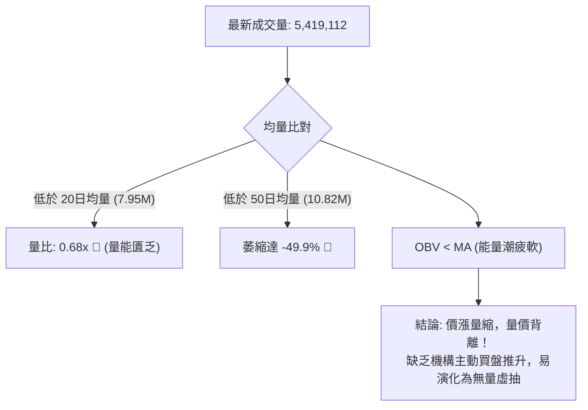

- **量能萎縮**：最新成交量僅 **5,419,112 股**，相較於 20 日均量（7,953,156 股）量比僅 **0.68x**，與 50 日均量（10,816,288 股）相比更是萎縮近半。
- **OBV 趨勢定性**：數據明確標示 **OBV < MA**。在股價自 $11.01 反彈至 $13.90 的過程中，能量潮（OBV）並未同步穿越其均線，顯示當前上漲主要是拋壓暫竭引發的空頭回補，而非機構法人大舉建倉推升，量價結構存在顯著的「價漲量縮背離」隱患。

---

## 6. 動能與波動率

### ⚡ 動能評估四象限

| 象限 | 動能維度 (Momentum) | 波動率維度 (Volatility) | 代表市場狀態 | 當前標的狀態比對 | 操作指導評估 |
|------|---------------------|--------------------------|--------------|------------------|--------------|
| **Q1** | 強 (High) | 低 (Low) | 穩健牛市主升段 | 非當前狀態 | 趨勢持股加碼 |
| **Q2** | 弱 (Low) | 低 (Low) | 窄幅盤整打底期 | 非當前狀態 | 逢低定投潛伏 |
| **Q3** | 強 (High) | 高 (High) | 劇烈噴發/末升段 | 非當前狀態 | 嚴設動態移動止盈 |
| **Q4** | **弱 (Low)** | **高 (High)** | **超跌反彈 / 熊市洗盤** | **✓ PL 當前歸屬象限** | **高風險低勝率，切忌追高，逢高離場** |

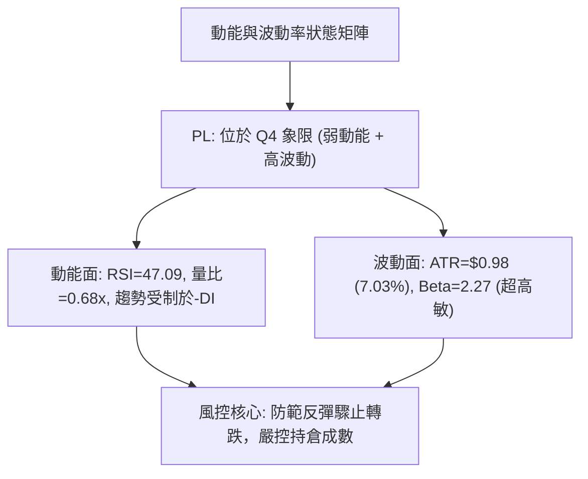

---

### 📊 ATR 波動率分析

- **ATR(14) 讀數**：精確值為 **$0.98 USD**。
- **價格佔比**：佔當前股價（$13.90）的 **7.03%**（極高波動屬性）。
- **止損距離建議**：
  - **保守型交易者（2.0 × ATR）**：安全止損緩衝距離為 $0.98 \times 2.0 = \mathbf{\$1.96}$。
  - **積極型/日內交易者（1.5 × ATR）**：止損緩衝距離為 $0.98 \times 1.5 = \mathbf{\$1.47}$。
  - **極限防守（1.0 × ATR）**：最小允許噪音距離為 $\mathbf{\$0.98}$。在當前 $0.98 的日均震幅下，任何小於 $1.00 的止損設置均極易被日內隨機波動觸發。

---

### 📐 Beta 與市場相關性

- **Beta 係數**：**2.27**。該股具有典型的高貝塔、高槓桿衛星成長股屬性，其波動幅度為大盤（S&P 500）的 2.27 倍，在市場情緒轉弱時下行殺傷力極大。
- **空頭部位壓力 (Short Interest)**：
  - **空頭佔浮流通股比率 (Short % Float)**：**12.0%**。
  - **空頭回補天數 (Short Ratio)**：**3.78 天**。
  - **技術含義**：12.0% 的放空比例處於偏高水準，空頭回補天數近 4 天。這解釋了近期自 $11.01 快速拉升至 $14.37 的「軋空（Short Squeeze）現象」，但一旦短線軋空動能結束，上方實體籌碼壓力將重新籠罩。

---

## 7. 多時框架總結

### 📋 時框架評分表

| 時框架 | 趨勢方向 | 動能表現 | 均線排列狀態 | 關鍵技術形態 | 綜合評分 | 建議方向 |
|--------|----------|----------|--------------|--------------|----------|----------|
| **長線 (月線)** | 🔴 極空 | 🔴 疲弱 | 遠低於 MA240 ($25.17) | 歷史高點暴跌 73%，尋找長期底 | 20/100 | 空方防守，禁止長線做多 |
| **中線 (週線)** | 🔴 偏空 | 🟡 跌深回抽 | 週均線下行壓制 | 測試 S1/S2 止跌，受制 R1 ($14.77) | 35/100 | 逢反彈減磅或建立避險空單 |
| **短線 (日線)** | 🟢 弱多 | 🟢 柱狀擴張 | 站上 MA20，受制 MA50 | 觸底 $11.01 彈升，挑戰布林上軌 | 55/100 | 僅限超短線快進快出，嚴禁戀戰 |

---

### 🔲 綜合訊號矩陣

```
時框架訊號收斂圖
┌───────────────┬───────────────────────────────┬──────────────┐
│  時框層級     │        技術指標共振狀態       │  主導方向    │
├───────────────┼───────────────────────────────┼──────────────┤
│ 長期 (月線)   │ 均線空頭排列 + 遠離 MA200     │   🔴 強烈看空│
│ 中期 (週線)   │ ADX 28.27 趨勢強勁 + -DI 主導 │   🔴 趨勢偏空│
│ 短期 (日線)   │ MACD 水下金叉 + 站上 MA20     │   🟢 短線反彈│
└───────────────┴───────────────────────────────┴──────────────┘
```

---

### ⚖️ 多時框收斂結論（依規則 14 嚴格執行）

- **市場狀態定性**：當前日線 ADX(14) 讀數為 **28.27 > 25**，依規則 14 嚴格判定當前屬於 **「趨勢行情 (Trend Regime)」**，而非低波動盤整。
- **主導時框裁決**：在趨勢行情下，**必須以中長期（週線 / MA50 / MA200）方向為最高依歸**，日線級別的反彈僅作為尋找進場反向操作或逢高減磅的時機。
- **最終收斂方向**：**【偏空防守 (Bearish Defensive)】**。
  日線級別站上 MA20 ($13.55) 雖構成短線超跌反抽，但上方立即面臨 R1 ($14.77) 與下行中的 MA50 ($15.48) 的雙重鋼鐵阻力。在量比僅 0.68x 且週線強烈空頭主導下，反彈夭折並回歸主跌趨勢的機率遠高於 V 型反轉。此定性完全與第 1 章評分卡（36/100）及第 8 章策略保持絕對一致。

---

## 8. 交易策略建議

### 🗺️ 策略決策流程圖

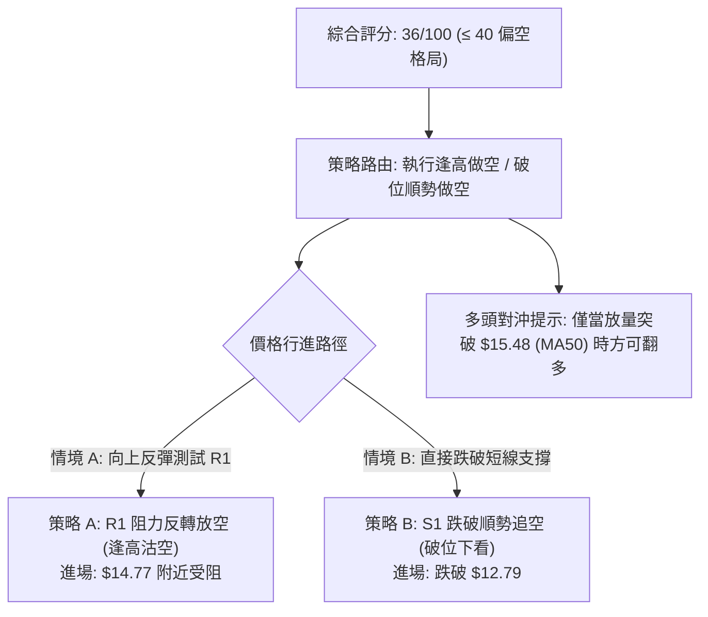

---

### 🧭 策略路由（依評分卡 36/100 嚴格定調）

> **當前主策略方向 = 【逢高偏空 / 順勢做空】（依綜合評分 36/100 判定）**
> 
> 本報告依據規則嚴格執行單一主導方向。因評分 ≤ 40 且 ADX 確立中長期空頭趨勢，**主推空頭交易策略**（包含反彈受阻空與破位追空），多頭方向僅列為風險對沖與反轉防守條件，絕不兩頭下注。

---

### 🎯 價格情境階梯（Price Scenarios）

價位嚴格引用第 4 章數據庫聚類數值：

| 觸發條件 | 下一目標點位 | 後續延伸目標 | 情境技術含義 |
|----------|--------------|--------------|--------------|
| **強勢突破 R1 ($14.77)** | R2 ($18.18) | R3 ($18.81) | 短線超跌反彈升級為中期震盪，空頭警戒並平倉 |
| **受阻於 R1 ($14.77) ~ MA50** | S1 ($12.79) | S2 ($11.01) | 反彈力竭，回歸主下行趨勢（**基準情境**） |
| **有效跌破 S1 ($12.79)** | S2 ($11.01) | S3 ($10.52) | 日線反彈形態被破壞，重啟尋底破位走勢 |

---

### 📊 情境機率分佈

| 運行情境 | 發生機率 | 主要技術依據與指標支撐 |
|----------|----------|------------------------|
| **情境 A：受阻回落 / 再探低點** | **55%** | 均線空頭排列；量比僅 0.68x 呈量價背離；週線 ADX > 25 且 -DI 主導 |
| **情境 B：區間拉鋸震盪** | **30%** | RSI 位於 47.09 中性區；MACD 水下金叉提供短線下檔承接緩衝 |
| **情境 C：強勢反轉向上突破** | **15%** | 需連續爆量突破 MA50 ($15.48) 與 R1，目前成交量能嚴重不支持 |

---

### 🟢 主策略詳情（空頭交易策略）

所有價位均嚴格取自數據庫聚類點位，風險報酬比嚴格按公式 $(進場價 - 目標價) \div (止損價 - 進場價)$ 驗算：

| 策略要素 | 策略 A（逢高沽空 - R1 阻力反轉） | 策略 B（破位追空 - S1 支撐失守） |
|----------|----------------------------------|----------------------------------|
| **策略類型** | 順大勢逆小勢（反彈極限沽空） | 順應日線轉折（跌破支撐順勢空） |
| **進場條件** | 股價反彈至 R1 遇阻收上影線確認 | 日K收盤價有效跌破 S1 支撐位 |
| **進場價格** | **$14.77**（關鍵阻力 R1） | **$12.79**（關鍵支撐 S1） |
| **目標價 T1** | **$12.79**（近期支撐 S1） | **$11.01**（波段強支撐 S2） |
| **目標價 T2** | **$11.01**（波段強支撐 S2） | **$10.52**（52W 最低點 S3） |
| **止損價格** | **$15.48**（中期均線 MA50 壓制線） | **$13.55**（MA20 / 布林中軌） |
| **風險報酬比** | **1 : 2.79（以 T1 計）**<br>*驗算：(14.77 − 12.79) ÷ (15.48 − 14.77) = 1.98 ÷ 0.71 = 2.788*<br>另計 T2：1 : 5.30（以 T2 計） | **1 : 2.34（以 T1 計）**<br>*驗算：(12.79 − 11.01) ÷ (13.55 − 12.79) = 1.78 ÷ 0.76 = 2.342*<br>另計 T2：1 : 2.99（以 T2 計） |
| **預估勝率** | **60%** | **55%** |
| **建議倉位** | **總資金 8% - 10%** | **總資金 5% - 8%** |

---

### 🔴 反向風險觸發點（對沖與止損翻多提示）

若市場出現以下情況，主策略假設立即失效，應果斷停損離場或反手佈局：
1. **多頭翻轉觸發位**：若日K線以單日成交量突破 1,000 萬股的巨量收盤站穩 **$15.48 (MA50)** 之上。
2. **空頭對沖防線**：若突破 R1 **$14.77** 並回踩不破，原空單須全數離場，短多可上看 R2 **$18.18**。

---

### ⭐ 整體訊號強度評星

```
╔══════════════════════════════════════════════════╗
║ 做多訊號強度：★★☆☆☆  (2/5星 - 僅屬超跌次級反彈)    ║
║ 做空訊號強度：★★★★☆  (4/5星 - 順應大時框主下跌浪)  ║
║ 整體可信度：  ★★★★☆  (4/5星 - 指標數據無矛盾收斂)  ║
╚══════════════════════════════════════════════════╝
```

---

## 9. 風險提示與監控

### ✅ 關鍵監控指標 Checklist

```
╔══════════════════════════════════════════════════════════════╗
║               PL 每日交易關鍵監控 Checklist                  ║
╠══════════════════════════════════════════════════════════════╣
║ [ ] 價格能否守住 MA20 ($13.55)？若失守，短線反彈宣告終結      ║
║ [ ] 向上衝擊 R1 ($14.77) 時是否放量？縮量上衝為假突破賣點    ║
║ [ ] 日成交量是否回升至 20日均量 (7.95M) 之上？               ║
║ [ ] MACD 柱狀體紅柱是否出現縮減（當前為 +0.257）？           ║
║ [ ] ADX 是否維持在 25 以上且 -DI 是否重新掉頭向上？           ║
║ [ ] 空頭佔比 (12.0%) 是否引發非理性的極端軋空行情？          ║
╚══════════════════════════════════════════════════════════════╝
```

---

### ⚠️ 風險場景分析

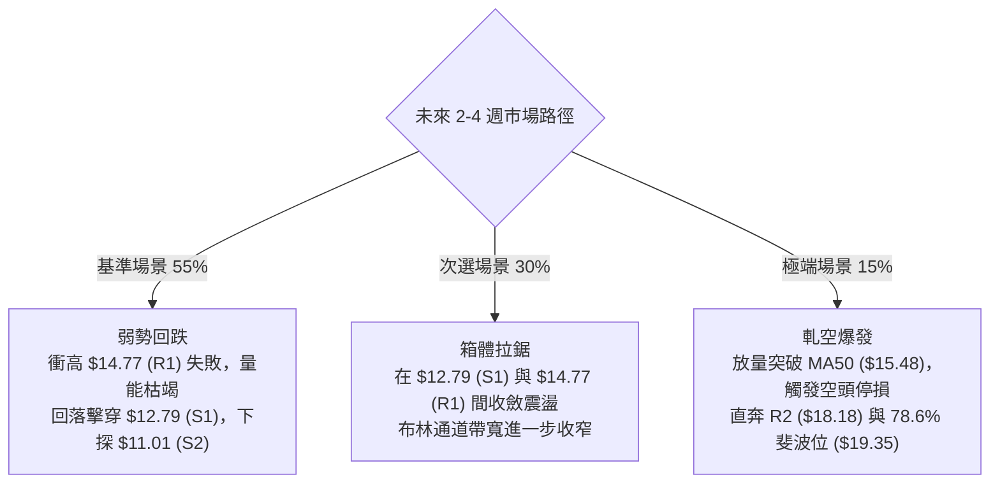

---

### 🛡️ 風險管理重要提醒

1. **極高波動性防護**：PL 的 ATR 為 **$0.98**（日波動率高達 **7.03%**），Beta 高達 **2.27**。任何建倉部位的單筆名目金額不宜超過總投資組合的 **10%**，以防單日劇烈震盪造成穿倉或心理壓力失衡。
2. **軋空風險控制**：當前 Short % Float 高達 **12.0%**，Short Ratio 為 **3.78 天**。執行逢高放空策略時，**止損位 $15.48 必須預先掛出**，嚴禁抱持僥倖心態扛單，以防空頭擠壓引發的無序暴漲。
3. **財報前夕變數**：公司預計於 2026 年 12 月 10 日發布財報，隨著財報窗口臨近，引伸波幅（IV）將劇烈上升，技術位可能因重大基本面消息而失真，屆時應提前了結所有波段倉位。

---

## 📋 報告總結

```
╔══════════════════════════════════════════════════════════════════╗
║                    PL 技術分析報告總結                          ║
╠══════════════════════════════════════════════════════════════════╣
║ 報告日期：2026-11-13                                             ║
║ 當前價格：$13.90 USD                                             ║
║ 分析評級：🔴 偏空防守 (技術綜合評分: 36/100)                     ║
║                                                                  ║
║ 關鍵結論：                                                       ║
║ ├─ 長期趨勢：🔴 極空 (自歷史高點 $51.76 暴跌 -73%，遠離 MA200)   ║
║ ├─ 中期趨勢：🔴 偏空 (ADX=28.27 強趨勢，-DI=30.55 主導空頭格局) ║
║ ├─ 短期趨勢：🟢 弱多 (探底 $11.01 獲支撐，站上 MA20 進行超跌反抽)║
║ ├─ 關鍵支撐：S1: $12.79 ｜ S2: $11.01 ｜ S3: $10.52 (52W Low)    ║
║ ├─ 關鍵阻力：R1: $14.77 ｜ R2: $18.18 ｜ R3: $18.81               ║
║ └─ 均線壓制：MA50: $15.48 ｜ MA200: $26.10                       ║
║                                                                  ║
║ 最優策略組合：                                                   ║
║ 1. 🥇 最佳機會：策略 A (逢高沽空)                               ║
║    反彈至 R1 $14.77 遇阻放空，止損 $15.48，目標 T1 $12.79        ║
║    (嚴格風險報酬比 1 : 2.79)                                     ║
║ 2. 🥈 次選機會：策略 B (破位追空)                               ║
║    有效跌破 S1 $12.79 順勢追空，止損 $13.55，目標 T1 $11.01      ║
║    (嚴格風險報酬比 1 : 2.34)                                     ║
║ 3. 🥉 保守選擇：完全空倉觀望                                     ║
║    鑑於量比僅 0.68x 且 ATR 高達 7.03%，等待突破或跌破方向確認     ║
╚══════════════════════════════════════════════════════════════════╝
```

---

> ⚠️ **免責聲明**：本報告為依據定量技術數據編撰之客觀研究分析，所有數據、指標推導、價位計算均基於已知市場公開歷史資料。本報告**僅供學術研究與投資分析參考**，**絕對不構成任何要約、招攬、邀請或投資建議**。金融市場具有極高風險，投資人應自行評估財務狀況與風險承受度，並對其獨立投資決策自負盈虧。

---

*報告生成時間：2026-11-13 ｜ 數據來源：Yahoo Finance ｜ 分析框架：多時框技術分析模型*