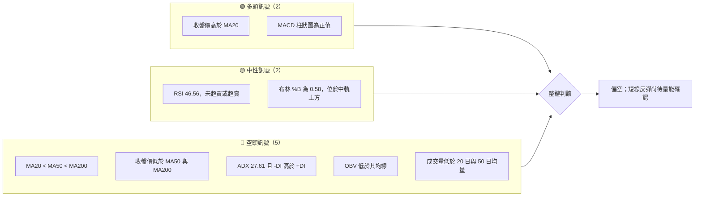
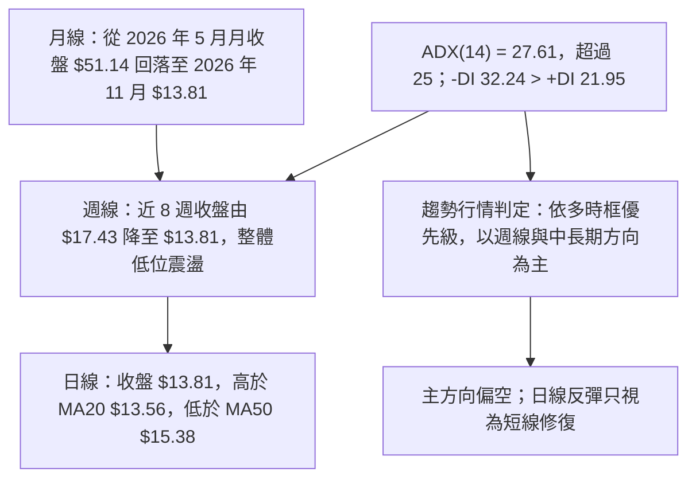
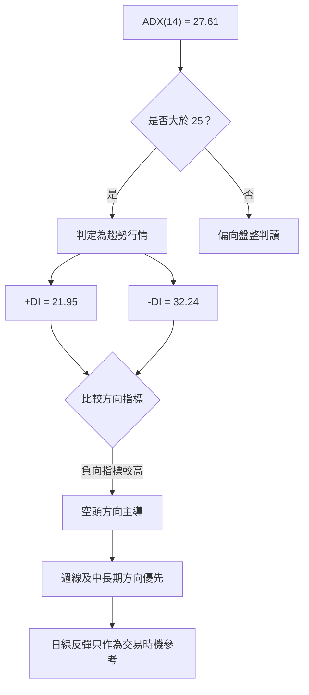
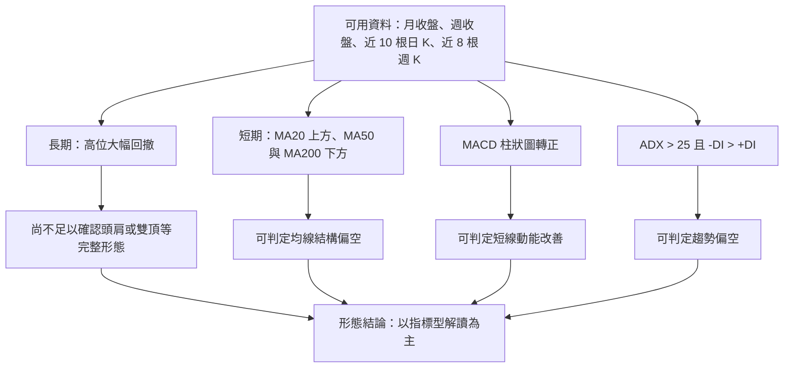
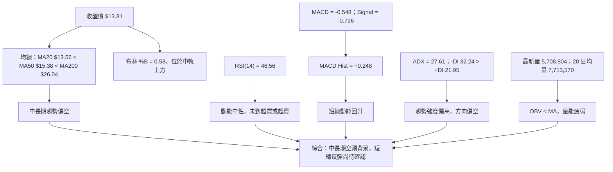
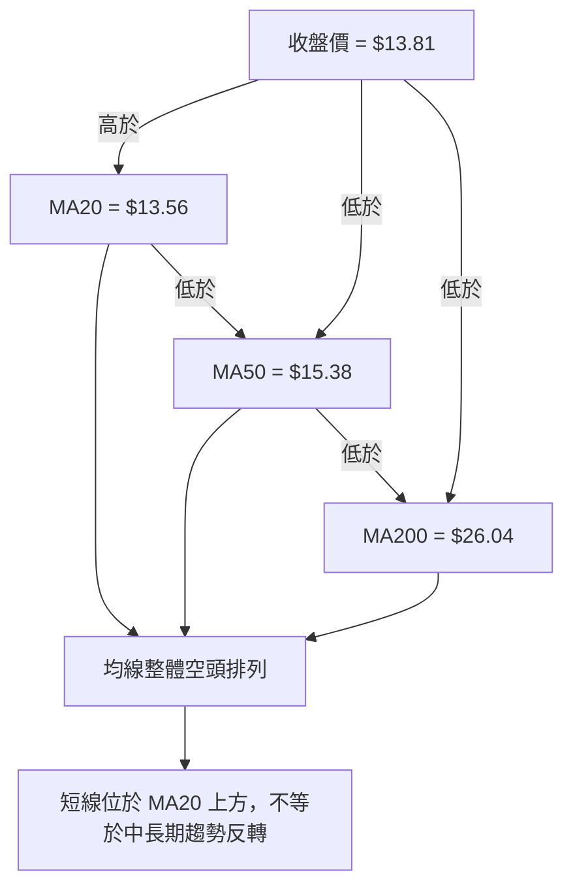
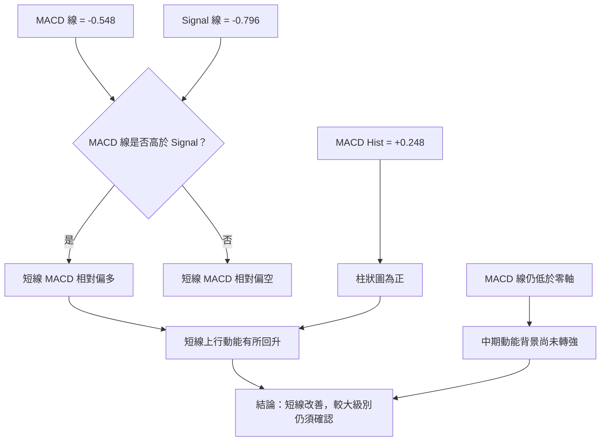
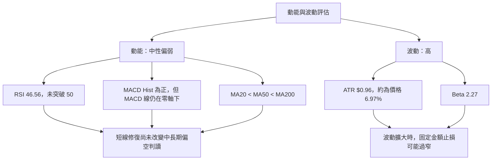
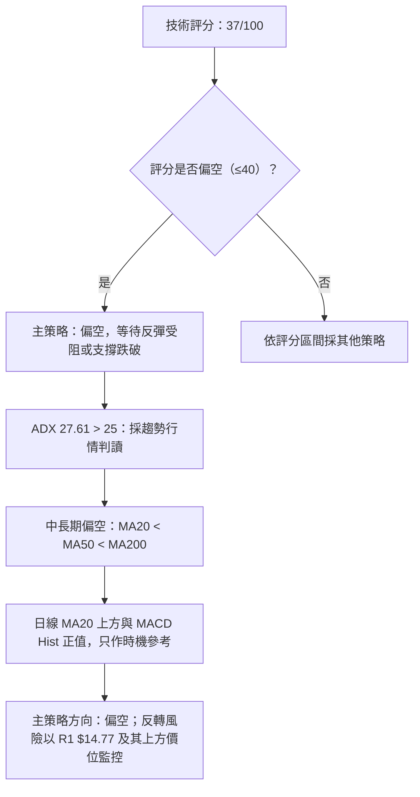
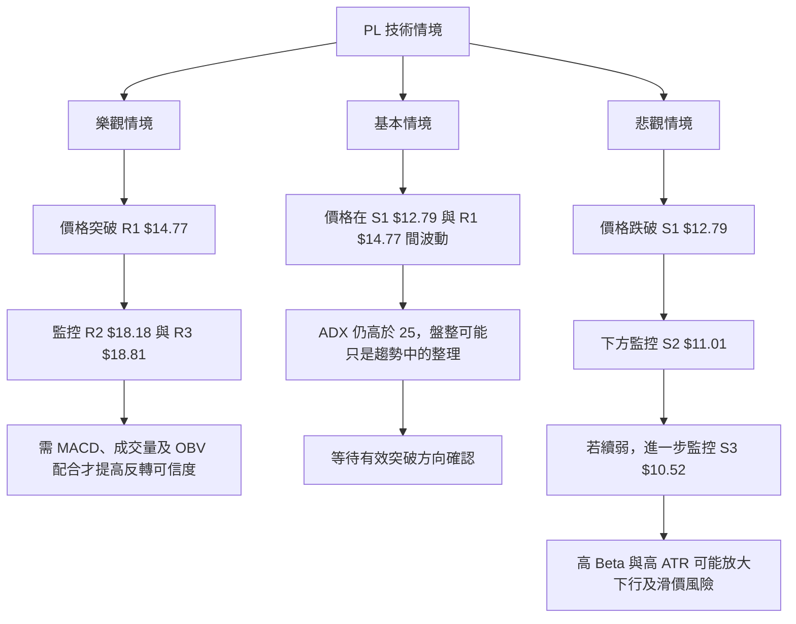

# PL 技術分析報告

> **報告日期**：2026-11-14 ｜ **語言**：繁體中文 ｜ **數據來源**：使用者提供之 Yahoo Finance 技術數據 ｜ **當前價格**：**$13.81**

---

## 目錄

| 章節 | 內容 |
|------|------|
| 1. 技術面概覽 | 訊號儀表板、核心指標、評分卡 |
| 2. 趨勢分析 | 多時框趨勢、長中短期走勢 |
| 3. 圖表形態分析 | 形態識別、K 線組合、目標價 |
| 4. 支撐與阻力 | 關鍵價位、斐波那契回調 |
| 5. 技術指標深度解讀 | MA、RSI、MACD、布林、成交量 |
| 6. 動能與波動率 | 動能評估、ATR、Beta |
| 7. 多時框架總結 | 時框架評分矩陣 |
| 8. 交易策略建議 | 主策略、價格情境、風險報酬比 |
| 9. 風險提示與監控 | 監控指標、風險場景 |

---

## 1. 技術面概覽

### 🎯 技術訊號儀表板

PL 收盤價為 **$13.81**。價格略高於 MA20，但仍低於 MA50、MA200；ADX 為 27.61，且 -DI 高於 +DI，代表整體仍屬**空頭趨勢主導**。MACD 柱狀圖轉正提供短線反彈訊號，但 OBV 仍低於其均線，成交量尚未確認反彈。



### 📊 核心指標速覽表

| 指標類別 | 指標名稱 | 當前數值 | 訊號 | 解讀 |
|----------|----------|----------:|:----:|------|
| 價格 | 收盤價 | $13.81 | 🔴 | 位於 52 週區間的 8.0% 位置；接近區間低端 |
| 均線 | MA20 | $13.56 | 🟢 | 收盤價高於 MA20，短線略有修復 |
| 均線 | MA50 | $15.38 | 🔴 | 收盤價低於 MA50，反彈仍受中期均線壓制 |
| 均線 | MA200 | $26.04 | 🔴 | 收盤價大幅低於 MA200，長期趨勢偏弱 |
| 動能 | RSI(14) | 46.56 | 🟡 | 中性區，未見超買或超賣 |
| 動能 | MACD | -0.548 | 🟡 | MACD 線仍在零軸下方 |
| 動能 | MACD 柱狀圖 | +0.248 | 🟢 | 柱狀圖為正，短線動能改善 |
| 趨勢 | ADX(14) | 27.61 | 🔴 | 趨勢強度高於 25；-DI 主導，空頭趨勢較強 |
| 波動 | ATR(14) | $0.96 | 🔴 | 約為價格的 6.97%，單日波動幅度高 |
| 量能 | 量比（對 20 日均量） | 0.74x | 🔴 | 最新成交量低於 20 日均量 |
| 量能 | OBV 趨勢 | OBV < MA | 🔴 | 累積量能未確認反彈 |

### 🏆 技術評分卡

評分範圍為 0–100，分數越高代表該項技術條件越偏多。綜合評分依六項子評分**算術平均**計算，四捨五入至整數。

```text
╔══════════════════════════════════════════════════════════════╗
║                   技術評分卡 — PL                            ║
║                   日期：2026-11-14                           ║
╠══════════════════════════════════════════════════════════════╣
║ 趨勢強度      ███████░░░░░░░░░░░░░  35/100  🔴              ║
║ 動能指標      ██████████░░░░░░░░░░  50/100  🟡              ║
║ 支撐穩定度    █████████░░░░░░░░░░░  45/100  🟡              ║
║ 成交量配合    ███████░░░░░░░░░░░░░  35/100  🔴              ║
║ 形態完整度    ███████░░░░░░░░░░░░░  35/100  🔴              ║
║ 均線排列      ████░░░░░░░░░░░░░░░░  20/100  🔴              ║
╠══════════════════════════════════════════════════════════════╣
║ 綜合評分      ███████░░░░░░░░░░░░░  37/100  🔴 偏空          ║
╚══════════════════════════════════════════════════════════════╝
```

計算：`(35 + 50 + 45 + 35 + 35 + 20) ÷ 6 = 36.67`，四捨五入為 **37/100**。

- **趨勢強度 35/100**：ADX 高於 25，但 -DI 高於 +DI，趨勢存在且方向偏空。
- **動能指標 50/100**：MACD 柱狀圖轉正，但 RSI 位於中性區、MACD 線仍低於零軸。
- **支撐穩定度 45/100**：股價在 52 週低位區附近，但既有支撐仍需後續價格反應確認。
- **成交量配合 35/100**：最新量能低於 20 日均量，OBV 亦未確認反彈。
- **形態完整度 35/100**：現有資料不足以確認高信心度的反轉或延續形態。
- **均線排列 20/100**：MA20 < MA50 < MA200，呈空頭排列。

---

## 2. 趨勢分析

### 🌐 多時框趨勢分析



**多時框結論：**

- **月線／長期**：兩年價格資料呈現先大幅上漲、後由高位快速回撤的劇烈反轉。2026 年 5 月月收盤為 $51.14，至 2026 年 11 月收盤 $13.81，跌幅約 **73.0%**。
- **週線／中期**：近 8 週收盤由 $17.43 降至 $13.81；反彈未能扭轉較低的價格區間結構。近 20 週資料中，價格從 2026-07-02 的 $31.38 下行至 $13.81。
- **日線／短期**：收盤略高於 MA20，且 MACD 柱狀圖為正，顯示短線有修復跡象；但價格仍低於 MA50、MA200，且 -DI 領先 +DI。
- **時框收斂**：ADX 27.61 > 25，按規則視為趨勢行情；因此以週線與中長期均線方向為主，日線只作為進場時機參考。**總體仍偏空。**

### 📈 長期趨勢 — 12 個月走勢圖

下圖採用提供的月度收盤資料，區間為 **2025-12 至 2026-11**。圖形用來呈現方向和轉折；精確收盤數值列於圖下表格。

```text
PL 月線收盤走勢圖（2025-12 至 2026-11）

價格
$55 ┤
$50 ┤                         ● 2026-05 $51.14
$45 ┤                        ╱ ╲
$40 ┤                       ╱   ╲
$35 ┤                      ╱     ● 2026-06 $33.13
$30 ┤                     ╱       ╲
$25 ┤        ●──●──●──●──●          ╲
$20 ┤ ● 2025-12                ╲       ●──●
$15 ┤                            ╲          ●──●──●──●
$10 ┤
     └────────────────────────────────────────────────────
      Dec25 Jan26 Feb26 Mar26 Apr26 May26 Jun26 Jul26 Aug26 Sep26 Oct26 Nov26
      19.72 24.97 24.14 27.95 36.97 51.14 33.13 20.48 19.85 16.39 13.47 13.81
```

| 月份 | 月收盤價 | 階段特徵 |
|------|---------:|----------|
| 2025-12 | $19.72 | 由 2025-11 的 $11.90 明顯反彈 |
| 2026-01 | $24.97 | 月收盤延續上升 |
| 2026-02 | $24.14 | 高位小幅回落 |
| 2026-03 | $27.95 | 再度走高 |
| 2026-04 | $36.97 | 上漲加速 |
| 2026-05 | $51.14 | 12 個月月收盤高點 |
| 2026-06 | $33.13 | 高位回撤，月收盤約跌 35.2% |
| 2026-07 | $20.48 | 延續急跌 |
| 2026-08 | $19.85 | 低位整理 |
| 2026-09 | $16.39 | 再度走低 |
| 2026-10 | $13.47 | 延續回撤 |
| 2026-11 | $13.81 | 月度收盤較前月小幅回升 |

**趨勢階段量化：**

- 2025-12 至 2026-05：由 $19.72 升至 $51.14，累計約 **+159.3%**。
- 2026-05 至 2026-11：由 $51.14 降至 $13.81，累計約 **-73.0%**。
- 2025-11 月收盤 $11.90 至 2026-11 月收盤 $13.81：期間約 **+16.1%**，但此單一端點比較掩蓋了期間內極大幅度的上漲和回撤。
- 目前收盤位於 52 週區間的 **8.0%** 位置，代表價格接近年內低端，而非高位趨勢延續區。

### 📊 中期趨勢（週線分析）

近 8 週收盤由 $17.43 下移至 $13.81，期間先在 $17 左右整理，後於 2026-10-16 急跌，再於 $13 附近盤整。最新週收盤較 2026-11-06 的 $12.55 回升，但尚未站回 R1 $14.77 或 MA50 $15.38。

```text
PL 近期週線支撐與壓力示意（非比例圖）

$18.81 ───────────────────────── R3：$18.81
$18.18 ───────────────────────── R2：$18.18
$17.50 ─────── 10 月初週收盤區
$16.24 ─────── MA60（技術參考，非指定支撐阻力）
$15.38 ─────── MA50（技術參考，非指定支撐阻力）
$14.89 ─────── 近週高點資料；非關鍵價位表之 R 位
$14.77 ═════════════════════════ R1：$14.77
$13.81 ────────────────●──────── 現價
$13.56 ─────── MA20（技術參考）
$12.79 ═════════════════════════ S1：$12.79
$11.01 ═════════════════════════ S2：$11.01
$10.52 ═════════════════════════ S3：$10.52
```

> 上圖的阻力／支撐級別只採用關鍵價位表的 R1–R3、S1–S3。MA 與近週高點只作指標背景，不另立為關鍵價位。

### ⚡ 趨勢強度評估（ADX 解讀）

| ADX 區間 | 常見解讀 | 本次數值 |
|----------|----------|----------|
| < 20 | 趨勢偏弱，較可能盤整 | 否 |
| 20–25 | 趨勢開始形成 | 否 |
| > 25 | 趨勢強度偏高 | **是，ADX 27.61** |
| > 40 | 強趨勢極端區，需留意趨勢延伸或耗竭 | 否 |



ADX 本身衡量趨勢強度，並不單獨代表多空。此處方向由 **-DI 32.24 高於 +DI 21.95** 判讀，故為「趨勢強度偏高、方向偏空」，不是單純因 ADX 高就視為多頭。

---

## 3. 圖表形態分析

### 🔍 形態識別系統

現有資料提供月收盤序列、近 20 週收盤，以及近期日／週 OHLC，但不足以確認具完整頸線、左右肩或明確幾何邊界的反轉形態。因此不把頭肩、雙底、三角形或旗形當成已確認形態。主要採用指標型訊號與價格區間解讀。



### 形態信心度與判斷依據

| 形態／訊號 | 信心度 | 判斷依據（引用數據） | 完成度 | 目標價 |
|------|------:|------|------|------|
| 高位回撤趨勢 | 85% | 月收盤由 2026-05 的 $51.14 降至 2026-11 的 $13.81，回撤約 73.0% | 已觀察到明顯回撤，但不代表已完成反轉 | 不指定形態目標價；僅採用關鍵價位表 |
| 均線空頭排列 | 95% | MA20 $13.56 < MA50 $15.38 < MA200 $26.04 | 已確認 | 不適用 |
| 短線動能修復 | 65% | 收盤高於 MA20；MACD Hist 為 +0.248；RSI 46.56 | 尚未確認為中期反轉 | 不指定 |
| 雙底／頭肩／三角形／旗形 | <50%／資料不足 | 提供資料不足以可靠確認關鍵幾何轉折、頸線或形態邊界 | 未確認 | **數據中未偵測到** |

> 信心度是對「資料支持該技術判讀」的主觀評估，不是統計模型輸出的成功機率。低於 50% 或缺乏幾何證據的形態不作為交易目標依據。

### 🕯️ 重要 K 線形態分析

以下僅依據提供的近 10 根日 K、近 8 根週 K 的實際開、高、低、收判讀。未列出的日期不作 K 線形態描述。

| 日期（日 K／週 K） | 開 | 高 | 低 | 收 | K 線形態／價格特徵 | 解讀 | 訊號 |
|------|---:|---:|---:|---:|------|------|:---:|
| 2026-11-05（日） | $12.21 | $12.40 | $11.01 | $11.37 | 收低，低點明顯低於開盤與收盤 | 當日賣壓仍強；僅憑單根 K 棒不能判定反轉 | 🔴 |
| 2026-11-06（日） | $11.77 | $12.55 | $11.48 | $12.55 | 收於當日高點，陽線 | 低位出現買盤回應，但仍需後續確認 | 🟢 |
| 2026-11-09（日） | $12.85 | $14.47 | $12.64 | $14.37 | 實體上漲且收盤接近高點 | 短線反彈力度較強，但需觀察能否突破 R1 $14.77 | 🟢 |
| 2026-11-11（日） | $14.72 | $14.89 | $14.24 | $14.34 | 收低於開盤，實體有限 | 上方出現回落，反彈延續性未獲確認 | 🟡 |
| 2026-11-13（日） | $13.90 | $14.06 | $13.29 | $13.81 | 小幅收低，區間收斂 | 短線方向不明，成交量低於 20 日均量 | 🟡 |
| 2026-10-16（週 K） | $17.00 | $17.03 | $13.33 | $13.56 | 大幅收低的週線陰線 | 中期賣壓顯著，破壞此前高位整理 | 🔴 |
| 2026-11-06（週 K） | $13.62 | $13.74 | $11.01 | $12.55 | 週內下探後收回部分跌幅 | 有低位承接跡象，但週收仍低於開盤 | 🟡 |
| 2026-11-13（週 K） | $12.85 | $14.89 | $12.64 | $13.81 | 收盤高於開盤，且上影線較長 | 週內曾升至 $14.89，收盤回落；上方供給仍存在 | 🟡 |

> 上表的幾何形態稱呼採保守原則。若無法由 OHLC 明確構成標準錘頭、吞噬或十字星，便不強行貼上該形態標籤。

### 📉 ASCII 走勢形態示意圖

```text
近 20 週收盤價格示意（按提供週收盤資料；非比例精確繪圖）

$35 ┤ ● 31.38
$30 ┤   ╲
$25 ┤     ● 26.05   ● 24.69
$20 ┤       ●22.47 ●20.47 ●20.48     ●22.29
$18 ┤                                  ╲ ●19.98
$16 ┤                                     ╲ ●18.12
$14 ┤                                        ●16.45─●16.42
$12 ┤                                                    ╲●17.43─●17.50
$10 ┤                                                           ╲
     └───────────────────────────────────────────────────────────
          7 月             8 月          9 月         10 月  11 月
          2026-07-02 至 2026-11-13：整體下行，間有反彈
```

這張圖表呈現的是提供資料中的週收盤走勢，不能直接視為精確的形態量度圖。現階段最有證據支持的結構是：**中期下行趨勢中出現短線反彈，尚未確認趨勢反轉**。

### 🎯 形態目標價計算

- **頭肩／雙底／旗形等形態目標**：數據中未偵測到足以支持精確形態高度與頸線的結構，故不套用「頸線 ± 形態高度」公式。
- **交易目標價**：後文只使用已列出的關鍵價位 R1–R3、S1–S3。
- **形態判讀限制**：提供資料雖含周線收盤序列，但未提供全期間的週 OHLC 與完整逐日 OHLC，因此不能補造幾何形態細節。

---

## 4. 支撐與阻力

### 🗺️ 關鍵價位分布圖

下列 R、S 價位均直接取自提供的「關鍵價位（由 OHLCV 計算）」區塊。

```text
PL 價位結構分布圖
══════════════════════════════════════════════════════

$18.81 ║████████████████████████║ R3：主要阻力
$18.18 ║██████████████████████  ║ R2：次級阻力
$14.77 ║████████████████████████║ R1：近期阻力
$13.81 ╠════════════●═══════════╣ 現價：收盤價
$12.79 ║▓▓▓▓▓▓▓▓▓▓▓▓▓▓▓▓        ║ S1：第一支撐
$11.01 ║▓▓▓▓▓▓▓▓▓▓▓▓▓▓▓▓▓▓▓▓    ║ S2：次級支撐
$10.52 ║████████████████████████║ S3：52 週低點
══════════════════════════════════════════════════════
```

### 🚧 阻力位分析表

| 阻力級別 | 價位 | 形成原因 | 突破難度 | 重要性 |
|----------|------:|----------|----------|--------|
| R1 | **$14.77** | 近一年波段高點聚類 | 中等；需觀察價格是否能有效突破，而非只短暫觸及 | 高；為現價上方最近一級已列阻力 |
| R2 | **$18.18** | 近一年波段高點聚類 | 偏高；與更大級別回撤區間相鄰，但仍需成交量確認 | 高 |
| R3 | **$18.81** | 近一年波段高點聚類 | 偏高；屬已提供資料中的上方重要阻力 | 高 |

### 🛡️ 支撐位分析表

| 支撐級別 | 價位 | 形成原因 | 守住狀態評估 | 重要性 |
|----------|------:|----------|----------|--------|
| S1 | **$12.79** | 近一年波段低點聚類 | 尚待測試或確認；目前收盤高於 S1 | 高；第一層下方支撐 |
| S2 | **$11.01** | 近一年波段低點聚類；亦出現在提供的近期日／週 K 低點 | 具有近期低點參考，但不能據此推定必然守住 | 高 |
| S3 | **$10.52** | 52 週低點所在價位 | 年內重要低點；若價格下破，代表年內低位結構再度惡化 | 很高 |

> 「守住狀態評估」為技術條件判讀，不是由歷史統計回測得出的機率；因此不以無資料支持的百分比呈現。

### 📐 斐波那契回調位分析

斐波那契回調位直接引用資料包提供值，不重新計算：

| 回調比例 | 價位 | 與現價 $13.81 的關係 |
|----------|------:|----------------------|
| 23.6% | $42.03 | 高於現價 |
| 38.2% | $36.01 | 高於現價 |
| 50.0% | $31.14 | 高於現價 |
| 61.8% | $26.27 | 高於現價 |
| 78.6% | $19.35 | 高於現價 |
| 100.0% | $10.52 | 低於現價 |

現價 **$13.81 位於 78.6% 回調位 $19.35 與 100% 回調位 $10.52 之間**。這表示股價已回吐 52 週區間中相當大部分漲幅，位置接近區間低端；但斐波那契位置本身不構成反轉訊號，仍需結合支撐反應、成交量與趨勢指標判讀。

```text
斐波那契區間定位（由資料包提供）
$51.76  0.0%   52 週高點
$42.03 23.6%
$36.01 38.2%
$31.14 50.0%
$26.27 61.8%
$19.35 78.6% ───── 現價高於此位的條件不成立；現價位於其下方
$13.81 現價   ●
$10.52 100.0% 52 週低點
```

---

## 5. 技術指標深度解讀

### 🎛️ 指標訊號總覽



### 📈 移動平均線排列分析



| 均線 | 數值 | 收盤價相對位置 | 趨勢判讀 |
|------|------:|------|------|
| MA20 | $13.56 | 收盤價高 $0.25 | 短線略偏多 |
| MA50 | $15.38 | 收盤價低 $1.57 | 中期偏空 |
| MA200 | $26.04 | 收盤價低 $12.23 | 長期偏空 |
| MA20 / MA50 / MA200 | $13.56 / $15.38 / $26.04 | MA20 < MA50 < MA200 | 空頭排列 |

收盤價高於 MA20 是短線改善訊號，但 MA20 本身仍低於 MA50 和 MA200。若反彈未能改善中長期均線結構，較合理的定義仍是**下跌趨勢內的反彈**，而非已確認的多頭翻轉。

### 📉 RSI(14) 分析

**RSI(14) = 46.56**，位於常用的 30–70 中性範圍，未顯示極端超買或超賣。

```text
RSI(14) 相對區間
0          30                    50                    70          100
|-----------|---------------------|---------------------|------------|
            超賣區                中性區                超買區
                              ▲
                           46.56

強度條：█████████░░░░░░░░░░░  46.56 / 100
```

- **狀態**：中性，略低於 50，買方動能尚未取得明顯優勢。
- **超買／超賣**：未進入 RSI > 70 的超買區，也未進入 RSI < 30 的超賣區。
- **背離判斷**：資料包明確提供「RSI 背離：無明顯背離」，因此本報告判斷**無明顯 RSI 頂背離或底背離**。
- **解讀限制**：RSI 回升但仍低於 50，較符合動能修復，不能單獨推論趨勢反轉。

### 📊 MACD(12/26/9) 訊號解讀

| 指標 | 數值 | 判讀 |
|------|------:|------|
| MACD 線 | -0.548 | 仍低於零軸 |
| Signal 線 | -0.796 | 仍低於零軸 |
| MACD Hist | +0.248 | 柱狀圖為正，短線動能改善 |



- **零軸位置**：MACD 線與 Signal 線均為負值，顯示較大級別動能背景仍偏弱。
- **柱狀圖**：+0.248，代表當前 MACD 與 Signal 的差值為正，短線動能改善。
- **與均線／ADX 的整合**：MACD 柱狀圖偏多，與收盤價高於 MA20 相互呼應；但 MA50、MA200 下方及 -DI 主導則與中長期多頭反轉相矛盾。
- **背離判斷**：現有資料沒有完整的逐點 MACD 與價格轉折配對，故**無足夠依據確認 MACD 頂背離或底背離**。近 20 週指標變化不能單獨替代正式的波峰／波谷背離確認。

### 📦 布林通道分析

| 布林通道項目 | 數值 |
|------|------:|
| 上軌 | $15.11 |
| 中軌（MA20） | $13.56 |
| 下軌 | $12.02 |
| 現價 | $13.81 |
| %B | 0.58 |

```text
布林通道示意（以提供數值標示）

$15.11 ───────────── 上軌
                    │
$13.81 ───────●───── 現價；%B = 0.58
                    │
$13.56 ───────────── 中軌（MA20）
                    │
$12.02 ───────────── 下軌

%B：0.00 ───────── 0.50 ──●── 1.00
                           0.58
```

現價在中軌上方但未接近上軌，代表短線價格相對位置略偏上，但仍處在通道內。依目前 ADX > 25 的趨勢行情規則，布林上下軌可用於輔助觀察短線波動，不應取代週線和中長期方向作為主要交易依據。

### 💹 成交量分析（量價配合度）

| 量能項目 | 數值 | 相對比較 |
|------|------:|----------|
| 最新成交量 | 5,708,804 | — |
| 20 日均量 | 7,713,570 | 最新量為 0.74x |
| 50 日均量 | 10,291,726 | 最新量明顯低於 50 日均量 |
| OBV 趨勢 | OBV < MA | 量能疲弱 |

最新成交量較 20 日均量低約 **26%**，亦低於 50 日均量。近 10 根日 K 中，2026-11-09 的成交量為 11,000,900，隨後數日成交量降至約 5.4–6.9 百萬區間；這表示反彈初期較有量，但後續量能收斂。

```text
量價確認檢核
價格：由 2026-11-06 收盤 $12.55 回升至 2026-11-13 收盤 $13.81  → 短線回升
最新量：5,708,804 < 20 日均量 7,713,570                    → 未放量
OBV：低於其均線                                          → 量能未確認
結論：價格反彈有跡象，但量價確認不足
```

因此目前量價關係不是「價格走高、量能同步擴張」的強勢確認型態。若未來價格上行但 OBV 仍持續低於均線、成交量未能改善，反彈的可持續性仍須審慎評估。

---

## 6. 動能與波動率

### ⚡ 動能評估四象限

本報告以 RSI、MACD Hist、均線排列與 ADX／DI 作為動能判斷；以 ATR 占價格比例及 Beta 作為波動判斷。這是技術定位，不是歷史統計分類。

| 象限 | 動能 | 波動 | 當前狀態 | 評估 |
|------|------|------|----------|------|
| Q1 | 強 | 低 | — | 趨勢較穩定，利於分段部署 |
| Q2 | 弱 | 低 | — | 波動較低但方向不明 |
| Q3 | 強 | 高 | 尚非主要狀態 | 若短線 MACD 改善與高波動同時出現，價格可能快速擺動 |
| Q4 | 弱／中性 | 高 | **接近此象限** | 中長期趨勢偏空，且 ATR 占價格 6.97%，操作需控制風險 |



### 📊 ATR 波動率分析

- **ATR(14)**：$0.96。
- **ATR／現價**：約 6.97%。
- **用途**：ATR 是波動幅度指標，不代表方向。單日常態波動參考約為 $0.96，但實際價格可能超出 ATR。
- **止損距離**：不將 ATR 倍數直接換算成新的精確止損價，避免違反本報告的價位來源規則。後文策略止損只使用已提供關鍵價位。
- **操作含意**：若部位過大，即使價格只走出一個 ATR 的波動，也可能造成明顯損益；應先依可承受損失反推股數，而非先決定股數再接受過大的風險。

```text
ATR 強度條（相對價格）
低波動       中等       高波動
0% ────────── 3% ─────── 5% ─────── 8% ───────── 10%
                                     ▲
                               6.97%（偏高）

ATR(14)：$0.96
```

### 📐 Beta 與市場相關性

**Beta = 2.27**，顯示 PL 對市場波動的敏感度高於 Beta 約為 1 的市場基準資產。Beta 不等於相關係數，亦不代表每日都會以固定倍數跟隨大盤。

- 在大盤上行時，高 Beta 可能放大股價波動；在大盤下跌或風險偏好收縮時，亦可能放大下行幅度。
- 報告未提供 PL 與標普 500 或其他指數的相關係數，故「與大盤的實際統計相關性」為 **N/A（數據未提供）**。
- 結合 Beta 2.27、ATR／價格 6.97% 及空頭均線結構，部位管理宜比低波動大型股更保守。

---

## 7. 多時框架總結

### 📋 時框架評分表

分數採用第 1 章同一套 0–100 技術評分邏輯；時框架分數為整體判讀，不是額外的第 1 章綜合評分。

| 時框架 | 趨勢方向 | 動能 | 均線排列 | 形態 | 綜合評分 | 建議 |
|--------|----------|------|----------|------|----------:|------|
| 長期（月線／MA200） | 🔴 偏空 | 🔴 偏弱 | 🔴 價格低於 MA200 | 高位大幅回撤 | 25/100 | 不以單月反彈推論長期轉多 |
| 中期（週線／MA50） | 🔴 偏空 | 🟡 反彈修復 | 🔴 收盤低於 MA50 | 尚未形成高信心反轉形態 | 35/100 | 以偏空為主，反彈受阻才考慮順勢 |
| 短期（日線／MA20） | 🟡 修復中 | 🟡 RSI 中性、MACD Hist 正值 | 🟡 價格高於 MA20 | 短線反彈，未確認反轉 | 50/100 | 等待價格對 R1 或 S1 的反應 |

### 🔲 綜合訊號矩陣

| 技術項目 | 短期（日線） | 中期（週線） | 長期（月線／MA200） | 訊號一致性 |
|------|------|------|------|------|
| 價格方向 | 🟡 反彈修復 | 🔴 偏空 | 🔴 高位回撤後偏弱 | 矛盾 |
| 均線 | 🟡 高於 MA20 | 🔴 低於 MA50 | 🔴 低於 MA200 | 中長期偏空一致 |
| 動能 | 🟡 MACD Hist 正值 | 🟡 部分週線動能回升 | 🔴 尚未確認轉強 | 短線改善、中長期未確認 |
| 趨勢強度 | ADX 27.61 | -DI 高於 +DI | 月度大幅回撤 | 整體偏空 |
| 量能 | 🔴 最新量低於均量 | 🔴 OBV < MA | N/A（未提供月度量能分析） | 量能未確認反彈 |

### ⚖️ 多時框收斂結論

1. **行情分類**：ADX(14) = **27.61 > 25**，按指定規則判定為趨勢行情，而非以布林上下軌為主的盤整行情。
2. **主導時框**：以週線及中長期均線方向優先；日線只用於尋找進場時機。
3. **方向收斂**：MA20 < MA50 < MA200，-DI > +DI，股價仍低於 MA50 與 MA200；MACD 柱狀圖轉正和價格高於 MA20 屬短線改善，但不足以扭轉中長期訊號。
4. **唯一方向性結論：偏空**。短線反彈存在，但主策略仍以偏空趨勢管理為主，不把反彈解讀為已確認的趨勢反轉。
5. **綜合評分**：沿用第 1 章，為 **37/100**。

---

## 8. 交易策略建議

> 以下屬技術情境規劃，並非個人化投資建議。PL 的高 Beta 與 ATR 代表價格可能出現快速波動，條件未成立時不應強行進場。

### 🗺️ 策略決策流程圖



### 🧭 策略路由

**當前主策略方向 = 偏空（依評分 37/100）。**

分流依據：綜合評分 37/100，低於或等於 40，故主推空頭方向的條件式策略；多頭只列為反向風險提示。策略依據並非預測必然下跌，而是按目前均線、ADX／DI、量能及多時框訊號安排風險情境。

### 🎯 價格情境階梯（Price Scenarios）

| 觸發條件 | 下一目標 | 後續延伸 | 情境含義 |
|----------|----------|----------|----------|
| 突破 R1 **$14.77** | R2 **$18.18** | R3 **$18.81** | 短線轉強；若只是短暫越過 R1，仍需防止假突破 |
| 價格在 S1 **$12.79** 與 R1 **$14.77** 之間運行 | — | — | 區間震盪；但因 ADX > 25，須留意趨勢延續方向 |
| 跌破 S1 **$12.79** | S2 **$11.01** | S3 **$10.52** | 下行延續；若到達 S2 或 S3，應重新評估趨勢和風險 |

### 📊 情境機率分佈

以下為依現有技術狀態作出的**主觀情境權重**，不是回測勝率或保證機率，合計 100%。

| 情境 | 機率估計 | 主要依據 |
|------|------:|----------|
| 繼續上行／反彈 | 25% | 收盤高於 MA20、MACD Hist +0.248、RSI 從低位區間回升；但 MA50／MA200 下方且 OBV 未確認 |
| 區間震盪 | 25% | RSI 46.56、布林 %B 0.58，短線未進入極端區；但 ADX 27.61 代表不能將盤整視為主導行情 |
| 回落／再探底 | 50% | MA20 < MA50 < MA200、-DI 32.24 > +DI 21.95、OBV < MA、成交量低於均量 |

### 🟢 主策略詳情（偏空方向）

因策略條件不同，列出兩個偏空執行方案；兩者並非同時強制進場。所有進場、止損與目標價均採用現價或資料包提供的關鍵價位，不使用未列出的自行估計價位。

| 策略要素 | 策略 A：現價附近反彈失敗型 | 策略 B：S1 跌破延續型 |
|----------|----------|----------|
| 進場條件 | 價格未能有效突破 R1 $14.77，且日線動能轉弱；須避免在強勢突破時逆勢進場 | 收盤確認跌破 S1 $12.79，並觀察量能是否配合 |
| 進場價格 | **$13.81**（以當前收盤作條件規劃，不代表未來必能成交） | **$12.79**（以 S1 跌破觸發價作規劃；實際成交可能有滑價） |
| 止損價格 | **$14.77**（R1） | **$14.77**（R1） |
| 目標價 T1 | **$12.79**（S1） | **$11.01**（S2） |
| 目標價 T2 | **$11.01**（S2） | **$10.52**（S3） |
| 風險報酬比 | **1 : 1.06（以 T1 計）**；**1 : 2.92（以 T2 計）** | **1 : 0.90（以 T1 計）**；**1 : 1.15（以 T2 計）** |
| 成功機率 | 主觀估計 50%；非回測勝率 | 主觀估計 45%；非回測勝率 |
| 建議倉位 | 依單筆可承受風險反推；保守，且不可只因分數偏空而放大 | 依單筆可承受風險反推；跌破後注意跳空和滑價 |

**風險報酬比驗算：**

- 策略 A（做空）：進場 $13.81，止損 $14.77，T1 $12.79。風險 `$14.77 − $13.81 = $0.96`；報酬 `$13.81 − $12.79 = $1.02`；報酬／風險 `$1.02 ÷ $0.96 = 1.06`。
- 策略 A 至 T2：報酬 `$13.81 − $11.01 = $2.80`；`$2.80 ÷ $0.96 = 2.92`。
- 策略 B（做空）：進場 $12.79，止損 $14.77，T1 $11.01。風險 `$14.77 − $12.79 = $1.98`；報酬 `$12.79 − $11.01 = $1.78`；`$1.78 ÷ $1.98 = 0.90`。
- 策略 B 至 T2：報酬 `$12.79 − $10.52 = $2.27`；`$2.27 ÷ $1.98 = 1.15`。

> 策略 B 的 T1 風險報酬比低於 1，若只看 T1，交易吸引力較弱；必須有明確跌破確認、依個人風控評估，且不可把 T2 當成必然到達目標。

### 🔴 反向風險觸發點（對沖提示）

- **突破 R1 $14.77**：偏空延續假設開始受挑戰，須觀察突破是否能維持，而非僅以盤中觸及判定。
- **上行至 R2 $18.18 或 R3 $18.81**：若價格持續上攻，空頭策略的風險增加；應依預先設定的止損規則管理。
- **日線 MACD Hist 持續為正且 RSI 明確改善**：可能代表短線反彈延續，但本資料未提供後續值，不能預設訊號一定成立。
- **收盤低於 S1 $12.79**：偏空方向獲得價格確認，但須考量跌破後的滑價與急速反轉風險。

### ⭐ 整體訊號強度評星

```text
做多訊號強度：★★☆☆☆  (2/5 星)
做空訊號強度：★★★☆☆  (3/5 星)
整體可信度：  ★★★☆☆  (3/5 星)

說明：
- 做多：短線價格高於 MA20、MACD Hist 為正，但量能與中長期均線未確認。
- 做空：空頭排列及 -DI 主導支持偏空，但短線動能修復與接近低位增加反彈風險。
- 可信度：資料足以判斷方向偏空，但不足以確認幾何形態或提供統計勝率。
```

---

## 9. 風險提示與監控

### ✅ 關鍵監控指標 Checklist

```text
╔══════════════════════════════════════════════════════════════╗
║                    PL 技術監控清單                            ║
╠══════════════════════════════════════════════════════════════╣
║ □ 收盤價是否有效突破 R1 $14.77？                             ║
║ □ 收盤價是否跌破 S1 $12.79？                                 ║
║ □ 若跌破 S1，S2 $11.01 與 S3 $10.52 是否成為下一監控位？     ║
║ □ MA20 $13.56 是否持續向上，並朝 MA50 $15.38 靠近？          ║
║ □ 價格是否仍低於 MA200 $26.04？                              ║
║ □ MACD Hist 是否維持正值，且 MACD 線是否逐步改善？           ║
║ □ RSI 是否由 46.56 上升，並能否維持在 50 上方？              ║
║ □ OBV 是否仍低於其均線？                                     ║
║ □ 最新成交量是否回升至 20 日均量 7,713,570 以上？            ║
║ □ ADX 是否仍高於 25，且 -DI 是否仍高於 +DI？                 ║
╠══════════════════════════════════════════════════════════════╣
║ 風險提示：ATR $0.96（約現價 6.97%）；Beta 2.27，注意波動風險 ║
╚══════════════════════════════════════════════════════════════╝
```

### ⚠️ 風險場景分析



### 🛡️ 風險管理重要提醒

1. **趨勢風險**：ADX 高於 25 且 -DI 高於 +DI，表示趨勢強度不低、方向偏空；但趨勢指標落後於價格，轉折時可能反應較慢。
2. **反彈風險**：現價低於 MA50、MA200，但高於 MA20，MACD Hist 為正。若把偏空訊號解讀成「股價必跌」，可能忽略短線反彈造成的空頭停損風險。
3. **量能風險**：最新量能低於 20 日均量，OBV 低於其均線；量能疲弱可讓突破更容易失敗，也可能令下跌中的反彈缺乏延續性。
4. **波動風險**：ATR 約為現價 6.97%，Beta 為 2.27。倉位應以最大可承受損失為起點，避免將一般日內波動誤認為趨勢確認。
5. **執行風險**：若價格跳空穿越支撐或止損價，實際成交價可能與設定價不同。短線策略尤其須考慮流動性、滑價及交易成本。
6. **部位風險**：同一方向分批交易仍可能累積成過度曝險。若已有 PL 或同產業高波動股票部位，應合併衡量整體組合風險。
7. **資料限制**：本分析使用提供的技術快照與歷史價格；未提供完整逐日 OHLCV、完整公司事件調整資料或指數相關係數。未提供的訊號不作推算。
8. **策略失效檢查**：偏空策略若遇價格突破 R1 $14.77、量能同步擴張並改善中期均線結構，須重新檢視原先假設，而非只依原方向持倉。

---

## 📋 報告總結

```text
PL 技術分析報告總結
══════════════════════════════════════════════════════════════
報告日期：2026-11-14
當前價格：$13.81
綜合評分：37/100
分析評級：🔴 偏空；短線反彈訊號尚未形成中長期反轉確認

關鍵結論：
├─ 長期趨勢：🔴 偏空；由 2026-05 月收盤 $51.14 回落至 $13.81
├─ 中期趨勢：🔴 偏空；週線收盤結構下移，-DI 高於 +DI
├─ 短期趨勢：🟡 修復；收盤高於 MA20，MACD Hist 為正
├─ 關鍵支撐：S1 $12.79；下方 S2 $11.01、S3 $10.52
├─ 關鍵阻力：R1 $14.77；上方 R2 $18.18、R3 $18.81
└─ 分析師共識目標：$30.27（外部分析師共識，非本報告技術目標）

最優策略組合：
1. 🥇 偏空主策略：等待反彈受阻或價格跌破 S1 $12.79 後再評估。
2. 🥈 風險管理：以 R1 $14.77 作為策略 A 的預設失效參考，不因偏空評分而忽略反彈風險。
3. 🥉 保守選擇：等待價格對 R1 或 S1 的有效反應，並觀察量能與 OBV 是否同步確認。
══════════════════════════════════════════════════════════════
```

> ⚠️ **免責聲明**：本報告為根據使用者提供之歷史價格與技術指標資料所撰寫，僅供研究與學術參考，不構成任何投資建議。技術指標與情境機率不代表未來價格保證；投資涉及市場、波動、流動性及執行風險，請依自身風險承受能力審慎決策。

*報告生成時間：2026-11-14 ｜ 數據來源：使用者提供之 Yahoo Finance 技術資料 ｜ 分析框架：多時框技術分析*