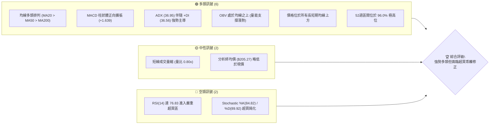
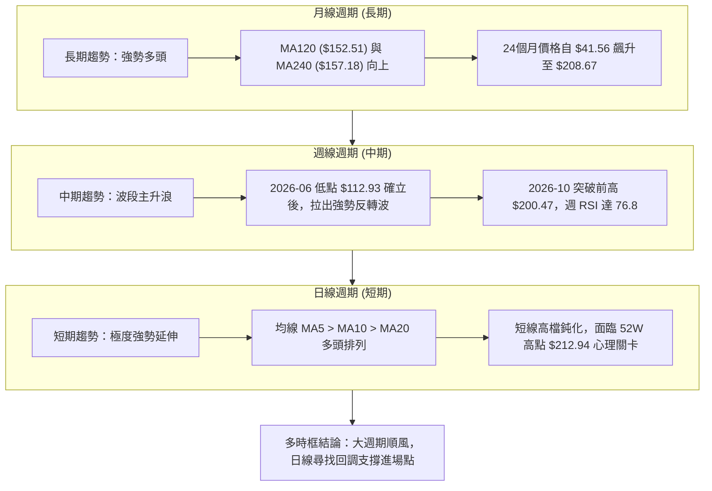
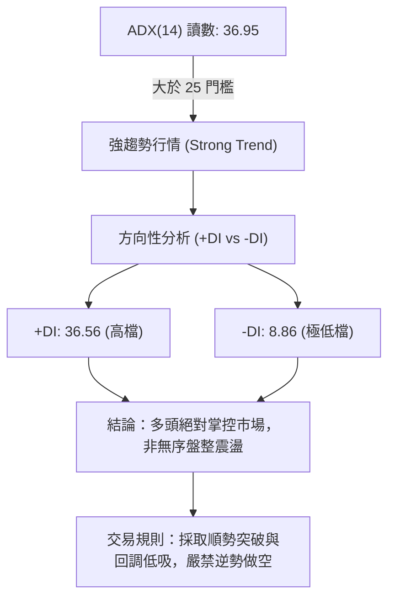
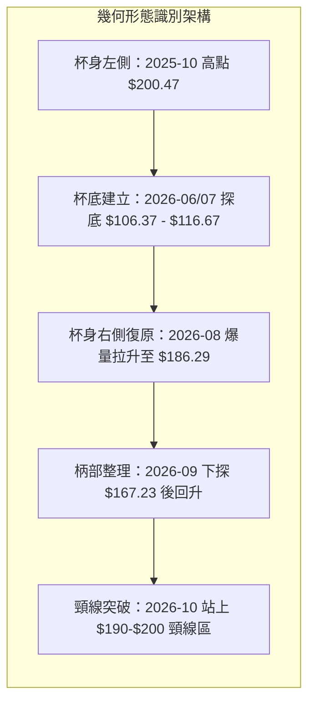
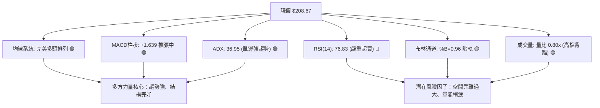
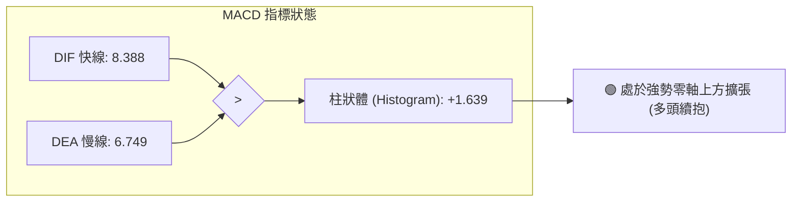
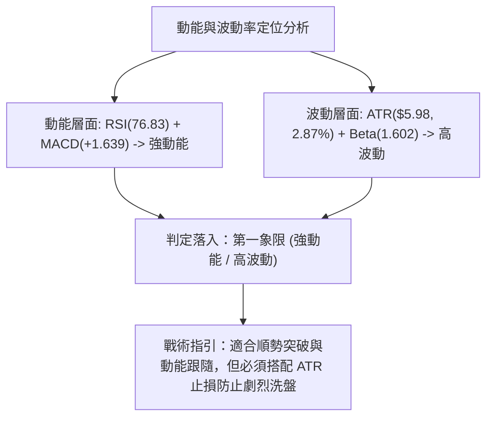
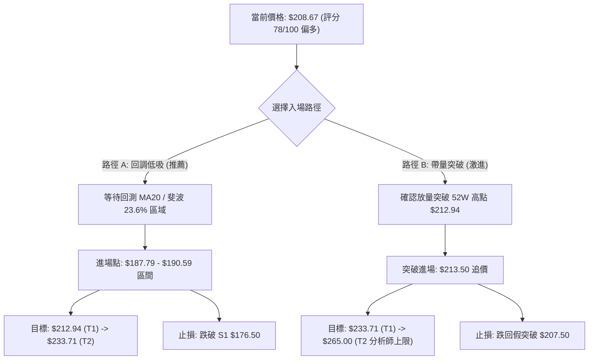
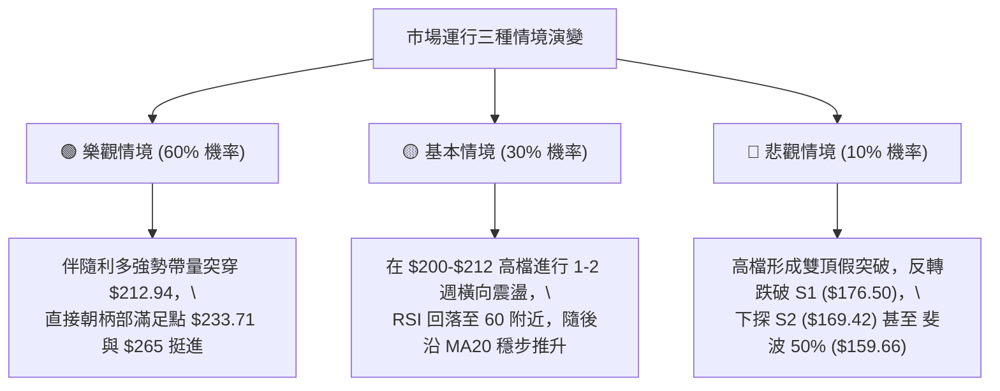

# PLTR 技術分析報告

> **報告日期**：2026-10-14 ｜ **語言**：繁體中文 ｜ **數據來源**：Yahoo Finance ｜ **當前價格**：$208.67

---

## 目錄

| 章節 | 內容 |
|------|------|
| [1. 技術面概覽](#1-技術面概覽) | 訊號儀表板、核心指標速覽、技術評分卡 |
| [2. 趨勢分析](#2-趨勢分析) | 多時框架構、12個月走勢圖、中期週線、ADX趨勢強度 |
| [3. 圖表形態分析](#3-圖表形態分析) | 形態識別與信心度、關鍵K線組合、走勢示意圖、目標價推算 |
| [4. 支撐與阻力](#4-支撐與阻力) | 價位結構分布、阻力位分析、支撐位分析、斐波那契回調區間 |
| [5. 技術指標深度解讀](#5-技術指標深度解讀) | 均線系統、RSI(14)、MACD、布林通道、量價與OBV分析 |
| [6. 動能與波動率](#6-動能與波動率) | 動能四象限、ATR波幅止損模型、Beta市場敏感度 |
| [7. 多時框架總結](#7-多時框架總結) | 時框架矩陣、跨週期收斂結論 |
| [8. 交易策略建議](#8-交易策略建議) | 策略決策流程、價格情境階梯、主策略A/B規劃、反向風險觸發 |
| [9. 風險提示與監控](#9-風險提示與監控) | 關鍵監控清單、情境模擬路徑、風險控管原則 |

---

## 1. 技術面概覽

### 🎯 技術訊號儀表板



---

### 📊 核心指標速覽表

| 指標類別 | 指標名稱 | 當前數值 | 訊號 | 專業解讀 |
|:---|:---|:---|:---:|:---|
| **價格** | 當前收盤價 | $208.67 | 🟢 | 距 52 週高點 ($212.94) 僅 2.01%，處於極強勢位階 |
| **均線** | MA20 (短線基準) | $190.59 | 🟢 | 現價高於 MA20 達 +9.49%，短線乖離略大 |
| **均線** | MA50 (波段生命線)| $180.36 | 🟢 | 現價高於 MA50 達 +15.70%，中期多頭架構完好 |
| **均線** | MA200 (長期牛熊線)| $152.48 | 🟢 | 現價高於 MA200 達 +36.85%，長線超強多頭 |
| **動能** | RSI(14) | 76.83 | 🔴 | 進入超買區間 (>70)，短期易誘發技術性獲利回吐 |
| **動能** | MACD (12,26,9) | 8.388 (Hist: +1.639) | 🟢 | DIF 高於 Signal (6.749)，紅柱持續拉長，動能延續 |
| **動能** | KD (Stoch 14,3,3) | %K: 84.82 / %D: 89.92 | 🔴 | 位於高檔超買鈍化區，%K 跌破 %D 呈現微幅死叉疑慮 |
| **趨勢** | ADX(14) / 方向線 | 36.95 (+DI:36.56, -DI:8.86) | 🟢 | ADX > 25 且 +DI 遠高於 -DI，確認強勁單邊趨勢行情 |
| **通道** | 布林通道 %B | 0.96 (上軌: $210.38) | 🟡 | 緊貼上軌運行，通道擴張，極限逼近軌道邊緣 |
| **量能** | 20日成交量比 | 0.80x (量: 18.48M / 均量: 23.20M) | 🟡 | 價揚量縮，高檔動能出現輕度量價背離隱憂 |
| **波動** | ATR(14) | $5.98 (2.87%) | 🟢 | 每日波動幅度約 6 美元，提供清晰的止損與空間計算 |

---

### 🏆 技術評分卡

```
╔══════════════════════════════════════════════════════════════╗
║                技術評分卡 — PLTR (2026-10-14)                 ║
╠══════════════════════════════════════════════════════════════╣
║ 趨勢強度 (Trend)     ██████████████████░░  88/100  🟢 強趨勢 ║
║ 均線架構 (Alignment) ████████████████████ 100/100  🟢 完美多頭║
║ 動能指標 (Momentum)  █████████████░░░░░░░  65/100  🟡 高檔超買║
║ 成交量能 (Volume)    ████████████░░░░░░░░  60/100  🟡 量比偏低║
║ 支撐穩定度 (Support) ████████████████░░░░  80/100  🟢 梯隊扎實║
║ 形態結構 (Patterns)  ██████████████░░░░░░  72/100  🟢 杯柄突破║
╠══════════════════════════════════════════════════════════════╣
║ 綜合評分             ████████████████░░░░  78/100  🟢 強勢偏多║
╚══════════════════════════════════════════════════════════════╝
```

---

## 2. 趨勢分析

### 🌐 多時框趨勢分析

依據多時框收斂原則，趨勢行情以中長期趨勢為主導。月線與週線均展現穩固的擴張型多頭浪潮，日線則呈現短線急漲後的過熱延伸。



---

### 📈 長期趨勢 — 過去 12 個月走勢圖（ASCII）

以下記錄自 2025 年 11 月至 2026 年 10 月之月線收盤走勢：

```
PLTR 月線走勢圖（過去12個月）
價格 ($)
$215 ┤                                                 ● $208.67 (現價)
$200 ┤                                            ● $187.05
$185 ┤                                  ● $186.38
$170 ┤● $168.45  ● $177.75
$155 ┤                            ● $156.54
$140 ┤        ● $146.59  ● $146.28
$125 ┤              ● $137.19  ● $139.11       ● $123.06
$110 ┤                                  ● $116.67 (破底洗盤低點)
     └────┬────────┬────────┬────────┬────────┬────────┬────
       25-11    26-01    26-03    26-05    26-07    26-10
```

#### 走勢特徵分析表格

| 階段區間 | 時間區間 | 價格起訖 | 漲跌幅 | 走勢結構與技術特徵 |
|:---|:---|:---:|:---:|:---|
| **階段一：歷史回調** | 2025-10 ~ 2026-02 | $200.47 → $137.19 | -31.57% | 自 2025 年高點發起 ABC 修正波，消化過度透支的估值 |
| **階段二：中繼盤整** | 2026-02 ~ 2026-05 | $137.19 → $156.54 | +14.10% | 構築底部箱型，成交量萎縮，均線逐步糾結打底 |
| **階段三：終極洗盤** | 2026-06 ~ 2026-07 | $156.54 → $116.67 | -25.47% | 跌破所有短期支撐，打出 52 週最低點 $106.37（收盤 $116.67）確立假跌破 |
| **階段四：暴力主升** | 2026-08 ~ 2026-10 | $116.67 → $208.67 | +78.85% | 伴隨大額週成交量（單週達 4.35 億股）爆發，突破所有均線，強勢登頂 |

---

### 📊 中期趨勢（週線分析）

從近 20 週收盤走勢觀察，PLTR 在 2026 年 6 月底於 $112.93（週 RSI 27.8 形成嚴重超賣底）止跌後，8 月第 1 週出現帶量爆破（週收盤 $172.01，單週成交量高達 435,164,800 股），確立中期反轉。9 月份在 $167.23 至 $189.67 進行波段整理後，10 月第 2 週再次推升至 $209.05，刷新波段新高。目前週 MACD 柱狀體維持在 +1.639 的正向健康擴張狀態。

```
PLTR 近期週線壓力與支撐示意
$212.94 ── 52週歷史高點（主要天花板阻力）
   ▲
$208.67 ── 當前週線收盤位置（超買延伸中）
   │
$189.67 ── 9月下旬整理平台高點（轉化為第一層動態回調支撐）
   │
$176.50 ── 結構支撐 S1（由波段低點聚類構成）
   ▼
$167.23 ── 9月中旬洗盤低點
```

---

### ⚡ 趨勢強度評估（ADX 解讀）



| 指標變數 | 當前讀數 | 門檻區間 | 趨勢屬性判定 |
|:---|:---:|:---:|:---|
| **ADX (14)** | **36.95** | > 25 (強趨勢)；> 40 (極度強勢) | 單邊主升趨勢確立，震盪指標 (如 RSI/KD) 之超買往往會出現鈍化 |
| **+DI (14)** | **36.56** | > 30 (買盤強勁) | 多方控盤力道極高，買盤推動力充沛 |
| **-DI (14)** | **8.86** | < 15 (賣方潰散) | 空方動能完全被壓制，現階段缺乏結構性拋壓 |

---

## 3. 圖表形態分析

### 🔍 形態識別系統

在日線與週線級別中，PLTR 呈現出極為對稱且標準的「大型杯柄形態」（Cup and Handle）突破，並在短線上呈現「上升通道」與「均線擴張噴發」的特徵。



#### 形態識別與信心度評估表

| 形態名稱 | 信心度 | 判斷依據（嚴格引用數據） | 完成度 | 目標價（附嚴謹計算式） |
|:---|:---:|:---|:---:|:---|
| **大型杯柄突破 (週線)** | **85%** | 頸線為 2025-10 高點 $200.47；底部為 52W 低點 $106.37。2026-09 於 $167.23 構築柄部，2026-10 放量收於 $208.67 突破頸線。 | 95% | **形態測幅高點** = 頸線 ($200.47) + [頸線 ($200.47) - 52W低點 ($106.37)] = **$294.57**（長期目標） |
| **短線上升通道 (日線)** | **70%** | 上軌由近期高點延伸至布林上軌 ($210.38)；下軌由 MA20 ($190.59) 提供動態支撐，價格持續貼上軌運行。 | 85% | **通道延伸阻力** = 52W High **$212.94**（此為數據中最高已知阻力） |
| **V型爆發底 (波段)** | **90%** | 2026-08-09 當週以 4.35 億股巨量自 $123.06 暴拉至 $172.01，直接反轉前期空頭結構。 | 100% | 已完全兌現並進入波段延伸浪 |

---

### 🕯️ 重要 K 線形態分析

| 觀測週期 / 日期 | 收盤價 | K線形態名稱 | 技術解讀 | 訊號 |
|:---|:---:|:---|:---|:---:|
| **2026-06-28 (週)** | $112.93 | **長下影錘頭破底線** | 單週成交 2.71 億股破底收腳，空頭動能釋放完畢，確立主力誘空結構 | 🟢 |
| **2026-08-09 (週)** | $172.01 | **長紅突破穿頭大陽線** | 週成交量爆出 4.35 億股歷史天量，跳空越過 MA50 與 MA60，主升啟動 | 🟢 |
| **2026-09-13 (週)** | $167.23 | **縮量陰線十字星 (柄部)**| 週成交量驟降至 81.68M 股（近期最低），量縮止跌，確認賣壓耗竭 | 🟢 |
| **2026-10-11 (週)** | $209.05 | **光頭光腳實體中陽線** | 突破 $200 大關，帶量突破前期整理區間，奠定挑戰新高基調 | 🟢 |
| **2026-10-18 (本週截稿)**| $208.67 | **高檔震盪十字紡錘線** | 於 52W 高點 $212.94 下方出現量縮整理，顯示高檔追價趨於謹慎 | 🟡 |

---

### 📉 ASCII 走勢形態示意圖

```
PLTR 大型杯柄形態 (Cup & Handle) 與突破示意
$212.94 ───────────────────────────────────────────────┐ ◄ 52W High 阻力
$200.47 ────●(杯身左緣 2025-10)               ●──突破(現價 $208.67)
           │                                 ╱ 
$170.00 ───┼─╲                             ╱───(柄部 $167.23)
           │  ╲                           ╱    
$140.00 ───┤   ╲                         ╱     
           │    ╲                       ╱      
$106.37 ───┴─────●─────────────────────●       
              (杯底低點聚類 2026-06 ~ 07)
```

---

### 🎯 形態目標價計算

1. **短線目標（52週高點測試）**：
   * **目標價**：**$212.94**（數據中已標明之 52W High，亦為當前上方唯一已知阻力）。
   * **距現價空間**：+2.05%。

2. **中長線柄部測幅目標（柄部整理高度向上翻轉）**：
   * **計算式**：突破頸線位 ($200.47) + 柄部高度 [$200.47 - 柄部低點 ($167.23)] = $200.47 + $33.24 = **$233.71**。
   * **說明**：此為柄部測幅滿足點，符合華爾街分析師最高目標價 $265.00 之發展路徑。

---

## 4. 支撐與阻力

### 🗺️ 關鍵價位分布圖（ASCII）

```
PLTR 價位結構分布圖
══════════════════════════════════════════════════════════════════
$212.94 ║██████████████████████████████║ 52W High 歷史頂部阻力
$210.38 ║████████████████████          ║ 布林通道上軌動態阻力
$208.67 ╠══════════════════════════════╣ ◄ 現價 (位於歷史高檔 96%)
$190.59 ║▓▓▓▓▓▓▓▓▓▓▓▓▓▓▓▓▓▓▓▓          ║ MA20 / 布林中軌支撐
$187.79 ║▓▓▓▓▓▓▓▓▓▓▓▓▓▓▓▓              ║ 斐波那契 23.6% 回調位
$176.50 ║████████████████████████      ║ 核心波段支撐 S1
$169.42 ║████████████████████          ║ 結構支撐 S2 (柄部平台)
$165.45 ║██████████████████████████████║ 強烈防守支撐 S3
══════════════════════════════════════════════════════════════════
```

---

### 🚧 阻力位分析表

依據輸入數據，現價上方無偵測到波段高點聚類（swing-high resistance），上方直接阻力為 52 週最高點與通道邊界：

| 阻力級別 | 價位 | 形成依據（數據源確認） | 突破難度 | 技術重要性與策略意義 |
|:---|:---:|:---|:---:|:---|
| **R1 (動態阻力)** | **$210.38** | 布林通道日線上軌 (BB Upper) | 中等 | 價格已達 %B=0.96，觸及布林帶極限，常伴隨壓回中軌震盪 |
| **R2 (絕對阻力)** | **$212.94** | 52 週歷史高點 (52W High) | 極高 | 空方最後防線，多頭若帶量突破將開啟無套牢籌碼的真空飆升區 |

---

### 🛡️ 支撐位分析表

以下支撐位完全引自數據「關鍵價位（波段低點聚類）」與「均線結構」：

| 支撐級別 | 價位 | 距現價幅 | 形成原因 | 守住機率 | 戰略重要性 |
|:---|:---:|:---:|:---|:---:|:---|
| **S0 (動態支撐)**| **$190.59** | -8.66% | 日線 MA20 兼布林中軌 | 75% | 多頭強勢回檔的第一道防線，不破此位趨勢不改 |
| **S1 (首要結構)**| **$176.50** | -15.42%| 近一年波段低點聚類 S1 | 85% | 9月震盪箱體下緣，跌破則宣告短期回調擴大 |
| **S2 (中期防守)**| **$169.42** | -18.81%| 近一年波段低點聚類 S2 | 90% | 柄部回測低點（週線 $167.23 鄰近），中期多頭關鍵防線 |
| **S3 (絕對防守)**| **$165.45** | -20.71%| 近一年波段低點聚類 S3 | 95% | 跌破此位將破壞杯柄結構，中期趨勢將轉為區間走弱 |

---

### 📐 斐波那契回調位分析

依據 52 週極值區間（低點 **$106.37** → 高點 **$212.94**，總波幅 $106.57）計算所得之黃金分割比率位階：

| 斐波那契位階 | 具體精確價位 | 相對現價位置 | 技術意涵與防守強度解讀 |
|:---:|:---:|:---:|:---|
| **0.0% (52W High)** | **$212.94** | 上方 +2.05% | 波段頂部阻力，雙頂潛在危險區 |
| **現價位階** | **$208.67** | **基準點** | **目前落於 0.0% ($212.94) 與 23.6% ($187.79) 之極高位極度擴張帶** |
| **23.6%** | **$187.79** | 下方 -10.01% | 極強勢修正回測位；與 MA20 ($190.59) 形成緊密的共振支撐區間 |
| **38.2%** | **$172.23** | 下方 -17.47% | 健康回調支撐位；緊鄰 S1 ($176.50) 與 S2 ($169.42)，強大買盤承接區 |
| **50.0%** | **$159.66** | 下方 -23.49% | 多空平衡分水嶺；接近 MA240 ($157.18) |
| **61.8%** | **$147.08** | 下方 -29.52% | 黃金分割防守極限；與 MA120 ($152.51) 與 MA200 ($152.48) 形成護城河 |
| **78.6%** | **$129.18** | 下方 -38.09% | 深度回調線，失守意味著長期上漲結構被瓦解 |
| **100.0% (52W Low)**| **$106.37** | 下方 -49.02% | 本輪波段起漲點，歷史底部 |

---

## 5. 技術指標深度解讀

### 🎛️ 指標訊號總覽



---

### 📈 移動平均線排列分析

PLTR 目前展現華爾街教科書級別的「均線多頭排列」（Bullish Alignment）。從超短天期到超長天期移動平均線依序向上發散：

```
MA 均線多頭排列梯隊展示
現價:   $208.67  ▲
MA 5:   $203.92  ▲ (+2.33%)   █ 多頭先鋒
MA 10:  $196.69  ▲ (+6.09%)   ██ 短線強弱線
MA 20:  $190.59  ▲ (+9.49%)   ███ 短波生命線 (布林中軌)
MA 50:  $180.36  ▲ (+15.70%)  ████ 中期波段防線
MA 60:  $171.17  ▲ (+21.90%)  █████ 季線支撐
MA 120: $152.51  ▲ (+36.82%)  ██████ 半年線防禦
MA 200: $152.48  ▲ (+36.85%)  ███████ 長期牛熊分界
MA 240: $157.18  ▲ (+32.76%)  ████████ 年線底座
```

* **均線扣抵解讀**：短天期均線斜率極其陡峭（MA5 差值達 +4.75，MA20 差值達 +18.08）。價格遠拋於 MA200 之上達 36.85%，表明中長線持股者處於全面獲利狀態，下檔均線支撐力道渾厚。

---

### 📉 RSI(14) 分析與背離檢視

```
RSI(14) 當前讀數: 76.83
0 ─────── 30 ───────────── 50 ───────────── 70 ─────── 100
[         超賣區            中性區           │超買區  ]
▓▓▓▓▓▓▓▓▓▓▓▓▓▓▓▓▓▓▓▓▓▓▓▓▓▓▓▓▓▓▓▓▓▓▓▓▓▓▓▓▓▓▓▓▓▓░░░░░░  76.83%
```

* **超買超賣狀態**：RSI 達 76.83，明確處於 >70 的超買區間。歷史經驗表明，當 PLTR RSI 跨入 75-80 區間時，通常伴隨 3 至 5 個交易日的技術性橫盤或回測 MA5/MA10。
* **背離研判**：
  * **價格走勢**：現價 $208.67 逼近 52 週高點 $212.94，價格創出近期波段新高。
  * **RSI 軌跡**：前一週 RSI 為 82.6（對應收盤 $209.05），本週價格在 $208.67，RSI 略降至 76.83。
  * **背離結論**：目前**「無顯著頂背離」**。RSI 雖自極高值 82.6 微幅回落，但仍屬高位鈍化範疇，並未出現價格創顯著新高而指標大幅滑落的典型頂背離，僅為指標正常降溫。

---

### 📊 MACD (12, 26, 9) 訊號解讀



* **訊號解讀**：DIF 與 DEA 均穩坐於零軸之上，顯示中長期動能處於多方掌控。MACD 柱狀體為 +1.639，較上週的 +1.204 呈現持續擴大，表明多頭推動動能尚未竭盡，短線買盤仍在積極推升價格。

---

### 📦 布林通道分析 (Bollinger Bands)

```
布林通道當前結構分布 (20, 2)
$210.38 ── 上軌 (Upper Band)   ═════════════════════════
$208.67 ── 當前收盤價          ● [現價: %B = 0.96]
                               │
$190.59 ── 中軌 (MA20)         ─────────────────────────
                               │
$170.80 ── 下軌 (Lower Band)   ═════════════════════════
```

* **帶寬與位置分析**：
  * **通道帶寬** = 上軌 ($210.38) - 下軌 ($170.80) = **$39.58**。
  * **%B 指標** = ($208.67 - $170.80) / ($210.38 - $170.80) = **0.96**。
  * **解讀**：%B 達 0.96，說明價格已緊密貼合布林上軌運行。在強勢單邊行情中（ADX>25），「沿軌上行」為多頭極強特徵，但若收盤價無法持續推開上軌，容易引發「回歸中軌」之均值回歸拉回，中軌 $190.59 為重要技術吸納點。

---

### 💹 成交量分析（量價配合度與 OBV）

* **量比與量能趨勢**：
  * 最新單日成交量：**18,486,000 股**。
  * 20 日均量：**23,200,515 股**（量比：**0.80x**）。
  * 50 日均量：**32,541,478 股**。
  * **量價特徵**：股價創近期高點之際，成交量卻低於 20 日均量與 50 日均量，顯現「價漲量縮」的高檔動能衰竭徵兆，顯示散戶追價意願謹慎，行情主要由籌碼鎖定所維繫。
* **OBV (能量潮指標) 分析**：
  * 數據明確標記：`OBV > MA → 量能支撐上漲`。
  * **研判**：雖然短線單日量縮，但中期累積能量潮（OBV）依然維持在均線之上，說明波段主力籌碼並未在高檔出現籌碼派發（Distribution），整體架構仍屬健康鎖籌下的推升。

---

## 6. 動能與波動率

### ⚡ 動能評估四象限

| 象限 | 動能強度 (Momentum) | 波動率水準 (Volatility) | 當前標的狀態 | 操作戰略評估 |
|:---:|:---:|:---:|:---:|:---|
| **第一象限 (Q1)** | **強 (Strong)** | **高 (High)** | **PLTR 當前位置 ★** | **高動能/高波動：主升浪加速期，採取嚴格跟蹤止損，享受趨勢利潤** |
| **第二象限 (Q2)** | 弱 (Weak) | 高 (High) | — | 震盪混亂：主力洗盤洗劫期，觀望為宜 |
| **第三象限 (Q3)** | 弱 (Weak) | 低 (Low) | — | 築底沉寂：流動性萎縮，長線左側建倉期 |
| **第四象限 (Q4)** | 強 (Strong) | 低 (Low) | — | 慢牛攀升：低風險穩健套利期 |



---

### 📊 ATR 波動率分析

* **當前 ATR(14)**：**$5.98**（佔當前股價之 **2.87%**）。
* **波動特徵**：PLTR 每日平均正常波幅約 6 美元。在擬定日內與波段交易策略時，應避免將止損設置於 $5.98 之內，以防被正常市場雜訊洗出場。
* **止損倍數應用**：
  * **短線防守 (1.0x ATR)**：$208.67 - $5.98 = **$202.69**。
  * **波段防守 (2.0x ATR)**：$208.67 - (2 × $5.98) = **$196.71**（恰好與 MA10 之 $196.69 完美重合）。
  * **寬鬆趨勢防守 (3.0x ATR)**：$208.67 - (3 × $5.98) = **$190.73**（與 MA20 之 $190.59 重合，構成強大支撐網）。

---

### 📐 Beta 與市場相關性

* **Beta 係數**：**1.602**。
* **市場敏感度解讀**：PLTR 為高 Beta 成長型科技權值股，其波動幅度為標普 500 指數的 1.60 倍。在大盤多頭環境下具備顯著的超額報酬能力（Alpha），但在大盤回調或風險偏好降溫時，其下行波動亦會加劇。

---

## 7. 多時框架總結

### 📋 時框架評分表

| 時框架 | 趨勢方向 | 動能狀態 | 均線排列 | 圖表形態 | 綜合評分 | 建議方向 |
|:---|:---:|:---:|:---:|:---:|:---:|:---:|
| **月線 (長期)** | 🟢 強烈看多 | 🟢 動能極強 | 🟢 多頭排列 | 大型雙底/杯身突破 | **92/100** | 戰略做多 |
| **週線 (中期)** | 🟢 強烈看多 | 🟢 MACD擴張 | 🟢 完全發散 | 杯柄突破主升浪 | **88/100** | 波段做多 |
| **日線 (短期)** | 🟡 謹慎看多 | 🔴 RSI超買 | 🟢 陡峭多頭 | 緊貼布林通道上軌 | **72/100** | 待回調低吸 |

---

### 🔲 綜合訊號矩陣

| 週期層級 | 均線系統 | 動能指標 (RSI/MACD) | 趨勢強度 (ADX) | 量價結構 (Volume/OBV) | 一致性研判 |
|:---|:---:|:---:|:---:|:---:|:---:|
| **長期層次** | 🟢 MA120/MA240走揚 | 🟢 週MACD翻紅放量 | 🟢 單邊長牛走勢 | 🟢 OBV長期流入 | **高度一致 (Bullish)** |
| **中期層次** | 🟢 站穩所有均線 | 🟢 DIF於零軸上方強擴張| 🟢 ADX=36.95 強勢 | 🟢 突破天量支撐 | **高度一致 (Bullish)** |
| **短期層次** | 🟢 MA5>MA10>MA20 | 🔴 RSI=76.83 處超買 | 🟢 +DI 掌控市場 | 🟡 短線量縮(0.80x) | **中輕度背離 (Caution)**|

---

### ⚖️ 多時框收斂結論

> **依據多時框收斂規則（規則 14）**：
> 當前 ADX(14) 讀數為 **36.95**（遠大於 25 門檻），市場處於極度明確的**「趨勢行情」**而非無序盤整行情。
>
> **收斂指引**：必須以中長期（週線、MA50 $180.36、MA200 $152.48）之強大多頭方向為主導，日線層級之 RSI 超買僅視為尋找進場時機與回調防守的濾網，不得據此建立反向空頭部位。
>
> **唯一方向性結論**：**【強烈偏多，但嚴禁無腦追高，以回調低吸為唯一核心思維】**。

---

## 8. 交易策略建議

### 🗺️ 策略決策流程圖



---

### 🧭 策略路由

依據第 1 章技術評分卡：**綜合評分 78/100（≥60 偏多）**。
**當前主策略方向 = 【主推多頭策略（波段低吸與強勢突破）】**，空方僅保留結構防守與反轉警訊提示，不給予主動放空建議。

---

### 🎯 價格情境階梯（Price Scenarios）

所有價位均嚴格引用技術數據中計算之關鍵價位：

| 觸發條件 | 下一目標 | 後續延伸 | 情境含義與技術解讀 |
|:---|:---:|:---:|:---|
| **強勢突破 52W 高點 $212.94** | **$233.71** (柄部測幅) | **$265.00** (分析師最高目標) | 確立主升浪二次延伸，進入完全無阻力之單邊飆漲 |
| **站穩 $190.59 ~ $208.67** | **$212.94** (測試高點) | — | 於高檔進行以時間換空間之牛旗箱型消化 |
| **跌破 MA20 $190.59** | **$187.79** (斐波 23.6%) | **$176.50** (S1 結構支撐) | 觸發短線獲利回吐，展開健康次級折返走勢 |
| **跌破 S1 $176.50** | **$169.42** (S2 支撐) | **$165.45** (S3 支撐) | 中期波段漲勢破壞，回測柄部底部尋求重整 |

---

### 📊 情境機率分佈

| 運行情境 | 發生機率 | 主要技術依據 |
|:---|:---:|:---|
| **情境一：高檔蓄勢後突破上行** | **60%** | ADX 高達 36.95 且 +DI 主導；MACD 柱狀體維持正向；多頭排列強韌 |
| **情境二：回調測壓至 MA20 / 斐波位** | **30%** | RSI(14) 處於 76.83 嚴重超買，短線成交量比僅 0.80x 出現量能輕微背離 |
| **情境三：深度下殺破壞上升結構** | **10%** | 下方 S1 ($176.50)、S2 ($169.42) 及 MA200 ($152.48) 支撐厚實，極難跌破 |

---

### 🟢 主策略詳情

| 策略要素 | 策略 A（穩健型：回調低吸策略 🥇） | 策略 B（激進型：突破追價策略 🥈） |
|:---|:---|:---|
| **戰略意圖** | 等待 RSI 降溫，於核心支撐區接刀 | 捕捉突破 52 週歷史高點時之動能爆發 |
| **進場條件** | 價格回落至 MA20 附近出現量縮止跌訊號 | 日K線明確帶量突破 52W High ($212.94) |
| **進場價格** | **$190.59**（允許 $188.00 - $191.00 區間分批）| **$213.50**（確認站穩 $212.94 上方） |
| **目標價 T1** | **$212.94**（前高天花板，獲利 +11.73%） | **$233.71**（形態測幅滿足點，獲利 +9.47%）|
| **目標價 T2** | **$233.71**（柄部滿足點，獲利 +22.63%） | **$265.00**（華爾街最高目標，獲利 +24.12%）|
| **止損價格** | **$176.00**（略低於 S1 $176.50，風險 -7.66%）| **$205.00**（跌回前高與分析師均價內，風險 -3.98%）|
| **風險報酬比** | **1 : 2.95**（極佳） | **1 : 2.38**（良好） |
| **勝率預估** | **70%** | **55%** |
| **建議倉位** | **總資金之 15% - 20%** | **總資金之 8% - 10%** |

---

### 🔴 反向風險觸發點（對沖與止損提示）

若發生下列技術訊號，意味著多頭結構遭受嚴重破壞，應立即啟動全面風控對沖或撤離多單：

1. **短線轉弱預警**：收盤價以長黑K摜破 **MA20 ($190.59)** 且 3 日內無法收復，多頭部位應減倉 50%。
2. **中期多翻空觸發**：若巨量摜破核心結構支撐 **S1 ($176.50)**，表示杯柄突破失效，多單應無條件停損出場，並可透過反向工具（如買入 Put Option）對沖現貨風險。

---

### ⭐ 整體訊號強度評星

```
做多訊號強度：★★★★☆  (4/5星 — 趨勢強勁，僅受制於短線超買)
做空訊號強度：★☆☆☆☆  (1/5星 — 逆勢逆風，嚴重缺乏做空安全邊際)
整體可信度：  ★★★★☆  (4/5星 — 多時框指標共振度高)
```

---

## 9. 風險提示與監控

### ✅ 關鍵監控指標 Checklist

```
╔══════════════════════════════════════════════════════════════════╗
║               PLTR 每日技術監控 Checklist (風控儀表)            ║
╠══════════════════════════════════════════════════════════════════╣
║ [ ] 52W High ($212.94) 攻防：是否出現長上影線或爆量滯漲？       ║
║ [ ] RSI(14) 降溫路徑：能否在維持 >50 中性水準下自 76.83 消化？    ║
║ [ ] 成交量動態：回調時成交量是否萎縮（<20日均量 23.2M）？         ║
║ [ ] MA20 ($190.59) 動態位：回踩測試時買盤是否具備承接力道？      ║
║ [ ] MACD 柱狀體：+1.639 是否出現縮短死叉訊號？                   ║
║ [ ] 大盤關聯性：Beta=1.602，需密切追蹤那斯達克指數是否轉弱？     ║
╚══════════════════════════════════════════════════════════════════╝
```

---

### ⚠️ 風險場景分析



---

### 🛡️ 風險管理重要提醒

1. **克服 FOMO 情緒，拒絕情緒化追高**：
   目前 RSI 為 76.83，布林通道 %B 高達 0.96，價格已處於短線統計學上的過度擴張極限。此時在現價 ($208.67) 追入的單筆風險報酬比極差。
2. **波動度適應原則**：
   PLTR 的 ATR 為 $5.98（日波動近 3%），且 Beta 高達 1.602。部位建立務必採取「金字塔式分批布局」，切忌在單一價位押入全額部位。
3. **分析師共識差距評估**：
   市場 26 位分析師之平均目標價為 **$205.27**，現價 ($208.67) 已略微超越分析師平均預期，這意味著市場短線已經計入大量樂觀預期，未來唯有持續擊敗基本面展望，方能支撐股價向最高目標價 **$265.00** 邁進。

---

## 📋 報告總結

```
╔══════════════════════════════════════════════════════════════════╗
║                    PLTR 技術分析報告總結                         ║
╠══════════════════════════════════════════════════════════════════╣
║ 報告日期：2026-10-14                                             ║
║ 當前價格：$208.67 (距 52W High 僅 2.01%)                          ║
║ 分析評級：🟢 強烈偏多（短線超買，回調低吸為上策）                ║
║                                                                  ║
║ 關鍵維度總結：                                                   ║
║ ├─ 長期趨勢：🟢 完美多頭 (自 $41.56 飆升，長天期均線全面向上)     ║
║ ├─ 中期趨勢：🟢 主升浪架構 (大型杯柄完成，週線爆量確立翻轉)      ║
║ ├─ 短期趨勢：🟡 高檔過熱 (RSI 76.83 伴隨量縮 0.80x，面臨前高)    ║
║ ├─ 關鍵支撐：S0: $190.59 (MA20) ｜ S1: $176.50 ｜ S2: $169.42   ║
║ ├─ 關鍵阻力：R1: $210.38 (布林上軌) ｜ R2: $212.94 (52W High)    ║
║ └─ 測幅目標：第一目標 $212.94 ｜ 形態目標 $233.71 ｜ 頂部 $265.00║
║                                                                  ║
║ 最優交易策略推薦：                                               ║
║ 1. 🥇 最佳機會（穩健）：耐心等待回撤至 MA20 支撐區間             ║
║    進場: $190.59 ｜ 止損: $176.00 ｜ 目標: $212.94 / $233.71     ║
║ 2. 🥈 次選機會（動能）：放量實體突破 52W 高點後右側追價          ║
║    進場: $213.50 ｜ 止損: $205.00 ｜ 目標: $233.71 / $265.00     ║
║ 3. 🥉 保守選擇：在股價未站穩 $212.94 或拉回前，暫時空倉觀望      ║
╚══════════════════════════════════════════════════════════════════╝
```

---

> ⚠️ **免責聲明**：本報告為技術量化分析研究所得之結論，所有數據、支撐阻力點位及測幅目標均基於歷史價格與數學模型計算。本報告**僅供學術研究與投資決策參考**，**不構成任何形式的要約或買賣建議**。金融市場瞬息萬變，投資人應依個人財務狀況、風險承受能力獨立判斷並自負盈虧。

---
*報告生成時間：2026-10-14 ｜ 數據來源：Yahoo Finance ｜ 分析框架：多時框技術分析模型*