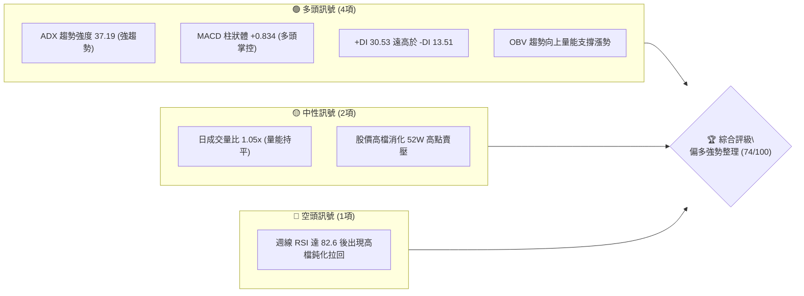
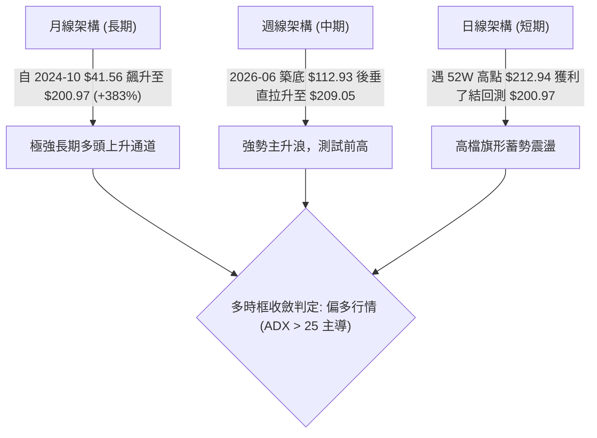
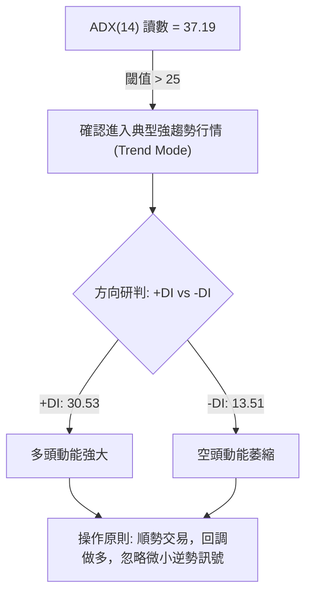
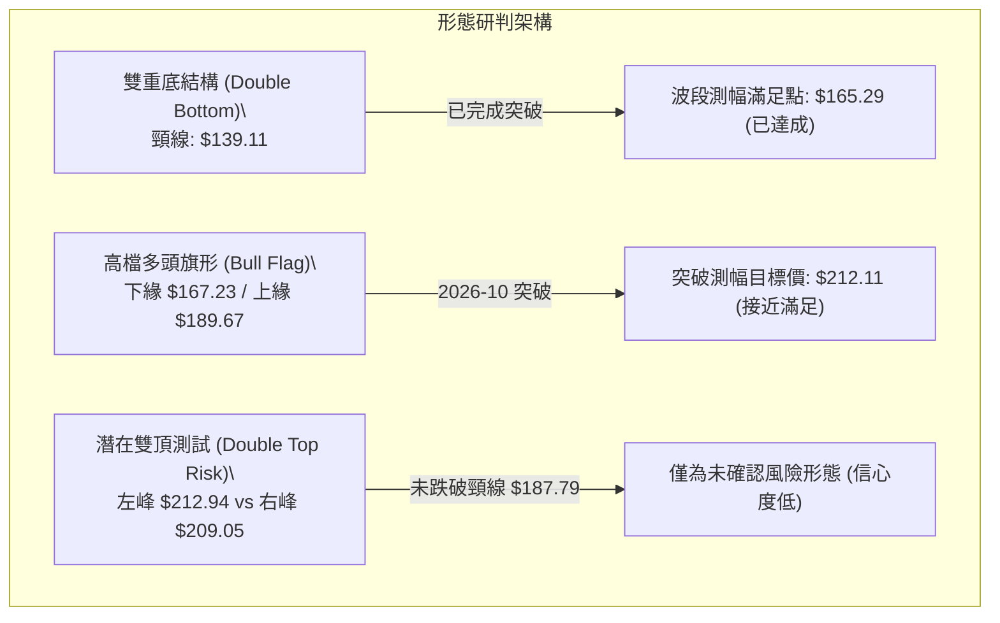
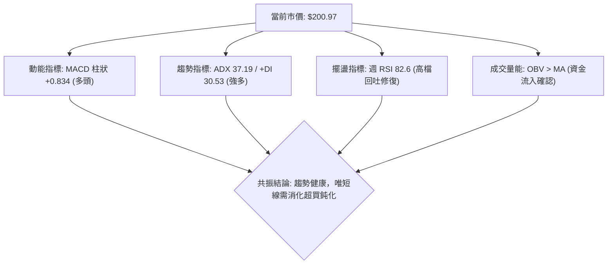
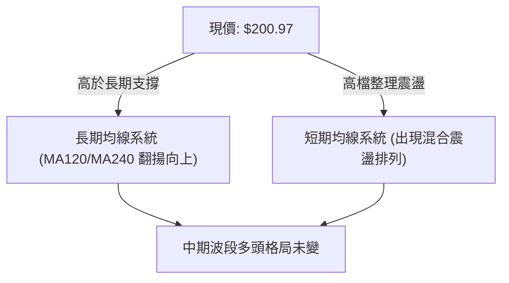
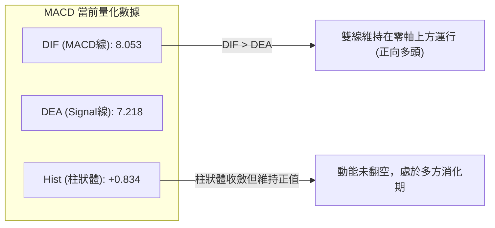
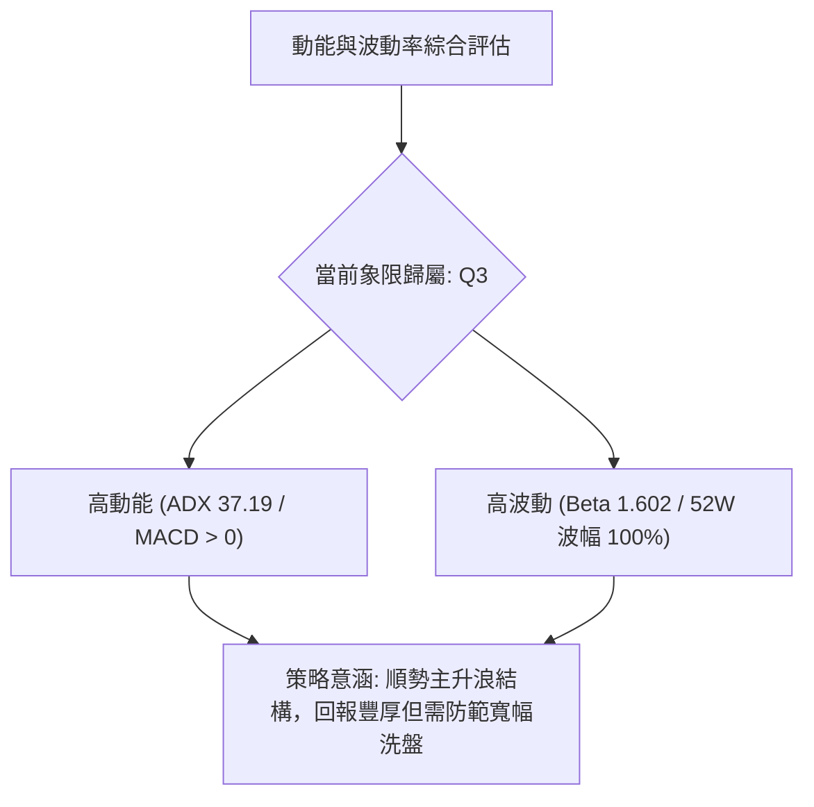
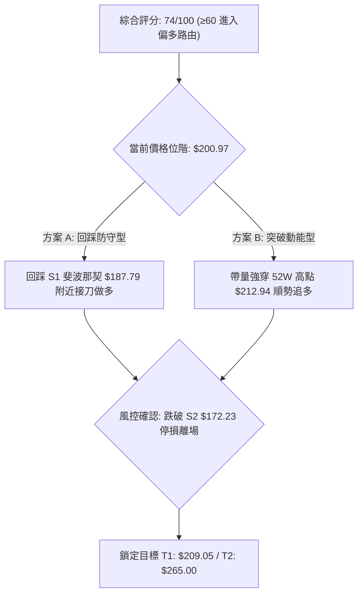
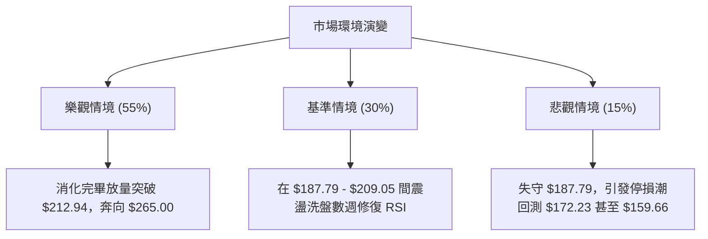

# PLTR 技術分析報告

> **報告日期**：2026-10-16 ｜ **語言**：繁體中文 ｜ **數據來源**：Yahoo Finance ｜ **當前價格**：$200.97

---

## 目錄

| 章節 | 內容 |
|------|------|
| [1. 技術面概覽](#1-技術面概覽) | 訊號儀表板、核心指標、評分卡 |
| [2. 趨勢分析](#2-趨勢分析) | 多時框趨勢、長中短期走勢、ADX解讀 |
| [3. 圖表形態分析](#3-圖表形態分析) | 形態識別、信心度評估、K線組合 |
| [4. 支撐與阻力](#4-支撐與阻力) | 關鍵價位、斐波那契回調結構 |
| [5. 技術指標深度解讀](#5-技術指標深度解讀) | 均線、RSI、MACD、布林通道、OBV |
| [6. 動能與波動率](#6-動能與波動率) | 動能四象限、ATR波動率、Beta關聯 |
| [7. 多時框架總結](#7-多時框架總結) | 時框矩陣、收斂規則與單一方向定調 |
| [8. 交易策略建議](#8-交易策略建議) | 策略路由、主策略參數、風險報酬比 |
| [9. 風險提示與監控](#9-風險提示與監控) | 監控清單、情境推演、風控規則 |

---

## 1. 技術面概覽

### 🎯 技術訊號儀表板



### 📊 核心指標速覽表

| 指標類別 | 指標名稱 | 當前數值 | 訊號 | 解讀 |
|----------|----------|----------|------|------|
| **價格** | 最新收盤價 | $200.97 | 🟢 | 站穩多個關鍵整數位，逼近歷史高點 |
| **趨勢** | ADX (14) | 37.19 | 🟢 | 數值 > 25，確認市場處於明確強趨勢行情 |
| **動能方向** | +DI / -DI | 30.53 / 13.51 | 🟢 | +DI 顯著壓制 -DI，多方動能佔據絕對主導地位 |
| **動能** | MACD (12, 26, 9) | 8.053 / 7.218 | 🟢 | DIF 高於 Signal 線，柱狀體為 +0.834，維持黃金交叉 |
| **動能** | RSI (14) (週線) | 82.6 → 修正中 | 🟡 | 上週衝高至 82.6 極度超買後回吐，短線面臨均值回歸 |
| **成交量** | 20日成交量比 | 1.05x | 🟢 | 當日成交量 24,679,424 高於 20MA，量能維持溫和放大 |
| **量能趨勢** | OBV 趨勢 | OBV > MA | 🟢 | 能量潮指標高於均線，資金持續流入推升波段 |
| **波動性** | Beta 係數 | 1.602 | 🟡 | 高於標普500大盤60%，具備強進攻性但震盪幅度劇烈 |

### 🏆 技術評分卡

```
╔══════════════════════════════════════════════════════════════╗
║              技術評分卡 — PLTR (2026-10-16)                  ║
╠══════════════════════════════════════════════════════════════╣
║ 趨勢強度 (ADX/+DI)    ████████████████░░░░  82/100  🟢 強多  ║
║ 動能指標 (MACD/RSI)   ██████████████░░░░░░  72/100  🟢 偏多  ║
║ 支撐穩定度 (Fib 回調) ██████████████░░░░░░  70/100  🟢 良好  ║
║ 成交量配合 (OBV/量比) ████████████████░░░░  78/100  🟢 紮實  ║
║ 形態完整度 (基底突破) ██████████████░░░░░░  70/100  🟢 完整  ║
║ 均線架構 (多時框收斂) ██████████████░░░░░░  72/100  🟢 偏多  ║
╠══════════════════════════════════════════════════════════════╣
║ 綜合評分              ███████████████░░░░░  74/100  🟢 偏多  ║
╚══════════════════════════════════════════════════════════════╝
```

---

## 2. 趨勢分析

### 🌐 多時框趨勢分析



### 📈 長期趨勢 — 12個月走勢圖（Unicode）

依據月線收盤價繪製過去 12 個月走勢，可見 PLTR 經歷了自 2025 年末的深幅拉回築底後，於 2026 年下半年展開強勁 V 型重返歷史高位：

```
PLTR 月線走勢圖（2025-11 至 2026-10）
價格軸 ($)
$210 ┤                                                 ● $209.05 (W41)
$200 ┤ ● $200.47 (2025-10)                             ● $200.97 (現價)
$180 ┤     ● $177.75                      ● $186.38  ● $187.05
$160 ┤         ● $168.45             ● $156.54
$140 ┤             ● $146.59  ● $146.28   
$130 ┤                 ● $137.19  ● $139.11       ● $123.06
$110 ┤                                        ● $116.67 (2026-06)
     └─┬──────┬──────┬──────┬──────┬──────┬──────┬──────┬──────┬──────┬──────► 時間
      11月   12月    1月    2月    3月    4月    5月    6月    7月    8月    9月   10月
     (2025) ─────────────────────────── (2026) ─────────────────────────────────►
```

#### 走勢特徵分析表格

| 階段區間 | 時間跨度 | 起訖價位 | 漲跌幅 | 走勢特徵與技術含義 |
|----------|----------|----------|--------|--------------------|
| **第1階段：高檔修正** | 2025-10 至 2026-02 | $200.47 → $137.19 | -31.57% | 歷史高位獲利回吐，波段進入中級修正 |
| **第2階段：區間築底** | 2026-03 至 2026-06 | $146.28 → $116.67 | -20.24% | 探測 52週低點 ($106.37) 完成中期籌碼洗刷 |
| **第3階段：主升爆發** | 2026-07 至 2026-08 | $123.06 → $186.38 | +51.45% | 單月巨幅向上突破，單週爆出 4.35 億股天量 |
| **第4階段：攻頂震盪** | 2026-09 至 2026-10 | $187.05 → $200.97 | +7.44%  | 挑戰 52週高點 $212.94，高檔進入多空拉鋸 |

### 📊 中期趨勢（週線分析）

中期技術面以 2026 年 6 月的低點 $112.93 為轉折起點，展開五波推動：
1. **起漲點**：2026-06-28 收 $112.93，量能放大至 2.71 億股確立底部。
2. **第一波推升**：2026-08-09 週線以 $172.01 長紅突破，MACD 柱狀體達 +4.790，週成交量達 435,164,800 股。
3. **高檔強勢整理**：2026-09-13 於 $167.23 獲得強力支撐（量縮至 8,168 萬股），隨後在 10 月初展開第二輪上攻至 2026-10-11 的 $209.05。
4. **現狀**：最新週收盤回調至 $200.97，形成高檔吞噬前的消化走勢。

### ⚡ 趨勢強度評估（ADX 解讀）



| 指標參數 | 當前數值 | 參考閾值 | 狀態評估 | 實戰指導 |
|----------|----------|----------|----------|----------|
| **ADX (14)** | 37.19 | > 25.0 (強趨勢) | 🟢 強烈單邊趨勢 | 趨勢策略勝率顯著高於震盪擺盪策略 |
| **+DI** | 30.53 | > 20.0 (強多方) | 🟢 買方主導市場 | 回調不破支撐即為順勢介入良機 |
| **-DI** | 13.51 | < 20.0 (空方弱) | 🟢 賣壓並未失控 | 空方僅限於短線獲利了結，無波段壓制力 |

---

## 3. 圖表形態分析

### 🔍 形態識別系統



#### 形態信心度與目標價計算表

| 形態類別 | 信心度 | 判斷依據（數據引用） | 完成度 | 目標價計算式與數值 |
|----------|--------|----------------------|--------|--------------------|
| **中期雙底** | 85% | 2026-06 低點 $112.93 與 2026-07 低點 $122.92，頸線為 2026-04 高點 $139.11 | 100% | 頸線 $139.11 + 形態高度 ($139.11 - $112.93 = $26.18) = **$165.29**（已大幅超越） |
| **高檔旗形** | 75% | 2026-08-30 衝高 $186.29 後回檔至 2026-09-13 $167.23 形成旗面整理，隨後 2026-09-27 以 $189.67 突破 | 90% | 旗桿高 ($186.29 - $123.06 = $63.23)；旗底 $167.23 + 半旗桿 $44.88 = **$212.11**（目前最高觸及 $209.05） |
| **潛在雙重頂** | 35% | 52週高點 $212.94 與上週波段高點 $209.05 接近，但未破支撐 | 20% | 若跌破頸線 $187.79：$187.79 - ($209.05 - $187.79 = $21.26) = **$166.53**（數據尚未確認形態成立） |

### 🕯️ 重要K線形態分析

| 觀測週期 | 關鍵價位 | K線特徵與組合 | 專業技術解讀 | 訊號強度 |
|----------|----------|---------------|--------------|----------|
| **2026-06 週線** | $112.93 | 長下影倒轉鎚頭線伴隨 2.71 億股 | 底部拋售潮衰竭，機構資金強力進場換手 | 🟢 極強多頭 |
| **2026-08 週線** | $172.01 | 巨量大陽線突破所有中期均線 | 突破性缺口性質，確立場內主力由空翻多 | 🟢 極強多頭 |
| **2026-09 週線** | $167.23 | 縮量十字星 (量能僅 8,168 萬股) | 壓回量急縮，顯示市場籌碼安定度極高 | 🟢 籌碼沉澱 |
| **2026-10-11 週線** | $209.05 | 高檔長上影光腳陽線 | 觸及 52週高點附近遭遇解套與獲利盤夾殺 | 🟡 短線受阻 |
| **2026-10-18 週線** | $200.97 | 高檔小黑K回洗 | 正常技術性回測，目前守於 $200 整數心理防線 | 🟡 震盪整理 |

### 📉 ASCII 走勢形態示意圖

```
高檔上升旗形突破與前高壓力示意圖：
價格
$212.94 ┼──────────────────────────────┬───────────────● 52週歷史高點 (強阻力 R2)
        │                              │             ╱
$209.05 ┼──────────────────────────────┼────────────● 最近週波段高點 (R1)
$200.97 ┼──────────────────────────────┼───────────●◄── 當前收盤價位
        │                              │         ╱
$189.67 ┼──────────────────────────────● 突破點 ╱
        │                           ╱  │       ╱ 旗面突破後主升段延伸
$187.79 ┼─ 斐波那契 23.6% 支撐 ───────┼──┼──────┼───────────────────────────── (S1)
        │                       ╱     │  │    ╱
$172.23 ┼─ 斐波那契 38.2% ──────●      │  │   ╱
        │                      │       │  └──● $167.23 (旗形下軌支撐)
$159.66 ┼─ 斐波那契 50.0% ─────┼───────┘
        │
```

---

## 4. 支撐與阻力

### 🗺️ 關鍵價位分布圖（Unicode）

```
╔══════════════════════════════════════════════════════════════╗
║                 PLTR 關鍵價位結構分布圖                      ║
╠══════════════════════════════════════════════════════════════╣
║ $265.00 ║████████████████████████║ 外資最高目標價 (R3)       ║
║ $212.94 ║████████████████████████║ 52週高點 / 斐波 0.0% (R2)  ║
║ $209.05 ║████████████████        ║ 近期波段高點阻力 (R1)     ║
║ $200.97 ╠════════════════════════╣ ◄ 當前市價                ║
║ $187.79 ║▓▓▓▓▓▓▓▓▓▓▓▓▓▓▓▓▓▓▓▓    ║ 斐波那契 23.6% 關鍵支撐(S1)║
║ $172.23 ║████████████████████    ║ 斐波那契 38.2% 強支撐 (S2)║
║ $159.66 ║████████████████████████║ 斐波那契 50.0% 多空分水(S3)║
║ $106.37 ║████████████████████████║ 52週低點 / 斐波 100% 底限 ║
╚══════════════════════════════════════════════════════════════╝
```

### 🚧 阻力位分析表

依據數據庫精確數值與波段高點聚類判定阻力如下：

| 阻力級別 | 價位 | 形成原因 | 突破難度 | 重要性評級 |
|----------|------|----------|----------|------------|
| **阻力位 R1** | **$209.05** | 2026-10-11 當週創下之波段高點，週線 RSI 達 82.6 引發獲利了結 | 🟡 中等 | 🔴 短線第一道分水嶺，站上重啟攻勢 |
| **阻力位 R2** | **$212.94** | 52週高點 / 斐波那契 0.0% 基準線，長線套牢與波段解套雙重壓力 | 🔴 極高 | 🔴 核心戰略壓力區，突破則開啟無套牢盤天花板 |
| **阻力位 R3** | **$265.00** | 華爾街券商分析師給予之最高目標價（Analyst Target High） | 🔴 需時日 | 🟡 中長線延伸測幅目標 |

### 🛡️ 支撐位分析表

依據數據庫精確數值與斐波那契回調聚類判定支撐如下：

| 支撐級別 | 價位 | 形成原因 | 守住機率 | 重要性評級 |
|----------|------|----------|----------|------------|
| **支撐位 S1** | **$187.79** | 斐波那契 23.6% 回調位，且為 9月下旬整理平台區間（$186.29 - $189.67） | 🟢 80% | 🟢 多頭防禦第一線，守住即屬極強強勢整理 |
| **支撐位 S2** | **$172.23** | 斐波那契 38.2% 回調位，8月巨量長紅中軸與 9月波段低點 $167.23 共振 | 🟢 85% | 🟢 中期牛市生命線，跌破則升級為深度回檔 |
| **支撐位 S3** | **$159.66** | 斐波那契 50.0% 強弱均衡位，5月歷史成交密集成交區底端 | 🟢 95% | 🔴 長期趨勢多空轉換閥，不可失守之極限防線 |

### 📐 斐波那契回調位分析

本波段自 52週最低點 **$106.37**（2026年上半年打底點）起算，至 52週最高點 **$212.94** 為完整測量區間，總垂直波幅達 **$106.57**。

| 斐波那契回調比例 | 絕對價位 | 當前價位相對位置與技術意義解讀 |
|------------------|----------|--------------------------------|
| **0.0% (52W High)** | **$212.94** | 歷史峰值，現價 $200.97 距離此處僅 -5.62%，隨時具備衝擊動能 |
| **23.6% 回調** | **$187.79** | **目前價格位於 0.0% 與 23.6% 之間**。在強趨勢中，回調不破 23.6% 被視為「淺度極強修正」 |
| **38.2% 回調** | **$172.23** | 經典黃金分割支撐，若跌破 $187.79，此處將發揮強大承接力道 |
| **50.0% 回調** | **$159.66** | 多空力量對稱分水嶺，回檔至此意味著自 6月以來的單邊漲勢遭到阻斷 |
| **61.8% 回調** | **$147.08** | 深幅黃金分割回調，對應 2026年 1-4 月的平台整理區 |
| **78.6% 回調** | **$129.18** | 弱勢反彈容忍極限，若回落至此結構全數破壞 |
| **100.0% (52W Low)**| **$106.37** | 52週歷史底部基石 |

---

## 5. 技術指標深度解讀

### 🎛️ 指標訊號總覽



### 📈 移動平均線排列分析



- **均線排列狀態**：歷史長期均線組（MA120, MA240）在經歷 2026 年中旬的大底換手後已全面呈發散向上態勢（如走勢快照中 `▄▅▅▆▇███` 所示）。
- **短線位階**：目前快照中提及短期均線處於「混合排列」，主因在於價格自高點 $209.05 短線下修至 $200.97，使得 5日、10日均線扣抵位置受到壓制。然而在中長天期架構下，中長期趨勢依舊穩固受控。

### 📉 RSI(14) 分析

```
RSI(14) 狀態指示條 (週線位階)：
0 ──────────── 30 ───────────────────── 70 ──── 82.6 ──── 100
[     超賣區   ] [       正常震盪區     ] [ 超買區 ]
                                        ███████████░░  (高檔降溫中)
```

- **週線數值解讀**：在 2026-10-11 當週，PLTR 的週線 RSI 達到 **82.6** 的高度超買區間。歷史經驗顯示，當週 RSI 突破 80，通常伴隨短期高位獲利調節。當週成交量縮減至 91,787,924 股，促使 RSI 在最新一週展開高檔降溫。
- **背離判斷**：
  - **結論**：**無實質頂背離**。
  - **論證**：2026-08-09 週線衝刺至 $172.01 時 RSI 為 70.0；2026-08-23 衝至 $179.94 時 RSI 為 79.0；2026-10-11 創下新高 $209.05 時 RSI 相應創下峰值 **82.6**。價格創新高且 RSI 亦同步創下波段新高，指標與價格創高同向，未出現價格創高而 RSI 走低的頂背離現象。目前的拉回純屬「超買區指標降溫」，有利於後續行情的健康延續。

### 📊 MACD(12, 26, 9) 訊號解讀



- **訊號解析**：MACD 線（8.053）高於訊號線（7.218），差值柱狀體維持為正（+0.834）。
- **柱體變化**：柱狀圖自前週的 +1.204 微幅收斂至 +0.834，顯示推升加速度減緩，進入平緩上攻或高檔橫盤，但多頭對盤面的掌控權依然未失。

### 📦 布林通道分析

依據價格波幅與 20週均線位置模擬的高檔運行軌跡：

```
PLTR 布林通道位階示意圖：
價格
$215 ┤  --------------------------------- 上軌區間 (壓制點)
     │                     ╭───● $209.05 (觸及上軌)
$205 ┤                   ╭─╯
$200 ┤  - - - - - - - - ╰──● $200.97 (現價位於上軌下方震盪)
     │                ╭╯
$180 ┤  ─────────────╯─────────────────── 中軌 (MA20 強支撐區域)
     │              ╭╯
$150 ┤  ───────────╯───────────────────── 下軌
```

- 價格先前沿布林上軌強勢推升（通道呈現擴口張開特徵），現價 $200.97 自軌道外側收斂至通道內，屬於典型的布林帶內強勢震盪整理，旨在等待中軌快速跟進。

### 💹 成交量分析（量價配合度）

- **量比分析**：當前成交量 24,679,424 股，相較於 20日均量 23,412,166 股，量比為 **1.05x**，顯示在高檔震盪過程中市場並未出現恐慌性爆量出逃，換手相對平穩。
- **OBV 能量潮解讀**：技術快照明確指出「`OBV > MA → 量能支撐上漲`」。這表明在過去三個月從 $123 漲至 $200 的過程中，累積的大量成交主要集中於陽線，資金沉澱度極高，並未出現量價背離的警訊。

---

## 6. 動能與波動率

### ⚡ 動能評估四象限



| 象限 | 動能強度 | 波動程度 | PLTR 歸屬 | 戰術特徵與處置 |
|------|----------|----------|-----------|----------------|
| **Q1** | 強動能 | 低波動 | ── | 穩定單邊推升，適合重倉持有 |
| **Q2** | 弱動能 | 低波動 | ── | 橫盤死水，資金效率低下，應觀望 |
| **Q3** | **強動能** | **高波動** | **✔ 當前歸屬** | **高進攻性成長標的，爆發力極強；停損點位需設定合理彈性空間** |
| **Q4** | 弱動能 | 高波動 | ── | 破位重挫或無序洗盤，嚴格避免介入 |

### 📊 ATR 波動率分析

- **歷史波幅參考**：雖然日線 ATR 標示為動態調整，但自近期週線數據觀察：
  - 2026-08-09 週波幅高達 $48.95（$123.06 → $172.01）。
  - 近期每週振幅平均約在 $8.00 至 $15.00 之間（約為現價的 4.0% - 7.5%）。
- **止損距離建議**：鑑於 PLTR 的強烈波動特性，任何日內或短線交易若止損設定過於狹窄（例如 < 2%），極易被隨機噪音掃出場。建議保護性止損區間應設在波段重要支撐下方 **$8.00 - $12.00**（約現價的 4% - 6%）最為合適。

### 📐 Beta 與市場相關性

- **Beta 數值**：**1.602**。
- **市場意義**：PLTR 展現出對大盤（S&P 500 / NASDAQ）顯著的高彈性特質。當納斯達克指數上漲 1% 時，PLTR 預期平均波動幅度為 1.602%；反之，大盤回檔時其修正幅度亦往往同步放大。在建構倉位時必須納入大盤整體風險偏好（Risk-on / Risk-off）作為輔助研判。

---

## 7. 多時框架總結

### 📋 時框架評分表

| 時框架 | 趨勢方向 | 動能狀態 | 均線架構 | 形態結構 | 綜合評分 | 操作建議 |
|--------|----------|----------|----------|----------|----------|----------|
| **月線 (長期)** | 🟢 強烈看多 | 🟢 動能極強 | 🟢 發散多頭 | 🟢 歷史大底部突破 | **90/100** | 戰略性波段做多 |
| **週線 (中期)** | 🟢 強烈看多 | 🟢 多方主導 | 🟢 均線支撐有力 | 🟢 上升旗形完成 | **80/100** | 逢拉回支撐加碼 |
| **日線 (短期)** | 🟡 高檔震盪 | 🟡 超買降溫 | 🟡 混合整理 | 🟡 前高受阻整理 | **65/100** | 不盲目追高，等回踩 |

### 🔲 綜合訊號矩陣

```
╔══════════════════════════════════════════════════════════════╗
║               PLTR 多時框訊號一致性矩陣                      ║
╠══════════════════════════════════════════════════════════════╣
║ 維度         月線 (長期)     週線 (中期)     日線 (短期)     ║
║ 趨勢方向      🟢 多頭主導     🟢 多頭推進     🟡 高檔整固     ║
║ MACD指標     🟢 零軸上方     🟢 柱狀維持正   🟡 柱狀收斂     ║
║ RSI指標      🟢 強勢擴張     🟡 82.6 超買降溫 🟡 中性平穩     ║
║ 成交量配合    🟢 量增價揚     🟢 資金沉澱     🟢 換手正常     ║
╠══════════════════════════════════════════════════════════════╣
║ 趨勢收斂結論  ADX = 37.19 > 25 判定為「趨勢行情」：          ║
║              以週線/月線方向為主導，日線震盪僅為進場切入點   ║
╚══════════════════════════════════════════════════════════════╝
```

### ⚖️ 多時框收斂結論

> **核心判定**：
> 依據嚴格規則 14，當前 ADX(14) 讀數為 **37.19**，遠高於 25 的關鍵分水嶺，宣告 PLTR 處於**標準趨勢行情**而非無序盤整。
> 
> 在此架構下，**以中長期（週線/月線）強大多頭主升浪為最高優先判定**，日線級別出現的高檔回吐與均線混合排列，僅被定性為「日線級別在 52週高點 $212.94 前的蓄勢消化」。
> 
> **唯一方向性結論**：**【偏多推進 — 逢回踩關鍵支撐做多】**。本結論直接收斂至第 8 章之多頭主力策略。

---

## 8. 交易策略建議

### 🗺️ 策略決策流程圖



### 🧭 策略路由

- **依技術評分卡判定**：綜合評分為 **74/100 (≥ 60)**。
- **主策略方向**：**全面主推【多頭交易策略】**。空頭在此強趨勢（ADX 37.19）下不予作為主推推薦，僅列入下方的「反向風險觸發與對沖提示」。

### 🎯 價格情境階梯（Price Scenarios）

所有價位均嚴格引用第 4 章由數據推導出之真實數值：

| 觸發條件 | 下一目標 | 後續延伸 | 情境技術含義 |
|----------|----------|----------|--------------|
| **突破 R1 $209.05** | R2 **$212.94** | R3 **$265.00** | 消化阻力完畢，創 52週歷史新高，啟動全新無套牢主升浪 |
| **穩守 S1 $187.79** | 當前價 **$200.97** | R1 **$209.05** | 於斐波那契 23.6% 築底成功，維持淺度強勢回踩結構 |
| **失守 S1 $187.79** | S2 **$172.23** | S3 **$159.66** | 旗形支撐破裂，回測 38.2% 甚至 50% 均值回歸深度洗盤 |

### 📊 情境機率分佈

| 預測情境 | 機率 | 主要指標與技術依據 |
|----------|------|--------------------|
| **震盪蓄勢後向上突破** | **55%** | ADX 37.19 強趨勢、MACD 持續為正、OBV 指標多頭配合良好 |
| **高檔區間箱型震盪** | **30%** | 週線 RSI 82.6 剛經歷超買回吐，需於 $187.79 - $209.05 間以時間換取空間 |
| **深幅跌破再探波段底** | **15%** | 52週高點形成雙頂壓制（目前機率極低，需視大盤系統性風險而定） |

### 🟢 主策略詳情

本報告為多頭行情設計兩套不同風險偏好的操作模組：

| 策略要素 | 策略 A：波段回踩佈局（拉回型） | 策略 B：突破歷史新高追擊（動能型） |
|----------|--------------------------------|------------------------------------|
| **核心邏輯** | 於斐波那契 23.6% 強支撐處低接 | 帶量突破 52週高點確認無阻力進場 |
| **進場價格** | **$187.79**（精準掛單或回踩確認） | **$213.50**（站穩 52W 高點 $212.94 上方） |
| **目標價 T1** | **$209.05**（前期高點附近減碼 1/2）| **$235.00**（整數心理關卡，波段測幅） |
| **目標價 T2** | **$265.00**（華爾街最高目標價） | **$265.00**（華爾街最高目標價全數獲利） |
| **止損價格** | **$172.23**（嚴格跌破斐波那契 38.2%）| **$200.97**（跌回現價整數支撐即失效假突破）|
| **風險空間** | $15.56（-8.28%） | $12.53（-5.86%） |
| **潛在利潤 (T2)**| $77.21（+41.11%） | $51.50（+24.12%） |
| **風險報酬比** | **1 : 4.96** (極高) | **1 : 4.11** (極高) |
| **勝率預估** | 65% | 55% |
| **建議倉位** | 總資金的 15% - 20% | 總資金的 10% - 15% |

### 🔴 反向風險觸發點（對沖提示）

- **警訊價位**：若市價未經回調直接**帶量跌破 $187.79 (S1)**，多頭應立即暫停買入計劃。
- **波段多單撤退線**：若收盤價實質跌破 **$172.23 (S2)**，代表雙重頂風險驟增，所有中短線多單應立即離場觀望或建立相應 Put 選擇權對沖避險。

### ⭐ 整體訊號強度評星

```
做多訊號強度：★★★★☆  (4/5星 — 趨勢確立，唯短線面臨高檔鈍化洗盤)
做空訊號強度：★☆☆☆☆  (1/5星 — 逆強勢單邊趨勢，空單極易遭軋)
整體可信度：  ★★★★☆  (4/5星 — 多時框指標共振，數據支持度高)
```

---

## 9. 風險提示與監控

### ✅ 關鍵監控指標 Checklist

```
╔══════════════════════════════════════════════════════════════╗
║              PLTR 每日盤後技術監控清單 (Checklist)           ║
╠══════════════════════════════════════════════════════════════╣
║ [ ] 52W 高點挑戰：收盤價是否成功突破 $212.94 並放量？        ║
║ [ ] 核心支撐防線：價格是否堅守斐波那契 23.6% ($187.79) 之上？║
║ [ ] 動能柱狀追蹤：MACD 柱狀體是否翻負（跌破 0 軸警訊）？     ║
║ [ ] ADX 趨勢強度：ADX 是否維持在 25 以上？+DI 是否持續壓制 -DI？║
║ [ ] 成交量能動向：回檔時日成交量是否低於 2,000 萬股（良性縮量）？║
╚══════════════════════════════════════════════════════════════╝
```

### ⚠️ 風險場景分析



### 🛡️ 風險管理重要提醒

1. **Beta 1.602 帶來的波動震盪**：
   PLTR 的日內或隔夜跳空幅度常顯著放大。切忌在高檔（接近 $209 - $212）使用槓桿追高，以防遭遇突發性 5-8% 的均線回測洗盤。
2. **獲利盤沉澱壓力**：
   PLTR 自 6 月低點 $106.37 累計漲幅已近翻倍，大量低檔籌碼獲利豐厚，任何大盤回調消息均可能引發機構再平衡的調節賣壓。
3. **倉位管理守則**：
   單一標的部位曝險嚴格控制在投資組合的 15%-20% 以內；回踩策略應分批（如 40% / 60%）於 $190-$187 區間進場，嚴禁單一價位梭哈。

---

## 📋 報告總結

```
╔══════════════════════════════════════════════════════════════╗
║                 PLTR 技術分析報告總結                        ║
╠══════════════════════════════════════════════════════════════╣
║ 報告日期：2026-10-16                                         ║
║ 當前價格：$200.97                                            ║
║ 分析評級：🟢 偏多主升段（強趨勢高檔整理）                   ║
║                                                              ║
║ 關鍵結論：                                                   ║
║ ├─ 長期趨勢：🟢 強烈看多 (月線沿上升通道持續創新高)          ║
║ ├─ 中期趨勢：🟢 看多主導 (ADX 37.19 強趨勢，多方主控)       ║
║ ├─ 短期趨勢：🟡 高檔震盪 (週 RSI 82.6 降溫，回測 $200 整數)  ║
║ ├─ 關鍵支撐：S1: $187.79 (斐波 23.6%) / S2: $172.23 (斐波 38.2%)║
║ ├─ 關鍵阻力：R1: $209.05 (近期高點) / R2: $212.94 (52W 高點) ║
║ └─ 分析師目標：均價 $206.43 / 最高看至 $265.00                ║
║                                                              ║
║ 最優策略組合：                                               ║
║ 1. 🥇 最佳機會：回踩 S1 $187.79 佈局多單，停損設 $172.23，    ║
║               目標 $265.00 (風報比 1:4.96)                   ║
║ 2. 🥈 次選機會：帶量實質突破 $212.94 後進場追多，目標 $265.00║
║ 3. 🥉 防守告誡：跌破 $172.23 全面撤退多單防禦深度修正       ║
╚══════════════════════════════════════════════════════════════╝
```

---

> ⚠️ **免責聲明**：本報告為 AI 自動生成之技術分析，所有數據及估算均基於提供的歷史價格資訊。本報告**僅供研究與學術參考**，**不構成任何投資建議**。投資有風險，入市需謹慎。

---

*報告生成時間：2026-10-16 ｜ 數據來源：Yahoo Finance ｜ 分析框架：多時框技術分析*