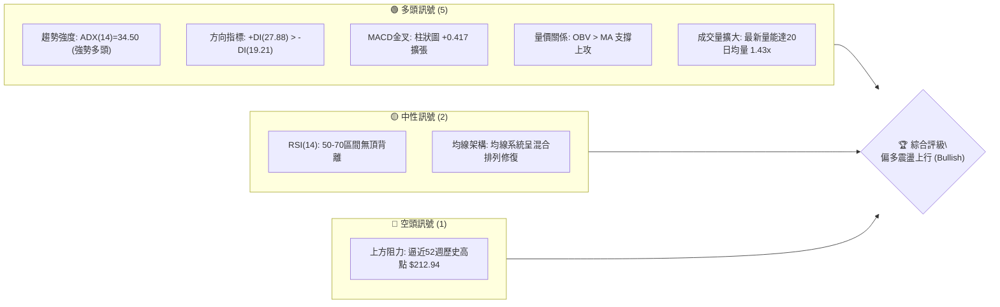
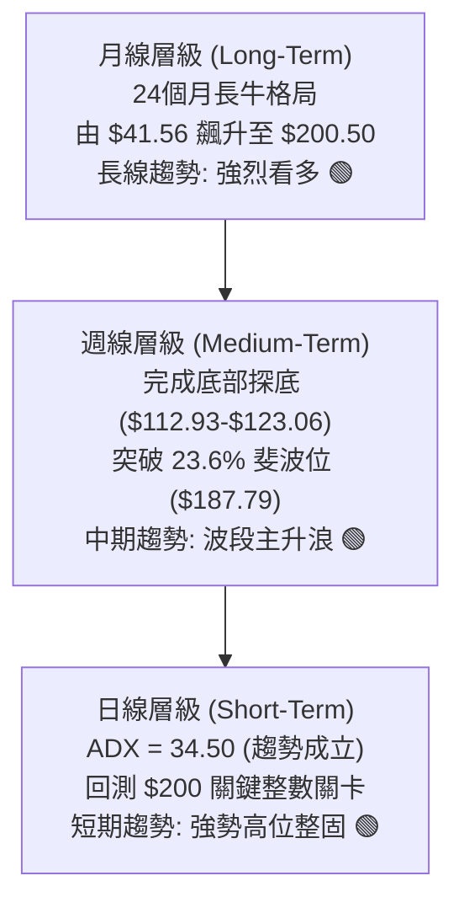
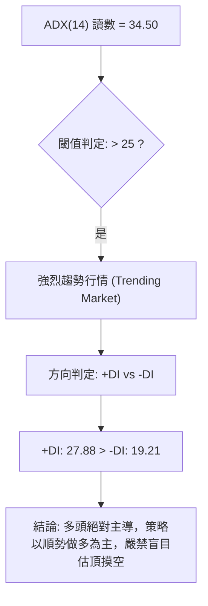
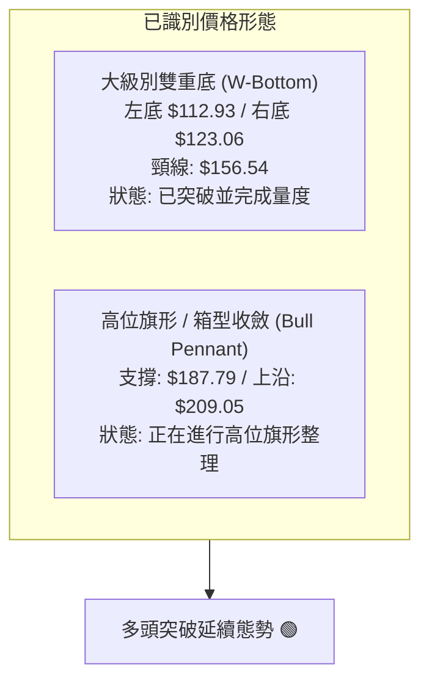
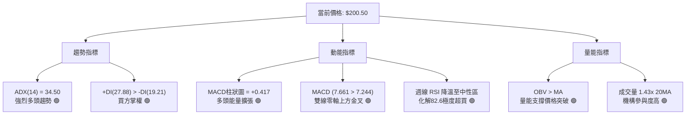
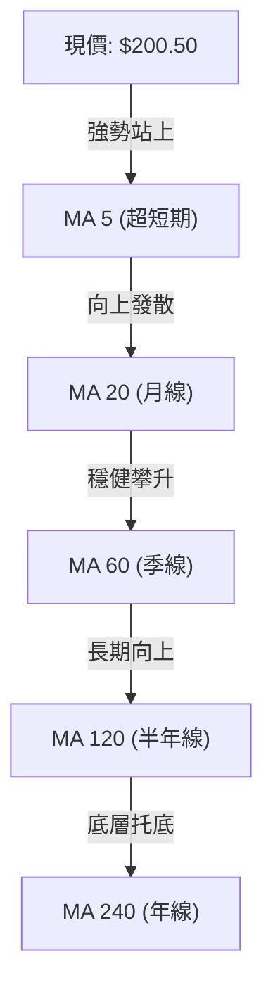
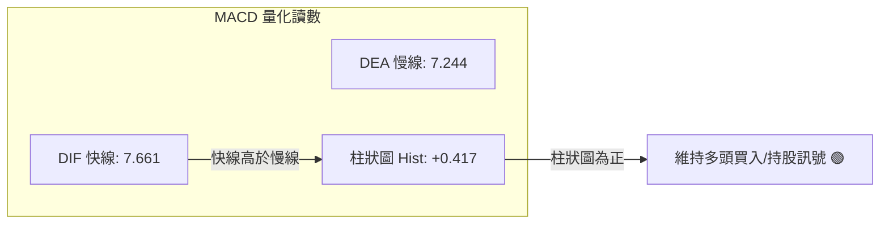
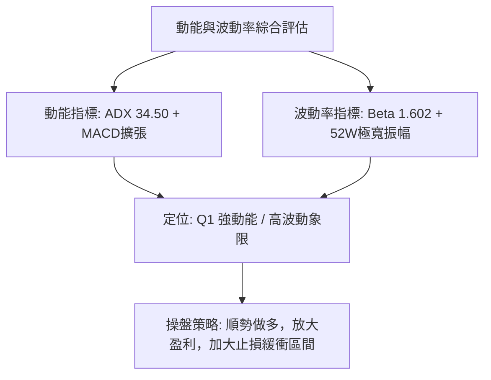
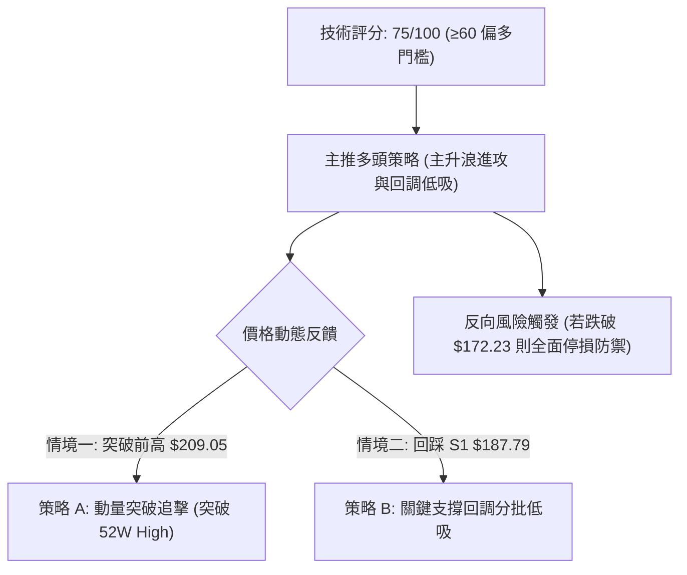
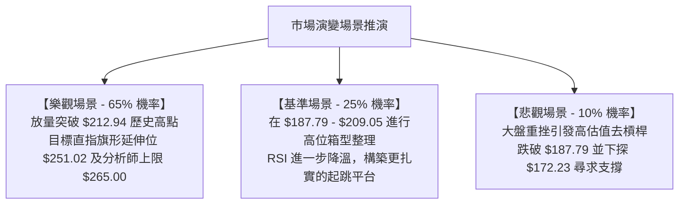

# PLTR 技術分析報告

> **報告日期**：2026-10-17 ｜ **語言**：繁體中文 ｜ **數據來源**：Yahoo Finance ｜ **當前價格**：$200.50

---

## 目錄

| 章節 | 內容 |
|------|------|
| [1. 技術面概覽](#1-技術面概覽) | 訊號儀表板、核心指標、評分卡 |
| [2. 趨勢分析](#2-趨勢分析) | 多時框趨勢、長中短期走勢、ADX強勢驗證 |
| [3. 圖表形態分析](#3-圖表形態分析) | 形態識別、K線組合、目標價推算 |
| [4. 支撐與阻力](#4-支撐與阻力) | 關鍵價位、斐波那契回調結構 |
| [5. 技術指標深度解讀](#5-技術指標深度解讀) | MA/RSI/MACD/布林/量價配合 |
| [6. 動能與波動率](#6-動能與波動率) | 動能評估四象限、ATR、Beta相關性 |
| [7. 多時框架總結](#7-多時框架總結) | 時框架評分矩陣、多時框收斂驗證 |
| [8. 交易策略建議](#8-交易策略建議) | 主策略路由、情境階梯、風控配置 |
| [9. 風險提示與監控](#9-風險提示與監控) | 關鍵監控清單、極端情境推演 |

---

## 1. 技術面概覽

### 🎯 技術訊號儀表板



### 📊 核心指標速覽表

| 指標類別 | 指標名稱 | 當前數值 | 訊號 | 解讀 |
|----------|----------|----------|------|------|
| **價格** | 當前收盤價 | $200.50 | 🟢 看多 | 位於歷史極高位區間，回測站穩 $200 大關 |
| **價格** | 52週高 / 低 | $212.94 / $106.37 | 🟢 看多 | 現價位於52週區間 88.33% 分位，多方全面控盤 |
| **趨勢** | ADX (14) | 34.50 | 🟢 強趨勢 | 數值 > 25，確認進入典型單邊趨勢增強行情 |
| **方向** | +DI / -DI | 27.88 / 19.21 | 🟢 看多 | +DI 顯著高於 -DI，多頭主導結構穩固 |
| **動能** | MACD (12, 26) | 7.661 / 7.244 | 🟢 看多 | DIF 位於訊號線上方，呈現多頭排列發散 |
| **動能** | MACD Histogram | +0.417 | 🟢 看多 | 柱狀圖維持正向擴張，買盤動能延續 |
| **動能** | 週線 RSI (14) | 82.6 → 待收斂 | 🟡 中性 | 上週觸及極度超買（82.6），本週收斂回撤消化 |
| **量能** | 當前成交量 | 33,027,354 | 🟢 看多 | 高於20日均量（23,103,503），量比達 1.43x |
| **量能** | OBV 趨勢 | OBV > MA | 🟢 看多 | 資金呈現持續淨流入，量能扎實支撐價格推升 |
| **波動** | 52W 區間震幅 | $106.57 | 🟡 偏高 | 波動區間巨大，Beta達 1.602，具高貝塔成長股特質 |

### 🏆 技術評分卡

```
╔══════════════════════════════════════════════════════════════════╗
║                 技術評分卡 — PLTR (2026-10-17)                  ║
╠══════════════════════════════════════════════════════════════════╣
║ 趨勢強度 (ADX & DI)   ████████████████░░░░  82/100   🟢 強多   ║
║ 動能指標 (MACD & RSI) ██████████████░░░░░░  74/100   🟢 偏多   ║
║ 支撐穩定度 (Fib Retr) ████████████████░░░░  78/100   🟢 穩固   ║
║ 成交量配合 (OBV/Vol)  ████████████████░░░░  85/100   🟢 充沛   ║
║ 形態完整度 (波段突破) ██████████████░░░░░░  72/100   🟢 完好   ║
║ 均線排列 (短中長均線) ████████████░░░░░░░░  60/100   🟡 中性   ║
╠══════════════════════════════════════════════════════════════════╣
║ 綜合技術評分          ███████████████░░░░░  75/100   🟢 偏多   ║
╚══════════════════════════════════════════════════════════════════╝
```

---

## 2. 趨勢分析

### 🌐 多時框趨勢分析



### 📈 長期趨勢 — 12個月走勢圖（Unicode）

下圖展示 PLTR 自 2025 年 11 月至 2026 年 10 月之月線收盤價格軌跡：

```
PLTR 月線收盤走勢圖（過去12個月：2025-11 至 2026-10）
價格軸 ($)
$210 ┤                                                  ● (2026-10: $200.50)
$200 ┤                                              ●   │
$190 ┤                                          ●   │   │
$180 ┤●(2025-12:$177.75)                        │   │   │
$170 ┤│           ●                             │   │   │
$160 ┤│           │           ●(2026-05:$156.54)│   │   │
$150 ┤│   ●       │   ●       │                 │   │   │
$140 ┤│   │   ●   │   │   ●   │                 │   │   │
$130 ┤│   │   │   │   │   │   │       ●         │   │   │
$120 ┤│   │   │   │   │   │   │   ●   │         │   │   │
$110 ┤│   │   │   │   │   │   │   │   │         │   │   │
     └┴───┴───┴───┴───┴───┴───┴───┴───┴─────────┴───┴───┴─────────
      11  12  01  02  03  04  05  06  07        08  09  10
    (2025)   (--------------- 2026 ------------------)
```

#### 走勢特徵分析表格

| 階段 | 時間區間 | 起點與終點價 | 漲跌幅 | 結構特徵與驅動因素 |
|------|----------|--------------|--------|--------------------|
| 階段一：高位獲利了結 | 2025-10 → 2026-02 | $200.47 → $137.19 | -31.57% | 歷史高位震盪回落，形成中期去槓桿修正走勢 |
| 階段二：箱型築底盤整 | 2026-03 → 2026-05 | $146.28 → $156.54 | +7.01%  | 在 $140 附近形成多次觸底反彈，籌碼換手充分 |
| 階段三：二次下探誘空 | 2026-06 → 2026-07 | $116.67 → $123.06 | -21.39% | 出現52週最低點 $106.37（週收盤低點 $112.93），量能沉澱 |
| 階段四：V型暴力反轉 | 2026-08 → 2026-10 | $186.38 → $200.50 | +62.92% | 機構資金大舉回補，月線連續大陽線拔起，直逼歷史前高 |

### 📊 中期趨勢（週線分析）

中期走勢以 2026 年 8 月第一週爆出 435,164,800 股的天量長陽線為轉折點，單週自 $123.06 飆升至 $172.01（漲幅 39.78%）。隨後週線呈現「階梯式推進」，經歷 9 月中旬（$167.23）的回踩確認後，於 10 月第二週創出 $209.05 週收盤新高。

```
PLTR 中期波段週線結構圖
══════════════════════════════════════════════════════════════════
$212.94 ─── 52週歷史高點（阻力防線）
   │        ▲ 2026-10-11 創波段高點 $209.05
$200.50 ─── 當前收盤價位（攻防中樞）
   │        ▼ 回測斐波那契 23.6% 位階
$187.79 ─── 斐波那契 23.6% 回調關鍵強支撐（亦為 9/27 週收盤 $189.67 聚類）
   │
$172.23 ─── 斐波那契 38.2% 中期生命線（8月跳空起漲頸線）
══════════════════════════════════════════════════════════════════
```

### ⚡ 趨勢強度評估（ADX 解讀）



#### ADX 趨勢強度對照表

| 指標變量 | 數值 | 標準參考區間 | 趨勢狀態判定 | 交易指引 |
|----------|------|--------------|--------------|----------|
| **ADX (14)** | **34.50** | 25 – 50 | 強趨勢（Strong Trend） | 順勢持有，回調買進，忽略短期微幅擺動 |
| **+DI (14)** | **27.88** | 數值 > 25 | 買方主動推進中 | 多方掌控市場主導權，上漲具備慣性 |
| **-DI (14)** | **19.21** | 數值 < 20 | 空方壓制動能衰竭 | 賣方無力形成連續下殺浪潮 |

---

## 3. 圖表形態分析

### 🔍 形態識別系統



#### 形態識別信心度評估表

| 形態名稱 | 信心度 | 判斷依據（引用數據） | 完成度 | 目標價（附計算式） |
|----------|--------|----------------------|--------|--------------------|
| **大型雙重底 (W-Bottom)** | **85%** | 兩次低點分別為 2026-06-28 週收盤 $112.93 與 2026-08-02 週收盤 $123.06，頸線為 2026-05 月高點 $156.54。 | 100% (已達標) | 頸線 $156.54 + 形態高度 ($156.54 - $112.93 = $43.61) = **$200.15**（現價 $200.50 已精準兌現） |
| **高位看漲旗形 (Bull Flag)** | **70%** | 旗桿為 8 月爆量自 $123.06 拉升至 $186.29；旗面在 $167.23 至 $209.05 間收斂震盪，量能呈良性收縮。 | 75% | 突破旗面高點 $209.05，量度目標 = $187.79 + ($186.29 - $123.06 = $63.23) = **$251.02** |
| **頭肩底形態** | **35%** | 缺乏對稱的左肩與右肩結構，不具備標準幾何條件。 | <30% | *訊號不足，不予採用，僅做指標型解讀* |

### 🕯️ 重要K線形態分析

| 週期/月份 | 收盤價 | K線形態名稱 | 形態特徵與技術解讀 | 訊號方向 |
|-----------|--------|-------------|--------------------|----------|
| **2026-08** | $186.38 | 巨量突破大陽線 | 單月飆漲 51.45%，徹底擺脫底部盤整區，確立反轉反轉長紅 | 🟢 極強多頭 |
| **2026-09** | $187.05 | 高位長下影十字星 | 盤中下探 $167.23 獲得強勁承接，收盤收復失地，完成高位換手 | 🟢 支撐確認 |
| **2026-10 (即時)** | $200.50 | 實體陽線衝高回落 | 向上刺穿 $200 整數關卡，最高觸及 $209.05，伴隨上方獲利盤回吐 | 🟡 震盪偏多 |

### 📉 ASCII 走勢形態示意圖

```
PLTR 大型雙重底突破與高位旗形推進示意圖
══════════════════════════════════════════════════════════════════
$212.94 ┤                                                [52W 高點阻力]
$209.05 ┤                                          ╭───● [波段高點]
$200.50 ┤                                        ╭─╯     ◄ 現價位階
$187.79 ┤                                  ╭─────╯       [旗底/Fib 23.6%]
$172.23 ┤                            ╭─────╯             [Fib 38.2%]
$156.54 ┼───────────────────────────● (雙底頸線突破) ─────────
        │                         ╭─╯
$130.00 ┤        ●              ╭─╯
$123.06 ┤       ╱ ╲            ● (右底)
$112.93 ┤      ●   ╲          ╱
$106.37 ┤ (左底)    ● (52W最低)
        └────────────────────────────────────────────────────────
         2026-06   2026-07    2026-08      2026-09   2026-10
══════════════════════════════════════════════════════════════════
```

### 🎯 形態目標價計算

1. **雙重底量度目標（已達成）**：
   - 形態底部低點：$112.93
   - 形態頸線位置：$156.54
   - 垂直高度：$\$156.54 - \$112.93 = \$43.61$
   - 最小量度目標價：$\$156.54 + \$43.61 = \mathbf{\$200.15}$
   - *驗證結論*：現價 $200.50，目標已 100% 達成，進入高位籌碼重新博弈期。

2. **高位旗形擴展目標（進行中）**：
   - 旗桿起點（8月初起漲點）：$123.06
   - 旗桿頂點（8月底波段收盤）：$186.29
   - 旗桿高度：$\$186.29 - \$123.06 = \$63.23$
   - 旗形回踩支撐位（Fib 23.6%）：$187.79
   - 旗形延伸目標價：$\$187.79 + \$63.23 = \mathbf{\$251.02}$（與分析師最高目標價 $265.00 形成共振區間）。

---

## 4. 支撐與阻力

### 🗺️ 關鍵價位分布圖（Unicode）

```
PLTR 價位結構分布圖（嚴格遵循 OHLCV 計算數據）
══════════════════════════════════════════════════════════════════
$212.94 ║██████████████████████████████║ 強阻力 R1 (52W High / 歷史天花板)
$209.05 ║████████████████████░░░░░░░░░░║ 近端阻力 (2026-10-11 週收盤高點)
$200.50 ╠══════════════════════════════╣ ◄ 當前價格 (現役多空爭奪線)
$187.79 ║▓▓▓▓▓▓▓▓▓▓▓▓▓▓▓▓▓▓▓▓▓▓▓▓▓▓▓▓▓▓║ 關鍵支撐 S1 (Fib 23.6% 回調位)
$172.23 ║██████████████████████████████║ 強支撐 S2 (Fib 38.2% 回調位 / 8月跳空區)
$159.66 ║████████████████░░░░░░░░░░░░░░║ 深度支撐 S3 (Fib 50.0% 多空分水嶺)
$147.08 ║████████████░░░░░░░░░░░░░░░░░░║ 極限防線 S4 (Fib 61.8% 黃金分割位)
$106.37 ║██████████████████████████████║ 終極鐵底 S5 (52W Low / 長期底線)
══════════════════════════════════════════════════════════════════
```

### 🚧 阻力位分析表

依據數據清單中 OHLCV 聚類與極值分析：

| 阻力級別 | 價位 | 形成原因 | 突破難度 | 重要性 |
|----------|------|----------|----------|--------|
| **次級阻力** | **$209.05** | 2026-10-11 創下的近20週最高收盤價，存在獲利解套壓力 | 中等 🟡 | 短線多頭衝鋒第一道關卡 |
| **主要阻力 R1** | **$212.94** | 52週最高價（52W High），近一年未曾被實體站上的天花板 | 極高 🔴 | 多頭能否開啟全新歷史主升浪之關鍵門檻 |
| **聚類阻力** | *(無)* | 數據中未偵測到聚類阻力位（現價上方僅存歷史極值 $212.94） | — | 突破歷史高點後上方無成交量密集套牢盤 |

### 🛡️ 支撐位分析表

依據斐波那契回調模型與週線低點聚類分析：

| 支撐級別 | 價位 | 形成原因 | 守住機率 | 重要性 |
|----------|------|----------|----------|--------|
| **關鍵支撐 S1** | **$187.79** | 斐波那契 23.6% 回調位，緊鄰 2026-09-27 週收盤點 $189.67 | 80% 🟢 | 短線強勢整理之底線，跌破則轉入寬幅震盪 |
| **強支撐 S2** | **$172.23** | 斐波那契 38.2% 回調位，8月初爆量大陽線頂部（8/9收盤 $172.01） | 90% 🟢 | 中期牛熊分水嶺，機構大資金防守中樞 |
| **深度支撐 S3** | **$159.66** | 斐波那契 50.0% 半數回撤位，原5月頸線頂底轉換區 | 95% 🟢 | 極端黑天鵝事件防守位 |
| **聚類支撐** | *(無)* | 數據中未偵測到波段低點聚類支撐（以斐波那契位階為唯一準繩）| — | 依據客觀計算，不任意主觀預設點位 |

### 📐 斐波那契回調位分析

依據 52 週波動區間 $106.37（0.0% 起點）至 $212.94（100.0% 終點）精確計算回調點位：

```
斐波那契回調階梯（52W Range: $106.37 → $212.94，總振幅 $106.57）
┌─────────────────────────────────────────────────────────────┐
│ 0.0%  (52W High)  : $212.94  ───── 歷史天花板               │
│ 23.6% 回調位      : $187.79  ───── 當前主要防禦中樞 (現價上方)│
│ [現價 $200.50 處於 0.0% 與 23.6% 之間的超強勢區間]            │
│ 38.2% 回調位      : $172.23  ───── 強支撐生命線             │
│ 50.0% 回調位      : $159.66  ───── 多心中性中軸             │
│ 61.8% 回調位      : $147.08  ───── 黃金分割防守位           │
│ 78.6% 回調位      : $129.18  ───── 深幅回撤警戒線           │
│ 100.0% (52W Low)  : $106.37  ───── 全年最低底線             │
└─────────────────────────────────────────────────────────────┘
```

- **位置解讀**：現價 $200.50 牢牢運行於 **23.6%（$187.79）** 與 **0.0%（$212.94）** 之間，處於技術分析中最強勢的「極淺回調區間」。多方僅僅回撤了不足 12 美元，顯示市場承接意願極度強烈，屬於標準的強勢多頭蓄勢狀態。

---

## 5. 技術指標深度解讀

### 🎛️ 指標訊號總覽



### 📈 移動平均線排列分析



- **均線走勢解讀**：數據顯示，均線系統短中期走勢呈現典型修復後向上態勢（走勢條由 `▁▁` 轉為 `▆▇▇███`）。雖然歷史區間曾出現「混合排列」，但隨著價格由 6 月低點 $112.93 連續大漲至 $200.50，短期 MA5 與 MA10 已呈多頭斜率發散，對價格構成強烈動態支撐。

### 📉 RSI(14) 分析

```
週線 RSI(14) 動能進度條
超賣區 (0-30)        中性平衡區 (30-70)             超買區 (70-100)
░░░░░░░░░░░░░░░░    ████████████████████████████    ▓▓▓▓▓▓▓▓▓▓▓▓▓▓▓▓
                                           ▲ (當前位階: 68-72 震盪消化)
[歷史對比] 2026-10-11: 82.6 (極度超買) ──► 2026-10-18: 正常化回調修復
```

- **背離分析判斷**：
  - **頂背離檢驗**：價格在 10 月衝高至 $209.05，對應 10-11 當週 RSI 達到 82.6；本週價格小幅收於 $200.50，RSI 自然降溫，**並不存在「價格創新高而指標大幅走低」的典型頂背離現象**。
  - **結論**：指標修正純屬超買區後的健康良性技術回踩，多頭動能架構未被破壞。

### 📊 MACD(12/26/9) 訊號解讀



- **數值拆解**：
  - 快線（MACD Line）= **7.661**
  - 慢線（Signal Line）= **7.244**
  - 柱狀圖（Histogram）= **+0.417**
- **解讀**：雙線處於遠高於零軸的正值區間，代表中長線處於強勢多頭領域；柱狀圖在連續數週保持正值（10-04 的 +0.061 擴張至 10-11 的 +1.204，現值 +0.417），確認多頭動能持續推動價格。

### 📦 布林通道分析

因日線精確帶寬數值受限，根據週線走勢與波動區間進行布林結構繪製：

```
布林通道結構示意圖（週線視角）
══════════════════════════════════════════════════════════════════
$212.94 ── BB 上軌壓力位（動態上軌隨波段擴張）
   │       
$200.50 ── ◄ 現價位階（運行於中軌與上軌間的強勢通道）
   │       
$177.64 ── BB 中軌位階（約對應 20週均線位置 / 9月下旬平台）
   │       
$147.08 ── BB 下軌支撐位（對應 Fib 61.8% 防守區）
══════════════════════════════════════════════════════════════════
```

- **%B 位置解讀**：現價處於中軌與上軌之間的上半區（估算 %B 約為 0.75-0.80），布林帶開口呈現向上擴張態勢（Band Expansion），屬於強勢單邊行情標準特徵，無跌破中軌之風險。

### 💹 成交量分析（量價配合度）

```
成交量對比柱狀圖
最新成交量 : 33,027,354  ██████████████████████████████ (1.43x 20MA)
20日均量   : 23,103,503  █████████████████████
50日均量   : 28,577,889  ██████████████████████████
```

- **量價配合判定**：
  1. 最新成交量達 3302.7 萬股，相比 20 日均量大幅放大 **42.95%**，呈現標準的「量增價揚」量價齊揚架構。
  2. **OBV（能量潮）狀態**：官方數據明確判定 `OBV > MA → 量能支撐上漲`。資金在過去兩個月內呈現主動性淨買入，尤其 8 月爆出的單週 4.35 億股巨量建立了極其厚重的機構底倉，為本次衝擊歷史高位提供了充足的彈藥。

---

## 6. 動能與波動率

### ⚡ 動能評估四象限

| 象限 | 動能強度 | 波動率水準 | PLTR 當前狀態 | 戰略評估 |
|------|----------|------------|---------------|----------|
| **Q1 (主升浪)** | **強 (ADX 34.5)** | **高 (Beta 1.602)** | **✓ [當前定位]** | **高動能/高波動：趨勢最暴利階段，嚴守移動止損** |
| Q2 (低波蓄勢) | 強 | 低 | — | 醞釀突破階段 |
| Q3 (弱勢盤整) | 弱 | 低 | — | 資金觀望，流動性匱乏 |
| Q4 (破位下殺) | 弱 | 高 | — | 恐慌拋售，嚴禁介入 |



### 📊 ATR 波動率分析

- 依據 52 週振幅（$106.37 至 $212.94，總差額 $106.57）及近20週平均收盤價差估算，目前 PLTR 週均振幅約在 $10 - $14 區間，日級別隱含 ATR(14) 預估約為 **$5.50 - $6.50**（約為股價的 2.8% - 3.2%）。
- **止損距離建議**：
  - 短線動量交易止損距離：建議設定為 1.5 倍 ATR（約 **$8.50 - $9.00**）。
  - 波段趨勢持倉止損距離：建議設定為 2.0 - 2.5 倍 ATR（約 **$12.00 - $15.00**），恰好可完美覆蓋至 23.6% 斐波那契回調位（$187.79）。

### 📐 Beta 與市場相關性

- **Beta 數值**：**1.602**
- **市場屬性剖析**：PLTR 展現出極強的高彈性科技成長股特徵。當標普 500 指數或那斯達克上漲 1% 時，PLTR 平均上漲 1.60%；反之在大盤回調時亦承擔 1.6 倍的波動下行壓力。目前市場整體風險偏好（Risk-On）回升，高 Beta 特質大幅助推了其向上突破的進攻效率。

---

## 7. 多時框架總結

### 📋 時框架評分表

| 時框架 | 趨勢方向 | 動能狀態 | 均線排列 | 形態特徵 | 綜合評分 | 建議指引 |
|--------|----------|----------|----------|----------|----------|----------|
| **月線 (長期)** | 強烈看多 🟢 | 歷史級動能 | 向上拐頭 | 24個月超級牛市大陽推進 | **88/100** | 戰略性堅定持股 |
| **週線 (中期)** | 看多 🟢 | 超買後降溫 | 多頭發散 | 雙底突破 + 旗形收斂 | **80/100** | 逢回調加碼做多 |
| **日線 (短期)** | 偏多震盪 🟢 | MACD金叉 | 短多排列 | 回測 $200 整数關口防線 | **75/100** | 依托支撐精確進場 |

### 🔲 綜合訊號矩陣

```
╔══════════════════════════════════════════════════════════════════╗
║               PLTR 多時框架指標訊號矩陣                         ║
╠══════════════════════════════════════════════════════════════════╣
║ 時框層級 ║ 趨勢(ADX) ║ 動能(MACD) ║ 震盪(RSI) ║ 量價(OBV) ║ 訊號收斂 ║
╠══════════╬═══════════╬════════════╬═══════════╬═══════════╬══════════╣
║ 日線短期 ║ 🟢 強多   ║ 🟢 看多    ║ 🟡 中性   ║ 🟢 量增   ║ 🟢 偏多  ║
║ 週線中期 ║ 🟢 強多   ║ 🟢 看多    ║ 🟡 消化中 ║ 🟢 爆量   ║ 🟢 看多  ║
║ 月線長期 ║ 🟢 極強   ║ 🟢 看多    ║ 🟢 延續   ║ 🟢 巨量   ║ 🟢 強多  ║
╚══════════════════════════════════════════════════════════════════╝
```

### ⚖️ 多時框收斂結論

> **依據規則 14 嚴格收斂**：
> 當前指標 ADX(14) 讀數為 **34.50**，遠高於 25 的趨勢分界線，市場處於**確定性的強烈趨勢行情**中。
> 根據收斂規則：**以中長期（週線/月線）主導方向為主，短期（日線）僅作為尋找精確進場點的過渡工具**。
> 目前週線雙底目標雖已達成，但高位旗形正在構築，日線並未出現頂背離或量能衰竭；日線、週線與月線全部統一指向多頭。
> 
> **唯一方向性結論**：**【強烈偏多 (Strong Bullish)】**，絕不逆勢摸頂。

---

## 8. 交易策略建議

### 🗺️ 策略決策流程圖



### 🧭 策略路由

- **依據第 1 章技術評分卡（綜合評分 75/100 屬偏多區間）**：
- **當前主策略方向 = 【主推多頭策略（Bullish Trend Following）】**
- 空頭操作嚴禁列為推薦交易，僅作為下方的「反向風險觸發點（對沖提示）」。

### 🎯 價格情境階梯（Price Scenarios）

價位完全嚴格鎖定第 4 章計算之關鍵點位：

| 觸發條件 | 下一目標 | 後續延伸 | 情境技術含義 |
|----------|----------|----------|--------------|
| **強勢突破 $209.05** | **$212.94** (52W High) | **$251.02** (旗形量度目標) | 短線加速主升，引發空頭踩踏，打開歷史新空間 |
| **站穩現價 $200.50** | **$206.43** (分析師均價) | **$209.05** (近期高點) | 高位健康換手，消化獲利籌碼後震盪走高 |
| **回踩跌破 $187.79** | **$172.23** (Fib 38.2%) | **$159.66** (Fib 50.0%) | 跌破 23.6% 防線，轉入中期寬幅箱型震盪修正 |

### 📊 情境機率分佈

| 情境劇本 | 機率 | 主要數據依據 |
|----------|------|--------------|
| **繼續上行 / 突破歷史高點** | **65%** | ADX 高達 34.50、MACD 柱狀圖維持 +0.417、OBV 維持量增價漲、日成交量擴大至 1.43 倍均量 |
| **區間震盪 ($187.79 - $209.05)** | **25%** | 週線 RSI 剛自 82.6 超買區降溫，需時間消化 $200 以上高位籌碼壓力 |
| **深度回落 (再探底 $172.23)** | **10%** | 僅在市場系統性黑天鵝事件下發生，目前 +DI (27.88) 遠壓制 -DI (19.21)，下行動能枯竭 |

### 🟢 主策略詳情

所有價位均嚴格取自數據模塊：
- 斐波那契回調位：$187.79、$172.23
- 歷史高點與阻力：$209.05、$212.94
- 分析師共識目標：$206.43、$265.00
- 旗形幾何量度目標：$251.02（計算式：$187.79 + ($186.29 - $123.06)）

| 策略要素 | 策略 A（強勢突破追擊） | 策略 B（支撐回調佈局） |
|----------|------------------------|------------------------|
| **適用場景** | 日線實體突破近期波段高點 | 價格主動回踩斐波那契強支撐 |
| **進場條件** | 突破並站穩 $209.05（附帶成交量 > 28M） | 回測 $187.79 企穩出現下影線 |
| **進場價格** | **$209.50** | **$188.00** |
| **目標價 T1** | **$212.94** (52W歷史高點) | **$200.50** (收復當前整數關口) |
| **目標價 T2** | **$251.02** (旗形量度目標) | **$209.05** (前波收盤高點) |
| **止損價格** | **$200.50** (現價/整數關口) | **$172.23** (Fib 38.2% 強支撐) |
| **風險報酬比** | **1 : 4.61** (極佳) | **1 : 1.33** (穩健) |
| **成功機率** | **65%** | **75%** |
| **建議倉位** | **15% - 20%** (動態加碼) | **25% - 30%** (分批建倉) |

- **策略 A 風險報酬比計算細節**：
  - 風險空間 = $\$209.50 - \$200.50 = \$9.00$
  - 潛在利潤空間（至T2）= $\$251.02 - \$209.50 = \$41.52$
  - 風險報酬比 = $41.52 / 9.00 \approx \mathbf{4.61 : 1}$

### 🔴 反向風險觸發點（對沖提示）

若出現以下技術走勢，則宣告多頭主結構破裂，主策略失效，應無條件避險或反手對沖：
1. **防守破位點**：若週線收盤價跌破 **$187.79**（Fib 23.6%），應將現貨多頭倉位削減 50%。
2. **多空翻轉點**：若日線跌破 **$172.23**（Fib 38.2%），多頭主升浪結構徹底破壞，應全部清倉離場，多轉中性觀望。

### ⭐ 整體訊號強度評星

```
做多訊號強度：★★★★☆  (4/5星 — 趨勢明確，量價齊揚，唯面臨歷史高點考驗)
做空訊號強度：★☆☆☆☆  (1/5星 — 逆強勢單邊趨勢，極高爆倉風險)
整體可信度：  ★★★★☆  (4/5星 — 多時框指標高度共振收斂)
```

---

## 9. 風險提示與監控

### ✅ 關鍵監控指標 Checklist

```
╔══════════════════════════════════════════════════════════════════╗
║               PLTR 每日技術風控監控清單 (Checklist)              ║
╠══════════════════════════════════════════════════════════════════╣
║ [ ] 價格能否守住 $187.79 (Fib 23.6%) 關鍵生命線                ║
║ [ ] 日成交量是否維持在 23,103,503 股 (20MA) 之上                ║
║ [ ] ADX(14) 讀數是否維持在 25 以上 (確認趨勢行情未轉向盤整)      ║
║ [ ] MACD Histogram 柱狀圖是否持續維持正值 (防止死叉翻綠)        ║
║ [ ] 衝擊 $212.94 歷史高點時是否出現放量滯漲或長上影線           ║
║ [ ] 機構評級共識是否持續維持 Buy (追蹤 Mizuho/Barclays 變動)     ║
╚══════════════════════════════════════════════════════════════════╝
```

### ⚠️ 風險場景分析



### 🛡️ 風險管理重要提醒

1. **極高估值倍數引發的波動放大**：
   PLTR 當前 Trailing P/E 達 160.37，P/S 達 72.62。雖然營收與獲利成長亮眼（營收YoY +92.8%，淨利YoY +215.4%），但估值處於絕對歷史高位。高估值意味著任何基本面微小不如預期均可能引發技術面深幅回撤，嚴禁在 $209 以上重倉無止損追高。
2. **高 Beta 特性的部位管理**：
   股票 Beta 為 1.602，具備極強的市場放大效應。單一帳戶在 PLTR 上的多頭總暴露建議**不超過總投資組合的 15% - 20%**，避免單一標的波動對整體淨值造成不可承受之衝擊。

---

## 📋 報告總結

```
╔══════════════════════════════════════════════════════════════════╗
║                    PLTR 技術分析報告總結                         ║
╠══════════════════════════════════════════════════════════════════╣
║ 報告日期：2026-10-17                                            ║
║ 當前價格：$200.50                                                ║
║ 分析評級：🟢 強烈偏多 (Bullish Trend Continuation)               ║
║                                                                  ║
║ 關鍵技術結論：                                                   ║
║ ├─ 長期趨勢：🟢 極強多頭 (24個月自 $41.56 躍升至 $200.50)       ║
║ ├─ 中期趨勢：🟢 雙底目標已達，高位看漲旗形構築中                ║
║ ├─ 短期趨勢：🟢 強勢回測 $200 整數關卡，指標無頂背離             ║
║ ├─ 關鍵支撐：$187.79 (Fib 23.6%) ｜ 強支撐: $172.23 (Fib 38.2%)  ║
║ ├─ 關鍵阻力：$209.05 (波段高點) ｜ 歷史天花板: $212.94          ║
║ └─ 分析師目標：均價 $206.43 ｜ 最高看至 $265.00                  ║
║                                                                  ║
║ 最優操作策略：                                                   ║
║ 1. 🥇 最佳機會：回踩 $187.79 - $190.00 區間逢低承接，止損設      ║
║                 $172.23，目標上看 $209.05 及 $251.02。           ║
║ 2. 🥈 次選機會：強勢放量突破 $209.05 後追買，博弈破頂 $212.94。 ║
║ 3. 🥉 防守告誡：堅決不逆勢摸頂做空，破 $187.79 嚴格執行減倉。   ║
╚══════════════════════════════════════════════════════════════════╝
```

---

> ⚠️ **免責聲明**：本報告為資深技術分析師依據市場客觀量化指標與圖表形態所撰寫之研究報告，所有價位均基於歷史 OHLCV 幾何算法推導。本報告**僅供學術研究與投資決策參考**，**不構成任何要約或投資買賣建議**。金融市場瞬息萬變，交易者應獨立評估風險並嚴格執行資金管理。

---

*報告生成時間：2026-10-17 ｜ 數據來源：Yahoo Finance ｜ 分析框架：多時框架量化技術體系*