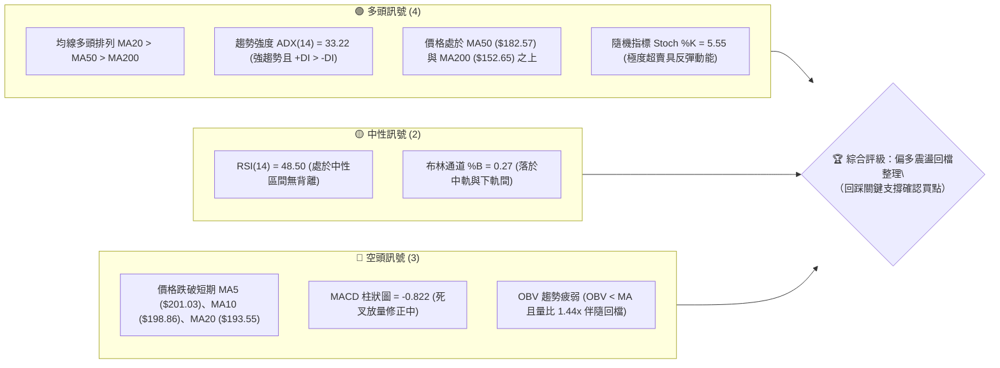
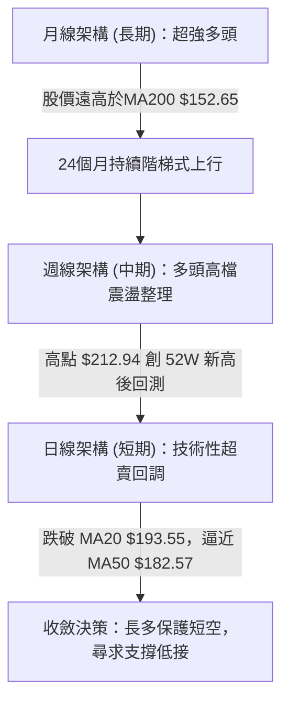
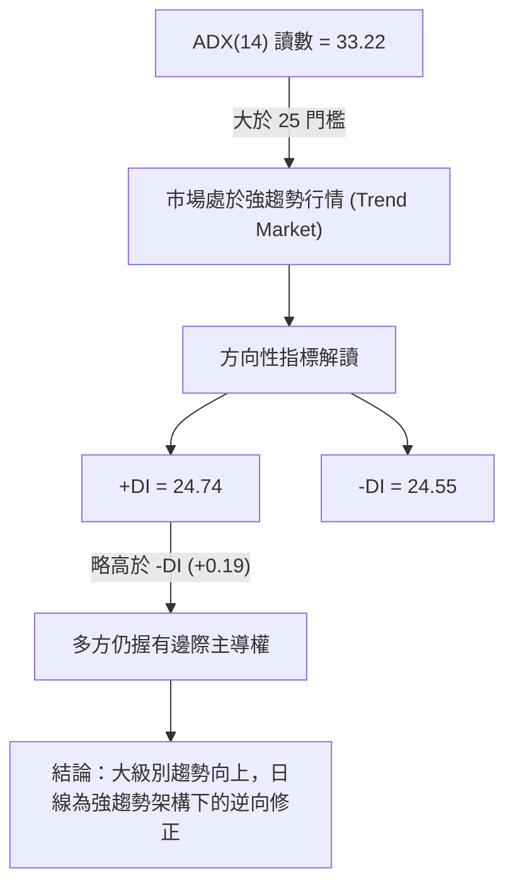
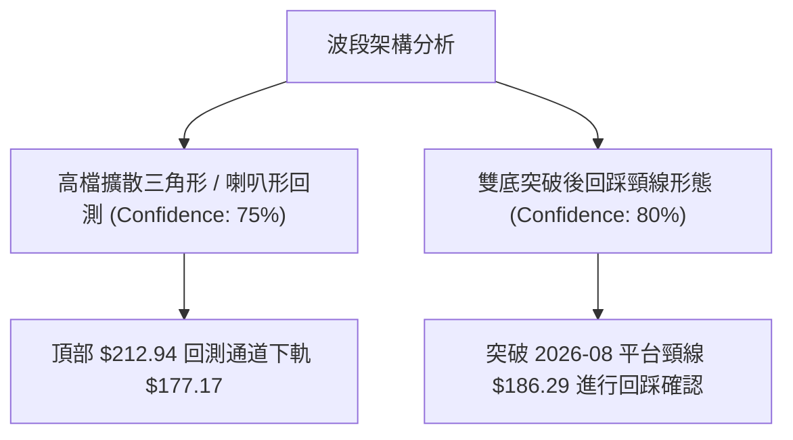
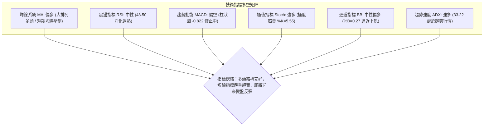
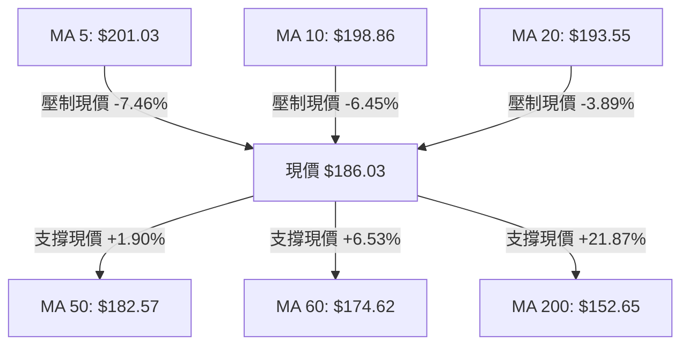
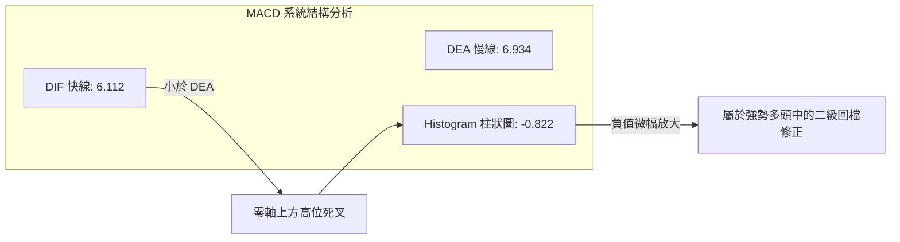
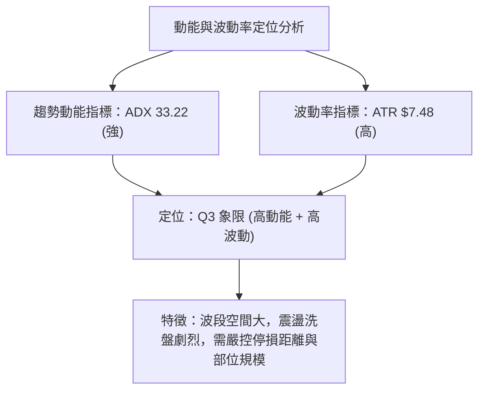
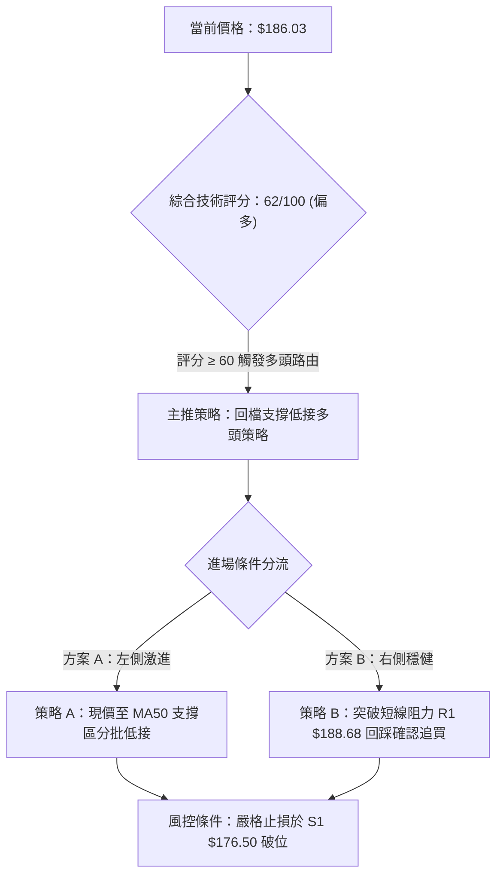
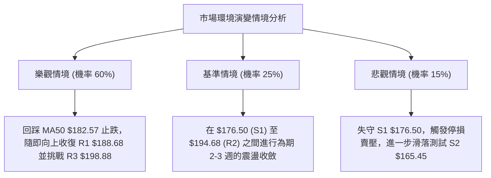

# PLTR 技術分析報告

> **報告日期**：2026-10-19 ｜ **語言**：繁體中文 ｜ **數據來源**：Yahoo Finance ｜ **當前價格**：$186.03

---

## 目錄

| 章節 | 內容 |
|------|------|
| [1. 技術面概覽](#1-技術面概覽) | 訊號儀表板、核心指標、評分卡 |
| [2. 趨勢分析](#2-趨勢分析) | 多時框趨勢、長中短期走勢、ADX強度 |
| [3. 圖表形態分析](#3-圖表形態分析) | 形態識別、K線組合、形態目標價 |
| [4. 支撐與阻力](#4-支撐與阻力) | 關鍵價位、斐波那契回調位分析 |
| [5. 技術指標深度解讀](#5-技術指標深度解讀) | MA/RSI/MACD/布林/成交量/OBV |
| [6. 動能與波動率](#6-動能與波動率) | 動能象限、ATR波動率、Beta解讀 |
| [7. 多時框架總結](#7-多時框架總結) | 時框架評分、訊號矩陣、收斂結論 |
| [8. 交易策略建議](#8-交易策略建議) | 策略路由、價格情境、主策略詳情 |
| [9. 風險提示與監控](#9-風險提示與監控) | 監控指標Checklist、風險場景分析 |

---

## 1. 技術面概覽

### 🎯 技術訊號儀表板



### 📊 核心指標速覽表

| 指標類別 | 指標名稱 | 當前數值 | 訊號 | 解讀 |
|----------|----------|----------|------|------|
| **價格** | 當前價格 | $186.03 | 🟡 | 位於52週區間 74.7%，自高點 $212.94 回調 -12.64% |
| **均線** | 短期 MA20 | $193.55 | 🔴 | 現價位於 MA20 下方 (-3.89%)，短線承壓 |
| **均線** | 中期 MA50 | $182.57 | 🟢 | 現價守於 MA50 之上 (+1.90%)，中期上升趨勢完好 |
| **均線** | 長期 MA200| $152.65 | 🟢 | 現價大幅高於 MA200 (+21.87%)，長期多頭確立 |
| **動能** | RSI(14) | 48.50 | 🟡 | 位於 30–70 中性平衡區，高檔鈍化後回落消化完畢 |
| **動能** | MACD(12,26,9)| 6.112 / 6.934 | 🔴 | DIF 線低於 DEA 線，柱狀圖 -0.822，處於空頭修正段 |
| **動能** | Stoch %K / %D| 5.55 / 39.59 | 🟢 | %K 進入個位數極端超賣區，醞釀技術性反抽 |
| **趨勢** | ADX(14) | 33.22 | 🟢 | ADX > 25 且 +DI(24.74) > -DI(24.55)，大級別為強多頭趨勢 |
| **通道** | 布林通道 %B | 0.27 | 🟡 | 下軌 $177.17 提供動態保護，當前逼近超賣下緣 |
| **波動** | ATR(14) | $7.48 | 🟡 | 波動率佔股價 4.02%，日間洗盤幅度較大 |
| **量能** | 成交量 / 20MA | 1.44x | 🔴 | 成交量 33.25M 高於均量，伴隨下跌放量需留意籌碼換手 |

### 🏆 技術評分卡

```
╔══════════════════════════════════════════════════════════════════╗
║              技術評分卡 — PLTR (2026-10-19)                     ║
╠══════════════════════════════════════════════════════════════════╣
║ 趨勢強度 (ADX & DMI)  ██████████████░░░░  72/100  🟢 趨勢強勁   ║
║ 動能指標 (RSI & MACD) ████████░░░░░░░░░░  42/100  🔴 短線疲弱   ║
║ 支撐穩定度 (S1-S3)    ██████████████░░░░  75/100  🟢 支撐密集   ║
║ 成交量配合 (OBV & 均量)████████░░░░░░░░░░  45/100  🔴 量能背離   ║
║ 形態完整度 (波段結構) ████████████░░░░░░  65/100  🟡 高檔收斂   ║
║ 均線架構 (MA 排列)    ██████████████░░░░  73/100  🟢 多頭排列   ║
╠══════════════════════════════════════════════════════════════════╣
║ 綜合評分              ████████████░░░░░░  62/100  🟢 偏多回檔   ║
╚══════════════════════════════════════════════════════════════════╝
```

---

## 2. 趨勢分析

### 🌐 多時框趨勢分析



### 📈 長期趨勢 — 12個月走勢圖（Unicode）

```
PLTR 月線走勢圖（過去12個月：2025-10 至 2026-10）
價格軸 ($)
$210 ┤                                      ● (52W高點 $212.94)
$200 ┤ ● (2025-10: $200.47)                 │
$190 ┤  ╲                                  │ ●←現價 $186.03
$180 ┤   ╲       ● ($177.75)   ● ($186.38)─● ($187.05)
$170 ┤    ● ($168.45)           │
$160 ┤                         ● ($156.54)
$150 ┤         ● ($146.59)      │
$140 ┤              ● ($137.19) │
$130 ┤                          │   ● ($123.06)
$120 ┤                          │  ╱
$110 ┤                          ● ($116.67) ◄ (2026-06 波段低點)
     └────────────────────────────────────────────────────────
       10  11  12  01  02  03  04  05  06  07  08  09  10 (月)
       (2025年)               (2026年)
```

#### 走勢特徵分析表格

| 階段區間 | 起訖月份 | 區間低點/高點 ($) | 漲跌幅 | 結構特徵與成交量解讀 |
|----------|----------|-------------------|--------|----------------------|
| **第一階段：高檔修正** | 2025-10 ~ 2026-02 | $200.47 → $137.19 | -31.57% | 歷史初次衝高破兩百後獲利了結，成交量呈階梯遞減 |
| **第二階段：雙底築底** | 2026-02 ~ 2026-06 | $137.19 → $116.67 | -14.96% | 測試 52週低點 $106.37 上方支撐，6月落底放量換手 |
| **第三階段：主升推升** | 2026-06 ~ 2026-08 | $116.67 → $186.38 | +59.75% | 2026-08-09 週成交放巨量 4.35 億股，強力V型反轉 |
| **第四階段：高檔震盪** | 2026-08 ~ 2026-10 | $186.38 → $212.94 | +14.25% | 刷新52週新高 $212.94，目前回調至 $186.03 尋求支撐 |

### 📊 中期趨勢（週線分析）

中期走勢呈現由 2026 年 8 月初巨量突破引導的中級上升通道。近 20 週收盤走勢顯示，2026-08-09 突破週爆出 435,164,800 股歷史天量，確立了中期的基底。隨後經過連續 10 週的推升，於 2026-10-11 創下收盤 $209.05 及盤中 52W 高點 $212.94。

近期週線拉回至 $186.03，剛好落在 2026-08-30 收盤價 $186.29 形成的平台支撐處。此處為前波突破平台的頸線位置，中期多頭結構並未被破壞。

```
週線級別支撐阻力結構示意：
[阻力 52W High]  $212.94 ───┐ (2026-10-11 觸頂 $209.05)
                             ▼
[回檔測試中]     $186.03 ───◄ (現價：回踩8月平台高點 $186.29)
                             ▲
[中期生命線]     $182.57 ───┴ (MA50 上揚支撐防線)
```

### ⚡ 趨勢強度評估（ADX 解讀）



#### ADX 強度對照表

| 指標名稱 | 當前數值 | 參考標準 | 趨勢判定 | 行情屬性解讀 |
|----------|----------|----------|----------|--------------|
| **ADX(14)** | 33.22 | > 25 (強趨勢) | 🟢 強趨勢延續 | 市場非無方向盤整，波段操作應順應大級別均線方向 |
| **+DI(14)** | 24.74 | 高於 -DI | 🟢 多頭佔優 | 買方動能雖有收斂，但尚未被空方實質逆轉 |
| **-DI(14)** | 24.55 | 低於 +DI | 🟡 空頭抬頭 | -DI 快速上升逼近 +DI，顯示短線賣壓加速湧現 |

---

## 3. 圖表形態分析

### 🔍 形態識別系統



#### 形態識別與信心度評估表

| 形態名稱 | 信心度 | 判斷依據（引用數據） | 完成度 | 目標價（附計算式） |
|----------|--------|----------------------|--------|--------------------|
| **大級別雙底回踩 (W底)** | 80% | 2026-06 低點 $116.67 與 2026-07 低點 $123.06 構築底部，頸線為 2026-08 平台 $186.29 | 85% | 頸線 $186.29 + 形態高度 ($186.29 - $116.67 = $69.62) = **$255.91** (逼近分析師高標 $265.00) |
| **高檔收斂箱體回測** | 68% | 頂部受制於 R3 $198.88 及 52W 高點 $212.94，底部為 S1 $176.50 | 70% | 區間測幅：突破箱頂 $212.94 + 寬度 ($212.94 - $176.50 = $36.44) = **$249.38** |
| **短線下降旗形** | 62% | 10月中創 $212.94 後連續回吐，MA5/10/20下彎，但成交量較8月天量明顯收縮 | 50% | 旗形下軌 $177.17 (布林下軌) 若獲支撐，旗桿高度推算目標 **$212.94** |

### 🕯️ 重要K線形態分析

| 週/月份 | 收盤價 | K線形態 | 解讀 | 訊號 |
|---------|--------|---------|------|------|
| **2026-08-09 (週)** | $172.01 | 爆量長紅突破K | 成交 4.35 億股，奠定 2026 年反轉向上基石 | 🟢 強烈買進 |
| **2026-09-13 (週)** | $167.23 | 縮量十字星回踩 | 量能急凍至 8,168 萬股，確認下檔支撐紮實 | 🟢 底部確認 |
| **2026-10-11 (週)** | $209.05 | 高檔長上影墓碑倒錘 | 衝擊 52W 高點 $212.94 後遇阻，引發高檔獲利賣壓 | 🔴 短期見頂 |
| **2026-10-18 (週)** | $186.03 | 光腳長陰實體K | 單週回吐逾 $23，回測前波突破點，考驗買盤承接力 | 🔴 空方釋放 |

### 📉 ASCII 走勢形態示意圖

```
PLTR 高檔回踩支撐形態示意圖
$212.94 ───┐                     ● (52W新高 $212.94，遇阻回落)
           │                    ╱ ╲
$200.00 ───┼───────────────────╱───╲──────── (整數心理大關)
           │                  ╱     ╲
$193.55 ───┼─────────────────╱───────╲────── (MA20 / 布林中軌跌破)
           │                ╱         ▼
$186.03 ───┼───────────────●           ● ◄── 現價 $186.03 (回踩8月平台頸線)
           │              ╱             :
$182.57 ───┼─────────────╱──────────────:─── (MA50 強支撐防線)
           │            ╱               :
$176.50 ───┼───●───────●────────────────:─── (S1 密集波段低點支撐)
           │  ╱ ╲     ╱                 :
$116.67 ───┴─●───●───●──────────────────┴─── (6-7月築底基底)
```

### 🎯 形態目標價計算

1. **雙底形態測幅 (Medium-term W-Bottom)**:
   - 形態底部：2026-06 低點 $116.67
   - 頸線位置：2026-08 收盤突破點 $186.29
   - 形態垂直高度 = $186.29 - $116.67 = $69.62
   - 理論推算目標價 = 頸線 $186.29 + $69.62 = **$255.91**
2. **高檔旗形整理破位/有守測幅 (Short-term Bull Flag)**:
   - 旗桿起點：2026-09-13 低點 $167.23
   - 旗桿頂點：2026-10-11 高點 $212.94 (旗桿長度 = $45.71)
   - 若回調於布林下軌/S1 區域 $176.50–$177.17 止跌，滿足等長測幅：$176.50 + $45.71 = **$222.21**

---

## 4. 支撐與阻力

### 🗺️ 關鍵價位分布圖（Unicode）

```
PLTR 價位結構分布圖（單位：美元）
═════════════════════════════════════════════════════════════════
$212.94 ║████████████████████████████████║ 52W 最高點 / 極限壓力
$198.88 ║████████████████████████        ║ 強阻力 R3 (波段密集高點聚類)
$194.68 ║████████████████                ║ 阻力 R2 (MA20 $193.55 聚類共振)
$188.68 ║████████████                    ║ 關鍵阻力 R1 (Fib 23.6% $187.79 附近)
$186.03 ╠════════════════════════════════╣ ◄ 現價 ($186.03)
$182.57 ║▓▓▓▓▓▓▓▓▓▓▓▓▓▓▓▓                ║ 中期動態均線防線 (MA50)
$176.50 ║████████████████                ║ 近期波段強支撐 S1 (布林下軌 $177.17)
$165.45 ║████████████████████            ║ 關鍵結構支撐 S2 (9月修正低點區域)
$148.07 ║████████████████████████████    ║ 鐵底強支撐 S3 (Fib 61.8% $147.08 共振)
═════════════════════════════════════════════════════════════════
```

### 🚧 阻力位分析表

所有阻力價位嚴格引用自 OHLCV 波段高點聚類計算數值：

| 阻力級別 | 精確價位 | 距現價幅標 | 形成原因與技術共振 | 突破難度 | 重要性權重 |
|----------|----------|------------|--------------------|----------|------------|
| **R1** | **$188.68** | +1.42% | 近期波段高點聚類，貼近 Fib 23.6% 回調位 ($187.79)，短線反彈首道關卡 | 🟡 中等 | ★★★☆☆ |
| **R2** | **$194.68** | +4.65% | 與下彎的日線 MA20 ($193.55) 形成動靜態共振壓力帶，為多空分水嶺 | 🔴 較高 | ★★★★☆ |
| **R3** | **$198.88** | +6.91% | 近一年波段密集解套壓力區，上方即為整數心理關卡 $200.00 及 MA10 ($198.86) | 🔴 極高 | ★★★★★ |

### 🛡️ 支撐位分析表

所有支撐價位嚴格引用自 OHLCV 波段低點聚類計算數值：

| 支撐級別 | 精確價位 | 距現價幅標 | 形成原因與技術共振 | 守住機率 | 重要性權重 |
|----------|----------|------------|--------------------|----------|------------|
| **S1** | **$176.50** | -5.12% | 近一年波段低點聚類，與當前日線布林下軌 ($177.17) 形成強共振 | 75% | ★★★★☆ |
| **S2** | **$165.45** | -11.06% | 2026年9月中旬回踩低點 ($167.23) 聚類區，跌破將破壞中級反彈通道 | 85% | ★★★★☆ |
| **S3** | **$148.07** | -20.41% | 歷史核心籌碼密集區，與 Fib 61.8% 黃金分割位 ($147.08) 及 MA200 重合 | 95% | ★★★★★ |

### 📐 斐波那契回調位分析

依據 52 週完整區間波動（最低 $106.37 至 最高 $212.94，總垂直落差 $106.57）計算各級回調水平：

```
斐波那契水平位置對照圖：
  0.0%  (52W High)   $212.94 ──────────────────────────────────────────
  23.6%              $187.79 ──┬── 現價 $186.03 處於 23.6% 與 38.2% 之間
  38.2%              $172.23 ──┴──
  50.0%              $159.66 ──────────────────────────────────────────
  61.8%              $147.08 ───── (強支撐共振帶 S3 $148.07)
  78.6%              $129.18 ──────────────────────────────────────────
 100.0% (52W Low)    $106.37 ──────────────────────────────────────────
```

#### 斐波那契價位解讀表

| 回調比例 | 精確價位 | 相對現價狀態 | 技術面意義與市場心理 |
|----------|----------|--------------|----------------------|
| **0.0%** | $212.94 | +14.47% | 52週歷史極值，波段封頂目標 |
| **23.6%** | $187.79 | +0.95% | **現價 ($186.03) 剛跌破此處**。此位置為淺幅回調防線，若迅速收復代表強勢整理 |
| **38.2%** | $172.23 | -7.42% | 強趨勢多頭的極限健康回調位，位於 S1 ($176.50) 下方不遠處 |
| **50.0%** | $159.66 | -14.17% | 多空力量中樞，接近長期 MA240 ($157.16) |
| **61.8%** | $147.08 | -20.94% | 黃金分割黃金支撐，與聚類支撐 S3 ($148.07) 完美重疊 |

---

## 5. 技術指標深度解讀

### 🎛️ 指標訊號總覽



### 📈 移動平均線排列分析



#### 均線數據明細表

| 均線週期 | 當前價格 | 與現價乖離 | 走勢狀態 | 評估結論 |
|----------|----------|------------|----------|----------|
| **MA 5** | $201.03 | -7.46% | ▼ 下彎 | 短線急跌乖離偏大，負乖離率達 -7.46% |
| **MA 10** | $198.86 | -6.45% | ▼ 下彎 | 短期反壓線，與 R3 ($198.88) 形成重疊壓力 |
| **MA 20** | $193.55 | -3.89% | ▼ 下彎 | 月線級別反壓，短期空頭防守位 |
| **MA 50** | $182.57 | +1.90% | ▲ 上揚 | **中期生命線**，距離現價僅 1.9%，具極強護盤作用 |
| **MA 60** | $174.62 | +6.53% | ▲ 上揚 | 季線支撐，為多頭中期波段防線 |
| **MA 120**| $153.84 | +20.92% | ▲ 上揚 | 半年線向上走揚，中長期結構穩固 |
| **MA 200**| $152.65 | +21.87% | ▲ 上揚 | **長期牛熊分界**，MA20 > MA50 > MA200 呈現標準多頭排列 |

### 📉 RSI(14) 分析

當前 RSI(14) 讀數為 **48.50**：
- **區間劃定**：
  - 超買區（70–100）：▓▓▓▓▓▓▓▓▓▓░░░░░░░░░░ (0%)
  - 中性區（30–70）：  ██████████████████░░ (48.50)
  - 超賣區（0–30）：   ░░░░░░░░░░░░░░░░░░░░ (0%)
- **進度條展示**：
  `RSI(14) = 48.50： [██████████░░░░░░░░░░] 48.5%`
- **背離判斷**：
  - **結論：無明顯背離**。
  - **分析詳解**：股價在 2026-10-11 創下 $209.05 週收盤新高時，當週 RSI 達到 82.6 的極高水準；隨後股價拉回至 $186.03，RSI 同步自 82.6 回落至 48.50，指標與價格變動完全同步，並未出現高位量價背離或頂背離現象。此現象表明此波回調為技術性獲利盤宣洩，非趨勢終結。

### 📊 MACD(12,26,9) 訊號解讀



- **MACD 快線 (DIF)**：6.112
- **信號線 (DEA)**：6.934
- **柱狀圖 (Histogram)**：-0.822
- **深度解讀**：MACD 快慢線雙雙維持在零軸上方遠處（> 6.0），表明 PLTR 大週期仍處於多頭絕對控制區。當前出現高檔死叉與柱狀圖負值 (-0.822)，屬於典型的上漲趨勢中的次級回撤。隨機指標 Stoch %K 已經超賣至 5.55，顯示短線殺跌動能已達尾聲，MACD 柱狀圖預計在回測零軸支撐後重新收斂。

### 📦 布林通道分析

```
PLTR 布林通道 (20, 2) 結構走勢：
$209.93 ─── 上軌 ══════════════════════════════════════ (超買壓力帶)
                 ╲
$193.55 ─── 中軌 ─── (MA20) ─────────────────────────── (多空平衡軸)
                       ╲
$186.03 ─── 現價 ───────● (現價 %B = 0.27)
                           ╲
$177.17 ─── 下軌 ═══════════●══════════════════════════ (超賣動態強支撐)
```

- **通道寬度**：上軌 $209.93 與下軌 $177.17 相差 $32.76（帶寬 16.9%）。
- **%B 指標**：0.27。數值低於 0.30，表示現價已高度偏向通道下緣，處於下軌動態保護範圍內，下行空間受限。

### 💹 成交量分析（量價配合度）

1. **量價特徵**：最新日成交量為 33,253,300 股，較 20 日均量 (23,114,800 股) 放大 1.44 倍。下跌伴隨成交量放大，顯示短期市場籌碼出現恐慌性殺出。
2. **OBV 走勢**：OBV < MA，反映近期累積能量線跌破短期均線，量能暫顯疲弱。然而從 20 週歷史觀察，2026-08-09 爆發的 4.35 億股多頭巨量仍是主導資金，近兩週拉回的週成交量維持在 1.25 億至 1.30 億股之間，未見機構主力全面出逃跡象。

---

## 6. 動能與波動率

### ⚡ 動能評估四象限

| 象限 | 動能維度 | 波動維度 | 狀態特徵 | 當前 PLTR 定位與評估 |
|------|----------|----------|----------|----------------------|
| **Q1** | 強動能 (High) | 低波動 (Low) | 穩定單邊推升 | 偏離（前期 8-9 月階段） |
| **Q2** | 弱動能 (Low) | 低波動 (Low) | 築底盤整期 | 偏離 |
| **Q3** | **強動能 (High)** | **高波動 (High)**| **劇烈洗盤 / 主升衝刺** | **✓ 當前狀態 (ADX=33.22, ATR=4.02%)** |
| **Q4** | 弱動能 (Low) | 高波動 (High) | 破位恐慌下瀉 | 偏離（均線大排列仍完整） |



### 📊 ATR 波動率分析

- **ATR(14) 絕對數值**：**$7.48**
- **ATR 佔比 (ATR / 股價)**：**4.02%**
- **風控止損測算**：
  - **1.0x ATR**：$7.48（適合日內短線操作動態止損）
  - **1.5x ATR**：$11.22（建議波段操作止損緩衝距離）
  - **2.0x ATR**：$14.96（長線趨勢部位防守距離）
- **止損距離建議**：以現價 $186.03 計算，1.5x ATR 止損位約在 $174.81，此位置恰好落在關鍵支撐 S1 ($176.50) 下方約 1 美元處，具備高度技術邏輯支撐。

### 📐 Beta 與市場相關性

- **Beta 係數**：**1.602**
- **解讀**：PLTR 為高彈性、高貝塔成長型科技股。當標普 500 指數或納斯達克波動 1% 時，PLTR 預期平均波動 1.602%。在當前高 Beta 環境下，回檔幅度放大屬於常規波動，順勢做多時應採取分批建倉原則以平滑波動衝擊。

---

## 7. 多時框架總結

### 📋 時框架評分表

| 時框架 | 趨勢方向 | 動能狀態 | 均線排列 | 形態結構 | 綜合評分 | 操作建議 |
|--------|----------|----------|----------|----------|----------|----------|
| **月線 (長期)** | 🟢 強烈看多 | 🟢 處於強多頭 | 🟢 MA200之上 | 大級別上升趨勢 | **88 / 100** | 長期核心部位抱牢 |
| **週線 (中期)** | 🟢 震盪偏多 | 🟡 高檔鈍化修正 | 🟢 MA50向上 | 8月巨量突破回踩 | **72 / 100** | 逢拉回支撐建立波段多單 |
| **日線 (短期)** | 🔴 回調修正 | 🔴 MACD死叉超賣 | 🔴 跌破短期MA20| 連續陰線拉回測支撐 | **46 / 100** | 短線勿追空，靜待止跌信號 |

### 🔲 綜合訊號矩陣

```
時框維度與技術面向共振矩陣：
┌──────────────┬────────────┬────────────┬────────────┬────────────┐
│   時框維度   │  趨勢方向  │  均線系統  │  動能指標  │  量價結構  │
├──────────────┼────────────┼────────────┼────────────┼────────────┤
│ 長期 (月線)  │  🟢 多頭   │  🟢 多頭   │  🟢 多頭   │  🟢 堆量   │
│ 中期 (週線)  │  🟢 多頭   │  🟢 多頭   │  🟡 中性   │  🟢 守頸線 │
│ 短期 (日線)  │  🔴 修正   │  🔴 偏空   │  🟢 超賣   │  🔴 放量跌 │
└──────────────┴────────────┴────────────┴────────────┴────────────┘
```

### ⚖️ 多時框收斂結論

依據多時框收斂規則第 14 條：
1. **行情屬性判定**：當前 ADX(14) 讀數為 **33.22 > 25**，確立市場處於**強趨勢行情 (Trend Market)**，非無方向震盪。
2. **時框優先級權重**：在趨勢行情中，必須以中長期（週線、MA50、MA200）方向為主要導向，日線級別的回調僅作為「尋找優質進場點與時機」之依據。
3. **矛盾取捨與收斂**：日線短期的 MACD 死叉與跌破 MA20 屬次級回撤，受到週線級別突破巨量與 MA50 ($182.57) 的強效托底。
4. **唯一方向性結論**：**【偏多觀望，回踩支撐佈局多單】**。嚴禁在 Stoch %K=5.55 及逼近布林下軌處殺跌做空。

---

## 8. 交易策略建議

### 🗺️ 策略決策流程圖



### 🧭 策略路由

> **當前主策略方向 = 【逢低做多 (Buy on Dips)】（依綜合評分 62/100）**
> 
> 依據技術評分卡 62/100 分流準則，系統判定當前處於多頭趨勢中的超賣回調，主推兩大多頭操作策略，空頭策略僅作為避險與風控反轉觸發點。

### 🎯 價格情境階梯（Price Scenarios）

所有價位均嚴格引用第 4 章關鍵價位數據：

| 觸發條件 | 下一目標 | 後續延伸 | 情境含義 | 應對方針 |
|----------|----------|----------|----------|----------|
| **突破 R1 $188.68** | R2 $194.68 | R3 $198.88 | 短線止跌轉強，站回 Fib 23.6% | 右側多單進場或加碼 |
| **突破 R2 $194.68** | R3 $198.88 | 52W高點 $212.94 | 站穩 MA20，重啟主升通道 | 全面轉為進攻型持倉 |
| **回測 MA50 $182.57** | R1 $188.68 | R2 $194.68 | 均線回測支撐，洗盤近尾聲 | 左側掛單分批承接 |
| **跌破 S1 $176.50** | S2 $165.45 | S3 $148.07 | 跌破布林下軌，中期走勢走弱 | 多頭策略全面嚴格停損 |

### 📊 情境機率分佈

| 情境劇本 | 發生機率 | 主要依據與技術論證 |
|----------|----------|--------------------|
| **情境一：回踩 MA50 反彈重回升勢** | **60%** | ADX=33.22 趨勢強勁，Stoch %K=5.55 嚴重超賣，MA50 ($182.57) 與平台頸線支撐堅實 |
| **情境二：在 S1 與 R2 間區間震盪** | **25%** | 布林帶寬度達 16.9%，短線量能背離需時間消化獲利盤，圍繞 MA20 形成收斂 |
| **情境三：跌破 S1 深幅回調至 S2** | **15%** | 日線放量跌破短均線，若大盤系統性風險爆發可能擊穿 S1 ($176.50) 尋求 S2 ($165.45) |

### 🟢 主策略詳情

| 策略要素 | 策略 A（左側回踩低接） | 策略 B（右側突破確認） |
|----------|------------------------|------------------------|
| **策略名稱** | **MA50 支撐區間低吸策略** | **R1 突破追買轉強策略** |
| **進場條件** | 股價回踩 $182.57–$186.03 區間企穩 | 日線收盤價帶量突破 R1 $188.68 |
| **進場價格** | **$184.50** (取區間中樞) | **$189.00** (突破後微幅確認) |
| **目標價 T1** | **$194.68** (阻力 R2 / MA20) | **$198.88** (阻力 R3 / 整數關卡) |
| **目標價 T2** | **$206.43** (分析師平均目標價) | **$212.94** (52W 歷史最高點) |
| **止損價格** | **$176.50** (波段支撐 S1，跌破出局) | **$182.57** (跌破 MA50 防線) |
| **風險空間** | $184.50 - $176.50 = $8.00 (4.34%) | $189.00 - $182.57 = $6.43 (3.40%) |
| **報酬空間 (T2)**| $206.43 - $184.50 = $21.93 (11.89%) | $212.94 - $189.00 = $23.94 (12.67%) |
| **風險報酬比** | **1 : 2.74** | **1 : 3.72** |
| **成功機率** | 65% | 70% |
| **建議倉位** | 總資金之 15% | 總資金之 20% |

### 🔴 反向風險觸發點（對沖提示）

- **全面停損觸發價**：**$176.50**（波段低點支撐 S1）。若日線收盤價實體擊破此處，意味著多頭結構嚴重受損，應全數清倉多頭部位。
- **對沖空單介入點**：若價格反彈至 R2 **$194.68** 或 R3 **$198.88** 受阻並出現放量滯漲陰線，可建立不超過總部位 5% 的反向空單以保護現貨多頭。

### ⭐ 整體訊號強度評星

```
╔══════════════════════════════════════════════════════════╗
║ 做多訊號強度：★★★★☆  (4/5星：長多短調，極度超賣)         ║
║ 做空訊號強度：★★☆☆☆  (2/5星：逆大趨勢，空間受限)         ║
║ 整體可信度：  ★★★★☆  (4/5星：數據一致性高，價位明確)     ║
╚══════════════════════════════════════════════════════════╝
```

---

## 9. 風險提示與監控

### ✅ 關鍵監控指標 Checklist

```
╔══════════════════════════════════════════════════════════════╗
║               關鍵技術監控清單 (DAILY CHECKLIST)             ║
╠══════════════════════════════════════════════════════════════╣
║ [ ] 價位監控：現價是否守穩 MA50 ($182.57)                    ║
║ [ ] 價位監控：現價是否跌破波段生命線 S1 ($176.50)            ║
║ [ ] 指標監控：Stoch %K 是否自超賣區 (5.55) 金叉向上穿過 %D  ║
║ [ ] 指標監控：MACD 柱狀圖負值 (-0.822) 是否開始收斂走平      ║
║ [ ] 通道監控：股價是否在布林下軌 ($177.17) 出現下影線支撐    ║
║ [ ] 量能監控：成交量是否在反彈時突破 20日均量 (23.11M)        ║
║ [ ] 阻力突破：收盤價是否有效站上 R1 ($188.68)                ║
╚══════════════════════════════════════════════════════════════╝
```

### ⚠️ 風險場景分析



### 🛡️ 風險管理重要提醒

1. **Beta 波動控管**：PLTR Beta 值高達 1.602，加上 ATR 每日波動高達 $7.48 (4.02%)，絕不可使用過高槓桿。單筆交易承受風險不應超過投資組合總淨值的 1.5%。
2. **籌碼與解套盤壓制**：近一週自 $209.05 下滑累積了短線套牢盤，反彈至 R2 ($194.68) 至 R3 ($198.88) 區域將面臨解套賣壓，建議多單分批獲利了結。
3. **無新聞事件擾動下的純技術反應**：近期公司無重大即時新聞，當前股價波動純粹為技術性獲利了結與籌碼換手，各項支撐阻力位之有效性大幅提升，嚴守紀律即可有效控制風險。

---

## 📋 報告總結

```
╔══════════════════════════════════════════════════════════════════╗
║                    PLTR 技術分析報告總結                         ║
╠══════════════════════════════════════════════════════════════════╣
║ 報告日期：2026-10-19                                             ║
║ 當前價格：$186.03                                                ║
║ 分析評級：🟢 偏多回檔整理（逢低佈局買點）                        ║
╠══════════════════════════════════════════════════════════════════╣
║ 關鍵結論：                                                       ║
║ ├─ 長期趨勢：🟢 強烈看多 (MA200 $152.65 向上，長期牛市架構完好) ║
║ ├─ 中期趨勢：🟢 多頭回踩 (8月突破平台 $186.29 接受回測檢驗)      ║
║ ├─ 短期趨勢：🔴 技術性回調 (短均壓制，但 Stoch %K=5.55 極度超賣)  ║
║ ├─ 關鍵支撐：S1 $176.50 / MA50 $182.57                           ║
║ ├─ 關鍵阻力：R1 $188.68 / R2 $194.68 / R3 $198.88                ║
║ └─ 分析師共識：買進 (Buy，平均目標價 $206.43，最高 $265.00)      ║
╠══════════════════════════════════════════════════════════════════╣
║ 最優策略組合：                                                   ║
║ 1. 🥇 最佳機會：策略 A (於 $182.57–$184.50 分批低接，停損$176.50)║
║ 2. 🥈 次選機會：策略 B (帶量突破 R1 $188.68 右側追買，目標$212.94)║
║ 3. 🥉 保守選擇：等待股價重新收復 MA20 ($193.55) 再順勢跟進      ║
╚══════════════════════════════════════════════════════════════════╝
```

---

> ⚠️ **免責聲明**：本報告為 AI 自動生成之技術分析，所有數據及估算均基於提供的歷史價格資訊。本報告**僅供研究與學術參考**，**不構成任何投資建議**。投資有風險，入市需謹慎。

---

*報告生成時間：2026-10-19 ｜ 數據來源：Yahoo Finance ｜ 分析框架：多時框技術分析*