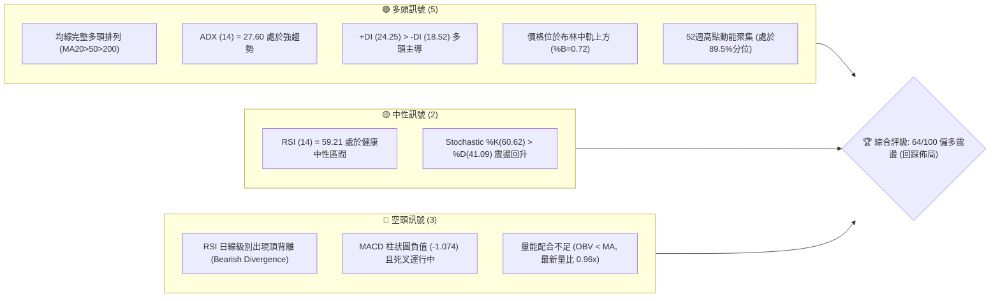
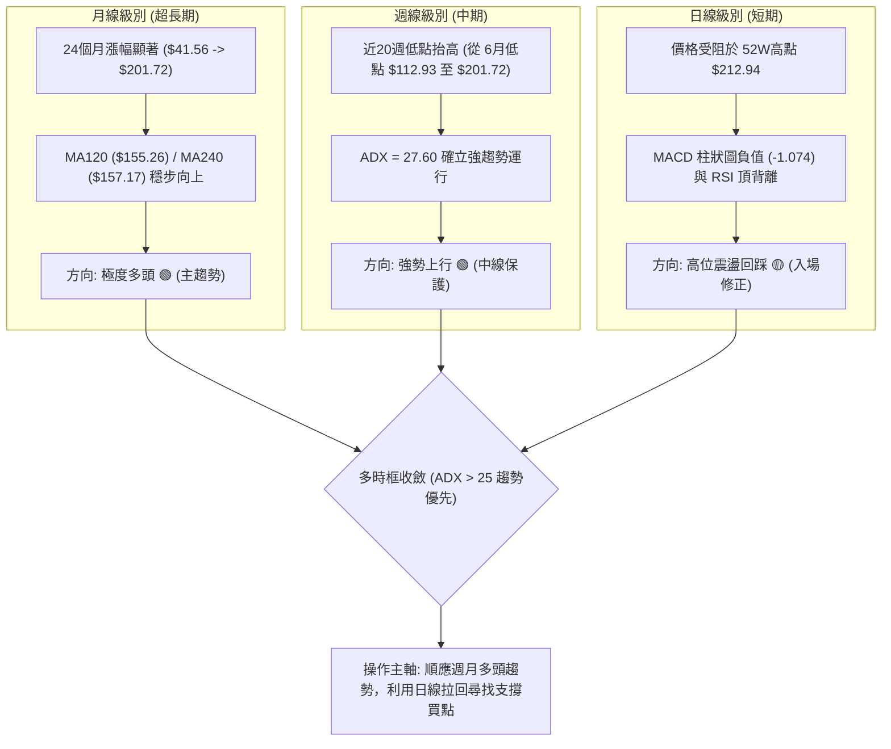
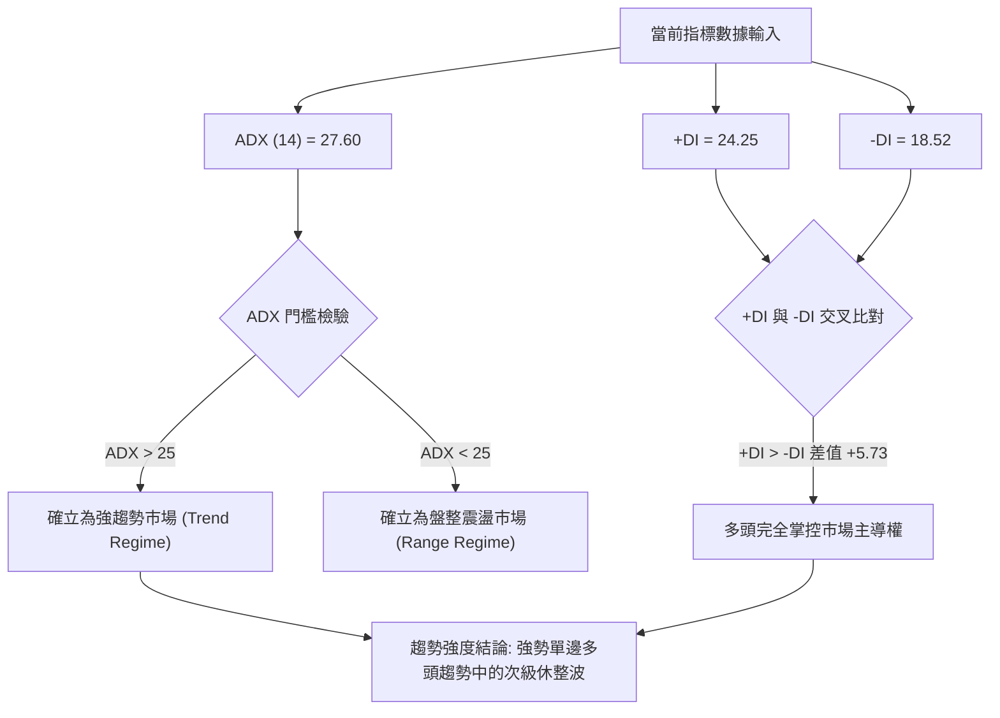
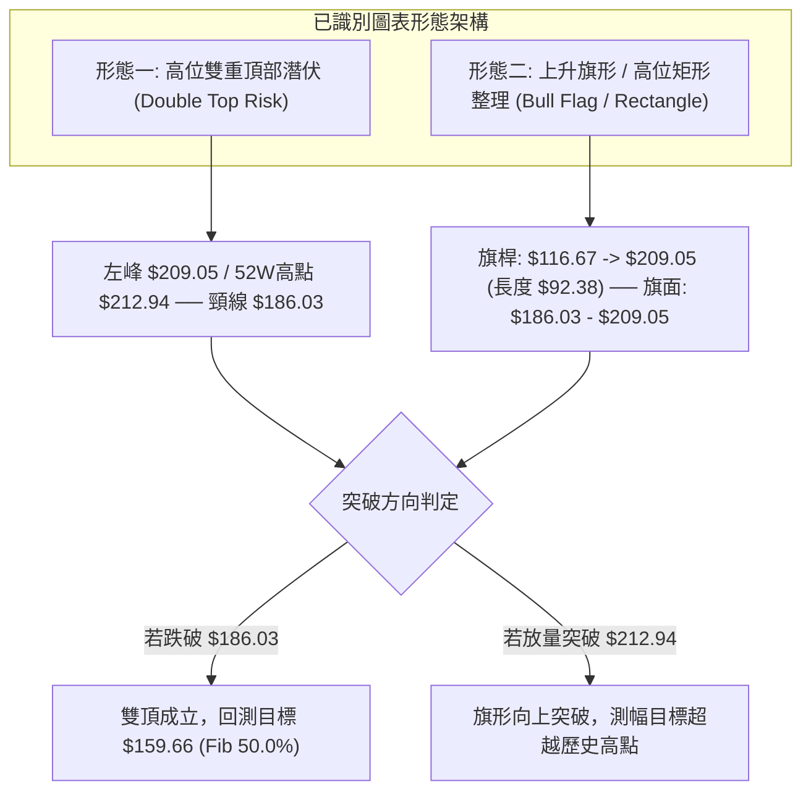
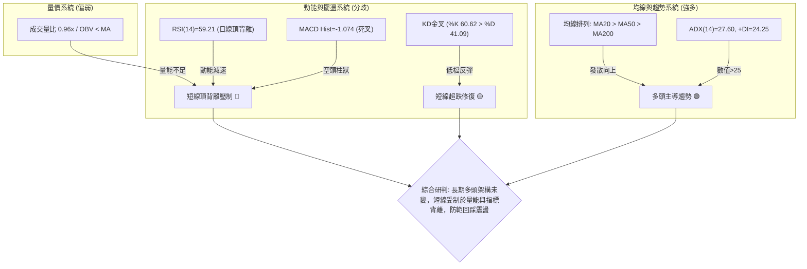
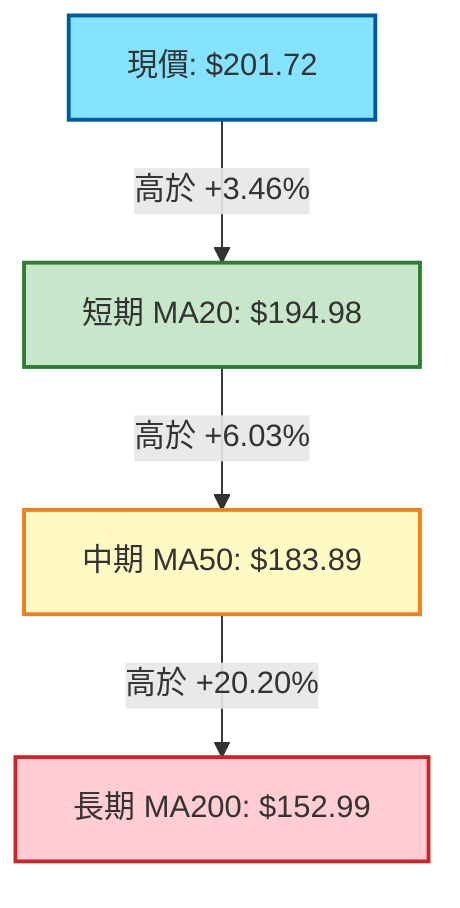
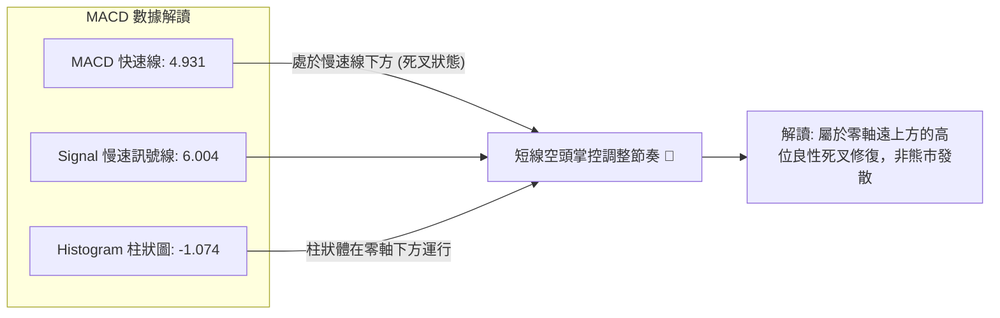
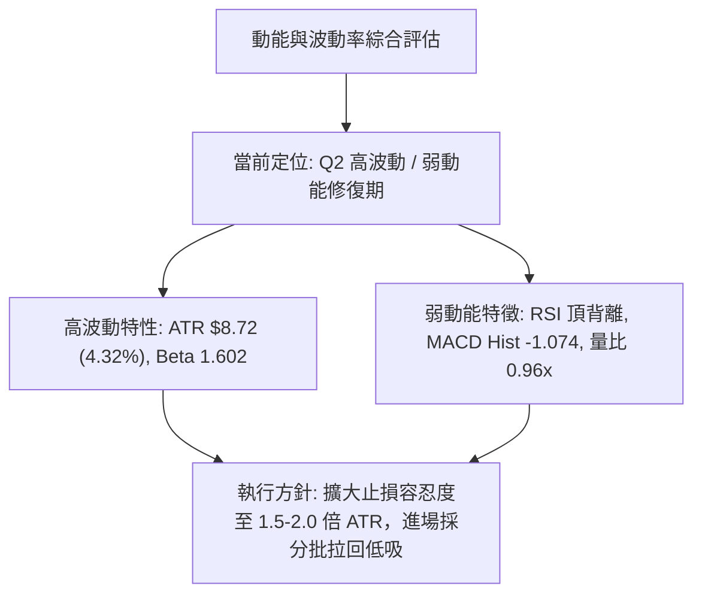
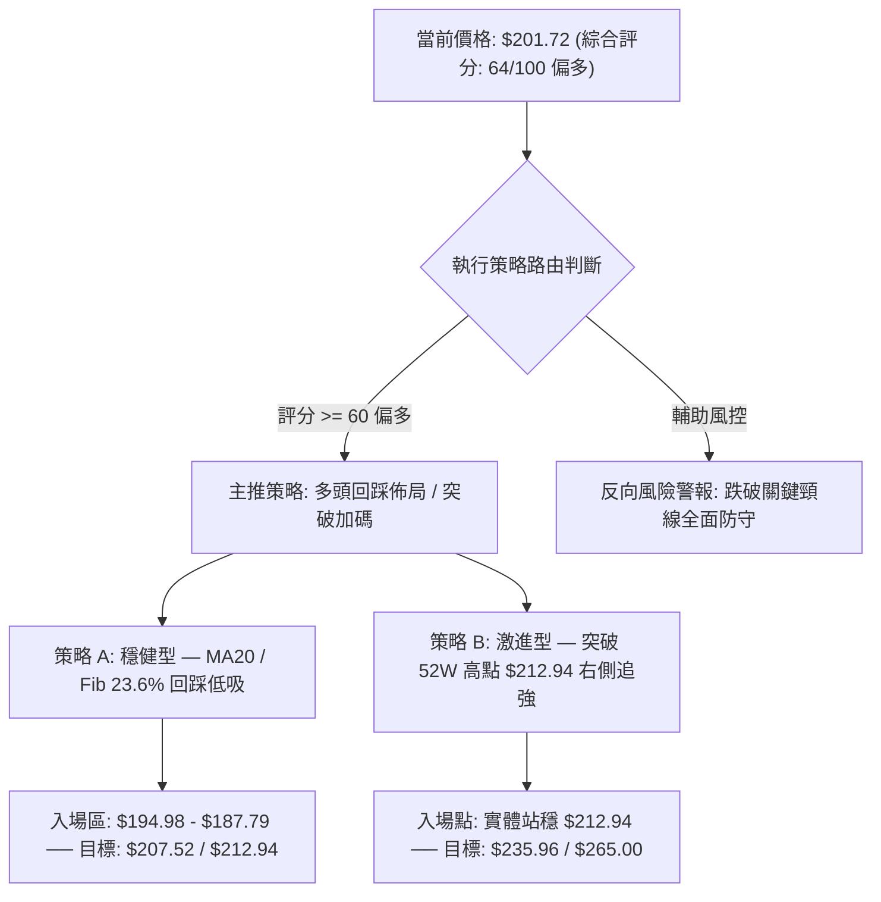
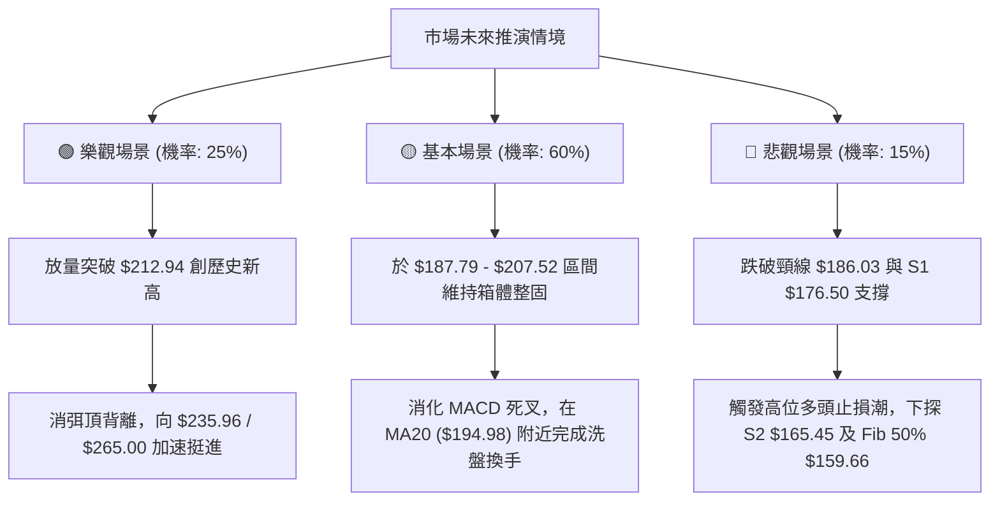

# PLTR 技術分析報告

> **報告日期**：2026-10-22 ｜ **語言**：繁體中文 ｜ **數據來源**：Yahoo Finance ｜ **當前價格**：$201.72

---

## 目錄

| 章節 | 內容 |
|------|------|
| [1. 技術面概覽](#1-技術面概覽) | 訊號儀表板、核心指標、評分卡 |
| [2. 趨勢分析](#2-趨勢分析) | 多時框趨勢、長中短期走勢 |
| [3. 圖表形態分析](#3-圖表形態分析) | 形態識別、K線組合、目標價 |
| [4. 支撐與阻力](#4-支撐與阻力) | 關鍵價位、斐波那契回調 |
| [5. 技術指標深度解讀](#5-技術指標深度解讀) | MA/RSI/MACD/布林/成交量 |
| [6. 動能與波動率](#6-動能與波動率) | 動能評估、ATR、Beta |
| [7. 多時框架總結](#7-多時框架總結) | 時框架評分矩陣 |
| [8. 交易策略建議](#8-交易策略建議) | 多空策略、風險報酬比 |
| [9. 風險提示與監控](#9-風險提示與監控) | 監控指標、風險場景 |
| [10. 報告總結](#10-報告總結) | 關鍵結論與最優策略組合 |

---

## 1. 技術面概覽

### 🎯 技術訊號儀表板



### 📊 核心指標速覽表

| 指標類別 | 指標名稱 | 當前數值 | 訊號 | 解讀 |
|----------|----------|----------|------|------|
| **價格** | 當前收盤價 | $201.72 | 🟢 | 站穩 $200 心理關口，處於 52 週區間 89.5% 之高位強勢區 |
| **均線** | 短期 MA20 | $194.98 | 🟢 | 現價高於 MA20 (+3.46%)，短期趨勢保持向上斜率 |
| **均線** | 中期 MA50 | $183.89 | 🟢 | 現價高於 MA50 (+9.70%)，波段多頭防守底線穩固 |
| **均線** | 長期 MA200| $152.99 | 🟢 | 現價大幅高於 MA200 (+31.85%)，超長期牛市結構完整 |
| **動能** | RSI(14) | 59.21 | 🟡 | 位於中性偏強區間，但出現頂背離警告訊號 |
| **動能** | MACD (12,26,9) | 4.931 / 6.004 | 🔴 | MACD 線低於 Signal 線，柱狀圖為 -1.074，短線動能減弱 |
| **動能** | Stochastic | %K 60.62 / %D 41.09 | 🟢 | 低檔金叉後持續向上發散，短線具備修復動力 |
| **趨勢** | ADX(14) | 27.60 | 🟢 | 數值突破 25 臨界線，確認處於清晰趨勢行情之中 |
| **通道** | 布林通道 %B | 0.72 | 🟢 | 位於中軌 ($194.98) 與上軌 ($210.30) 之間強勢區間 |
| **量能** | OBV 與量比 | 量比 0.96x | 🔴 | 成交量 21.29M 略低於 20 日均量，OBV 低於均線顯示量價輕度背離 |
| **波動** | ATR(14) | $8.72 | 🟡 | 每日平均震幅約 4.32%，高波動特性需寬幅風控設定 |

### 🏆 技術評分卡

```
╔══════════════════════════════════════════════════════════════╗
║                技術評分卡 — PLTR (2026-10-22)                ║
╠══════════════════════════════════════════════════════════════╣
║ 趨勢強度 (Trend)     ████████████████░░░░  80/100 🟢 強勢趨勢 ║
║ 動能指標 (Momentum)  ██████████░░░░░░░░░░  50/100 🟡 背離壓制 ║
║ 均線排列 (MAs)       ██████████████████░░  90/100 🟢 完美多頭 ║
║ 支撐穩定度 (Support) ██████████████░░░░░░  70/100 🟢 結構扎實 ║
║ 成交量配合 (Volume)  ████████░░░░░░░░░░░░  40/100 🔴 量能疲弱 ║
║ 形態完整度 (Pattern) ████████████░░░░░░░░  60/100 🟡 高位箱體 ║
╠══════════════════════════════════════════════════════════════╣
║ 綜合技術評分         █████████████░░░░░░░  64/100 🟢 偏多整固 ║
║ 策略定調             中長期趨勢向上，短線受制動能背離，回踩低吸 ║
╚══════════════════════════════════════════════════════════════╝
```

---

## 2. 趨勢分析

### 🌐 多時框趨勢分析



### 📈 長期趨勢 — 12個月走勢圖（Unicode）

```
PLTR 月線走勢圖（2025-10 至 2026-10）
價格軸 ($)
$210 ┤                                                    ● $201.72 (現價)
$200 ┤ ● $200.47                                   ● $187.05
$190 ┤                                       ● $186.38
$180 ┤             ● $177.75
$170 ┤       ● $168.45
$160 ┤                               ● $156.54
$150 ┤                   ● $146.59       ● $146.28
$140 ┤                         ● $137.19     ● $139.11
$130 ┤                                              ● $123.06
$120 ┤                                        ● $116.67
     └────────────────────────────────────────────────────────────
        25-10 25-11 25-12 26-01 26-02 26-03 26-04 26-05 26-06 26-07 26-08 26-09 26-10
```

#### 走勢特徵分析表格

| 週期波段 | 期間月份 | 起訖價格 ($) | 漲跌幅 (%) | 波段特徵與技術解讀 |
|----------|----------|--------------|------------|--------------------|
| **第一階段：高檔獲利回吐** | 2025-10 → 2026-02 | $200.47 → $137.19 | -31.57% | 歷史高點承壓，月線級別健康修正，釋放高估值壓力 |
| **第二階段：中期築底震盪** | 2026-02 → 2026-05 | $137.19 → $156.54 | +14.10% | 區間 $137–$156 構築波段箱體，多空力量進入再平衡 |
| **第三階段：終極洗盤探底** | 2026-05 → 2026-06 | $156.54 → $116.67 | -25.47% | 跌破前低形成假破底破線誘空，回測 52W低點 ($106.37) 上方企穩 |
| **第四階段：主升浪狂飆** | 2026-06 → 2026-08 | $116.67 → $186.38 | +59.75% | 週成交量爆出 4.35 億股天量，V型反轉展開暴力逼空 |
| **第五階段：前高衝刺整固** | 2026-08 → 2026-10 | $186.38 → $201.72 | +8.23% | 突破 $200 大關，挑戰 52W高點 $212.94，進入高位旗形整固 |

### 📊 中期趨勢（週線分析）

中期技術面以 2026 年 8 月以來的強勢反彈為核心。近期週線收盤走勢顯示：
1. **量價爆發點**：2026-08-09 該週收盤 $172.01，伴隨單週 435,164,800 股歷史級天量，MACD 柱狀圖暴增至 +4.790，奠定中長期翻多基石。
2. **高檔分歧點**：2026-10-11 觸及波段收盤高點 $209.05（週 RSI 達 82.6 超買），隨後一週急跌至 $186.03，隨後本週再次反彈至 $201.72。
3. **震盪中樞**：當前週線在 $186–$209 區間呈現寬幅高檔洗盤，支撐位於斐波那契 23.6% 回調位 $187.79 與波段支撐位 S1 $176.50。

```
週線支撐與壓力拓撲
$212.94 ─── 52W 最高點阻力 (R2) ──────────────────────────
$207.52 ─── 近期波段高點聚類 (R1) ─────────────────────────
$201.72 ─── [現價位置] ─ 處於高檔震盪中軸上方
$194.98 ─── MA20 / 布林中軌動態支撐 ───────────────────────
$187.79 ─── 斐波那契 23.6% 回調關鍵線 ──────────────────────
$176.50 ─── 近一年波段低點聚類核心支撐 (S1) ────────────────
```

### ⚡ 趨勢強度評估（ADX 解讀）



| 指標名稱 | 數值 | 評估區間 | 趨勢屬性判斷 | 交易指引 |
|----------|------|----------|--------------|----------|
| **ADX(14)** | **27.60** | > 25 (強趨勢) | 趨勢行情確立，非無序震盪 | 順勢交易為主，摒棄逆勢摸頂思維 |
| **+DI** | **24.25** | 多方攻擊動能 | 多方佔優，維持攻擊姿態 | 回踩重要均線即可視為多頭上車點 |
| **-DI** | **18.52** | 空方打壓動能 | 空方受壓制，無系統性拋壓 | 空頭缺乏持續性動能，做空空間受限 |
| **差值 (+DI - -DI)**| **+5.73**| 正向優勢顯著 | 多頭主導趨勢 | 保持多頭部位持有信心 |

---

## 3. 圖表形態分析

### 🔍 形態識別系統



#### 形態信心度與參數清單

| 形態名稱 | 信心度 | 判斷依據（嚴格引用歷史數據） | 形態完成度 | 測幅目標價與計算式 |
|----------|--------|------------------------------|------------|--------------------|
| **高位上升旗形 (Bull Flag)** | **70%** | 2026年6月低點 $116.67 巨量拉升至 10月高點 $209.05 構成旗桿；近3週於 $186.03–$209.05 區間收斂洗盤構成旗面。ADX=27.60 支撐順勢延伸。 | 75% | 依旗桿高度推算：頸線突破點 $212.94 + 旗桿高度 ($209.05 - $116.67 = $92.38) = 理論測幅高達 $305.32。保守第一階以分析師最高目標價 **$265.00** 為基準。 |
| **潛在雙重頂部 (Double Top)** | **45%** | 2026-10-11 週收盤 $209.05 為峰1，當前反彈至 $201.72 受阻於 R1 $207.52；RSI 頂背離與 MACD 負柱狀體提供空頭動能支持。 | 40% (未跌破頸線) | 依雙頂頸線計算式：頸線 $186.03 - 形態高度 ($209.05 - $186.03 = $23.02) = **$163.01** (極度接近波段支撐 S2 **$165.45** 與 Fib 50% **$159.66**)。 |

### 🕯️ 重要K線形態分析

| 週/月週期 | 收盤價 ($) | 成交量 | K線組合形態 | 技術面深層解讀 | 多空訊號 |
|-----------|------------|--------|-------------|----------------|----------|
| **2026-08-09** | $172.01 | 435.16M | 突破大陽線 (Marubozu) | 帶天量突破近一年多個整理平台，主力機構強勢建倉信號 | 🟢 極強多頭 |
| **2026-10-11** | $209.05 | 130.58M | 高檔長上影假突破 | 創 52W 高點後尾盤回吐，RSI 達到 82.6 極端超買，多頭顯疲態 | 🔴 轉折預警 |
| **2026-10-18** | $186.03 | 125.24M | 回踩長下影鎚頭線 | 快速砸盤至 $186.03 即獲買盤支撐，精準守住 Fib 23.6% ($187.79) 區域 | 🟢 支撐確認 |
| **2026-10-25** | $201.72 | 60.32M (進行中) | 縮量反包陽線 | 價格重回 $200 之上，但成交量明顯萎縮，暗示追價買盤動能衰減 | 🟡 謹慎偏多 |

### 📉 ASCII 走勢形態示意圖

```
PLTR 高位旗形整理 vs 雙頂分水嶺示意圖
價格 ($)
$212.94 ┬─────────────────────● (52W 高點 / 旗形上軌阻力 R2)
        │                   /   \
$207.52 ┼───────● (峰1)    /     ● $201.72 (現價反彈高點 / R1)
        │      / \        /       \
$194.98 ┼─────/───\──────/─────────\─── MA20 / 布林中軌
        │    /     \    /           \ (潛在回踩路徑)
$187.79 ┼───/───────\──/─────────────● 斐波那契 23.6% 緩衝區
        │  /         ● $186.03 (頸線支撐分水嶺)
$176.50 ┴─● (旗桿起點 / S1 強支撐)
        └────────────────────────────────────────────► 時間軸
```

### 🎯 形態目標價計算

1. **旗形向上突破情境**：
   - 形態突破觸發條件：日線實體收盤突破 52W 高點 **$212.94**，且單日成交量大於 20 日均量 (22.18M) 的 1.5 倍以上。
   - 測幅計算：突破點 $212.94 + 形態高度 $23.02 ($209.05 - $186.03) = **$235.96**。若全額釋放旗桿動能，延伸目標上看分析師最高目標價 **$265.00**。
2. **形態跌破下行風險情境**：
   - 形態破位觸發條件：跌破 2026-10-18 週低點頸線 **$186.03**，且失守 Fib 23.6% (**$187.79**)。
   - 測幅計算：頸線 $186.03 - 形態高度 $23.02 = **$163.01**。此價位將尋求波段支撐 **$165.45** (S2) 及 斐波那契 50.0% **$159.66** 的結構性接盤支撐。

---

## 4. 支撐與阻力

### 🗺️ 關鍵價位分布圖（Unicode）

```
PLTR 價位結構分佈圖（嚴格依據 OHLCV 計算值）
═══════════════════════════════════════════════════════════════
$212.94 ║████████████████████████████████║ 強阻力 R2 (52W 最高點 / Fib 0.0%)
$207.52 ║████████████████████████        ║ 近期阻力 R1 (波段高點聚類)
$201.72 ╠════════════════════════════════╣ ◄ 現價位置 ($201.72)
$194.98 ║▓▓▓▓▓▓▓▓▓▓▓▓▓▓▓▓▓▓▓▓▓▓▓▓        ║ 短期動態支撐 (MA20 / 布林中軌)
$187.79 ║▓▓▓▓▓▓▓▓▓▓▓▓▓▓▓▓▓▓▓▓            ║ 關鍵斐波那契回調位 (Fib 23.6%)
$176.50 ║████████████████████████████    ║ 關鍵波段支撐 S1 (-12.50%)
$165.45 ║████████████████████            ║ 強結構支撐 S2 (-17.98%)
$148.07 ║████████████████████████████████║ 終極防守支撐 S3 (-26.60% / Fib 61.8%)
═══════════════════════════════════════════════════════════════
```

### 🚧 阻力位分析表

| 阻力級別 | 準確價位 | 距現價空間 | 形成原因與量價結構 | 突破難度 | 重要性權重 |
|----------|----------|------------|--------------------|----------|------------|
| **R1** | **$207.52** | +2.88% | 近一年波段高點聚類密集區，多空短線激烈換手成本位 | 中等 🟡 | ★★★★☆ |
| **R2** | **$212.94** | +5.56% | 52週絕對最高點、Fib 0.0% 關鍵阻力，歷史套牢與獲利了結共振區 | 極高 🔴 | ★★★★★ |

### 🛡️ 支撐位分析表

| 支撐級別 | 準確價位 | 距現價空間 | 形成原因與量價結構 | 守住機率 | 重要性權重 |
|----------|----------|------------|--------------------|----------|------------|
| **S1** | **$176.50** | -12.50% | 近一年波段低點聚類，8月突破放量大陽線實體下沿 | 75% 🟢 | ★★★★☆ |
| **S2** | **$165.45** | -17.98% | 波段強支撐結構，前期整理平台頂部，機構回踩護盤位 | 85% 🟢 | ★★★★★ |
| **S3** | **$148.07** | -26.60% | 接近 Fib 61.8% ($147.08) 與 MA200 ($152.99)，牛熊生命線 | 95% 🟢 | ★★★★★ |

### 📐 斐波那契回調位分析

依據 52 週絕對極值（低點 **$106.37** → 高點 **$212.94**，總波幅 $106.57）計算之回調位矩陣：

```
斐波那契回調分層與現價對照
 0.0% (52W High)  $212.94 ──┐ 阻力天花板
                            ├─ 當前價格 $201.72 (處於 0.0% 與 23.6% 強勢區間)
23.6%             $187.79 ──┘ 第一黃金回踩防線 (強勢調整極限)
38.2%             $172.23 ──── 中度回調防禦線 (接近 S1 $176.50)
50.0%             $159.66 ──── 多空均衡樞紐線 (整固底線)
61.8%             $147.08 ──── 黃金分割極限防線 (接近 S3 $148.07 及 MA200)
78.6%             $129.18 ──── 弱勢破位預警線
100.0% (52W Low)  $106.37 ──── 週期絕對起漲點
```

#### 解讀與意義：
- **強勢區間運作**：現價 $201.72 穩穩運行於 **0.0% ($212.94)** 與 **23.6% ($187.79)** 之間。在技術分析理論中，當標的在大幅上漲後回調幅度未觸及 23.6% 斐波那契水平，屬於標準的「極強勢空中加油」格局。
- **關鍵共振支撐**：
  - **$187.79 (Fib 23.6%)** 與近期週線低點 **$186.03** 形成強力價格帶，為多頭第一道不容失守的關鍵防線。
  - **$147.08 (Fib 61.8%)** 與波段支撐 **$148.07 (S3)** 精確重合（誤差僅 $0.99），奠定了此處作為長期牛市結構終極防線的數學有效性。

---

## 5. 技術指標深度解讀

### 🎛️ 指標訊號總覽



### 📈 移動平均線排列分析



#### 均線全曲度量化矩陣

| 均線週期 | 當前價格 ($) | 現價與MA乖離率 | 均線歷史軌跡強度 | 排列評估 |
|----------|--------------|----------------|------------------|----------|
| **MA 5** | $195.00 | +3.45% 🟢 | ▁▁▁▁▁▁▂▂▃▃▄▅▅▅▅▅▅▅▅▅▆▇▇███▇▇▆▆ | 短期均線回勾向上，形成助漲 |
| **MA 10** | $200.15 | +0.79% 🟢 | ▂▁▁▁▁▁▁▁▁▂▃▃▄▄▄▅▅▅▆▆▆▆▇███████ | 現價微幅突破，重奪10日均線主控權 |
| **MA 20** | $194.98 | +3.46% 🟢 | ▁▁▁▁▁▁▁▁▁▁▂▂▂▂▂▂▂▃▃▄▄▅▆▇▇█████ | 20日布林中軌呈穩健 30 度角斜率向上 |
| **MA 60** | $178.13 | +13.24% 🟢 | ▁▁▁▁▁▂▂▂▂▃▃▃▄▄▄▄▅▅▅▅▆▆▆▇▇▇████ | 中期波段強烈支撐帶，多頭防線 |
| **MA 120** | $155.26 | +29.92% 🟢 | ▁▁▁▁▁▁▁▂▂▂▂▃▃▃▃▄▄▄▅▅▅▆▆▇▇▇▇███ | 半年線持續上移，底部扎實 |
| **MA 240** | $157.17 | +28.35% 🟢 | ▂▂▂▁▁▁▁▁▁▁▁▂▂▃▃▃▄▄▄▅▆▇▇████▇██ | 年線穩定推升，大長多格局 |

**均線綜合研判**：當前呈現標準的多頭排列（MA20 > MA50 > MA200），且短中長各天期均線無一向下掉頭。MA20 與 MA60/50 差距健康，並無極端乖離導致的均線崩塌風險，支撐基礎極度雄厚。

### 📉 RSI(14) 分析

```
RSI(14) 當前狀態: 59.21 (健康中性偏強區間)
0       20        40   50   59.21    70        80      100
├────────┼────────┼─────┼─────●────────┼────────┼────────┤
   極度超賣   偏弱區間   中軸線    現值     超買預警   極度超買
[▓▓▓▓▓▓▓▓▓▓▓▓▓▓▓▓▓▓▓▓▓▓▓▓▓▓▓▓▓░░░░░░░░░░░░░░░░░░░░] 59.21%
```

- **頂背離判定 (Bearish Divergence) — ⚠️ 成立**：
  - **價格走勢**：價格於 2026-10-11 創下收盤新高 $209.05，隨後回落並於本週再次衝擊 $201.72 高位。
  - **指標走勢**：RSI 在 2026-10-11 錄得 82.6 的極端高值，但當前價格反彈至 $201.72 時，RSI 僅回升至 **59.21**，指標高點大幅下移。
  - **技術含義**：典型的「價格高位徘徊，動能顯著衰竭」之頂背離形態。這意味著如果沒有爆發性成交量進場化解，短線極難一舉突破 52W 高點 $212.94，隨時面臨二度回踩釋放賣壓的風險。

### 📊 MACD(12/26/9) 訊號解讀



- **數值關係**：MACD 線 (4.931) 低於訊號線 (6.004)，差值柱狀圖為 **-1.074**。
- **背離與趨勢解讀**：柱狀圖自 10 月初的高檔鈍化迅速轉為負值，確認短線動能正經歷週期性減速。然而，由於雙線均遠在零軸上方運行（4.931 遠大於 0），這屬於標準的「強勢市場高位洗盤」，其性質是消化前期暴漲獲利籌碼，而非趨勢反轉。

### 📦 布林通道分析

```
PLTR 布林通道 (20, 2) 結構示意圖
價格 ($)
$210.30 ┬───────────────────────────────── BB 上軌 (阻力帶)
        │
$201.72 ┼───────────────● 現價 (位處中上軌之間, %B = 0.72)
        │
$194.98 ┼───────────────────────────────── BB 中軌 / MA20 (核心動態支撐)
        │
$179.66 ┴───────────────────────────────── BB 下軌 (極限超賣支撐)
```

- **帶寬與位置**：上軌 **$210.30**，中軌 **$194.98**，下軌 **$179.66**。
- **%B 指標分析**：%B 為 **0.72**，數值 > 0.50 顯示當前多頭依然佔據主控優勢，價格在中軌獲得有力支撐。當前通道呈現收斂走平態勢，意味著單邊暴漲暫告段落，行情步入 $194.98–$210.30 的布林帶內震盪。

### 💹 成交量分析（量價配合度）

1. **量能指標檢視**：
   - 當前成交量：**21,288,000** 股
   - 20 日均量：**22,179,880** 股 (量比 **0.96x**)
   - 50 日均量：**26,227,898** 股
   - **OBV 趨勢**：OBV < MA，量能指標下行。
2. **量價關係解讀**：
   - 最新交易量比僅為 0.96x，低於 20 日及 50 日平均水平，伴隨 OBV 走弱，顯示在現價突破 $200 的過程中，並未出現機構搶籌的增量資金配合，呈現「價漲量縮」的輕度背離狀態。
   - 這進一步印證了第 3 章與 RSI 頂背離的推論：缺乏量能支持的高位反彈，突破 52W 高點 $212.94 的阻力極大，需要先在 $194–$207 區間充分換手蓄勢。

---

## 6. 動能與波動率

### ⚡ 動能評估四象限

| 象限 | 動能維度 (Momentum) | 波動率維度 (Volatility) | PLTR 當前狀態定位 | 交易戰術評估 |
|------|---------------------|--------------------------|-------------------|--------------|
| **Q1：突破主升** | 強動能 (ADX>25, RSI>60) | 低波動 (ATR 壓縮) | — | 最佳重倉追漲突破機會 |
| **Q2：高位震盪** | **弱動能 (MACD死叉, RSI背離)** | **高波動 (ATR 4.32%, Beta 1.60)** | **✔ 當前精確落點 (Q2)** | **嚴禁追高，耐心等待拉回支撐低吸** |
| **Q3：狂暴單邊** | 強動能 (大陽爆發) | 高波動 (跳空暴漲) | — | 8月上旬走勢，適合波段持有 |
| **Q4：陰跌沉寂** | 弱動能 (空頭排列) | 低波動 (量能冰凍) | — | 徹底規避，觀望為主 |



### 📊 ATR 波動率分析

- **ATR(14) 絕對值**：**$8.72**
- **波動率佔比**：約為當前股價的 **4.32%**，顯示 PLTR 屬於高彈性成長股，單日價格波動極具爆發力。
- **止損距離建議**：
  - 日內短線止損：1.0 × ATR = **$8.72** 緩衝空間。
  - 波段交易止損（Swing Trade）：建議採用 1.5 至 2.0 倍 ATR，即設定 **$13.08 至 $17.44** 的回撤空間。若現價 $201.72 買進，合理的波動率止損位應設於 **$184.28–$188.64**，此區間恰好與 Fib 23.6% ($187.79) 及週線低點頸線 ($186.03) 形成完美共振。

### 📐 Beta 與市場相關性

- **Beta 係數**：**1.602**
- **解讀**：PLTR 對標普 500 指數具有 1.6 倍的波動敏感度。在大盤處於牛市擴張期時，PLTR 能創造顯著的 Alpha 超額收益；但一旦大盤回檔，其技術面回撤幅度亦會放大 60%。當前高達 1.602 的 Beta 值要求交易者必須在大盤處於低風險環境時再加碼進場。

---

## 7. 多時框架總結

### 📋 時框架評分表

| 時框架 | 趨勢方向 | 動能狀態 | 均線系統 | 關鍵形態 | 綜合評分 | 操作指引 |
|--------|----------|----------|----------|----------|----------|----------|
| **月線 (長期)** | 極度看多 🟢 | 極強 (歷史級大漲) | 多頭排列 (MA120/240走平向上) | 超大級別底層反轉主升浪 | **90/100** | 長線堅定做多，持股續抱 |
| **週線 (中期)** | 強烈看多 🟢 | 偏多整固 (ADX 27.60) | 完美多頭 (均線多頭發散) | 高位上升旗形構築中 (70%信心度) | **75/100** | 回踩關鍵支撐買入，順勢而為 |
| **日線 (短期)** | 高位震盪 🟡 | 動能背離 🔴 (MACD死叉) | 短期多頭 (價格守在MA20之上) | 52W 高點受阻，潛在雙頂未遂 | **52/100** | 拒絕高位追漲，等待回踩洗盤完成 |

### 🔲 綜合訊號矩陣

```
╔══════════════════════════════════════════════════════════════════════╗
║                    多時框架訊號一致性交叉檢驗                        ║
╠══════════════════════════════════════════════════════════════════════╣
║ 時框維度 ║ 趨勢訊號 ║ 動能訊號 ║ 量價訊號 ║ 波動風險 ║ 結論收斂      ║
╠══════════════════════════════════════════════════════════════════════╣
║ 長期月線 ║   🟢     ║   🟢     ║   🟢     ║   🟡     ║ 極度偏多      ║
║ 中期週線 ║   🟢     ║   🟢     ║   🟡     ║   🟡     ║ 順勢看多      ║
║ 短期日線 ║   🟢     ║   🔴     ║   🔴     ║   🔴     ║ 衝高回踩防守  ║
╚══════════════════════════════════════════════════════════════════════╝
```

### ⚖️ 多時框收斂結論

依據多時框收斂規則第 14 條：
1. **行情屬性判定**：當前 ADX(14) 數值為 **27.60**（高於 25 臨界線），明確判定當前處於**趨勢行情 (Trend Regime)**，而非無方向的盤整市場。
2. **優先級收斂原則**：在趨勢行情中，必須以中長期（週線級別主趨勢與 MA20/MA50/MA200 均線方向）為主導方向；日線級別的動能背離與 MACD 死叉，僅作為尋找次級折返進場時機的工具，不可凌駕於中長期多頭趨勢之上盲目做空。
3. **唯一方向性結論**：**【偏多震盪 — 回踩關鍵支撐順勢做多】**。本結論嚴格收斂第 1 章（技術評分 64/100 偏多）、第 2 章（多頭主導）、第 5 章（均線強多但指標背離需防回踩）之全部分析，並直接指導第 8 章之主策略配置。

---

## 8. 交易策略建議

### 🗺️ 策略決策流程圖



### 🧭 策略路由

**當前主策略方向 = 【主推多頭回踩策略（技術評分 64/100）】**
（綜合評分大於 60 分，多頭架構完備，空頭僅列為反轉風險觸發點與風控對沖提示）。

### 🎯 價格情境階梯（Price Scenarios）

所有價位均嚴格引用第 4 章計算之波段聚類點位與斐波那契回調位：

| 觸發條件 | 下一目標 | 後續延伸 | 情境含義與操作指引 |
|----------|----------|----------|--------------------|
| **強勢突破 R1 ($207.52)** | **R2 ($212.94)** | 分析師最高價 **$265.00** | 短線頂背離被量能強行化解，多頭重啟主升浪，全面追買 |
| **站穩現價區間 ($194.98–$201.72)** | **R1 ($207.52)** | **R2 ($212.94)** | 依託 MA20 動態支撐強勢洗盤，維持區間多頭震盪 |
| **回踩跌破 MA20 ($194.98)** | **Fib 23.6% ($187.79)** | **S1 ($176.50)** | 短線獲利盤湧出，進入技術性深度回調，迎來黃金低吸買點 |
| **有效跌破 S1 ($176.50)** | **S2 ($165.45)** | **S3 ($148.07)** | 中期上升結構遭受破壞，多頭停損離場，趨勢轉入防禦階段 |

### 📊 情境機率分佈

| 情境劇本 | 發生機率 | 主要技術與量化依據 |
|----------|----------|--------------------|
| **情境一：回踩支撐後重拾升勢** | **55%** | 均線多頭排列完整 (MA20>50>200)，ADX=27.60 處強趨勢，回踩 $187.79–$194.98 提供優質進場盈虧比。 |
| **情境二：高位強勢橫盤震盪** | **30%** | 布林通道走平收窄，成交量比 0.96x 顯示拋壓有限但追價不足，將於 $194.98–$210.30 區間整固。 |
| **情境三：深度破位下探 S1/S2** | **15%** | 日線 RSI 頂背離與 MACD 死叉共振，若大盤系統性下挫，可能引發下探 S1 $176.50 甚至 S2 $165.45。 |

### 🟢 主策略詳情

嚴格遵循風控與資金管理原則，依據不同風險偏好制定兩套執行方案：

| 策略要素 | 策略 A：穩健回踩買入策略 (Pullback Long) | 策略 B：強勢右側突破策略 (Breakout Long) |
|----------|------------------------------------------|------------------------------------------|
| **適用對象** | 中波段波段交易者、價值成長投資者 | 短線動能交易者、趨勢突破追隨者 |
| **進場條件** | 價格回踩至 MA20 或 Fib 23.6% 出現止跌K線 | 日線實體突破 52W 高點，且單日成交量 > 30M 股 |
| **進場價格** | **$194.98** (首筆) 至 **$187.79** (加碼) | **$213.50** (站穩 R2 $212.94 上方確認) |
| **第一目標 (T1)**| **$207.52** (R1 波段高點阻力) | **$235.96** (高位旗形理論測幅目標) |
| **第二目標 (T2)**| **$212.94** (R2 52W歷史高點) | **$265.00** (分析師共識最高目標價) |
| **止損價格** | **$184.50** (跌破週線頸線 $186.03 與 1.5 ATR) | **$204.00** (跌回突破點下方 1.0 ATR 處) |
| **潛在空間/風險**| 潛在獲利 +$17.96 / 承受風險 -$10.48 | 潛在獲利 +$51.50 / 承受風險 -$9.50 |
| **風險報酬比** | **1 : 1.71** | **1 : 5.42** |
| **成功機率** | **65%** | **55%** |
| **建議總倉位** | 基礎倉位 15%，回踩加碼至 25% | 突破進場 10%，站穩後追加至 15% |

### 🔴 反向風險觸發點（對沖提示）

- **短期警報點 ($186.03)**：若日線實體跌破 2026-10-18 週低點頸線 **$186.03**，則「高位雙頂」形態成立機率飆升至 70% 以上，此時應全面清空短期短線多頭部位，甚至以 5% 倉位買入看跌期權對沖現貨。
- **中期破位點 ($176.50)**：若失守波段支撐 **$176.50 (S1)**，標誌著 8 月以來的強勢主升浪結構徹底終結，多頭部位應嚴格執行無條件停損，等待股價在 **$159.66 (Fib 50%)** 或 **$152.99 (MA200)** 附近重新構築底部。

### ⭐ 整體訊號強度評星

```
╔══════════════════════════════════════════════════════════════╗
║                     技術訊號強度星級面板                     ║
╠══════════════════════════════════════════════════════════════╣
║ 做多訊號強度：★★★★☆  (4.0/5星) — 中長多頭架構完好，支撐厚實  ║
║ 做空訊號強度：★★☆☆☆  (2.0/5星) — 逆勢做空風險極大，僅防回踩  ║
║ 整體技術可信度：★★★★☆  (4.5/5星) — 多時框指標共振，邊界清晰  ║
╚══════════════════════════════════════════════════════════════╝
```

---

## 9. 風險提示與監控

### ✅ 關鍵監控指標 Checklist

```
╔══════════════════════════════════════════════════════════════╗
║              PLTR 每日交易關鍵技術監控清單 (Checklist)        ║
╠══════════════════════════════════════════════════════════════╣
║ [ ] 價格能否守穩布林中軌 / MA20 ($194.98) 關鍵心理支撐       ║
║ [ ] RSI(14) 能否重返 65 以上化解日線級別「頂背離」隱患       ║
║ [ ] MACD 柱狀圖能否自 -1.074 向上收斂翻紅，發出二次金叉訊號   ║
║ [ ] 單日成交量是否放大至 26.2M (50日均量) 以上以配合突破      ║
║ [ ] 52W 最高阻力位 $212.94 的多空爭奪與突破有效性確認        ║
║ [ ] 下方斐波那契 23.6% ($187.79) 與頸線 $186.03 是否牢固      ║
╚══════════════════════════════════════════════════════════════╝
```

### ⚠️ 風險場景分析



### 🛡️ 風險管理重要提醒

1. **估值與基本面風險溢價**：
   - 當前 PLTR 滾動市盈率 (P/E Trailing) 高達 **173.90**，市銷率 (P/S) 達 **78.74**，PEG 比率為 **1.67**。高企的估值意味著股價容錯率極低，市場對任何微小負面消息的反應均會放大。
   - 儘管營收年增率達 92.8%、淨利潤率高達 49.0% 顯示基本面處於超級爆發期，但在高估值背景下，技術面破位引發的踩踏效應通常遠超常態。
2. **波動率與倉位管理嚴格要求**：
   - 由於 Beta 值高達 **1.602** 且每日 ATR 達 **$8.72 (4.32%)**，單一交易帳戶對 PLTR 的總曝險倉位上限**嚴格禁止超過總資金的 25%**。
   - 每次進場均需依據 ATR 設置預定止損，單筆交易虧損總額必須壓低在總交易本金的 **1.5% - 2.0%** 範圍內，切忌在高位逆勢補倉攤平成本。

---

## 10. 報告總結

```
╔══════════════════════════════════════════════════════════════════╗
║                    PLTR 技術分析報告總結                         ║
╠══════════════════════════════════════════════════════════════════╣
║ 報告日期：2026-10-22         當前價格：$201.72                   ║
║ 分析評級：🟢 64/100 偏多整固（順應主趨勢，等待拉回低吸）         ║
╠══════════════════════════════════════════════════════════════════╣
║ 關鍵結論：                                                       ║
║ ├─ 長期趨勢 (月線)：🟢 極度看多，大牛市主升浪持續推進            ║
║ ├─ 中期趨勢 (週線)：🟢 強勢上行，ADX(27.60) 確立強趨勢延伸       ║
║ ├─ 短期趨勢 (日線)：🟡 高位背離震盪，受制於 52W 高點阻力         ║
║ ├─ 關鍵第一阻力：$207.52 (R1) ｜ 核心歷史高點阻力：$212.94 (R2)  ║
║ ├─ 動態中軌支撐：$194.98 (MA20) ｜ 核心波段防守支撐：$176.50 (S1)║
║ └─ 華爾街共識目標：$206.43 (平均) ｜ 最高樂觀目標：$265.00       ║
╠══════════════════════════════════════════════════════════════════╣
║ 最優交易策略組合：                                               ║
║ 1. 🥇 最佳機會 (策略 A 穩健型)：                                ║
║    耐性等待股價回踩 MA20 ($194.98) 至 Fib 23.6% ($187.79) 區間   ║
║    分批佈局做多，止損設於 $184.50，目標看 $207.52 及 $212.94。    ║
║ 2. 🥈 次選機會 (策略 B 突破型)：                                ║
║    若伴隨爆發性大成交量實體突破 $212.94，順勢追買，目標直指      ║
║    形態測幅位 $235.96 及分析師最高目標 $265.00。                 ║
║ 3. 🥉 保守選擇 (場外觀望)：                                     ║
║    鑑於 RSI 頂背離與 MACD 負柱狀體尚未消化，空倉者可保持觀望，   ║
║    靜待日線動能指標完成修正金叉後再行進場。                      ║
╚══════════════════════════════════════════════════════════════════╝
```

---

> ⚠️ **免責聲明**：本報告為技術分析專用研究報告，所有分析、圖表及價位推算均基於歷史量價數據之客觀呈現。本報告**僅供學術研究與投資策略參考**，**不構成任何個人化的投資邀約、推薦或操作建議**。金融市場瞬息萬變，高估值與高 Beta 標的風險顯著，投資人應獨立思考並自行承擔交易風險。

---

*報告生成時間：2026-10-22 ｜ 數據來源：Yahoo Finance ｜ 分析框架：多時框技術分析模型*