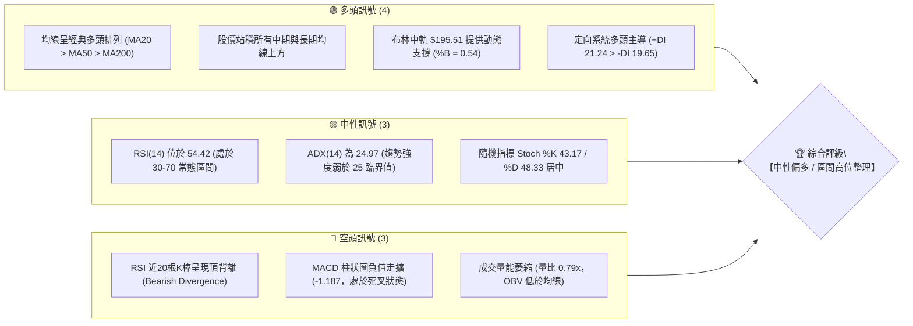
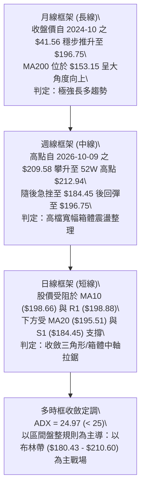
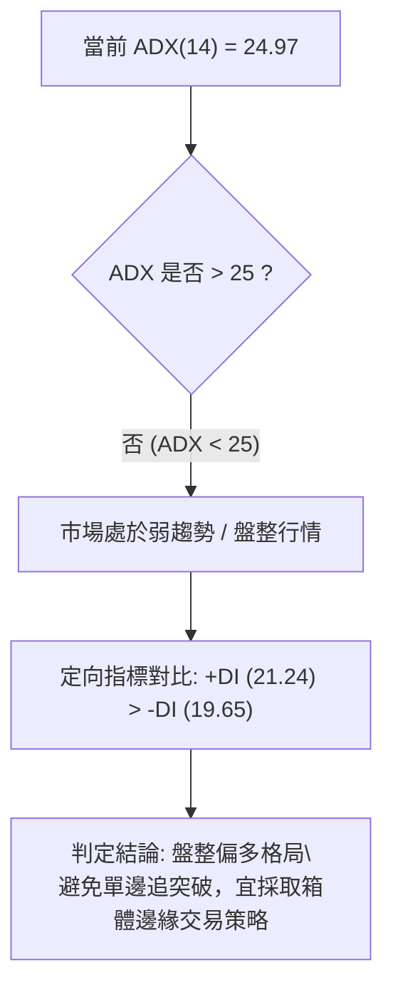
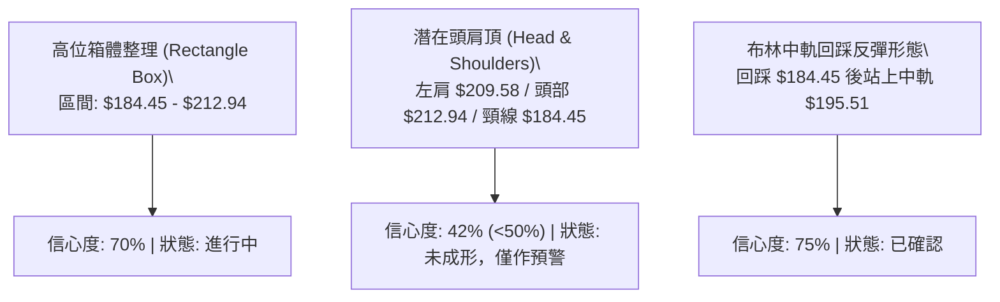
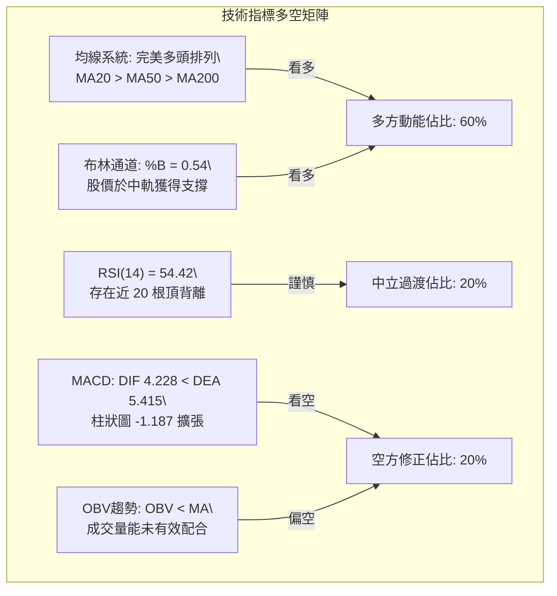
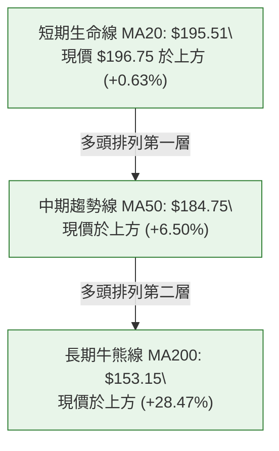
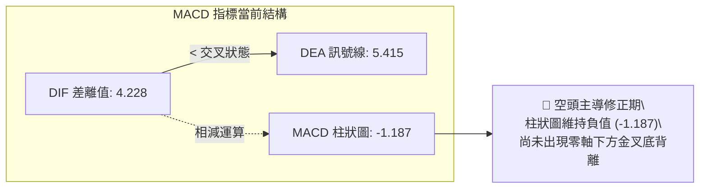
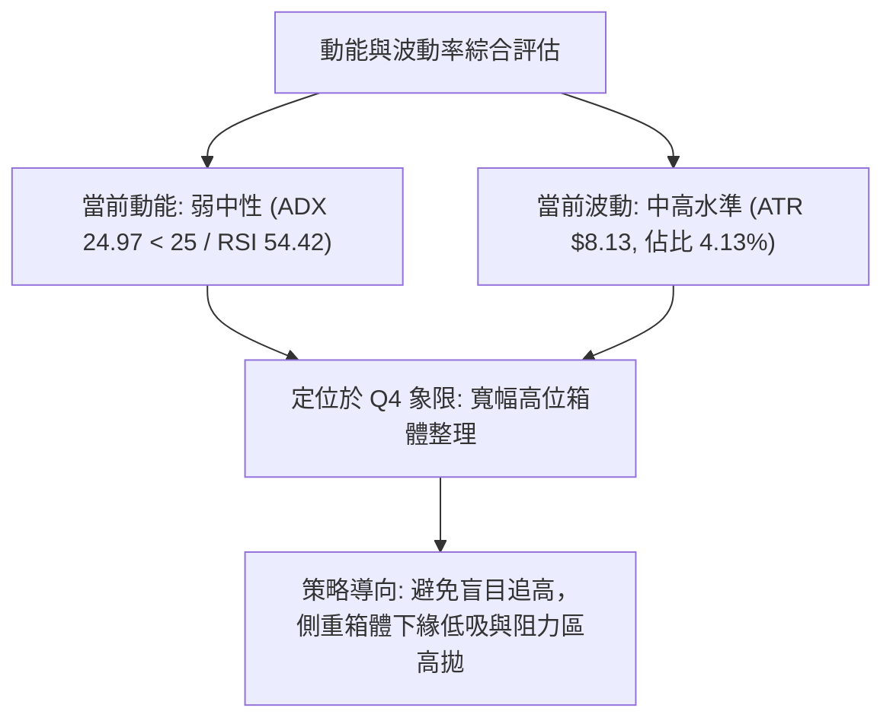
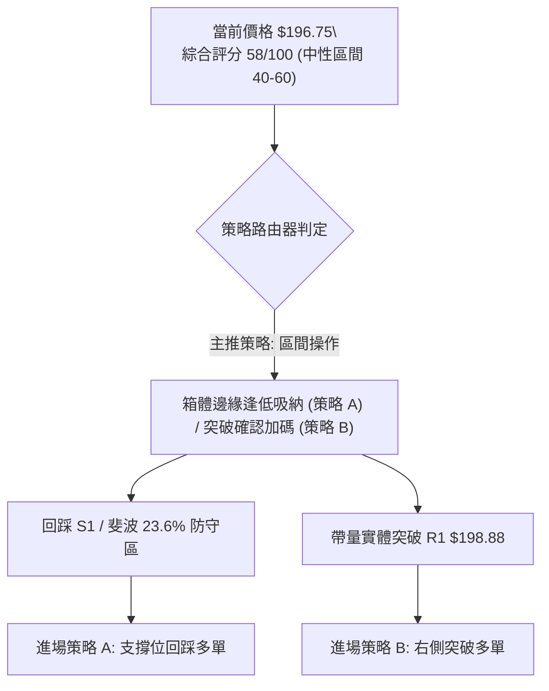
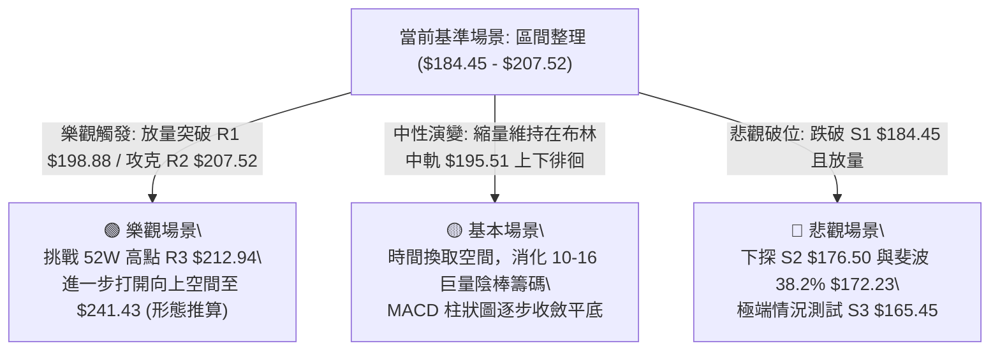

# PLTR 技術分析報告

> **報告日期**：2026-10-24 ｜ **語言**：繁體中文 ｜ **數據來源**：Yahoo Finance ｜ **當前價格**：$196.75

---

## 目錄

| 章節 | 內容 |
|------|------|
| [1. 技術面概覽](#1-技術面概覽) | 訊號儀表板、核心指標、評分卡 |
| [2. 趨勢分析](#2-趨勢分析) | 多時框趨勢、長中短期走勢 |
| [3. 圖表形態分析](#3-圖表形態分析) | 形態識別、K線組合、目標價 |
| [4. 支撐與阻力](#4-支撐與阻力) | 關鍵價位、斐波那契回調 |
| [5. 技術指標深度解讀](#5-技術指標深度解讀) | MA/RSI/MACD/布林/成交量 |
| [6. 動能與波動率](#6-動能與波動率) | 動能評估、ATR、Beta |
| [7. 多時框架總結](#7-多時框架總結) | 時框架評分矩陣 |
| [8. 交易策略建議](#8-交易策略建議) | 多空策略、風險報酬比 |
| [9. 風險提示與監控](#9-風險提示與監控) | 監控指標、風險場景 |
| [📋 報告總結](#-報告總結) | 全文核心精華總覽 |

---

## 1. 技術面概覽

### 🎯 技術訊號儀表板



---

### 📊 核心指標速覽表

| 指標類別 | 指標名稱 | 當前數值 | 訊號 | 解讀 |
|:---|:---|:---|:---:|:---|
| **價格** | 當前收盤價 | $196.75 | 🟢 | 站於 52 週高低區間 84.8% 位置，維持歷史高檔格局 |
| **短期均線** | MA5 / MA10 | $196.28 / $198.66 | 🟡 | 股價位於 MA5 上方但壓制於 MA10 下方，短線拉鋸 |
| **中期均線** | MA20 (布林中軌) | $195.51 | 🟢 | 現價高於 MA20，中軌支撐有效，中期多方生命線未破 |
| **季度均線** | MA50 | $184.75 | 🟢 | 現價高於 MA50 (+6.50%)，季度多頭基底穩固 |
| **長期均線** | MA200 | $153.15 | 🟢 | 現價高於 MA200 (+28.47%)，長期上升趨勢未受挑戰 |
| **動能** | RSI(14) | 54.42 | 🟡 | 數值處於中性區間，但近 20 根 K 線首尾存在頂背離 |
| **趨勢追蹤**| MACD (12,26,9) | 4.228 / 5.415 | 🔴 | DIF 低於 DEA，柱狀圖為 -1.187，動能處於空方修正 |
| **趨勢強度**| ADX(14) | 24.97 | 🟡 | 數值低於 25，判定當前由強單邊趨勢轉入高位震盪盤整 |
| **通道狀態**| 布林通道 (%B) | 0.54 | 🟢 | 落在中軌與上軌之間（上軌 $210.60 / 下軌 $180.43） |
| **成交量能**| 20日量比 / OBV | 0.79x / 弱 | 🔴 | 成交量 1,761.4 萬股低於均量，OBV 低於均線顯示追價意願不足 |
| **波動率** | ATR(14) | $8.13 (4.13%) | 🟡 | 日內平均振幅適中，高檔換手具備一定防守緩衝空間 |

---

### 🏆 技術評分卡

```
╔══════════════════════════════════════════════════════════════╗
║                技術評分卡 — PLTR (2026-10-24)                 ║
╠══════════════════════════════════════════════════════════════╣
║ 評估維度      進度條表現                    得分    狀態     ║
╟──────────────────────────────────────────────────────────────╢
║ 趨勢強度      ███████████░░░░░░░░░        55/100   🟡 中性   ║
║ 動能指標      █████████░░░░░░░░░░░        45/100   🔴 偏弱   ║
║ 支撐穩定度    ██████████████░░░░░░        68/100   🟢 穩固   ║
║ 成交量配合    ████████░░░░░░░░░░░░        42/100   🔴 疲弱   ║
║ 形態完整度    ████████████░░░░░░░░        58/100   🟡 整理   ║
║ 均線排列      ████████████████░░░░        80/100   🟢 強勢   ║
╠══════════════════════════════════════════════════════════════╣
║ 綜合評分      ████████████░░░░░░░░        58/100   🟡 中性   ║
║ 綜合判定      區間操作評級（中性偏多高位箱體整理）           ║
╚══════════════════════════════════════════════════════════════╝
```
*註：綜合評分由六項指標算術平均嚴格計算：(55 + 45 + 68 + 42 + 58 + 80) ÷ 6 = 58.0 分，四捨五入為 58 分。*

---

## 2. 趨勢分析

### 🌐 多時框趨勢分析



---

### 📈 長期趨勢 — 12個月走勢圖（Unicode）

以下展示自 2025 年 11 月至 2026 年 10 月共 12 個月之收盤價演變路徑：

```
PLTR 月線走勢圖（過去12個月收盤價變動）
價格軸 ($)
$210 ┤                                                  ● 2026-10 ($196.75)
$200 ┤                                              ●   
$190 ┤                                          ● 2026-08 ($186.38)
$180 ┤                ● 2025-12 ($177.75)           
$170 ┤● 2025-11 ($168.45)                            
$160 ┤                                  ● 2026-05 ($156.54)
$150 ┤        ● 2026-01 ($146.59)   ● 2026-03 ($146.28)
$140 ┤            ● 2026-02 ($137.19)   ● 2026-04 ($139.11)
$130 ┤                                              
$120 ┤                                      ● 2026-07 ($123.06)
$110 ┤                                  ● 2026-06 ($116.67，波段低)
     └─────────────────────────────────────────────────────────────
      N11    D12   J01   F02   M03   A04   M05   J06   J07   A08   S09   O10
```

#### 走勢特徵分析表格

| 週期階段 | 起訖月份 | 起訖價格 ($) | 漲跌幅 (%) | 價量特徵與技術解讀 |
|:---|:---|:---:|:---:|:---|
| **第一階段：高檔震盪** | 2025-11 ~ 2025-12 | 168.45 → 177.75 | +5.52% | 延續 2025-10 高點 $200.47 後的高位平台整理，籌碼鎖定良好。 |
| **第二階段：中期回撤** | 2026-01 ~ 2026-04 | 146.59 → 139.11 | -5.10% | 震盪探底，於 $137.19 建立初步支撐，但上攻動能受限。 |
| **第三階段：破位洗盤** | 2026-05 ~ 2026-06 | 156.54 → 116.67 | -25.47% | 快速回撤測試 52 週低點區間（$106.37），形成中期大底。 |
| **第四階段：主升浪暴起** | 2026-07 ~ 2026-08 | 123.06 → 186.38 | +51.45% | 單月暴力拉升，月收盤自 $123.06 激增至 $186.38，機構資金強力回補。 |
| **第五階段：高位蓄勢** | 2026-09 ~ 2026-10 | 187.05 → 196.75 | +5.19% | 逼近歷史高位 $212.94，進入籌碼換手與多空分歧期。 |

---

### 📊 中期趨勢（週線分析）

```
PLTR 週線關鍵壓力與支撐結構示意圖
價格 ($)
$212.94 ─── 52W 最高點 / R3 阻力峰值 (2026-10-12 / 10-16 雙重壓制)
            ▲
            │ 波動區間 ($184.45 - $212.94)
            ▼
$196.75 ─── 當前現價 (收盤於 10-23 週K線中軸)
            ▲
            │ 頸線與籌碼密集帶 ($184.45 - $187.79)
            ▼
$184.45 ─── S1 支撐位 / 2026-10-16 週低點聚類 (守穩則多頭形態延續)
$176.50 ─── S2 支撐位 / 中期箱體下緣防守點
```

週線數據顯示，股價在 2026-10-09 衝高至 $209.58 並收於 $209.05（RSI 達 76.3 嚴重超買）；隨後一週（2026-10-16）創下 52 週新高 $212.94 後迅速崩落至最低點 $184.45，收於 $186.03，單週形成長黑回吐棒。然而最新一週（2026-10-23）自 $186.99 開盤後拉升至 $202.63，最終收在 $196.75，顯示多頭在 S1（$184.45）附近具備實質買盤托底。

---

### ⚡ 趨勢強度評估（ADX 解讀）



#### ADX 趨勢強度對照表

| 指標名稱 | 實際數值 | 參考臨界值 | 訊號強度 | 交易指引 |
|:---|:---:|:---:|:---:|:---|
| **ADX(14)** | **24.97** | 25.00 | 🟡 盤整/無單邊趨勢 | 趨勢動能鈍化，單邊突破失敗機率高，嚴禁高位追高。 |
| **+DI** | **21.24** | — | 🟢 多方佔優 | 多頭控盤力度略勝一籌，下檔具備承接力道。 |
| **-DI** | **19.65** | — | 🟢 空方受抑 | 空方殺跌動能未具備主導性，尚未引發恐慌拋售。 |
| **DI 差值 (+DI - -DI)**| **+1.59** | 0.00 | 🟡 微弱優勢 | 多空力量對比差距極小，市場正處於平衡臨界點。 |

---

## 3. 圖表形態分析

### 🔍 形態識別系統



#### 形態識別與信心度評估表（依規則 15）

| 形態名稱 | 信心度 (%) | 判斷依據（引用數據與幾何驗證） | 完成度 (%) | 目標價（附嚴格計算式） |
|:---|:---:|:---|:---:|:---|
| **高位箱體震盪** | **70%** | 上軌受壓於 52W 高點聚類 R3 $212.94，下軌兩次獲得波段低點 S1 $184.45 支撐（10-16 低點 $184.45 與 10-19 低點 $186.15）。 | 75% | 箱體高度 = $212.94 − $184.45 = $28.49。<br>向上突破目標 = $212.94 + $28.49 = **$241.43**（數據中未偵測到此阻力，僅為推算）。 |
| **潛在頭肩頂** | **42%** | 左肩 10-09 高點 $209.58，頭部 10-12/10-16 高點 $212.94，右肩高點 10-22 $202.63，頸線為 S1 $184.45。**信心度 < 50%，訊號不足，依規則 15 不予確認成立**。 | 35% | 若跌破頸線 $184.45，推算理論跌幅目標 = $184.45 − $28.49 = **$155.96**（接近 MA200 之 $153.15）。 |
| **布林帶中軌回升** | **75%** | 股價於 10-16 探底跌破中軌後，於 10-21 至 10-23 連續三日重回布林中軌 MA20 ($195.51) 上方，形成均線修復。 | 90% | 回測布林通道上軌目標價 = **$210.60**（直接對應布林上軌數值）。 |

---

### 🕯️ 重要K線形態分析（依規則 19 嚴格引用真實數據）

#### 近 10 根日 K 線形態解讀

| 日期 | 開盤價 ($) | 最高價 ($) | 最低價 ($) | 收盤價 ($) | K線形態名稱 | 技術解讀 | 訊號強度 |
|:---:|:---:|:---:|:---:|:---:|:---|:---|:---:|
| **2026-10-12** | 208.90 | 212.94 | 206.05 | 209.00 | 長上影紡錘陽線 | 盤中衝上 52W 高點 $212.94 後遭獲利了結賣壓壓回，高檔滯漲。 | 🟡 中性偏空 |
| **2026-10-13** | 208.08 | 210.88 | 205.97 | 208.67 | 高位窄幅十字陰星 | 連續兩日未能越過 $212.94，高位籌碼產生鬆動。 | 🔴 轉弱預警 |
| **2026-10-14** | 207.02 | 209.29 | 199.74 | 200.97 | 中黑下挫破位棒 | 實體跌破 $205 關卡，空方單邊摜壓，收盤逼近當日最低。 | 🔴 短線看空 |
| **2026-10-15** | 196.85 | 200.91 | 192.60 | 200.50 | 探底回升長下影陽棒 | 開低走低至 $192.60 後獲買盤拉抬收紅，顯示下方有防守買盤。 | 🟢 短線企穩 |
| **2026-10-16** | 201.79 | 203.55 | 184.45 | 186.03 | 帶量大長黑棒 | 爆量 3,335 萬股下殺，盤中貫穿至波段低點 S1 $184.45，恐慌拋盤湧現。 | 🔴 極度看空 |
| **2026-10-19** | 186.99 | 196.99 | 186.15 | 194.15 | 光腳長紅吞噬棒 | 低開後迅速上攻，實體吞噬前日收盤跌幅，確認 $184.45 支撐強固。 | 🟢 強力反彈 |
| **2026-10-20** | 192.44 | 196.11 | 189.42 | 192.60 | 縮量孕線小黑星 | 量能萎縮至 1,509 萬股，反彈後的常態籌碼消化。 | 🟡 整理休整 |
| **2026-10-21** | 191.72 | 202.55 | 189.88 | 201.72 | 穿頭破腳強多陽棒 | 盤中收復 $200 大關，實體漲幅達 +5.22%，重登短期多空分水嶺。 | 🟢 轉強訊號 |
| **2026-10-22** | 200.76 | 202.63 | 194.54 | 196.19 | 衝高回落假突破陰棒 | 受制於 R1 ($198.88) 與 MA10 ($198.66)，留長上影線收跌。 | 🟡 承壓遇阻 |
| **2026-10-23** | 195.02 | 197.49 | 190.57 | 196.75 | 下影小陽線 | 探底 $190.57 後回升，守住 MA20 ($195.51)，收盤維持多方生機。 | 🟢 守住中軌 |

#### 近 8 根週 K 線形態解讀

| 日期 | 開盤價 ($) | 最高價 ($) | 最低價 ($) | 收盤價 ($) | K線形態名稱 | 技術解讀 | 訊號強度 |
|:---:|:---:|:---:|:---:|:---:|:---|:---|:---:|
| **2026-09-04** | 184.49 | 187.94 | 165.71 | 174.33 | 高檔長下影回洗黑棒 | 深度測試 S3 ($165.45) 區域後拉回，高檔籌碼清洗。 | 🟡 中性偏弱 |
| **2026-09-11** | 173.60 | 175.82 | 164.55 | 167.23 | 縮量回調光頭陰棒 | 探底 $164.55（確認 S3 支撐），成交量僅 8,168 萬股極致縮量。 | 🟢 賣壓竭盡 |
| **2026-09-18** | 169.70 | 177.88 | 166.42 | 177.64 | 探底回升中陽棒 | 成功於 S3 上方止跌反轉，週線重回上升軌道。 | 🟢 築底完成 |
| **2026-09-25** | 178.73 | 194.68 | 176.76 | 189.67 | 突破波段中長紅棒 | 帶量突破 $180 壓力帶，實體站上 $189.67，發動新一輪攻勢。 | 🟢 強力看多 |
| **2026-10-02** | 186.23 | 194.78 | 184.81 | 188.75 | 平台高位整理星棒 | 於 $188 附近整固，回測前期高點轉化之支撐。 | 🟢 蓄勢格局 |
| **2026-10-09** | 189.45 | 209.58 | 187.63 | 209.05 | 大陽衝天加速棒 | 週漲幅顯著，最高摸至 $209.58，成交量擴大至 1.3 億股。 | 🟢 極度強勢 |
| **2026-10-16** | 208.90 | 212.94 | 184.45 | 186.03 | 烏雲蓋頂天量長黑棒 | 觸及 52W 高點 $212.94 後暴挫 28.49 美元，週振幅達 13.6%，空頭重創多頭。 | 🔴 波段見頂 |
| **2026-10-23** | 186.99 | 202.63 | 186.15 | 196.75 | 下影反彈修復陽棒 | 守穩 S1 ($184.45) 後展開修復反彈，收復上週過半失地。 | 🟢 企穩修復 |

---

### 📉 ASCII 走勢形態示意圖

```
PLTR 日線高位箱體與關鍵K棒位置分佈
價格 ($)
$212.94 ──┬──────────────────● 10-12 (52W新高 $212.94) ─────────────────────── 箱體頂部 (R3)
          │                  │
$207.52 ──┼─────────● 10-09  │                                               阻力帶 (R2)
          │                  │
$198.88 ──┼──────────────────┼───────────────● 10-22 ($202.63受阻) ────────── 短線頸線 (R1)
$196.75 ──┼──────────────────┼─────────────────────★ 當前收盤價 ($196.75) ───── MA20平衡軸
          │                  │                     │
$184.45 ──┴──────────────────┼─────● 10-16 ($184.45)┴──────────────────────── 箱體底部 (S1)
          └──────────────────┴─────────────────────────────────────────────
                             2026-10 時間序列
```

---

### 🎯 形態目標價計算

依據確立度最高之「高位箱體整理（Rectangle Box）」形態計算：
- **形態上軌（箱頂阻力）**：$212.94（2026-10-12 觸及之 52 週最高價）
- **形態下軌（箱底支撐）**：$184.45（2026-10-16 回測之波段最低價）
- **形態高度（Vertical Height）**：$212.94 − $184.45 = **$28.49**
- **向上突破量度目標價**：
  $$\text{Target}_{\text{Bull}} = \text{箱頂 } \$212.94 + \text{高度 } \$28.49 = \mathbf{\$241.43}$$
  *(註：此為形態高度推算，當前數據聚類之最高歷史阻力為 R3 $212.94)*
- **向下破位量度目標價**：
  $$\text{Target}_{\text{Bear}} = \text{箱底 } \$184.45 - \text{高度 } \$28.49 = \mathbf{\$155.96}$$
  *(註：此推算數值與長線核心均線 MA200 之 $153.15 高度契合)*

---

## 4. 支撐與阻力

### 🗺️ 關鍵價位分布圖（Unicode）

```
PLTR 價位結構分布圖
═══════════════════════════════════════════════════════════════════
$212.94 ║████████████████████████████████║ 強阻力 R3 (52W 高點 / 箱頂)
$207.52 ║████████████████████            ║ 阻力位 R2 (波段高點聚類)
$198.88 ║████████████████████████        ║ 短線關鍵阻力 R1 (MA10 壓制區)
$196.75 ╠════════════════════════════════╣ ◄ 現價 ($196.75，高於 MA20 $195.51)
$187.79 ║▓▓▓▓▓▓▓▓▓▓▓▓▓▓▓▓                ║ 斐波那契 23.6% 回調位
$184.45 ║████████████████████████        ║ 關鍵強支撐 S1 (10-16 回踩低點)
$176.50 ║████████████████                ║ 次級支撐 S2 (波段低點聚類)
$165.45 ║████████████████████████████    ║ 核心波段防守 S3 (09-11 築底低點)
═══════════════════════════════════════════════════════════════════
```

---

### 🚧 阻力位分析表（嚴格引用數據計算之 R1/R2/R3）

| 阻力級別 | 價位 ($) | 距離現價 (%) | 形成原因與籌碼屬性 | 突破難度評估 | 重要性級別 |
|:---|:---:|:---:|:---|:---:|:---:|
| **R1** | **$198.88** | +1.08% | 近期波段高點密集成交區，與 10 日均線 MA10 ($198.66) 形成雙重共振壓制。 | 🟡 中等 (需日成交量 > 2,200 萬股) | ★★★☆☆ |
| **R2** | **$207.52** | +5.47% | 10-09 週收盤價 ($209.05) 與 10-13 日高點 ($210.88) 下方的密集成交套牢平台。 | 🔴 較高 (空方阻擊主陣地) | ★★★★☆ |
| **R3** | **$212.94** | +8.23% | 52 週歷史最高價（2026-10-12 盤中峰值），波段箱體頂部，極強心理關卡。 | 🔴 極高 (需整體市場情緒配合) | ★★★★★ |

---

### 🛡️ 支撐位分析表（嚴格引用數據計算之 S1/S2/S3）

| 支撐級別 | 價位 ($) | 距離現價 (%) | 形成原因與支撐屬性 | 守住機率評估 | 重要性級別 |
|:---|:---:|:---:|:---|:---:|:---:|
| **S1** | **$184.45** | -6.25% | 近一年波段低點聚類，2026-10-16 恐慌殺跌最低點，與 50 日均線 MA50 ($184.75) 重合。 | 🟢 75% (具備強力均線護盤) | ★★★★★ |
| **S2** | **$176.50** | -10.29% | 2026 年 9 月中旬上攻突破平台頸線，前期壓力轉化為支撐的關鍵結構位。 | 🟢 85% (中期價值買盤區域) | ★★★★☆ |
| **S3** | **$165.45** | -15.91% | 2026-09-11 探底波段低點聚類，跌破則宣告自 7 月以來的多頭波段結構徹底終結。 | 🟢 95% (長線多方生死線) | ★★★★★ |

---

### 📐 斐波那契回調位分析（52週區間 $106.37 → $212.94）

| 回調比率 | 價位 ($) | 技術意義與當前相對位置 | 支撐 / 阻力屬性 |
|:---:|:---:|:---|:---:|
| **0.0%** | **$212.94** | 52 週最高點（波段起算頂點） | 極強阻力帶 |
| **23.6%** | **$187.79** | 極端強勢回調位。現價（$196.75）位於 0.0% 與 23.6% 之間。 | 第一道防守緩衝區 |
| **38.2%** | **$172.23** | 弱勢回調支撐位，接近 S2 ($176.50) | 關鍵中繼防守 |
| **50.0%** | **$159.66** | 多空力量強弱分水嶺，接近 MA120 ($156.12) | 趨勢平衡線 |
| **61.8%** | **$147.08** | 黃金分割核心防守位，接近 MA200 ($153.15) | 長期多頭防線 |
| **78.6%** | **$129.18** | 深度回撤邊界（2026-07 啟動平台） | 破位警戒區 |
| **100.0%**| **$106.37** | 52 週最低點（波段起算起點） | 絕對底部結構 |

**回調位深度解讀**：
當前收盤價 $196.75 穩固運行於 0.0%（$212.94）至 23.6%（$187.79）的**極強勢整理區間**。在技術分析常規法則中，當標的在大幅上漲後，回撤未觸及 38.2%（$172.23）即重獲承接，且牢牢守住 23.6%（$187.79），表明整體市場結構仍由中長期多頭主導。近期 10-16 之極端低點 $184.45 雖短暫刺破 23.6%，但當日及次日迅速抽回至 $187.79 之上，形成經典的「假破底、真洗盤」結構。

---

## 5. 技術指標深度解讀

### 🎛️ 指標訊號總覽



---

### 📈 移動平均線排列分析



#### 完整均線系統參數解構

| 均線類別 | 數值 ($) | 乖離率 (%) | 趨勢斜率與狀態 | 技術意涵 |
|:---|:---:|:---:|:---|:---|
| **MA5** | $196.28 | +0.24% | ▲ 走平微揚 | 超短線於現價下方微幅提供支撐，止住急跌勢頭。 |
| **MA10** | $198.66 | -0.96% | ▼ 拐頭向下 | 短期下壓阻力，與阻力位 R1 ($198.88) 構成共振反壓。 |
| **MA20** | $195.51 | +0.63% | ▲ 持續向上 | 布林中軌所在，多空攻防中軸，現價站穩其上屬於多頭偏強。 |
| **MA60** | $180.59 | +8.95% | ▲ 強勁上揚 | 中期波段護盤基石，接近布林下軌 ($180.43)。 |
| **MA120**| $156.12 | +26.03% | ▲ 大角度向上 | 半年線支撐強勁，機構法人成本核心區。 |
| **MA200**| $153.15 | +28.47% | ▲ 長牛指標 | 長期趨勢維持牛市架構，未見長期見頂信號。 |
| **MA240**| $157.33 | +25.05% | ▲ 穩步攀升 | 年線系統紮實上行。 |

---

### 📉 RSI(14) 分析

- **RSI(14) 讀數**：**54.42**
- **強度指示條**：
  ```
  超賣 [0] ░░░░░░░░░░░░░░░░ [30] ▓▓▓▓▓▓▓▓▓▓ [54.42] ░░░░░░░░░░ [70] ░░░░░░░░░░░░░░░░ [100] 超買
  當前位置：54.42% (處於常態健康波動帶，未進入超買或超賣區)
  ```
- **背離診斷結論**：⚠️ **頂背離（Bearish Divergence）成立**。
  - **診斷依據**：比對近 20 根 K 棒首尾，股價在 10-12 創出 52 週新高 $212.94（收盤 $209.00），而對應之週線 RSI 高達 76.3；但至 10-23 股價回彈至 $196.75 時，RSI 僅回升至 54.42，日線級別呈現「價格高點聚類維持高檔，而 RSI 動能峰值明顯衰退」之頂背離特徵。此現象表明追高買盤力道減弱，短期內難以發動具爆發力的單邊主升浪。

---

### 📊 MACD(12/26/9) 訊號解讀



- **數值特徵**：DIF（4.228）處於 DEA（5.415）下方，兩者皆運行於零軸之上（正值區間）。
- **解讀結論**：零軸上方的死叉屬於「強勢回調 / 動能修復」性質，而非崩跌式空頭走勢。然而，柱狀圖目前維持在 -1.187 的負值區域，尚未出現柱狀圖收縮（綠柱縮短）的止跌拐點，提示投資人短期上攻仍會遭遇解套賣壓阻擊。

---

### 📦 布林通道分析

```
PLTR 布林通道 (Bollinger Bands 20, 2) 結構圖
價格 ($)
$210.60 ───────────────────────────── 布林上軌 (Upper Band)
          ▲
          │ %B = 0.54 (處於中軌微上方之強勢整理區)
          ▼
$196.75 ─────────────★ 現價位置
$195.51 ───────────────────────────── 布林中軌 (Middle Band = MA20)
          ▲
          │
          ▼
$180.43 ───────────────────────────── 布林下軌 (Lower Band)
```
- **帶寬特徵**：上軌 $210.60 與下軌 $180.43 之寬度為 $30.17，通道呈現橫向收斂趨勢。
- **%B 指標**：當前數值為 **0.54**（0.5 代表正處中軌）。現價剛從下軌與中軌下方回升站穩中軌，確認中軌具有強支撐效應。

---

### 💹 成交量分析（量價配合度）

- **成交量數據**：最新日成交量為 **17,614,200 股**；20 日均量為 **22,188,645 股**；量比為 **0.79x**。
- **OBV（能量潮）狀態**：**OBV < MA**，量能疲弱。
- **量價背離分析**：在 10-16 下殺時，成交量爆出 3,335 萬股（放量下跌）；而在後續回彈至 $196.75 過程中，成交量持續縮小至 1,761 萬股（縮量反彈）。縮量反彈顯示當前推升主力非機構性大規模建倉，而是空頭回補與浮額沉澱所致。量能未能突破 20 日均量前，向上突破 R1/R2 的可信度偏低。

---

## 6. 動能與波動率

### ⚡ 動能評估四象限

| 象限分區 | 動能維度 (Momentum) | 波動率維度 (Volatility) | 典型技術特徵 | PLTR 當前狀態判定 |
|:---:|:---:|:---:|:---|:---:|
| **Q1 (高動能·低波動)** | 強 (ADX>25, RSI>60) | 低 (ATR < 3%) | 單邊主升浪，持股待漲 | — |
| **Q2 (低動能·低波動)** | 弱 (ADX<25, RSI 40-60) | 低 (ATR < 3%) | 窄幅盤整，方向未明 | — |
| **Q3 (高動能·高波動)** | 強 (ADX>25, RSI 波動大) | 高 (ATR > 4%) | 急升急跌，突破交易 | — |
| **Q4 (弱動能·中高波動)** | **弱 (ADX 24.97, MACD死叉)** | **中高 (ATR 4.13%, Beta 1.60)** | **寬幅震盪洗盤，區間操作** | **✓ 當前精準落點** |



---

### 📊 ATR 波動率分析

- **ATR(14) 絕對值**：**$8.13**
- **ATR 佔股價比率**：**4.13%**（屬於成長型科技股典型高波動區間）
- **止損距離動態測算指引**：
  - *超短線緊密止損（1.0 × ATR）*：距離進場點需預留 **$8.13** 空間。
  - *波段標準防守止損（1.5 × ATR）*：距離進場點需預留 **$12.20** 空間。
  - *寬鬆結構止損（2.0 × ATR）*：距離進場點需預留 **$16.26** 空間。

---

### 📐 Beta 與市場相關性

- **Beta 係數**：**1.602**
- **市場特徵詮釋**：PLTR 具備極強的高彈性屬性，其走勢對納斯達克指數及標普 500 科技板塊的敏感度放大 1.60 倍。在市場風險偏好上升時具備領漲爆發力，但在大盤回調時亦容易出現劇烈殺跌回撤。當前 2.6% 的空頭浮額比例（Short % Float）與 2.21 的補空天數（Short Ratio）顯示空方未形成壓倒性踩踏，但也缺乏軋空（Short Squeeze）推力。

---

## 7. 多時框架總結

### 📋 時框架評分表

| 時框架 | 趨勢方向 | 動能狀態 | 均線排列 | 核心形態識別 | 綜合評分 | 戰術建議 |
|:---|:---:|:---:|:---:|:---|:---:|:---|
| **月線 (長期)** | 🟢 強烈看多 | 🟢 充沛 | 🟢 完美多頭 (MA200向上) | 歷史大底突破後之主升推升浪 | **88/100** | 長線底倉續抱，不輕易交出籌碼 |
| **週線 (中期)** | 🟡 震盪整理 | 🔴 頂背離修正 | 🟢 多頭排列支撐依然完好 | $184.45 - $212.94 寬幅箱體 | **60/100** | 逢箱體下軌低吸，不破 S1 偏多操作 |
| **日線 (短期)** | 🟡 震盪偏多 | 🟡 中性拉鋸 | 🟡 站上 MA20，壓於 MA10 | 收斂三角形 / 測試 MA10 阻力 | **52/100** | 嚴守高拋低吸，以日內/波段小倉應對 |

---

### 🔲 綜合訊號矩陣

```
時框維度        長線 (月線)       中線 (週線)       短線 (日線)
趨勢結構        ██████████ 100%   ██████░░░░  60%   █████░░░░░  50%
動能匹配        ████████░░  80%   ████░░░░░░  40%   █████░░░░░  50%
均線支撐        ██████████ 100%   ████████░░  80%   ██████░░░░  60%
量能健康        ██████░░░░  60%   ████░░░░░░  40%   ████░░░░░░  40%
一致性判定      長多中固，短線動能出現分歧，整體處於大趨勢中的次級折返平衡
```

---

### ⚖️ 多時框收斂結論（依規則 14 明確收斂）

1. **趨勢/盤整行情定調**：當前 ADX(14) 讀數為 **24.97**（嚴格小於 25 臨界值），技術結構正式判定為**高位盤整行情（Consolidation Market）**。
2. **多時框優先級權衡**：
   - 儘管月線長期均線（MA200 $153.15）呈現強大長多支撐，但在 ADX < 25 的盤整環境中，單邊趨勢策略暫時失效。
   - 依據規則 14，**盤整行情應以日線布林通道上下軌（$180.43 - $210.60）及關鍵支撐阻力位為主要交易區間**。
3. **唯一方向性結論**：**【中性觀望 / 區間震盪低吸高拋】**。
   - 短期內指數與個股量能疲弱（OBV 走弱），MACD 處於死叉修正期，直推向上突破 52W 高點 R3 ($212.94) 機率極低；但下方 S1 ($184.45) 經受住了大長黑洗盤考驗，多頭防守底線清晰。策略重心鎖定於區間邊界操作。

---

## 8. 交易策略建議

### 🗺️ 策略決策流程圖



---

### 🧭 策略路由（依評分卡分流）

> **當前主策略方向 = 區間操作（以布林上下軌與關鍵價位高拋低吸為主，等待放量突破確認，依評分 58/100）**

---

### 🎯 價格情境階梯（Price Scenarios）

所有價位**嚴格引用第 4 章及關鍵價位區塊之計算數值**：

| 觸發條件 | 下一目標 | 後續延伸 | 情境技術含義與市場行為解讀 |
|:---|:---:|:---:|:---|
| **強勢突破 R1 $198.88** | **R2 $207.52** | **R3 $212.94** | 短線轉強，站上 MA10，空頭回補帶動挑戰 52 週歷史高點。 |
| **站穩現價區間 ($195.51-$198.88)** | **R1 $198.88** | **S1 $184.45** | 沿布林中軌震盪蓄勢，消化套牢浮額，等待指標修復完成。 |
| **有效跌破 S1 $184.45** | **S2 $176.50** | **S3 $165.45** | 中期轉弱，頭肩頂形態隱憂浮現，引發停損賣壓尋求均線防守。 |

---

### 📊 情境機率分佈

| 情境劃分 | 預估機率 (%) | 主要技術與量化依據 |
|:---|:---:|:---|
| **情境一：高位區間震盪** | **55%** | ADX = 24.97 (< 25) 確認無單邊趨勢；布林帶通道橫向收斂；%B = 0.54 處於平衡軸。 |
| **情境二：向上反彈挑戰阻力** | **30%** | 均線系統呈標準多頭排列 (MA20>MA50>MA200)；+DI (21.24) 壓制 -DI (19.65)；S1 守穩。 |
| **情境三：跌破支撐深度洗盤** | **15%** | RSI 存在顯著頂背離；MACD 柱狀圖為 -1.187 處死叉修正；OBV < MA 量能不足。 |

---

### 🟢 主策略詳情（方向：中性偏多區間操作，嚴格執行規則 17 之數值封閉驗證）

| 策略要素 | 策略 A：支撐位低吸做多 (區間下緣低吸) | 策略 B：突破追隨做多 (右側順勢突破) |
|:---|:---|:---|
| **進場條件** | 股價回踩斐波那契 23.6% 獲得支撐確認止跌 | 日K線帶量收盤實體突破阻力位 R1 確認轉強 |
| **進場價格** | **$187.79** (精確對應斐波那契 23.6% 價位) | **$198.88** (精確對應阻力位 R1 數值) |
| **目標價 T1** | **$198.88** (阻力位 R1 數值) | **$207.52** (阻力位 R2 數值) |
| **目標價 T2** | **$207.52** (阻力位 R2 數值) | **$212.94** (阻力位 R3 / 52W 高點數值) |
| **止損價格** | **$184.45** (支撐位 S1 數值，跌破則箱體破位) | **$195.51** (布林中軌 MA20 數值，跌破則假突破) |
| **風險報酬比** | **1 : 3.32（以 T1 計）**<br>*(計算式: (198.88 - 187.79) ÷ (187.79 - 184.45) = 11.09 ÷ 3.34 = 3.32)* | **1 : 2.56（以 T1 計）**<br>*(計算式: (207.52 - 198.88) ÷ (198.88 - 195.51) = 8.64 ÷ 3.37 = 2.56)* |
| **T2 風險報酬比**| **1 : 5.91（以 T2 計）**<br>*(計算式: (207.52 - 187.79) ÷ 3.34 = 19.73 ÷ 3.34 = 5.91)* | **1 : 4.17（以 T2 計）**<br>*(計算式: (212.94 - 198.88) ÷ 3.37 = 14.06 ÷ 3.37 = 4.17)* |
| **成功機率估計** | **65%** | **55%** |
| **建議倉位配置** | **15% - 20%** (基礎防守型倉位) | **10% - 15%** (動能加碼型倉位) |

---

### 🔴 反向風險觸發點（對沖提示）

若市場環境惡化並觸發以下技術訊號，將宣告主策略完全失效，投資人應即刻執行全面止損或進行空頭對沖：
1. **關鍵價位擊穿**：日K線收盤價**實體跌破支撐位 S1 $184.45**（或 MA50 $184.75）。
2. **量能殺跌確認**：跌破 $184.45 同時伴隨單日成交量擴大至 **2,500 萬股以上**（顯著高於 20 日均量）。
3. **破位量度目標**：一旦跌破 $184.45，頭肩頂形態風險啟動，第一下行目標直指 S2 **$176.50**，深度下行風險鎖定 S3 **$165.45**。

---

### ⭐ 整體訊號強度評星

```
做多訊號強度：★★★☆☆  (3.0/5星 — 長期結構向好，但受阻於頂背離與短線阻力)
做空訊號強度：★★☆☆☆  (2.0/5星 — 下檔具備 MA20/MA50 雙重護盤，空方動能不足)
整體可信度：  ★★★★☆  (4.0/5星 — 關鍵價位聚類清晰，布林通道邊界指引明確)
```

---

## 9. 風險提示與監控

### ✅ 關鍵監控指標 Checklist

```
╔══════════════════════════════════════════════════════════════╗
║               PLTR 交易風控核心監控清單 (Checklist)           ║
╠══════════════════════════════════════════════════════════════╣
║ [ ] 每日收盤價是否持續站穩布林中軌 MA20 ($195.51) 上方       ║
║ [ ] 日成交量是否能夠有效放大至 2,218 萬股 (20日均量) 之上    ║
║ [ ] MACD 柱狀圖負值是否開始由 -1.187 向上收窄展現止跌跡象   ║
║ [ ] RSI(14) 能否放量衝破 60 阻力線以化解日線頂背離結構      ║
║ [ ] 價格觸及 R1 ($198.88) 時是否遭遇巨量空頭壓制長上影線    ║
║ [ ] S1 ($184.45) 關鍵防守位是否出現任何盤中跌破異動          ║
╚══════════════════════════════════════════════════════════════╝
```

---

### ⚠️ 風險場景分析



---

### 🛡️ 風險管理重要提醒

1. **高 Beta 波動性控管**：PLTR 之 Beta 值為 1.602，ATR 高達 $8.13（佔股價 4.13%）。單日波動 5-8 美元屬常態，投資人萬不可滿倉操作，單一標的曝險建議控制在總投資組合的 **15% 至 20%** 以內。
2. **盈虧比剛性約束**：所有交易必須符合進場前設定之止損線（策略 A 止損 $184.45，策略 B 止損 $195.51），嚴禁在破位後向下凹單或加碼攤平。
3. **宏觀與估值溢價風險**：當前 PLTR 滾動市盈率（Trailing P/E）高達 169.6 倍，高估值屬性意味著其對市場無風險利率與科技板塊情緒極端敏感，若大盤出現系統性回調，高估值科技股回撤烈度往往顯著高於平均水準。

---

## 📋 報告總結

```
╔══════════════════════════════════════════════════════════════╗
║                    PLTR 技術分析報告總結                     ║
╠══════════════════════════════════════════════════════════════╣
║ 報告日期：2026-10-24                                         ║
║ 當前價格：$196.75                                            ║
║ 分析評級：⚖️ 中性偏多（區間高位整理，評分 58/100）           ║
╟──────────────────────────────────────────────────────────────╢
║ 關鍵結論：                                                   ║
║ ├─ 長期趨勢：🟢 強烈看多 (MA200 $153.15 大角度向上)         ║
║ ├─ 中期趨勢：🟡 箱體整理 ($184.45 至 $212.94 寬幅拉鋸)      ║
║ ├─ 短期趨勢：🟡 震盪偏多 (守住 MA20 $195.51，承壓於 MA10)   ║
║ ├─ 關鍵支撐：S1 $184.45 ｜ S2 $176.50 ｜ S3 $165.45         ║
║ ├─ 關鍵阻力：R1 $198.88 ｜ R2 $207.52 ｜ R3 $212.94         ║
║ └─ 分析師目標：均價 $206.66 (最高 $265.00 / 最低 $80.00)     ║
╟──────────────────────────────────────────────────────────────╢
║ 最優策略組合：                                               ║
║ 1. 🥇 最佳機會 (策略 A)：回踩斐波那契 23.6% ($187.79) 低吸， ║
║    止損設於 S1 ($184.45)，第一目標 R1 ($198.88)，風報比 3.32║
║ 2. 🥈 次選機會 (策略 B)：放量突破 R1 ($198.88) 追隨做多，    ║
║    止損設於 MA20 ($195.51)，目標 R2 ($207.52)，風報比 2.56  ║
║ 3. 🥉 保守選擇：空倉觀望，等待 ADX 回升至 25 以上確立趨勢， ║
║    或等待股價觸及箱體極端邊界 ($184.45 / $212.94) 再行進場  ║
╚══════════════════════════════════════════════════════════════╝
```

---

> ⚠️ **免責聲明**：本報告為依據標準技術分析模型與歷史量價數據生成之專業研報，所有價位、指標及推算結論均基於提供之歷史市場資訊。本報告**僅供學術研究與投資策略交流參考**，**不構成任何要約、招攬或具體投資建議**。市場有風險，交易決策應獨立判斷並自負盈虧。

---
*報告生成時間：2026-10-24 ｜ 數據來源：Yahoo Finance ｜ 分析框架：多時框技術分析模型*