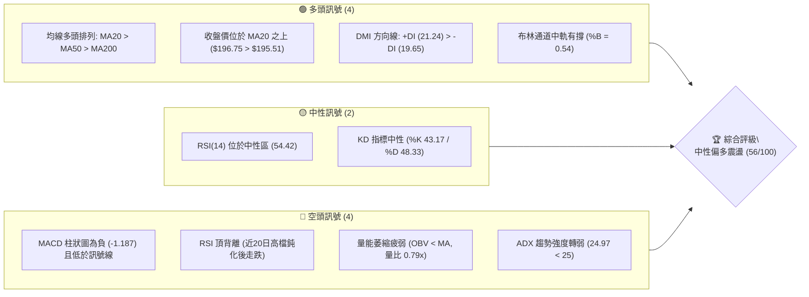
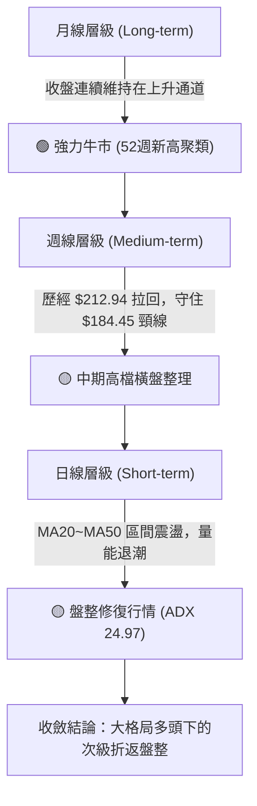
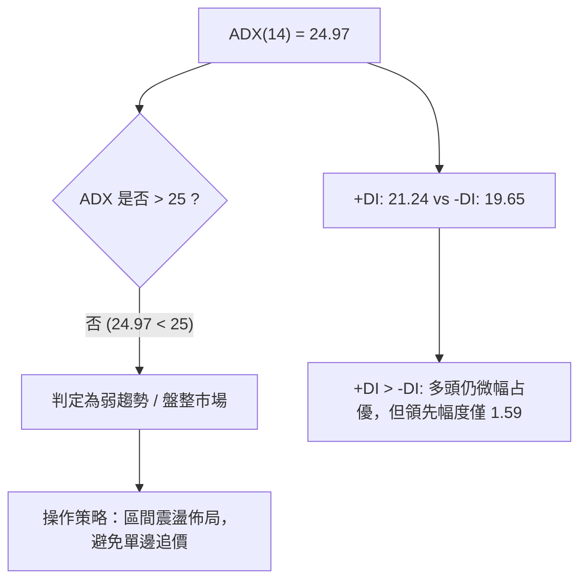
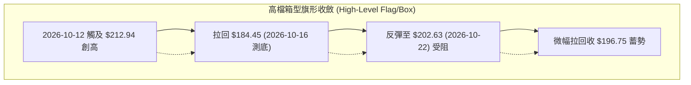
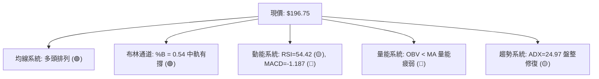
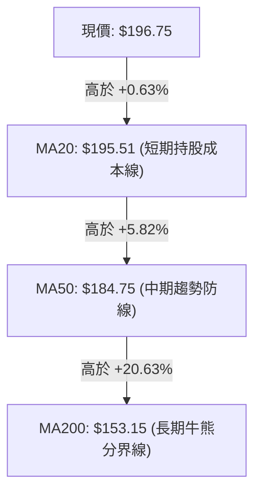
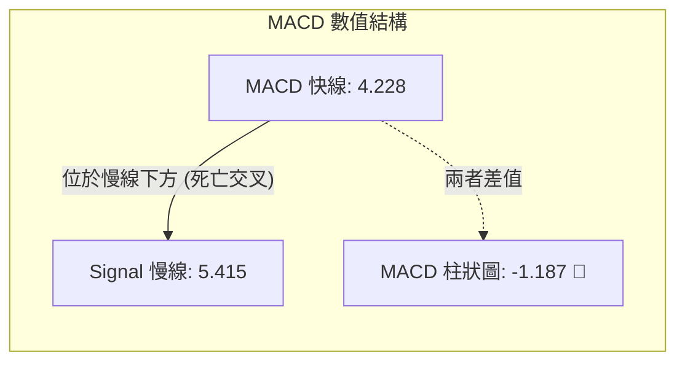
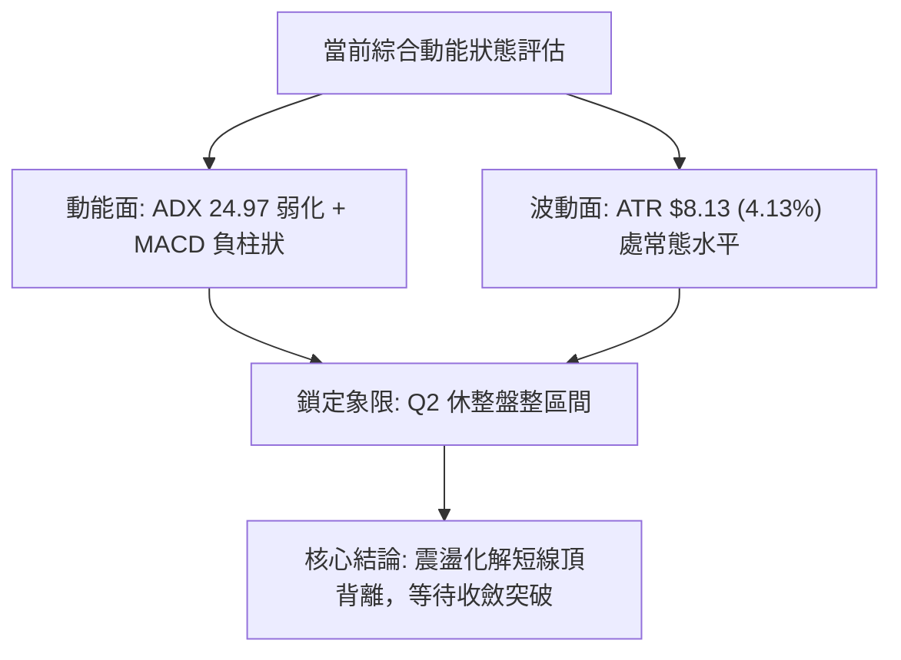
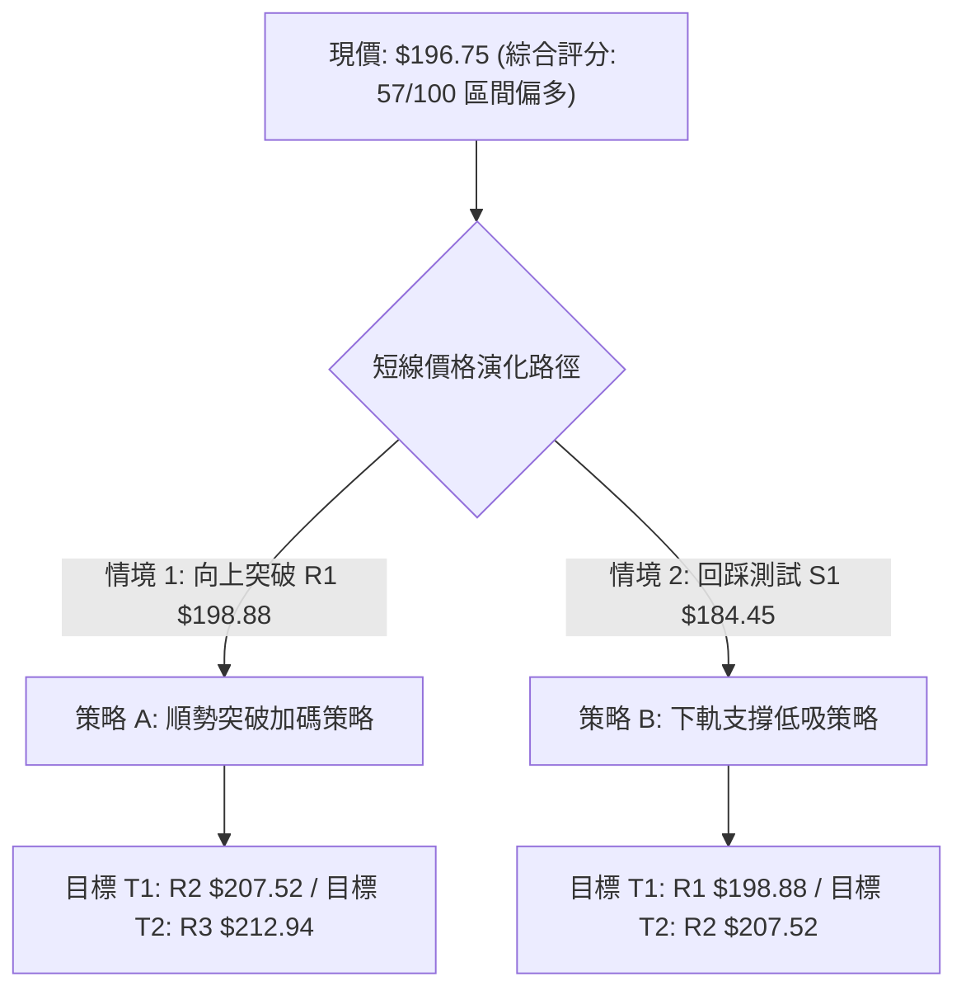
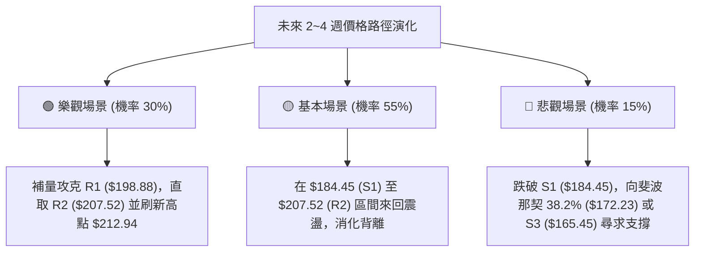

# PLTR 技術分析報告

> **報告日期**：2026-10-25 ｜ **語言**：繁體中文 ｜ **數據來源**：Yahoo Finance ｜ **當前價格**：$196.75

---

## 目錄

| 章節 | 內容 |
|------|------|
| [1. 技術面概覽](#1-技術面概覽) | 訊號儀表板、核心指標、評分卡 |
| [2. 趨勢分析](#2-趨勢分析) | 多時框趨勢、長中短期走勢 |
| [3. 圖表形態分析](#3-圖表形態分析) | 形態識別、K線組合、目標價 |
| [4. 支撐與阻力](#4-支撐與阻力) | 關鍵價位、斐波那契回調 |
| [5. 技術指標深度解讀](#5-技術指標深度解讀) | MA/RSI/MACD/布林/成交量 |
| [6. 動能與波動率](#6-動能與波動率) | 動能評估、ATR、Beta |
| [7. 多時框架總結](#7-多時框架總結) | 時框架評分矩陣 |
| [8. 交易策略建議](#8-交易策略建議) | 多空策略、風險報酬比 |
| [9. 風險提示與監控](#9-風險提示與監控) | 監控指標、風險場景 |

---

## 1. 技術面概覽

### 🎯 技術訊號儀表板



### 📊 核心指標速覽表

| 指標類別 | 指標名稱 | 當前數值 | 訊號 | 解讀 |
|----------|----------|----------|------|------|
| **價格** | 當前收盤價 | $196.75 | 🟢 | 位於52週區間 84.8% 高檔位置，展現長線強勢格局 |
| **均線** | MA20 (短) | $195.51 | 🟢 | 現價高於 MA20（+0.63%），短線支撐初步成立 |
| **均線** | MA50 (中) | $184.75 | 🟢 | 現價顯著高於 MA50（+6.50%），中期多頭結構穩固 |
| **均線** | MA200 (長) | $153.15 | 🟢 | 遠高於長期牛熊分界線（+28.47%），長期牛市無虞 |
| **動能** | RSI(14) | 54.42 | 🟡 | 位於 30–70 中性平衡區，但出現近 20 根 K 線頂背離 |
| **動能** | MACD (12,26,9) | 4.228 / 5.415 | 🔴 | MACD 線低於訊號線，Hist 柱為 -1.187，動能修復中 |
| **擺動** | Stoch %K / %D | 43.17 / 48.33 | 🟡 | 震盪指標位於中性區間，無明顯超買或超賣 |
| **趨勢** | ADX(14) | 24.97 | 🟡 | ADX < 25 代表強單邊趨勢暫歇，行情轉入區間震盪 |
| **通道** | 布林通道 %B | 0.54 | 🟡 | 價格落於中軌（$195.51）與上軌（$210.60）之間微偏多 |
| **量能** | 20日成交量比 | 0.79x | 🔴 | 成交量 17.61M 低於 20MA (22.19M)，OBV < MA 量能疲弱 |
| **波動** | ATR(14) | $8.13 | 🟡 | 佔現價 4.13%，日均震盪幅度偏大，操作需嚴格風控 |

### 🏆 技術評分卡

```
╔══════════════════════════════════════════════════════════════╗
║                技術評分卡 — PLTR (2026-10-25)                 ║
╠══════════════════════════════════════════════════════════════╣
║ 趨勢強度      ██████████░░░░░░░░░░  50/100  🟡 ADX < 25 震盪  ║
║ 動能指標      ████████░░░░░░░░░░░░  40/100  🔴 MACD柱翻負背離 ║
║ 支撐穩定度    ██████████████░░░░░░  70/100  🟢 S1/MA50 支撐硬 ║
║ 成交量配合    ████████░░░░░░░░░░░░  40/100  🔴 量比 0.79x 量縮║
║ 形態完整度    ████████████░░░░░░░░  60/100  🟡 高檔箱型收斂   ║
║ 均線排列      ████████████████░░░░  80/100  🟢 完美多頭排列   ║
╠══════════════════════════════════════════════════════════════╣
║ 綜合評分      ███████████░░░░░░░░░  57/100  中性偏多 (區間)   ║
╚══════════════════════════════════════════════════════════════╝
```
*(註：綜合評分由六項子指標算術平均得 (50 + 40 + 70 + 40 + 60 + 80) ÷ 6 = 56.67，四捨五入為 57/100)*

---

## 2. 趨勢分析

### 🌐 多時框趨勢分析



### 📈 長期趨勢 — 12個月走勢圖（Unicode）

```
PLTR 月線走勢圖（過去12個月收盤價軌跡）
價格軸 ($)
$210 ┤                                      ● (52W高點 $212.94)
$200 ┤              ● (2025-10: $200.47)    │      ● (現價: $196.75)
$190 ┤              │                       ●──────┘ (2026-09: $187.05)
$180 ┤              ● (2025-12: $177.75)    ● (2026-08: $186.38)
$170 ┤        ●─────┘ (2025-11: $168.45)    │
$160 ┤        │                             │
$150 ┤        │     ● (2026-01: $146.59)    │
$140 ┤        │     ● (2026-03: $146.28)    │
$130 ┤        │     │     ● (2026-04: $139.11)
$120 ┤        │     │     │     ● (2026-07: $123.06)
$110 ┤        │     │     │     ● (2026-06: $116.67 - 週期低點)
     └────────┴─────┴─────┴─────┴───────────┴─────────────────────
      25-10  25-11 26-01 26-03 26-06       26-08       26-10
```

#### 走勢特徵分析表格

| 階段 | 時間區間 | 起始收盤 | 終止收盤 | 漲跌幅 | 主要走勢特徵 |
|------|----------|----------|----------|--------|--------------|
| 第1階段：高檔折返 | 2025-10 ~ 2026-02 | $200.47 | $137.19 | -31.57% | 遭遇獲利了結賣壓，自兩百元大關大幅技術性修正 |
| 第2階段：低檔築底 | 2026-03 ~ 2026-06 | $146.28 | $116.67 | -20.24% | 於 $106.37（52W低點）上方反覆打底，6月收盤 $116.67 見底 |
| 第3階段：主升暴衝 | 2026-07 ~ 2026-08 | $123.06 | $186.38 | +51.45% | 8月巨量單月飆漲 51.45%，確立反轉主升段展開 |
| 第4階段：挑戰新高 | 2026-09 ~ 2026-10 | $187.05 | $196.75 | +5.19% | 觸及 52W 高點 $212.94 後回測，當前收在 $196.75 蓄勢 |

### 📊 中期趨勢（週線分析）

```
近期週線壓力與支撐示意圖
$212.94 ─── 52W最高點 (2026-10-16 當週高點) ══════════════ [強壓 R3]
            │
$202.63 ─── 2026-10-23 當週反彈高點 ──────────────────── [次壓 R1/R2]
            │
$196.75 ─── 2026-10-23 週收盤價 ◄ 現價位置
            │
$184.45 ─── 2026-10-16 當週急跌低點 (強勁承接線) ═════════ [重要支撐 S1]
            │
$164.55 ─── 2026-09-11 週低點 (9月中旬盤整底部) ───────── [深層防線 S3]
```

中期週線在 2026-08-07 當週爆出 435.16M 天量突破後，週 K 線格局已徹底轉多。過去 8 週走勢呈現「急拉至 $212.94 → 快速下殺至 $184.45 測底 → 抽腳收在 $196.75」的洗盤過程。週線 MACD 雖有柱狀圖轉負跡象（-1.187），但價格依然穩固運行在週線等級上升軌道上方。

### ⚡ 趨勢強度評估（ADX 解讀）



#### ADX 趨勢強度對照表

| 指標名稱 | 當前數值 | 臨界門檻 | 狀態解讀 | 操作意涵 |
|----------|----------|----------|----------|----------|
| **ADX (14)** | 24.97 | 25.00 | 弱趨勢 / 盤整區間 🟡 | 缺乏單邊推動力，指標容易鈍化，以回調支撐進場為主 |
| **+DI** | 21.24 | -DI (19.65) | 多方占優 (+1.59) 🟢 | 買盤控盤力度猶存，未演變成空方主導跌勢 |
| **-DI** | 19.65 | +DI (21.24) | 空方受抑 🟢 | 空方打壓力量未達單邊標準，屬於正常獲利回吐 |

---

## 3. 圖表形態分析

### 🔍 形態識別系統



#### 圖表形態信心度表格（依規則 15）

| 形態名稱 | 信心度 | 判斷依據（引用數據） | 完成度 | 目標價（附計算式） |
|----------|--------|----------------------|--------|--------------------|
| **高檔矩形箱型** | 70% | 頂部受制於波段高點聚類 R1/R3 ($198.88 / $212.94)，底部受到波段低點聚類 S1 ($184.45) 強力支撐 | 75% | 箱頂突破目標價 = 頸線 $212.94 + 形態高度 ($212.94 - $184.45 = $28.49) = $241.43（由形態推算） |
| **潛在雙底 (W底)** | 45% | 日線於 2026-10-16 探底 $184.45，次週低點於 $186.15 止跌；但兩次低點間隔過短且未突破中間頸線 $202.63 | 35% | 訊號不足（信心度 < 50%），僅做指標型解讀，不予計算雙底目標價 |

### 🕯️ 重要K線形態分析（依規則 19）

依規範僅使用數據中「近10根日K」與「近8根週K」之開高低收進行精確解讀：

#### 近10根日K線形態分析表

| 日期 | 開 | 高 | 低 | 收 | K線形態 | 解讀 | 訊號 |
|------|----|----|----|----|---------|------|------|
| 2026-10-12 | 208.90 | 212.94 | 206.05 | 209.00 | 衝高小陽線 | 創 52W 新高 $212.94，但留上影線，買盤追高動能衰退 | 🟡 |
| 2026-10-13 | 208.08 | 210.88 | 205.97 | 208.67 | 孕線十字星 | 實體極小，高檔獲利了結與承接買盤拉鋸 | 🟡 |
| 2026-10-14 | 207.02 | 209.29 | 199.74 | 200.97 | 中長黑K線 | 跌破 200 大關，空頭吞噬前兩日實體，確立回檔 | 🔴 |
| 2026-10-15 | 196.85 | 200.91 | 192.60 | 200.50 | 下影小陽錘 | 低開至 $192.60 後強勁抽腳收回 $200.50，逢低買盤進駐 | 🟢 |
| 2026-10-16 | 201.79 | 203.55 | 184.45 | 186.03 | 帶巨量長黑 | 創近十日最大量 (33.35M)，長黑下殺灌破 S1 測底 | 🔴 |
| 2026-10-19 | 186.99 | 196.99 | 186.15 | 194.15 | 實體大陽線 | 吞噬昨日跌幅，低點 $186.15 未破前日低，形成雙根破底翻 | 🟢 |
| 2026-10-20 | 192.44 | 196.11 | 189.42 | 192.60 | 量縮小陰星 | 成交量急縮至 15.09M，壓回整理，賣壓不重 | 🟡 |
| 2026-10-21 | 191.72 | 202.55 | 189.88 | 201.72 | 穿頭大陽線 | 盤中直攻 $202.55，收盤站上 $201.72，短線轉強 | 🟢 |
| 2026-10-22 | 200.76 | 202.63 | 194.54 | 196.19 | 上影小陰線 | 上攻高點 $202.63 遇阻回落，收盤跌破開盤，短壓浮現 | 🔴 |
| 2026-10-23 | 195.02 | 197.49 | 190.57 | 196.75 | 陽十字星 | 探底 $190.57 後回升，守住 MA20 ($195.51)，量縮觀望 | 🟡 |

#### 近8根週K線形態分析表

| 週交易日 | 開 | 高 | 低 | 收 | K線形態 | 解讀 | 訊號 |
|----------|----|----|----|----|---------|------|------|
| 2026-09-04 | 184.49 | 187.94 | 165.71 | 174.33 | 長黑帶下影 | 8月急漲後的第一次大幅回檔整理 | 🔴 |
| 2026-09-11 | 173.60 | 175.82 | 164.55 | 167.23 | 量縮小陰K | 成交量驟降至 81.68M，空頭摜壓動能衰竭 | 🟡 |
| 2026-09-18 | 169.70 | 177.88 | 166.42 | 177.64 | 帶量反彈陽 | 成交量放大至 144.45M，確立底部完成轉折 | 🟢 |
| 2026-09-25 | 178.73 | 194.68 | 176.76 | 189.67 | 突破長陽K | 實體突破 $180 壓力帶，創波段收盤新高 | 🟢 |
| 2026-10-02 | 186.23 | 194.78 | 184.81 | 188.75 | 高檔孕線星 | 86.97M 極致量縮，高檔強勢整理無深跌跡象 | 🟡 |
| 2026-10-09 | 189.45 | 209.58 | 187.63 | 209.05 | 光頭大陽K | 放量攻克兩百元大關，收在最高點附近 | 🟢 |
| 2026-10-16 | 208.90 | 212.94 | 184.45 | 186.03 | 烏雲罩頂黑 | 週振幅高達 15.2%，自高點 $212.94 暴跌至 $184.45 | 🔴 |
| 2026-10-23 | 186.99 | 202.63 | 186.15 | 196.75 | 止跌修復陽 | 週K收陽，收盤漲回 $196.75，低點守住前週下影線區間 | 🟢 |

### 📉 ASCII 走勢形態示意圖

```
PLTR 近十日高檔箱型震盪示意圖
價格
$212.94 ──┬──────● (10-12 創高點)
          │      │╲
$202.63 ──┼──────┼─╲───────● (10-22 反彈次高)
$198.88 ──┼──────┼──╲─────╱─╲───── [R1 阻力線]
$196.75 ──┼──────┼───╲───╱───●◄ [現價 10-23]
$195.51 ──┼──────┼────╲─╱─────── [MA20 / BB中軌]
          │      │     ● (10-15 下影)
$184.45 ──┴──────● (10-16 測底低點) ═══════════ [S1 支撐線]
          └──────┴─────┴─────┴───────────
          10-12 10-16 10-19 10-23 (交易日)
```

### 🎯 形態目標價計算

根據上述高檔矩形箱型形態（信心度 70%）：
1. **箱型頂部頸線**：$212.94（2026-10-12 盤中波段最高點，亦即 52W High）
2. **箱型底部支撐**：$184.45（2026-10-16 盤中波段最低點，亦即 S1 支撐）
3. **形態垂直高度**：$212.94 - $184.45 = $28.49
4. **向上突破翻轉目標價**：頸線 $212.94 + 形態高度 $28.49 = **$241.43**（由形態高度推算）
5. **向下破位跌幅滿足目標價**：支撐 $184.45 - 形態高度 $28.49 = **$155.96**（由形態高度推算，與 MA200 $153.15 聚類相符）

---

## 4. 支撐與阻力

### 🗺️ 關鍵價位分布圖（Unicode）

```
PLTR 價位結構分布圖
══════════════════════════════════════════════════════════
$212.94 ║██████████████████████████████║ 強阻力 R3 (52W High / 斐波 0.0%)
$207.52 ║████████████████████          ║ 阻力 R2 (波段高點聚類)
$198.88 ║████████████████████████      ║ 關鍵阻力 R1 (+1.08%)
$196.75 ╠══════════════════════════════╣ ◄ 現價 (收盤價)
$195.51 ║──────────────────────────────║ MA20 動態支撐 / 布林中軌
$187.79 ║▓▓▓▓▓▓▓▓▓▓▓▓▓▓▓▓              ║ 斐波那契 23.6% 回調位
$184.45 ║████████████████████████      ║ 近期關鍵支撐 S1 (-6.25%)
$176.50 ║██████████████████            ║ 支撐 S2 (波段低點聚類)
$172.23 ║▓▓▓▓▓▓▓▓▓▓▓▓▓▓▓▓              ║ 斐波那契 38.2% 回調位
$165.45 ║██████████████████████████████║ 強支撐 S3 (-15.91%)
══════════════════════════════════════════════════════════
```

### 🚧 阻力位分析表

*(註：阻力價位嚴格引用技術數據中由波段高點聚類計算之數值)*

| 阻力級別 | 價位 | 距現價幅差 | 形成原因 | 突破難度 | 重要性 |
|----------|------|------------|----------|----------|--------|
| **R1** | $198.88 | +1.08% | 近期日K高點聚類密度最高處，且接近 200 整數心理關卡 | 中等 🟡 | 短線多空臨界點，突破即解除日K短線下壓態勢 |
| **R2** | $207.52 | +5.47% | 2026-10-14 起跌前的成交密集帶與次級反彈高點聚類 | 高 🔴 | 中期回檔結構的頸線壓力區，需伴隨 25M 以上巨量 |
| **R3** | $212.94 | +8.23% | 52週歷史新高紀錄（2026-10-12盤中高點），斐波那契 0.0% | 極高 🔴 | 多頭終極防線，攻克將開啟無套牢區的歷史主升浪 |

### 🛡️ 支撐位分析表

*(註：支撐價位嚴格引用技術數據中由波段低點聚類計算之數值)*

| 支撐級別 | 價位 | 距現價幅差 | 形成原因 | 守住機率 | 重要性 |
|----------|------|------------|----------|----------|--------|
| **S1** | $184.45 | -6.25% | 2026-10-16 爆量長黑之洗盤低點，與 MA50 ($184.75) 重合 | 75% 🟢 | 極關鍵短期護城河，多頭趨勢不破的底線標竿 |
| **S2** | $176.50 | -10.29% | 2026-09-18 週反彈起漲點與 8 月中旬突破平台高點轉支撐 | 85% 🟢 | 中期防守中樞，若失守將引發機構減倉賣壓 |
| **S3** | $165.45 | -15.91% | 2026-09-04、2026-09-11 兩週波段探底低點聚類 | 95% 🟢 | 強力結構性支撐，靠近此區間將出現價值投資買盤 |

### 📐 斐波那契回調位分析

依據 52 週完整波動區間（低點 $106.37 → 高點 $212.94，總落差 $106.57）計算之回調位：

```
斐波那契黃金分割結構
 0.0% ─── $212.94 (52W High)
          │
23.6% ─── $187.79 ─── [現價 $196.75 運行於 0.0% ~ 23.6% 強勢區間]
          │
38.2% ─── $172.23 ─── [回調安全閥：多頭最強修正限度]
          │
50.0% ─── $159.66 ─── [牛熊均衡點：與 MA200 $153.15 構成緩衝墊]
          │
61.8% ─── $147.08 ─── [黃金分割防線：失守代表趨勢轉空]
          │
100.0% ── $106.37 (52W Low)
```

**解讀**：
當前價格 **$196.75** 穩穩運行於 **0.0% ($212.94)** 與 **23.6% ($187.79)** 的極淺回調強勢區間內。在技術分析常規中，一檔飆升股票回調若能守穩在 23.6% 之上，代表市場多方資金強勢鎖碼，屬於典型「強勢蓄勢形態」。即便日後發生深度回洗跌破 $187.79，下方還有 S1 ($184.45) 形成雙重共振保護。

---

## 5. 技術指標深度解讀

### 🎛️ 指標訊號總覽



### 📈 移動平均線排列分析



#### 均線全景數據解析表

| 均線規格 | 當前數值 | 距現價百分比 | 趨勢斜率 | 技術意涵 |
|----------|----------|--------------|----------|----------|
| **MA 5** | $196.28 | +0.24% 🟢 | 上彎 ▲ | 短線止跌回穩，重新翻越 5 日線 |
| **MA 10** | $198.66 | -0.96% 🔴 | 下彎 ▼ | 短線第一道蓋頭均線，需放量突破 |
| **MA 20** | $195.51 | +0.63% 🟢 | 上彎 ▲ | 月線生命線失而復得，提供微幅多頭支撐 |
| **MA 50** | $184.75 | +6.50% 🟢 | 上彎 ▲ | 季線強勁向上延伸，中期上漲動能未變 |
| **MA 60** | $180.59 | +8.95% 🟢 | 上彎 ▲ | 支撐區間密集，回踩即有買盤逢低布局 |
| **MA 120** | $156.12 | +26.03% 🟢 | 上彎 ▲ | 半年線持續上揚，長線基礎極為厚實 |
| **MA 200** | $153.15 | +28.47% 🟢 | 上彎 ▲ | 年線長期向上發散，維持大牛市基調 |
| **MA 240** | $157.33 | +25.05% 🟢 | 上彎 ▲ | 兩年均線呈標準順向多頭，無結構性破位跡象 |

### 📉 RSI(14) 分析

```
RSI(14) 當前數值: 54.42
0               30               50        54.42       70              100
├───────────────┼────────────────┼───────────●─────────┼───────────────┤
  超賣區 (Oversold)       中性平靜區           現值      超買區 (Overbought)
[████████████████████████████████████████████░░░░░░░░░░░░░░░░░░░░░░░░] 54.42%
```

**背離判斷**：
- **頂背離確認**：技術數據中明確標示「⚠️ 頂背離 (Bearish Divergence)」。比較近 20 根 K 棒走勢，價格於 2026-10-12 創下歷史新高點 $212.94，然而 RSI(14) 卻未能同步突破前期高點，隨後價格自高點回落過程中，RSI 由 76.3（2026-10-09 週）陡降至 54.42。此一頂背離確認了短線動能出現衰竭，需要時間橫盤震盪化解上檔套牢籌碼。

### 📊 MACD(12/26/9) 訊號解讀



**解讀**：
MACD 快線（4.228）在零軸上方與慢線（5.415）呈死叉狀態運行，柱狀圖為 **-1.187**。雖然雙線均維持在零軸以上（代表長線多頭市場），但負柱狀圖顯示近兩週以來市場回檔修正的動能仍未完全衰退。短線若要重新啟動攻勢，MACD 負柱狀圖必須出現連續縮頭並收斂至零軸之上。

### 📦 布林通道分析

```
布林通道當前結構 (帶寬: $30.17)
$210.60 ─── BB 上軌 ──────────────────────────────────
            │
            │
$196.75 ─── 現價位置 (%B = 0.54) ◄ 中軌偏上
$195.51 ─── BB 中軌 (MA20) ───────────────────────────
            │
            │
$180.43 ─── BB 下軌 ──────────────────────────────────
```

**解讀**：
布林通道 %B 數值為 **0.54**，價格緊貼中軌 $195.51 上方波動。通道上軌座落於 $210.60，下軌座落於 $180.43。這表明行情在經歷了 10 月中旬劇烈向下碰觸中軌後，目前正以中軌為支點展開橫向窄幅盤整。在通道未收口或發散前，中軌至下軌區間提供第一道彈性防護。

### 💹 成交量分析（量價配合度）

1. **成交量萎縮**：最新單日成交量為 **17,614,200 股**，較 20 日均量（22,188,645 股）縮減了 21%（量比僅 **0.79x**）。在價格試圖回升的過程中出現量縮，表明市場追價意願不足，機構投資人轉為觀望。
2. **OBV 能量潮疲弱**：指標顯示「OBV < MA」，量能線低於其移動平均線，這意味著籌碼累積動力放緩，整體資金在目前位置呈現被動防守而非主動進攻。

---

## 6. 動能與波動率

### ⚡ 動能評估四象限

| 象限 | 動能強度 | 波動率水準 | 當前狀態 | 策略應對方針 |
|------|----------|------------|----------|--------------|
| **Q1：突破主升** | 強動能 (ADX > 25, MACD柱 > 0) | 低/中波動 | ─ | 強勢順勢加碼，抱牢持股 |
| **Q2：休整盤整** | 弱動能 (ADX = 24.97, MACD柱 < 0) | 低/中波動 | **✓ 當前位置** | **謹慎區間操作，低吸高拋，避免追價** |
| **Q3：劇烈狂暴** | 強動能 (趨勢明確加速) | 極高波動 | ─ | 縮小部位規模，擴大止損區間 |
| **Q4：破位下跌** | 弱動能 (空方佔優) | 高波動 | ─ | 嚴格防守觀望，現金為王 |



### 📊 ATR 波動率分析

- **當前 ATR(14)**：**$8.13**（佔現價 $196.75 之 **4.13%**，採用 Wilder 平滑法）。
- **日內波動解析**：PLTR 每日平均跳動空間超過 8 美元，屬於典型高貝塔成長股特徵。
- **止損距離建議**：
  - **短線交易止損**：以 1.0 倍 ATR 為基準，建議設置緩衝空間為 **$8.13**（對應現價約 4.1%）。
  - **波段交易止損**：以 1.5 倍 ATR 為基準，建議設置緩衝空間為 **$12.20**（對應現價約 6.2%，恰與下探支撐 S1 $184.45 吻合）。

### 📐 Beta 與市場相關性

- **Beta 係數**：**1.602**（高彈性）。
- **大盤敏感度**：PLTR 走勢比標普 500 指數與那斯達克指數波動劇烈約 60%。當科技板塊出現拉回時，PLTR 的回撤幅度通常大於指數；反之在市場反彈時，其修復爆發力亦顯著領先。
- **空頭部位比例**：放空比率（Short % Float）為 **2.6%**，Short Ratio 為 **2.21 天**，空頭借券比例偏低，並無迫在眉睫的軋空題材，股價波動主要由主動買賣盤推動。

---

## 7. 多時框架總結

### 📋 時框架評分表

| 時框架 | 趨勢方向 | 動能指標 | 均線排列 | 圖表形態 | 綜合評分 | 戰術建議 |
|--------|----------|----------|----------|----------|----------|----------|
| **長期 (月線)** | 強力偏多 🟢 | RSI 處高檔擴展 | 完美多頭 (均線多頭) | 歷史大通道上升段 | **85/100** | 核心長期多單續抱，無視短期回調 |
| **中期 (週線)** | 中性偏多 🟢 | 週 MACD 柱翻負 | MA20 上彎走揚 | 突破後的高檔震盪箱型 | **65/100** | 回踩重要支撐分批佈局 |
| **短期 (日線)** | 震盪修復 🟡 | RSI 頂背離、量縮 | MA20 有撐、MA10 有壓 | 矩形旗形收斂整理 | **50/100** | 區間交易，嚴禁高檔盲目追多 |

### 🔲 綜合訊號矩陣

```
┌─────────────────┬─────────────────────────────────────────────────────────┐
│ 維度指標        │ 短期 (1–5日)      中期 (2–8週)        長期 (數月以上)       │
├─────────────────┼─────────────────────────────────────────────────────────┤
│ 價格趨勢        │ 🟡 橫向盤整修復   🟢 高檔強勢整理     🟢 順勢牛市主升段     │
│ 均線系統        │ 🟡 夾於MA10~MA20  🟢 站穩MA50上方     🟢 遠高於MA200 (+28%) │
│ 動能 (MACD/RSI) │ 🔴 死叉負柱背離   🟡 柱狀微翻負修正   🟢 長期雙線處於高位   │
│ 量能配合        │ 🔴 量縮 (0.79x)   🟢 突破時天量沉澱   🟢 機構持股達 64.6%   │
│ 結構穩定性      │ 🟡 波動收斂等待   🟢 守穩 23.6% 斐波  🟢 52W低點翻倍強勢    │
└─────────────────┴─────────────────────────────────────────────────────────┘
```

### ⚖️ 多時框收斂結論（依規則 14）

1. **行情性質判定**：當前日線 **ADX(14) 為 24.97**（明確小於 25 臨界值），依照規則 14 判定為**「盤整行情」**。
2. **多時框優先級處理**：
   - 由於處於 ADX < 25 的盤整結構，交易邏輯應以**日線布林通道上下軌（$180.43 ~ $210.60）及高低點聚類（S1 $184.45 / R1 $198.88）**作為核心震盪操作邊界。
   - 同時，中長期均線（MA50 $184.75、MA200 $153.15）呈現強勁多頭順向排列，表明盤整格局是「牛市中的休整」，而非空頭轉折。
3. **唯一方向性結論**：**中性偏多（區間震盪蓄勢）**。策略重點在於利用短線回踩測試支撐時低吸，等待放量突破。

---

## 8. 交易策略建議

### 🗺️ 策略決策流程圖



### 🧭 策略路由（依規則 18 評分卡分流）

> **當前主策略方向 = 區間偏多操作，等待突破確認（依技術評分卡 57/100，落於 40–60 區間）**
> 
> 由於綜合評分為 57/100，短線 ADX 趨勢強度不足 25 且存在動能頂背離，報告主推**「區間低吸」與「右側突破確認」**雙軌並行之偏多策略。

### 🎯 價格情境階梯（Price Scenarios）

*(註：價位嚴格引用第 4 章及數據區塊之精確數值)*

| 觸發條件 | 下一目標 | 後續延伸 | 情境含義 |
|----------|----------|----------|----------|
| **向上突破 R1 $198.88** | R2 $207.52 | R3 $212.94 | 突破短期壓制，多頭發動挑戰 52 週新高 |
| **站穩現價 $196.75 區間** | R1 $198.88 | S1 $184.45 | 於 MA20 ($195.51) 附近蓄勢整理，籌碼換手 |
| **跌破 S1 $184.45** | S2 $176.50 | S3 $165.45 | 短線結構破位，回測 38.2% 斐波那契深層支撐 |

### 📊 情境機率分佈

| 情境 | 機率 | 主要依據 |
|------|------|----------|
| **區間震盪蓄勢** | **55%** | ADX=24.97 (<25) 弱趨勢、量比 0.79x 成交量低迷、布林通道帶寬收斂 |
| **放量向上突破** | **30%** | 均線系統呈標準多頭排列、+DI (21.24) > -DI (19.65)、機構持股達 64.6% 護盤 |
| **向下破位跌落** | **15%** | RSI 頂背離發酵、MACD 負柱狀擴散、失守 MA20 引發短線停損賣壓 |

### 🟢 主策略詳情（方向：區間偏多）

*(註：風險報酬比嚴格按規則 17 計算：(T1 - 進場價) ÷ (進場價 - 止損價))*

| 策略要素 | 策略 A（右側突破進場） | 策略 B（左側回調低吸） |
|----------|------------------------|------------------------|
| **策略類型** | 順勢突破買入策略 | 支撐低吸防守策略 |
| **進場條件** | 日K收盤明確突破阻力位 R1，且成交量放大 | 價格回調測試關鍵支撐 S1 與 MA50 守穩反彈 |
| **進場價格** | **$198.88**（以 R1 突破確認點計） | **$184.45**（以 S1 支撐測試點計） |
| **目標價 T1** | **$207.52**（阻力位 R2） | **$198.88**（阻力位 R1） |
| **目標價 T2** | **$212.94**（阻力位 R3 / 52W High） | **$207.52**（阻力位 R2） |
| **止損價格** | **$194.54**（2026-10-22 日低點下方 / 跌破 MA20） | **$176.50**（支撐位 S2 / 跌破 S1 緩衝） |
| **風險報酬比** | **1 : 1.99（以 T1 計）**<br>*(207.52 - 198.88) ÷ (198.88 - 194.54) = 8.64 ÷ 4.34*<br>另：1 : 3.24（以 T2 計） | **1 : 1.82（以 T1 計）**<br>*(198.88 - 184.45) ÷ (184.45 - 176.50) = 14.43 ÷ 7.95*<br>另：1 : 2.90（以 T2 計） |
| **成功機率** | 60% | 65% |
| **建議倉位** | 10% ~ 15% 總資金 | 15% ~ 20% 總資金 |

### 🔴 反向風險觸發點（對沖提示）

若發生意外利空導致走勢破位，以下為推翻偏多假設之關鍵風控條件：
- **空頭觸發點**：若日 K 線帶量（單日成交量 > 25M）跌破 **S1 ($184.45)** 且收盤無法收回，多頭結構遭到破壞。
- **風控處置措施**：全面平倉短線多單，波段多單減倉 50% 以上；激進交易者可於 $184.45 反抽確認受阻時建立空頭避險部位，對沖目標指向 **S2 ($176.50)** 及 **S3 ($165.45)**，止損設於 **$187.79**（23.6% 斐波那契回調位）。

### ⭐ 整體訊號強度評星

```
做多訊號強度：★★★☆☆  (3/5星 — 均線排列完整支撐強，受制於短線背離量縮)
做空訊號強度：★★☆☆☆  (2/5星 — 僅為技術性回檔，無空方單邊趨勢條件)
整體可信度：  ★★★★☆  (4/5星 — 價位聚類與斐波那契點位契合度高)
```

---

## 9. 風險提示與監控

### ✅ 關鍵監控指標 Checklist

```
╔══════════════════════════════════════════════════════════════╗
║               PLTR 每日盤後關鍵監控清單 (Checklist)           ║
╠══════════════════════════════════════════════════════════════╣
║ [ ] 價格是否成功收在 MA20 ($195.51) 之上？                    ║
║ [ ] 日成交量是否回升至 20 日均量 (22.19M) 之上？              ║
║ [ ] MACD 柱狀圖是否由負轉正 (目前: -1.187) 或持續收斂？       ║
║ [ ] RSI(14) 能否重返 60 攻擊區，擺脫 54.42 震盪區間？         ║
║ [ ] 盤中是否跌破關鍵防守點 S1 ($184.45)？                     ║
║ [ ] 科技股大盤指數波動是否導致 Beta 1.602 放大性賣壓？        ║
╚══════════════════════════════════════════════════════════════╝
```

### ⚠️ 風險場景分析



### 🛡️ 風險管理重要提醒

1. **基本面估值壓力防範**：PLTR 目前 Trailing P/E 高達 **169.61**，P/S (TTM) 達 **76.80**，EV/EBITDA 高達 **174.16**。此類極高估值成長股在市場流動性緊縮或大盤回調時極易遭遇倍數壓縮（Multiple Compression），因此技術面停損必須嚴格執行，不可將短線交易轉為被動套牢長抱。
2. **波動度適應原則**：每日 ATR 達 **$8.13 (4.13%)**，進場部位不得過大。單筆交易承受之最大虧損金額應嚴格限制在總投資組合淨值的 **1.0% ~ 1.5%** 以內。
3. **重大日程與財報防範**：需隨時追蹤相關雲端與 AI 軟體族群財報對市場情緒之連鎖效應，避免在財報發布前夕進行重倉單邊賭博。

---

## 📋 報告總結

```
╔══════════════════════════════════════════════════════════════╗
║                   PLTR 技術分析報告總結                      ║
╠══════════════════════════════════════════════════════════════╣
║ 報告日期：2026-10-25                                          ║
║ 當前價格：$196.75                                             ║
║ 分析評級：⚖️ 中性偏多震盪 (綜合評分: 57/100)                  ║
║                                                              ║
║ 關鍵結論：                                                    ║
║ ├─ 長期趨勢：🟢 強烈牛市 (MA200 $153.15 向上擴展，處 52W 高檔) ║
║ ├─ 中期趨勢：🟢 突破後高檔橫盤，守穩 23.6% 斐波那契 ($187.79) ║
║ ├─ 短期趨勢：🟡 ADX 24.97 盤整修復，RSI 頂背離等待化解       ║
║ ├─ 關鍵支撐：S1 $184.45 / S2 $176.50 / S3 $165.45             ║
║ ├─ 關鍵阻力：R1 $198.88 / R2 $207.52 / R3 $212.94             ║
║ └─ 分析師共識目標價：$206.66 (最高 $265.00，評級: Buy)        ║
║                                                              ║
║ 最優策略組合：                                                ║
║ 1. 🥇 最佳機會：回調至 S1 ($184.45) 附近佈局，風報比 1 : 1.82 ║
║ 2. 🥈 次選機會：右側突破 R1 ($198.88) 追價加碼，目標看 R2/R3  ║
║ 3. 🥉 保守選擇：維持現有倉位觀望，等待 MACD 柱狀圖由負翻正   ║
╚══════════════════════════════════════════════════════════════╝
```

---

> ⚠️ **免責聲明**：本報告為技術分析研究成果，所有數據、圖表及價位推算均基於歷史量價數據之客觀解讀。本報告**僅供學術研究與投資策略討論參考**，**不構成任何要約、招攬或具體投資建議**。市場有風險，交易須設定嚴格停損並獨立承擔決策後果。

---

*報告生成時間：2026-10-25 ｜ 數據來源：Yahoo Finance ｜ 分析框架：多時框技術分析體系*