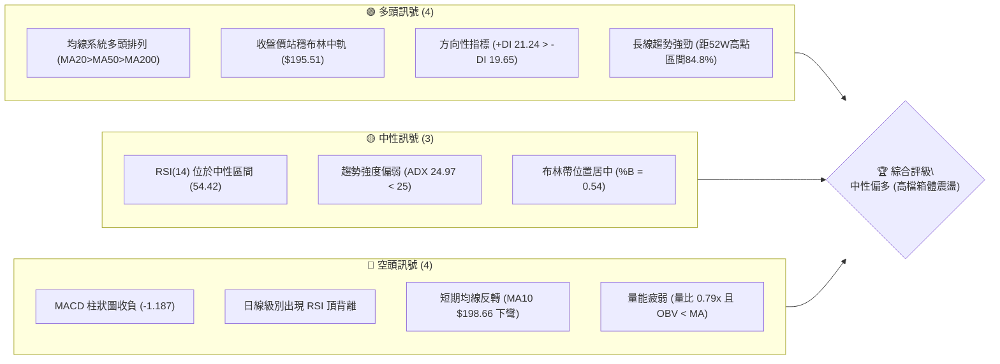
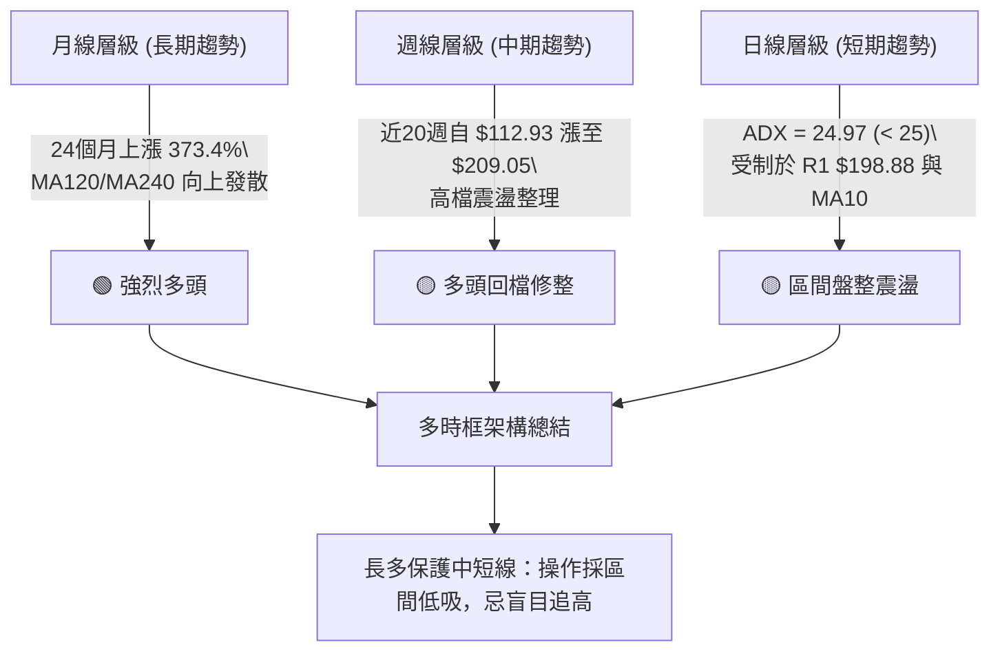
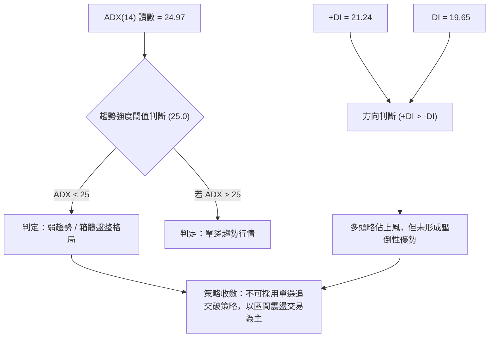
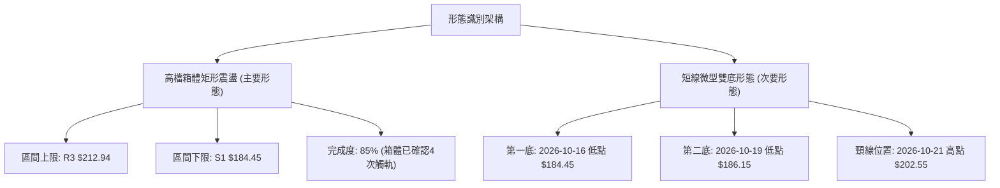
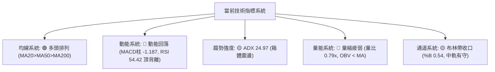
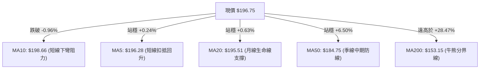
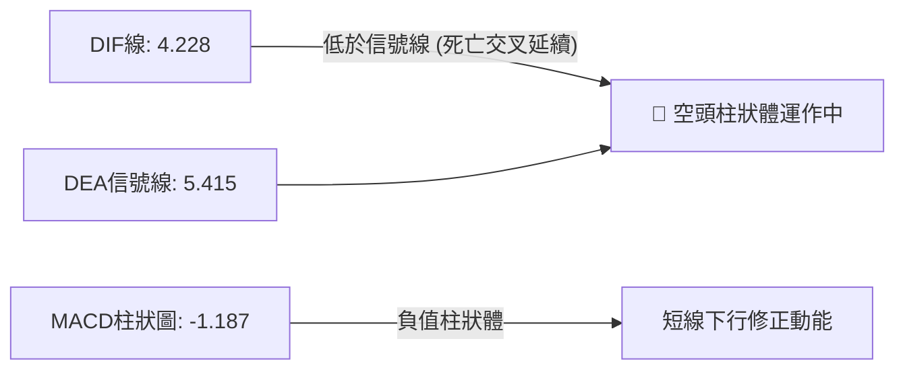
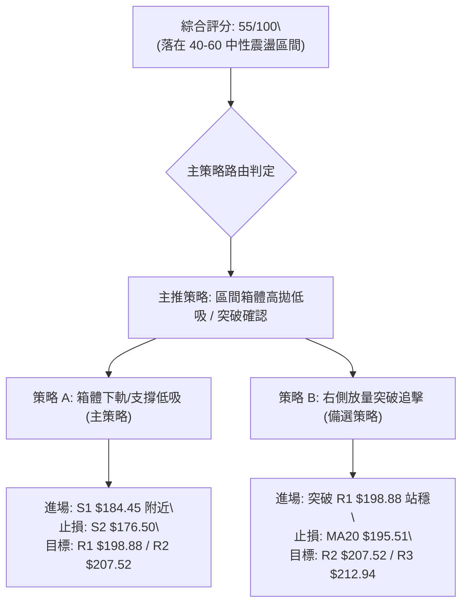
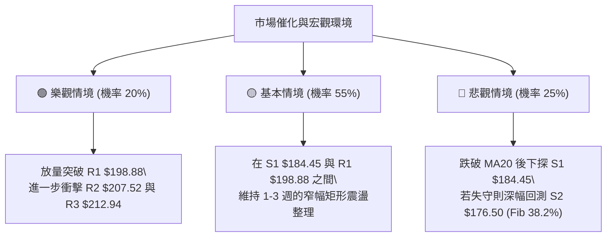

# PLTR 技術分析報告

> **報告日期**：2026-10-26 ｜ **語言**：繁體中文 ｜ **數據來源**：Yahoo Finance ｜ **當前價格**：$196.75

---

## 目錄

| 章節 | 內容 |
|------|------|
| [1. 技術面概覽](#1-技術面概覽) | 訊號儀表板、核心指標、評分卡 |
| [2. 趨勢分析](#2-趨勢分析) | 多時框趨勢、長中短期走勢 |
| [3. 圖表形態分析](#3-圖表形態分析) | 形態識別、K線組合、目標價 |
| [4. 支撐與阻力](#4-支撐與阻力) | 關鍵價位、斐波那契回調 |
| [5. 技術指標深度解讀](#5-技術指標深度解讀) | MA/RSI/MACD/布林/成交量 |
| [6. 動能與波動率](#6-動能與波動率) | 動能評估、ATR、Beta |
| [7. 多時框架總結](#7-多時框架總結) | 時框架評分矩陣 |
| [8. 交易策略建議](#8-交易策略建議) | 多空策略、風險報酬比 |
| [9. 風險提示與監控](#9-風險提示與監控) | 監控指標、風險場景 |

---

## 1. 技術面概覽

### 🎯 技術訊號儀表板



### 📊 核心指標速覽表

| 指標類別 | 指標名稱 | 當前數值 | 訊號 | 解讀 |
|----------|----------|----------|------|------|
| **價格** | 當前收盤價 | $196.75 | 🟢 | 位於52週區間84.8%高位，守於短中期均線上方 |
| **均線** | MA20 (月線) | $195.51 | 🟢 | 現價高於 MA20（+$1.24, +0.63%），多頭支撐有效 |
| **均線** | MA50 (季線) | $184.75 | 🟢 | 現價高於 MA50（+$12.00, +6.50%），中期趨勢向上 |
| **均線** | MA200 (年線) | $153.15 | 🟢 | 現價遠高於 MA200（+$43.60, +28.47%），長多基底堅固 |
| **動能** | RSI(14) | 54.42 | 🟡 | 位於50中軸上方，但近20根K棒首尾出現頂背離警訊 |
| **動能** | MACD (12,26,9) | 4.228 / 5.415 | 🔴 | DIF位於信號線下方，柱狀圖為 -1.187，短線動能衰竭 |
| **動能** | KD指標 (%K/%D) | 43.17 / 48.33 | 🟡 | 位於中性超賣過渡區，%K低於%D，短期向下修正 |
| **趨勢** | ADX(14) | 24.97 | 🟡 | ADX < 25，表明單邊強趨勢暫歇，進入盤整震盪行情 |
| **通道** | 布林帶 (%B) | 0.54 | 🟡 | 位於中軌 ($195.51) 與上軌 ($210.60) 之間，偏向中軌 |
| **量能** | 量比 / OBV | 0.79x / 疲弱 | 🔴 | 成交量僅 17.61M 低於20日均量 22.19M，量能未確認突破 |
| **波動** | ATR(14) | $8.13 | 🟡 | 日波動率 4.13%，屬於中等偏高正常波動區間 |

### 🏆 技術評分卡

```
技術評分卡 — PLTR (2026-10-26)
════════════════════════════════════════════════════
趨勢強度      ███████████░░░░░░░░░  55/100  🟡 中性 (ADX 24.97 趨勢暫緩)
動能指標      █████████░░░░░░░░░░░  45/100  🔴 偏弱 (MACD負柱與RSI背離)
支撐穩定度    █████████████░░░░░░░  65/100  🟢 偏強 (S1 $184.45 與 MA50 守穩)
成交量配合    ████████░░░░░░░░░░░░  40/100  🔴 疲弱 (量比 0.79x, OBV < MA)
形態完整度    ██████████░░░░░░░░░░  50/100  🟡 中性 (高檔箱體震盪收斂)
均線排列      ███████████████░░░░░  75/100  🟢 強勁 (MA20>MA50>MA200 多頭)
════════════════════════════════════════════════════
綜合評分      ███████████░░░░░░░░░  55/100  評級：中性偏多 (區間震盪)
════════════════════════════════════════════════════
（註：綜合評分 55 依規則 18 由六項評分算術平均四捨五入計算：(55+45+65+40+50+75)/6 = 55.00）
```

---

## 2. 趨勢分析

### 🌐 多時框趨勢分析



### 📈 長期趨勢 — 12個月走勢圖（Unicode）

以下圖表記錄 PLTR 過去 12 個月（2025-11 至 2026-10）收盤價走勢：

```
PLTR 月線走勢圖（過去12個月）
價格軸 ($)
$205 ┤                                                  ● (2025-10: $200.47 前高)
$200 ┤                                        ●←現在 ($196.75)
$190 ┤                                  ●     │
$180 ┤                            ●     │     │
$170 ┤ ●(2025-11: $168.45)   ●    │     │     │
$160 ┤  │              ●     │    │     │     │
$150 ┤  │        ●     │     │    │     │     │
$140 ┤  │  ●     │  ●  │     │    │     │     │
$130 ┤  │  │     │  │  │     │    │     │     │
$120 ┤  │  │     │  │  │     │ ●  │     │     │
$110 ┤  │  │     │  │  │  ●(2026-06 低點: $116.67)
     └────────────────────────────────────────────────────────────
        11  12  01  02 03 04 05 06 07  08    09    10 (月份)
       '25 '25 '26 '26 '26 '26 '26 '26 '26   '26   '26   '26
```

**走勢特徵分析表格**：

| 階段區間 | 起始收盤價 | 結束收盤價 | 區間漲跌幅 | 趨勢特徵與結構分析 |
|----------|------------|------------|------------|--------------------|
| **2025-11 至 2026-02** | $168.45 | $137.19 | -18.56% | 高檔獲利回吐，跌破短期均線，呈現階梯式下行尋找支撐 |
| **2026-03 至 2026-05** | $146.28 | $156.54 | +7.01% | 築底反彈行情，測試季線壓力後出現多頭抵抗 |
| **2026-06 至 2026-07** | $116.67 | $123.06 | +5.48% | 深幅回洗打出52週次低點區（6月收 $116.67），形成中期大底 |
| **2026-08 至 2026-10** | $186.38 | $196.75 | +5.56% | 爆量突破展開主升段，自7月 $123.06 飆升至目前 $196.75 (+59.88%) |

### 📊 中期趨勢（週線分析）

從近 8 週的週 K 走勢觀察，PLTR 呈現典型的高檔震盪洗盤結構：

```
PLTR 週線阻力與支撐示意圖
═════════════════════════════════════════════════════════════════
$212.94 ─── 52W 高點 (2026-10-16 當週高點) ──────────── [R3 強阻力]
$209.05 ─── 2026-10-09 當週收盤高點 ──────────────────── [R2 阻力區間]
$198.88 ─── 近期日線密集壓力峰位 ─────────────────────── [R1 頸線]
$196.75 ─── 當前收盤價 (位於週線高檔震盪中軸) ◄ 現價
$186.03 ─── 2026-10-16 週收盤價 / 支撐帶 ─────────────── [S1 上沿]
$184.45 ─── 2026-10-16 當週最低點 (波段關鍵低點) ─────── [S1 核心支撐]
$174.33 ─── 2026-09-04 週收盤價 ───────────────────────── [S2 次級支撐]
═════════════════════════════════════════════════════════════════
```

中期週線週成交量從 2026-08-07 的 435.16M 天量逐級遞減至上週的 100.98M，呈現典型的「量縮收斂」特徵。週 MACD 柱狀圖由正轉負（2026-10-23 數值為 -1.187），週 RSI 回落至 54.4，表明中期動能已從急遽拉升轉入高位整理。

### ⚡ 趨勢強度評估（ADX 解讀）



**ADX 指標強度對照分析**：

| 指標項目 | 數值 | 門檻區間 | 技術意義解讀 |
|----------|------|----------|--------------|
| **ADX(14)** | 24.97 | < 25 (弱趨勢/震盪) | 趨勢強度不足，市場缺乏推動單邊行情的持續買盤或賣盤 |
| **+DI** | 21.24 | 中等水平 | 多方力量佔據主導，但較8月主升段已有顯著降溫 |
| **-DI** | 19.65 | 中等水平 | 空方拋壓未失控，空頭尚未奪得盤面控制權 |
| **(+DI) - (-DI)** | +1.59 | 微幅偏多 | 差值極小，確認價格處於平衡整理狀態 |

---

## 3. 圖表形態分析

### 🔍 形態識別系統



**形態信心度評估表**：

| 形態名稱 | 信心度 | 判斷依據（引用數據） | 完成度 | 形態高度與推算目標價 |
|----------|--------|----------------------|--------|----------------------|
| **高檔矩形箱體** | 85% | 頂部受制於波段高點 R3 $212.94 與 R2 $207.52，底部受 S1 $184.45 嚴格支撐 | 85% | 箱體高度 = $212.94 - $184.45 = $28.49；向上突破目標價 = $212.94 + $28.49 = $241.43 |
| **短線雙底雛形** | 65% | 2026-10-16 探底 $184.45 後拉升，10-19 次低點 $186.15 獲支撐回升 | 70% | 形態高度 = $202.55 (10-21高點) - $184.45 = $18.10；突破目標價 = $202.55 + $18.10 = $220.65 |
| **頭肩頂形態** | 35% | 數據不足以確認（信心度 < 50%）。右肩未成形，且現價仍守於頸線 $184.45 之上 | 20% | 訊號不足，僅做指標型解讀，不預設此空頭形態 |

### 🕯️ 重要K線形態分析

嚴格依據近 10 根日 K 與近 8 根週 K 原始數據判斷：

| 日期（週期） | 開盤價 | 最高價 | 最低價 | 收盤價 | K線形態名稱 | 技術解讀 | 訊號 |
|--------------|--------|--------|--------|--------|-------------|----------|------|
| **2026-10-12 (日K)** | $208.90 | $212.94 | $206.05 | $209.00 | 高位十字星/流星 | 創52週新高 $212.94 後承壓回落，留長上影線 | 🔴 |
| **2026-10-14 (日K)** | $207.02 | $209.29 | $199.74 | $200.97 | 光腳大陰線 | 實體跌破 $205，收於最低點附近，空方下殺 | 🔴 |
| **2026-10-16 (日K)** | $201.79 | $203.55 | $184.45 | $186.03 | 放量下影長黑K | 巨量33.35M殺跌，最低下探 $184.45 留下支撐下影線 | 🟡 |
| **2026-10-19 (日K)** | $186.99 | $196.99 | $186.15 | $194.15 | 穿透陽線 | 低開高走，實體反包前日收盤，確認 $186 支撐有效 | 🟢 |
| **2026-10-21 (日K)** | $191.72 | $202.55 | $189.88 | $201.72 | 光頭長陽線 | 突破 $200 整數關口，重返 MA20 之上，多頭強勁反攻 | 🟢 |
| **2026-10-23 (日K)** | $195.02 | $197.49 | $190.57 | $196.75 | 小陽錘頭線 | 探底 $190.57 後拉回收高於開盤，MA20 守穩 | 🟢 |
| **2026-10-16 (週K)** | $208.90 | $212.94 | $184.45 | $186.03 | 帶長下影大陰K | 衝擊歷史新高失敗後引發獲利回吐，波幅達 $28.49 | 🔴 |
| **2026-10-23 (週K)** | $186.99 | $202.63 | $186.15 | $196.75 | 下影中陽週K | 週線止跌回升，收復上週實體過半跌幅，量縮回穩 | 🟢 |

### 📉 ASCII 走勢形態示意圖

```
PLTR 日線高檔箱體震盪形態示意圖
價格軸 ($)
$212.94 ───┬───────────────────● (10-12 觸頂 $212.94) ──────────── [箱體頂部 R3]
$207.52 ───┼──────────● (10-13)   \                  ● (10-21: $201.72)
$200.00 ───┼───● (10-14)           \                / \
$196.75 ───┼─────────────────────────\──────────────/───● (10-23 現價 $196.75)
$190.00 ───┼                          \            /
$184.45 ───┴───────────────────────────● (10-16)──● (10-19: $186.15) [箱體底部 S1]
           └─────────────────────────────────────────────────────────────
              10-12    10-13    10-14    10-16    10-19    10-21   10-23 (日期)
```

### 🎯 形態目標價計算

1. **高檔箱體向上突破情境**：
   - 形態頸線／上軌：$212.94（數據源 52W High）
   - 形態底部／下軌：$184.45（數據源 S1 波段低點）
   - 形態高度：$H = 212.94 - 184.45 = \$28.49$
   - **等距突破目標價**：$212.94 + 28.49 = \$241.43$

2. **短線微型雙底情境**：
   - 雙底低點：$184.45（2026-10-16 低點）
   - 雙底頸線：$202.55（2026-10-21 日 K 高點）
   - 形態高度：$H = 202.55 - 184.45 = \$18.10$
   - **雙底測量目標價**：$202.55 + 18.10 = \$220.65$

---

## 4. 支撐與阻力

### 🗺️ 關鍵價位分布圖（Unicode）

```
PLTR 價位結構分布圖
═════════════════════════════════════════════════════════════════
$212.94 ║██████████████████████████████║ 強阻力 R3 / 52W High (Fib 0.0%)
$207.52 ║████████████████████          ║ 波段阻力 R2 (近期高點聚類)
$198.88 ║████████████████████████      ║ 關鍵短線阻力 R1 (MA10 $198.66 重合)
$196.75 ╠══════════════════════════════╣ ◄ 現價 ($196.75, 位於BB中軌上方)
$187.79 ║▓▓▓▓▓▓▓▓▓▓▓▓▓▓▓▓▓▓            ║ 斐波那契支撐 (Fib 23.6%)
$184.45 ║████████████████████████████  ║ 核心波段支撐 S1 (MA50 $184.75 聚類)
$176.50 ║████████████████              ║ 中期支撐 S2 (波段回調低點聚類)
$172.23 ║▓▓▓▓▓▓▓▓▓▓▓▓                  ║ 斐波那契支撐 (Fib 38.2%)
$165.45 ║██████████████████████████████║ 強支撐 S3 (前期突破平台密集區)
═════════════════════════════════════════════════════════════════
```

### 🚧 阻力位分析表

依據數據包中「關鍵價位（由 OHLCV 計算）」嚴格填列：

| 阻力級別 | 價位 | 與現價距離 | 形成原因與技術共振 | 突破難度 | 重要性 |
|----------|------|------------|--------------------|----------|--------|
| **R1** | $198.88 | +1.08% | 近期日 K 密集成交區，與下彎的 MA10 ($198.66) 形成重疊壓制 | 中等 | 🟡 短線強弱分水嶺 |
| **R2** | $207.52 | +5.47% | 10-12 至 10-14 開盤聚集帶，套牢籌碼解套賣壓密集區 | 高 | 🔴 波段多頭攻防樞紐 |
| **R3** | $212.94 | +8.23% | 52週歷史最高點（2026-10-12 觸及），強烈心理壓力位 | 極高 | 🔴 歷史天花板 |

### 🛡️ 支撐位分析表

依據數據包中「關鍵價位（由 OHLCV 計算）」嚴格填列：

| 支撐級別 | 價位 | 與現價距離 | 形成原因與技術共振 | 守住機率 | 重要性 |
|----------|------|------------|--------------------|----------|--------|
| **S1** | $184.45 | -6.25% | 10-16 探底低點，與 MA50 ($184.75) 及布林下軌 ($180.43) 共振 | 80% | 🟢 核心多頭防線 |
| **S2** | $176.50 | -10.29% | 近一年次級波段低點聚類，接近 9 月中旬反彈中樞 | 70% | 🟢 中期趨勢底線 |
| **S3** | $165.45 | -15.91% | 近一年長期平台低點，接近 MA120 ($156.12) 與 MA200 ($153.15) | 90% | 🟢 長期牛熊分界線 |

### 📐 斐波那契回調位分析

依據 52 週完整區間（低點 $106.37 → 高點 $212.94）計算：

| 斐波那契回調比例 | 對應價位 | 技術特徵與角色解讀 |
|------------------|----------|--------------------|
| **0.0% (52W High)** | $212.94 | 歷史阻力位 R3，牛市目標極值 |
| **23.6%** | $187.79 | 淺幅回調位，現價 $196.75 穩居此水平之上，表明回調極具韌性 |
| **38.2%** | $172.23 | 健康回調支撐位，與波段支撐 S2 ($176.50) 形成雙重支撐帶 |
| **50.0%** | $159.66 | 多空平衡分水嶺，與 MA120 ($156.12) 及 MA240 ($157.33) 形成支撐簇 |
| **61.8% (黃金分割)** | $147.08 | 強力黃金支撐位，低於年線 MA200 ($153.15)，牛市最後防線 |
| **78.6%** | $129.18 | 深度回撤防線，接近 2026 年 6-7 月打底區間 |
| **100.0% (52W Low)**| $106.37 | 52週週期起點 |

**現價區間解讀**：當前價格 $196.75 精確落在 **Fib 0.0% ($212.94)** 與 **Fib 23.6% ($187.79)** 之間。在技術分析定義中，回調未觸及或未有效跌破 Fib 23.6% 屬於極為強勢的高位強勢整理（Super Strong Retracement），顯示多方在 $187.79 上方具有充沛承接意願。

---

## 5. 技術指標深度解讀

### 🎛️ 指標訊號總覽



### 📈 移動平均線排列分析



**移動平均線詳細走勢評估**：

| 均線名稱 | 數值 | 距現價幅差 | 當前走勢 | 技術訊號 | 戰略意涵 |
|----------|------|------------|----------|----------|----------|
| **MA5** | $196.28 | +0.24% | ▲ 翻揚 | 🟢 短線止跌 | 現價回踩後重新翻上 MA5，短線急跌告一段落 |
| **MA10** | $198.66 | -0.96% | ▼ 下彎 | 🔴 短期阻力 | 過去一週下殺導致 MA10 形成下壓蓋頭反壓，與 R1 重合 |
| **MA20** | $195.51 | +0.63% | ▲ 上行 | 🟢 月線支撐 | 布林通道中軌，守穩此位代表波段多頭格局未被破壞 |
| **MA50** | $184.75 | +6.50% | ▲ 向上 | 🟢 中期護城河 | 與波段低點 S1 ($184.45) 完美重疊，為最強中期支撐 |
| **MA60** | $180.59 | +8.95% | ▲ 向上 | 🟢 波段緩衝 | 接近布林下軌 ($180.43) |
| **MA120** | $156.12 | +26.03% | ▲ 向上 | 🟢 長期支撐 | 半年線持續上揚 |
| **MA200** | $153.15 | +28.47% | ▲ 向上 | 🟢 牛市長多 | 長期多頭趨勢無虞 |
| **MA240** | $157.33 | +25.05% | ▲ 向上 | 🟢 長期支撐 | 年線向上延伸 |

### 📉 RSI(14) 分析

- **當前讀數**：`54.42`（Wilder 計算法）
- **RSI 進度條**：
  ```
  超賣區 (0-30)            中性平衡區 (30-70)            超買區 (70-100)
  ├──────────────┼─────────────────────┼──────────────┤
  ░░░░░░░░░░░░░░ ▓▓▓▓▓▓▓▓▓▓▓▓▓▓▓░░░░░░░ ░░░░░░░░░░░░░░  54.42
  ```
- **區間評估**：數值 54.42 落在 30–70 之正常中性平衡偏多區間，遠離超買及超賣閾值。
- **背離分析（頂背離警告）**：
  - 價格端：PLTR 在 2026-10-12 盤中創出 $212.94 的 52 週新高，10-09 週收盤價達 $209.05。
  - 指標端：10-09 當週 RSI 高達 76.3，而隨後日線 RSI 在近 20 根 K 棒高檔處未能同步突破前高，形成明確的**頂背離（Bearish Divergence）**。
  - **背離結論**：頂背離引發了 10-14 至 10-16 的快速下修，目前 RSI 自高位拉回至 54.42，背離壓力已釋放過半，轉入指標鈍化重整期。

### 📊 MACD(12,26,9) 訊號解讀



- **MACD DIF**：`4.228`
- **MACD Signal (DEA)**：`5.415`
- **MACD Histogram**：`-1.187`（負向）
- **技術解讀**：DIF 與 DEA 均位於零軸（0.00）上方，表明 PLTR 的大週期多頭母體依然完好；但雙線死叉後柱狀圖擴大至 -1.187，意味著次級折返修正正在進行，需等待柱狀圖收縮轉正後方能確認次級回調結束。

### 📦 布林通道分析

```
PLTR 布林通道 (20, 2) 結構圖
═════════════════════════════════════════════════════════════════
$210.60 ───┬────────────────────────────────────────── [布林上軌]
           │
           │
$196.75 ───┼──────────────● 現價 ($196.75, %B = 0.54)
$195.51 ───┼────────────────────────────────────────── [布林中軌 MA20]
           │
           │
$180.43 ───┴────────────────────────────────────────── [布林下軌]
═════════════════════════════════════════════════════════════════
```

- **通道參數與軌道值**：
  - 上軌：`$210.60`
  - 中軌（MA20）：`$195.51`
  - 下軌：`$180.43`
  - 帶寬（Bandwidth）：$(210.60 - 180.43) / 195.51 = 15.43\%$
  - **%B 指標**：`0.54`（公式：$(\text{Price} - \text{Lower}) / (\text{Upper} - \text{Lower})$）
- **走勢解讀**：%B 讀數 0.54 顯示價格剛好重返中軌上方，擺脫了先前下探軌道的恐慌，目前在通道上半部運行。帶寬呈現微幅收口收斂特徵，預示價格即將在此帶寬區間內進行低波動盤整。

### 💹 成交量分析（量價配合度）

```
成交量對比進度條 (百萬股)
當日成交量:  17.61M  ███████████████░░░░░ (0.79x 均量)
20日均量:    22.19M  ███████████████████░
50日均量:    25.61M  ██████████████████████
```

- **量能現況**：最新日成交量為 17,614,200 股，僅為 20 日均量（22,188,645 股）的 0.79 倍；週線量能亦自 8 月初的 435M 遞減至 100M。
- **OBV 趨勢**：數據明確標記「`OBV < MA → 量能疲弱`」，量能指標落後於價格走勢。
- **量價配合結論**：價格自 $184.45 反彈至 $196.75 過程中成交量呈現萎縮（量縮反彈），顯示當前推升動能主要來自「賣壓減輕」而非「主力增量爆買」。若要攻克阻力位 R1 ($198.88) 與 R2 ($207.52)，必須補量至 25M 以上，否則容易引發再次衝高回落。

---

## 6. 動能與波動率

### ⚡ 動能評估四象限

```
動能與波動率四象限矩陣
       高波動率 ↑
                │
     Q3 (爆發期) │     Q4 (危險期)
     強動能 / 高波動  │   弱動能 / 高波動
                │
────────────────┼───────────────────→
                │
     Q1 (黃金期) │  ★ Q2 (當前 PLTR 狀態)
     強動能 / 低波動  │   弱動能 / 區間收斂低波動
                │
       低波動率 ↓   動能 (ADX/MACD) → 弱
```

**象限特徵定位表**：

| 象限 | 動能強度 | 波動特徵 | 當前狀態標註 | 戰術應對與操作指引 |
|------|----------|----------|--------------|--------------------|
| **Q1** | 強趨勢 (ADX>25) | 低波動穩定推進 | — | 最佳波段持股機會，沿短均線加碼 |
| **Q2** | **弱趨勢 (ADX<25)** | **震盪收斂低波動** | **✓ (PLTR 當前位置)** | **謹慎觀望，避免追漲殺跌，採網格高拋低吸** |
| **Q3** | 強趨勢爆發 | 極端高波動 | — | 主升段衝刺，適合緊盯止損順勢交易 |
| **Q4** | 空頭發散 | 高波動下殺 | — | 出現破位殺跌，必須離場觀望或避險 |

### 📊 ATR 波動率分析

- **ATR(14) 數值**：`$8.13`（Wilder 方法計算）
- **價格百分比**：`4.13%`（即每日平均波動區間約佔現價的 4.13%）
- **動態止損/止盈間距建議**：
  - **短線交易止損距離（1.0x ATR）**：$\$8.13$
  - **波段交易止損距離（1.5x ATR）**：$1.5 \times \$8.13 = \$12.20$
  - **寬鬆趨勢防守距離（2.0x ATR）**：$2.0 \times \$8.13 = \$16.26$
- **波動率解讀**：ATR 數值表明 PLTR 具備典型的科技成長股高彈性特徵，單日正常隨機噪音波幅即達 $8 左右。因此，進場止損點切忌設置過緊（< 1.0x ATR），否則極易在正常震盪中被假突破掃出場。

### 📐 Beta 與市場相關性

- **Beta 係數**：`1.602`
- **市場屬性解讀**：PLTR 的 Beta 值高達 1.602，屬於**高彈性成長標的**。當標普 500 指數或那斯達克指數上漲 1% 時，該股預期波動幅度約為 1.60%；反之，大盤回檔時其下修幅度亦約為大盤的 1.6 倍。在當前大盤高檔環境下，需警惕市場系統性回調對其造成的放大放大效應。

---

## 7. 多時框架總結

### 📋 時框架評分表

| 時框架 | 趨勢方向 | 動能指標 | 均線排列 | 圖表形態 | 綜合評分 | 戰術建議 |
|--------|----------|----------|----------|----------|----------|----------|
| **長期 (月線)** | 🟢 強烈看多 | 🟢 RSI 偏多 | 🟢 MA120/240 發散 | 24個月大牛市升浪 | **85/100** | 長線多單堅定續抱 |
| **中期 (週線)** | 🟡 高檔整理 | 🔴 MACD柱轉負 | 🟢 週均線仍向上 | 高檔箱體矩形 | **60/100** | 中期不追高，逢回踩支撐低吸 |
| **短期 (日線)** | 🟡 區間震盪 | 🟡 RSI 54 / KD 43 | 🟡 MA20有守/MA10壓制 | 箱體下沿反彈回中軌 | **55/100** | 以布林通道中下軌區間交易 |

### 🔲 綜合訊號矩陣

| 技術維度 | 短期視角 (日線) | 中期視角 (週線) | 長期視角 (月線) | 多時框一致性評估 |
|----------|-----------------|-----------------|-----------------|------------------|
| **趨勢方向** | 盤整震盪 (ADX 24.97) | 上升趨勢中回調 | 強烈多頭主升 | 🟡 長多中調短震盪，結構未破壞 |
| **動能指標** | MACD柱負 / RSI頂背離 | MACD柱收縮 / RSI 54 | RSI 維持在多頭擴張區 | 🔴 短期動能落後於長期趨勢 |
| **均線架構** | 夾在 MA10 與 MA20 間 | 守於所有週均線之上 | 經典多頭排列 | 🟢 均線支撐層層保護 |
| **量價結構** | 量縮反彈 (量比 0.79x) | 週線量能持續退潮 | 長期量價齊揚 | 🔴 短期缺乏爆發性買盤推動力 |

### ⚖️ 多時框收斂結論

> **依「嚴格要求 14」之收斂裁決**：
> 1. **趨勢/盤整判定**：當前日線 ADX(14) 讀數為 **24.97 (< 25.0)**，明確觸發**盤整行情（Consolidation Market）優先級**。
> 2. **主導維度確立**：在 ADX < 25 的盤整結構下，短線不可盲目順從單邊突破邏輯，必須以**日線布林通道上下軌（$180.43 – $210.60）及關鍵支撐阻力結構（S1 $184.45 – R1 $198.88）作為交易的核心操作區間**。
> 3. **方向性最終結論**：**中性偏多觀望（Neutral-Bullish Range Bound）**。
>    - 長多保護中短線，底線不看空；但短線 MACD 負柱與量能疲弱限制了立即攻克歷史新高的能力。
>    - 第 8 章主策略將嚴格收斂於：**區間操作、中軌及支撐低吸，等待突破確認**。

---

## 8. 交易策略建議

### 🗺️ 策略決策流程圖



### 🧭 策略路由（依評分卡分流）

**當前主策略方向 = 區間震盪低吸操作（依綜合評分 55/100）**

> **路由邏輯說明**：綜合評分為 **55/100**，精確落入 **40–60 中性區間**。依規則，此區間不宜激進押注單邊大漲或大跌，策略主軸為「依托布林下軌與關鍵支撐位進行區間低吸」，並密切關注向上突破 R1 ($198.88) 之右側確認訊號。

### 🎯 價格情境階梯（Price Scenarios）

所有價位均嚴格取自數據包之「關鍵價位」：

| 觸發條件 | 下一目標 | 後續延伸 | 情境含義與技術應對 |
|----------|----------|----------|--------------------|
| **強勢突破 R1 ($198.88)** | **R2 ($207.52)** | **R3 ($212.94)** | 短線轉強，突破日線反壓，多頭重啟上攻挑戰前高 |
| **站穩現價區間 ($195.51–$196.75)** | **R1 ($198.88)** | **S1 ($184.45)** | 守穩月線中軌，維持 $184.45 至 $198.88 窄幅拉鋸 |
| **有效跌破 S1 ($184.45)** | **S2 ($176.50)** | **S3 ($165.45)** | 中期轉弱，跌破季線與箱體底，多頭防線全面退守 Fib 38.2% |

### 📊 情境機率分佈

| 情境分類 | 預估機率 | 主要技術指標依據 |
|----------|----------|------------------|
| **情境一：高檔區間震盪** | **55%** | ADX 24.97 (< 25) 顯示無單邊趨勢；布林帶縮口，成交量維持 0.79x 均量水位 |
| **情境二：回測支撐再反彈** | **25%** | MACD 柱狀圖仍為負值 (-1.187)，RSI 出現頂背離，需再次考驗 S1 $184.45 |
| **情境三：放量向上突破** | **20%** | +DI (21.24) 略佔優勢，均線維持多頭排列，若消息面激勵可能補量上攻 |

### 🟢 主策略詳情（方向依上方路由）

依規則 17，風險報酬比公式為：$\text{RRR} = (T1 - \text{進場價}) \div (\text{進場價} - \text{止損價})$。所有價位均取自關鍵價位與均線系統：

| 策略要素 | 策略 A：支撐位低吸策略 (波段逢低) | 策略 B：突破追隨策略 (右側確認) |
|----------|-----------------------------------|-----------------------------------|
| **策略定位** | 左側/右側共振：回測箱體下沿支撐做多 | 右側突破：站上下彎 MA10 與 R1 阻力追多 |
| **進場條件** | 價格回調測試 S1 獲得支撐，出現止跌K棒 | 日 K 收盤放量突破 R1 阻力位確認站穩 |
| **進場價格** | **$184.45** (S1 支撐位) | **$198.88** (R1 阻力位突破點) |
| **止損價格** | **$176.50** (S2 支撐位下方防守) | **$195.51** (布林中軌 / MA20 跌破防守) |
| **風險空間** | $\$184.45 - \$176.50 = \$7.95$ | $\$198.88 - \$195.51 = \$3.37$ |
| **目標價 T1** | **$198.88** (R1 阻力位，利潤 $\$14.43$) | **$207.52** (R2 阻力位，利潤 $\$8.64$) |
| **目標價 T2** | **$207.52** (R2 阻力位，利潤 $\$23.07$) | **$212.94** (R3 / 52W High，利潤 $\$14.06$) |
| **風險報酬比** | **1 : 1.82（以 T1 計）**<br>*(註：以 T2 計為 1 : 2.90)* | **1 : 2.56（以 T1 計）**<br>*(註：以 T2 計為 1 : 4.17)* |
| **預估勝率** | 65% (支撐重疊 MA50) | 55% (需成交量顯著放大確認) |
| **建議倉位** | 15% - 20% (標準波段倉位) | 10% (突破驗證倉位，回踩再加) |

### 🔴 反向風險觸發點（對沖提示）

- **全面停損／反手減倉觸發價**：**$184.45（S1）**。若日 K 實體收盤跌破 $184.45，意味著近一個月形成的高檔箱體宣告破位，多頭防線瓦解，股價將朝 S2 ($176.50) 甚至 S3 ($165.45) 尋求支撐。此時多頭部位應嚴格止損，或建立反向空頭對沖部位。
- **動能逆轉確認訊號**：日線 MACD 柱狀圖進一步擴大跌破 -2.0，且 RSI 跌破 45 跌入空方主導區。

### ⭐ 整體訊號強度評星

```
做多訊號強度：★★★☆☆  (3/5星) ── 長期結構極佳，但短期受制於震盪指標與量縮
做空訊號強度：★★☆☆☆  (2/5星) ── 均線多頭保護層層疊疊，做空盈虧比欠佳
整體可信度：  ★★★★☆  (4/5星) ── 箱體上下邊界極其清晰，技術價位一致性高
```

---

## 9. 風險提示與監控

### ✅ 關鍵監控指標 Checklist

```
╔══════════════════════════════════════════════════════════════════╗
║              PLTR 每日技術面風控監控清單 (Checklist)             ║
╠══════════════════════════════════════════════════════════════════╣
║ [ ] 1. 均線防守：收盤價是否持續站穩 MA20 ($195.51) 與 MA50 ($184.75) ║
║ [ ] 2. 阻力突圍：日 K 能否放量突破 R1 ($198.88) 並消化 MA10 反壓   ║
║ [ ] 3. 成交量配合：反彈日成交量是否放大至 20日均量 (22.19M) 之上   ║
║ [ ] 4. 動能指標修復：MACD 柱狀圖是否收斂由負 (-1.187) 翻正         ║
║ [ ] 5. RSI 軌跡：RSI(14) 能否維持在 50 中軸上方並化解頂背離形態     ║
║ [ ] 6. 趨勢喚醒：ADX(14) 讀數何時突破 25.0 觸發單邊方向確認        ║
╚══════════════════════════════════════════════════════════════════╝
```

### ⚠️ 風險場景分析



### 🛡️ 風險管理重要提醒

1. **高估值引發的波動放大風險**：PLTR 目前 Trailing P/E 達 174.11，EV/Revenue 達 75.33，Beta 高達 1.602。這類極高估值成長股對市場無風險利率及獲利預期極度敏感，一旦大盤下修，其拋壓將呈非線性放大，嚴禁滿倉操作。
2. **區間震盪嚴禁追高殺跌**：ADX 為 24.97，表明目前處於「假突破與假跌破高發期」。在價格逼近 R1 ($198.88) 或 R2 ($207.52) 時切忌追價，應逢高部分止盈；同理，逼近 S1 ($184.45) 獲得支撐時應果斷執行低吸，嚴守交易紀律。
3. **倉位管理防線**：單一交易策略（如策略 A）資金配置上限建議控制在總資產的 15%–20% 以內，整體持股若遭遇跌破 S1 ($184.45)，總虧損金額應控制在投資組合總資產的 1.5% 以內。

---

## 📋 報告總結

```
PLTR 技術分析報告總結
════════════════════════════════════════════════════════════════
報告日期：2026-10-26
當前價格：$196.75
分析評級：⚖️ 中性偏多 (綜合評分 55/100，高檔箱體震盪)

關鍵結論：
├─ 長期趨勢：🟢 強烈看多 (月線多頭主升，均線大級別發散)
├─ 中期趨勢：🟡 高檔震盪修整 (週線動能回落，箱體洗盤)
├─ 短期趨勢：🟡 弱趨勢盤整 (ADX 24.97 < 25，布林通道中軸拉鋸)
├─ 關鍵支撐：S1: $184.45 ｜ S2: $176.50 ｜ S3: $165.45
├─ 關鍵阻力：R1: $198.88 ｜ R2: $207.52 ｜ R3: $212.94
└─ 分析師目標：平均 $206.66 (共26位分析師，最高 $265.00)

最優策略組合：
1. 🥇 最佳機會：策略 A (箱體下沿支撐低吸)
   - 進場 $184.45 ｜ 止損 $176.50 ｜ 目標 T1 $198.88 (風報比 1 : 1.82)
2. 🥈 次選機會：策略 B (右側突破確認追擊)
   - 進場 $198.88 ｜ 止損 $195.51 ｜ 目標 T1 $207.52 (風報比 1 : 2.56)
3. 🥉 保守選擇：場外觀望，等待 ADX > 25 或價格回踩 MA50 形成右側雙底信號
════════════════════════════════════════════════════════════════
```

---

> ⚠️ **免責聲明**：本報告為 AI 自動生成之技術分析，所有數據及估算均基於提供的歷史價格資訊。本報告**僅供研究與學術參考**，**不構成任何投資建議**。投資有風險，入市需謹慎。

---

*報告生成時間：2026-10-26 ｜ 數據來源：Yahoo Finance ｜ 分析框架：多時框技術分析*