# PLTR 技術分析報告

> **報告日期**：2026-10-27 ｜ **語言**：繁體中文 ｜ **數據來源**：Yahoo Finance ｜ **當前價格**：$198.84 USD

---

## 目錄

| 章節 | 內容 |
|------|------|
| [1. 技術面概覽](#1-技術面概覽) | 訊號儀表板、核心指標、評分卡 |
| [2. 趨勢分析](#2-趨勢分析) | 多時框趨勢、長中短期走勢 |
| [3. 圖表形態分析](#3-圖表形態分析) | 形態識別、K線組合、目標價 |
| [4. 支撐與阻力](#4-支撐與阻力) | 關鍵價位、斐波那契回調 |
| [5. 技術指標深度解讀](#5-技術指標深度解讀) | MA/RSI/MACD/布林/成交量 |
| [6. 動能與波動率](#6-動能與波動率) | 動能評估、ATR、Beta |
| [7. 多時框架總結](#7-多時框架總結) | 時框架評分矩陣 |
| [8. 交易策略建議](#8-交易策略建議) | 多空策略、風險報酬比 |
| [9. 風險提示與監控](#9-風險提示與監控) | 監控指標、風險場景 |

---

## 1. 技術面概覽

### 🎯 技術訊號儀表板

Palantir Technologies Inc.（PLTR）當前處於強勢中長期多頭架構下的高檔橫向箱體震盪整固階段。價格穩居全均線系統之上，但短線受制於歷史高點區域壓力與 MACD 柱狀圖負背離壓制。

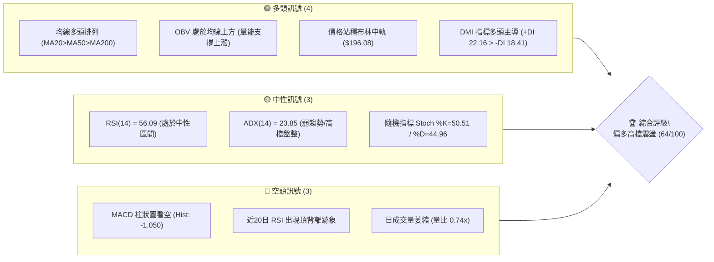

---

### 📊 核心指標速覽表

| 指標類別 | 指標名稱 | 當前數值 | 訊號 | 解讀 |
|:---|:---|:---:|:---:|:---|
| **價格** | 當前收盤價 | $198.84 | 🟢 | 站於 52 週區間高檔 86.8% 位置，逼近 R1 阻力位 |
| **均線** | MA20 (月線) | $196.08 | 🟢 | 價格在均線上方 +1.41%，布林中軌提供短線動態支撐 |
| **均線** | MA50 (季線) | $185.25 | 🟢 | 價格在均線上方 +7.34%，波段多頭生命線支撐穩固 |
| **均線** | MA200 (年線) | $153.26 | 🟢 | 價格在均線上方 +29.74%，長期牛市格局穩健 |
| **動能** | RSI(14) | 56.09 | 🟡 | 位於 50–60 強勢中性區，但近 20 根 K 棒呈現頂背離 |
| **動能** | MACD (12,26,9) | 4.102 / 5.152 | 🔴 | DIF 低於 DEA，柱狀圖 -1.050，短線動能處於修正期 |
| **波動** | ATR(14) | $8.06 | 🟡 | 佔股價 4.05%，波幅適中，反映高檔收斂特徵 |
| **趨勢** | ADX(14) | 23.85 | 🟡 | ADX < 25，單邊趨勢動能減弱，當前轉為區間盤整 |
| **通道** | 布林通道 %B | 0.59 | 🟢 | 價格位於中軌（$196.08）至上軌（$210.74）偏多區間 |
| **量能** | 20日成交量比 | 0.74x | 🔴 | 成交量 16.35M 低於 20 日均量 22.09M，量價動能偏低 |

---

### 🏆 技術評分卡

```
╔══════════════════════════════════════════════════════════════╗
║                技術評分卡 — PLTR (2026-10-27)                ║
╠══════════════════════════════════════════════════════════════╣
║ 趨勢強度 (Trend Strength)   ███████████░░░░░░░░░  55/100 🟡  ║
║ 動能指標 (Momentum)         █████████░░░░░░░░░░░  46/100 🔴  ║
║ 支撐穩定度 (Support)        ███████████████░░░░░  75/100 🟢  ║
║ 成交量配合 (Volume)         ███████████░░░░░░░░░  57/100 🟡  ║
║ 形態完整度 (Pattern)        █████████████░░░░░░░  64/100 🟢  ║
║ 均線排列 (Moving Averages)  █████████████████░░░  87/100 🟢  ║
╠══════════════════════════════════════════════════════════════╣
║ 綜合評分 (Overall Score)    █████████████░░░░░░░  64/100 🟢  ║
║ 評級結論：偏多區間震盪（算術平均四捨五入：(55+46+75+57+64+87)/6 = 64） ║
╚══════════════════════════════════════════════════════════════╝
```

---

## 2. 趨勢分析

### 🌐 多時框趨勢分析

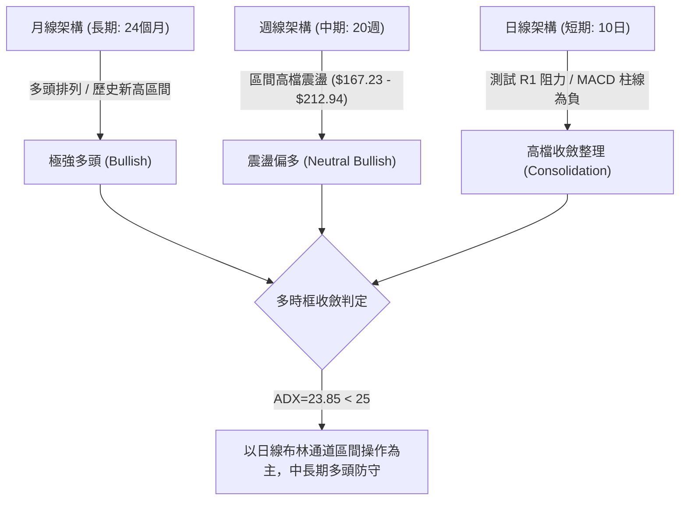

---

### 📈 長期趨勢 — 12個月走勢圖（Unicode）

過去 12 個月（2025-11 至 2026-10），PLTR 完成了從歷史高檔回調、築底再到重啟升勢的完整週期。在 2026 年 6 月觸及 $116.67 波段低點後，8 月爆發性大漲突破，當前再度逼近前高。

```
PLTR 月線走勢圖（2025-11 至 2026-10，標注收盤價）
價格軸 ($)
$210 ┤                                              ● $198.84 (現價)
$195 ┤                                        ● $187.05
$180 ┤● $177.75                         ● $186.38
$165 ┤      ● $168.45             ● $156.54
$150 ┤            ● $146.59 ● $146.28
$135 ┤                  ● $137.19 ● $139.11
$120 ┤                                  ● $123.06
$105 ┤                            ● $116.67 (年度波段低點)
     └───────────────────────────────────────────────────────────►
       11    12    01    02    03    04    05    06    07    08    09    10  (月份)
      '25   '25   '26   '26   '26   '26   '26   '26   '26   '26   '26   '26
```

#### 走勢特徵分析表格

| 階段週期 | 月份區間 | 價格區間 ($) | 漲跌幅 (%) | 走勢特徵與結構解讀 |
|:---|:---:|:---:|:---:|:---|
| **高檔回撤期** | 2025-11 ～ 2026-02 | $177.75 → $137.19 | -22.82% | 自 $200 以上高檔獲利回吐，於 $137 尋求支撐 |
| **築底蓄勢期** | 2026-03 ～ 2026-05 | $146.28 → $156.54 | +7.01% | 於 $140 附近形成箱體震盪底部，籌碼換手 |
| **最後洗盤** | 2026-06 ～ 2026-07 | $116.67 → $123.06 | -21.39% | 快速下殺探測 52 週低點附近（$106.37），空頭陷阱 |
| **主升反彈** | 2026-08 ～ 2026-10 | $123.06 → $198.84 | +61.58% | 8 月大陽線放量暴漲，目前在高檔 $185–$212 震盪 |

---

### 📊 中期趨勢（週線分析）

中期走勢以 2026-08-07 該週大放量（成交量 435,164,800 股，收盤 $172.01）為轉折點，確立中期突破底結構。隨後於 2026-10-09 推進至波段高點 $209.05，並在 2026-10-16 創下 52 週高點 $212.94 後出現急劇長下影線洗盤（當週最低探至 S1 支撐 $184.45）。

```
週線關鍵壓力與支撐階梯
┌────────────────────────────────────────────────────────┐
│ [R3] 52W 高點阻力區：$212.94                           │
│   ▲ 壓力區間：$207.52 (R2) ～ $212.94                  │
│────────────────────────────────────────────────────────│
│ [現價] PLTR：$198.84 ─── 逼近 R1：$198.88               │
│────────────────────────────────────────────────────────│
│   ▼ 支撐區間：$187.79 (Fib 23.6%) ～ $184.45 (S1)       │
│ [S1] 近期急跌低點守護區：$184.45                        │
│ [S2] 次級強支撐：$176.50                               │
└────────────────────────────────────────────────────────┘
```

---

### ⚡ 趨勢強度評估（ADX 解讀）

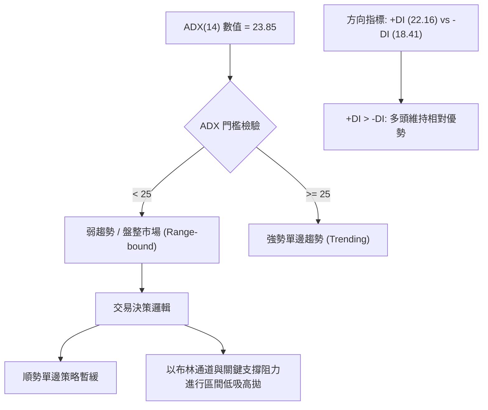

#### ADX 強度對照表

| 指標名稱 | 當前數值 | 參考臨界值 | 狀態評估 | 戰術意義 |
|:---|:---:|:---:|:---:|:---|
| **ADX(14)** | 23.85 | 25.00 | 弱趨勢 / 震盪 | 行情失去單邊推動力，避免追高，重視均值回歸 |
| **+DI** | 22.16 | 20.00 | 多頭擴張 | 多方仍掌控盤面主導權，空方未構成實質壓制 |
| **-DI** | 18.41 | 20.00 | 空頭收縮 | 下跌動能不足以引發波段崩跌 |
| **方向差距 (+DI - -DI)**| +3.75 | 0.00 | 偏多 | 整體結構屬於多頭控制下的休整期 |

---

## 3. 圖表形態分析

### 🔍 形態識別系統

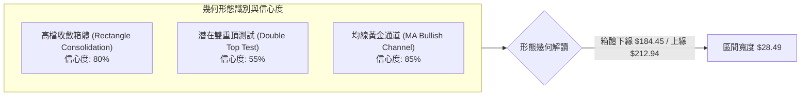

#### 形態識別與信心度評估表

| 形態名稱 | 信心度 | 判斷依據（引用數據） | 完成度 | 目標價（附計算式） |
|:---|:---:|:---|:---:|:---|
| **高檔矩形箱體震盪** | 80% | 頂部受限於波段高點 R3（$212.94），底部兩次於 10-16 探測 S1（$184.45）後強勁收復 | 85% | 向上突破 R3：$212.94 + ($212.94 - $184.45) = **$241.43**（由箱體高度推算） |
| **短線潛在雙頂威脅** | 55% | 10-09 週高 $209.58 與 10-16 週高 $212.94 形成雙峰，但 10-26 收盤 $198.84 未跌破頸線 S1 | 45% | 若跌破頸線 S1：$184.45 - ($212.94 - $184.45) = **$155.96**（由雙頂高度推算） |
| **均線多頭排列架構** | 85% | MA20（$196.08）> MA50（$185.25）> MA200（$153.26），價格全線處於均線之上 | 100% | 指標型形態，確認長期上升趨勢延續，無幾何目標價 |

---

### 🕯️ 重要K線形態分析

嚴格依據近 10 根日 K 線與近 8 根週 K 線之實際開高低收數據進行專業解讀：

#### 近 10 根日 K 線形態解讀

| 日期 | 開盤價 ($) | 最高價 ($) | 最低價 ($) | 收盤價 ($) | 成交量 (股) | K線形態名稱 | 專業解讀 | 訊號 |
|:---:|:---:|:---:|:---:|:---:|:---:|:---:|:---|:---:|
| 2026-10-13 | 208.08 | 210.88 | 205.97 | 208.67 | 18,535,900 | 高檔小陽線 | 逼近歷史高檔，受制於 R2/R3，買盤轉趨謹慎 | 🟡 |
| 2026-10-14 | 207.02 | 209.29 | 199.74 | 200.97 | 24,263,800 | 實體中陰線 | 跌破 $205 關卡，空方發力測試 $200 大關 | 🔴 |
| 2026-10-15 | 196.85 | 200.91 | 192.60 | 200.50 | 24,781,500 | 錘頭反彈線 | 低開下探 $192.60 後長下影線拉回，多方防守 | 🟢 |
| 2026-10-16 | 201.79 | 203.55 | 184.45 | 186.03 | 33,354,900 | 放量大陰線 | 盤中重挫擊穿多重均線，觸及波段低點 S1 $184.45 | 🔴 |
| 2026-10-19 | 186.99 | 196.99 | 186.15 | 194.15 | 23,934,800 | 吞噬中陽線 | 低檔長陽包覆前日陰線實體，S1 支撐確認生效 | 🟢 |
| 2026-10-20 | 192.44 | 196.11 | 189.42 | 192.60 | 15,095,200 | 縮量小陰線 | 縮量回踩 $190 整數關卡，洗盤性質明顯 | 🟡 |
| 2026-10-21 | 191.72 | 202.55 | 189.88 | 201.72 | 21,398,400 | 長陽突破線 | 帶量突破 $200，重新收復 MA20 短期均線 | 🟢 |
| 2026-10-22 | 200.76 | 202.63 | 194.54 | 196.19 | 22,933,600 | 衝高回落倒錘頭 | 上攻 $202.63 遇阻回落，上方賣壓顯現 | 🔴 |
| 2026-10-23 | 195.02 | 197.49 | 190.57 | 196.75 | 17,668,400 | 下影小陽十字 | 下探 $190.57 獲得支撐回升，呈現拉鋸 | 🟡 |
| 2026-10-26 | 197.90 | 200.05 | 192.91 | 198.84 | 16,352,300 | 溫和小陽線 | 穩步收於 $198.84，直逼阻力位 R1（$198.88） | 🟢 |

#### 近 8 根週 K 線形態解讀

| 日期 (週末) | 開盤價 ($) | 最高價 ($) | 最低價 ($) | 收盤價 ($) | 成交量 (股) | 週K形態名稱 | 結構意義解讀 | 訊號 |
|:---:|:---:|:---:|:---:|:---:|:---:|:---:|:---|:---:|
| 2026-09-11 | 173.60 | 175.82 | 164.55 | 167.23 | 81,680,200 | 回踩中陰線 | 測試 $165.45 (S3) 區域支撐完成 | 🔴 |
| 2026-09-18 | 169.70 | 177.88 | 166.42 | 177.64 | 144,450,500 | 轉折中陽線 | 放量反彈，確立波段築底成功 | 🟢 |
| 2026-09-25 | 178.73 | 194.68 | 176.76 | 189.67 | 119,600,900 | 突破大陽線 | 突破 $180 箱體阻力，展開新一輪主升 | 🟢 |
| 2026-10-02 | 186.23 | 194.78 | 184.81 | 188.75 | 86,973,500 | 高檔十字星 | 漲勢放緩，在 $188 附近蓄勢換手 | 🟡 |
| 2026-10-09 | 189.45 | 209.58 | 187.63 | 209.05 | 130,578,300 | 光頭強勢陽線 | 放量大漲突破 $200，創階段收盤新高 | 🟢 |
| 2026-10-16 | 208.90 | 212.94 | 184.45 | 186.03 | 125,244,900 | 巨幅震盪長陰 | 創 52W 高點 $212.94 後暴挫至 $184.45，高檔劇震 | 🔴 |
| 2026-10-23 | 186.99 | 202.63 | 186.15 | 196.75 | 101,030,400 | 下影長陽修復 | 於 S1 處強勢彈升收復失地，下檔買盤強勁 | 🟢 |
| 2026-10-26 | 197.90 | 200.05 | 192.91 | 198.84 | 16,352,300 | 延續攀升線 | 週初穩健上行，測試前週高點壓力 | 🟢 |

---

### 📉 ASCII 走勢形態示意圖

```
PLTR 高檔箱體形態結構圖 (2026-10-13 至 2026-10-26)
價格 ($)
$212.94 ┼──────────────────────────────● (52W歷史天花板 R3 / 10-16 高點)
         │                              │
$207.52 ┼──────────────●───────────────┼ (波段高點阻力 R2 / 10-13 高點)
         │              │               │
$198.88 ┼──────────────┼───────────────┼────● [現價: $198.84 挑戰 R1]
$196.08 ┼ - - - - - - -│- - - - - - - -│- - - - - [MA20 月線動態支撐]
         │              │               │
$184.45 ┼──────────────┴───────────────● (波段鐵底支撐 S1 / 箱體下軌)
         └────────────────────────────────────────────────────────►
          10-13       10-14   10-15   10-16   10-19   10-21   10-26 (交易日)
```

---

### 🎯 形態目標價計算

1. **向上突破情境**：
   - 形態基礎：高檔箱體震盪突破
   - 頸線 / 阻力位：$212.94（R3，52W 高點）
   - 箱底支撐：$184.45（S1）
   - 形態垂直高度：$212.94 - $184.45 = $28.49
   - **向上目標價** = $212.94 + $28.49 = **$241.43**（由箱體高度推算）

2. **向下破位情境**：
   - 形態基礎：潛在雙重頂頸線破位
   - 頸線位置：$184.45（S1）
   - 雙頂高度：$28.49
   - **向下量測目標** = $184.45 - $28.49 = **$155.96**（由雙頂高度推算，緊鄰 MA200 年線 $153.26）

---

## 4. 支撐與阻力

### 🗺️ 關鍵價位分布圖（Unicode）

```
PLTR 價位結構分布圖（嚴格依據 OHLCV 聚類計算）
═══════════════════════════════════════════════════════════════════
$212.94 ║██████████████████████████████║ 強烈阻力 R3 / 52W 歷史高點
$207.52 ║████████████████████          ║ 重大阻力 R2 / 近期反彈波段頂
$198.88 ║██████████████████████████████║ 關鍵阻力 R1 (當前觸發點 +0.02%)
$198.84 ╠══════════════════════════════╣ ◄ 當前收盤價 ($198.84)
$196.08 ║░░░░░░░░░░░░░░░░░░░░░░░░░░░░░░║ 短線均線支撐 (MA20 / 布林中軌)
$187.79 ║▓▓▓▓▓▓▓▓▓▓▓▓▓▓▓▓▓▓▓▓▓▓        ║ 斐波那契 23.6% 回調關鍵位
$184.45 ║██████████████████████████████║ 強支撐 S1 (近一年波段低點聚類)
$176.50 ║████████████████████          ║ 次級強支撐 S2 (中期整理箱體頂)
$165.45 ║██████████████████████████████║ 核心防守支撐 S3 (9月中旬回踩低點)
═══════════════════════════════════════════════════════════════════
```

---

### 🚧 阻力位分析表

價位完全嚴格引用數據中「關鍵價位（由 OHLCV 計算）」區塊數值：

| 阻力級別 | 價位 ($) | 距現價幅動 (%) | 形成原因 | 突破難度 | 重要性評級 |
|:---:|:---:|:---:|:---|:---:|:---:|
| **R1** | $198.88 | +0.02% | 近一年波段高點密集聚類點，即時心理與解套賣壓防線 | 🟡 中等 | ★★★★☆ |
| **R2** | $207.52 | +4.37% | 10 月中旬多頭衝刺波段次高點，機構法人短線防守帶 | 🔴 偏高 | ★★★★☆ |
| **R3** | $212.94 | +7.09% | 52 週歷史天花板（52W High），多頭最終考驗與空頭防線 | 🔴 極高 | ★★★★★ |

---

### 🛡️ 支撐位分析表

價位完全嚴格引用數據中「關鍵價位（由 OHLCV 計算）」區塊數值：

| 支撐級別 | 價位 ($) | 距現價幅動 (%) | 形成原因 | 守住機率 | 重要性評級 |
|:---:|:---:|:---:|:---|:---:|:---:|
| **S1** | $184.45 | -7.24% | 10-16 暴挫急跌之波段低點，多次驗證強烈抄底買盤進駐 | 80% | ★★★★★ |
| **S2** | $176.50 | -11.24% | 8 月下旬及 9 月中旬多次回測不破之密集成交平台區 | 88% | ★★★★☆ |
| **S3** | $165.45 | -16.79% | 9-11 週線低點聚類（$164.55）對應之中期多空生命線防區 | 95% | ★★★★★ |

---

### 📐 斐波那契回調位分析

依據 52 週完整波動區間（$106.37 至 $212.94）計算之黃金分割關鍵位：

| 斐波那契比例 | 價位 ($) | 結構技術意義與現況對照 | 當前相對位置 |
|:---:|:---:|:---|:---:|
| **0.0% (52W High)** | $212.94 | 歷史最高壓力極限，多頭強阻力 R3 | 位於上方 +7.09% |
| **23.6%** | $187.79 | **第一道淺幅回調強支撐**，與 10-16 收盤價 $186.03 共振 | 位於下方 -5.56% |
| **38.2%** | $172.23 | **黃金分割回調位**，與 8 月初放量暴漲起點重疊 | 位於下方 -13.38% |
| **50.0%** | $159.66 | 趨勢強弱分水嶺，鄰近 MA120 半年線（$156.64） | 位於下方 -19.70% |
| **61.8%** | $147.08 | **絕對多頭防守底線**，跌破則牛市反轉 | 位於下方 -26.03% |
| **78.6%** | $129.18 | 深度回調超跌支撐區 | 位於下方 -35.03% |
| **100.0% (52W Low)**| $106.37 | 52 週年度最低起漲點 | 位於下方 -46.50% |

> **當前價位定位解讀**：現價 $198.84 正處於 **0.0%（$212.94）與 23.6%（$187.79）** 的極強多頭掌控區間。股價在回調過程中甚至未曾有效觸及 38.2%（$172.23），展現典型的強勢牛市高檔回檔格局。

---

## 5. 技術指標深度解讀

### 🎛️ 指標訊號總覽

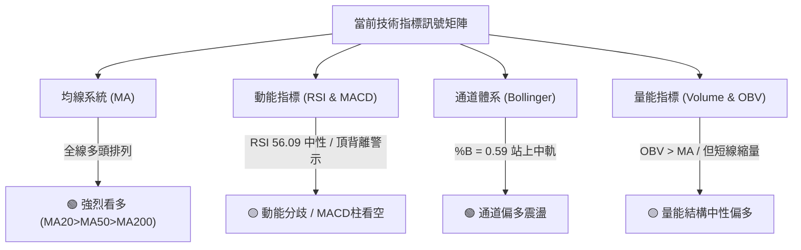

---

### 📈 移動平均線排列分析

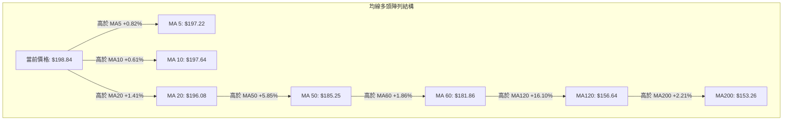

#### 均線階梯偏離度分析表

| 均線天期 | 當前價位 ($) | 偏離距離 ($) | 偏離幅度 (%) | 走勢狀態 | 評估意義 |
|:---:|:---:|:---:|:---:|:---:|:---|
| **MA 5** | $197.22 | +$1.62 | +0.82% | 向上攀升 | 超短線買盤強勢支撐 |
| **MA 10** | $197.64 | +$1.20 | +0.61% | 向上攀升 | 短線動態成本線，多頭守護 |
| **MA 20** | $196.08 | +$2.76 | +1.41% | 向上攀升 | 波段多空分水嶺，布林中軌 |
| **MA 50** | $185.25 | +$13.59 | +7.34% | 向上攀升 | 中期生命線，與 S1（$184.45）共振 |
| **MA 60** | $181.86 | +$16.98 | +9.34% | 向上攀升 | 季線防護網，下檔買盤聚落 |
| **MA 120** | $156.64 | +$42.20 | +26.94% | 向上攀升 | 半年線基石，中長線多頭屏障 |
| **MA 200** | $153.26 | +$45.58 | +29.74% | 向上攀升 | 長期牛市核心分水嶺，極穩固 |

---

### 📉 RSI(14) 分析

```
RSI(14) 動能強度進度條
0         30                    56.09      70              100
├─────────┼───────────────────────●─────────┼────────────────┤
[  超賣   ] [      中性偏多       ] [  強勢   ] [     超買     ]
進度條展示：███████████░░░░░░░░░ (56.09%)
```

- **超買超賣區間判斷**：RSI(14) 讀數為 **56.09**，脫離 10 月初的超買警戒區（10-09 週線 RSI 高達 76.3），目前落在 50–70 的健康多頭調控區間，未見超賣現象。
- **背離分析與結論**：**明確存在頂背離（Bearish Divergence）**。
  - **背離事實**：在近 20 根 K 棒的首尾比對中，價格於 10-16 創下歷史新高 $212.94，然而日線 RSI(14) 數值未能同步創高，僅微升至 56.09（遠低於前期高檔的 70 以上水準）。
  - **技術含義**：顯示價格推升動能逐漸減弱，買盤追價意願跟不上價格漲幅，暗示短線再度衝擊 R2/R3 時面臨震盪拉回風險。

---

### 📊 MACD(12,26,9) 訊號解讀

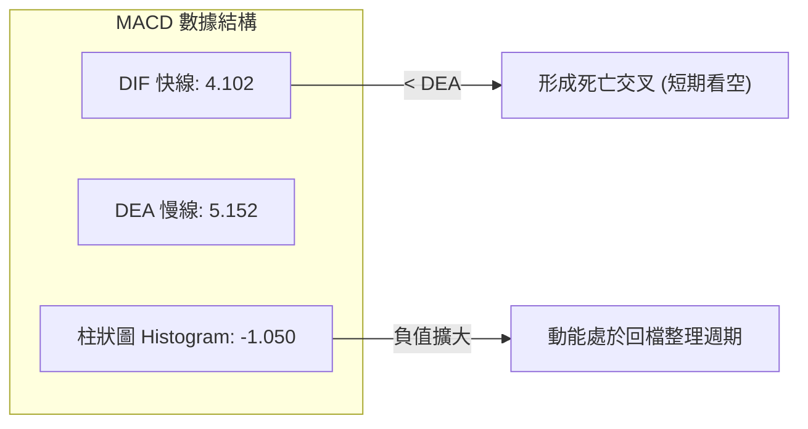

- **MACD 線與訊號線關係**：快線 DIF（4.102）處於慢線 DEA（5.152）下方，呈現死叉狀態，數值均保持在零軸上方運作（零軸上死叉），屬於多頭趨勢內部的技術性休整。
- **柱狀圖動態**：當前 MACD Hist 為 **-1.050**，綠柱（空頭動能）持續釋放，表明自 10-16 高檔下殺以來的修正波尚未完全結束，短線多頭難以形成爆發性單邊行情。

---

### 📦 布林通道分析

```
PLTR 布林通道空間示意圖 (收盤價 $198.84, %B = 0.59)
┌────────────────────────────────────────────────────────┐
│ $210.74 ───────────────────────────── [布林上軌 Upper]  │
│                                                        │
│ $198.84 ───────────● [現價: 位於中上軌之間偏多區間]    │
│                                                        │
│ $196.08 ----------------------------- [布林中軌 MA20]  │
│                                                        │
│ $181.43 ───────────────────────────── [布林下軌 Lower]  │
└────────────────────────────────────────────────────────┘
```

- **軌道邊界數值**：
  - **上軌 (Upper Band)**：$210.74
  - **中軌 (Middle Band / MA20)**：$196.08
  - **下軌 (Lower Band)**：$181.43
  - **帶寬寬度**：$210.74 - $181.43 = **$29.31**（佔股價 14.74%）
- **通道指標解讀**：%B 數值為 **0.59**（大於 0.5），現價穩固運行於中軌（$196.08）之上，代表下檔動態支撐有效。由於布林通道走平並呈現收口傾向，確認市場進入區間防守格局。

---

### 💹 成交量分析（量價配合度）

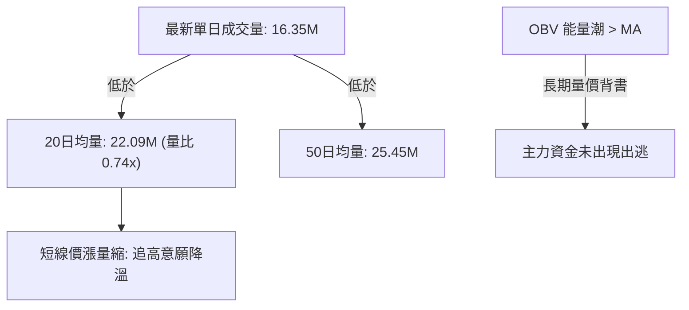

- **成交量萎縮特徵**：最新成交量 16,352,300 股，僅為 20 日均量的 74.0%，屬於典型的「反彈縮量」。
- **量價配合檢驗**：股價自 10-16 暴跌低點 $184.45 連續反彈至 $198.84，但成交量自 33.35M 遞減至 16.35M，呈現「價漲量縮」量價背離。此現象確認短線買盤追價謹慎，向上突破 R1/R2 時必須有大於 22M 均量的放量確認。
- **OBV 趨勢**：數據顯示「OBV > MA → 量能支撐上漲」，表明長線資金沉澱穩固，並無資金大舉潰逃跡象。

---

## 6. 動能與波動率

### ⚡ 動能評估四象限

| 象限 | 動能維度 (Momentum) | 波動率維度 (Volatility) | PLTR 當前狀態 | 戰略評估與操盤建議 |
|:---:|:---:|:---:|:---:|:---|
| **Q1** | 強動能 (ADX>25 / RSI>60) | 低波動 (ATR%<3%) | — | 最佳波段起飛機會，重倉順勢跟隨 |
| **Q2** | **弱動能 (ADX<25 / RSI 56)** | **低至中波動 (ATR% 4.05%)** | **✓ 符合 (當前象限)** | **高檔震盪蓄勢，適合以支撐阻力進行箱體來回操作** |
| **Q3** | 強動能 (單邊突破) | 高波動 (ATR%>6%) | — | 高風險高收益，警惕單日反轉洗盤 |
| **Q4** | 弱動能 (無趨勢) | 高波動 (劇烈震盪) | — | 盤面混亂，建議離場觀望 |

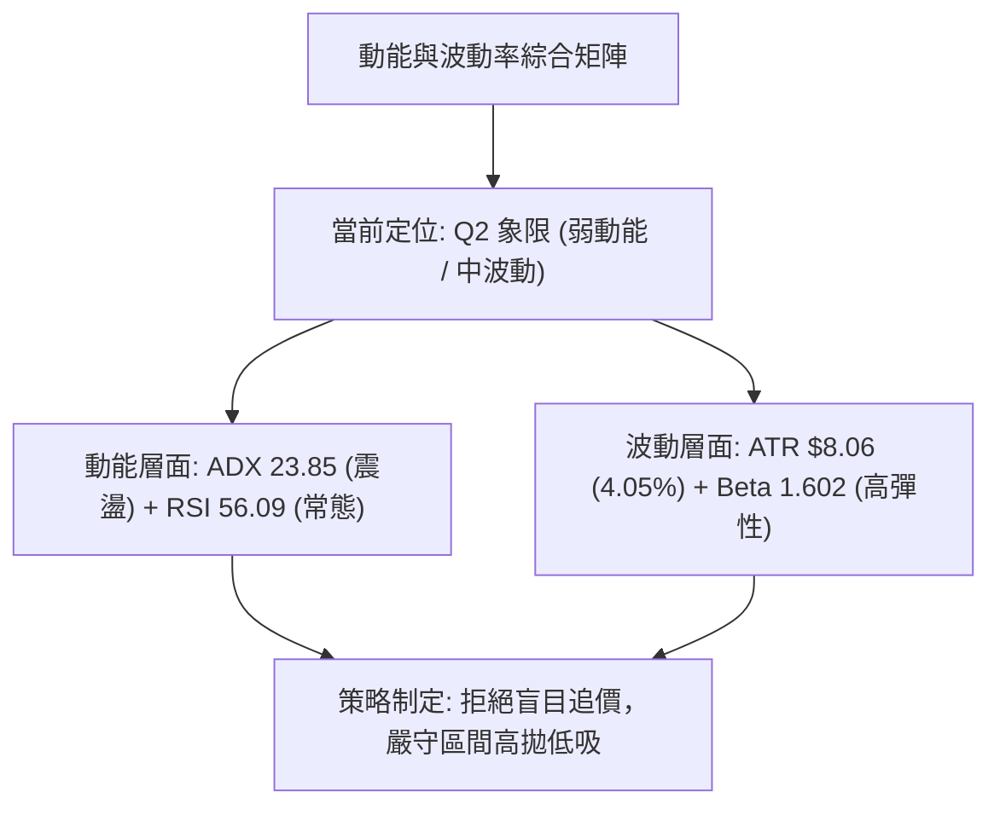

---

### 📊 ATR 波動率分析

- **ATR(14) 數值**：**$8.06**（佔當前價格 $198.84 的 4.05%，採 Wilder 平滑算法）。
- **市場意義**：PLTR 每日的平均理論波動空間約在 $8.00 上下，日內具有極佳的價差操作空間。
- **風控止損距離建議**：
  - **超短線進場止損距離（1.0 × ATR）**：$8.06
  - **波段交易保護止損距離（1.5 × ATR）**：1.5 × $8.06 = **$12.09**
  - **中期防守寬鬆止損距離（2.0 × ATR）**：2.0 × $8.06 = **$16.12**

---

### 📐 Beta 與市場相關性

- **Beta 係數**：**1.602**（高彈性成長股標籤）。
- **解讀**：PLTR 的波動幅度約為 S&P 500 大盤的 1.60 倍。當標普 500 指數波動 1% 時，PLTR 預期同向波動約 1.60%。此高 Beta 特性意味著在牛市多頭時具有高超額報酬（Alpha），但在大盤回調時亦會放大下跌振幅，必須透過嚴格倉位控制管理波動風險。

---

## 7. 多時框架總結

### 📋 時框架評分表

| 時框架 | 趨勢方向 | 動能狀態 | 均線排列 | 圖表形態 | 綜合評分 | 操作建議 |
|:---:|:---:|:---:|:---:|:---:|:---:|:---|
| **長期 (月線)** | 🟢 強烈看多 | 強勁 (月線沿頂攀升) | 多頭排列 | 歷史大牛市主升通道 | 90/100 | 長期投資者底倉堅定持有 |
| **中期 (週線)** | 🟢 震盪看多 | 中性調控 (MACD轉負) | 多頭排列 | 高檔大箱體蓄勢 ($184–$212) | 70/100 | 波段操作者逢拉回支撐加碼 |
| **短期 (日線)** | 🟡 橫向盤整 | 偏弱 (RSI頂背離/量縮)| 短期收復 MA20 | 窄幅收斂三角形 / 測試 R1 | 55/100 | 嚴格依據區間邊界操作 |

---

### 🔲 綜合訊號矩陣

```
時框訊號一致性矩陣
┌──────────────┬─────────────┬─────────────┬─────────────┬─────────────┐
│ 時框架 / 維度 │ 趨勢方向     │ 均線架構     │ 動能指標     │ 成交量配合   │
├──────────────┼─────────────┼─────────────┼─────────────┼─────────────┤
│ 長期 (月線)  │ 🟢 強烈看多 │ 🟢 多頭排列 │ 🟢 處於強勢 │ 🟢 OBV攀升  │
│ 中期 (週線)  │ 🟢 震盪偏多 │ 🟢 均線發散 │ 🟡 高檔鈍化 │ 🟢 放量後蓄勢│
│ 短期 (日線)  │ 🟡 橫向整固 │ 🟢 均線多頭 │ 🔴 MACD死叉 │ 🔴 反彈量縮  │
└──────────────┴─────────────┴─────────────┴─────────────┴─────────────┘
結論：長中期牛市架構完好無損，短期指標出現超買修正與動能衰退，產生多時框「長多短整」的共振拉鋸。
```

---

### ⚖️ 多時框收斂結論

依據多時框收斂嚴格規則進行裁決：
1. **行情性質判定**：當前 ADX(14) 數值為 **23.85**（嚴格小於 25.00），確立當前市場處於**「盤整行情（Range-bound Consolidation）」**。
2. **優先級收斂原則**：由於 ADX < 25，單邊趨勢順勢交易退居次席，**日線布林通道上下軌（$181.43 至 $210.74）與關鍵支撐阻力結構（S1 $184.45 至 R3 $212.94）成為主導當前交易的核心區間**。
3. **最終方向性結論**：綜合評分為 **64/100（偏多區間震盪）**。月線與週線強大趨勢保護下，空方無法造成深跌，但日線短波動能尚未爆發。因此，唯一方向性結論為：**偏多區間操作（震盪偏多）**。逢回踩區間下軌或均線支撐做多為最優解，不宜追高。

---

## 8. 交易策略建議

### 🗺️ 策略決策流程圖

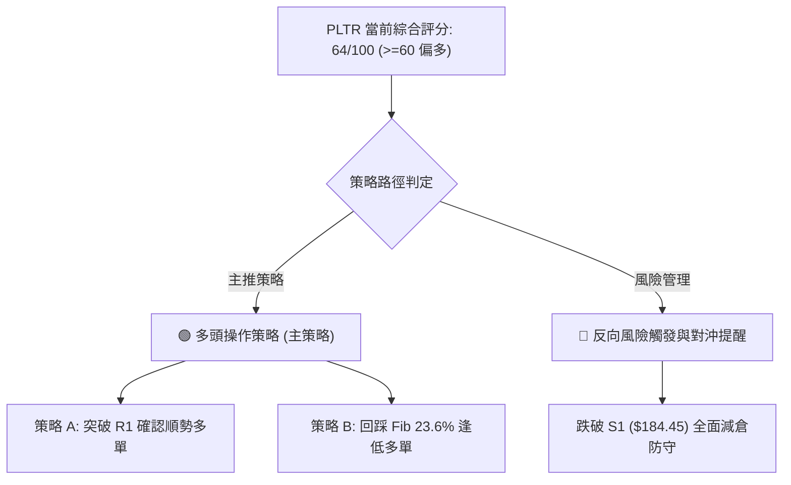

---

### 🧭 策略路由

> **當前主策略方向 = 多頭策略（逢低低吸與關鍵突破），依評分 64/100 確立**  
> 綜合評分 64 ≥ 60，依規定主推多頭交易策略；空頭僅列為反轉風險觸發點與風控防線，不進行兩頭下注。

---

### 🎯 價格情境階梯（Price Scenarios）

價位完全嚴格引用數據中「關鍵價位」區塊與斐波那契回調位：

| 觸發條件 | 下一目標價 ($) | 後續延伸目標 ($) | 情境技術含義解讀 |
|:---|:---:|:---:|:---|
| **強勢突破 R1 ($198.88)** | R2 ($207.52) | R3 ($212.94) | 短線重啟攻勢，突破日線整理平台，挑戰 52W 高點 |
| **維持現價區間 ($196.08–$198.88)** | 布林上軌 ($210.74) | 布林下軌 ($181.43) | 區間橫盤蓄勢，消化高檔 MACD 負動能 |
| **跌破第一防線 S1 ($184.45)** | S2 ($176.50) | S3 ($165.45) | 中期上升趨勢轉弱，形態演化為雙頂破位調整 |

---

### 📊 情境機率分佈

| 運行情境 | 發生機率 | 主要技術依據與指標佐證 |
|:---|:---:|:---|
| **區間震盪蓄勢 (箱體整理)** | **50%** | ADX=23.85（弱趨勢）、布林通道走平、成交量能萎縮至 0.74x 均量 |
| **繼續上行 / 向上突破** | **35%** | 均線系統多頭排列完整、OBV 處於均線之上、+DI 佔優（22.16）、分析師評級為 Buy |
| **回落調整 / 跌破防線** | **15%** | RSI 出現頂背離、MACD 柱狀圖看空（-1.050）、短線價漲量縮 |

---

### 🟢 主策略詳情

本報告設計兩套多頭策略，價位完全引用自真實數據層級：

| 策略要素 | 策略 A（突破 R1 順勢多單） | 策略 B（回踩 Fib 23.6% 低吸多單） |
|:---|:---|:---|
| **交易邏輯** | 突破近一年波段高點聚類 R1 確立短多動能 | 回踩支撐聚落進行低風險波段布局 |
| **進場條件** | 日 K 收盤確認站穩 R1（$198.88）之上 | 價格回調至 Fib 23.6%（$187.79）附近止跌 |
| **進場價格 ($)** | **$198.88** | **$187.79** |
| **止損價格 ($)** | **$192.60**（10-15 與 10-26 日 K 低點防線） | **$181.43**（布林通道下軌邊界） |
| **目標價 T1 ($)** | **$207.52**（阻力位 R2） | **$198.88**（阻力位 R1） |
| **目標價 T2 ($)** | **$212.94**（阻力位 R3 / 52W High） | **$207.52**（阻力位 R2） |
| **風險報酬比** | **1 : 1.38（以 T1 計）**<br>*(207.52-198.88)/(198.88-192.60) = 8.64/6.28 = 1.38*<br>*(以 T2 計為 1 : 2.24，即 14.06/6.28)* | **1 : 1.74（以 T1 計）**<br>*(198.88-187.79)/(187.79-181.43) = 11.09/6.36 = 1.74*<br>*(以 T2 計為 1 : 3.10，即 19.73/6.36)* |
| **成功機率** | 60% | 68% |
| **建議倉位** | 10% – 15%（動量突破倉位） | 15% – 20%（核心底倉倉位） |

---

### 🔴 反向風險觸發點（對沖提示）

若市場出現非預期利空導致價格跌破關鍵節點，多頭必須立即進行對沖或停損：
- **第一警戒點 ($196.08)**：若收盤實體跌破布林中軌（MA20），宣告短線反彈終結，多頭部位應減倉 30%。
- **核心多空反轉點 ($184.45)**：S1 支撐若遭到放量跌破（尤其是成交量大於 25M），高檔「雙重頂形態」完成度將飆升至 80%，下行目標直指 $155.96。此時所有多單必須無條件離場觀望，激進者可反手建立輕倉空頭對沖部位。

---

### ⭐ 整體訊號強度評星

```
做多訊號強度：★★★★☆  (4/5星) ── 均線與中長期結構強勁
做空訊號強度：★☆☆☆☆  (1/5星) ── 逆長期大勢，僅限防守對沖
整體可信度：  ★★★★☆  (4/5星) ── 數據聚類明確，技術邊界清晰
```

---

## 9. 風險提示與監控

### ✅ 關鍵監控指標 Checklist

```
╔══════════════════════════════════════════════════════════════╗
║              PLTR 每日操盤必看監控清單 (Checklist)           ║
╠══════════════════════════════════════════════════════════════╣
║ [ ] 價格是否有效突破 R1 ($198.88) 且收盤站穩                 ║
║ [ ] 日成交量是否重返 20 日均量 (22.09M) 以上（放量突破驗證） ║
║ [ ] 布林中軌 ($196.08 / MA20) 是否持續發揮支撐作用           ║
║ [ ] MACD 柱狀圖負值是否收斂（由 -1.050 向零軸靠攏）          ║
║ [ ] RSI(14) 能否突破 60 關卡化解頂背離疑慮                   ║
║ [ ] S1 關鍵支撐線 ($184.45) 是否遭受威脅                     ║
╚══════════════════════════════════════════════════════════════╝
```

---

### ⚠️ 風險場景分析

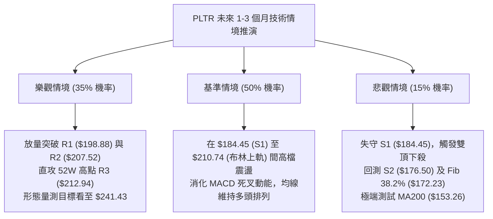

---

### 🛡️ 風險管理重要提醒

1. **財報與事件風險控制**：新聞提及著名投資人 Michael Burry 建立做空部位，且財報公佈即將到來。此類重大基本面事件將導致波動率激增，期權引伸波動率暴漲。建議在財報出爐前，嚴禁使用超過 2 倍槓桿，波段持倉總部位宜降至總資產的 20% 以下。
2. **高 Beta 波動調節**：PLTR 的 Beta 值高達 1.602，在市場出現系統性修正時，跌幅往往顯著大於標普 500 指數。止損策略必須嚴格機械化執行，切忌因基本面信仰而抱單抗虧。
3. **ATR 動態倉位管理**：鑑於單日 ATR 為 $8.06，單筆交易的最大資金承擔風險若設定為總資金的 1.5%，則依據 1.5 倍 ATR 止損距離（約 $12.00），單一倉位頭寸不得超過投資組合總資金的 12.5%。

---

## 📋 報告總結

```
╔══════════════════════════════════════════════════════════════╗
║                    PLTR 技術分析報告總結                     ║
╠══════════════════════════════════════════════════════════════╣
║ 報告日期：2026-10-27                                         ║
║ 當前價格：$198.84 USD                                        ║
║ 分析評級：🟢 偏多區間震盪 (綜合評分: 64/100)                 ║
╠══════════════════════════════════════════════════════════════╣
║ 關鍵結論：                                                   ║
║ ├─ 長期趨勢：🟢 極強多頭，MA200 ($153.26) 穩步向上抬升       ║
║ ├─ 中期趨勢：🟢 高檔大箱體運行 ($184.45 ～ $212.94)          ║
║ ├─ 短期趨勢：🟡 動能整固，挑戰 R1 ($198.88) 面臨 MACD 負背離 ║
║ ├─ 關鍵支撐：S1: $184.45 ｜ Fib 23.6%: $187.79               ║
║ ├─ 關鍵阻力：R1: $198.88 ｜ R2: $207.52 ｜ R3: $212.94        ║
║ └─ 分析師共識目標：$207.62 (26位分析師評級為 Buy)           ║
╠══════════════════════════════════════════════════════════════╣
║ 最優策略組合：                                               ║
║ 1. 🥇 最佳機會：策略 B（回踩 Fib 23.6% $187.79 逢低做多，     ║
║                 止損 $181.43，風報比 1:1.74 至 T1 $198.88）  ║
║ 2. 🥈 次選機會：策略 A（突破 R1 $198.88 順勢追多，           ║
║                 止損 $192.60，風報比 1:1.38 至 T1 $207.52）  ║
║ 3. 🥉 保守選擇：場外觀望，等待日線 MACD 柱狀圖翻正且成交量   ║
║                 突破 22M 均量後再行進場確認突破               ║
╚══════════════════════════════════════════════════════════════╝
```

---

> ⚠️ **免責聲明**：本報告為 AI 自動生成之技術分析，所有數據及估算均嚴格基於所提供的歷史價格與量化技術指標資訊。本報告**僅供研究與學術參考**，**不構成任何個人化的投資建議、邀約或承諾**。金融市場投資具有極高風險，股價波動受多重不可抗力因素影響，入市需獨立思考並嚴格執行風控紀律。

---

*報告生成時間：2026-10-27 ｜ 數據來源：Yahoo Finance ｜ 分析框架：多時框技術分析模型*