# PLTR 技術分析報告

> **報告日期**：2026-10-28 ｜ **語言**：繁體中文 ｜ **數據來源**：Yahoo Finance ｜ **當前價格**：$198.73 USD

---

## 目錄

| 章節 | 內容 |
|------|------|
| [1. 技術面概覽](#1-技術面概覽) | 訊號儀表板、核心指標、評分卡 |
| [2. 趨勢分析](#2-趨勢分析) | 多時框趨勢、長中短期走勢、ADX 解讀 |
| [3. 圖表形態分析](#3-圖表形態分析) | 形態識別、K線組合、目標價計算 |
| [4. 支撐與阻力](#4-支撐與阻力) | 關鍵價位、斐波那契回調結構 |
| [5. 技術指標深度解讀](#5-技術指標深度解讀) | MA/RSI/MACD/布林/量價配合 |
| [6. 動能與波動率](#6-動能與波動率) | 四象限動能、ATR 波動率、Beta |
| [7. 多時框架總結](#7-多時框架總結) | 時框矩陣、收斂結論 |
| [8. 交易策略建議](#8-交易策略建議) | 策略路由、主策略、風險報酬比 |
| [9. 風險提示與監控](#9-風險提示與監控) | 監控清單、情境推演、風控紀律 |

---

## 1. 技術面概覽

### 🎯 技術訊號儀表板

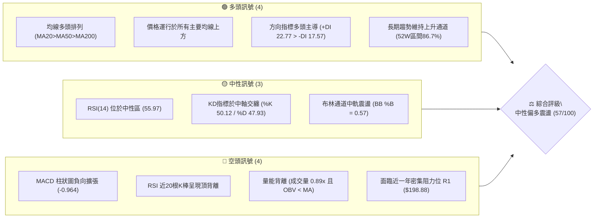

---

### 📊 核心指標速覽表

| 指標類別 | 指標名稱 | 當前數值 | 訊號 | 專業解讀 |
|:---|:---|:---|:---:|:---|
| **價格結構** | 最新收盤價 | $198.73 | 🟢 | 位於 52 週波動區間 $106.37–$212.94 的 86.7% 高位水平 |
| **短期均線** | MA20 (月線) | $196.67 | 🟢 | 現價高於 MA20 約 +1.05%，月線呈現向上微彎支撐 |
| **中期均線** | MA50 (季線) | $185.77 | 🟢 | 現價高於 MA50 約 +6.98%，中期多頭防線穩固 |
| **長期均線** | MA200 (年線)| $153.36 | 🟢 | 現價高於 MA200 約 +29.58%，長期牛市基調完全確立 |
| **動能震盪** | RSI(14) | 55.97 | 🟡 | 位於 30–70 擴展中性區，但近 20 根 K 線首尾已浮現頂背離 |
| **指數平滑** | MACD(12,26,9)| 3.948 / 4.911 | 🔴 | MACD 跌破訊號線，柱狀圖負向擴大至 -0.964，動能趨緩 |
| **隨機指標** | Stoch %K / %D | 50.12 / 47.93 | 🟡 | 兩線於 50 均衡軸黃金交叉微揚，顯示短期下行受阻 |
| **趨勢強度** | ADX(14) | 23.07 | 🟡 | ADX < 25，顯示當前處於無明確單邊行情的區間盤整格局 |
| **通道軌道** | Bollinger Bands | $182.62–$210.72 | 🟡 | %B 為 0.57，位於通道中軌 ($196.67) 上方，朝上軌行進 |
| **波動風險** | ATR(14) | $7.84 (3.95%) | 🔴 | 波動區間放大，單日震幅近 $8 美元，持倉風險需嚴格控管 |
| **量能狀態** | 成交量 / 20日均量 | 19,869,700 / 0.89x | 🔴 | 量能低於均量，OBV 跌破其均線，呈現典型量縮反彈結構 |

---

### 🏆 技術評分卡

```
╔══════════════════════════════════════════════════════════════════╗
║                 技術評分卡 — PLTR (2026-10-28)                  ║
╠══════════════════════════════════════════════════════════════════╣
║ 趨勢強度 (Trend)       ███████████░░░░░░░░░   55/100   🟡 中性弱勢 ║
║ 動能指標 (Momentum)    ██████████░░░░░░░░░░   48/100   🔴 動能減弱 ║
║ 支撐穩定度 (Support)   ██████████████░░░░░░   68/100   🟢 支撐穩固 ║
║ 成交量配合 (Volume)    ████████░░░░░░░░░░░░   42/100   🔴 量能萎縮 ║
║ 形態完整度 (Pattern)   ██████████░░░░░░░░░░   52/100   🟡 箱體整固 ║
║ 均線排列 (MA System)   ███████████████░░░░░   77/100   🟢 完美多頭 ║
╠══════════════════════════════════════════════════════════════════╣
║ 綜合評分 (Overall)     ███████████░░░░░░░░░   57/100   ⚖️ 區間震盪 ║
╚══════════════════════════════════════════════════════════════════╝
```
> *註：綜合評分 = (55 + 48 + 68 + 42 + 52 + 77) ÷ 6 = 57.0/100（依規則 18 採六項算術平均四捨五入）。*

---

## 2. 趨勢分析

### 🌐 多時框趨勢分析

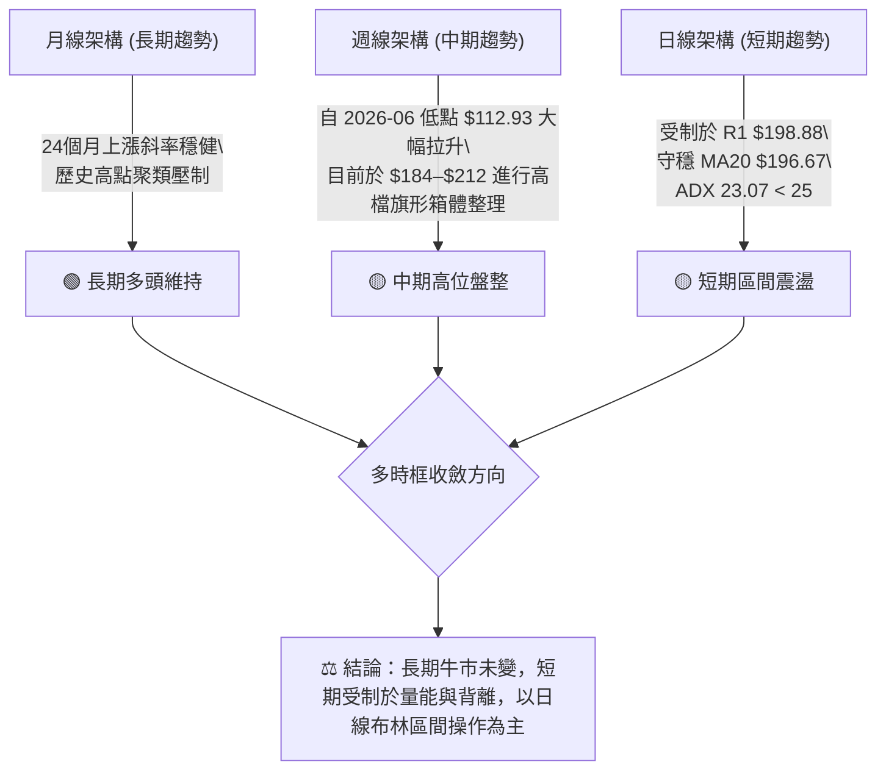

---

### 📈 長期趨勢 — 12個月走勢圖（Unicode）

以下展示 PLTR 自 2025 年 11 月至 2026 年 10 月共 12 個月之收盤價格軌跡與關鍵轉折點：

```
PLTR 月線收盤走勢圖（2025-11 至 2026-10）
價格軸 ($)
$210 ┤                                                  
$200 ┤                                            ● (2026-10: $198.73)
$190 ┤                                      ●     │
$180 ┤          ●                     ●           │
$170 ┤●         │                     │           │
$160 ┤          │               ●     │           │
$150 ┤    ●     │         ●     │     │           │
$140 ┤          │   ●     │     │     │           │
$130 ┤          │         │     │     │     ●     │
$120 ┤          │         │     │     │     │     │
$110 ┤          │         │     │     ●     │     │
     └────┬─────┬───┬─────┬─────┬─────┬─────┬─────┬───┬────
        25-11 25-12 26-01 26-02 26-03 26-04 26-05 26-06 26-07 26-08 26-09 26-10
關鍵:   回檔   反彈  重挫  尋底  築底  震盪  拉升  回跌  反轉  主升  高檔  整固
```

#### 走勢特徵分析表格（過去 12 個月）

| 階段區間 | 月收盤價變動 | 期間漲跌幅 | 趨勢性質 | 價量特徵與結構意涵 |
|:---|:---|:---:|:---:|:---|
| **2025-11 ~ 2026-02** | $168.45 → $137.19 | -18.56% | 階段性中級修正 | 自高檔回落尋求年線支撐，波段跌幅明顯 |
| **2026-03 ~ 2026-05** | $146.28 → $156.54 | +7.01% | 箱體震盪築底 | 於 $140–$155 區間換手，籌碼逐漸收斂沉澱 |
| **2026-06 ~ 2026-07** | $116.67 → $123.06 | 探底反彈 | 終極洗盤探底 | 創 52 週次低點 $112.93，隨後爆巨量 2.7 億股築底回升 |
| **2026-08 ~ 2026-09** | $186.38 → $187.05 | +51.99% | 主升爆發推進 | 業績驅動，單月成交量激增至 4.35 億股，確立多頭主升浪 |
| **2026-10 (當前)** | $187.05 → $198.73 | +6.24% | 高位箱體盤整 | 測試 52 週高點 $212.94 未果，回落至 $198.73 進入消化整理 |

---

### 📊 中期趨勢（週線分析）

中期走勢以 2026-08-07 當週的巨量陽線（週成交量 435,164,800 股，收盤 $172.01，週 RSI 達到 72.8）為基石，展開高空推升。近 8 週進入高檔消化：

```
週線關鍵壓力與支撐示意圖
══════════════════════════════════════════════════════════════════
$212.94 ── 52W 歷史極值高點 (2026-10-16 當週高點) ───── [極強阻力 R3]
           ▲
$207.52 ── 波段聚集高點 (2026-10-09 週收盤 $209.05 下緣) ─ [壓力區 R2]
           ▲
$198.88 ── 前期整理平台頂頸線 ─────────────── [現價 $198.73 測試中 R1]
──────────────────────────────────────────────────────────────────
$184.45 ── 2026-10-16 週低點 / 10-02 週低點聚類 ───── [短期強支撐 S1]
           ▼
$176.50 ── 2026-09-18 週收盤 $177.64 與波段低點聚類 ── [中期防守 S2]
══════════════════════════════════════════════════════════════════
```

---

### ⚡ 趨勢強度評估（ADX 解讀）

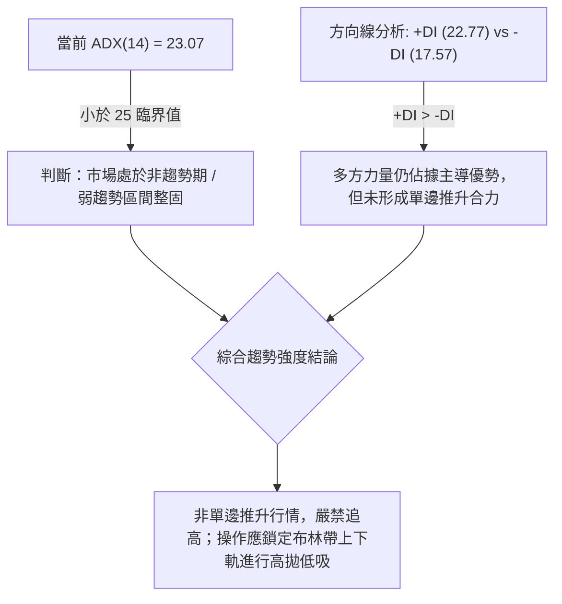

#### ADX 趨勢強度對照表

| 指標變數 | 當前讀數 | 門檻區間 | 趨勢狀態評判 | 交易指引 |
|:---|:---:|:---:|:---:|:---|
| **ADX(14)** | **23.07** | `< 20` 弱勢盤整<br>`20–25` 臨界過渡<br>`> 25` 明確趨勢 | **區間震盪（盤整行情）** | 順勢指標失靈，切換為擺盪型指標（布林通道、KD、支撐阻力） |
| **+DI (14)** | **22.77** | 相對強弱差值 | 多頭控盤力道領先 | 空方力道 (-DI 17.57) 無法發動單邊屠殺，多頭基底尚存 |
| **-DI (14)** | **17.57** |  `+5.20` | 空方壓制有限 | 逢支撐處存在逢低買盤承接，下檔破位機率相對較低 |

---

## 3. 圖表形態分析

### 🔍 形態識別系統

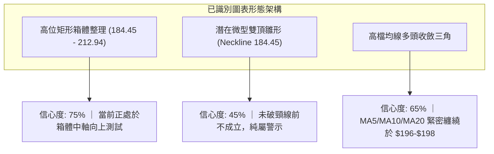

#### 形態信心度與目標價評估表

| 識別形態名稱 | 信心度 | 判斷依據（引用數據與點位） | 完成度 | 目標價推算與計算式 |
|:---|:---:|:---|:---:|:---|
| **高位箱體整理** | **75%** | 箱底獲 S1 ($184.45) 兩次確認（10-16日低 $184.45、10-02週低 $184.81），箱頂為 52W 高點 $212.94 | 85% | **向上突破目標**：箱頂 $212.94 + 形態高度 ($212.94 - $184.45 = $28.49) = **$241.43**（數據外推，僅供參考） |
| **潛在雙重頂** | **40%** | 左頂 2026-10-09 ($209.58)，右頂 2026-10-16 ($212.94)，頸線位於 2026-10-16 低點 $184.45 | 30% | **註明**：信心度 < 50%，未跌破頸線 $184.45 前形態不成立，僅作下行風險警示 |
| **短期布林中軌收斂支撐** | **70%** | 收盤價 $198.73 連續 4 日站穩布林中軌 (MA20 $196.67)，K棒震幅收窄至 ATR 內 | 90% | **通道上軌測距**：以布林上軌為目標，推算目標價為 **$210.72** |

---

### 🕯️ 重要 K 線形態分析

依據提供的「近10根日K」與「近8根週K」原始數據，精確解讀 K 棒微觀語言：

#### 近 10 根日 K 線形態解構

| 日期 | 開盤價 | 最高價 | 最低價 | 收盤價 | 成交量 | K 線形態識別 | 專業技術解讀與訊號確認 | 訊號強度 |
|:---|:---:|:---:|:---:|:---:|:---:|:---|:---|:---:|
| **10-14** | 207.02 | 209.29 | 199.74 | 200.97 | 24,263,800 | 衝高回落中陰線 | 測試 $209 阻力未果，實體收於下半部，多方追價意願衰退 | 🔴 |
| **10-15** | 196.85 | 200.91 | 192.60 | 200.50 | 24,781,500 | 下影錘頭陽線 | 開盤跳空走低探至 $192.60 後強勁拉起，顯示 $195 下方有防守盤 | 🟢 |
| **10-16** | 201.79 | 203.55 | 184.45 | 186.03 | 33,354,900 | 放量長黑破位陰線 | 創 52W 高點後巨幅重挫，單日殺跌 $19.1，摜破 MA20 形成恐慌盤 | 🔴🔴 |
| **10-19** | 186.99 | 196.99 | 186.15 | 194.15 | 23,934,800 | 吞噬型長陽線 | 守住 $186 低位，實體完全吞噬前一日陰線下半段，確認 S1 支撐有效 | 🟢🟢 |
| **10-20** | 192.44 | 196.11 | 189.42 | 192.60 | 15,095,200 | 縮量孕線小十字 | 成交量銳減至 1,509 萬股，多空在此暫時休兵，籌碼進入緊縮 | 🟡 |
| **10-21** | 191.72 | 202.55 | 189.88 | 201.72 | 21,398,400 | 反彈突破長陽線 | 重新收復 $200 整數大關與 MA20 ($196.67)，扭轉短線劣勢 | 🟢 |
| **10-22** | 200.76 | 202.63 | 194.54 | 196.19 | 22,933,600 | 衝高受阻上影陰線 | 上攻 $202.63 遭解套賣壓擊退，收跌於 $196.19，確認上檔阻力沉重 | 🔴 |
| **10-23** | 195.02 | 197.49 | 190.57 | 196.75 | 17,668,400 | 低開下影小陽星 | 測試 $190.57 後回升，守住 MA20，形成中軌爭奪戰 | 🟡 |
| **10-26** | 197.90 | 200.05 | 192.91 | 198.84 | 16,380,400 | 窄幅縮量陽線 | 波動度降至 7 美元內，收盤貼近阻力 R1 ($198.88)，蓄勢待變 | 🟡 |
| **10-27** | 198.12 | 201.83 | 196.79 | 198.73 | 19,869,700 | 陀螺星線 (Spinning Top) | 最高 $201.83 未能突破 R1，多空膠著於 $198.73，成交量仍受制 | 🟡 |

#### 近 8 根週 K 線特徵摘要

| 週最後交易日 | 週開盤 | 週最高 | 週最低 | 週收盤 | 週成交量 | 週 K 線型態與結構解讀 |
|:---:|:---:|:---:|:---:|:---:|:---:|:---|
| **2026-09-11** | 173.60 | 175.82 | 164.55 | 167.23 | 81,680,200 | 回踩測試 S3 ($165.45) 區域支撐，縮量打底完成 |
| **2026-09-18** | 169.70 | 177.88 | 166.42 | 177.64 | 144,450,500 | 放量中陽線上攻，週 RSI 升至 57.0，確認反彈主升延續 |
| **2026-09-25** | 178.73 | 194.68 | 176.76 | 189.67 | 119,600,900 | 突破 $180 關卡，多頭排列全面舒展 |
| **2026-10-02** | 186.23 | 194.78 | 184.81 | 188.75 | 86,973,500 | 測試 S1 附近 $184.81 獲得買盤支撐，週線呈高檔十字星 |
| **2026-10-09** | 189.45 | 209.58 | 187.63 | 209.05 | 130,578,300 | 週線長陽突破 $200，週 RSI 達到 76.3 超買高熱區 |
| **2026-10-16** | 208.90 | 212.94 | 184.45 | 186.03 | 125,244,900 | 創 52W 高點 $212.94 後出現巨幅上影長黑，洗盤劇烈 |
| **2026-10-23** | 186.99 | 202.63 | 186.15 | 196.75 | 101,030,400 | 下測 $186.15 止穩，收盤強拉至 $196.75，展現下檔承接力道 |
| **2026-10-27** | 197.90 | 201.83 | 192.91 | 198.73 | 36,250,100 | 週內兩日窄幅整理，收盤 $198.73 壓制在 R1 邊緣 |

---

### 📉 ASCII 走勢形態示意圖

```
PLTR 高檔箱體與布林通道軌跡示意圖
===================================================================
$212.94 ──┬─────────────────────● (52W High / 10-16) ───────── [R3 強壓]
          │                    / \
$207.52 ──┼───────────●───────/───\────────────── [R2 阻力區]
          │          / \     /     \
$198.88 ──┼─────────/───\───/───────\───────●───── [R1 頸線壓制]
$198.73 ──┼────────/─────\─/─────────\─────▲────── [現價位置]
$196.67 ──┼───────/───────● (MA20) ───\───/─────── [布林中軌支撐]
          │      /                     \ /
$184.45 ──┴─────●───────────────────────● (10-16日低) ─ [S1 箱底支撐]
===================================================================
時間軸     09-25      10-09     10-16     10-21     10-27 (今日)
狀態       拉升突破    高檔過熱   天量巨震   V型修復   收斂等待方向
```

---

## 4. 支撐與阻力

### 🗺️ 關鍵價位分布圖（Unicode）

```
PLTR 價位結構分布圖
══════════════════════════════════════════════════════════════════
$212.94 ║████████████████████████████████████║ 強阻力 R3 (52W 最高點)
$207.52 ║████████████████████████            ║ 阻力 R2 (波段密集高點)
$198.88 ║██████████████████████████████      ║ 關鍵阻力 R1 (前波平台頸線)
$198.73 ╠════════════════════════════════════╣ ◄ 現價位置 ($198.73)
$184.45 ║▓▓▓▓▓▓▓▓▓▓▓▓▓▓▓▓▓▓▓▓▓▓▓▓▓▓▓▓        ║ 強支撐 S1 (近一年波段密集低點)
$176.50 ║████████████████████████████        ║ 強支撐 S2 (週收盤聚類低點)
$165.45 ║████████████████████████████████    ║ 終極支撐 S3 (中級起漲防線)
══════════════════════════════════════════════════════════════════
```

---

### 🚧 阻力位分析表

所有阻力價位嚴格引用自數據中經由 OHLCV 演算法計算之波段聚類值：

| 阻力級別 | 精確價位 | 距現價空間 | 形成技術原因與籌碼結構 | 突破難度評估 | 重要性級別 |
|:---|:---:|:---:|:---|:---:|:---:|
| **阻力一 (R1)** | **$198.88** | **+0.08%** | 過去兩週日線反覆測試之微型頸線高點（10-26收盤 $198.84、10-27高點 $201.83回落點），空方短線壓制首位 | 🟡 中等 (量縮不易過) | ★★★★☆ |
| **阻力二 (R2)** | **$207.52** | **+4.42%** | 2026-10-14開盤價 $207.02 與 10-09週收盤價 $209.05 下緣套牢解套賣壓聚類區 | 🔴 較高 (需 25M 以上量能) | ★★★★★ |
| **阻力三 (R3)** | **$212.94** | **+7.15%** | **52 週歷史天花板**（2026-10-16 當日創下之最高點），極端超買賣壓發源地 | 🔴 極高 (需強大利多配合) | ★★★★★ |

---

### 🛡️ 支撐位分析表

所有支撐價位嚴格引用自數據中經由 OHLCV 演算法計算之波段聚類值：

| 支撐級別 | 精確價位 | 距現價空間 | 形成技術原因與籌碼結構 | 守住機率評估 | 重要性級別 |
|:---|:---:|:---:|:---|:---:|:---:|
| **支撐一 (S1)** | **$184.45** | **-7.19%** | 近一年波段低點聚類核心，2026-10-16 單日恐慌下殺最低點，與 MA50 ($185.77) 形成重疊共振 | 🟢 85% (中期強堡壘) | ★★★★★ |
| **支撐二 (S2)** | **$176.50** | **-11.19%** | 2026-09-18 週收盤價 $177.64 與 09-25 起漲低點 $176.76 之平台結構聚類區 | 🟢 90% (主力成本區) | ★★★★☆ |
| **支撐三 (S3)** | **$165.45** | **-16.75%** | 2026-09-11 週低點 $164.55 處籌碼換手防線，跌破則長期多頭結構面臨破壞 | 🟢 95% (牛熊分水嶺) | ★★★★★ |

---

### 📐 斐波那契回調位分析

依據 52 週波動極值（低點 **$106.37** → 高點 **$212.94**），總波段垂直震幅 **$106.57**：

| 回調比例 | 精確價位 | 技術結構意義 | 現價相對位置與操作解讀 |
|:---|:---:|:---|:---|
| **0.0% (52W High)** | **$212.94** | 歷史極限推升壓力點 | 當前多頭終極目標，此處易誘發獲利了結盤 |
| **23.6%** | **$187.79** | 強勢回調分界線 | **現價 ($198.73) 處於 0.0% 與 23.6% 之間極強勢多頭強勢區**，回調未碰觸 23.6%，代表盤勢維持高位震盪強整理 |
| **38.2%** | **$172.23** | 正常回調黃金分割支撐 | 靠近 2026-08 主升突破週收盤價 $172.01，中期多頭回檔極限防線 |
| **50.0%** | **$159.66** | 多空中樞平衡線 | 緊鄰 MA120 ($157.18) 與 MA240 ($157.39)，中長線價值買盤分水嶺 |
| **61.8%** | **$147.08** | 深度回調警戒防線 | 接近 2026-03 築底收盤價 $146.28，多頭生命底線 |
| **78.6%** | **$129.18** | 弱勢回調防線 | 2026-07 探底回升反彈頸線位置 |
| **100.0% (52W Low)**| **$106.37** | 52 週大週期循環低點 | 原始起漲點，非極端系統性風險不復見 |

> **回調位深度判斷**：PLTR 目前股價 $198.73 穩居 23.6% 回調位 ($187.79) 上方達 +5.83%，顯示股價屬於標準的「強勢高檔消化」，並未對主升浪結構產生破壞性回調。

---

## 5. 技術指標深度解讀

### 🎛️ 指標訊號總覽

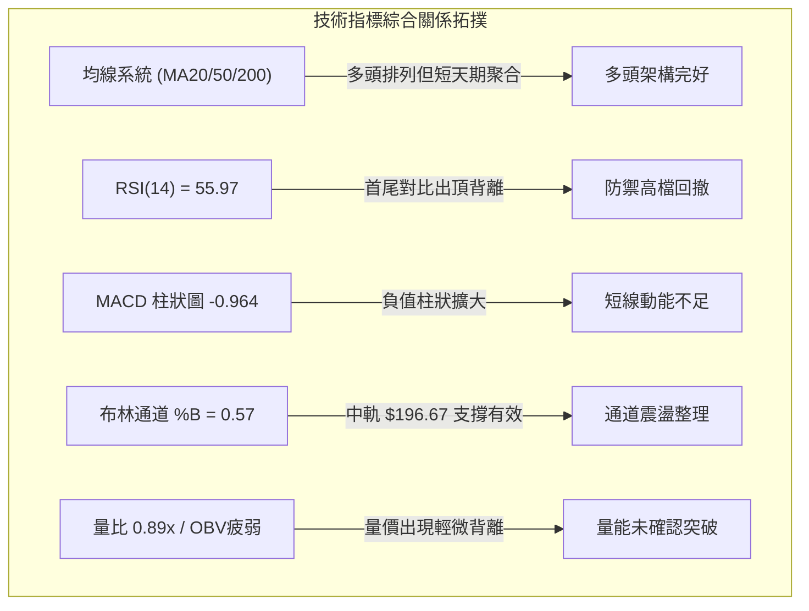

---

### 📈 移動平均線排列分析

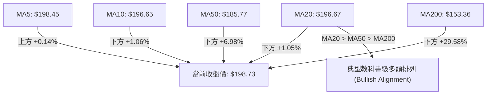

#### 各週期均線數據與趨勢狀態詳解

| 均線名稱 | 當前價格 | 偏離現價幅度 | 均線歷史軌跡斜率 | 支撐/壓力屬性評估 |
|:---|:---:|:---:|:---|:---|
| **MA 5** | $198.45 | +0.14% | 平緩微升 | 超短期平水線，股價貼線震盪，無明顯推升力道 |
| **MA 10** | $196.65 | +1.06% | 持平微升 | 短線動能線，與 MA20 在 $196.65–$196.67 形成雙重黏合黃金支撐 |
| **MA 20** | $196.67 | +1.05% | 向上微彎 | 短期生命線 / 日布林中軌，多空分界指標，跌破將轉弱 |
| **MA 50** | $185.77 | +6.98% | 穩定向上陡峭 | 中期多頭防線，與 S1 ($184.45) 構築出厚實的中期承接帶 |
| **MA 60** | $183.07 | +8.55% | 穩健爬升 | 季線基底，中長線機構加倉防禦成本線 |
| **MA 120** | $157.18 | +26.43% | 緩步抬升 | 半年線，與 MA240 ($157.39) 形成中期黃金交叉 |
| **MA 200** | $153.36 | +29.58% | 長期向上 | 牛熊分界線，現價大幅領先 30%，牛市格局完全無損 |

---

### 📉 RSI(14) 分析

當前數值：**55.97**（Wilder 平滑法）

```
RSI(14) 狀態進度條
超賣 (0)                       中軸 (50)    現值 (55.97)           超買 (100)
┌───────────────┬───────────────┼───────●───────┬───────────────┐
│               │               │▓▓▓▓▓▓▓░░░░░░░░│               │
└───────────────┴───────────────┴───────────────┴───────────────┘
0              30              50      55.97   70             100
狀態評定：【中性偏強區間】
```

#### ⚠️ 背離診斷（頂背離確立）
*   **背離檢驗基準**：依據近 20 根 K 棒首尾價格與 RSI 之比對。
*   **首端 (2026-10-09 週線交易日)**：當日收盤價為 **$209.05**（盤中創波段高點 $209.58），對應之週 RSI 高達 **76.3**，日線 RSI 亦處於 70 以上之極端超買區。
*   **尾端 (2026-10-27 當前)**：價格反彈收在 **$198.73**，但盤中最高曾再度上衝至 $201.83，而當前 RSI(14) 僅能微弱回升至 **55.97**。
*   **背離結論**：價格維持在高位嘗試向 R1 挑戰，但 RSI 峰值顯著降低（下降逾 15–20 個點數），**確認日線級別存在「典型量價頂背離 (Bearish Divergence)」**。這表明近期反彈純屬修正性架構，內部多頭動能正在耗竭，隨時有向中軌回踩之風險。

---

### 📊 MACD(12, 26, 9) 訊號解讀

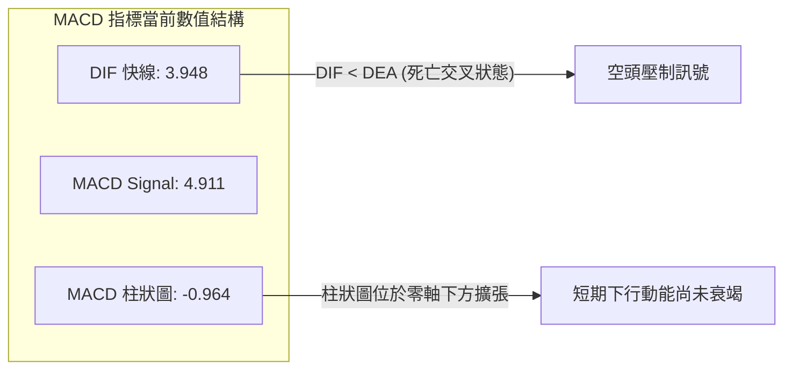

*   **數值結構解析**：MACD 主線 (3.948) 位於訊號線 (4.911) 下方，兩者雖然都在零軸之上（代表大週期多頭趨勢仍受保護），但負向柱狀圖值為 **-0.964**，延續自 10 月中旬以來的綠柱擴張狀態。
*   **歷史走勢比對**：回顧 2026-09-11 柱狀圖觸及 -3.155 極端低點後展開大反彈；當前 -0.964 尚未達到恐慌釋放極值，表明短線空方動能仍有宣洩空間，多頭尚未組織起反攻突破。

---

### 📦 布林通道分析（Bollinger Bands）

```
PLTR 布林通道空間示意圖 (帶寬: $28.10)
══════════════════════════════════════════════════════════════════
$210.72 ── 上軌 (Upper Band)  ────────────────────── [通道天花板]
           │
           │                                 
$198.73 ── ┼──────────────────────────────● (現價, %B = 0.57)
           │
$196.67 ── 中軌 (Middle Band = MA20)  ────────────── [動態平衡線]
           │
           │
$182.62 ── 下軌 (Lower Band)  ────────────────────── [通道地板]
══════════════════════════════════════════════════════════════════
```

*   **通道參數**：上軌 **$210.72**、中軌 **$196.67**、下軌 **$182.62**，通道帶寬為 $28.10 美元。
*   **%B 指標解讀**：目前 **%B = 0.57**。%B 大於 0.5 代表價格處於中軌之上偏多區域，但低於 0.8 表明未進入強勢單邊擠壓擴軌狀態。現價在 $196.67（中軌）至 $198.88（R1）之間狹幅蠕動，隨時面臨通道縮口後的方向性抉擇。

---

### 💹 成交量分析（量價配合度）

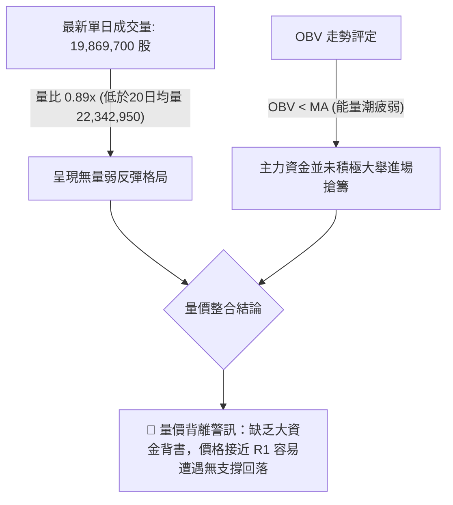

*   **量能萎縮**：最新成交量 1,986.9 萬股，不僅低於 20 日均量（2,234.3 萬股，量比 0.89x），更大幅落後於 50 日均量（2,535.9 萬股）。在挑戰前波套牢密集區時出現量能萎縮，反映買盤追高動能不足。
*   **OBV 能量潮狀態**：明確顯示 `OBV < MA`。能量潮跌破其均線代表籌碼流出大於流入，當前價格反彈屬於技術性抽腳，未獲成交量有效確認。

---

## 6. 動能與波動率

### ⚡ 動能評估四象限

| 象限 | 動能維度 (Momentum) | 波動率維度 (Volatility) | PLTR 當前狀態歸屬 | 策略意涵與行動指引 |
|:---:|:---:|:---:|:---:|:---|
| **第一象限 (Q1)** | 強動能 (ADX>25, RSI>60) | 低波動 (ATR% < 3.0%) | 否 | 最佳單邊順勢主升段，全力持股待漲 |
| **第二象限 (Q2)** | 弱動能 (ADX<25, RSI 50-60) | 低波動 (ATR% < 3.0%) | 否 | 蓄勢打底沉寂期，適合中長線低吸定投 |
| **第三象限 (Q3)** | 強動能 (ADX>25, MACD柱擴大) | 高波動 (ATR% > 3.5%) | 否 | 爆發突破行情，風險與報酬並存 |
| **第四象限 (Q4)** | **弱動能 (ADX 23.07, MACD負柱)** | **高波動 (ATR% 3.95%, Beta 1.602)** | **✓ [當前歸屬此象限]** | **高風險假突破震盪期：動能不足但日內震幅劇烈，極易雙向巴洗，操作宜防守優先** |

---

### 📊 ATR 波動率分析

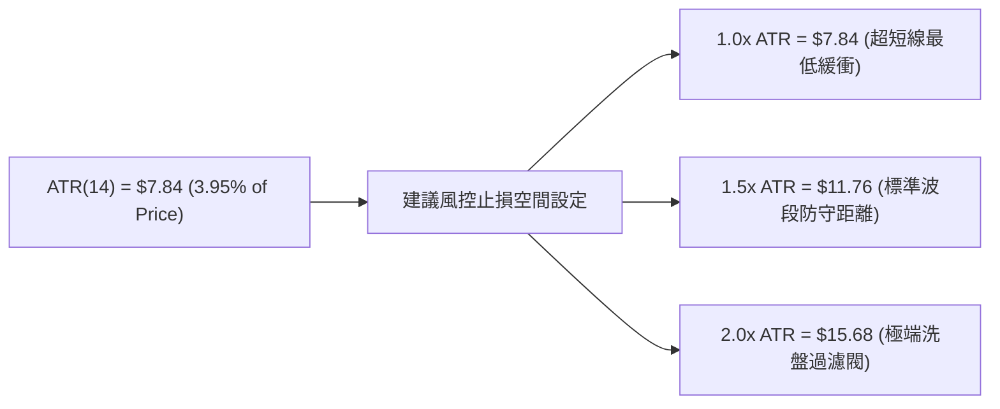

*   **波動率絕對值**：ATR(14) 讀數為 **$7.84**，佔當前股價比例達 **3.95%**，屬於標準的高波動成長型科技股特徵。
*   **交易風控含義**：在 PLTR 當前價格下建立任何部位，**盤中常態性噪聲波動即可達 ±$7.84**。因此，若交易者將停損設定在 $5 以內，將極易被市場噪聲無謂掃出場；合理的停損寬度必須維持在至少 $8.00–$12.00 空間。

---

### 📐 Beta 與市場相關性

*   **Beta 係數**：**1.602**
*   **市場敏感度解讀**：PLTR 的價格彈性是大盤（S&P 500 指數）的 1.60 倍。在標普指數上漲 1% 時，PLTR 理論預期上漲 1.60%；反之當大盤回調 1% 時，PLTR 將承擔 1.60% 的下殺壓力。
*   **機構持股結構驗證**：機構持股比例達 **64.6%**，內部人持股僅 3.5%，融券賣空比例 (Short % Float) 為 **2.6%**（Short Ratio 2.21 天）。這說明該股籌碼高度被華爾街機構掌控，高 Beta 意味著其價格對於宏觀流動性與市場避險情緒極度敏感。

---

## 7. 多時框架總結

### 📋 時框架評分表

| 時框架 | 趨勢方向 | 核心動能指標 | 均線排列特徵 | 形態識別結論 | 綜合評分 | 操作指引 |
|:---|:---:|:---|:---|:---|:---:|:---|
| **長期 (月線)** | 🟢 多頭持續 | 月線MACD黃金交叉，月K沿上升通道爬升 | 遠高於 MA120/MA240 (+26%) | 24個月超級牛市大通道 | **82/100** | 核心長線部位續抱，無視短期波動 |
| **中期 (週線)** | 🟡 高檔整理 | 週 RSI 自 76.3 降至 56.0，週 MACD 柱綠色 | 週線均線多頭散發完好 | $184–$212 歷史高檔大箱體 | **60/100** | 波段操作以高檔箱體邊界為主 |
| **短期 (日線)** | 🔴 弱勢震盪 | 日 RSI 頂背離，MACD 柱狀 -0.964，量比 0.89x | MA20 上方爭奪，短均線聚集 | 陀螺星線受阻於 R1 ($198.88) | **48/100** | 逢高減碼，嚴禁追高，回踩接多 |

---

### 🔲 綜合訊號矩陣

```
時框與指標訊號共振矩陣
══════════════════════════════════════════════════════════════════
維度            長期 (月線)       中期 (週線)       短期 (日線)
──────────────────────────────────────────────────────────────────
趨勢方向        🟢 強烈看多       🟢 溫和看多       🟡 橫向盤整
均線系統        🟢 完美多頭       🟢 完美多頭       🟢 完美多頭
動能指標        🟢 動能充沛       🟡 動能降溫       🔴 動能衰退 (頂背離)
成交量能        🟢 歷史放量       🟡 量能收斂       🔴 量縮背離 (0.89x)
布林通道        🟢 沿上軌擴張     🟡 軌道內收縮     🟡 中軌上方震盪
──────────────────────────────────────────────────────────────────
時框收斂共識    長多基調未變 ──► 中期高位整固 ──► 短線隨時回踩消化
══════════════════════════════════════════════════════════════════
```

---

### ⚖️ 多時框收斂結論

嚴格依據**規則 14 多時框收斂優先級**進行判斷：

1.  **市場屬性裁決**：當前日線 **ADX(14) = 23.07 < 25**，毫無爭議屬於**「盤整行情 (Range-bound Market)」**。
2.  **交易主導法則**：在 ADX < 25 的盤整結構中，順勢突破策略失效機率極高，**必須以日線布林通道 ($182.62–$210.72) 以及波段支撐阻力 S1–R1 作為核心邊界**。
3.  **時框矛盾取捨**：雖然長期月線與均線系統展現強大多頭排列，但日線 RSI 頂背離與 MACD 負柱狀圖對短期上行空間構成封鎖。日線僅用來尋找回調至關鍵支撐時的進場機會。
4.  **唯一方向性結論**：**【中性偏多區間震盪（逢低做多，阻力高拋）】**。不進行單邊強推，主策略必須圍繞回踩支撐位的防守型買入展開。

---

## 8. 交易策略建議

### 🗺️ 策略決策流程圖

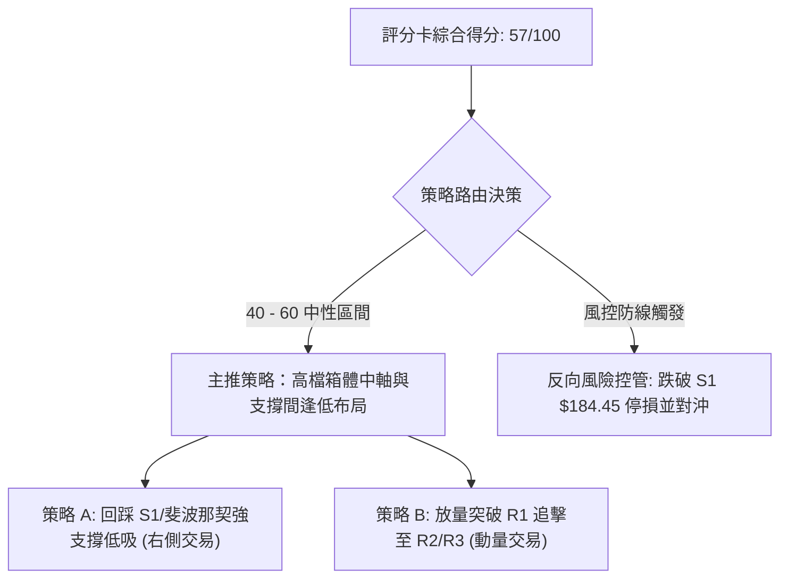

---

### 🧭 策略路由（依評分卡分流）

> **當前主策略方向 = 【中性偏多，區間操作，回踩支撐做多】（依評分 57/100）**
> 
> *分流說明：綜合評分 57/100 坐落於 40–60 中性區間。依規定採取「區間操作」策略，以布林通道與波段密集位為主，嚴格等待回調支撐確認或帶量確認突破，不進行無保護之追高。*

---

### 🎯 價格情境階梯（Price Scenarios）

價位嚴格引用自「第 4 章」由 OHLCV 所計算之關鍵價位：

| 觸發條件 | 階段目標 1 | 延伸目標 2 | 技術情境含義與操作對策 |
|:---|:---:|:---:|:---|
| **有效放量突破 R1 ($198.88)** | **R2 ($207.52)** | **R3 ($212.94)** | 短線頂背離被強行化解，多頭挑戰 52W 歷史極值，動態推升停利點 |
| **維持於現價區間 ($196.67–$198.88)** | **布林上軌 ($210.72)** | **布林下軌 ($182.62)** | 於布林中軌上方狹幅橫盤，時間換取空間，觀望等待量能信號 |
| **失守 MA20 回踩 S1 ($184.45)** | **S2 ($176.50)** | **S3 ($165.45)** | 頂背離完全釋放，測試中級多頭生命線，為絕佳波段右側買點 |

---

### 📊 情境機率分佈

| 運行情境 | 發生機率 | 主要技術指標支撐依據 |
|:---|:---:|:---|
| **區間震盪消化 (主情境)** | **55%** | ADX 23.07 確認盤整，布林中軌支撐良好但量比僅 0.89x，難以發動單邊行情 |
| **回踩支撐打底 (次情境)** | **30%** | RSI 頂背離尚未修正完畢，MACD 負向柱狀圖持續擴展 (-0.964)，需要回踩測試 |
| **直接放量突破 (低機率)** | **15%** | OBV 疲弱且在均線下方，缺少增量資金入場確認，直接突破 R3 難度極大 |

---

### 🟢 主策略詳情（方向：區間中性偏多）

所有價位均來自關鍵價位區塊；風險報酬比計算式：`(目標價 T1 - 進場價) ÷ (進場價 - 止損價)`，嚴格檢驗算術一致性：

| 策略要素 | 策略 A：回踩支撐低吸策略（左側波段布局） | 策略 B：突破 R1 確認跟進策略（右側動能追擊） |
|:---|:---|:---|
| **策略類型** | 逢低回踩關鍵支撐買入 | 帶量突破關鍵阻力順勢買入 |
| **進場條件** | 股價回踩 S1 不破，出現 15 分鐘/日線底分型確認 | 收盤價帶量（日量 > 25M）實體突破 R1 |
| **進場價格** | **$184.45** (精確引用支撐位 S1) | **$198.88** (精確引用阻力位 R1) |
| **目標價 T1** | **$198.88** (精確引用阻力位 R1) | **$207.52** (精確引用阻力位 R2) |
| **目標價 T2** | **$207.52** (精確引用阻力位 R2) | **$212.94** (精確引用 52W 高點阻力位 R3) |
| **止損價格** | **$176.50** (精確引用強支撐位 S2) | **$192.60** (精確引用 10-15/10-20 低點密集區) |
| **風險報酬比** | **1 : 1.81（以 T1 計）**<br>*(計算: ($198.88 - $184.45) ÷ ($184.45 - $176.50) = 14.43 ÷ 7.95 = 1.815)*<br>*(註：以 T2 計則為 1 : 2.90)* | **1 : 1.38（以 T1 計）**<br>*(計算: ($207.52 - $198.88) ÷ ($198.88 - $192.60) = 8.64 ÷ 6.28 = 1.375)*<br>*(註：以 T2 計則為 1 : 2.24)* |
| **成功機率估計** | **68%** | **52%** |
| **建議配置倉位** | **15% - 20% 總資金** | **10% 總資金 (突破驗證期輕倉)** |

---

### 🔴 反向風險觸發點（對沖提示）

本小節列出推翻上述做多策略的風控預警節點（僅供對沖避險參考）：
*   **首要警報**：日線收盤價跌破 **MA20 ($196.67)**，意味著短期通道失守，多頭進攻態勢暫告段落。
*   **全面破位警報**：若股價無量跌破 **S1 ($184.45)**，多頭箱體結構瓦解，潛在雙重頂形態成形。此時應全數停損離場，並可透過購買認沽期權 (Put Option) 針對整體投資組合進行下行對沖，下方第一回補目標鎖定 **S2 ($176.50)** 及斐波那契 38.2% 回調位 **$172.23**。

---

### ⭐ 整體訊號強度評星

```
做多訊號強度：★★★☆☆  (3.0/5星 — 均線排列良好，但受制於量能與背離)
做空訊號強度：★★☆☆☆  (2.0/5星 — 長期趨勢多頭，逆勢放空盈虧比欠佳)
整體可信度：  ★★★★☆  (4.0/5星 — 支撐阻力結構清晰，價位聚類顯著)
```

---

## 9. 風險提示與監控

### ✅ 關鍵監控指標 Checklist

```
╔══════════════════════════════════════════════════════════════════╗
║               PLTR 每日盤後技術監控清單 (Checklist)             ║
╠══════════════════════════════════════════════════════════════════╣
║ [ ] 價格是否跌破月線/布林中軌 MA20 ($196.67)？                  ║
║ [ ] 日成交量是否放大至 2,500 萬股以上（恢復超越 50 日均量）？    ║
║ [ ] MACD 負向柱狀圖是否開始收斂（數值由 -0.964 朝零軸回升）？   ║
║ [ ] 日線 RSI(14) 能否向上突破 60 關卡化解頂背離形態？            ║
║ [ ] 盤中是否有效擊穿短期波段低點 S1 ($184.45) 關鍵防線？         ║
║ [ ] ADX(14) 是否攀升突破 25，預告單邊趨勢行情正式啟動？          ║
╚══════════════════════════════════════════════════════════════════╝
```

---

### ⚠️ 風險場景分析

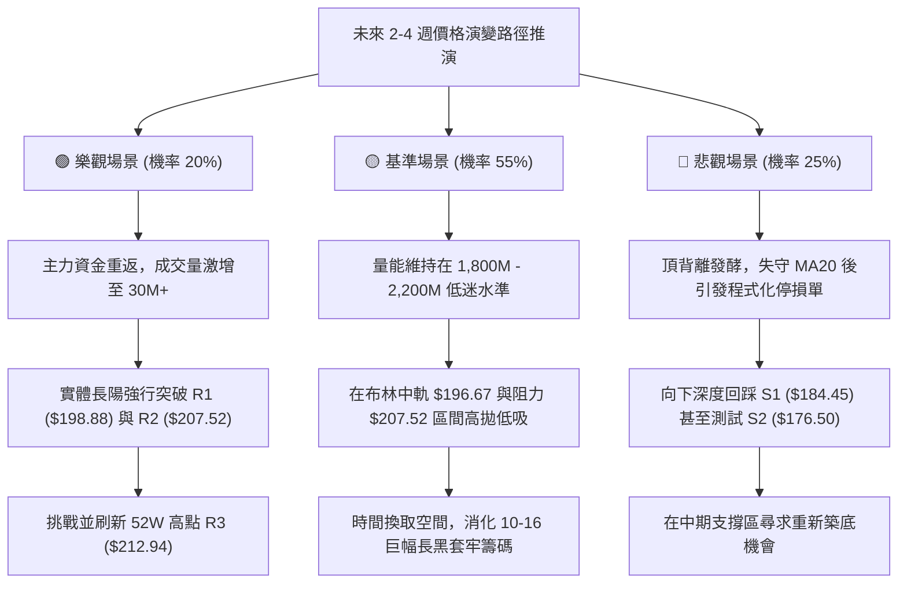

---

### 🛡️ 風險管理重要提醒

1.  **高波動風險控制**：PLTR 歷史 Beta 高達 **1.602**，ATR 達到 **$7.84 (3.95%)**。在進行槓桿保證金合約交易時，單筆承擔之最大帳戶損失嚴禁超過整體本金之 **1.5% - 2.0%**。
2.  **避免追逐假突破**：在 ADX < 25 且 OBV 弱勢的環境下，日內盤中突破 R1 ($198.88) 極易形成如 2026-10-22 般的「假突破真誘多」長上影線。**務必等待日線收盤確認站穩**方可追加倉位。
3.  **大盤聯動性審查**：身為高本益比 (Trailing P/E 171.3) 之軟體基建龍頭，股價對美債殖利率波動敏感度極高。操作時必須同步監控科技板塊整體情緒。

---

## 📋 報告總結

```
╔══════════════════════════════════════════════════════════════════╗
║                    PLTR 技術分析報告總結                         ║
╠══════════════════════════════════════════════════════════════════╣
║ 報告日期：2026-10-28                                            ║
║ 當前價格：$198.73 USD                                           ║
║ 分析評級：⚖️ 中性偏多區間震盪 (綜合評分: 57 / 100)               ║
╠══════════════════════════════════════════════════════════════════╣
║ 關鍵結論：                                                       ║
║ ├─ 長期趨勢：🟢 強烈看多 (MA20>MA50>MA200 完美多頭，年線上方30%) ║
║ ├─ 中期趨勢：🟡 高檔震盪 (守穩 $184.45 箱底，受制於 $212.94 天花板)║
║ ├─ 短期趨勢：🔴 弱勢修正 (RSI 頂背離，MACD 負向擴展，量比 0.89x) ║
║ ├─ 關鍵支撐：S1: $184.45 ｜ S2: $176.50 ｜ S3: $165.45           ║
║ ├─ 關鍵阻力：R1: $198.88 ｜ R2: $207.52 ｜ R3: $212.94           ║
║ └─ 分析師目標：華爾街平均共識目標價為 $208.97 (最高 $265.00)      ║
╠══════════════════════════════════════════════════════════════════╣
║ 最優策略組合：                                                   ║
║ 1. 🥇 最佳機會：策略 A (回踩 S1 $184.45 不破建立左側多單，       ║
║                風報酬比 1:1.81，勝率最高)                       ║
║ 2. 🥈 次選機會：策略 B (帶量實體收過 R1 $198.88 順勢追多至 R2，  ║
║                風報酬比 1:1.38，需量能配合)                     ║
║ 3. 🥉 保守選擇：維持現金觀望，等待日線 ADX 突破 25 或 MACD 柱狀圖 ║
║                翻正後再行進場                                    ║
╚══════════════════════════════════════════════════════════════════╝
```

---

> ⚠️ **免責聲明**：本報告為依據量化技術指標與歷史行情數據所完成之專業技術分析研究，所有數據均基於客觀模型演算。本報告**僅供學術研究與投資策略探討參考**，**不構成任何要約、招攬或具體投資買賣建議**。金融市場具有高度不確定性，投資人應獨立審慎評估風險並自負盈虧。

---
*報告生成時間：2026-10-28 ｜ 數據來源：Yahoo Finance ｜ 分析框架：多時框技術分析模型*