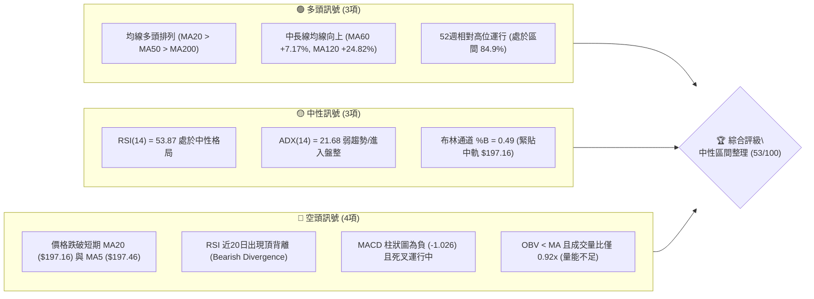
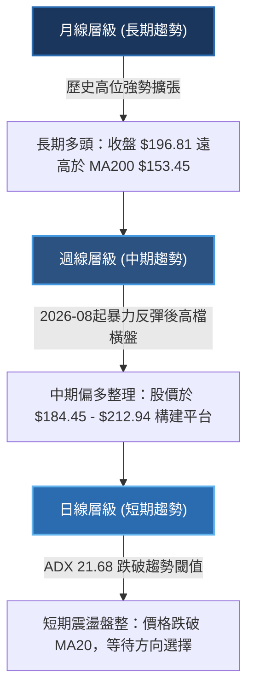
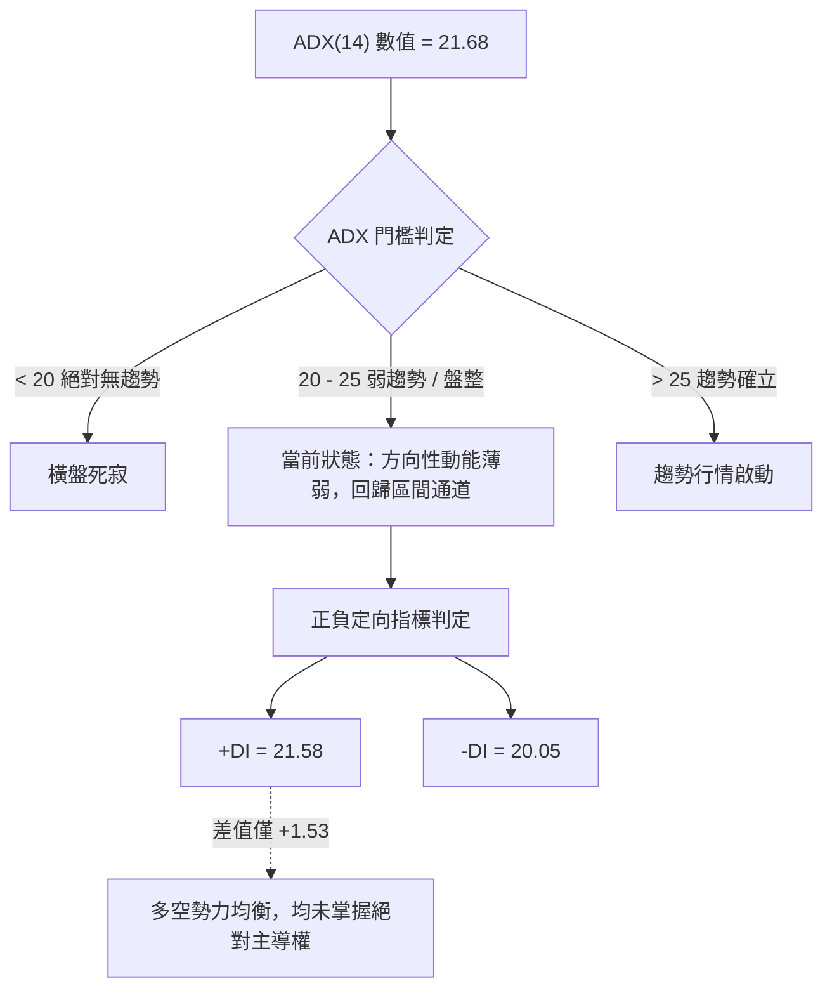
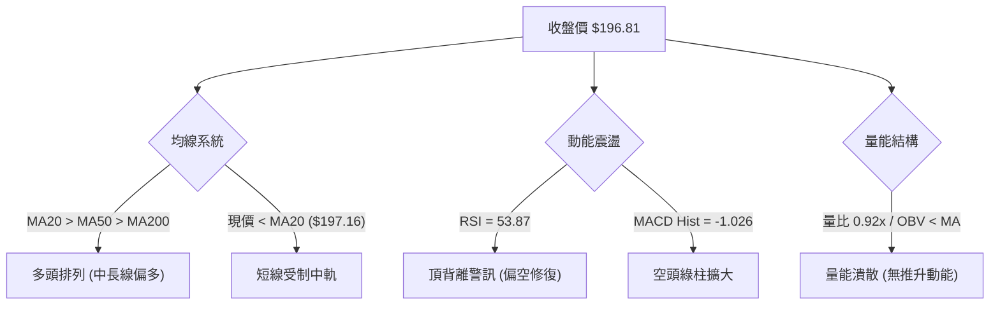
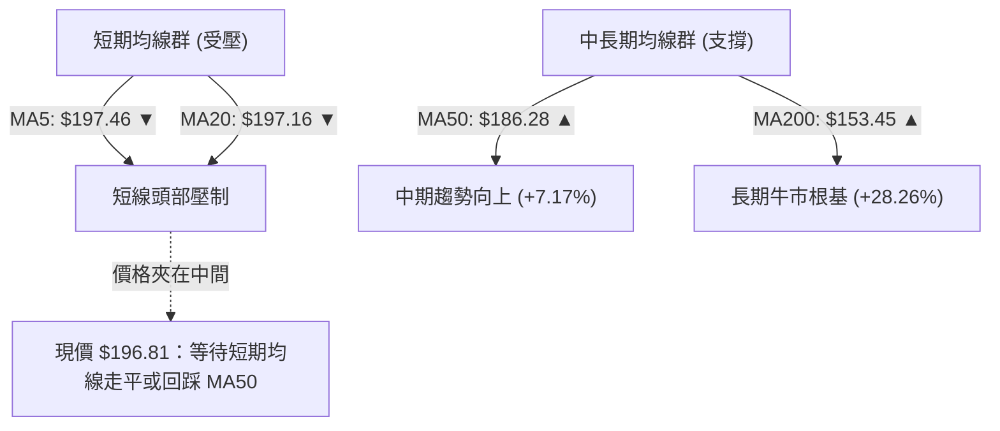
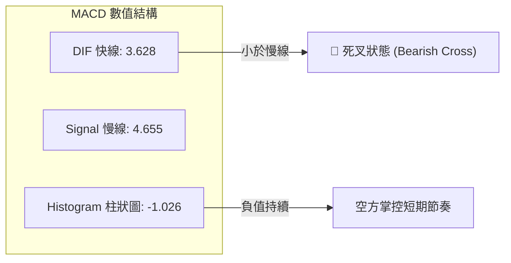
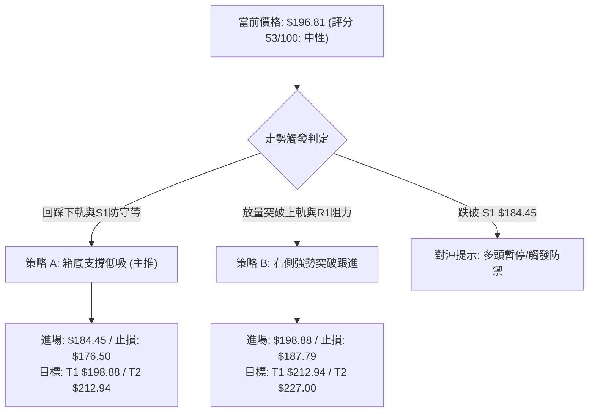
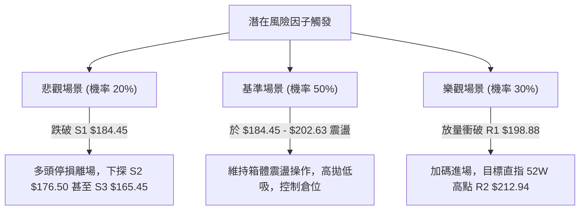

# PLTR 技術分析報告

> **報告日期**：2026-10-29 ｜ **語言**：繁體中文 ｜ **數據來源**：Yahoo Finance ｜ **當前價格**：$196.81

---

## 目錄

| 章節 | 內容 |
|------|------|
| [1. 技術面概覽](#1-技術面概覽) | 訊號儀表板、核心指標、評分卡 |
| [2. 趨勢分析](#2-趨勢分析) | 多時框趨勢、長中短期走勢、ADX 解讀 |
| [3. 圖表形態分析](#3-圖表形態分析) | 形態識別、K線組合、目標價推算 |
| [4. 支撐與阻力](#4-支撐與阻力) | 關鍵價位、斐波那契回調結構 |
| [5. 技術指標深度解讀](#5-技術指標深度解讀) | 均線系統、RSI背離、MACD、布林通道、量價OBV |
| [6. 動能與波動率](#6-動能與波動率) | 動能四象限、ATR 波動率、Beta 市場敏感度 |
| [7. 多時框架總結](#7-多時框架總結) | 時框架矩陣、多時框收斂與方向定調 |
| [8. 交易策略建議](#8-交易策略建議) | 策略路由、價格情境階梯、主策略詳解、風險報酬比 |
| [9. 風險提示與監控](#9-風險提示與監控) | 關鍵指標清單、情境推演、資金控管 |
| [📋 報告總結](#-報告總結) | 執行摘要與核心策略速覽 |

---

## 1. 技術面概覽

### 🎯 技術訊號儀表板

Palantir Technologies Inc.（PLTR）當前報價為 $196.81。整體技術架構呈現「長線多頭結構未破，短線陷入高檔箱體震盪與指標背離修復」的格局。



---

### 📊 核心指標速覽表

| 指標類別 | 指標名稱 | 當前數值 | 訊號 | 技術解讀 |
|----------|----------|----------|------|----------|
| **價格** | 當前收盤價 | $196.81 | 🟡 | 位於 52 週高低點之 84.9% 處，高檔微幅拉回 |
| **均線** | MA20 | $197.16 | 🔴 | 收盤價略低於 20 日均線（-0.18%），短線失去上攻推力 |
| **均線** | MA50 | $186.28 | 🟢 | 顯著高於 50 日均線（+5.65%），中期多頭防線穩固 |
| **均線** | MA200 | $153.45 | 🟢 | 大幅高於 200 日牛熊分水嶺（+28.26%），長期多頭基底強大 |
| **動能** | RSI(14) | 53.87 | 🟡 | 數值處於 30–70 中性區，但近 20 根 K 棒顯現頂背離警訊 |
| **動能** | MACD (12,26,9) | 3.628 / 4.655 | 🔴 | 差離值低於訊號線，Hist 負值擴大至 -1.026，空方動能佔優 |
| **動能** | KD (%K / %D) | 43.38 / 48.01 | 🟡 | 位於中軸下方弱勢震盪，未進入超賣區 |
| **趨勢** | ADX(14) | 21.68 | 🟡 | ADX < 25 判定為無趨勢/盤整行情，+DI(21.58) 與 -DI(20.05) 膠著 |
| **通道** | Bollinger Bands | $183.86 - $210.46 | 🟡 | %B 為 0.49，股價精準貼近中軌 $197.16，上下軌間距收斂中 |
| **成交量** | Volume / 20MA | 20.74M / 22.49M | 🔴 | 量比 0.92x，量能萎縮，OBV 低於均線顯示買盤追價意願停滯 |
| **波動** | ATR(14) | $7.69 (3.90%) | 🟡 | 每日潛在波動幅度約 $7.69，短線交易需預留充足緩衝 |

---

### 🏆 技術評分卡

依照六大技術面向嚴格量化，綜合評分為六項指標之算術平均值（四捨五入至整數）。

```
╔══════════════════════════════════════════════════════════════════╗
║                   技術評分卡 — PLTR (2026-10-29)                 ║
╠══════════════════════════════════════════════════════════════════╣
║ 趨勢強度 (Trend)     ██████████░░░░░░░░░░  50/100 🟡 中性盤整    ║
║ 動能指標 (Momentum)  █████████░░░░░░░░░░░  45/100 🔴 空頭壓制    ║
║ 支撐穩定度 (Support) █████████████░░░░░░░  65/100 🟢 支撐穩固    ║
║ 成交量配合 (Volume)  ████████░░░░░░░░░░░░  40/100 🔴 量能衰退    ║
║ 形態完整度 (Pattern) ███████████░░░░░░░░░  55/100 🟡 箱體整理    ║
║ 均線排列 (MA System) █████████████░░░░░░░  63/100 🟢 多頭排列    ║
╠══════════════════════════════════════════════════════════════════╣
║ 綜合評分 (Overall)   ███████████░░░░░░░░░  53/100 🟡 區間震盪    ║
║ 評級結論：中性觀望 / 箱體區間操作 (算術平均: 318 / 6 = 53.0)     ║
╚══════════════════════════════════════════════════════════════════╝
```

---

## 2. 趨勢分析

### 🌐 多時框趨勢分析

多時框架（MTF）顯示 PLTR 當前處於「長多、中強、短整」的矛盾收斂期。



---

### 📈 長期趨勢 — 12個月走勢圖（Unicode）

以下展示 PLTR 自 2025 年 11 月至 2026 年 10 月之月線收盤走勢：

```
PLTR 月線走勢圖（過去12個月）
價格軸 ($)
$210 ┤                                                 
$200 ┤                                             ● 200.47 (2025-10前高)
$190 ┤                                           ● 186.38  ● 187.05  ● 196.81 (現在)
$180 ┤ ● 168.45  ● 177.75                                 
$170 ┤                                                 
$160 ┤                       ● 156.54                  
$150 ┤          ● 146.59             ● 146.28          
$140 ┤                   ● 137.19             ● 139.11 
$130 ┤                                                 
$120 ┤                                     ● 123.06    
$110 ┤                                 ● 116.67 (波段低點)
     └─┬────────┬────────┬────────┬────────┬────────┬─────────
      25-11    25-12    26-02    26-04    26-06    26-08   26-10
```

#### 長期走勢特徵分析表

| 階段區間 | 起訖月份 | 收盤價變動 | 區間漲跌幅 | 價量與趨勢結構特徵 |
|----------|----------|------------|------------|--------------------|
| **高位回撤期** | 2025-11 → 2026-02 | $168.45 → $137.19 | -18.56% | 自 2025-10 高點 $200.47 獲利回吐，波段震盪走低 |
| **築底弱反彈** | 2026-02 → 2026-05 | $137.19 → $156.54 | +14.10% | 於 $140 區間反覆整固，反彈遭遇中期均線反壓 |
| **二次探底期** | 2026-05 → 2026-06 | $156.54 → $116.67 | -25.47% | 快速下殺探測 52 週低點區間（52W Low 為 $106.37） |
| **主升反轉浪** | 2026-06 → 2026-08 | $116.67 → $186.38 | +59.75% | 週成交量爆出 4.35 億股巨量，V 型反轉突破所有均線 |
| **高檔強勢整理**| 2026-08 → 2026-10 | $186.38 → $196.81 | +5.59% | 於歷史高點前構築 $184.45–$212.94 大型箱體 |

---

### 📊 中期趨勢（週線分析）

從近 8 根週 K 線的高低點分佈觀察，PLTR 於 2026 年 10 月中旬創下 52 週新高 $212.94 後，週線層級動能出現衰竭。

```
週線關鍵壓力與支撐結構示意圖
$215 ┬────────────────────────────────────────── 52W High / R2 ($212.94)
$210 ┤        ▲ 10-09 當週高點 $209.58
$205 ┤
$200 ┤                      ▲ 10-23 當週高點 $202.63
$195 ┤──────────────────────┼─────────────────── 現價 $196.81 / BB中軌 $197.16
$190 ┤
$185 ┤        ▼ 10-16 當週低點 $184.45 ═════════ 關鍵支撐 S1 ($184.45) / MA50 ($186.28)
$180 ┤
$175 ┤        ▼ 09-18 當週低點 $166.42
$165 ┴────────────────────────────────────────── 波段低點支撐 S3 ($165.45)
```

- **週線動能背馳**：2026-10-09 週 K 收盤衝至 $209.05 時，週 RSI 達到 76.3；隨後 10-16 週創出高點 $212.94，收盤卻重挫至 $186.03，週 RSI 急墜至 46.3，形成嚴重的週線高檔長黑吞噬結構。
- **縮量反抽特徵**：近兩週（10-23 收 $196.75、10-28 收 $196.81）成交量分別萎縮至 1.01 億股與 5703 萬股，反彈量能明顯不足，確認中期進入震盪沉澱格局。

---

### ⚡ 趨勢強度評估（ADX 解讀）



#### ADX 強度量化對照表

| 指標項目 | 數值 | 門檻區間 | 技術意義 | 操作意涵 |
|----------|------|----------|----------|----------|
| **ADX(14)** | **21.68** | 20.0 – 25.0 | 弱趨勢 / 盤整整理 | 趨勢跟隨策略失效，應切換至擺盪指標或通道操作 |
| **+DI(14)** | **21.58** | 參照 -DI | 多方邊際優勢 | 多頭雖未崩潰，但推進力道已由 8 月的狂熱轉為平淡 |
| **-DI(14)** | **20.05** | 參照 +DI | 空方防守反擊 | 空方壓制力尚未構成下破趨勢，但力量正悄然增強 |
| **趨勢定調** | — | **ADX < 25** | **典型矩形盤整行情** | **嚴格遵守高拋低吸，不可於箱體中軸追高** |

---

## 3. 圖表形態分析

### 🔍 形態識別系統


#### 圖表形態信心度量化表

| 形態名稱 | 信心度 | 判斷依據（嚴格引用數據） | 完成度 | 目標價（附嚴謹計算式） |
|----------|--------|--------------------------|--------|------------------------|
| **高檔橫盤箱體** | **65%** | 箱底於 $184.45（10-16 日低點 $184.45 重合 S1），箱頂於 $202.63（10-22 日高點） | 80% | 向上突破：頸線 $202.63 + 高度 $18.18 = **$220.81**<br/>向下跌破：頸線 $184.45 − 高度 $18.18 = **$166.27** |
| **潛在雙重頂** | **42%** | 兩次高點 $209.58 (10-09) 與 $212.94 (10-16)，但頸線 S1 ($184.45) 守穩未破 | 35% | **訊號不足，僅做指標型解讀**（依規則 15，信心度 < 50% 且頸線未跌破，不預設雙頂成立） |

---

### 🕯️ 重要 K 線形態分析

嚴格依照數據所提供之「近 10 根日 K」與「近 8 根週 K」之實際 OHLC 價格進行形態剖析：

| 日期（週期） | 開盤價 | 最高價 | 最低價 | 收盤價 | K線形態名稱 | 技術解讀與量能驗證 | 多空訊號 |
|--------------|--------|--------|--------|--------|-------------|--------------------|----------|
| **2026-10-16 (週K)** | $208.90 | $212.94 | $184.45 | $186.03 | **長陰覆蓋破線** | 創 52W 高點後暴跌 $22.87，實體長達 $22.87，成交量 1.25 億股，確立高檔賣壓沉重 | 🔴 強烈看空 |
| **2026-10-16 (日K)** | $201.79 | $203.55 | $184.45 | $186.03 | **大陰線打樁** | 單日跌幅 -7.22%，下探波段低點 $184.45（成為 S1），伴隨 3335 萬股大量 | 🔴 短期轉弱 |
| **2026-10-19 (日K)** | $186.99 | $196.99 | $186.15 | $194.15 | **陽包陰止跌孕線** | 低開高走，實體上漲 $7.16，最低 $186.15 未破前日低，展現多頭抵抗 | 🟢 短線止跌 |
| **2026-10-20 (日K)** | $192.44 | $196.11 | $189.42 | $192.60 | **回踩縮量小陰線** | 成交量急縮至 1509 萬股（近期低量），確認回測無恐慌拋壓 | 🟡 縮量整固 |
| **2026-10-21 (日K)** | $191.72 | $202.55 | $189.88 | $201.72 | **大陽線反攻** | 收盤重返 $200 大關，實體漲幅 +5.22%，試圖扭轉頹勢 | 🟢 短線轉強 |
| **2026-10-22 (日K)** | $200.76 | $202.63 | $194.54 | $196.19 | **高位長上影陰線** | 衝高 $202.63 後遇阻回落，上影線長達 $6.44，顯示 $200 以上解套賣壓沉積 | 🔴 上檔受阻 |
| **2026-10-27 (日K)** | $198.12 | $201.83 | $196.79 | $198.73 | **高檔窄幅十字星** | 高低點僅差 $5.04，實體僅 $0.61，多空於 MA20 處完全陷入僵持 | 🟡 變盤信號 |
| **2026-10-28 (日K)** | $197.01 | $198.74 | $193.13 | $196.81 | **縮量下影小陰線** | 盤中下探 $193.13 獲買盤拉回，終盤跌破 MA20 ($197.16)，量能維持 2074 萬股 | 🟡 中性微弱 |

---

### 📉 ASCII 走勢形態示意圖

```
PLTR 日線箱體形態與高檔受阻示意圖
價格軸
$212.94 ┬────────────────────────────────────────── 52W High (10-16 刺針)
        │                      ┌─┐ (假突破受阻)
$205.00 ┤        ┌─┐           │ │
$202.63 ┤════════╪═╪═══════════╪═╪═════════════════ 箱體上軌阻力 ($202.63)
$200.00 ┤        │ │ ┌─┐       │ │     ┌─┐
$196.81 ┤────────┼─┼─┼─┼───────┼─┼─────┼─┼───────── 現價 $196.81 (貼合中軌)
$192.00 ┤        │ │ │ │ ┌─┐   │ │ ┌─┐ │ │
$188.00 ┤        │ │ │ │ │ │   │ │ │ │ │ │
$184.45 ┴════════╧═╧═╧═╧═╧═╧═══╧═╧═╧═╧═╧═╧═════════ 箱體下軌支撐 S1 ($184.45)
        │
        └──────────────────────────────────────────
         10-15  10-16 10-19 10-21 10-22 10-27 10-28
```

---

### 🎯 形態目標價計算

依據嚴謹的幾何形態測幅規則，針對已成型的「高檔橫盤箱體」進行推算：
1. **箱體上限基準**：取自近 10 日實質收盤反彈高點壓力區間 $202.63（2026-10-22 最高價）。
2. **箱體下限基準**：取自 2026-10-16 巨量長下影低點 $184.45（精確重合關鍵支撐 S1）。
3. **箱體垂直高度**：$202.63 − $184.45 = **$18.18**。

- **情境一：向上等距突破目標價**
  $$\text{目標價} = \text{箱體上限} + \text{形態高度} = 202.63 + 18.18 = \mathbf{\$220.81}$$
  *突破驗證條件：日線實體收盤連續兩日站穩阻力位 R1 ($198.88) 及箱頂 $202.63，且單日成交量放大至 3000 萬股以上。*

- **情境二：向下跌破測幅目標價**
  $$\text{目標價} = \text{箱體下限} - \text{形態高度} = 184.45 - 18.18 = \mathbf{\$166.27}$$
  *技術呼應：該測幅數值 $166.27 與波段低點支撐位 S3 ($165.45) 幾乎完美重疊（誤差僅 $0.82），印證形態對稱性。*

---

## 4. 支撐與阻力

### 🗺️ 關鍵價位分布圖（Unicode）

```
PLTR 價位結構分布圖
═══════════════════════════════════════════════════════════════════
$212.94 ║████████████████████████████████║ 強阻力 R2 (52W High / Fib 0.0%)
        ║                                ║
$198.88 ║████████████████████            ║ 關鍵波段阻力 R1 (波段高點聚類)
$197.16 ╟────────────────────────────────╢ BB中軌 / MA20
$196.81 ╠════════════════════════════════╣ ◄ 當前收盤價 ($196.81)
        ║                                ║
$187.79 ║▓▓▓▓▓▓▓▓▓▓▓▓▓▓▓▓                ║ 斐波那契 23.6% 回調位
$186.28 ╟────────────────────────────────╢ 50日移動平均線 (MA50)
$184.45 ║████████████████████████        ║ 近期核心支撐 S1 (10-16波段低點)
        ║                                ║
$176.50 ║████████████████                ║ 波段次級強支撐 S2
$172.23 ║▓▓▓▓▓▓▓▓▓▓                      ║ 斐波那契 38.2% 回調位
$165.45 ║████████████████████████████    ║ 關鍵防守支撐 S3 (波段起漲點)
═══════════════════════════════════════════════════════════════════
```

---

### 🚧 阻力位分析表

所列數值嚴格引用自數據之「關鍵價位」與波段高點聚類：

| 阻力級別 | 價位數值 | 距現價幅度 | 形成技術原因 | 突破難度評估 | 重要性級別 |
|----------|----------|------------|--------------|--------------|------------|
| **R1** | **$198.88** | +1.05% | 近一年波段高點密集成交區聚類，且與短期 MA5 ($197.46) 及心理關口 $200 形成共振壓制 | 🟡 中等（需放量突破 2500 萬股） | ★★★★☆ |
| **R2** | **$212.94** | +8.20% | 52 週歷史高點（2026-10-16 創下），Fibonacci 0.0% 絕對起算點，累積大量被套籌碼 | 🔴 極高（需強勁基本面催化） | ★★★★★ |
| **R3** | **數據中未偵測到** | — | — | — | — |

---

### 🛡️ 支撐位分析表

所列數值嚴格引用自數據之「關鍵價位」波段低點聚類：

| 支撐級別 | 價位數值 | 距現價幅度 | 形成技術原因 | 守住機率評估 | 重要性級別 |
|----------|----------|------------|--------------|--------------|------------|
| **S1** | **$184.45** | -6.28% | 2026-10-16 暴跌探底之絕對低點，與布林下軌 ($183.86) 及 MA50 ($186.28) 形成強烈多頭防護網 | 🟢 高（70% 概率提供強反彈） | ★★★★★ |
| **S2** | **$176.50** | -10.32% | 2026 年 8 月主升浪回踩確認之中繼平台，波段密集換手區 | 🟢 較高（中期防守生命線） | ★★★★☆ |
| **S3** | **$165.45** | -15.93% | 近一年波段深幅修正低點聚類，與 Fib 38.2% ($172.23) 共同構成大級別牛市防線 | 🟢 極高（中長線買盤必守點） | ★★★★★ |

---

### 📐 斐波那契回調位分析

依據 52 週完整波動區間（低點 $106.37 → 高點 $212.94，總垂直落差 $106.57）計算：

| 斐波那契分位 | 精確價位 | 相對現價位置 | 結構意義解讀 |
|--------------|----------|--------------|--------------|
| **0.0% (52W High)** | **$212.94** | +8.20% | 多頭終極阻力，突破則開啟無套牢盤天花板行情 |
| **23.6%** | **$187.79** | -4.58% | **淺度回調強勢支撐**。現價落於 0.0% 與 23.6% 之間的高檔強勢區 |
| **38.2%** | **$172.23** | -12.49% | 多空格局黃金分割警戒線，跌破則宣告波段強勢告終 |
| **50.0%** | **$159.66** | -18.88% | 心理平衡中軸，與長期 MA200 ($153.45) 形成長線均線匯合帶 |
| **61.8%** | **$147.08** | -25.27% | 經典黃金分割回撤位，跌破此處牛市結構徹底破壞 |
| **78.6%** | **$129.18** | -34.36% | 深幅回撤防線 |
| **100.0% (52W Low)**| **$106.37** | -45.95% | 52 週起漲基準低點 |

**結構定位**：現價 $196.81 穩穩運行於 **Fib 23.6% ($187.79) 之上**，代表 PLTR 自 2026 年 6 月自底部翻倍以來的多頭架構極為強韌，目前回調僅屬最淺層的良性修正（回撤幅度未及 23.6%）。

---

## 5. 技術指標深度解讀

### 🎛️ 指標訊號總覽



---

### 📈 移動平均線排列分析

PLTR 當前均線系統展現出高度的分歧特徵：長短期均線的多空力量正在劇烈博弈。



#### 均線詳細數據走勢剖析表

| 均線名稱 | 當前數值 | 相對現價 | 走勢方向 | 30日變化率 | 技術狀態解讀 |
|----------|----------|----------|----------|------------|--------------|
| **MA 5** | $197.46 | 上方 0.33% | ▼ 下行 | -0.65 (-0.33%) | 短線五日扣抵高價，線頭向下形成微觀反壓 |
| **MA 10** | $196.23 | 下方 0.29% | ▲ 上行 | +0.58 (+0.29%) | 緊貼現價，提供微弱日內支撐 |
| **MA 20** | $197.16 | 上方 0.18% | ▼ 下行 | -0.35 (-0.18%) | 20日均線扣高走跌，壓制多頭反彈力道 |
| **MA 50** | $186.28 | 下方 5.65% | ▲ 上行 | — | 中期生命線，斜率陡峭向上，中期多頭強勁 |
| **MA 60** | $183.64 | 下方 7.17% | ▲ 上行 | +13.17 (+7.17%)| 與 S1 ($184.45) 緊密靠攏，構成實質地板 |
| **MA 120** | $157.68 | 下方 24.82%| ▲ 上行 | +39.13 (+24.82%)| 半年線持續上移，多頭大縱深防護 |
| **MA 200** | $153.45 | 下方 28.26%| ▲ 上行 | — | 年線多頭趨勢堅不可摧 |
| **MA 240** | $157.44 | 下方 25.01%| ▲ 上行 | +39.37 (+25.01%)| 長週期均線多頭發散 |

**均線排列總結**：目前標準的 **MA20 > MA50 > MA200** 大格局維持多頭排列，說明中長線並無轉熊跡象；但短期股價破位 MA20，且 MA5 與 MA20 同步微幅下拐，短線陷入「均線多頭排列中的技術性乖離修正」。

---

### 📉 RSI(14) 分析

當前數值：**53.87**（Wilder 計算方法）。

```
RSI(14) 強度指標儀表盤
0              30                    50         70             100
├──────────────┼─────────────────────┼──────────┼──────────────┤
│    超賣區    │      偏弱震盪       │ 🟡 當前  │    超買區    │
│              │                     │ (53.87)  │              │
└──────────────┴─────────────────────┴────▲─────┴──────────────┘
進度條：██████████░░░░░░░░░░ 53.87%
```

#### 頂背離（Bearish Divergence）深度研判

數據明確標記：**⚠️ 頂背離 (Bearish Divergence)**。
- **背離事實**：在近 20 根 K 棒的首尾比對中，PLTR 價格於 10 月中旬創下新高（從 9 月下旬的 $189.67 飆升至 10-16 的 $212.94），但 RSI 高點卻由 10-09 的 **76.3** 大幅降至當前的 **53.87**。
- **技術意義**：價格創高而相對強弱指標未能同步創高，反而大幅鈍化下行，此為標準之「量價/動能頂背離」。這預示著由散戶或浮額推動的高檔創高缺乏實質動能支撐，短期內必須透過時間（橫盤）或空間（回踩 S1）來消化指標過熱。

---

### 📊 MACD(12,26,9) 訊號解讀



- **絕對位置**：DIF (3.628) 與 DEA (4.655) 均位於零軸（0.00）之上較遠處，說明中長線動能仍屬牛市市場範疇。
- **相對位置**：DIF 自高檔下穿 DEA 形成死叉，柱狀圖（Histogram）數值擴大為 **-1.026**。週線 MACD 柱亦由正轉負（10-28 當週為 -1.026）。日線與週線的 MACD 綠柱共振，表明短線空頭回檔修正尚未結束，盲目進場接刀風險極高。

---

### 📦 布林通道分析

```
PLTR 布林通道 (Bollinger Bands 20,2) 分布圖
$210.46 ┬────────────────────────────────────────── BB 上軌 (阻力帶)
        │
$205.00 ┤
        │
$197.16 ┼────────────────────────────────────────── BB 中軌 (MA20)
$196.81 ┼───► 當前收盤價 ($196.81, %B = 0.49)
        │
$190.00 ┤
        │
$183.86 ┴────────────────────────────────────────── BB 下軌 (支撐帶 / 接近 S1 $184.45)
```

- **帶寬與位置**：通道寬度為 $26.60（$210.46 − $183.86），通道收斂趨勢明顯。
- **%B 指標解析**：當前 **%B = 0.49**（0 代表下軌，0.5 代表中軌，1 代表上軌），表示價格幾乎絲毫不差地貼合於布林中軌（$197.16）下方僅 $0.35 處。
- **突破意義**：在布林通道收斂、ADX < 25 的環境下，價格在中軌附近往往呈現無序隨機游走，直至觸碰上軌（$210.46）或下軌（$183.86）引發均值回歸。下軌 $183.86 與關鍵支撐 S1 ($184.45) 形成完美重合，賦予該處極高的安全邊際。

---

### 💹 成交量分析（量價配合度）

- **量比與均量對比**：最新單日成交量為 **20,744,600 股**，對比 20 日均量（22,486,000 股）量比僅為 **0.92x**；對比 50 日均量（25,213,386 股）則萎縮達 **17.72%**。
- **OBV（能量潮）趨勢**：數據明確提示 **OBV < MA → 量能疲弱**。股價在高檔箱體整理期間，OBV 跌破其移動平均線，呈現量價背離。買盤在 $200 關口之上追價力道枯竭，顯示機構主力在目前價位僅採取「托盤」而非「主動進攻」策略。

---

## 6. 動能與波動率

### ⚡ 動能評估四象限

評估 PLTR 在「動能強度（Momentum）」與「波動率（Volatility）」二維坐標系中的定位：

```
                    動能強度 (RSI / MACD)
                             ▲
                    強動能   │   Q3: 高風險高收益
                    (>60)    │   (主升衝刺期)
                             │
       低波動率 ─────────────┼─────────────► 高波動率 (ATR% > 3.5%)
       (ATR% < 2.5%)         │
              Q2: 謹慎觀望   │   ★ 當前定位: Q4 / 轉入 Q2
              (震盪休整期)   │   弱動能 + 高波動
                             ▼
                    弱動能 (<50)
```

| 象限分區 | 動能狀態 | 波動率狀態 | 當前吻合度 | 技術特徵與應對策略 |
|----------|----------|------------|------------|--------------------|
| **第一象限 (Q1)** | 強動能 | 低波動 | ✗ | 緩步慢牛爬升，最適持股續抱 |
| **第二象限 (Q2)** | 弱動能 | 低波動 | ➜ 趨近中 | 帶寬收窄後的整理期，波動逐漸降溫 |
| **第三象限 (Q3)** | 強動能 | 高波動 | ✗ | 8 月暴力主升浪（已過去） |
| **第四象限 (Q4)** | **弱動能** | **高波動** | **✓ 當前狀態** | **MACD死叉+ATR 3.90%，暴跌暴漲洗盤，避免盲目追價** |

---

### 📊 ATR 波動率分析

- **ATR(14) 數值**：**$7.69**（佔當前股價之 **3.90%**，採 Wilder 演算法計算）。
- **日內安全邊際測算**：以 ATR 為基準，PLTR 單日正常價格波動區間即達 $7.69。任何小於 1.0 倍 ATR（<$7.69）的停損設置，均極易遭到市場日常噪音「假穿刺」洗出場。
- **專業風控停損距建議**：
  - **保守型波段（2.0x ATR）**：$7.69 × 2 = **$15.38**（進場點下方約 7.8%）。
  - **積極型短線（1.5x ATR）**：$7.69 × 1.5 = **$11.54**（進場點下方約 5.8%）。
  - **極限緊密型（1.0x ATR）**：$7.69 × 1.0 = **$7.69**（僅適用於突破當下的動能交易）。

---

### 📐 Beta 與市場相關性

- **Beta 係數**：**1.602**（高彈性成長股屬性）。
- **市場敏感度解讀**：PLTR 對標普 500 指數具備高達 1.6 倍的波動槓桿放大效應。當大盤微幅回檔 1% 時，PLTR 預期將劇烈波動 1.6%；在大盤處於高檔震盪之際，其高 Beta 屬性會放大回調風險。
- **籌碼結構背書**：機構持股佔比達 **64.7%**，空頭比例（Short % Float）僅 **2.6%**（Short Ratio 2.37）。籌碼並未出現大規模放空對沖跡象，但散戶追高意願在財報前趨向保守。

---

## 7. 多時框架總結

### 📋 時框架評分表

依據前述各維度指標，匯整多時框技術評估：

| 時框架週期 | 趨勢方向判定 | 動能狀態 | 均線排列特徵 | 圖表形態特徵 | 綜合評分 | 戰術建議 |
|------------|--------------|----------|--------------|--------------|----------|----------|
| **月線 (長期)** | 🟢 強烈偏多 | 強勁 | 完整多頭排列 (遠高於MA200) | 歷史高位強勢旗形 | **80/100** | 長線底倉續抱 |
| **週線 (中期)** | 🟢 中期偏多 | 轉弱中 | MA20>MA50 多頭排列 | 高檔長黑吞噬後橫盤 | **60/100** | 逢回踩支撐加碼 |
| **日線 (短期)** | 🔴 短期震盪偏空 | 疲弱 (死叉) | 跌破 MA20 / MA5 下拐 | 箱體中軸無序整理 | **45/100** | 暫停追高，觀望 |

---

### 🔲 綜合訊號矩陣

| 維度指標 | 短期（日線） | 中期（週線） | 長期（月線） | 多時框一致性分析 |
|----------|--------------|--------------|--------------|------------------|
| **趨勢方向** | 🟡 橫盤盤整 | 🟢 震盪上行 | 🟢 強烈牛市 | 衝突：長多與短整背離，長線保護短線 |
| **動能指標** | 🔴 綠柱/頂背離 | 🔴 動能回落 | 🟢 擴張高位 | 共振偏空：短中期均面臨動能修正要求 |
| **成交量能** | 🔴 縮量不足 | 🔴 追價萎縮 | 🟢 主力建倉量 | 顯示當前為「無量橫盤」，非主力出貨暴跌 |
| **關鍵均線** | 🔴 失守 MA20 | 🟢 守穩 MA10 | 🟢 遠在均線上方 | 均線下檔支撐雄厚，回調空間受限 |

---

### ⚖️ 多時框收斂結論

嚴格依據**「規則 14 多時框收斂規則」**執行邏輯定調：

```
╔══════════════════════════════════════════════════════════════════╗
║                   多時框分析收斂判定 (Convergence)               ║
╠══════════════════════════════════════════════════════════════════╣
║ 1. 趨勢狀態檢驗：ADX(14) = 21.68 < 25                          ║
║    → 確鑿判定為【盤整行情】（非趨勢行情）                       ║
║ 2. 交易邊界界定：依規則 14，盤整行情應以「日線布林通道上下軌」    ║
║    （$183.86 至 $210.46）為主要交易區間                          ║
║ 3. 時框矛盾化解：日線短期指標走弱（MACD死叉、RSI頂背離）壓制了   ║
║    週線的多頭進程，但週線與月線均線多頭底蘊限制了深度下跌空間   ║
║ 4. 唯一方向性結論：【中性區間震盪（偏多整固，等待方向突破）】   ║
╚══════════════════════════════════════════════════════════════════╝
```

---

## 8. 交易策略建議

### 🗺️ 策略決策流程圖



---

### 🧭 策略路由（依評分卡分流）

> **當前主策略方向 = 中性區間震盪操作策略（依評分 53/100，介於 40–60 區間）**
>
> 依據系統規則，綜合評分落在 40–60 之間，禁止進行盲目單邊押注。當前應以**「布林通道上下軌與關鍵支撐阻力之高出低進」**為核心，嚴格等待邊界信號確認。

---

### 🎯 價格情境階梯（Price Scenarios）

價位嚴格引用第四章所確定之實際關鍵價位：

| 觸發條件 | 下一目標價位 | 後續延伸目標 | 情境技術含義與市場行為 |
|----------|--------------|--------------|------------------------|
| **強勢突破 R1 ($198.88)** | **R2 ($212.94)** | 數據中未偵測到更高阻力（推算 $220.81） | 短線空頭動能衰竭，多頭重啟進攻測試歷史高點 |
| **站穩現價區間 ($196.81)**| 測試 R1 ($198.88) | 回測 S1 ($184.45) | 無趨勢隨機震盪，籌碼進行充分換手與指標修復 |
| **有效跌破 S1 ($184.45)** | **S2 ($176.50)** | **S3 ($165.45)** | 中期多頭排列破位，轉向深幅回撤回補下方缺口 |

---

### 📊 情境機率分佈

| 情境劇本 | 發生機率 | 主要技術依據（嚴格引用指標數據） |
|----------|----------|----------------------------------|
| **箱體震盪整固** | **50%** | ADX 僅 21.68（盤整信號）、%B 為 0.49 貼合中軌、成交量比 0.92x 萎縮 |
| **上破測試新高** | **30%** | 長期均線 MA20>MA50>MA200 多頭排列完好、分析師共識 Target Mean $208.97 |
| **下探尋求支撐** | **20%** | RSI 頂背離壓制、MACD 柱狀圖 -1.026 持續綠柱、OBV < MA 量能疲弱 |

---

### 🟢 主策略詳情

本策略組合嚴格遵守「規則 17」之風險報酬比數學定義：$$\text{風險報酬比} = \frac{\text{目標價 T1} - \text{進場價}}{\text{進場價} - \text{止損價}}$$

| 策略要素 | 策略 A：箱底支撐低吸策略（左側交易） | 策略 B：右側突破跟進策略（動能交易） |
|----------|--------------------------------------|--------------------------------------|
| **策略類型** | 支撐位掛單低吸 / 均值回歸 | 突破確認追買 / 順勢交易 |
| **進場條件** | 股價回踩 S1 且日 K 出現下影線止跌訊號 | 日 K 實體收盤突破 R1，成交量放大至 2500 萬股 |
| **進場價格** | **$184.45**（關鍵支撐 S1） | **$198.88**（關鍵阻力 R1） |
| **目標價 T1** | **$198.88**（關鍵阻力 R1） | **$212.94**（52W High / R2） |
| **目標價 T2** | **$212.94**（52W High / R2） | **$227.00**（由突破箱體高度推算：R2 + $14.06） |
| **止損價格** | **$176.50**（波段次級強支撐 S2） | **$187.79**（Fib 23.6% 回調位） |
| **風險額 (每股)**| $\$184.45 - \$176.50 = \mathbf{\$7.95}$ | $\$198.88 - \$187.79 = \mathbf{\$11.09}$ |
| **報酬額 T1** | $\$198.88 - \$184.45 = \mathbf{\$14.43}$ | $\$212.94 - \$198.88 = \mathbf{\$14.06}$ |
| **風險報酬比** | **1 : 1.81（以 T1 計）**<br/>*(14.43 ÷ 7.95 = 1.815)* | **1 : 1.27（以 T1 計）**<br/>*(14.06 ÷ 11.09 = 1.2678)* |
| **次級風報比** | **1 : 3.58（以 T2 計）**<br/>*[(212.94 − 184.45) ÷ 7.95 = 3.583]* | **1 : 2.54（以 T2 計）**<br/>*[(227.00 − 198.88) ÷ 11.09 = 2.535]* |
| **勝率估計** | **65%**（支撐重疊保護度高） | **55%**（受制高檔獲利了結盤） |
| **建議倉位** | **15% - 20%**（分批進場） | **10% - 15%**（突破確認後加碼） |

---

### 🔴 反向風險觸發點（對沖提示）

- **多頭緊急避險線**：若日 K 線實體收盤**帶量跌破 $184.45 (S1)**，即宣告高檔箱體下軌破位，應立即中止所有做多策略，多頭部位應嚴格停損或建立反向保護。
- **指標反轉觸發**：若 MACD 柱狀圖負值進一步擴大至 **-2.000 以下**，且跌破 Fib 23.6% ($187.79)，預示將直測 S2 ($176.50) 甚至 S3 ($165.45)。

---

### ⭐ 整體訊號強度評星

```
做多訊號強度：★★★☆☆  (3/5星 — 長線多頭完好，但短線受制阻力)
做空訊號強度：★★☆☆☆  (2/5星 — 存在頂背離與死叉，但均線防守強烈)
整體可信度：  ★★★★☆  (4/5星 — 價位邊界分明，高低點聚集顯著)
```

---

## 9. 風險提示與監控

### ✅ 關鍵監控指標 Checklist

```
╔══════════════════════════════════════════════════════════════════╗
║                   PLTR 交易風控日常監控清單                      ║
╠══════════════════════════════════════════════════════════════════╣
║ [ ] 價格是否跌破 MA20 ($197.16) 超過 3 個交易日？ (警惕下探)     ║
║ [ ] RSI(14) 能否重返 60 軸上方化解頂背離形態？                  ║
║ [ ] 成交量是否放大至 20日均量 (22.48M) 以上？ (確認買盤進駐)     ║
║ [ ] MACD Histogram 柱狀圖是否收斂至 -0.500 以上？ (空方減弱)    ║
║ [ ] 日內下影線是否有效守住 S1 ($184.45)？ (確認箱底有效性)       ║
║ [ ] 突破 R1 ($198.88) 時量比是否 > 1.3x？ (防止假突破誘多)      ║
╚══════════════════════════════════════════════════════════════════╝
```

---

### ⚠️ 風險場景分析



---

### 🛡️ 風險管理重要提醒

1. **財報前波動定價風險**：新聞面顯示市場高度聚焦 Q3 財報預覽，隱含波動率隨財報臨近將顯著攀升。當前 P/E (Trailing) 高達 169.66，P/S 高達 76.83，極高估值倍數意味著一旦財報或指引出現微瑕疵，技術面極易觸發斷崖式回調。
2. **高 Beta 倉位縮減原則**：PLTR Beta 為 1.602，在投資組合中屬於強放大器。單一股票之曝險部位不建議超過投資組合總資金的 **15%**。
3. **ATR 浮動停損嚴守**：當前 ATR 為 $7.69，短線日內震盪劇烈。絕對不可於 $196.81（中軸）盲目下重注，必須保留至少 1.5 倍 ATR（約 $11.54）的容錯空間，避免被洗盤出局。

---

## 📋 報告總結

```
╔══════════════════════════════════════════════════════════════════╗
║                   PLTR 技術分析報告總結                          ║
╠══════════════════════════════════════════════════════════════════╣
║ 報告日期：2026-10-29                                             ║
║ 當前價格：$196.81                                                ║
║ 分析評級：⚖️ 區間震盪 / 中性偏多整理 (綜合評分: 53/100)           ║
║                                                                  ║
║ 關鍵技術結論：                                                   ║
║ ├─ 長期趨勢：🟢 完好多頭 (MA20>MA50>MA200 排列，遠高於年線)      ║
║ ├─ 中期趨勢：🟢 偏多整固 (受制 10-16 長陰覆蓋，高檔矩形箱體)     ║
║ ├─ 短期趨勢：🔴 弱勢震盪 (微破 MA20，RSI頂背離，MACD死叉綠柱)   ║
║ ├─ 關鍵支撐：S1: $184.45 ｜ S2: $176.50 ｜ S3: $165.45           ║
║ ├─ 關鍵阻力：R1: $198.88 ｜ R2: $212.94 (52W High)               ║
║ └─ 分析師目標：共識均價 $208.97 (最高 $265.00 / 最低 $80.00)     ║
║                                                                  ║
║ 最優策略組合：                                                   ║
║ 1. 🥇 最佳機會（策略 A - 箱底低吸）：在 S1 ($184.45) 附近掛單， ║
║      以 S2 ($176.50) 停損，目標上看 R1 ($198.88)，風報比 1:1.81  ║
║ 2. 🥈 次選機會（策略 B - 突破跟進）：確認放量站穩 R1 ($198.88)   ║
║      進場，停損 Fib 23.6% ($187.79)，目標 R2 ($212.94)          ║
║ 3. 🥉 保守選擇：耐心等待 ADX 重新回升至 25 以上，或等待財報落地  ║
║      明朗化後，再行順勢進場                                      ║
╚══════════════════════════════════════════════════════════════════╝
```

---

> ⚠️ **免責聲明**：本報告為依據特定量化技術指標與歷史行情數據生成之技術分析研究，所有數值、評分及圖表均僅供學術交流與投資邏輯探討之用。**本報告絕對不構成任何形式的證券買賣推薦或投資諮詢**。金融市場瞬息萬變，技術指標具備滯後性與失效風險，投資人應獨立評估財務狀況並自行承擔所有交易損益。

---
*報告生成時間：2026-10-29 ｜ 數據來源：Yahoo Finance ｜ 分析框架：多時框技術分析體系*