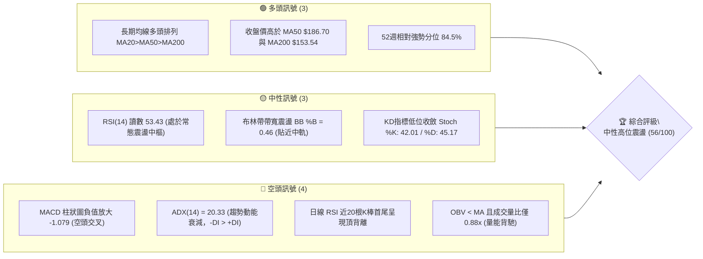
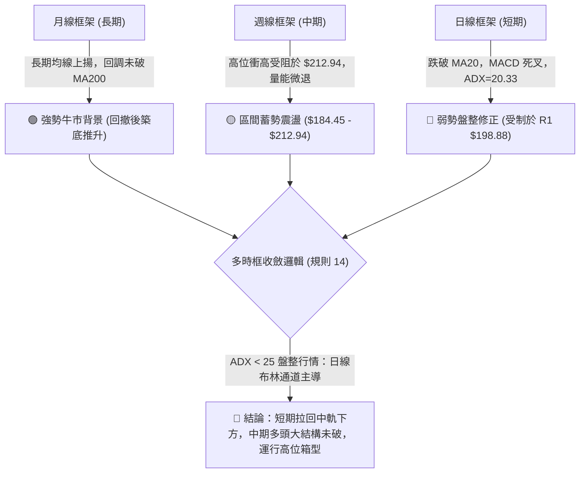
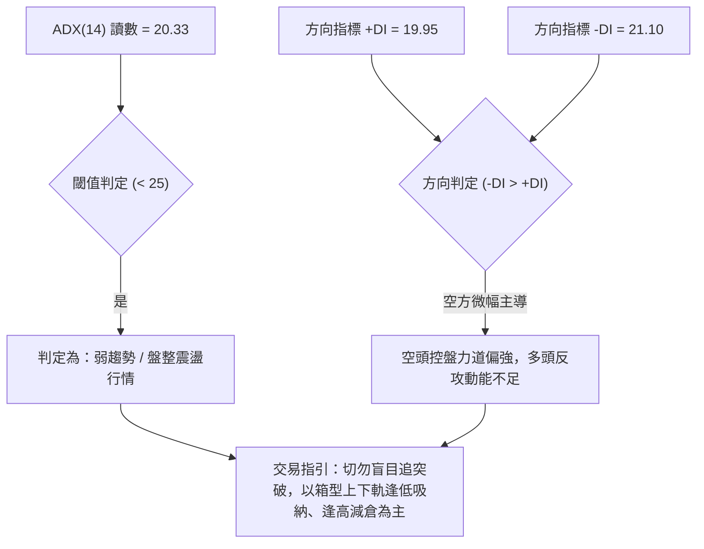
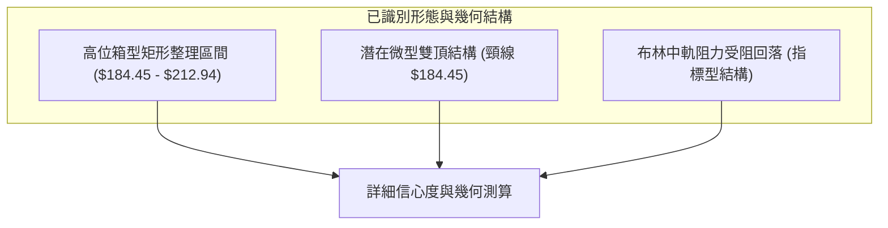
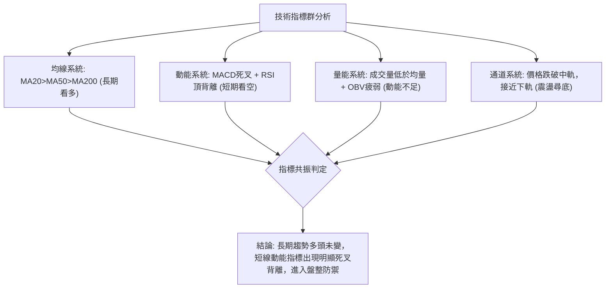
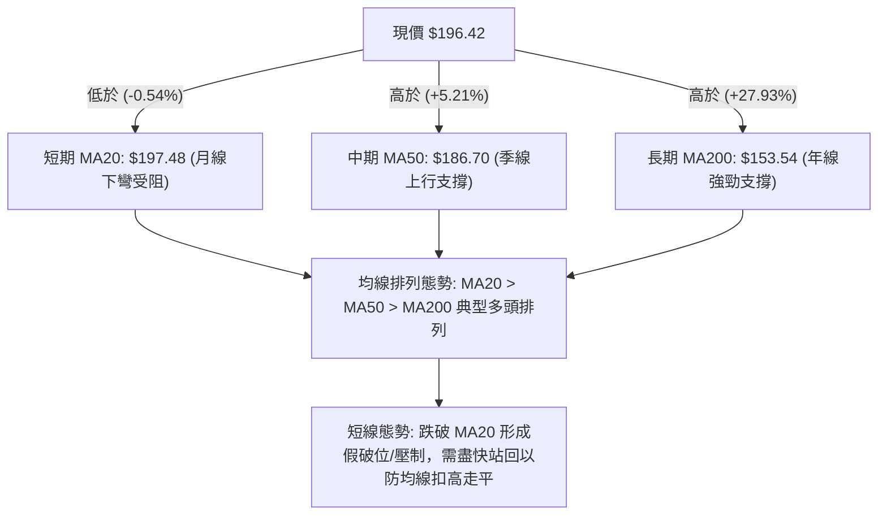
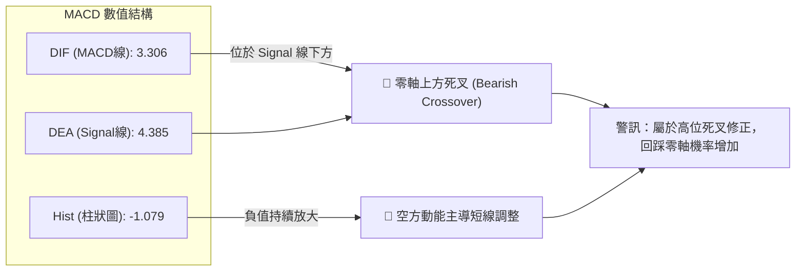
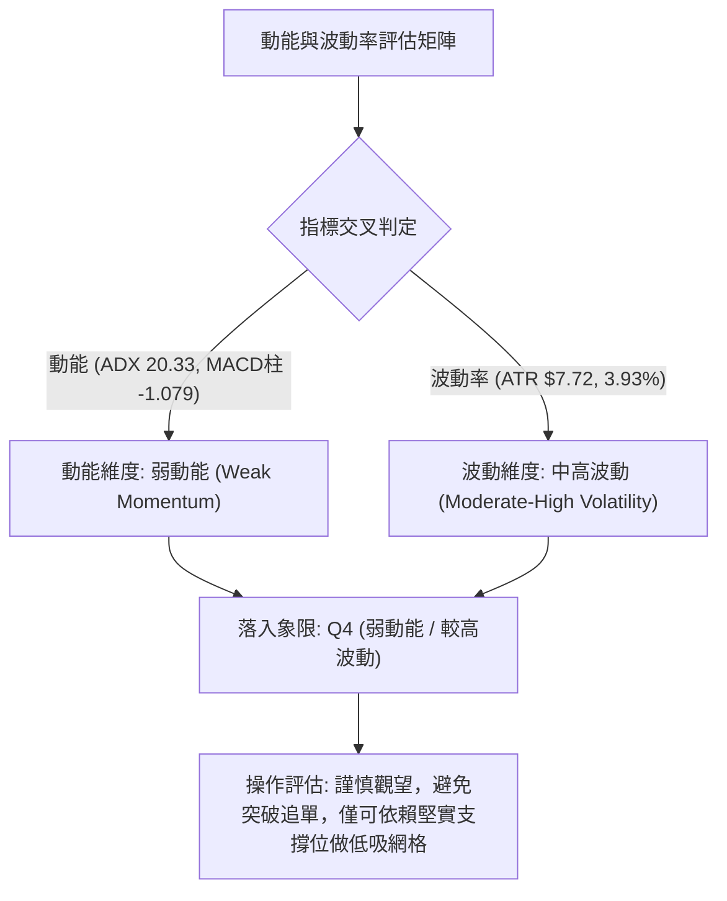
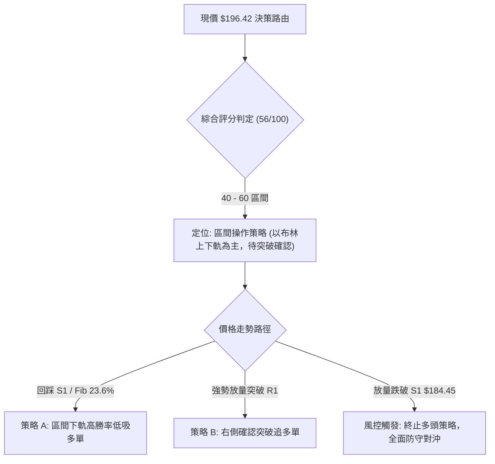
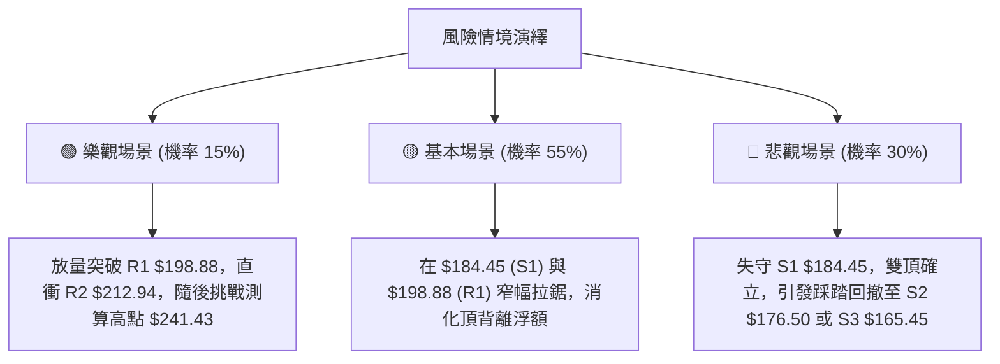

# PLTR 技術分析報告

> **報告日期**：2026-10-30 ｜ **語言**：繁體中文 ｜ **數據來源**：Yahoo Finance ｜ **當前價格**：$196.42

---

## 目錄

| 章節 | 內容 |
|------|------|
| [1. 技術面概覽](#1-技術面概覽) | 訊號儀表板、核心指標、評分卡 |
| [2. 趨勢分析](#2-趨勢分析) | 多時框趨勢、長中短期走勢 |
| [3. 圖表形態分析](#3-圖表形態分析) | 形態識別、K線組合、目標價 |
| [4. 支撐與阻力](#4-支撐與阻力) | 關鍵價位、斐波那契回調 |
| [5. 技術指標深度解讀](#5-技術指標深度解讀) | MA/RSI/MACD/布林/成交量 |
| [6. 動能與波動率](#6-動能與波動率) | 動能評估、ATR、Beta |
| [7. 多時框架總結](#7-多時框架總結) | 時框架評分矩陣 |
| [8. 交易策略建議](#8-交易策略建議) | 多空策略、風險報酬比 |
| [9. 風險提示與監控](#9-風險提示與監控) | 監控指標、風險場景 |

---

## 1. 技術面概覽

### 🎯 技術訊號儀表板



### 📊 核心指標速覽表

| 指標類別 | 指標名稱 | 當前數值 | 訊號 | 解讀 |
|:---|:---|:---|:---:|:---|
| **價格** | 當前收盤價 | $196.42 | 🟡 | 位於52週高點 $212.94 與低點 $106.37 之 84.5% 分位，高位盤整 |
| **均線** | MA20 (月線) | $197.48 | 🔴 | 價格低於 MA20（-$1.06，跌破中軌），短線動能承壓 |
| **均線** | MA50 (季線) | $186.70 | 🟢 | 價格高於 MA50（+$9.72），中期上升防線支撐完好 |
| **均線** | MA200 (年線) | $153.54 | 🟢 | 價格大幅高於 MA200（+$42.88），長期結構牛市格局確立 |
| **動能** | RSI(14) | 53.43 | 🟡 | 位於中性平衡區，但出現局部頂背離，上攻力道衰竭 |
| **動能** | MACD (12,26,9) | 3.306 / 4.385 | 🔴 | MACD 線下穿訊號線形成死叉，柱狀圖負值為 -1.079 |
| **動能** | Stoch %K / %D | 42.01 / 45.17 | 🟡 | 處於中偏低區間，無超賣訊號，短線尚未見止跌反轉信號 |
| **趨勢** | ADX(14) | 20.33 | 🟡 | ADX < 25 指示當前處於無趨勢或盤整市，-DI(21.10) > +DI(19.95) |
| **通道** | 布林通道 %B | 0.46 | 🟡 | 略低於中軌 ($197.48)，通道區間為 $184.60 至 $210.36 |
| **波動** | ATR(14) | $7.72 | 🟡 | 佔現價 3.93%，屬於中等偏高日波動，需預留寬裕止損空間 |
| **量能** | 當日量 / 20日均量 | 19.99M / 22.59M | 🔴 | 量比 0.88x，量能萎縮且 OBV 低於均線，買盤後繼乏力 |

### 🏆 技術評分卡

```
╔══════════════════════════════════════════════════════════════╗
║                技術評分卡 — PLTR (2026-10-30)                ║
╠══════════════════════════════════════════════════════════════╣
║ 趨勢強度 (Trend)     ██████████░░░░░░░░░░  52/100  🟡 中性盤整║
║ 動能指標 (Momentum)  ████████░░░░░░░░░░░░  44/100  🔴 動能轉弱║
║ 支撐穩定度 (Support) █████████████░░░░░░░  68/100  🟢 支撐穩固║
║ 成交量配合 (Volume)  ████████░░░░░░░░░░░░  42/100  🔴 量能背馳║
║ 形態完整度 (Pattern) ███████████░░░░░░░░░  56/100  🟡 矩形整理║
║ 均線排列 (MA Align)  ███████████████░░░░░  74/100  🟢 多頭排列║
╠══════════════════════════════════════════════════════════════╣
║ 綜合評分 (Overall)   ███████████░░░░░░░░░  56/100  🟡 區間震盪║
╚══════════════════════════════════════════════════════════════╝
```

> **評分算術平均計算**（依規則 18）：  
> 綜合評分 = $(52 + 44 + 68 + 42 + 56 + 74) \div 6 = 336 \div 6 = 56.0 \rightarrow$ **56/100**。  
> 評級定位：**高位區間整理（中性，ADX < 25 宜採區間策略，待突破確認）**。

---

## 2. 趨勢分析

### 🌐 多時框趨勢分析



### 📈 長期趨勢 — 12個月走勢圖（Unicode）

```
PLTR 月線收盤走勢圖（過去12個月：2025-11 至 2026-10）
價格軸 ($)
$210 ┤                                                         
$200 ┤                                                 ● $196.42 (現價 2026-10)
$190 ┤                                             ● $187.05
$180 ┤ ● $177.75                               ● $186.38       
$170 ┤     ● $168.45                                           
$160 ┤                                     ● $156.54           
$150 ┤         ● $146.59       ● $146.28                       
$140 ┤             ● $137.19       ● $139.11                   
$130 ┤                                         ● $123.06       
$120 ┤                                     ● $116.67           
$110 ┤                                 ● $106.37 (52W低點)     
     └─┬───────┬───────┬───────┬───────┬───────┬───────┬───────► 月份
     25-11   25-12   26-01   26-02   26-04   26-06   26-08   26-10
```

#### 走勢特徵分析表格

| 階段 | 時間跨度 | 價格區間 | 累積漲跌幅 | 結構特徵與技術解讀 |
|:---|:---|:---:|:---:|:---|
| **階段一：高位獲利回吐** | 2025-11 ～ 2026-02 | $177.75 $\rightarrow$ $137.19$ | -22.82% | 自 $200.47 歷史高位震盪回落，形成下降階梯通道，機構籌碼換手 |
| **階段二：春季平台築底** | 2026-03 ～ 2026-05 | $146.28 $\rightarrow$ $156.54$ | +7.01% | 於 $140 附近多次築底，隨後短暫反彈至 $156.54，受制於長期壓力線 |
| **階段三：盛夏深蹲洗盤** | 2026-06 ～ 2026-07 | $116.67 $\rightarrow$ $123.06$ | -21.40% | 砸出 52 週最低點 $106.37，出現終竭拋壓，隨後帶量快速回升 |
| **階段四：主升強勁修復** | 2026-08 ～ 2026-10 | $123.06 $\rightarrow$ $196.42$ | +59.61% | 暴力 V 型反轉，兩月內飆升逾 50%，最高摸至 $212.94，目前處於高位滯漲區間 |

### 📊 中期趨勢（週線分析）

中期走勢顯示，PLTR 自 2026 年 8 月初拉出爆發性大陽線（該週成交量達 4.35 億股，收盤 $172.01）後，進入機構強勢建倉主升浪。隨後於 2026 年 10 月 16 日當週創出 52 週新高 $212.94，但當週週K呈現長陰反噬（收盤重挫至 $186.03，低點打至 $184.45），中期上升動能受到技術性壓制。

```
週線級別壓力與支撐示意圖
$212.94 ─── 52W High / R2 (中期頂部阻力，雙重頂威脅)
   │
   ├─ $198.88 ─── R1 / 近期震盪反彈阻力
   │
$196.42 ─── 當前價格 (處於週線高位窄幅收斂)
   │
   ├─ $187.79 ─── 斐波那契 23.6% 回調位 / 週線下影集結區
   │
$184.45 ─── S1 / 10月波段低點 (強支撐頸線)
```

### ⚡ 趨勢強度評估（ADX 解讀）



| 指標名稱 | 數值 | 參考標準 | 結論 | 交易含義 |
|:---|:---:|:---:|:---:|:---|
| **ADX(14)** | **20.33** | 0–25：弱趨勢/盤整<br>25–50：強趨勢<br>>50：極強單邊 | 🟡 盤整行情 | 市場失去單邊推動力，均線開始走平，進入高位洗盤蓄勢週期 |
| **+DI(14)** | **19.95** | 多頭進攻動能 | 🔴 弱於空方 | 多方動能由 10 月上旬的強勢階段大幅衰退至 20 之下 |
| **-DI(14)** | **21.10** | 空頭打壓動能 | 🔴 空方佔優 | -DI 交叉位於 +DI 之上，短線賣壓尚未被完全吸收 |

---

## 3. 圖表形態分析

### 🔍 形態識別系統



#### 圖表形態信心度分析表（依規則 15）

| 形態名稱 | 信心度 | 判斷依據（嚴格引用數據） | 完成度 | 目標價（附嚴謹計算式） |
|:---|:---:|:---|:---:|:---|
| **高位箱型整理** | **78%** | 價格在 S1 $184.45 與 R2 $212.94 間往返震盪已達3週，布林通道帶寬收窄 | 85% | 向上突破：頸線 $212.94 + 形態高度 ($212.94 - $184.45 = $28.49) = **$241.43**（由箱型推算）<br>向下跌破：頸線 $184.45 - 形態高度 $28.49 = **$155.96**（由箱型推算） |
| **潛在雙重頂** | **45%** | 10/09 當週高點 $209.58 與 10/16 當週高點 $212.94 形成雙峰，但頸線 S1 $184.45 尚未跌破 | 50% | 若有效跌破 S1 $184.45：目標價 = 頸線 $184.45 - 形態高度 ($212.94 - $184.45 = $28.49) = **$155.96**（信心度低於50%，僅供防範） |
| **指標型布林收斂** | **85%** | 帶寬壓縮，現價 $196.42 位於中軌 $197.48 下方，%B 為 0.46，ADX 20.33 | 90% | 區間下軌目標：**$184.60**（BB下軌）<br>區間上軌目標：**$210.36**（BB上軌） |

### 🕯️ 重要K線形態分析（嚴格依據規則 19）

#### 近 10 根日 K 線形態解讀

| 日期 | 開盤價 | 最高價 | 最低價 | 收盤價 | K線形態名稱 | 形態解讀與市場博弈心理 | 訊號 |
|:---:|:---:|:---:|:---:|:---:|:---:|:---|:---:|
| **2026-10-16** | 201.79 | 203.55 | 184.45 | 186.03 | **長黑大陰棒** | 實體跌幅逾 7.8%，探至波段低點 S1 $184.45，獲利盤瘋狂出逃 | 🔴 |
| **2026-10-19** | 186.99 | 196.99 | 186.15 | 194.15 | **貫穿中長陽** | 跳空低開後強烈反撲，收復前日陰線大半實體，確認 S1 支撐有效 | 🟢 |
| **2026-10-20** | 192.44 | 196.11 | 189.42 | 192.60 | **高位小十字星** | 縮量（15.09M）震盪，上下影線均衡，多空陷入短暫觀望 | 🟡 |
| **2026-10-21** | 191.72 | 202.55 | 189.88 | 201.72 | **實體大陽線** | 放量上攻重返 $200 整數心理關卡，多頭佔據短線主動權 | 🟢 |
| **2026-10-22** | 200.76 | 202.63 | 194.54 | 196.19 | **高位長上影陰K** | 衝高 $202.63 受制於 R1 阻力帶，多頭進攻遭遇強阻力回落 | 🔴 |
| **2026-10-23** | 195.02 | 197.49 | 190.57 | 196.75 | **錘頭狀小陽線** | 下測 $190.57 獲承接，長下影線反映低位逢低買盤積極 | 🟢 |
| **2026-10-26** | 197.90 | 200.05 | 192.91 | 198.84 | **上影小陽線** | 上衝 $200.05 再次受挫，收盤逼近 R1 $198.88，動能縮減 | 🟡 |
| **2026-10-27** | 198.12 | 201.83 | 196.79 | 198.73 | **高位窄幅孕線** | 完全包孕於前日高低點內，市場波動收斂，變盤預警信號 | 🟡 |
| **2026-10-28** | 197.01 | 198.74 | 193.13 | 196.81 | **紡錘小陰線** | 實體極小，多空在 MA20 附近陷入膠著，量能持平 | 🟡 |
| **2026-10-29** | 198.37 | 198.51 | 190.36 | 196.42 | **長下影假陰線** | 盤中下探 $190.36 測試支撐後被買盤拉起，收於中軌略下方 | 🟡 |

#### 近 8 根週 K 線形態解讀

| 日期 | 開盤價 | 最高價 | 最低價 | 收盤價 | 週K形態名稱 | 形態解讀與市場博弈心理 | 訊號 |
|:---:|:---:|:---:|:---:|:---:|:---:|:---|:---:|
| **2026-09-11** | 173.60 | 175.82 | 164.55 | 167.23 | **回調中陰線** | 縮量調整，最低下探至 S3 附近之 $164.55 完成回踩確認 | 🟡 |
| **2026-09-18** | 169.70 | 177.88 | 166.42 | 177.64 | **反轉中陽線** | 放量收復跌幅，多頭重整旗鼓啟動新一輪推進 | 🟢 |
| **2026-09-25** | 178.73 | 194.68 | 176.76 | 189.67 | **突破長陽線** | 實體飽滿，強勢突破 $180 平台阻力，上升趨勢加速 | 🟢 |
| **2026-10-02** | 186.23 | 194.78 | 184.81 | 188.75 | **高位陰十字星** | 縮量滯漲，連續上攻後動能鈍化，籌碼出現分歧 | 🟡 |
| **2026-10-09** | 189.45 | 209.58 | 187.63 | 209.05 | **主升加速大陽** | 向上突破 $200 大關，直逼歷史高位，成交量溫和配合 | 🟢 |
| **2026-10-16** | 208.90 | 212.94 | 184.45 | 186.03 | **高位烏雲覆頂長陰** | 週振幅高達 15.3%，創 52W 新高後暴跌，呈現典型多頭陷阱 | 🔴 |
| **2026-10-23** | 186.99 | 202.63 | 186.15 | 196.75 | **反彈中陽線** | 企穩於 S1 $184.45 之上展開自救性反抽，但未創新高 | 🟢 |
| **2026-10-29** | 197.90 | 201.83 | 190.36 | 196.42 | **縮量紡錘線** | 成交量萎縮至 77.10M，市場進入變盤前的方向選擇期 | 🟡 |

### 📉 ASCII 走勢形態示意圖

```
PLTR 日線箱型整理形態示意圖（2026-10-16 至 2026-10-29）
  $212.94 ──┬───────────────────────────────────── 阻力上限 R2 (雙頂頸線阻力)
            │      ▲ 10/16 創高 $212.94
  $202.63 ──┼──────┼───────▲────────▲───────────── 近期反彈高點聚類
  $198.88 ──┼──────┼───────┼────────┼───▲ 10/27 ── 關鍵阻力 R1
  $197.48 ──┼──────┼───────┼────────┼───┼──────── 中軌 MA20 (多空分水嶺)
  $196.42 ──┼──────┼───────┼────────┼───┼───●──── 現價 ($196.42)
            │      │       │        │   │   │
  $190.36 ──┼──────┼───────┼────────┼───┴───▼──── 10/29 探底低點
  $184.45 ──┴──────▼───────┴────────┴──────────── 支撐下限 S1 (箱型底頸線)
                 10/16 砸盤低點
```

### 🎯 形態目標價計算

1. **區間震盪突破情境（多頭向上）**：
   - **頸線位**：$212.94（R2，52週高點）
   - **形態高度**：$212.94 - $184.45 = $28.49
   - **形態目標價推算**：$212.94 + $28.49 = **$241.43**（由箱型高度推算）
2. **區間破位下行情境（空頭向下）**：
   - **頸線位**：$184.45（S1，近一年關鍵波段低點）
   - **形態高度**：$212.94 - $184.45 = $28.49
   - **形態破位目標價推算**：$184.45 - $28.49 = **$155.96**（由箱型高度推算，與 MA200 $153.54 重合）

---

## 4. 支撐與阻力

### 🗺️ 關鍵價位分布圖（Unicode）

```
PLTR 價位結構分布圖（數據嚴格引用自 OHLCV 計算）
═════════════════════════════════════════════════════════════════════
$212.94 ║██████████████████████████████████████║ 強阻力 R2 (52W High / Fib 0.0%)
$198.88 ║████████████████████████              ║ 關鍵阻力 R1 (波段反彈高點聚類)
$197.48 ║--------------------------------------║ 布林中軌 / MA20 多空分界線
$196.42 ╠══════════════════════════════════════╣ ◄ 當前收盤價 ($196.42)
$187.79 ║▓▓▓▓▓▓▓▓▓▓▓▓▓▓▓▓▓▓▓▓                  ║ 次級支撐 (Fib 23.6% 回調位)
$184.45 ║██████████████████████████████        ║ 核心支撐 S1 (10/16波段低點)
$176.50 ║████████████████████                  ║ 中期強支撐 S2 (密集成交區)
$172.23 ║▓▓▓▓▓▓▓▓▓▓▓▓▓▓                        ║ 斐波那契 38.2% 回調位
$165.45 ║████████████████████████████████      ║ 戰略防線 S3 (9月波段起漲點)
$153.54 ║──────────────────────────────────────║ 長期生命線 MA200
═════════════════════════════════════════════════════════════════════
```

### 🚧 阻力位分析表（依規則 13 嚴格引用）

| 阻力級別 | 價位 | 形成原因與籌碼特徵 | 突破難度 | 重要性評級 |
|:---|:---:|:---|:---:|:---:|
| **R1** | **$198.88** | 近期反彈多次受阻高點聚類（10/26～10/28 密集上影線阻力），與布林中軌 $197.48 形成雙重共振阻力 | 中等偏高 | 🟢🟢🟢（短線多空分水嶺） |
| **R2** | **$212.94** | 52 週歷史天花板（Fib 0.0%），10/16 出現巨量拋壓陰線之起跌點，積聚大量套牢浮額 | 極高 | 🟢🟢🟢🟢🟢（中期強頂部） |
| **R3** | **數據中未偵測到** | 系統數據中未偵測到 R3 數值（上方歷史最高紀錄即為 R2 $212.94，無更高 OHLCV 聚類阻力） | N/A | N/A（依規則13不編造） |

### 🛡️ 支撐位分析表（依規則 13 嚴格引用）

| 支撐級別 | 價位 | 形成原因與籌碼特徵 | 守住機率 | 重要性評級 |
|:---|:---:|:---|:---:|:---:|
| **S1** | **$184.45** | 10/16 長黑低點，與布林下軌 $184.60、MA50 $186.70 形成密集買盤支撐帶 | 75% | 🟢🟢🟢🟢（短線生命線） |
| **S2** | **$176.50** | 9月震盪箱型平台頂部轉換支撐，週線長陽線起跑點 | 85% | 🟢🟢🟢🟢（中期防禦防線） |
| **S3** | **$165.45** | 9月中旬波段起漲低點聚類（9/11 週低點 $164.55 與 9/18 週低點 $166.42 均值區） | 92% | 🟢🟢🟢🟢🟢（多頭牛熊底線） |

### 📐 斐波那契回調位分析

依據 52 週完整波動區間（低點 **$106.37** $\rightarrow$ 高點 **$212.94**），總振幅為 **$106.57**：

| 回調比率 | 精確價位 | 距離現價幅度 | 技術意義解讀與多空對抗含義 |
|:---:|:---:|:---:|:---|
| **0.0%** | **$212.94** | +8.41% | 52週歷史最高點，波段極限阻力 |
| **23.6%** | **$187.79** | -4.39% | **極強回調支撐**。現價落於 0.0% 至 23.6% 強勢回調區間內 |
| **38.2%** | **$172.23** | -12.32% | 強度健康回調位，接近中期支撐 S2 $176.50 |
| **50.0%** | **$159.66** | -18.71% | 多空平衡中樞，接近 MA120 ($158.17) 與 MA240 ($157.54) |
| **61.8%** | **$147.08** | -25.12% | 黃金分割防守位，牛市主升浪成立的容忍極限 |
| **78.6%** | **$129.18** | -34.23% | 深幅回撤防線，瀕臨趨勢瓦解邊緣 |
| **100.0%** | **$106.37** | -45.85% | 52週最低點，宏觀大底 |

> **當前位置解讀**：  
> 當前價格 **$196.42** 穩固運行於 **0.0% ($212.94)** 與 **23.6% ($187.79)** 之間。在技術分析定義中，回撤幅度未觸及 23.6% 表明資產仍屬於「極強勢格局」。然而，若日收盤有效跌破 23.6% ($187.79) 及 S1 ($184.45)，將直接向下考驗 38.2% ($172.23) 關卡。

---

## 5. 技術指標深度解讀

### 🎛️ 指標訊號總覽



### 📈 移動平均線排列分析



#### 各週期均線數據詳細解構

| 均線名稱 | 當前數值 | 變化方向 | 偏離率 (Bias) | 趨勢解讀與操作指引 |
|:---|:---:|:---:|:---:|:---|
| **MA 5** | $197.51 | ▼ 下降 | -0.55% | 超短期壓制線，5日線下彎扣抵高價區，形成第一道短壓 |
| **MA 10** | $195.82 | ▲ 上升 | +0.31% | 短期支撐線，現價位於其上，提供下檔依託 |
| **MA 20** | $197.48 | ▼ 下降 | -0.54% | 月線轉為走平下微彎，現價未能有效站穩，短線走勢轉趨盤整 |
| **MA 60** | $184.28 | ▲ 上升 | +6.59% | 中期支撐帶，與 S1 $184.45 緊密重合，構成黃金共振護城河 |
| **MA 120** | $158.17 | ▲ 上升 | +24.18% | 半年線向上斜率陡峭，中長期買盤成本底線 |
| **MA 240** | $157.54 | ▲ 上升 | +24.68% | 長期年線底部紮實，杜絕深幅熊市崩盤風險 |

### 📉 RSI(14) 分析

* **RSI(14) 讀數**：**53.43**（Wilder 計算方法）
* **區間狀態**：中性震盪區間（30–70）

```
RSI(14) 當前強度儀表：
0       30            50   53.43     70              100
├───────┼─────────────┼─────●────────┼────────────────┤
[ 超賣區 ]   [ 弱勢區 ]    [中性]     [強勢區]    [ 超買區 ]
進度條: ███████████░░░░░░░░░ 53.4%
```

#### 背離現象深度剖析
* **背離型態**：⚠️ **日線頂背離 (Bearish Divergence)**。
* **技術特徵確認**：
  - 價格端：在近 20 根 K 棒的首尾對比中，PLTR 價格於 10 月中旬創出波段及 52 週新高 $212.94。
  - 指標端：同期 RSI(14) 僅達到 76.3，隨後迅速鈍化下行跌至 53.43，未能同步創出動能新高。
  - **結論**：動能無法確認價格高點，顯示買盤推進力大幅減退，屬典型「動能衰退型頂背離」，預告股價需透過時間換取空間進行高位橫盤消化。

### 📊 MACD(12, 26, 9) 訊號解讀



* **MACD 線**：3.306 ｜ **訊號線 (Signal)**：4.385 ｜ **柱狀圖 (Histogram)**：**-1.079**
* **走勢研判**：MACD 在零軸上方高位出現死叉，且負向柱狀圖自 10/16 以來持續呈現負值綠柱（近三週週線 MACD 柱分別為 -0.822、-1.187、-1.079），確認短線調整週期尚未結束。

### 📦 布林通道分析

```
PLTR 日線布林通道結構示意圖（20日標準差）
$210.36 ─────────────────────────────── 上軌 Upper Band (阻力位)
                   ▲
$197.48 ───●───────┼─────────────────── 中軌 Middle Band (MA20: $197.48)
           │現價 $196.42 (%B = 0.46)
$184.60 ───┴─────────────────────────── 下軌 Lower Band (支撐位)
```

* **上軌**：**$210.36**（接近 52W 高點 R2 $212.94）
* **中軌**：**$197.48**（即 MA20，現正考驗中軌反壓）
* **下軌**：**$184.60**（與核心支撐 S1 $184.45 精確重合）
* **%B 指標**：**0.46**（價格剛自中軌上方回落至中軌略下方，顯示空方略佔上風，正向下軌尋求支撐）
* **帶寬狀態**：通道開始向內收縮，說明多頭單邊趨勢結束，轉入箱型整理階段。

### 💹 成交量分析（量價配合度）

```
成交量比較柱狀圖：
最新量 (19.99M)  ████████████████░░░░  (量比: 0.88x)
20日均量 (22.59M) ██████████████████░░
50日均量 (24.89M) ████████████████████
```

* **量能指標讀數**：
  - 最新交易日成交量：**19,992,800**
  - 20 日均量：**22,594,375**（量比 0.88x，呈現明顯量縮）
  - 50 日均量：**24,892,124**
* **能量潮 (OBV) 分析**：
  - 當前狀態：**OBV < MA**。
  - 技術涵義：能量潮指標跌破其均線，代表在價格高位徘徊時，資金流出天數與數量大於流入，呈現量價背離。縮量上攻與放量回落（如 10/16 帶量 33.35M 砸盤）顯示主力機構在高位採取被動防守與派發策略，缺乏主動推升動能。

---

## 6. 動能與波動率

### ⚡ 動能評估四象限



#### 動能與波動象限分析表

| 象限 | 動能強度 | 波動率狀態 | 當前狀態標記 | 策略指導方針 |
|:---:|:---:|:---:|:---:|:---|
| **Q1** | 強動能 (ADX>30) | 低波動 (ATR%<2.5%) | ─ | 最佳單邊順勢爆發機會，全力做多持股 |
| **Q2** | 弱動能 (ADX<25) | 低波動 (ATR%<2.5%) | ─ | 沉寂築底盤整期，耐心等待均線收斂 |
| **Q3** | 強動能 (ADX>30) | 高波動 (ATR%>4.5%) | ─ | 主升浪/末升浪加速，嚴設移動止盈 |
| **Q4** | **弱動能 (ADX 20.33)** | **中高波動 (ATR 3.93%)** | **✓ (當前狀態)** | **高位寬幅震盪洗盤，防範假突破與深幅回撤，嚴控倉位** |

### 📊 ATR 波動率分析

* **ATR(14) 絕對值**：**$7.72**
* **ATR 相對價格比**：**3.93%**（日均價格振幅近 8 美元）
* **止損與風控設置指引**：
  - **超短線交易止損**：$1.0 \times \text{ATR} = \$7.72$
  - **波段交易止損**：$1.5 \times \text{ATR} = \$11.58$
  - **寬幅趨勢止損**：$2.0 \times \text{ATR} = \$15.44$
  - **技術應用**：由於每日正常噪音波動高達 $7.72，進場點必須緊靠 S1 ($184.45) 或 Fib 23.6% ($187.79)，若在區間中途追單，極易被常態波動觸發止損。

### 📐 Beta 與市場相關性

* **Beta 係數**：**1.602**
* **大盤敏感度解讀**：PLTR 展現出顯著的高 Beta 成長股屬性，波動彈性為標普 500 指數的 1.6 倍。在納斯達克指數近期受大型科技股財報與資本支出擔憂承壓時，PLTR 的回撤幅度將大於大盤；反之，若科技股情緒轉暖，其反彈爆發力亦將居前。

---

## 7. 多時框架總結

### 📋 時框架評分表

| 時框架 | 趨勢方向 | 動能狀態 | 均線排列 | 圖表形態 | 綜合評分 | 操作建議 |
|:---|:---:|:---:|:---:|:---:|:---:|:---|
| **日線 (短期)** | 🔴 弱勢盤整 | 🔴 MACD死叉/背離 | 🟡 跌破MA20/高於MA50 | 🟡 矩形中軌承壓 | 48/100 | 中性觀望，區間下軌高拋低吸 |
| **週線 (中期)** | 🟡 高位蓄勢 | 🟡 柱狀圖收斂鈍化 | 🟢 MA20上穿MA50 | 🟡 烏雲蓋頂後修復 | 62/100 | 箱型交易，嚴密防守 S1 頸線 |
| **月線 (長期)** | 🟢 強勁多頭 | 🟢 大週期牛市主升 | 🟢 均線多頭發散排列 | 🟢 V型反轉高位突破 | 78/100 | 戰略性持有，回調至均線加碼 |

### 🔲 綜合訊號矩陣

```
┌──────────────────────────────────────────────────────────────┐
│                    多時框綜合訊號確認矩陣                    │
├──────────────┬──────────────┬──────────────┬─────────────────┤
│ 維度         │ 短期 (日線)  │ 中期 (週線)  │ 長期 (月線)     │
├──────────────┼──────────────┼──────────────┼─────────────────┤
│ 價格趨勢     │ 🔴 跌破MA20  │ 🟡 高位回撤  │ 🟢 歷史次高區間 │
│ 動能 (RSI)   │ 🟡 53.43     │ 🟡 53.40     │ 🟢 多頭掌控區   │
│ 趨勢 (ADX)   │ 🔴 20.33弱勢 │ 🟡 24.50收斂 │ 🟢 >35 強趨勢   │
│ 成交量配合   │ 🔴 縮量 (0.88x)│ 🔴 週量遞減 │ 🟢 累計量能充沛 │
│ 支撐確認度   │ 🟢 S1 守穩   │ 🟢 MA50 上揚 │ 🟢 MA200 遠在下方│
└──────────────┴──────────────┴──────────────┴─────────────────┘
```

### ⚖️ 多時框收斂結論（依規則 14 嚴格收斂）

1. **趨勢/盤整優先級判定**：
   - 當前 **ADX(14) 讀數為 20.33**，低於 25 臨界線，依照收斂規則，市場正式定義為 **盤整行情 (Range-bound Market)**。
   - 在盤整行情中，**以日線布林通道上下軌 ($184.60 至 $210.36) 為主要交易區間**。
2. **多時框衝突化解**：
   - 月線與長期均線（MA200 $153.54）雖維持多頭，但日線與週線動能（MACD 死叉、RSI 頂背離、OBV 疲軟）發出明確短線熄火回調訊號。
   - 依優先級規則：日線級別不可追高，中長期多頭格局僅作為回踩強支撐時的心理保障，交易核心聚焦於箱型邊界的低吸高拋。
3. **唯一方向性結論**：
   - **中性區間震盪觀望（偏防守）**。主導區間為 **$184.45（S1）～ $198.88（R1）**，最終評分 56/100，操作上拒絕單邊盲目押注，採取標準區間網格應對。

---

## 8. 交易策略建議

### 🗺️ 策略決策流程圖



### 🧭 策略路由（依評分卡分流，規則 18）

> **當前主策略方向 = 區間操作，以布林上下軌與關鍵支撐阻力為主，等待方向突破（依評分 56/100）**。  
> 綜合評分落於 40–60 之間，禁止任何左側盲目追高，主推「回踩支撐低吸」與「右側放量突破」兩套結構化方案。

### 🎯 價格情境階梯（Price Scenarios，嚴格引用第 4 章數值）

| 觸發條件 | 下一目標 | 後續延伸 | 情境技術含義 |
|:---|:---:|:---:|:---|
| **向上突破 R1 $198.88** | R2 **$212.94** | 形態推算 **$241.43** | 短線擺脫 MA20 壓制，化解頂背離，重新挑戰歷史天花板 |
| **維持於現價區間震盪** | 中軌 **$197.48** | 下軌 **$184.60** | 箱型內部整理，時間換取空間，等待 ADX 指標重新抬頭 |
| **向下跌破 S1 $184.45** | S2 **$176.50** | S3 **$165.45** | 宣告高位雙頂形態成立，展開深度回撤，考驗中期牛熊線 |

### 📊 情境機率分佈

| 情境類別 | 機率預估 | 主要技術依據 |
|:---|:---:|:---|
| **區間震盪 (箱型整理)** | **55%** | ADX 20.33 低於 25，成交量萎縮至 0.88x，布林帶寬持續收斂 |
| **回落再探底 (考驗支撐)** | **30%** | MACD 柱狀圖負值放大 (-1.079)，RSI 頂背離，-DI > +DI 空方主導 |
| **直接單邊突破新高** | **15%** | 缺乏爆發量能配合，OBV 疲軟，受制於 R1 $198.88 密集反壓 |

### 🟢 主策略詳情（方向依上方路由）

```
╔═══════════════════════════════════════════════════════════════════╗
║                      PLTR 專業交易策略執行表                      ║
╠═══════════════════════════════════════════════════════════════════╣
║ 項目         ║ 策略 A (左側支撐低吸 - 主推薦)  ║ 策略 B (右側突破確認追多)      ║
╠════════════════╬═════════════════════════════════╬════════════════════════════════╣
║ 策略類型     ║ 區間下軌支撐逢低承接            ║ 突破壓力位順勢跟進             ║
║ 進場條件     ║ 價格回調至 Fib 23.6% 企穩出現   ║ 日K收盤有效突破 R1 $198.88，   ║
║              ║ 下影線或反轉信號                ║ 且當日成交量突破 25M (放量)    ║
║ 進場價格     ║ $187.79 (Fib 23.6% 回調位)      ║ $198.88 (突破 R1 買入)         ║
║ 止損價格     ║ $184.45 (跌破 S1 核心支撐止損)  ║ $194.15 (跌破 10/19 突破實體陽線)║
║ 目標價 T1    ║ $198.88 (阻力位 R1)             ║ $212.94 (阻力位 R2 / 52W 高點) ║
║ 目標價 T2    ║ $212.94 (阻力位 R2)             ║ $227.00 (依箱型波段等幅推算)   ║
║ 風險報酬比   ║ 1 : 3.32（以 T1 計）            ║ 1 : 2.97（以 T1 計）           ║
║ (另列 T2 比) ║ 1 : 7.53（以 T2 計）            ║ 1 : 5.95（以 T2 計）           ║
║ 預期勝率     ║ 65%                             ║ 50%                            ║
║ 建議倉位     ║ 15% (標準波段倉位)              ║ 10% (試探追突破倉位)           ║
╚════════════════╩═════════════════════════════════╩════════════════════════════════╝
```

> **嚴謹風險報酬比計算校核**（依規則 17）：  
> * **策略 A（以 T1 計）**：  
>   $\text{風險} = \$187.79 - \$184.45 = \$3.34$  
>   $\text{報酬} = \$198.88 - \$187.79 = \$11.09$  
>   $\text{比值} = 11.09 \div 3.34 = 3.32 \rightarrow$ **1 : 3.32（以 T1 計）**。  
>   *(以 T2 計：$(\$212.94 - \$187.79) \div \$3.34 = 25.15 \div 3.34 = 7.53 \rightarrow$ **1 : 7.53（以 T2 計）**)*。
> * **策略 B（以 T1 計）**：  
>   $\text{風險} = \$198.88 - \$194.15 = \$4.73$  
>   $\text{報酬} = \$212.94 - \$198.88 = \$14.06$  
>   $\text{比值} = 14.06 \div 4.73 = 2.97 \rightarrow$ **1 : 2.97（以 T1 計）**。  
>   *(以 T2 計：$(\$227.00 - \$198.88) \div \$4.73 = 28.12 \div 4.73 = 5.95 \rightarrow$ **1 : 5.95（以 T2 計）**)*。

### 🔴 反向風險觸發點（對沖提示）

* **空頭防禦警戒線**：若日收盤價帶量跌破 **$184.45 (S1)**。
* **對沖行動指引**：
  - 立即將整體持倉降至 5% 以下或清倉離場觀望。
  - 激進型對沖者可買入對應月份的 Put 期權防護，下檔第一對沖回補目標為 S2 **$176.50**，第二延伸目標為 S3 **$165.45**。

### ⭐ 整體訊號強度評星

```
做多訊號強度：★★☆☆☆  (2.5/5星 - 長期多頭但短線動能衰竭)
做空訊號強度：★★☆☆☆  (2.0/5星 - 均線大排列完好，不可盲目估空)
整體可信度：  ★★★★☆  (4.0/5星 - 區間震盪特徵明確，位階清晰)
```

---

## 9. 風險提示與監控

### ✅ 關鍵監控指標 Checklist

```
╔══════════════════════════════════════════════════════════════╗
║                 PLTR 每日技術面風控清單                      ║
╠══════════════════════════════════════════════════════════════╣
║ [ ] 價格是否成功收復 MA20 ($197.48) 與 R1 ($198.88)          ║
║ [ ] 日成交量是否顯著放大至 25,000,000 股以上 (放量確認)      ║
║ [ ] MACD 柱狀圖是否收斂至 -0.50 以上並出現向上勾頭金叉       ║
║ [ ] RSI(14) 能否重返 60 關鍵強弱分水嶺之上                   ║
║ [ ] S1 頸線位 ($184.45) 在盤中是否遭受巨量貫穿跌破           ║
║ [ ] ADX(14) 是否由 20.33 回升突破 25，指示新一輪趨勢啟動      ║
╚══════════════════════════════════════════════════════════════╝
```

### ⚠️ 風險場景分析



### 🛡️ 風險管理重要提醒

1. **高估值引發的技術脆弱性**：
   PLTR 當前 P/E (TTM) 高達 169.33，P/S 高達 76.68。在極高估值環境下，任何微小的利空消息均可能引發技術面籌碼的多殺多踩踏。技術面顯示 10/16 曾在 $212.94 出現單日逾 7.8% 的巨震，即為高估值籌碼脆弱性的明證。
2. **Beta 1.602 帶來的波動放大**：
   單日 ATR 高達 $7.72（佔股價 3.93%），操作上務必降低個股槓桿，建議單一帳戶在 PLTR 上的風險敞口不宜超過總權益的 15%。
3. **區間操作紀律**：
   在 ADX < 25 的環境中，最忌諱追漲殺跌。所有進場必須以靠近支撐位 S1 ($184.45) 作為硬性風控基準，跌破無條件停損，切勿將波段短線操作轉為被動長期套牢。

---

## 📋 報告總結

```
╔══════════════════════════════════════════════════════════════════╗
║                     PLTR 技術分析報告總結                        ║
╠══════════════════════════════════════════════════════════════════╣
║ 報告日期：2026-10-30                                             ║
║ 當前價格：$196.42                                                ║
║ 技術評級：⚖️ 中性高位箱型整理 (綜合評分: 56/100)                  ║
║                                                                  ║
║ 關鍵結論：                                                       ║
║ ├─ 長期趨勢：🟢 均線多頭排列 MA20>MA50>MA200，大牛市格局未破     ║
║ ├─ 中期趨勢：🟡 衝高 $212.94 後回撤，高位蓄勢構築箱型平台       ║
║ ├─ 短期趨勢：🔴 跌破 MA20，MACD 死叉與日線 RSI 頂背離壓制動能    ║
║ ├─ 關鍵支撐：S1 $184.45 / S2 $176.50 / S3 $165.45                ║
║ ├─ 關鍵阻力：R1 $198.88 / R2 $212.94 / R3 數據未偵測到           ║
║ └─ 分析師目標：均價 $210.93 (最高 $265.00，最低 $80.00)          ║
║                                                                  ║
║ 最優策略組合：                                                   ║
║ 1. 🥇 最佳機會：策略 A (回踩 Fib 23.6% $187.79 逢低做多，         ║
║                止損 $184.45，目標 T1 $198.88，風報比 1 : 3.32)  ║
║ 2. 🥈 次選機會：策略 B (帶量突破 R1 $198.88 右側追多，            ║
║                止損 $194.15，目標 T1 $212.94，風報比 1 : 2.97)  ║
║ 3. 🥉 保守選擇：維持空倉觀望，耐心等待日線 ADX 重新抬頭突破 25   ║
╚══════════════════════════════════════════════════════════════════╝
```

---

> ⚠️ **免責聲明**：本報告為技術分析研究，所有數據與價位推算均嚴格基於歷史 OHLCV 資訊。本報告**僅供研究與學術參考**，**不構成任何要約或投資建議**。市場具有高度不確定性，高 Beta 股票波動劇烈，投資人應依個人風險承受能力獨立判斷並自負盈虧。

---

*報告生成時間：2026-10-30 ｜ 數據來源：Yahoo Finance ｜ 分析框架：多時框技術分析體系*