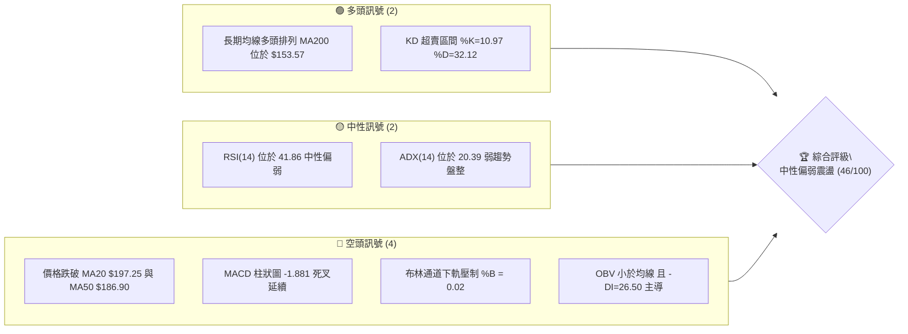
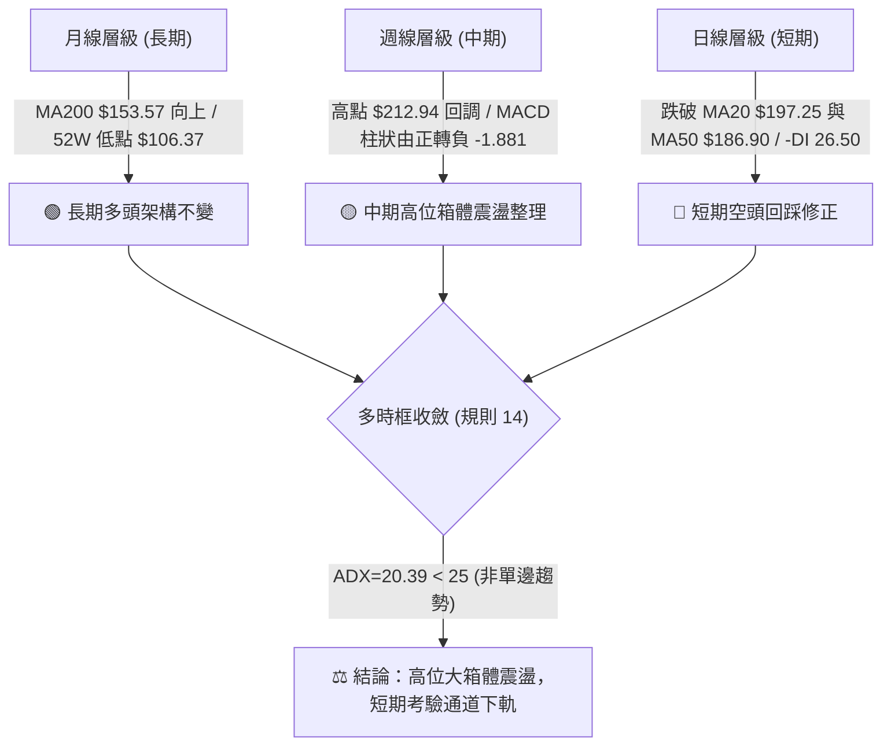
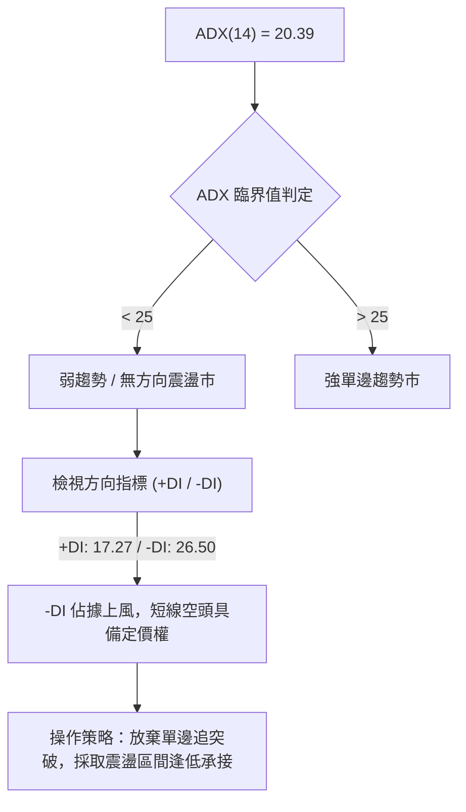
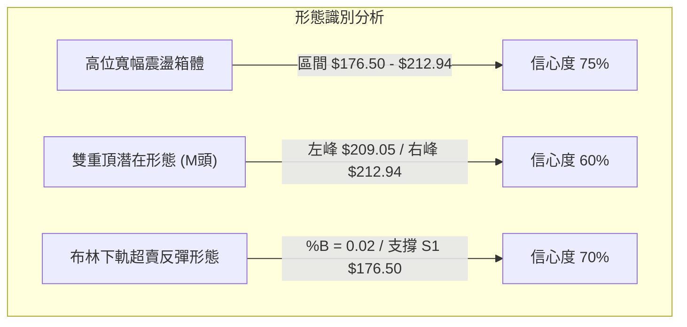
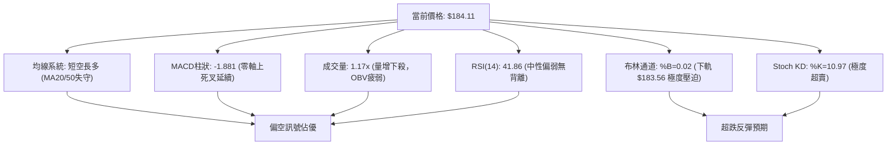
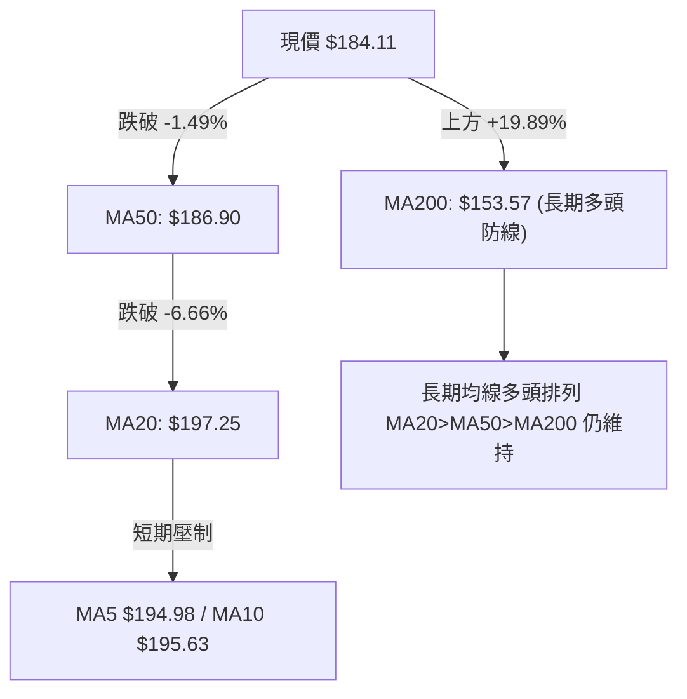
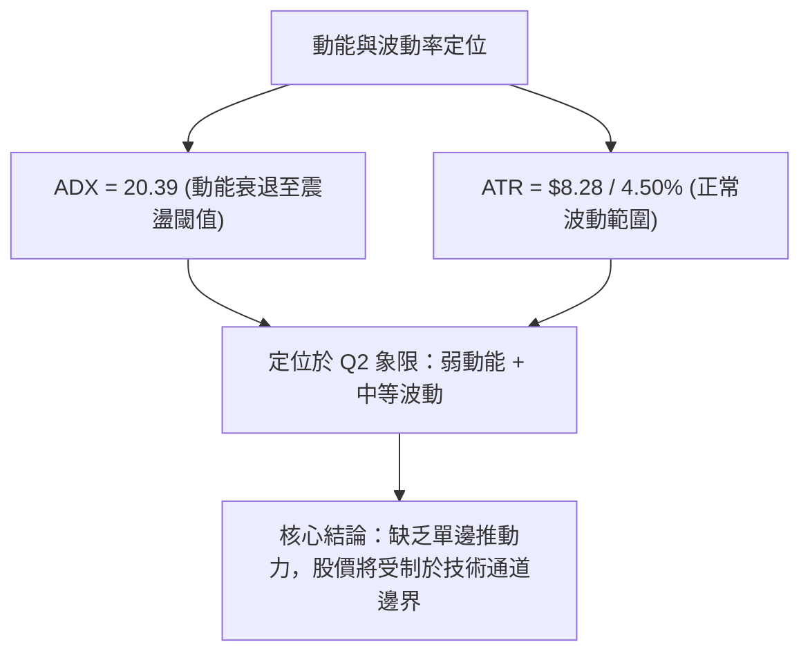
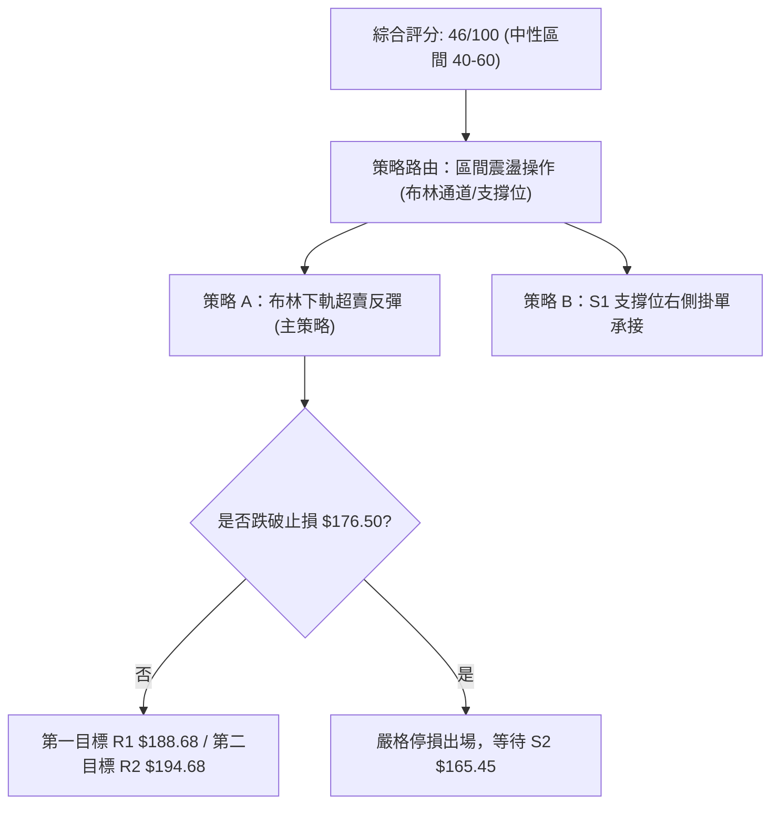
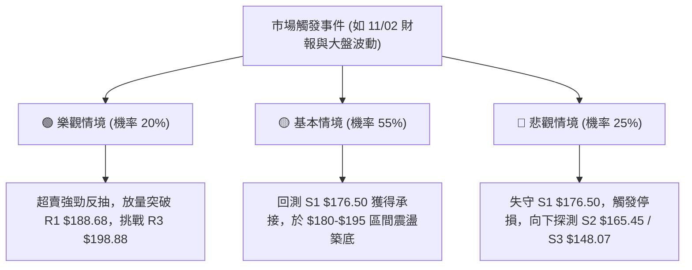

# PLTR 技術分析報告

> **報告日期**：2026-10-31 ｜ **語言**：繁體中文 ｜ **數據來源**：Yahoo Finance ｜ **當前價格**：$184.11

---

## 目錄

| 章節 | 內容 |
|------|------|
| [1. 技術面概覽](#1-技術面概覽) | 訊號儀表板、核心指標、評分卡 |
| [2. 趨勢分析](#2-趨勢分析) | 多時框趨勢、長中短期走勢 |
| [3. 圖表形態分析](#3-圖表形態分析) | 形態識別、K線組合、目標價 |
| [4. 支撐與阻力](#4-支撐與阻力) | 關鍵價位、斐波那契回調 |
| [5. 技術指標深度解讀](#5-技術指標深度解讀) | MA/RSI/MACD/布林/成交量 |
| [6. 動能與波動率](#6-動能與波動率) | 動能評估、ATR、Beta |
| [7. 多時框架總結](#7-多時框架總結) | 時框架評分矩陣 |
| [8. 交易策略建議](#8-交易策略建議) | 多空策略、風險報酬比 |
| [9. 風險提示與監控](#9-風險提示與監控) | 監控指標、風險場景 |

---

## 1. 技術面概覽

### 🎯 技術訊號儀表板



### 📊 核心指標速覽表

| 指標類別 | 指標名稱 | 當前數值 | 訊號 | 解讀 |
|:---|:---|:---|:---:|:---|
| **價格** | 當前收盤價 | $184.11 | 🔴 | 跌破短中期均線，貼近布林通道下軌 |
| **均線** | MA20 (月線) | $197.25 | 🔴 | 現價低於 MA20 (-6.66%)，短線承壓 |
| **均線** | MA50 (季線) | $186.90 | 🔴 | 現價跌破 MA50 (-1.49%)，中線多頭受挫 |
| **均線** | MA200 (年線) | $153.57 | 🟢 | 現價高於 MA200 (+19.89%)，長多架構穩固 |
| **動能** | RSI(14) | 41.86 | 🟡 | 處於 30-70 中性區間，空頭略佔優勢 |
| **動能** | MACD 柱狀圖 | -1.881 | 🔴 | DIF(2.034) < DEA(3.915)，空頭動能擴散 |
| **擺動** | KD 隨機指標 | %K 10.97 / %D 32.12 | 🟢 | 進入極度超賣區，短線存在技術性反彈需求 |
| **通道** | 布林通道 %B | 0.02 | 🔴 | 極度貼近下軌 ($183.56)，處於下軌支撐測試階段 |
| **趨勢** | ADX (14) | 20.39 | 🟡 | 數值小於 25，市場轉入弱趨勢/區間震盪整理 |
| **趨勢** | DMI 方向線 | +DI 17.27 / -DI 26.50 | 🔴 | -DI 大幅高於 +DI，短期空方掌控盤面節奏 |
| **波動** | ATR(14) | $8.28 (4.50%) | 🟡 | 波動度處於中等水平，單日正常波動區間約 ±$8.28 |
| **量能** | 成交量 / 20日均量 | 27.00M / 23.05M (1.17x) | 🔴 | 週五放量下挫，OBV 疲弱確認拋壓釋放 |

### 🏆 技術評分卡

```
技術評分卡 — PLTR (2026-10-31)
════════════════════════════════════════════════════
趨勢強度      ████████░░░░░░░░░░░░  40/100  🔴 空頭主導
動能指標      ██████░░░░░░░░░░░░░░  30/100  🔴 動能疲弱
支撐穩定度    ████████████░░░░░░░░  60/100  🟡 下軌支撐
成交量配合    ████████░░░░░░░░░░░░  40/100  🔴 量增價跌
形態完整度    ████████████░░░░░░░░  60/100  🟡 箱體回檔
均線排列      ████████░░░░░░░░░░░░  45/100  🟡 短空長多
════════════════════════════════════════════════════
綜合評分      █████████░░░░░░░░░░░  46/100  中性偏弱震盪
════════════════════════════════════════════════════
```
> **評分計算依據（規則 18）**：  
> 綜合評分 = (40 + 30 + 60 + 40 + 60 + 45) ÷ 6 = 275 ÷ 6 ≈ **45.83 → 四捨五入為 46/100**。  
> 依據評分路由，46 分落於 40–60 區間，界定為「**中性偏弱震盪格局**」，交易策略以布林通道與波段邊界之區間操作為主。

---

## 2. 趨勢分析

### 🌐 多時框趨勢分析



### 📈 長期趨勢 — 12個月走勢圖（Unicode）

依據月度歷史收盤價繪製過去 12 個月走勢圖（2025-11 至 2026-10）：

```
PLTR 月線走勢圖（過去12個月：2025-11 至 2026-10）
價格軸 ($)
$210 ┤                                      ● $209.05(週高)
$190 ┤                                  ●      ● $184.11(當前)
$180 ┤●               ●               ●
$170 ┤  ● $168.45
$160 ┤                      ● $156.54
$150 ┤          ●      ●
$140 ┤             ● $137.19(波段低)
$120 ┤                         ● $116.67(年內低點)
$110 ┤                             ● $123.06
     └─────────────────────────────────────────────────────────────
      11  12  01  02  03  04  05  06  07  08  09  10 (月份)
      25  25  26  26  26  26  26  26  26  26  26  26
```

**12個月走勢特徵分析表格**：

| 期間 | 起始收盤價 | 結束收盤價 | 區間漲跌幅 | 主要走勢特徵 |
|:---|:---|:---|:---:|:---|
| **2025-11 ~ 2026-02** | $168.45 | $137.19 | -18.56% | 觸及 $200 高位後出現第一波獲利回吐，持續下行探底 |
| **2026-03 ~ 2026-05** | $146.28 | $156.54 | +7.01% | 築底反彈，於 $140–$155 區間構築短期平台 |
| **2026-06 ~ 2026-07** | $116.67 | $123.06 | +5.48% | 探測 52 週低點聚類 ($106.37 附近)，完成中期深蹲洗盤 |
| **2026-08 ~ 2026-09** | $186.38 | $187.05 | +0.36% | 八月放量暴漲 (+51.45%)，確立 V 型反轉，重返高位平台 |
| **2026-10 (當前)** | $187.05 | $184.11 | -1.57% | 衝高至 $212.94 創 52 週新高後遇阻，月末回踩 MA50 尋求支撐 |

### 📊 中期趨勢（週線分析）

週線視角下，PLTR 呈現典型的高位寬幅震盪。近 8 週最高點達到 $212.94（2026-10-16 當週），隨後兩週連續收出陰線。

```
中期週線阻力與支撐結構
════════════════════════════════════════════════════════════════
$212.94 ────────────────────── 52W 歷史極值壓力 (波段頂部)
          │
$198.88 ──┼─────────────────── R3 強阻力區間 (回調起跌點)
          │
$188.68 ──┼─────────────────── R1 / MA50 爭奪帶 ($186.90)
          │ ◄◄◄ 當前收盤價 $184.11
$176.50 ──┼─────────────────── S1 近期波段強支撐 (頸線關鍵位)
          │
$165.45 ──┼─────────────────── S2 深度回撤防守位
════════════════════════════════════════════════════════════════
```

- **週線 MACD**：由 2026-10-09 的 +1.204 快速衰退至 2026-10-30 的 -1.881，顯示中期動能出現頂部鈍化後的顯著修正。
- **週成交量**：由高峰時期的 4.35 億股（8月第一週）降至近四週平均約 1.15 億股，說明高位缺乏增量資金追高，偏向存量博弈。

### ⚡ 趨勢強度評估（ADX 解讀）



**ADX 指標強度對照分析**：

| 指標名稱 | 數值 | 參考閾值 | 當前狀態解讀 |
|:---|:---:|:---:|:---|
| **ADX(14)** | 20.39 | < 25 (弱) / > 25 (強) | 處於弱趨勢區間，表明不具備展開單邊主升浪或暴跌浪的條件 |
| **+DI (多方)** | 17.27 | > 20 為多頭擴散 | 多方攻擊動能衰退，未能形成有效買盤支撐 |
| **-DI (空方)** | 26.50 | > 25 為空頭主導 | 空方主導短期價格運行，賣壓尚未完全衰竭 |
| **趨勢定性** | **弱勢震盪** | — | **以震盪通道格局對待，嚴禁追漲殺跌** |

---

## 3. 圖表形態分析

### 🔍 形態識別系統



**形態確認與信心度評估表（依規則 15）**：

| 形態名稱 | 信心度 | 判斷依據（嚴格引用數據） | 完成度 | 目標價（附嚴謹計算式） |
|:---|:---:|:---|:---:|:---|
| **高位箱體震盪** | **75%** | 箱體頂部為 52W 高點聚類 $212.94，底部為波段低點 S1 $176.50。近兩個月收盤價均維持在此範圍內。 | 85% | 箱體回測支撐：**$176.50** (S1)；<br>箱體反彈目標：**$198.88** (R3)。 |
| **潛在雙頂 (M頭)** | **60%** | 左高點為 2026-10-09 週收盤 $209.05，右高點為 2026-10-16 週高點 $212.94。頸線定義在 S1 $176.50。若跌破頸線則形態確立。 | 55% | 頸線 $176.50 − 形態高度 ($212.94 − $176.50 = $36.44) = **$140.06**（跌破頸線之理論測幅）。 |
| **日線布林通道超賣回測** | **70%** | 收盤價 $184.11 逼近下軌 $183.56 (%B=0.02)，KD 超賣 (%K=10.97)，具備指標型均值回歸特徵。 | 90% | 回歸中軌 MA20：**$197.25**；<br>或回測阻力 R1：**$188.68**。 |

### 🕯️ 重要 K 線形態分析

嚴格依據提供的「近10根日K」與「近8根週K」開高低收數據進行判定：

**近 10 根日 K 線形態解讀（規則 19）**：

| 日期 | 開盤價 | 最高價 | 最低價 | 收盤價 | K線形態名稱 | 形態專業解讀 | 訊號方向 |
|:---|:---:|:---:|:---:|:---:|:---|:---|:---:|
| **2026-10-19** | 186.99 | 196.99 | 186.15 | 194.15 | 長陽實體突破 | 放量吞噬前日陰線，多頭強勢反彈 | 🟢 |
| **2026-10-20** | 192.44 | 196.11 | 189.42 | 192.60 | 縮量十字陰線 | 衝高回落，市場在 MA20 附近觀望 | 🟡 |
| **2026-10-21** | 191.72 | 202.55 | 189.88 | 201.72 | 大陽線突破 | 實體穿透 $200 大關，多方進攻高點 | 🟢 |
| **2026-10-22** | 200.76 | 202.63 | 194.54 | 196.19 | 長上影中陰線 | 遇阻回落，上方 $202 賣壓沉重 | 🔴 |
| **2026-10-23** | 195.02 | 197.49 | 190.57 | 196.75 | 下影小陽線 | 測試 $190 關卡獲得支撐，呈現抵抗 | 🟡 |
| **2026-10-26** | 197.90 | 200.05 | 192.91 | 198.84 | 溫和實體陽線 | 向上試探 $200 整數心理阻力位 | 🟢 |
| **2026-10-27** | 198.12 | 201.83 | 196.79 | 198.73 | 高位十字星 | 多空雙方於高位陷入僵局，量能未放大 | 🟡 |
| **2026-10-28** | 197.01 | 198.74 | 193.13 | 196.81 | 連續陰十字星 | 上攻乏力，重心開始下移 | 🔴 |
| **2026-10-29** | 198.37 | 198.51 | 190.36 | 196.42 | 破位下影陰線 | 盤中下探 $190.36，顯示籌碼出現鬆動 | 🔴 |
| **2026-10-30** | 193.62 | 193.92 | 180.81 | 184.11 | 放量大長黑棒 | 跳空低開低走，收在最低點附近，灌破 MA50 | 🔴 |

**近 8 根週 K 線形態解讀（規則 19）**：

| 日期 | 開盤價 | 最高價 | 最低價 | 收盤價 | 週K線形態名稱 | 形態專業解讀 | 訊號方向 |
|:---|:---:|:---:|:---:|:---:|:---|:---|:---:|
| **2026-09-11** | 173.60 | 175.82 | 164.55 | 167.23 | 縮量中陰線 | 震盪回踩測試波段支撐 S2 ($165.45) | 🔴 |
| **2026-09-18** | 169.70 | 177.88 | 166.42 | 177.64 | 下影放量中陽 | 止跌回升，S2 支撐確認有效 | 🟢 |
| **2026-09-25** | 178.73 | 194.68 | 176.76 | 189.67 | 光頭大陽線 | 強勢多頭吞噬，突破短線所有均線 | 🟢 |
| **2026-10-02** | 186.23 | 194.78 | 184.81 | 188.75 | 孕線十字陰星 | 上攻遇阻於 R2 ($194.68)，展開蓄勢 | 🟡 |
| **2026-10-09** | 189.45 | 209.58 | 187.63 | 209.05 | 強勢進攻大陽 | 衝擊波段歷史高位，確立主升通道 | 🟢 |
| **2026-10-16** | 208.90 | 212.94 | 184.45 | 186.03 | 帶長上影倒轉長黑 | 創 52 週新高 $212.94 後爆量重挫，主力高位出逃 | 🔴 |
| **2026-10-23** | 186.99 | 202.63 | 186.15 | 196.75 | 弱勢反彈中陽 | 弱勢抽頭反彈，無法收復前一週實體高點 | 🟡 |
| **2026-10-30** | 197.90 | 201.83 | 180.81 | 184.11 | 反噬實體陰棒 | 再次反轉殺跌，回吐前週漲幅，中線轉弱 | 🔴 |

### 📉 ASCII 走勢形態示意圖

```
PLTR 日線雙頂與箱體破位示意圖
價格 ($)
$212.94 ┬                        ▲ (右頂 10/16: $212.94)
$209.05 ┤      ▲ (左頂 10/09)    │
        │      │                 │
$198.88 ┼──────┼─────────────────┼─────── R3 強阻力
        │     ╱ ╲               ╱ ╲
$188.68 ┼────╱───╲─────────────╱───╲──── R1 / MA50 阻力
        │   ╱     ╲   10/23   ╱     ╲
$184.11 ┼──┼───────●───────●───────▼── 現價 (回踩測試)
        │ ╱          (反彈)           ╲
$176.50 ┴●─────────────────────────────●── 頸線 / S1 強支撐
        │                               
        └─────────────────────────────────────────────► 時間
          09月下旬      10月上旬      10月下旬
```

### 🎯 形態目標價計算

依據形態學與高低點幾何測算（數據基於提供的關鍵價位）：
1. **箱體上限回彈測幅**：
   - 若 S1 支撐 $176.50 守穩，反彈第一波段阻力為 R1：**$188.68**（幅度 +2.48%）。
   - 突破 R1 後之第二目標為通道中軸 R2：**$194.68**（幅度 +5.74%）。
2. **潛在雙頂破位測幅（若發生極端破位）**：
   - 頸線位置：S1 = **$176.50**。
   - 形態高度：52W High ($212.94) − S1 ($176.50) = **$36.44**。
   - 破位延伸目標：頸線 $176.50 − 形態高度 $36.44 = **$140.06**（接近 MA200 之 $153.57 及 S3 $148.07 緩衝帶）。

---

## 4. 支撐與阻力

### 🗺️ 關鍵價位分布圖（Unicode）

```
PLTR 價位結構分布圖 (依 OHLCV 與斐波那契精確計算)
══════════════════════════════════════════════════════════════════
$212.94 ║████████████████████████████████║ 52W High / 斐波 0.0%
$198.88 ║████████████████████████        ║ 強阻力 R3 (波段高點聚類)
$194.68 ║████████████████                ║ 阻力 R2 (反彈高點聚類)
$188.68 ║████████████                    ║ 關鍵阻力 R1 (MA50 共振區)
$187.79 ║────────────────────────────────║ 斐波那契 23.6% 回調位
$184.11 ╠════════════════════════════════╣ ◄◄◄ 當前收盤價 ($184.11)
$183.56 ║░░░░░░░░░░░░░░░░░░░░░░░░░░░░░░░░║ 布林通道下軌
$176.50 ║▓▓▓▓▓▓▓▓▓▓▓▓▓▓▓▓▓▓▓▓▓▓▓▓        ║ 近期強支撐 S1 (頸線防守)
$172.23 ║────────────────────────────────║ 斐波那契 38.2% 回調位
$165.45 ║████████████████████████        ║ 深度支撐 S2 (波段起漲點)
$159.66 ║────────────────────────────────║ 斐波那契 50.0% 回調位
$153.57 ║████████████████████████████████║ 長期生命線 MA200
$148.07 ║████████████                    ║ 極限支撐 S3 (波段低點聚類)
$147.08 ║────────────────────────────────║ 斐波那契 61.8% 黃金分割
══════════════════════════════════════════════════════════════════
```

### 🚧 阻力位分析表

全部價位嚴格引用數據源「關鍵價位」區塊數值：

| 阻力級別 | 精確價位 | 距現價幅 | 形成原因與技術共振 | 突破難度 | 重要性 |
|:---|:---:|:---:|:---|:---:|:---:|
| **R1** | **$188.68** | +2.48% | 近期日 K 反覆震盪平台下緣，與 MA50 ($186.90) 及斐波 23.6% ($187.79) 形成密集阻力帶 | 🟡 中等 | ★★★☆☆ |
| **R2** | **$194.68** | +5.74% | 10/23 週反彈高點聚類，接近 MA5 ($194.98) 與 MA10 ($195.63)，為短線空頭防守位 | 🔴 較高 | ★★★★☆ |
| **R3** | **$198.88** | +8.02% | 10/26–10/28 日 K 收盤平台高點，與布林中軌 MA20 ($197.25) 形成強共振壓制 | 🔴 極高 | ★★★★★ |

### 🛡️ 支撐位分析表

全部價位嚴格引用數據源「關鍵價位」區塊數值：

| 支撐級別 | 精確價位 | 距現價幅 | 形成原因與技術共振 | 守住機率 | 重要性 |
|:---|:---:|:---:|:---|:---:|:---:|
| **S1** | **$176.50** | -4.13% | 09/25 週開盤低點聚類與近期回調頸線，為多頭第一道生命防線 | 🟢 70% | ★★★★☆ |
| **S2** | **$165.45** | -10.14% | 09/11 週低點聚類 ($164.55 延伸)，此處為 8 月放量暴漲後的強回測承接平台 | 🟢 85% | ★★★★★ |
| **S3** | **$148.07** | -19.58% | 2026 年初多次築底之波段低點聚類，與斐波 61.8% ($147.08) 及 MA200 ($153.57) 共振 | 🟢 95% | ★★★★★ |

### 📐 斐波那契回調位分析

依據 52 週波動區間：**最低點 $106.37 → 最高點 $212.94**（落差幅 $106.57）：

| 斐波那契層級 | 精確價位 | 相對現價位置 | 技術意義與多空心理分析 |
|:---|:---:|:---:|:---|
| **0.0% (52W High)** | **$212.94** | 上方 +15.66% | 本輪多頭行情的歷史極值，形成長期強壓力天花板 |
| **23.6%** | **$187.79** | 上方 +2.00% | 強勢回調防線。當前收盤價 ($184.11) 已微幅跌破此位，暗示回檔幅度擴大 |
| **38.2%** | **$172.23** | 下方 -6.45% | **多頭強勢回檔的極限關卡**。若在此位置上方止跌，整體長多形態依然健康 |
| **50.0%** | **$159.66** | 下方 -13.28% | 多空強弱分水嶺，逼近 MA120 ($158.56) 與 MA240 ($157.58) 密集均線帶 |
| **61.8%** | **$147.08** | 下方 -20.11% | **黃金分割關鍵防禦位**。與 S3 ($148.07) 高度重合，為長線投資者底線 |
| **78.6%** | **$129.18** | 下方 -29.83% | 深度回撤位，跌破代表 2026 下半年漲勢全數回吐 |
| **100.0% (52W Low)**| **$106.37** | 下方 -42.22% | 52 週最低點，年內終極結構支撐 |

> **當前價位定位評估**：  
> 現價 **$184.11** 目前運行於 **23.6% ($187.79)** 與 **38.2% ($172.23)** 之間。  
> 由於失守 23.6% 回調位，技術上將向下探測 S1 ($176.50) 及 38.2% ($172.23) 尋求支撐。只要多方能守穩 38.2% 黃金防禦線，長線多頭架構未遭破壞。

---

## 5. 技術指標深度解讀

### 🎛️ 指標訊號總覽



### 📈 移動平均線排列分析



**移動平均線系統狀態詳解**：
- **短中期均線形成反壓**：MA5 ($194.98)、MA10 ($195.63)、MA20 ($197.25) 呈現空頭排列且向下發散。週五長黑K使價格跌破 MA50 ($186.90)，短線多頭防禦節節敗退。
- **長期均線提供強大底部支撐**：MA200 ($153.57)、MA120 ($158.56) 與 MA240 ($157.58) 均維持穩健上行趨勢，且現價遠在年線之上 (+19.89%)，證明當前下挫屬於長期多頭行情中的高位次級折返。

### 📉 RSI(14) 分析

```
RSI(14) 當前數值進度條：
0 ══════════════ 30 ════════ 41.86 ═══════════ 70 ══════════════ 100
[    超賣區間    │  弱勢區  █▓░░░░░░░░  強勢區 │    超買區間    ]
```

- **當前讀數**：**41.86**（Wilder 計算法）。
- **區間評估**：處於 30 至 70 之間的中性偏弱區域，未觸及 30 以下極端超賣，顯示回調動能仍在釋放，空方動能尚未完全耗盡。
- **背離分析判斷**：
  - 根據近 20 根 K 棒的首尾走勢比對，價格自高點 $202.63 回落至 $184.11，RSI 亦同步由 54.4 回落至 41.86。
  - **結論**：**當前無明顯頂背離或底背離**。指標與價格變動方向一致，屬於常規的動能趨弱回調。

### 📊 MACD(12/26/9) 訊號解讀


- **數值關係**：DIF (2.034) 位於 DEA (3.915) 下方，柱狀圖為 **-1.881**。
- **趨勢解讀**：雖然快慢線仍處於零軸之上（代表大週期多頭未死），但零軸之上死叉後綠柱持續發散，說明短期獲利盤湧出，修正壓力正處於主升段。在柱狀圖收斂翻紅前，左側摸底風險極高。

### 📦 布林通道分析

```
布林通道 (20, 2) 結構圖
══════════════════════════════════════════════════════════════════
$210.93 ────────────────────────────────────────── 上軌 (壓力區)
                      
$197.25 ────────────────────────────────────────── 中軌 (MA20 趨勢中軸)
                      
$184.11 ──●◄◄◄ 現價 ($184.11, %B = 0.02)
$183.56 ────────────────────────────────────────── 下軌 (通道支撐)
══════════════════════════════════════════════════════════════════
```

- **軌道數據**：上軌 $210.93，中軌 $197.25，下軌 $183.56。
- **%B 指標分析**：目前 **%B = 0.02**，顯示價格已經貼近下軌邊緣（0.00 代表正好觸及下軌）。
- **技術意義**：當 %B 接近 0 時，股價面臨布林下軌的自然技術性承托。若週一開盤守穩 $183.56，極易引發向中軌 ($197.25) 的均值回歸反彈；若帶量直接摜破下軌，則將引發通道下軌向下開口（布林喇叭口張開），下行風險將指向 S1 ($176.50)。

### 💹 成交量分析（量價配合度）

- **量能數據**：最新成交量 27,007,300 股，20 日均量 23,053,640 股，**量比達 1.17x**。
- **量價行為分析**：
  - 10-30 日 K 下挫 -4.94%，成交量明顯大於過去四個交易日（1.6M–2.0M 水平），呈現典型的「**量增價跌**」不良特徵。
  - **OBV 趨勢**：數據顯示「OBV < MA → 量能疲弱」，OBV 能量潮持續運行於均線下方，說明主力資金近兩週以逢高減倉為主，未見機構回補跡象。量價尚未產生多頭底背離，下週初仍需消化拋壓。

---

## 6. 動能與波動率

### ⚡ 動能評估四象限

| 象限 | 動能強度 | 波動率水平 | PLTR 當前狀態 | 策略應對方向 |
|:---:|:---:|:---:|:---:|:---|
| **第一象限 (Q1)** | 強動能 (趨勢明顯) | 低波動 (穩定推進) | ✕ | 趨勢持股，加碼進場 |
| **第二象限 (Q2)** | **弱動能 (ADX=20.39)** | **中低波動 (ATR 4.5%)** | **✓ (當前處於此象限)** | **區間震盪操作，嚴控停損，觀望等待** |
| **第三象限 (Q3)** | 強動能 (爆發突破) | 高波動 (急劇拉升) | ✕ | 突破追價，嚴守移動停利 |
| **第四象限 (Q4)** | 弱動能 (無序震盪) | 高波動 (劇烈洗盤) | ✕ | 容易雙巴，避免頻繁交易 |



### 📊 ATR 波動率分析

- **ATR(14) 數值**：**$8.28**（占股價比例為 **4.50%**，基於 Wilder 計算法）。
- **日間交易波動評估**：PLTR 單日平均振幅達 $8.28，屬於中高彈性成長股特性。
- **風控與止損距離設定建議**：
  - **保守型交易者止損距離**：設定 1.5 倍 ATR = 1.5 × $8.28 = **$12.42**。
  - **激進型交易者止損距離**：設定 1.0 倍 ATR = 1.0 × $8.28 = **$8.28**。
  - **當前價格對應保護位**：以現價 $184.11 減去 1.0 倍 ATR 為 $175.83，此數值與關鍵支撐 S1 ($176.50) 極度重合，進一步確認 S1 具備天然的波動緩衝支撐效應。

### 📐 Beta 與市場相關性

- **Beta 係數**：**1.602**（高 Beta 屬性）。
- **市場特徵解讀**：
  - PLTR 相對標普 500 指數具備 1.6 倍的波動槓桿。當大盤或科技板塊（如近期新聞提及的蘋果、超微財報週與大盤賣壓）出現震盪時，PLTR 的回撤幅度通常為大盤的 1.5–2 倍。
  - 當前市場環境面臨科技股財報與總體環境不確定性，高 Beta 意味著股價容易在關鍵支撐位出現超跌假破位，交易需預留充足的 ATR 風險空間。

---

## 7. 多時框架總結

### 📋 時框架評分表

| 時框架 | 趨勢方向 | 動能狀態 | 均線排列狀況 | 形態結構特徵 | 綜合評分 | 操作建議方向 |
|:---|:---:|:---:|:---:|:---:|:---:|:---|
| **長期 (月線)** | 🟢 多頭 | 🟡 中性回調 | 多頭排列 (MA200向上) | 52W 高位強勢整理區 | **70/100** | 長線多單底倉續抱，不盲目殺跌 |
| **中期 (週線)** | 🟡 震盪 | 🔴 柱狀死叉 | 糾結 (MA20向下) | 高位大箱體 ($176.50–$212.94) | **48/100** | 箱體波段操作，高拋低吸 |
| **短期 (日線)** | 🔴 空頭 | 🔴 弱勢擴散 | 空頭排列 (跌破MA50) | 破位急跌，下測布林下軌 | **35/100** | 暫停追高，等待超賣反彈訊號 |

### 🔲 綜合訊號矩陣

```
時框架訊號矩陣收斂
┌───────────┬──────────────┬──────────────┬──────────────┐
│ 分析維度  │ 長期 (月線)  │ 中期 (週線)  │ 短期 (日線)  │
├───────────┼──────────────┼──────────────┼──────────────┤
│ 均線架構  │ 🟢 多頭排列  │ 🟡 均線黏合  │ 🔴 短均反壓  │
│ 動能指標  │ 🟢 處於強勢  │ 🔴 MACD死叉  │ 🔴 RSI<50    │
│ 擺動指標  │ 🟡 中性位置  │ 🟡 中軸震盪  │ 🟢 KD極度超賣│
│ 成交量能  │ 🟢 長期量增  │ 🔴 縮量整理  │ 🔴 量增價跌  │
│ 形態位置  │ 🟢 歷史高位  │ 🟡 箱體震盪  │ 🔴 下軌邊緣  │
└───────────┴──────────────┴──────────────┴──────────────┘
```

### ⚖️ 多時框收斂結論

> **依據規則 14 嚴格執行多時框收斂規則**：  
> 1. **趨勢模式判定**：當前日線 ADX(14) 讀數為 **20.39**，明確小於 25，判定市場為「**盤整震盪行情**」，非單邊趨勢行情。  
> 2. **主導維度取捨**：依規則，盤整行情應以「**日線布林通道上下軌 ($183.56 – $210.93) 為主要交易區間**」，日線的超買超賣為進出場關鍵。日線短期雖因長黑K呈現偏空形態，但已快速觸及布林下軌 ($183.56) 且日線 KD 出現極度超賣 (%K=10.97)，與長期多頭架構在 S1 ($176.50) 形成支撐收斂。  
> 3. **唯一方向性結論**：**中性偏弱震盪，下軌防守看反彈**。整體處於箱體下緣關鍵考驗期，禁止在下軌超賣區盲目放空，策略轉為在下軌支撐處尋求反彈之區間交易。

---

## 8. 交易策略建議

### 🗺️ 策略決策流程圖



### 🧭 策略路由（依評分卡分流）

**當前主策略方向 = 中性偏弱之區間低吸操作（依綜合評分 46/100，界定為 40–60 震盪區間）**  
當前盤面不具備單邊做多或單邊做空的單向條件，策略核心鎖定在「**布林通道下軌 $183.56 至波段支撐 S1 $176.50 之緩衝帶逢低承接，博弈均值回歸反彈**」。

### 🎯 價格情境階梯（Price Scenarios）

價位完全嚴格引用數據源「關鍵價位」區塊：

| 觸發條件 | 下一目標 | 後續延伸 | 情境含義與操作指引 |
|:---|:---:|:---:|:---|
| **強勢突破 R1 ($188.68)** | **R2 ($194.68)** | **R3 ($198.88)** | **短線轉強**：收復 MA50，空頭氣力衰竭，多頭將挑戰布林中軌 |
| **守穩現價 ($184.11) 於下軌震盪** | **R1 ($188.68)** | — | **區間震盪**：消化週五大陰線賣壓，KD 超賣修正引發溫和反彈 |
| **跌破 S1 ($176.50)** | **S2 ($165.45)** | **S3 ($148.07)** | **中期轉弱**：跌破箱體與雙頂頸線，引發停損潮，轉入深度回調 |

### 📊 情境機率分佈

| 情境劇本 | 機率 | 主要技術依據 |
|:---|:---:|:---|
| **情境一：下軌止跌回升，向上反彈** | **55%** | 布林 %B=0.02 極度逼近下軌，KD (%K=10.97) 嚴重超賣，S1 ($176.50) 強支撐共振 |
| **情境二：在 $180–$188 窄幅區間震盪** | **30%** | ADX=20.39 代表弱趨勢，市場等待 11/02 財報催化，多空雙方轉入防守觀望 |
| **情境三：跌破 S1，深度探底 S2** | **15%** | MACD 綠柱放大 (-1.881)，-DI=26.50 空頭主導，若盤面伴隨大盤重挫破位 |

### 🟢 主策略詳情（方向：區間超賣反彈）

全部價位、止損、目標價均精確對齊數據源，計算符合規則 17：

| 策略要素 | 策略 A（積極型：下軌現價反彈） | 策略 B（穩健型：S1 頸線低吸） |
|:---|:---|:---|
| **交易邏輯** | 押注布林下軌支撐與 KD 超賣反彈 | 等待價格回踩測試 S1 強支撐確認 |
| **進場條件** | 週一開盤不破下軌 $183.56，右側回升進場 | 盤中回落至 S1 附近出現下影線掛單進場 |
| **進場價格** | **$184.11**（現價確認） | **$177.00**（S1 $176.50 上方緩衝區） |
| **目標價 T1** | **$188.68** (阻力 R1) | **$188.68** (阻力 R1) |
| **目標價 T2** | **$194.68** (阻力 R2) | **$194.68** (阻力 R2) |
| **止損價格** | **$180.50** (跌破週五低點 $180.81) | **$174.50** (實質跌破 S1 $176.50) |
| **風險報酬比 (T1)** | **1 : 1.27（以 T1 計）**<br>計算式：($188.68 − $184.11) ÷ ($184.11 − $180.50)<br>= 4.57 ÷ 3.61 ≈ **1.27** | **1 : 4.67（以 T1 計）**<br>計算式：($188.68 − $177.00) ÷ ($177.00 − $174.50)<br>= 11.68 ÷ 2.50 ≈ **4.67** |
| **風險報酬比 (T2)** | **1 : 2.93（以 T2 計）**<br>計算式：($194.68 − $184.11) ÷ ($184.11 − $180.50)<br>= 10.57 ÷ 3.61 ≈ **2.93** | **1 : 7.07（以 T2 計）**<br>計算式：($194.68 − $177.00) ÷ ($177.00 − $174.50)<br>= 17.68 ÷ 2.50 ≈ **7.07** |
| **勝率估計** | **60%** | **50%** |
| **建議倉位** | **15%** (輕倉試單) | **25%** (標準波段倉位) |

### 🔴 反向風險觸發點（對沖提示）

- **推翻主策略之關鍵條件**：  
  若日 K 線帶量（單日成交量 > 3000 萬股）實體陰線**跌破 S1 支撐位 $176.50**，且布林通道開口向下發散。
- **對沖應對指引**：  
  多頭應立即全數止損離場。進階交易者可反手建立空頭避險倉位，向下對沖目標指向 **S2 $165.45** 及斐波那契 50% 回調位 **$159.66**。

### ⭐ 整體訊號強度評星

```
做多訊號強度：★★★☆☆  (3/5星 — 超賣有反彈動能，但均線壓制未消)
做空訊號強度：★★☆☆☆  (2/5星 — 空頭動能強但面臨下軌強支撐，盈虧比不佳)
整體可信度：  ★★★★☆  (4/5星 — 價位邊界極其清晰，區間明確)
```

---

## 9. 風險提示與監控

### ✅ 關鍵監控指標 Checklist

```
╔══════════════════════════════════════════════════════════════════╗
║              PLTR 交易風險與關鍵指標監控清單                      ║
╠══════════════════════════════════════════════════════════════════╣
║ [ ] 價位監控：收盤價是否跌破布林下軌 $183.56 (破位警報)          ║
║ [ ] 頸線防守：S1 $176.50 是否守穩 (雙頂確立分水嶺)               ║
║ [ ] 阻力反彈：能否快速回抽並站上 MA50 ($186.90) 與 R1 ($188.68)   ║
║ [ ] 量能驗證：反彈時成交量是否能超越 20日均量 (23.05M)           ║
║ [ ] 動能修復：日線 MACD 綠柱是否由 -1.881 轉向收斂              ║
║ [ ] 擺動指標：KD 指標是否在超賣區形成 %K 向上金叉 %D              ║
║ [ ] 事件風險：關注 11/02 財報公布前後引發的高波動度跳空風險       ║
╚══════════════════════════════════════════════════════════════════╝
```

### ⚠️ 風險場景分析



### 🛡️ 風險管理重要提醒

1. **財報前夕的極端波動風險**：新聞提及 11 月 2 日即將公布 Q3 財報，當前期權引伸波動率高企，ATR 為 $8.28 (4.5%)。財報發布極易引發跳空缺口，可能直接穿透常規止損點，建議嚴格將單筆交易風險敞口控制在總資產的 1.5% 以內。
2. **高估值引發的籌碼鬆動**：當前 PLTR 滾動市盈率 (Trailing P/E) 達 158.72，市銷率 (P/S) 達 71.87。高估值溢價依賴高成長支撐（最新季度營收增長 92.8%）。技術面上旦出現趨勢反轉信號，機構獲利了結往往堅決，切忌在無止損保護下盲目扛單。
3. **倉位管理紀律**：總持倉部位在當前弱趨勢 (ADX=20.39) 震盪市中不應超過 30%。嚴格執行本報告所制定的「策略 A 或策略 B」進出場標準，做到點位不到不進場、破位堅決止損。

---

## 📋 報告總結

```
PLTR 技術分析報告總結
════════════════════════════════════════════════════════
報告日期：2026-10-31
當前價格：$184.11
分析評級：⚖️ 中性偏弱震盪整理 (評分: 46/100)

關鍵結論：
├─ 長期趨勢：🟢 偏多 — 位於 MA200 ($153.57) 之上 +19.89%，長多完好
├─ 中期趨勢：🟡 震盪 — 處於 $176.50 至 $212.94 寬幅箱體內整理
├─ 短期趨勢：🔴 偏空 — 跌破 MA20 與 MA50，空方暫時掌控節奏
├─ 關鍵支撐：S1 $176.50 ｜ S2 $165.45 ｜ S3 $148.07
├─ 關鍵阻力：R1 $188.68 ｜ R2 $194.68 ｜ R3 $198.88
└─ 分析師目標：均價 $212.50 (買入共識，28位分析師評級)

最優策略組合：
1. 🥇 最佳機會：策略 B — 回踩 S1 ($176.50) 關鍵支撐位承接，
              止損設 $174.50，目標看 R1 $188.68，風報比 1 : 4.67 (極佳)。
2. 🥈 次選機會：策略 A — 現價 $184.11 依託布林下軌 $183.56 與 KD 超賣博弈
              技術反彈，目標看 R1 $188.68，止損設 $180.50，風報比 1 : 1.27。
3. 🥉 保守選擇：完全空倉觀望，靜待 11/02 財報後市場確認方向，
              若放量站穩 R1 ($188.68) 再順勢右側跟進。
════════════════════════════════════════════════════════
```

---

> ⚠️ **免責聲明**：本報告為 AI 自動生成之技術分析，所有數據及估算均基於提供的歷史價格資訊。本報告**僅供研究與學術參考**，**不構成任何投資建議**。投資有風險，入市需謹慎。

---

*報告生成時間：2026-10-31 ｜ 數據來源：Yahoo Finance ｜ 分析框架：多時框技術分析*