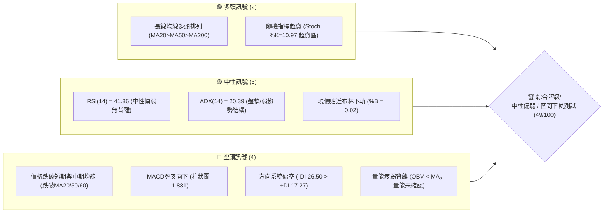
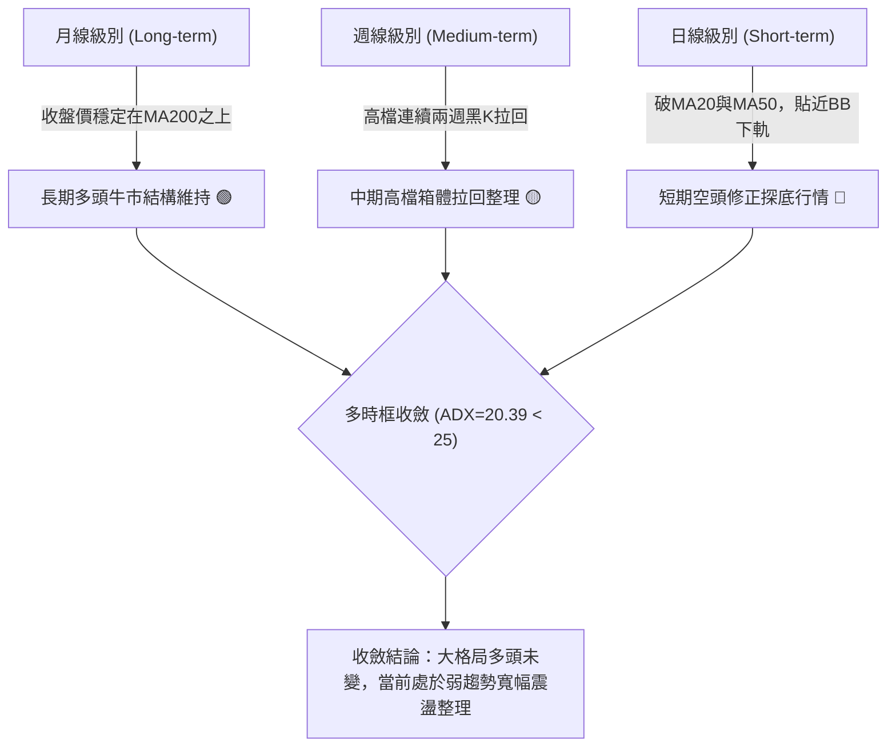
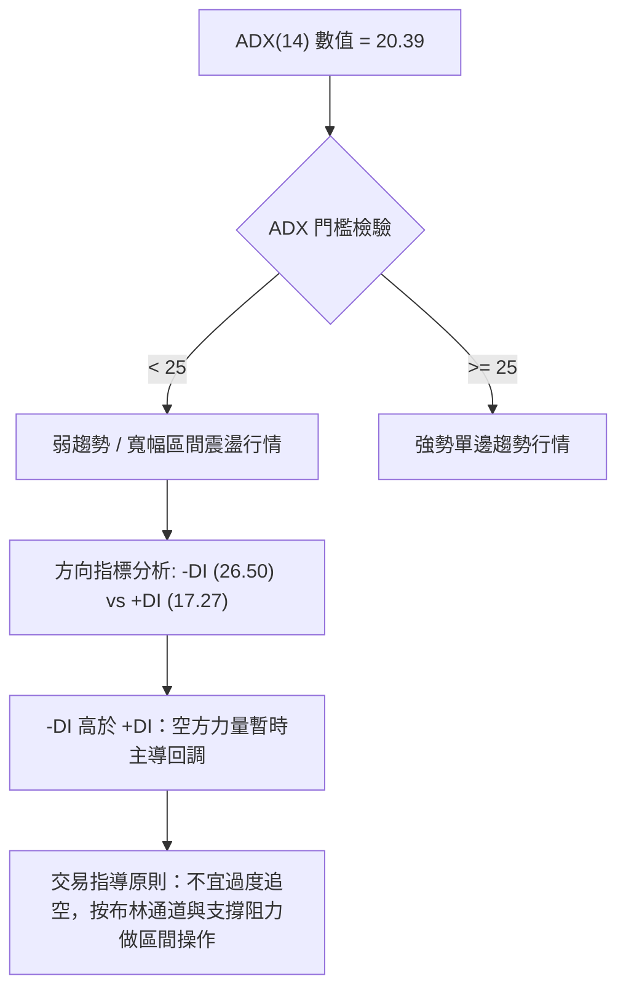
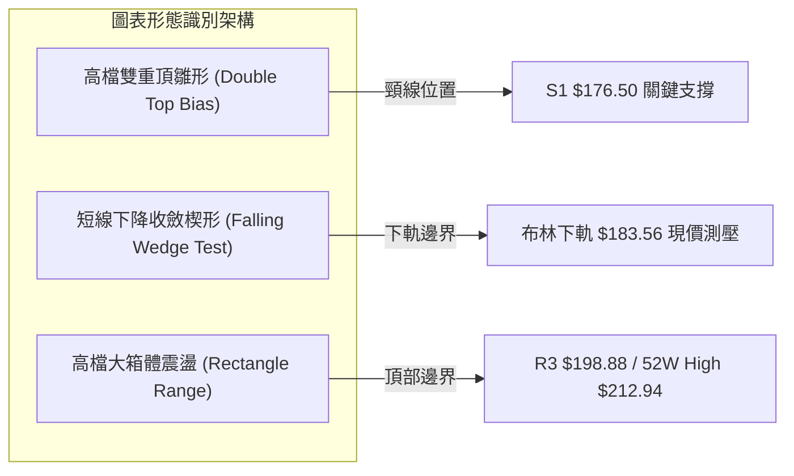
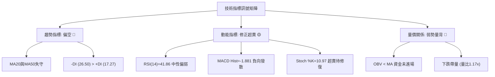
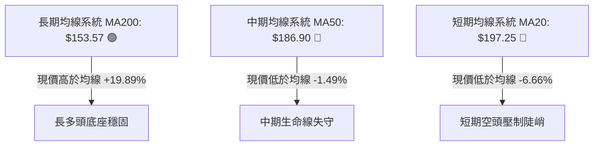
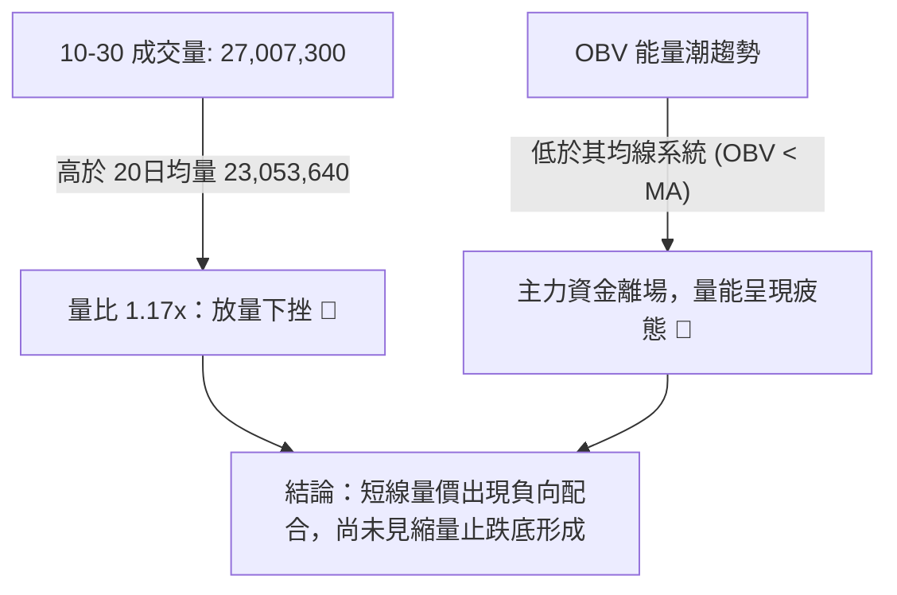
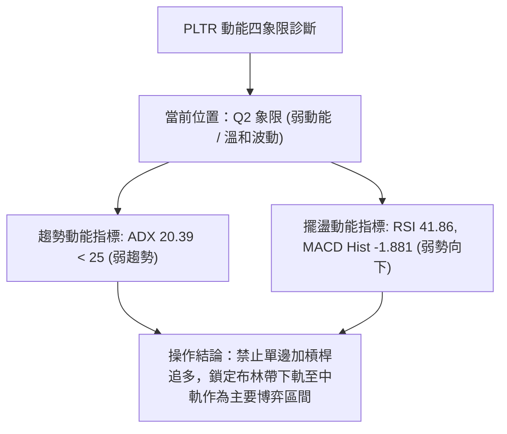
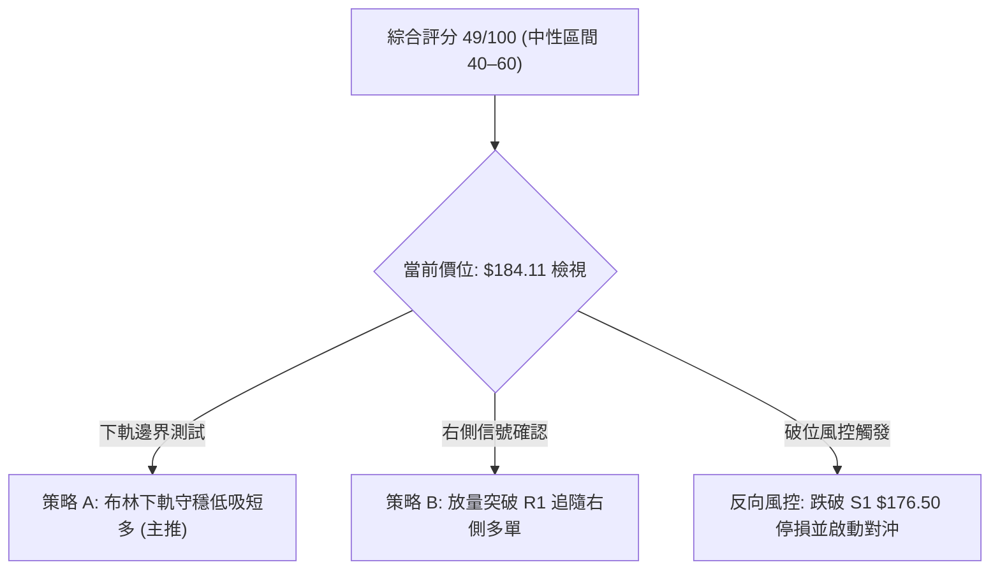
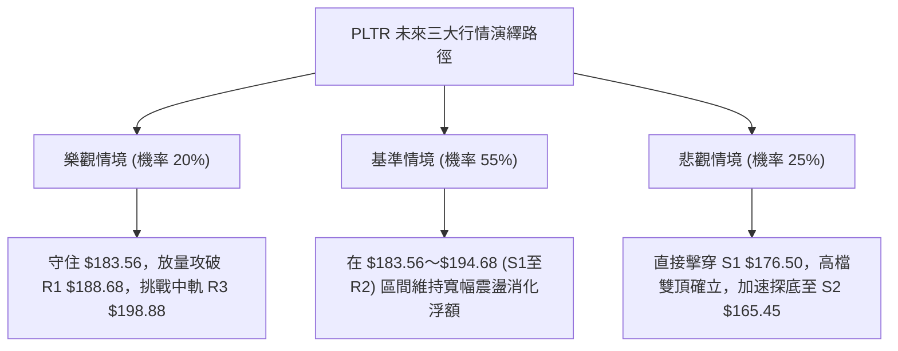

# PLTR 技術分析報告

> **報告日期**：2026-11-01 ｜ **語言**：繁體中文 ｜ **數據來源**：Yahoo Finance ｜ **當前價格**：$184.11

---

## 目錄

| 章節 | 內容 |
|------|------|
| [1. 技術面概覽](#1-技術面概覽) | 訊號儀表板、核心指標、評分卡 |
| [2. 趨勢分析](#2-趨勢分析) | 多時框趨勢、長中短期走勢、ADX解讀 |
| [3. 圖表形態分析](#3-圖表形態分析) | 形態識別、K線組合、目標價計算 |
| [4. 支撐與阻力](#4-支撐與阻力) | 關鍵價位分布、斐波那契回調結構 |
| [5. 技術指標深度解讀](#5-技術指標深度解讀) | 均線系統、RSI、MACD、布林通道、成交量 |
| [6. 動能與波動率](#6-動能與波動率) | 動能四象限、ATR波動率、Beta市場敏感度 |
| [7. 多時框架總結](#7-多時框架總結) | 時框架矩陣、多時框收斂判定 |
| [8. 交易策略建議](#8-交易策略建議) | 策略路由、情境階梯、風報比與操作參數 |
| [9. 風險提示與監控](#9-風險提示與監控) | 監控清單、極端情境與倉位風控 |

---

## 1. 技術面概覽

### 🎯 技術訊號儀表板



### 📊 核心指標速覽表

| 指標類別 | 指標名稱 | 當前數值 | 訊號 | 專業解讀 |
| :--- | :--- | :--- | :---: | :--- |
| **價格** | 當前收盤價 | $184.11 | 🟡 | 位於52週區間72.9%高位，但短線出現連日技術性回踩 |
| **均線** | 短期 MA20 | $197.25 | 🔴 | 現價低於MA20達-6.66%，短線下行斜率陡峭，形成上方動態壓制 |
| **均線** | 中期 MA50 | $186.90 | 🔴 | 現價跌破中期生命線，多方波段支撐轉為短線反彈首道阻力 |
| **均線** | 長期 MA200 | $153.57 | 🟢 | 現價高於MA200達+19.89%，中長期牛市基底結構未受破壞 |
| **動能** | RSI(14) | 41.86 | 🟡 | 位於40–50中性偏弱區，未跌破30極端超賣，短線動能放緩 |
| **動能** | MACD(12,26,9) | 2.034 / 3.915 | 🔴 | 雙線位於零軸上方死叉，柱狀圖擴大至-1.881，空方修正主導 |
| **動能** | 隨機指標 %K/%D| 10.97 / 32.12 | 🟢 | %K進入深跌超賣區間（<20），短線具備技術性跌深反彈契機 |
| **波動** | ATR(14) | $8.28 (4.50%) | 🟡 | 波動率處於中等水準，單日防守與停損區間需保留足夠安全墊 |
| **趨勢** | ADX(14) | 20.39 | 🟡 | ADX低於25，代表非強單邊趨勢行情，當前處於寬幅箱體震盪 |
| **通道** | 布林通道 %B | 0.02 | 🟡 | 現價緊貼布林下軌 $183.56，極限回踩，存在軌道收斂反彈需求 |
| **量能** | 成交量 / 20日均量| 27.00M / 23.05M | 🔴 | 量比1.17x，放量下跌伴隨OBV跌破均線，主力資金無主動承接 |

### 🏆 技術評分卡

```
╔══════════════════════════════════════════════════════════════╗
║              技術評分卡 — PLTR (2026-11-01)                  ║
╠══════════════════════════════════════════════════════════════╣
║ 趨勢強度 (ADX=20.39, 空方DI主導)   █████████░░░░░░░  45/100 🟡 ║
║ 動能指標 (MACD柱走弱, RSI=41.86)   ████████░░░░░░░░  40/100 🔴 ║
║ 支撐穩定度 (BB下軌與S1防守性)       ███████████░░░░░  55/100 🟡 ║
║ 成交量配合 (OBV<MA, 放量下挫)      ████████░░░░░░░░  40/100 🔴 ║
║ 形態完整度 (日線箱體震盪未破位)     ██████████░░░░░░  50/100 🟡 ║
║ 均線排列 (長線多頭排列但跌破短均)   █████████████░░░  64/100 🟡 ║
╠══════════════════════════════════════════════════════════════╣
║ 綜合評分 (依規則18算術平均)        ██████████░░░░░░  49/100 🟡 ║
║ 評級結論：【中性觀望 / 區間操作】等待布林下軌支撐確認與突破信號 ║
╚══════════════════════════════════════════════════════════════╝
```

---

## 2. 趨勢分析

### 🌐 多時框趨勢分析



### 📈 長期趨勢 — 12個月走勢圖（Unicode）

以下圖表繪製 PLTR 自 2025-11 至 2026-10 之月線收盤走勢，標注 52 週低點區、波段高點及現階段關鍵收盤價位：

```
PLTR 月線走勢圖（過去12個月：2025-11 至 2026-10）
價格軸 ($)
$210 ┤                                      ● (52W High $212.94 / 10月衝高回落)
$200 ┤                                  ●   │
$190 ┤                                      │   ● (09月 $187.05)
$180 ┤                ● (12月 $177.75)       │   │   ● (現價 $184.11)
$170 ┤● (11月 $168.45)                       │   │
$160 ┤                                  ●   │
$150 ┤        ● (01月 $146.59)  ● (03月) │   │
$140 ┤            ● (02月 $137.19)  ● (04月)│
$130 ┤                                  │   │
$120 ┤                      ● (07月 $123.06)│
$110 ┤                  ● (06月 $116.67 / 52W Low區 $106.37)
     └───────────────────────────────────────────────────────────────
       11  12  01  02  03  04  05  06  07  08  09  10 (月份)
```

#### 長期走勢特徵分析表

| 階段區間 | 時間跨度 | 起訖收盤價 | 漲跌幅 | 走勢特徵與技術含義 |
| :--- | :--- | :--- | :--- | :--- |
| **高檔回吐段** | 2025-11 ～ 2026-02 | $168.45 → $137.19 | -18.56% | 觸及兩百美元大關後多頭獲利了結，成交量收縮，均線轉向平緩 |
| **築底蓄勢段** | 2026-03 ～ 2026-05 | $146.28 → $156.54 | +7.01% | 於 $140–$150 區間反覆震盪，MA120 展現強力技術托底效應 |
| **深幅下洗段** | 2026-06 ～ 2026-07 | $116.67 → $123.06 | +5.48% | 探測 52 週最低點 $106.37 區域，快速留下影線完成籌碼大換手 |
| **主升加速段** | 2026-08 ～ 2026-09 | $186.38 → $187.05 | +0.36% | 08月爆量長陽（週成交4.35億股）直接修復多頭排列，重返高位 |
| **高檔收斂段** | 2026-10 (當前) | $187.05 → $184.11 | -1.57% | 衝刺 52W 高點 $212.94 受阻，月K收長上影線陰線，進入收斂整理 |

### 📊 中期趨勢（週線分析）

中期走勢顯示，PLTR 自 2026 年 8 月強勢跳空回升以來，已構築了寬幅震盪結構。

```
週線高低點示意圖
$212.94 ┬───────────────────────────────────────────── 52W 絕對高點阻力
        │                        ▲ (2026-10-16 週高 $212.94)
$198.88 ┼────────────────────────┼──────────────────── R3 強度阻力
        │                        │   ▲ (2026-10-23 週高 $202.63)
$188.68 ┼────────────────────────┼───┼──────────────── R1 頸線阻力
$184.11 ┼─ 現價 ─────────────────┼───┼──────────────── (目前回踩布林下軌)
$176.50 ┼────────────────────────┴───┴──────────────── S1 中期第一防守波段
        │
$165.45 ┴───────────────────────────────────────────── S2 強支撐波段
```

從近 8 根週 K 線結構觀察，2026-10-09 當週拉出最高 $209.58、收盤 $209.05 的長陽線；但緊接著 2026-10-16 週 K 線創出 52 週新高 $212.94 後爆量重挫至收盤 $186.03，單週振幅高達 13.63%，構築了明顯的波段高檔長上影避雷針形態。隨後兩週雖然多頭試圖於 10-23 當週反彈至 $202.63，但 10-30 當週隨即再度破底收於 $184.11。週 MACD 柱狀圖已由 10-09 的 +1.204 迅速翻負至 -1.881，確認中期動能已由多頭攻擊轉變為空頭修正與獲利了結。

### ⚡ 趨勢強度評估（ADX 解讀）



#### ADX 趨勢強度對照表

| 指標變數 | 當前讀數 | 判定級別 | 專業技術解讀 |
| :--- | :--- | :---: | :--- |
| **ADX(14)** | **20.39** | 弱趨勢 / 盤整 | 低於臨界值 25，確認市場處於無單邊主升/主跌的箱體震盪狀態 |
| **+DI** | **17.27** | 多頭疲軟 | 顯示多方目前缺乏連續推升價格的主動攻擊力道 |
| **-DI** | **26.50** | 空方佔優 | 空方在短線上佔據主導，推動價格向區間下軌施壓 |
| **綜合判定** | 震盪偏空修正 | 🟡 | 震盪市場中震盪指標與區間邊界有效性高於單邊趨勢突破指標 |

---

## 3. 圖表形態分析

### 🔍 形態識別系統



#### 圖表形態信心度評估表（依規則 15）

| 形態名稱 | 信心度 | 判斷依據（引用數據） | 完成度 | 目標價（附嚴格計算式） |
| :--- | :---: | :--- | :---: | :--- |
| **高檔雙重頂雛形** | 58% | 左峰 2026-10-16 高點 $212.94，右峰 2026-10-22 高點 $202.63（未能創高），兩次回踩頸線聚類區 S1 $176.50 | 65% | 若跌破頸線 S1 $176.50：<br>形態高度 = $212.94 - $176.50 = $36.44<br>測量目標 = 頸線 $176.50 - $36.44 = **$140.06**（註：接近S3 $148.07支撐區） |
| **短期布林軌道超跌** | 72% | 現價 $184.11 距離布林下軌 $183.56 僅 0.3%，%B=0.02，隨機指標 %K=10.97 超賣 | 90% | 下軌支撐反彈目標為中軌 MA20：<br>反彈第一目標 = **$197.25** (BB中軌 / MA20) |
| **高檔箱體震盪結構** | 80% | ADX=20.39<25，價格受限於箱底 S1 $176.50 至箱頂 R3 $198.88 之間震盪 | 85% | 箱頂突破前維持區間擺動：<br>箱底 = $176.50，箱頂 = $198.88，中樞 = **$187.69** |

*備註：高檔雙頂目前尚未有效跌破頸線 $176.50，完成度僅 65%，不可提前預判形態成立，應重點關注頸線得失。*

### 🕯️ 重要 K 線形態分析（依規則 19）

依據數據包中嚴格提供的「近 10 根日 K」與「近 8 根週 K」之開高低收數據進行客觀解讀：

#### 近 10 根日 K 線形態解讀表

| 日期 (日K) | 開盤價 | 最高價 | 最低價 | 收盤價 | K線形態名稱 | 形態專業解讀 | 訊號強度 |
| :--- | :---: | :---: | :---: | :---: | :--- | :--- | :---: |
| **2026-10-19** | 186.99 | 196.99 | 186.15 | 194.15 | 中陽線 (長實體) | 低開高走吞噬前低，多頭自 $186.15 強勢發動反彈 | 🟢 強 |
| **2026-10-20** | 192.44 | 196.11 | 189.42 | 192.60 | 陀螺線 (高檔整固) | 實體極小，高低點收縮，多空雙方在 $192–$196 暫行換手 | 🟡 中性 |
| **2026-10-21** | 191.72 | 202.55 | 189.88 | 201.72 | 突破大陽線 | 放量攻破兩百大關，收在最高點附近，展現強烈攻擊企圖 | 🟢 強 |
| **2026-10-22** | 200.76 | 202.63 | 194.54 | 196.19 | 流星線雛形 (長上影) | 衝高 $202.63 受阻，收盤失守兩百，形成局部空頭吞噬影線 | 🔴 偏空 |
| **2026-10-23** | 195.02 | 197.49 | 190.57 | 196.75 | 下影紡錘線 | 探底 $190.57 後回抽，多頭於 $190 關口展現承接力道 | 🟡 中性 |
| **2026-10-26** | 197.90 | 200.05 | 192.91 | 198.84 | 小陽線 (十字星延伸) | 試圖反撲兩百整數心理關卡，但實體收窄，多頭推升動能遞減 | 🟡 中性 |
| **2026-10-27** | 198.12 | 201.83 | 196.79 | 198.73 | 上影十字星 | 連續兩日高點承壓於 $201.83，空方高檔壓制明確 | 🔴 偏空 |
| **2026-10-28** | 197.01 | 198.74 | 193.13 | 196.81 | 小陰線 (重心下移) | 高低點同步下移，多頭防線後撤至 $193 附近 | 🔴 弱空 |
| **2026-10-29** | 198.37 | 198.51 | 190.36 | 196.42 | 下影小陰線 | 盤中下探 $190.36，尾盤小幅收復，顯示整數關卡多空爭奪 | 🟡 中性 |
| **2026-10-30** | 193.62 | 193.92 | 180.81 | 184.11 | 帶量破位大陰線 | 跳空低開，盤中重挫至 $180.81，收在近全日低點，光腳陰線 | 🔴 強空 |

#### 近 8 根週 K 線形態解讀表

| 日期 (週K) | 開盤價 | 最高價 | 最低價 | 收盤價 | 週K形態名稱 | 形態專業解讀 | 訊號強度 |
| :--- | :---: | :---: | :---: | :---: | :--- | :--- | :---: |
| **2026-09-11** | 173.60 | 175.82 | 164.55 | 167.23 | 破位中陰線 | 探底 $164.55，量能萎縮至 81.68M，測試底層支撐 | 🔴 偏空 |
| **2026-09-18** | 169.70 | 177.88 | 166.42 | 177.64 | 下影中陽線 | 自低檔回升，成交量放大至 144.45M，確立底部支撐有效 | 🟢 轉多 |
| **2026-09-25** | 178.73 | 194.68 | 176.76 | 189.67 | 實體長陽線 | 強勢突破，高點逼近 $194.68，週線級別多頭排列重啟 | 🟢 強多 |
| **2026-10-02** | 186.23 | 194.78 | 184.81 | 188.75 | 高檔整理陰十字 | 實體狹窄，高檔獲利盤與解套盤交織，等待方向確認 | 🟡 中性 |
| **2026-10-09** | 189.45 | 209.58 | 187.63 | 209.05 | 突破攻擊大陽線 | 放量攻克兩百美元大關，週成交量達 130.58M，買盤亢奮 | 🟢 極強 |
| **2026-10-16** | 208.90 | 212.94 | 184.45 | 186.03 | 天量長上影大陰線 | 刷出 52W 新高 $212.94 後暴跌，單週跌逾 23 美元，主力出貨顯著 | 🔴 破壞 |
| **2026-10-23** | 186.99 | 202.63 | 186.15 | 196.75 | 弱勢反彈中陽線 | 試圖收復前週失地，但反彈受阻於 $202.63，量能遞減至 101.03M | 🟡 弱多 |
| **2026-10-30** | 197.90 | 201.83 | 180.81 | 184.11 | 反噬反彈大陰線 | 直接包覆吞噬前週實體，週線再度考驗 $180 關口，空頭佔據主導 | 🔴 強空 |

### 📉 ASCII 走勢形態示意圖

```
PLTR 日線雙頂與布林通道回踩結構示意圖
價格軸
$212.94 ┬                        ▲ 頂部 1 (2026-10-16: $212.94)
        │                       / \
$202.63 ┼                      /   \           ▲ 頂部 2 (2026-10-22: $202.63)
        │                     /     \         / \
$197.25 ┼────────────────────/───────\───────/───\─── (MA20 / BB中軌)
        │                   /         \     /     \
$188.68 ┼──────────────────/───────────\───/───────\─ (R1 阻力位)
$184.11 ┼─ 現價 ──────────/─────────────▼─/─────────▼ (10-30 陰線回踩 $180.81)
$183.56 ┼─ 布林下軌 ═════/══════════════════════════════ (當前極限支撐)
        │               /
$176.50 ┴──────────────▼─────────────────────────────── (S1 雙頂潛在頸線支撐)
```

---

## 4. 支撐與阻力

### 🗺️ 關鍵價位分布圖（Unicode）

```
╔════════════════════════════════════════════════════════════════════════╗
║                   PLTR 關鍵價位與籌碼結構分布圖                         ║
╠════════════════════════════════════════════════════════════════════════╣
║ $212.94 ║████████████████████████████████████████║ 52週歷史最高阻力位 ║
║ $198.88 ║████████████████████████████████        ║ 強阻力 R3 (波段高點)║
║ $194.68 ║████████████████████████                ║ 中度阻力 R2         ║
║ $188.68 ║████████████████                        ║ 關鍵頸線阻力 R1     ║
║ ─────── ╫────────────────────────────────────────╫──────────────────── ║
║ $184.11 ╠════════════════════════════════════════╣ ◄ 當前收盤價         ║
║ ─────── ╫────────────────────────────────────────╫──────────────────── ║
║ $183.56 ║▓▓▓▓▓▓▓▓▓▓▓▓▓▓▓▓▓▓▓▓▓▓▓▓▓▓▓▓▓▓▓▓▓▓▓▓▓▓▓║ 動態通道：布林下軌  ║
║ $176.50 ║████████████████████████████████        ║ 關鍵防守支撐 S1     ║
║ $165.45 ║████████████████████████                ║ 結構性強支撐 S2     ║
║ $148.07 ║████████████████████████████████████████║ 深度防禦強支撐 S3   ║
╚════════════════════════════════════════════════════════════════════════╝
```

### 🚧 阻力位分析表

所有阻力數值均直接引用數據包之波段高點聚類計算成果：

| 阻力級別 | 準確價位 | 距現價空間 | 技術形成原因與特徵 | 突破難度 | 戰略重要性 |
| :--- | :---: | :---: | :--- | :---: | :---: |
| **R1 (第一阻力)** | **$188.68** | +2.48% | 近一年波段高點聚類位，且鄰近斐波那契 23.6% 回調位（$187.79）與 MA50（$186.90），為短線多頭翻多之關鍵關卡 | 中等 | ★★★☆☆ |
| **R2 (第二阻力)** | **$194.68** | +5.74% | 2026-09-25 週高及近期多根日K震盪密集高點，MA5（$194.98）與 MA10（$195.63）下壓聚攏區 | 高 | ★★★★☆ |
| **R3 (強烈阻力)** | **$198.88** | +8.02% | 兩百美元整數關卡下方之多頭防線潰退點，重合布林中軌 MA20（$197.25），為空頭波段防守總部 | 極高 | ★★★★★ |

### 🛡️ 支撐位分析表

所有支撐數值均直接引用數據包之波段低點聚類計算成果：

| 支撐級別 | 準確價位 | 距現價空間 | 技術形成原因與特徵 | 守住機率 | 戰略重要性 |
| :--- | :---: | :---: | :--- | :---: | :---: |
| **S1 (關鍵支撐)** | **$176.50** | -4.13% | 近一年波段低點聚類位，雙頂形態潛在頸線支撐位，若失守將引發結構性多殺多止損盤 | 65% | ★★★★☆ |
| **S2 (強支撐)** | **$165.45** | -10.14% | 2026年9月中旬回踩低點聚類區，跌破後市場將進入中級回撤修正，測試長期均線 | 75% | ★★★★★ |
| **S3 (深層支撐)** | **$148.07** | -19.58% | 長期強支撐波段聚類，重合斐波那契 61.8% 黃金分割位（$147.08）與 MA200（$153.57）防守帶 | 85% | ★★★★★ |

### 📐 斐波那契回調位分析

依據 52 週完整波動區間（最低點 $106.37 → 最高點 $212.94，總垂直波幅 $106.57）計算之斐波那契回調結構如下：

| 斐波那契回調比例 | 精準價位 ($) | 當前價格相對位置與技術意義解讀 |
| :--- | :---: | :--- |
| **0.0% (52W High)** | **$212.94** | 2026-10-16 創出的波段歷史極限高點，牛市極端上軌壓力 |
| **23.6% 回調位** | **$187.79** | **現價 ($184.11) 剛跌破此位**。跌破 23.6% 意味著自 $106.37 發動的強勢超強單邊推升暫告段落，行情進入常規技術修正 |
| **38.2% 回調位** | **$172.23** | 位於第一支撐位 S1 ($176.50) 之下，為多頭強勢回調的極限容忍區。若能在此止跌，中長線多頭結構依然完好 |
| **50.0% 回調位** | **$159.66** | 多空力量強弱分水嶺，此位置接近 MA120 半年線（$158.56）與 MA240 年線（$157.58） |
| **61.8% 黃金回調位** | **$147.08** | 與第三支撐聚類 S3 ($148.07) 完美重疊共振，是此波 52 週大牛市的多頭最終防禦堡壘 |
| **78.6% 回調位** | **$129.18** | 深度回撤區，跌破意味著過去一年的漲幅已遭全面扭轉 |
| **100.0% (52W Low)**| **$106.37** | 2026-06 底部起漲原點，長期絕對安全邊際基石 |

**斐波那契落點結論**：當前收盤價 **$184.11** 恰好落在 **23.6% ($187.79)** 與 **38.2% ($172.23)** 兩個關鍵回調位之間的空窗帶。短線價格正受到上方 23.6% 回調位（$187.79）的反壓，下方則由 S1（$176.50）與 38.2% 回調位（$172.23）構築雙重緩衝墊。

---

## 5. 技術指標深度解讀

### 🎛️ 指標訊號總覽



### 📈 移動平均線排列分析



#### 均線數據明細表

| 均線名稱 | 當前數值 | 價格與均線差值 | 斜率與排列特徵 | 多空信號解讀 |
| :--- | :---: | :---: | :--- | :---: |
| **MA5** | $194.98 | -5.58% | 短線急速下拐，形成第一道貼身反壓 | 🔴 極弱 |
| **MA10** | $195.63 | -5.89% | 下行加速，即將與 MA20 形成短期死叉 | 🔴 偏空 |
| **MA20** | $197.25 | -6.66% | 扣高走平並開始下傾，為布林中軌壓制位 | 🔴 空頭 |
| **MA50** | $186.90 | -1.49% | 中期上升趨勢線，10-30被帶量陰線實體貫穿 | 🔴 轉空 |
| **MA60** | $184.75 | -0.34% | 季線位置，當前價格在此反覆爭奪，多方微幅失守 | 🟡 爭奪 |
| **MA120** | $158.56 | +16.11% | 穩健上行，提供中期深度回撤之強力安全網 | 🟢 支撐 |
| **MA200** | $153.57 | +19.89% | 牛熊分界線，長期上升通道斜率依然健康向上 | 🟢 多頭 |
| **均線排列判定** | **多頭排列 (MA20>MA50>MA200)**，但**價格跌破短期與中期均線**，形成「長多短空、均線乖離拉回」之修復形態。 |

### 📉 RSI(14) 分析

```
RSI(14) 動能指示器：41.86
0 ────── 30 ───────────── 50 ───────────── 70 ────── 100
[ 超賣區 ]   [   現值 41.86   ]   [   多頭強勢區   ]   [ 超買區 ]
░░░░░░░░░░░░████████████░░░░░░░░░░░░░░░░░░░░░░░░░░░░░░
```

- **當前數值解讀**：Wilder 算法計算之 RSI(14) 為 **41.86**，處於 30 至 50 的中性偏弱震盪區間。RSI 跌破 50 中軸，意味著多頭攻擊節奏已完全被空頭反撲瓦解，市場由空方掌控主動定價權。
- **背離嚴格檢驗**：
  - 價格於 2026-10-16 創出 $212.94 新高時，週 RSI 為 76.3（未創 2026-08-07 的 72.8 顯著新高，週線級別隱含微幅動能背離）。
  - 但針對日線近 20 根 K 棒的首尾檢驗：2026-10-09 至 10-30，價格自 $209.05 下行至 $184.11，RSI 亦同步自 76.3 回落至 41.86，**兩者運動方向完全一致，日線層面「無明顯底背離，亦無短線頂背離」**。此訊號顯示當前下跌為動能充份釋放的真實調整，尚未出現動能耗盡之反轉底背離特徵。

### 📊 MACD(12,26,9) 訊號解讀


- **參數結構**：DIF 快線（2.034）低於 DEA 訊號線（3.915），雙線雖位於零軸上方，但開口向右下方發散。
- **柱狀圖動態**：MACD Histogram 當前為 **-1.881**。回顧近四週收盤柱狀圖走勢（-0.822 → -1.187 → -1.881），負值階梯式擴大，確認短線回調並非單日情緒，而是具備連續性的空頭動能宣洩。

### 📦 布林通道分析

```
布林通道 (20, 2) 結構示意圖
$210.93 ┬────────────────────────────────────────── 布林上軌 (強阻力區)
        │
$197.25 ┼────────────────────────────────────────── 布林中軌 (MA20 趨勢分水嶺)
        │
$184.11 ┼─ 現價 ─────────────────────────────────── (%B = 0.02, 極度逼近下軌)
$183.56 ┴────────────────────────────────────────── 布林下軌 (短線動態支撐)
```

- **軌道邊界**：
  - 上軌：**$210.93**
  - 中軌（MA20）：**$197.25**
  - 下軌：**$183.56**
- **通道指標解讀**：
  - 當前 **%B 數值僅為 0.02**（0 代表剛好觸及下軌，1 代表觸及上軌）。這表明現價 $184.11 已經壓迫至布林帶最下沿，屬於極端超跌區域。
  - 當價格在盤整市場（ADX=20.39）中測試下軌時，通常會引發統計學上的「均值回歸」效應；但若伴隨成交量放大並使軌道向下開口（Band Walking），則需慎防下軌支撐失效風險。

### 💹 成交量分析（量價配合度）



- **量比與均量比較**：最新單日成交量為 27,007,300 股，較 20 日均量（23,053,640 股）放大約 17.15%，較 50 日均量（24,894,104 股）放大 8.49%。在長黑下跌日出現量比 1.17x，顯示當日賣壓並非虛擬縮量下洗，而是存在實質的獲利籌碼離場現象。
- **OBV 資金流向**：OBV 指標目前明確處於其移動平均線下方（OBV < MA），這證實自 10 月中旬創出 $212.94 新高以來，量能並未確認價格的高位維持，呈現典型的量價頂部背離與累積性派發跡象。

---

## 6. 動能與波動率

### ⚡ 動能評估四象限

根據技術數據：ADX=20.39（趨勢強度低/盤整）、MACD 柱狀圖負向擴散與 RSI=41.86（動能疲弱偏空）、ATR=4.50%（波動率中等）：

| 象限分區 | 動能維度 (Momentum) | 波動率維度 (Volatility) | 當前判定狀態 | 戰略應對方針 |
| :---: | :---: | :---: | :---: | :--- |
| **Q1** | 強勁多頭 | 低 / 溫和 | — | 趨勢穩健推升，最理想之右側重倉波段機會 |
| **Q2** | 疲弱偏空 | 低 / 溫和 | **✓ 當前所處位置** | **防守觀望象限：動能走弱且缺乏方向爆發力，宜降低頻率，嚴守區間高拋低吸** |
| **Q3** | 強勁爆發 | 高波動 | — | 突破單邊行情，高風險高回報，適合突破追單 |
| **Q4** | 極度衰退 | 極高混亂 | — | 恐慌崩跌或多殺多，流動性枯竭，應全面空倉規避 |



### 📊 ATR 波動率分析

- **ATR(14) 絕對數值**：**$8.28**（採用 Wilder 平滑算法）。
- **ATR 相對百分比**：佔當前股價之 **4.50%**。
- **每日防守距離與停損設置指引**：
  - 由於個股單日平均波動空間達 $8.28，任何短線或波段策略若將停損距離設定在 $5.00 以內，將極易被日內正常市場雜訊（Noise）洗出場。
  - **保守型策略停損距**：建議設定為 1.0x ～ 1.5x ATR，即 **$8.28 ～ $12.42** 空間。
  - **波段型策略停損距**：建議設定為 2.0x ATR，即 **$16.56** 空間（恰好涵蓋自現價 $184.11 回撤至結構性強支撐 S2 $165.45 之安全緩衝邊界）。

### 📐 Beta 與市場相關性

- **Beta 係數**：**1.602**。
- **市場特徵與敏感度解讀**：
  - PLTR 展現出顯著高於標準普爾 500 指數（Beta = 1.0）的高貝塔攻擊性特徵。當大盤（S&P 500 / Nasdaq）上漲 1% 時，該股理論上傾向於波動 1.60%；反之，大盤回檔時其跌幅亦常被同比例放大。
  - 近期市場新聞顯示「美股因蘋果財報、Palantir、大選臨近等因素承壓拋售」，在高貝塔係數（1.602）的作用下，系統性宏觀風險對 PLTR 股價形成了放大器的下行加壓效應。

---

## 7. 多時框架總結

### 📋 時框架評分表

| 時框架 | 趨勢方向 | 動能狀態 | 均線系統排列 | 圖表形態評估 | 綜合評分 | 操作戰略建議 |
| :--- | :---: | :---: | :---: | :---: | :---: | :--- |
| **月線級別 (長線)** | 🟢 多頭看漲 | 偏強中性 (回調) | 完美多頭 (價格遠高於MA120/240) | 高檔大箱體擴張 | **72/100** | 核心底倉堅定持有，長期牛市基座健康 |
| **週線級別 (中線)** | 🟡 震盪整理 | 轉弱修正 (MACD翻負) | 承壓於MA20，守在MA50之上 | 高檔長上影高位換手 | **52/100** | 不宜盲目追高，等待下探 S1/S2 確立二次買點 |
| **日線級別 (短線)** | 🔴 空頭壓制 | 負向發散 (MACD死叉) | 短期均線向下死叉，破MA50 | 帶量長陰貫穿，逼近下軌 | **38/100** | 空方主控，禁止左側接飛刀，等待企穩信號 |

### 🔲 綜合訊號矩陣

```
┌─────────────────┬──────────────────────┬──────────────────────┬──────────────────────┐
│ 技術維度        │ 長期時框 (月線)      │ 中期時框 (週線)      │ 短期時框 (日線)      │
├─────────────────┼──────────────────────┼──────────────────────┼──────────────────────┤
│ 主導趨勢        │ 🟢 上升趨勢通道      │ 🟡 寬幅箱體擺動      │ 🔴 短線下行通道      │
│ 均線系統        │ 🟢 均線多頭發散      │ 🟡 均線收斂糾纏      │ 🔴 短均空頭發散      │
│ 動能指標 (RSI)  │ 🟢 強勢區間 (>60)    │ 🟡 中軸回落 (41.9)   │ 🔴 跌破中軸 (41.86)  │
│ MACD 狀態       │ 🟢 零軸上方運行      │ 🔴 負向柱擴大        │ 🔴 死叉負向發散      │
│ 波動軌道位置    │ 🟢 處於通道中上軌    │ 🟡 軌道內收縮        │ 🔴 貼近布林下軌(%B=0.02)│
└─────────────────┴──────────────────────┴──────────────────────┴──────────────────────┘
```

### ⚖️ 多時框收斂結論（依規則 14 嚴格收斂）

1. **趨勢性質判定**：
   - 當前 **ADX(14) 讀數為 20.39**，明確小於 25 的趨勢分水嶺，技術定義為**「盤整/弱趨勢行情」**。
2. **多時框收斂優先級取捨**：
   - 依據規則 14：「盤整行情（ADX<25）：以日線布林通道上下軌為主要交易區間」，長線的多頭力量暫時被中短期的箱體邊界所拘束。
   - 週線長上影大陰線壓制了短期上攻動能，日線均線（MA20/50）全數失守，但布林下軌 $183.56 與第一支撐 S1 $176.50 封鎖了深度下墜空間。
3. **唯一方向性結論**：
   - **【中性觀望 / 區間震盪下軌測試】（綜合評分：49/100）**。
   - 短線雖空頭主導，但因價格已貼近布林下軌（%B=0.02）且隨機指標 %K 進入超賣區（10.97），不宜在下軌盲目做空；操作重心完全聚焦於**「布林下軌至支撐 S1 區域的支撐確認與超跌反彈機會」**。

---

## 8. 交易策略建議

### 🗺️ 策略決策流程圖



### 🧭 策略路由（依評分卡分流，不得兩頭下注）

- **當前主策略方向 = 【中性偏多防禦：布林下軌超跌反彈低吸】（依綜合評分 49/100 路由）**
- **分流原則**：由於綜合評分處於 40–60 之中性盤整區間，市場受制於布林通道上下軌（$183.56 ～ $210.93）之內。策略主推在布林下軌（$183.56）與支撐 S1（$176.50）構築的防守帶內尋找「超賣止跌反彈」進場點；嚴禁追高，亦不建議在區間下軌處加槓桿殺跌做空。

### 🎯 價格情境階梯（Price Scenarios）

所有價位精確引用第 4 章波段計算數據：

| 觸發條件 | 下一目標 | 後續延伸 | 情境技術含義與市場行為 |
| :--- | :---: | :---: | :--- |
| **向上突破 R1 $188.68** | **R2 $194.68** | **R3 $198.88** | 短線擺脫空頭壓制，重返 MA50 上方，形成均線回補多頭攻勢 |
| **站穩現價 $184.11 區間** | **$188.68** | — | 於布林下軌 $183.56 獲得支撐，展開技術性均值回歸修復走勢 |
| **向下跌破 S1 $176.50** | **S2 $165.45** | **S3 $148.07** | 雙頂形態頸線失守，引發停損賣盤，中期趨勢正式轉弱進入深調 |

### 📊 情境機率分佈

| 演繹情境 | 發生機率 | 主要技術與量化依據 |
| :--- | :---: | :--- |
| **情境一：下軌止跌反彈** | **55%** | 布林通道 %B=0.02 緊貼下軌，Stoch %K=10.97 極端超賣，ADX=20.39 顯示無連續單邊暴跌趨勢，均值回歸機率最高 |
| **情境二：區間沉悶橫盤** | **25%** | 財報公布前（11月2日）主力資金觀望，成交量可能萎縮在 $180–$188 之間做窄幅十字星整固 |
| **情境三：跌破頸線深幅回調** | **20%** | MACD 負向柱擴散，10-30 長陰線跌破 MA50，若財報不及預期可能擊穿 S1 $176.50 引發多殺多 |

### 🟢 主策略詳情（方向依上方路由）

所有風報比嚴格依照規則 17 計算：`風險報酬比 = (目標價 T1 − 進場價) ÷ (進場價 − 止損價)`：

| 策略要素 | 策略 A：布林下軌守穩低吸短多（左側防禦） | 策略 B：突破 R1 頸線右側追多（順勢突破） |
| :--- | :--- | :--- |
| **進場條件** | 股價於布林下軌 $183.56～$184.11 止跌，盤中未破前低 $180.81 | 日K線收盤價有效站上 R1 阻力位 $188.68 且伴隨放量 |
| **精確進場價格** | **$184.11**（現價確認進場） | **$188.68**（突破點觸發進場） |
| **目標價 T1** | **$194.68**（R2 中度阻力 / 近期震盪密集成交區） | **$198.88**（R3 強烈阻力 / 重合 MA20 布林中軌） |
| **目標價 T2** | **$198.88**（R3 強烈阻力 / MA20 中軌目標） | **$212.94**（52W 歷史最高點目標位） |
| **嚴格止損價格** | **$176.50**（跌破波段低點聚類 S1） | **$183.56**（假突破跌回布林下軌） |
| **風險報酬比 (T1)** | **1 : 1.39（以 T1 計）**<br>計算式：$(194.68 - 184.11) \div (184.11 - 176.50) = 10.57 \div 7.61 = 1.3889$ | **1 : 1.99（以 T1 計）**<br>計算式：$(198.88 - 188.68) \div (188.68 - 183.56) = 10.20 \div 5.12 = 1.9922$ |
| **風險報酬比 (T2)** | **1 : 1.94（以 T2 計）**<br>計算式：$(198.88 - 184.11) \div (184.11 - 176.50) = 14.77 \div 7.61 = 1.9408$ | **1 : 4.74（以 T2 計）**<br>計算式：$(212.94 - 188.68) \div (188.68 - 183.56) = 24.26 \div 5.12 = 4.7383$ |
| **預估勝率** | **55%** | **45%** |
| **建議倉位** | **總資金之 10%～15%** (防禦性試倉) | **總資金之 15%～20%** (右側確認加倉) |

### 🔴 反向風險觸發點（對沖提示）

- **多頭邏輯推翻點**：若日 K 線**實體收盤跌破 S1 關鍵支撐 $176.50**，意味著高檔雙頂形態正式確認成型，箱體防守徹底失敗。
- **風控行動**：
  1. 所有多頭倉位必須無條件執行停損離場。
  2. 積極型投資人可在此觸發點啟動空頭避險，以反彈測試 $176.50 不破為防守，空頭第一目標下看 S2 **$165.45**，終極波段目標下看 S3 **$148.07**。

### ⭐ 整體訊號強度評星

```
做多訊號強度：★★☆☆☆  (2/5星 - 處於均線下方，僅具超跌反彈價值)
做空訊號強度：★★★☆☆  (3/5星 - 短線動能偏空，但受制於下軌支撐)
整體可信度：  ★★★☆☆  (3/5星 - 寬幅震盪市場，指標訊號頻繁鈍化)
```

---

## 9. 風險提示與監控

### ✅ 關鍵監控指標 Checklist

```
╔══════════════════════════════════════════════════════════════╗
║                   關鍵技術監控指標清單                       ║
╠══════════════════════════════════════════════════════════════╣
║ [ ] 價格是否跌破布林下軌 $183.56 並形成 Band Walking 下行      ║
║ [ ] 關鍵頸線支撐 S1 $176.50 是否被帶量實體長陰擊穿            ║
║ [ ] RSI(14) 能否在 40 附近形成有效底背離並重返 50 中軸之上   ║
║ [ ] MACD 柱狀圖（當前 -1.881）是否出現縮短拐點並翻紅          ║
║ [ ] 單日成交量在反彈時能否突破 20 日均量（>23.05M）有效補量   ║
║ [ ] 財報公布後（11-02）引發的隱含波動率是否突破 ATR $8.28 邊界║
╚══════════════════════════════════════════════════════════════╝
```

### ⚠️ 風險場景分析



### 🛡️ 風險管理重要提醒

1. **基本面事件疊加技術面臨界點**：
   - 數據包新聞顯示，11 月 2 日前後市場將面臨極具考驗的財報審視（市場聚焦其能否超越預期及營收連續成長考驗），且機構（如 Michael Burry）仍持有空頭部位。
   - 此時技術面剛好來到布林下軌 $183.56 與 S1 $176.50 的生死線邊緣，基本面消息將大幅放大技術突破或破位的動能，操作上切忌在財報公布當日前夕滿倉押注。
2. **高 Beta 波動之倉位控管嚴律**：
   - PLTR 的 Beta 高達 1.602，ATR 高達 $8.28（4.50%）。單一筆交易的最大承擔風險金額不得超過總帳戶淨值的 1.5% ～ 2.0%。
   - 依據策略 A 的停損幅度（$184.11 - $176.50 = $7.61），若帳戶總資產為 100,000 美元，單筆最大容許虧損為 1,500 美元，則最大允許建倉股數為：
     $$1,500 \div 7.61 \approx 197 \text{ 股（約佔總資金 36% 權重上限，建議初期僅建立 100 股以防範跳空風險）}$$
3. **拒絕情緒化槓桿追單**：
   - 當前處於 ADX=20.39 的弱趨勢無序震盪期，追高殺跌將遭到布林帶上下軌反覆多空雙巴。嚴格遵循「買在支撐邊緣、賣在阻力重重」之紀律。

---

## 📋 報告總結

```
╔══════════════════════════════════════════════════════════════════╗
║                   PLTR 技術分析報告核心總結                      ║
╠══════════════════════════════════════════════════════════════════╣
║ 報告日期：2026-11-01                                             ║
║ 當前價格：$184.11                                                ║
║ 綜合技術評分：49/100 (算術平均值)                                ║
║ 分析總體評級：⚖️ 【中性觀望 / 區間下軌測試】                       ║
║                                                                  ║
║ 核心結構結論：                                                   ║
║ ├─ 長期趨勢：🟢 多頭格局未破 (現價高於 MA200 $153.57 達 +19.89%) ║
║ ├─ 中期趨勢：🟡 寬幅高檔箱體整固 (受制於 52W 高點 $212.94 回吐)   ║
║ ├─ 短期趨勢：🔴 帶量破位偏空 (失守 MA20/MA50，MACD 柱狀圖 -1.881)║
║ ├─ 關鍵支撐：S1 $176.50 ｜ S2 $165.45 ｜ 動態下軌 $183.56        ║
║ ├─ 關鍵阻力：R1 $188.68 ｜ R2 $194.68 ｜ R3 $198.88              ║
║ └─ 分析師目標共識：$212.50 (最高 $265.00 / 最低 $80.00)          ║
║                                                                  ║
║ 最優戰略執行方案：                                               ║
║ 1. 🥇 最佳機會：布林下軌 $184.11 守穩低吸，停損設 S1 $176.50，   ║
║                 目標 R2 $194.68 (風報比 1 : 1.39（以 T1 計）)    ║
║ 2. 🥈 次選機會：右側等待日K放量突破 R1 $188.68 追多，            ║
║                 目標 R3 $198.88 (風報比 1 : 1.99（以 T1 計）)    ║
║ 3. 🥉 保守選擇：空倉觀望，靜待 11-02 財報落地及方向選擇後再行介入 ║
╚══════════════════════════════════════════════════════════════════╝
```

---

> ⚠️ **免責聲明**：本報告為依據客觀市場量化技術數據生成之專業技術分析研究，所有點位、走勢與估算均基於既有之歷史交易行情統計。本報告**僅供學術研究、量化模型驗證與個人交易決策參考**，**不構成任何要約、招攬或具體投資買賣建議**。金融市場具有高度不確定性，個股高波動伴隨本金損失風險，投資人應獨立思考並審慎承擔投資風險。

---

*報告生成時間：2026-11-01 ｜ 數據來源：Yahoo Finance ｜ 分析框架：多時框圖表與量化指標系統*