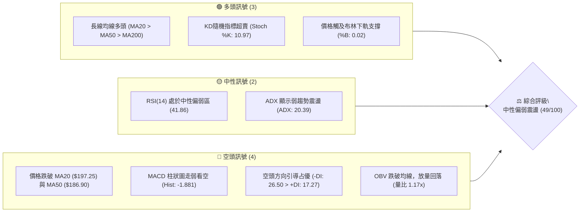
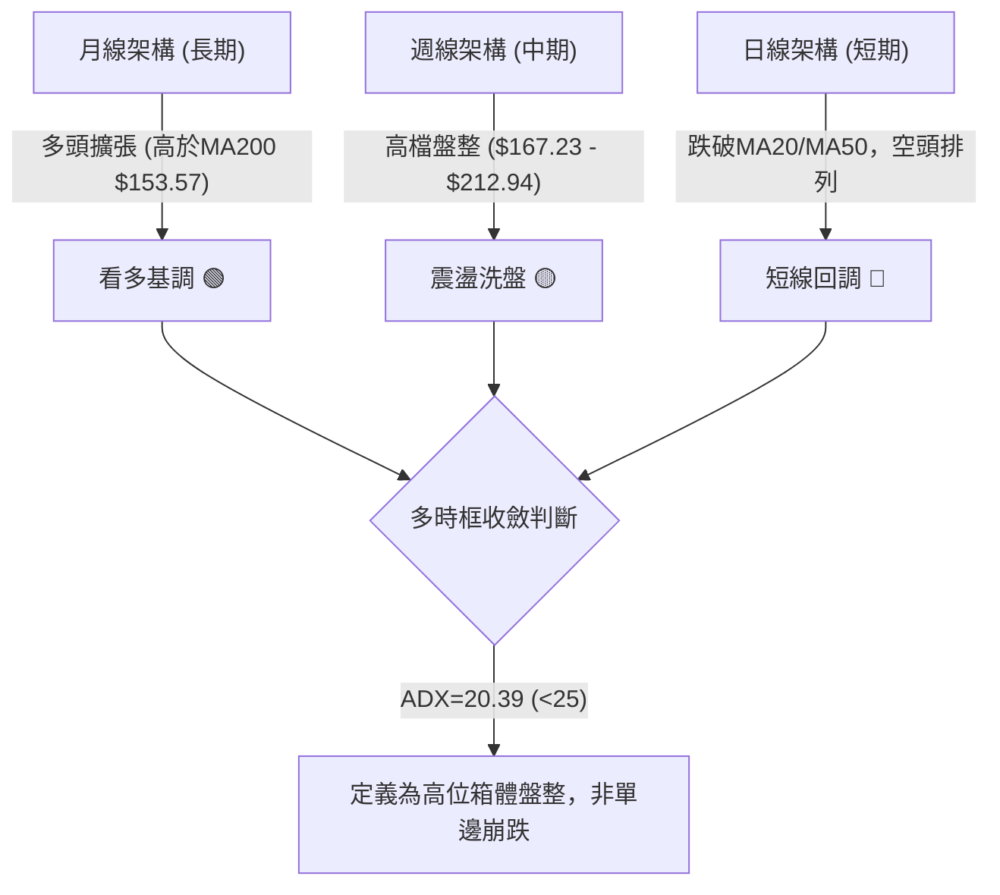
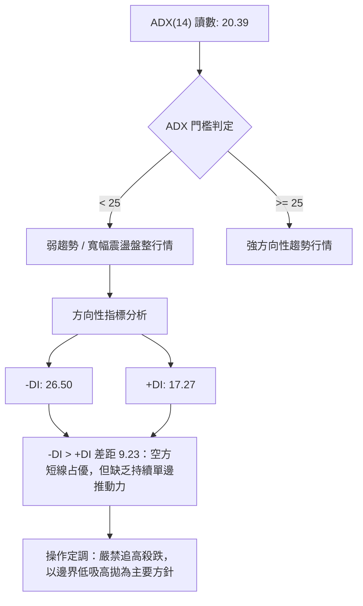
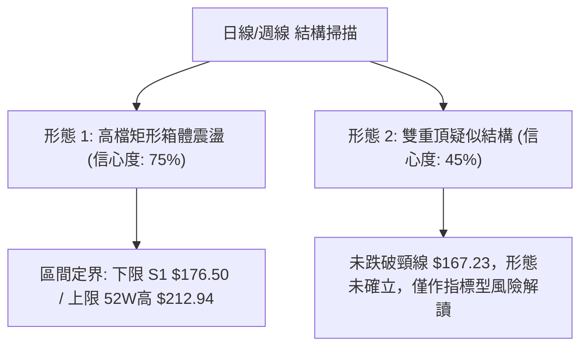
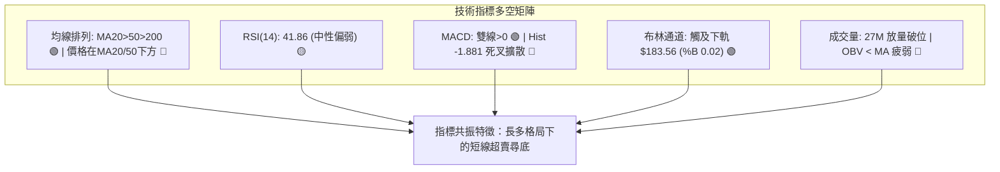
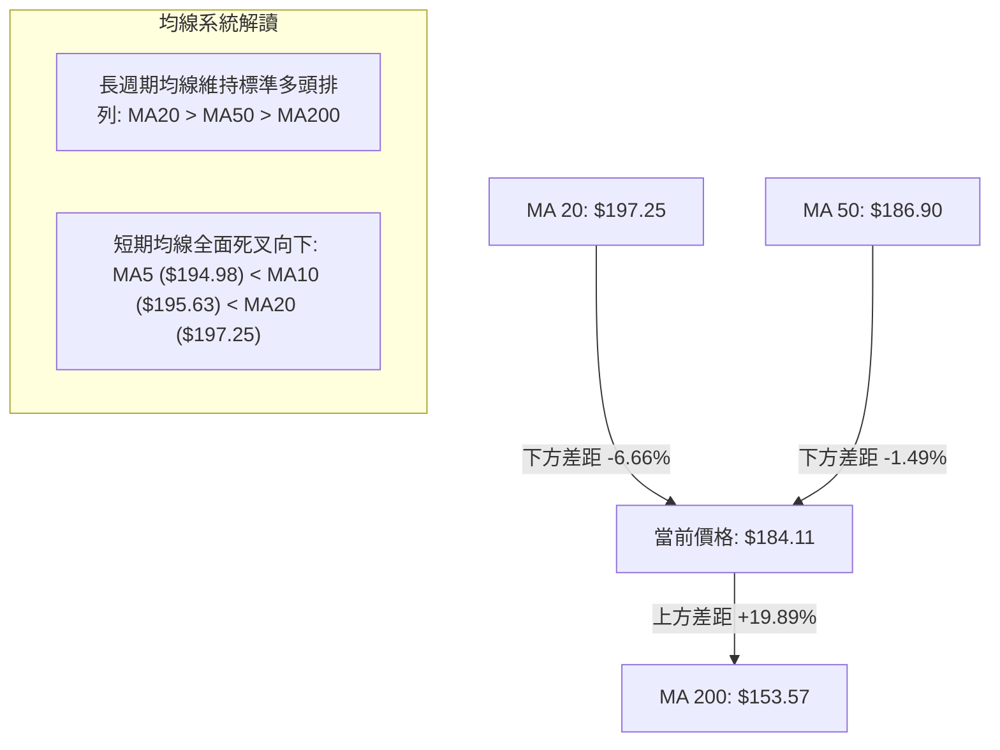
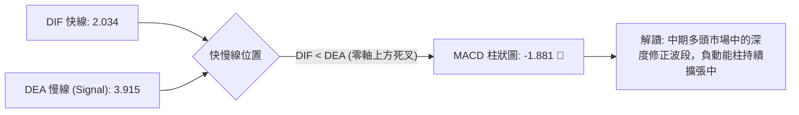
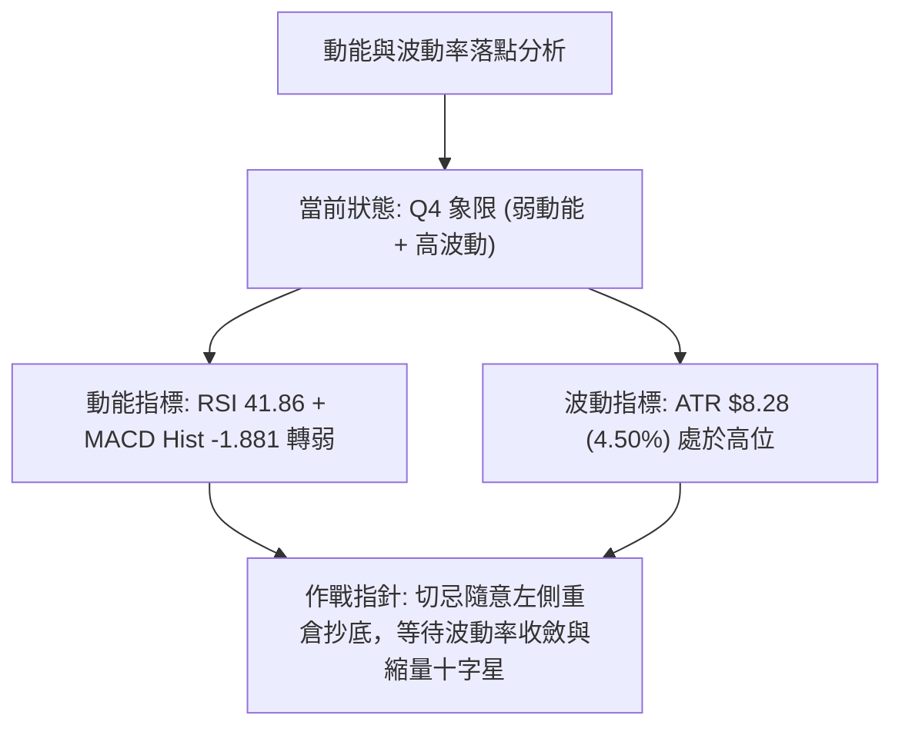
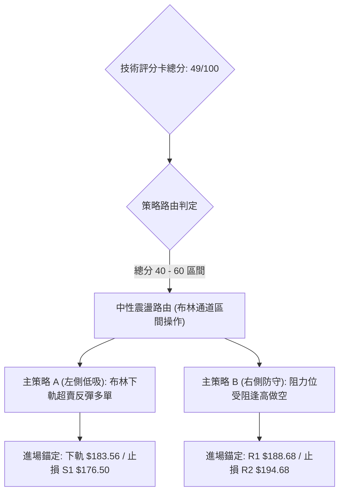
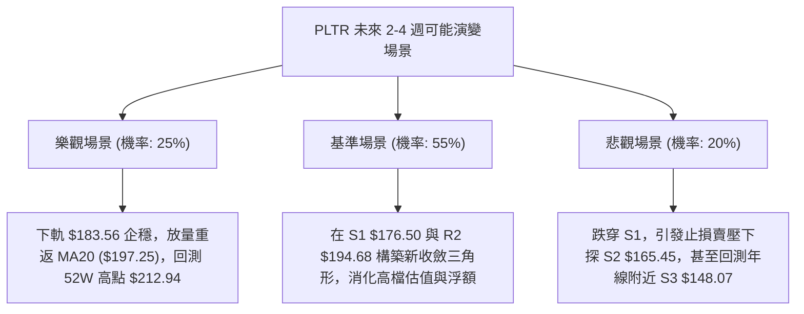

# PLTR 技術分析報告

> **報告日期**：2026-11-02 ｜ **語言**：繁體中文 ｜ **數據來源**：Yahoo Finance ｜ **當前價格**：$184.11

---

## 目錄

| 章節 | 內容 |
|------|------|
| [1. 技術面概覽](#1-技術面概覽) | 訊號儀表板、核心指標、評分卡 |
| [2. 趨勢分析](#2-趨勢分析) | 多時框趨勢、長中短期走勢 |
| [3. 圖表形態分析](#3-圖表形態分析) | 形態識別、K線組合、目標價 |
| [4. 支撐與阻力](#4-支撐與阻力) | 關鍵價位、斐波那契回調 |
| [5. 技術指標深度解讀](#5-技術指標深度解讀) | MA/RSI/MACD/布林/成交量 |
| [6. 動能與波動率](#6-動能與波動率) | 動能評估、ATR、Beta |
| [7. 多時框架總結](#7-多時框架總結) | 時框架評分矩陣 |
| [8. 交易策略建議](#8-交易策略建議) | 多空策略、風險報酬比 |
| [9. 風險提示與監控](#9-風險提示與監控) | 監控指標、風險場景 |

---

## 1. 技術面概覽

### 🎯 技術訊號儀表板



### 📊 核心指標速覽表

| 指標類別 | 指標名稱 | 當前數值 | 訊號 | 解讀 |
|----------|----------|----------|------|------|
| **價格** | 當前收盤價 | $184.11 | 🟡 | 位於52週區間 72.9% 分位，短期自高點 $212.94 回調 |
| **均線** | MA20 | $197.25 | 🔴 | 價格低於 MA20 -6.66%，短期承壓回檔 |
| **均線** | MA50 | $186.90 | 🔴 | 價格跌破 MA50 -1.49%，中期多空分水嶺受考驗 |
| **均線** | MA200 | $153.57 | 🟢 | 價格高於 MA200 +19.89%，長期牛市基調完好 |
| **動能** | RSI(14) | 41.86 | 🟡 | Wilder RSI 進入中性偏弱區間，未觸及極端超賣 (<30) |
| **動能** | MACD | 2.034 / 3.915 | 🔴 | 雙線位於零軸上方但柱狀圖為 -1.881，空頭動能主導波段 |
| **波動** | ATR(14) | $8.28 | 🟡 | 波動率佔股價 4.50%，日內振幅偏大，風險控制須擴大緩衝 |

### 🏆 技術評分卡

```
╔════════════════════════════════════════════════════════════════╗
║                  技術評分卡 — PLTR (2026-11-02)                ║
╠════════════════════════════════════════════════════════════════╣
║ 趨勢強度 (ADX/DI)   ██████████░░░░░░░░░░  48/100  🟡 中性弱勢  ║
║ 動能指標 (RSI/MACD) ████████░░░░░░░░░░░░  42/100  🔴 動能轉空  ║
║ 支撐穩定度 (BB/S1)  ███████████░░░░░░░░░  55/100  🟡 下軌承接  ║
║ 成交量配合 (OBV/VOL)████████░░░░░░░░░░░░  40/100  🔴 量價背離  ║
║ 形態完整度 (箱體)   ██████████░░░░░░░░░░  52/100  🟡 區間震盪  ║
║ 均線排列 (長均多頭) ███████████░░░░░░░░░  57/100  🟡 長多短空  ║
╠════════════════════════════════════════════════════════════════╣
║ 綜合評分            ██████████░░░░░░░░░░  49/100  ⚖️ 區間整理  ║
║ 評分公式依據：(48 + 42 + 55 + 40 + 52 + 57) ÷ 6 = 49 (四捨五入)║
╚════════════════════════════════════════════════════════════════╝
```

---

## 2. 趨勢分析

### 🌐 多時框趨勢分析



### 📈 長期趨勢 — 12個月走勢圖（Unicode）

```
PLTR 月線走勢圖（過去12個月：2025-11 至 2026-10）
價格軸 ($)
$210 ┤                                      ● (2026-10 盤中高 $212.94)
$200 ┤                                  ●   │
$190 ┤                              ●   │   │
$180 ┤                      ●       │   │   ●←當前收盤 $184.11
$170 ┤  ●       ●          │       │   │
$160 ┤  │   ●   │          │   ●   │   │
$150 ┤  │   │   │      ●   │   │   │   │
$140 ┤  │   │   │  ●   │   │   │   │   │
$130 ┤  │   │   │  │   │   │   │   │   │
$120 ┤  │   │   │  │   │   │   ●   │   │
$110 ┤  │   │   │  │   │   │   │   │   │
     └─────────────────────────────────────────────────────────────
        11  12  01  02  03  04  05  06  07  08  09  10 (月份)
       (25)(25)(26)(26)(26)(26)(26)(26)(26)(26)(26)(26)
```

#### 走勢特徵分析表格

| 階段區間 | 起止月份 | 收盤區間 | 累計漲跌幅 | 結構特徵分析 |
|----------|----------|----------|------------|--------------|
| 高位修正段 | 2025-11 ~ 2026-02 | $168.45 → $137.19 | -18.56% | 2025年10月衝高 $200.47 後進行估值修正，尋求百元上方中期支撐 |
| 築底震盪段 | 2026-03 ~ 2026-07 | $146.28 → $123.06 | -15.87% | 於 2026-06 探出 52週低點 $106.37（收盤 $116.67），完成大型底部清洗 |
| 強力主升段 | 2026-08 ~ 2026-09 | $186.38 → $187.05 | +51.99% | 財報強勁與主權AI合約爆發帶動單月巨量暴拉，週成交量飆破 4.35 億股 |
| 衝頂回調段 | 2026-10 | $187.05 → $184.11 | -1.57% | 創 52週新高 $212.94 後出現獲利了結賣壓，單月振幅達 $32.13 |

### 📊 中期趨勢（週線分析）

```
近期週線壓力與支撐示意圖
$212.94 ─── 52W 歷史天花板 (2026-10-16 當週高點) ─────────────────── [極強阻力]
$198.88 ─── R3 波段密集套牢區 ───────────────────────────────────── [強阻力]
$194.68 ─── R2 頸線與 MA20 週線爭奪區 ──────────────────────────── [次阻力]
$188.68 ─── R1 近期反彈受阻高點 ─────────────────────────────────── [即時壓力]
=============================================================================
$184.11 ◄── 現價位置 (面臨斐波那契 23.6% 與布林下軌考驗)
=============================================================================
$176.50 ─── S1 近期波段回撤低點聚類 (2026-09-25 週低 $176.76) ────── [關鍵支撐]
$165.45 ─── S2 9月中旬起漲點支撐 (2026-09-11 週低 $164.55) ──────── [核心防線]
$148.07 ─── S3 中期上升趨勢生命線 (對應 Fib 61.8% $147.08) ──────── [牛熊分界]
```

### ⚡ 趨勢強度評估（ADX 解讀）



#### ADX 趨勢強度對照

| 指標變數 | 當前讀數 | 門檻區間 | 趨勢屬性 | 結論與戰術引導 |
|----------|----------|----------|----------|----------------|
| **ADX(14)** | 20.39 | < 25 | 弱趨勢/震盪 | 市場處於高檔籌碼沉澱期，非破位崩跌或爆發性主升 |
| **+DI** | 17.27 | - | 多頭推進力 | 多頭推動力自10月上旬的強盛狀態明顯衰退 |
| **-DI** | 26.50 | - | 空頭殺傷力 | 空方短線佔據控盤主導權，反彈阻力大於下探阻力 |

---

## 3. 圖表形態分析

### 🔍 形態識別系統



#### 形態識別與信心度評估表

| 形態名稱 | 信心度 | 判斷依據（引用數據） | 完成度 | 目標價（附精確計算式） |
|----------|--------|----------------------|--------|------------------------|
| **高檔矩形箱體** | 75% | 價格在 2026-10-09 創 $209.05 後於 $180.81~$212.94 間大幅來回震盪，支撐 S1 為 $176.50，阻力 R3 為 $198.88 | 70% | 向上破位：$212.94 + ($212.94 - $176.50) = $249.38（N/A 未確認）<br>向下測底：依區間下限維持在支撐位 S1 **$176.50** |
| **雙重頂 (M頂)** | 45% | 10-09 當週高點 $209.58 與 10-16 當週高點 $212.94 形成雙峰，但頸線波段低點在 2026-09-11 的 $164.55，現價仍高於該水平甚遠 | 35% | 訊號不足，信心度低於50%，依規則僅作指標型解讀，不予預設極端破位目標 |

### 🕯️ 重要K線形態分析

嚴格依據數據中「近10根日K」與「近8根週K」開高低收進行形態審查：

| 日期（週期） | 開盤價 | 最高價 | 最低價 | 收盤價 | K線形態名稱 | 形態專業解讀 | 訊號 |
|--------------|--------|--------|--------|--------|-------------|--------------|------|
| **2026-10-21 (日K)** | $191.72 | $202.55 | $189.88 | $201.72 | 中長實體大陽線 | 多頭自低檔拉升突破200關卡，實體達 $10.00，量能放大確認買盤 | 🟢 |
| **2026-10-22 (日K)** | $200.76 | $202.63 | $194.54 | $196.19 | 高檔陰包容線 | 開高走低跌破前日收盤，高檔滯漲顯露空頭阻擊信號 | 🔴 |
| **2026-10-27 (日K)** | $198.12 | $201.83 | $196.79 | $198.73 | 上影小陽十字 | 多次上衝 $201.83 無功而返，高點逐步下移，顯示 $200 心理關卡拋壓沉重 | 🟡 |
| **2026-10-29 (日K)** | $198.37 | $198.51 | $190.36 | $196.42 | 長下影紡錘線 | 盤中下探 $190.36 後獲得逢低承接，但收盤仍受制於 MA20 ($197.25) | 🟡 |
| **2026-10-30 (日K)** | $193.62 | $193.92 | $180.81 | $184.11 | 帶量破位大陰線 | 破位跌穿 MA50 ($186.90)，最低探至 $180.81，成交量 27M 放量壓制 | 🔴 |
| **2026-10-16 (週K)** | $208.90 | $212.94 | $184.45 | $186.03 | 長上影流星陰線 | 創 52W 新高 $212.94 後遭遇機構斷崖式獲利結算，週跌幅顯著，確定短期頂部 | 🔴 |
| **2026-10-23 (週K)** | $186.99 | $202.63 | $186.15 | $196.75 | 陽線技術性回抽 | 週線反抽但未收復前週失地半數，屬下跌中繼的反抽確認 | 🟡 |
| **2026-10-30 (週K)** | $197.90 | $201.83 | $180.81 | $184.11 | 光頭中陰破位線 | 週線低點擊破前三週低位，空方實體完全吞噬前週反彈成果 | 🔴 |

### 📉 ASCII 走勢形態示意圖

```
PLTR 日線短期箱體受挫與下軌考驗走勢
$203.00 ┤        ┌──┐ (10/21-22 高點假突破 $202.63)
$200.00 ┤        │  └──┐    ┌─┐
$197.00 ┤        │     └────┘ └──┐
$194.00 ┤  ┌─────┘                └──┐ (10/29 跌破平台)
$191.00 ┤  │                         │
$188.00 ┤──┼─────────────────────────┼────── R1 $188.68
$185.00 ┤  │                         └──┐   
$184.11 ┼──┼─────────────────────────────●─── 當前現價 (逼近下軌)
$180.81 ┤  │                             │    10/30 盤中探底
$176.50 ┴──┴─────────────────────────────┴─── S1 關鍵支撐線
           10/19 10/21 10/23 10/27 10/30 (日期)
```

### 🎯 形態目標價計算

1. **短期反彈目標（向上形態）**：
   - 若 10/30 之長下影下探 $180.81 獲得布林下軌（$183.56）確認支撐，箱體回抽之第一頸線阻力為近端跳空破位點 **R1 $188.68**。
   - 若進一步向上修復，則指向箱體中軸與密集套牢起跌點 **R2 $194.68**。
2. **短期破位測幅（向下形態）**：
   - 形態計算式：當前破位箱體高度 = 箱體上緣 $198.88 (R3) − 箱體中軸 $188.68 (R1) = $10.20。
   - 跌破中軸後之等幅測算點 = $188.68 − $10.20 = **$178.48**（此數值高度共振數據中的波段低點聚類支撐 **S1 $176.50**）。

---

## 4. 支撐與阻力

### 🗺️ 關鍵價位分布圖（Unicode）

```
PLTR 價位結構分布圖
═══════════════════════════════════════════════════════════════
$212.94 ║██████████████████████████████║ 52週歷史高點 (極限天花板)
$198.88 ║████████████████████████║ 強阻力 R3 (波段密集套牢區)
$194.68 ║██████████████████      ║ 阻力 R2 (MA10/MA20 反壓帶)
$188.68 ║████████████████████████║ 關鍵阻力 R1 (前波低點轉阻力)
$187.79 ║────────────────────────║ 斐波那契 23.6% 回調位
════════╠════════════════════════╣ ◄ 現價 $184.11
$183.56 ║░░░░░░░░░░░░░░░░░░░░░░░░║ 布林通道下軌動態支撐
$176.50 ║▓▓▓▓▓▓▓▓▓▓▓▓▓▓▓▓▓▓▓▓    ║ 近期支撐 S1 (9月波段低點聚類)
$172.23 ║────────────────────────║ 斐波那契 38.2% 回調位
$165.45 ║████████████████████████║ 強支撐 S2 (起漲波段核心防線)
$148.07 ║████████████████████████║ 牛熊生死防線 S3 (共振Fib 61.8%)
═══════════════════════════════════════════════════════════════
```

### 🚧 阻力位分析表

全部價位嚴格引用技術數據「關鍵價位」區塊數值：

| 阻力級別 | 精確價位 | 距現價空間 | 形成原因與籌碼特徵 | 突破難度 | 重要性 |
|----------|----------|------------|--------------------|----------|--------|
| **R1** | **$188.68** | +2.48% | 近期波段高點聚類，亦為 10-23 週K開盤防守區與日線 MA60 ($184.75) 上方第一道結構反壓 | 中等 🟡 | ★★★☆☆ |
| **R2** | **$194.68** | +5.74% | 10月中下旬多個交易日收盤密集爭奪帶，與 MA5 ($194.98)、MA10 ($195.63) 形成重疊壓制 | 較高 🔴 | ★★★★☆ |
| **R3** | **$198.88** | +8.02% | 整數關卡 $200.00 前哨基地，10-26 至 10-28 盤中高點密集阻力區，解套賣壓最密集處 | 極高 🔴 | ★★★★★ |

### 🛡️ 支撐位分析表

全部價位嚴格引用技術數據「關鍵價位」區塊數值：

| 支撐級別 | 精確價位 | 距現價空間 | 形成原因與籌碼特徵 | 守住機率 | 重要性 |
|----------|----------|------------|--------------------|----------|--------|
| **S1** | **$176.50** | -4.13% | 近一年波段低點聚類，9月下旬起漲回踩低點（2026-09-25 週低 $176.76）保護區 | 65% 🟢 | ★★★★☆ |
| **S2** | **$165.45** | -10.14% | 9月中旬大成交量起漲平台低點（2026-09-11 週低 $164.55），機構護盤防線 | 80% 🟢 | ★★★★★ |
| **S3** | **$148.07** | -19.58% | 長期多頭防禦底線，緊鄰日線 MA200 ($153.57) 與 斐波那契 61.8% ($147.08) 黃金共振 | 95% 🟢 | ★★★★★ |

### 📐 斐波那契回調位分析

依據 52週區間極值（最低點 $106.37 → 最高點 $212.94，總垂直振幅 $106.57）推算之關鍵位分析：

| 斐波那契回調層級 | 精確點位 | 價位與現價 ($184.11) 相對關係與結構意義 |
|------------------|----------|-----------------------------------------|
| **0.0% (52W High)** | **$212.94** | 歷史絕對頂部，中期上行多頭終極目標 |
| **23.6%** | **$187.79** | **已跌破**（現價低於此位 -1.96%）。多頭極強勢回調保護線宣告失守，轉化為反彈第一阻力 |
| **38.2%** | **$172.23** | **當前下方主要緩衝區**。正常強勢多頭調整的極限健康回調位，位於 S1 ($176.50) 之下 |
| **50.0%** | **$159.66** | 多空中性平衡中樞，跌破代表 2026 年下半年升幅被抹平一半 |
| **61.8% (黃金分割)** | **$147.08** | **牛熊生命線**。與支撐位 S3 ($148.07) 完美重疊，多頭趨勢不破此位則長多格局未變 |
| **78.6%** | **$129.18** | 深幅回撤防線，若觸及則牛市結構遭受不可逆破壞 |
| **100.0% (52W Low)**| **$106.37** | 52週絕對底部，2026年6月大型複合底低點 |

*斐波那契位階判定*：當前收盤價 **$184.11** 處於 **23.6% ($187.79)** 與 **38.2% ($172.23)** 之間。這表明股價脫離了「超強勢單邊整理」，進入了「次級健康修正」階段；只要能守在 38.2%（$172.23）與 S1（$176.50）之上，中長期波段結構依然完好。

---

## 5. 技術指標深度解讀

### 🎛️ 指標訊號總覽



### 📈 移動平均線排列分析



#### 均線各週期偏離度與趨勢診斷

| 均線代號 | 數值 | 價格相對於均線 | 均線歷史斜率狀態 | 戰術意義解讀 |
|----------|------|----------------|------------------|--------------|
| **MA 5** | $194.98 | -5.58% (下方) | 急速下彎 ▅▆▇███▇▆▆ | 短線空方極度凌厲，反彈第一反壓 |
| **MA 10** | $195.63 | -5.89% (下方) | 拐頭向下 ████████▇▇ | 短線波段空頭防守線 |
| **MA 20** | $197.25 | -6.66% (下方) | 走平轉下 ▇▇▇▇██████ | 短期月線生命線失守，月度多空翻空 |
| **MA 50** | $186.90 | -1.49% (下方) | 緩升鈍化 ▄▄▅▅▆▆▇▇█ | 中期季度生命線，10/30 首度被實體陰線擊穿 |
| **MA 60** | $184.75 | -0.34% (下方) | 微升走平 ▆▆▆▇▇▇████ | 剛好壓制在現價頭頂，構成週初爭奪中樞 |
| **MA 120**| $158.56 | +16.11% (上方) | 強勁向上 ▄▄▅▅▆▆▇▇█ | 半年線支撐雄厚，牛市防禦縱深 |
| **MA 200**| $153.57 | +19.89% (上方) | 穩定向上 ▃▃▄▄▅▅▆▆▇ | 年線牛熊分水嶺，長期多頭根基穩固 |

### 📉 RSI(14) 分析

- **RSI(14) 當前讀數**：41.86（Wilder 計算方法）
- **區間進度條**：
  ```
  超賣 [0] ────────── [30] ───●────── [70] ────────── [100] 超買
  RSI 讀數 41.86: ██████████░░░░░░░░░░░░░░ 41.86%
  ```
- **超買超賣狀態**：
  - 目前處於 40–50 之弱勢平衡區，脫離了10月上旬創高時的嚴重超買區（當時週線 RSI 達 76.3）。
  - 日線 RSI 未進入 <30 的絕對超賣區，顯示空方動能尚未完全衰竭出清。
- **背離分析判斷**：
  - 數據明確顯示：「**RSI 背離：無明顯背離**（比對近20根K棒首尾之價格與RSI方向）」。
  - 股價自 10-21 高點 $202.55 降至 10-30 低點 $180.81，RSI 同步自高位滑落至 41.86，屬於正常的**價格跌勢與指標動能同步**，不存在底背離所預示的立即反轉訊號。

### 📊 MACD(12/26/9) 訊號解讀



- **MACD 快線 (2.034)** 與 **訊號線 (3.915)** 均維持在零軸上方，確認自 2026 年中以來的**大週期多頭趨勢未遭到結構性破壞**。
- 但 **MACD 柱狀圖已達 -1.881**，且連續呈現空頭擴散。此數據與週線 MACD 柱狀圖（連續三週為 -0.822、-1.187、-1.881）高度吻合，反映中期獲利了結賣壓仍在有節奏地釋放。

### 📦 布林通道分析

```
布林通道結構示意圖 (寬度參數 20, 2)
$210.93 ────────────────────────────────────────── 上軌 (強阻力壓制區)
          │
$197.25 ──┼─────────────────────────────────────── 中軌 (MA20 翻轉為反壓)
          │
$184.11 ──┼──● 現價位置 (%B: 0.02)
$183.56 ──┴─────────────────────────────────────── 下軌 (極限彈性支撐)
```

- **BB %B 數值**：**0.02**（0 代表下軌，0.5 代表中軌，1 代表上軌）。
- **結構意義**：現價 $184.11 距離下軌 $183.56 僅有些微差距（百分位 2%）。在統計學上，價格已運行動態常態分佈的 -2 個標準差極限位置。
- **隨機指標共振**：Stoch %K 為 10.97，Stoch %D 為 32.12，進入深度超賣區。布林通道極限位置共振隨機指標超賣，**技術性均值回歸（超跌反彈）的機率正在急劇累積**。

### 💹 成交量分析（量價配合度）

```
成交量柱狀對比圖
最新量 (10-30):   27,007,300 股 ███████████████████████████ (量比: 1.17x)
20日均量:         23,053,640 股 ███████████████████████
50日均量:         24,894,104 股 █████████████████████████
```

- **量能屬性**：10月30日下跌放出 2,700 萬股，為近 10 個交易日內最大單日成交量（高於 20 日均量 1.17 倍）。
- **OBV 能量潮判斷**：數據明確提示「**OBV趨勢：OBV < MA → 量能疲弱**」。在下行過程中 OBV 跌破其均線，意味著機構資金未在 $190 以上進行主動承接，屬於典型的「放量破線帶出恐慌盤」。
- **籌碼解讀**：放量長陰通常是波段恐慌賣壓的宣洩，但若下一個交易日無法迅速縮量止血，則確認為主力資金派發。

---

## 6. 動能與波動率

### ⚡ 動能評估四象限

| 象限 | 動能維度 (Momentum) | 波動率維度 (Volatility) | 當前判定 | 象限屬性與策略涵義 |
|:---:|:---:|:---:|:---:|---|
| **Q1** | 強動能 (Bullish) | 低波動 (Low Vol) | — | 穩定主升浪：持股待漲的最佳獲利期 |
| **Q2** | 弱動能 (Bearish) | 低波動 (Low Vol) | — | 窄幅陰跌盤整：市場交投清淡，資金觀望 |
| **Q3** | 強動能 (Bullish) | 高波動 (High Vol) | — | 狂暴拉升期：風險高收益大，易見短期暴頂 |
| **Q4** | 弱動能 (Bearish) | 高波動 (High Vol) | **✓ PLTR 目前落點** | **震盪宣洩期：空方動能放大伴隨 ATR 擴張，應防範慣性下殺** |



### 📊 ATR 波動率分析

- **ATR(14) 絕對數值**：**$8.28**（採用 Wilder 平滑算法）。
- **波動率佔比**：佔當前股價之 **4.50%**，展現 PLTR 作為成長型科技股的高彈性與高 Beta 特質。
- **止損與進場空間指導**：
  - **常規日內噪聲過濾**：單日價格波動在 $\pm \$8.28$ 內均屬正常波動。
  - **波段止損緩衝設距**：建立多頭或空頭波段部位時，止損距離絕不可小於 1.0 倍 ATR（$8.28），最佳防禦寬度應設為 1.5 倍 ATR（約 $\$12.42$），以避開盤中「假破位」掃單。

### 📐 Beta 與市場相關性

- **Beta 係數**：**1.602**。
- **市場特徵分析**：
  - 股價波動強度為 S&P 500 指數的 1.6 倍，大盤上漲時具備強大的超額收益（Alpha）爆發力，但在大盤回調或風險偏好收縮時，面臨放大 1.6 倍的殺跌風險。
  - 搭配目前未平倉放空比率（Short % Float）僅 2.6%、空頭回補天數（Short Ratio）僅 2.37 天，顯示當前下挫主要來自「長線多頭獲利了結」與「機構權重平衡」，而非大規模空頭投機做空聚集。

---

## 7. 多時框架總結

### 📋 時框架評分表

| 時框架 | 趨勢方向 | 動能狀態 | 均線排列 | 形態結構 | 綜合評分 | 操作方針建議 |
|--------|----------|----------|----------|----------|:--------:|--------------|
| **月線 (長期)** | 🟢 強烈看多 | 🟢 依然強勁 | 🟢 多頭完美排列 | 大五浪擴張末端 | **78/100** | 長線多頭底倉續抱，無須驚慌 |
| **週線 (中期)** | 🟡 震盪整理 | 🔴 柱狀圖走弱 | 🟢 支撐於MA20上 | 高位矩形箱體洗盤 | **52/100** | 暫停加碼，等待洗盤形態完成 |
| **日線 (短期)** | 🔴 短期下行 | 🔴 超賣但未背離| 🔴 破MA20/MA50 | 帶量長陰探下軌 | **38/100** | 嚴控多頭開倉，逢高減碼保護 |

### 🔲 綜合訊號矩陣

```
時框維度與技術面要素檢驗矩陣：
┌──────────────┬──────────────┬──────────────┬──────────────┐
│  分析維度    │ 短期 (日線)  │ 中期 (週線)  │ 長期 (月線)  │
├──────────────┼──────────────┼──────────────┼──────────────┤
│ 趨勢方向     │ 🔴 空方控盤  │ 🟡 寬幅箱體  │ 🟢 單邊長牛  │
│ 均線健康度   │ 🔴 跌破短均  │ 🟡 考驗中軌  │ 🟢 遠在年線上│
│ 動能指標     │ 🔴 死叉向下  │ 🔴 動能收斂  │ 🟢 零軸上方  │
│ 量能配合度   │ 🔴 放量下殺  │ 🟡 縮量整理  │ 🟢 歷史巨量  │
│ 形態位置     │ 🟢 逼近下軌  │ 🟡 箱體中央  │ 🟢 歷史高檔  │
└──────────────┴──────────────┴──────────────┴──────────────┘
```

### ⚖️ 多時框收斂結論

依據多時框收斂指引：
1. **行情性質判定**：當前日線 **ADX(14) 讀數為 20.39（< 25）**，明確判定當前不屬於單邊暴跌趨勢，而是**大級別多頭趨勢下的「高位寬幅震盪盤整行情」**。
2. **時框衝突取捨**：雖然長期月線極度強勢，但日線出現破位長陰（跌破 MA20 與 MA50），且 -DI（26.50）主導。在弱趨勢（ADX<25）環境下，**日線布林通道（上軌 $210.93，下軌 $183.56）構成了最核心的實戰交易邊界**。
3. **最終收斂方向**：給出**「中性觀望／區間邊界操作」**之唯一結論。評分 49/100 嚴格對應中性區間（40–60），策略必須以布林下軌承接、上軌反壓化解為唯一邏輯，禁止在區間中段激進追單。

---

## 8. 交易策略建議

### 🗺️ 策略決策流程圖



### 🧭 策略路由（依評分卡分流）

> **當前主策略方向 = 中性震盪區間操作（依綜合評分 49/100，介於 40–60 之間）**
> 
> 行情處於 ADX=20.39 的非單邊震盪市。價格剛好打在日線布林通道下軌（$183.56，現價 $184.11，%B=0.02），且隨機指標 Stoch %K 跌至 10.97 極端超賣。此時既不可盲目追空，亦不可重倉賭底，必須嚴格依據**第 4 章計算之關鍵價位**進行邊界博弈。

### 🎯 價格情境階梯（Price Scenarios）

全部價位嚴格引用技術數據「關鍵價位」區塊數值：

| 觸發條件 | 下一目標 | 後續延伸 | 情境含義與技術心理解讀 |
|----------|----------|----------|------------------------|
| **突破 R1 $188.68** | **R2 $194.68** | **R3 $198.88** | 短線空頭衰竭，多頭收復 MA50 並展開均值回歸回抽 |
| **站穩現價 $184.11** | **R1 $188.68** | — | 於布林下軌（$183.56）獲得支撐，進入窄幅止跌震盪 |
| **跌破 S1 $176.50** | **S2 $165.45** | **S3 $148.07** | 正式宣告中期破位，下探 38.2% 斐波那契位及起漲防線 |

### 📊 情境機率分佈

| 情境 | 機率 | 主要依據（指標狀態） |
|------|:---:|----------------------|
| **下軌超跌反彈 (向上)** | **50%** | 布林 %B 達 0.02、Stoch 進入極限超賣（10.97）、長期均線多頭保護 |
| **區間弱勢震盪 (橫盤)** | **30%** | ADX 僅 20.39 無方向趨勢、OBV 疲軟限制反彈高度，需時間換空間 |
| **持續破位下殺 (向下)** | **20%** | 10-30 放量陰線帶出慣性、MACD 柱狀圖 -1.881 負動能擴散中 |

### 🟢 主策略詳情（方向依上方路由）

依據嚴格規則 17，所有進場、止損、目標價必須引用提供數據，風險報酬比公式為：
$\text{風險報酬比} = (\text{目標價 T1} - \text{進場價}) \div (\text{進場價} - \text{止損價})$（做空時方向相反）。

| 策略要素 | 策略 A（下軌超跌短多） | 策略 B（反彈受阻高空） |
|----------|------------------------|------------------------|
| **策略屬性** | 逆勢左側交易（博弈超賣反彈） | 順勢右側交易（博弈均線壓制） |
| **進場條件** | 股價回踩布林下軌不破，出現止跌信號 | 反抽受阻於 R1 且成交量萎縮 |
| **進場價格** | **$183.56**（布林通道下軌） | **$188.68**（關鍵阻力位 R1） |
| **目標價 T1** | **$194.68**（阻力位 R2 / MA10處） | **$176.50**（支撐位 S1） |
| **目標價 T2** | **$198.88**（阻力位 R3 / 月線處） | **$165.45**（強支撐位 S2） |
| **止損價格** | **$176.50**（跌破支撐位 S1 止損） | **$194.68**（突破阻力位 R2 止損） |
| **風險報酬比** | **1 : 1.58（以 T1 計）**<br>*(計算式: (194.68 - 183.56) ÷ (183.56 - 176.50) = 11.12 ÷ 7.06 = 1.575)*<br>[若以 T2 計則為 1 : 2.17] | **1 : 2.03（以 T1 計）**<br>*(計算式: (188.68 - 176.50) ÷ (194.68 - 188.68) = 12.18 ÷ 6.00 = 2.030)*<br>[若以 T2 計則為 1 : 3.87] |
| **成功機率** | 55% | 50% |
| **建議倉位** | 10%–15%（輕倉防禦型） | 10%–15%（波段對沖型） |

### 🔴 反向風險觸發點（對沖提示）

- **多頭反轉警報**：若日K線以收盤價實體有效跌穿 **S1 $176.50**，意味著區間震盪下軌徹底崩潰，必須立即無條件止損出局，並防範價格朝向 **S2 $165.45** 慣性宣洩。
- **空頭反轉警報**：若日K線以長陽向上吞噬並收復 **R2 $194.68**，表示短期均線空頭排列遭到暴力破壞，所有做空或對沖部位應全面平倉避險。

### ⭐ 整體訊號強度評星

```
做多訊號強度：★★☆☆☆  (2.5/5星 — 短線超賣有反彈需求，但受制於破位陰線)
做空訊號強度：★★★☆☆  (3.0/5星 — 日線指標全面死叉，空方掌握波段定價權)
整體可信度：  ★★★☆☆  (3.5/5星 — 處於 ADX<25 震盪市，訊號常有毛刺與假突破)
```

---

## 9. 風險提示與監控

### ✅ 關鍵監控指標 Checklist

```
╔══════════════════════════════════════════════════════════════════╗
║               PLTR 盤面異動與風險監控清單 (Checklist)           ║
╠══════════════════════════════════════════════════════════════════╣
║ [ ] 價格防禦：盤中是否跌破布林下軌 $183.56 並收於其下方？        ║
║ [ ] 支撐極限：關鍵支撐 S1 $176.50 是否出現恐慌性放量拋售？       ║
║ [ ] 動能收斂：日線 RSI 是否跌破 30 進一步陷入鈍化？              ║
║ [ ] 量能指標：日成交量是否降至 2,000 萬股以下展現拋壓衰竭？      ║
║ [ ] 均線壓制：反彈時能否在 2 個交易日內收復 MA50 ($186.90)？     ║
║ [ ] 指標死叉：MACD 柱狀圖是否在零軸下方出現首根收斂紅柱？        ║
╚══════════════════════════════════════════════════════════════════╝
```

### ⚠️ 風險場景分析



### 🛡️ 風險管理重要提醒

1. **基本面高估值帶來的波動槓桿**：
   - 目前 PLTR 靜態 P/E 高達 158.72，P/S 達 71.87。高估值意味著市場對其成長容錯率極低，任何外部系統性風吹草動（如大盤科技股回檔）均會被 1.602 的高 Beta 放大，嚴禁在回調初期使用槓桿工具。
2. **波動率與部位規模精算**：
   - 考慮到日線 ATR 高達 **$8.28**，單筆交易的最大止損幅度應控制在總資金的 1%~1.5% 以內。以操作策略 A 為例，若進場點為 $183.56，止損點設為 $176.50，單股風險值為 $7.06；對於一個 10 萬美元的帳戶，單筆最大容許虧損若為 $1,000 美元，則最大開倉股數不得超過 140 股（市值約 $25,700 美元，約 25% 倉位上限）。

---

## 📋 報告總結

```
╔══════════════════════════════════════════════════════════════════╗
║                    PLTR 技術分析報告總結                        ║
╠══════════════════════════════════════════════════════════════════╣
║ 報告日期：2026-11-02                                             ║
║ 當前收盤價格：$184.11                                            ║
║ 綜合技術評級：⚖️ 中性偏弱寬幅整理 (評分: 49/100)                  ║
╠══════════════════════════════════════════════════════════════════╣
║ 關鍵結論綱要：                                                   ║
║ ├─ 長期趨勢：🟢 強烈看多 (高於 MA200 $153.57 達 +19.89%)          ║
║ ├─ 中期趨勢：🟡 寬幅震盪 (ADX 20.39 < 25，高位箱體蓄勢)          ║
║ ├─ 短期趨勢：🔴 偏弱回調 (跌破 MA20 $197.25 與 MA50 $186.90)     ║
║ ├─ 即時關鍵阻力：R1 $188.68 │ R2 $194.68 │ R3 $198.88           ║
║ ├─ 即時關鍵支撐：S1 $176.50 │ S2 $165.45 │ S3 $148.07           ║
║ └─ 華爾街共識目標價：$212.50 (28位分析師均值，區間 $80 - $265)   ║
╠══════════════════════════════════════════════════════════════════╣
║ 最優策略組合：                                                   ║
║ 1. 🥇 最佳機會：策略 A — 布林下軌 $183.56 處以極小停損博弈超賣反  ║
║                  彈，目標直指 R2 $194.68，風報比 1 : 1.58。      ║
║ 2. 🥈 次選機會：策略 B — 反抽至 R1 $188.68 遇阻無量時建立保護性   ║
║                  做空部位，止損 R2，目標下看 S1，風報比 1 : 2.03。║
║ 3. 🥉 保守選擇：完全空倉觀望，耐心等待價格在 S1 $176.50 附近完成  ║
║                  縮量築底結構，或強勢站回 MA20 上方後再行介入。  ║
╚══════════════════════════════════════════════════════════════════╝
```

---

> ⚠️ **免責聲明**：本報告為技術分析研究，所有數據指標及價位均嚴格基於歷史交易行情（OHLCV）計算呈現。本報告**僅供研究與學術參考**，**不構成任何要約、招攬或具體投資建議**。金融市場瞬息萬變，技術指標存在滯後性與失效風險，投資人應獨立評估風險並自行承擔交易盈虧。

---

*報告生成時間：2026-11-02 ｜ 數據來源：Yahoo Finance ｜ 分析框架：多時框量化技術分析*