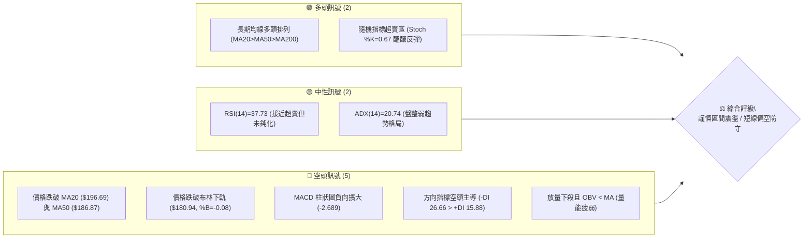
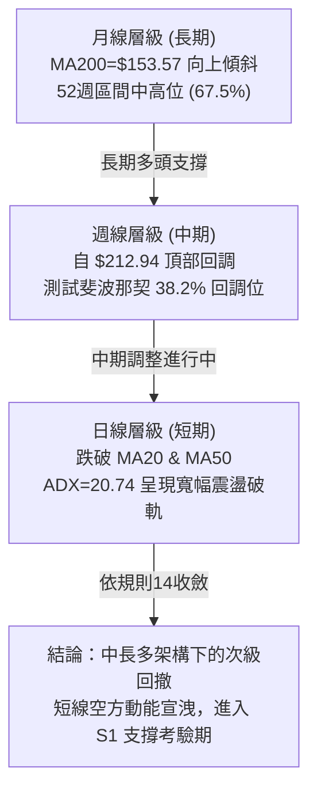
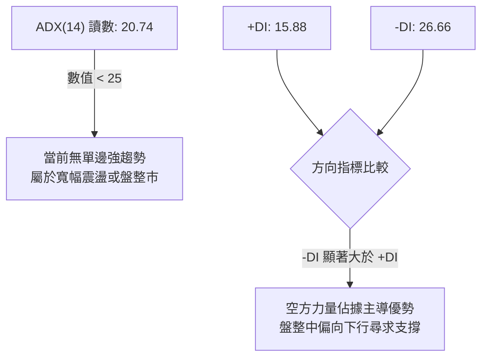
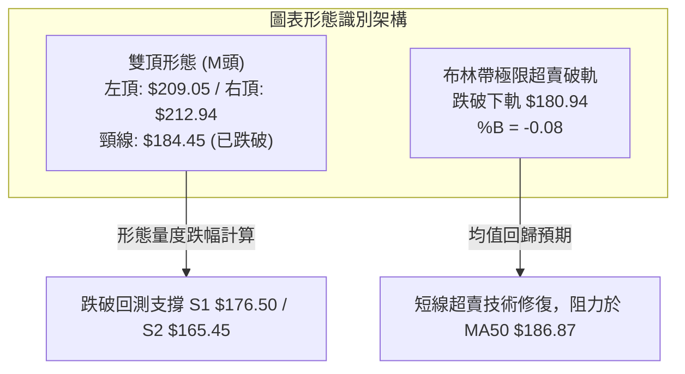
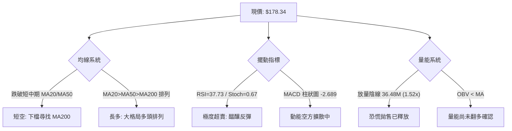
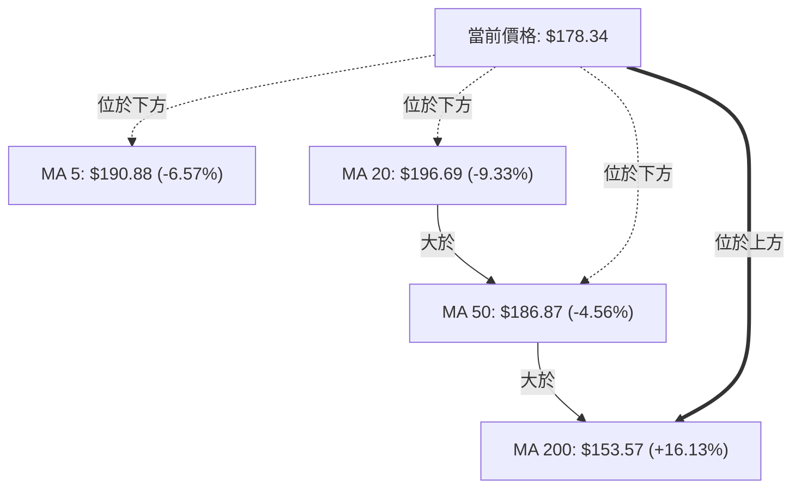
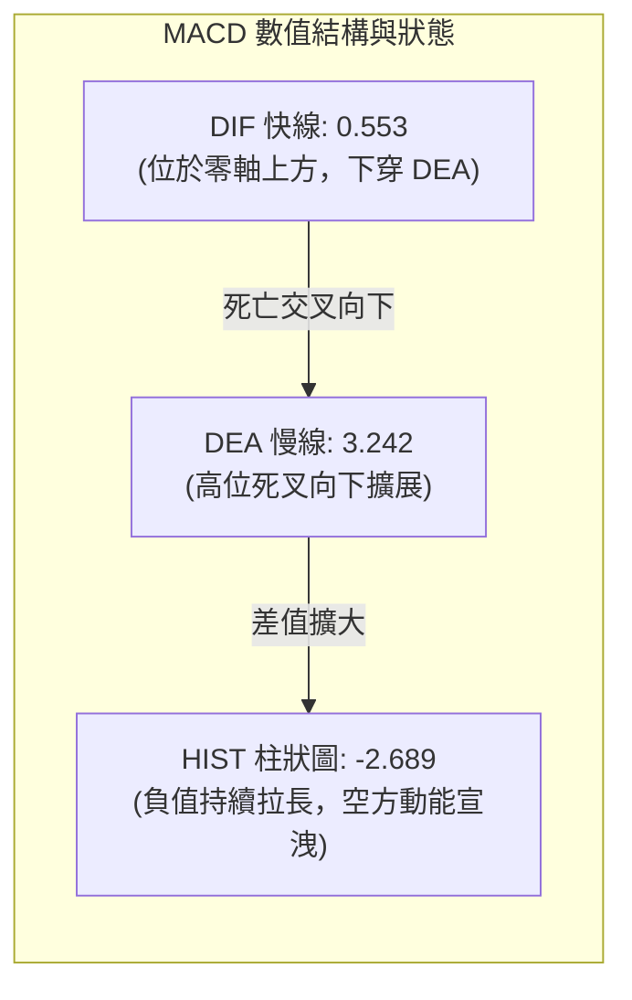
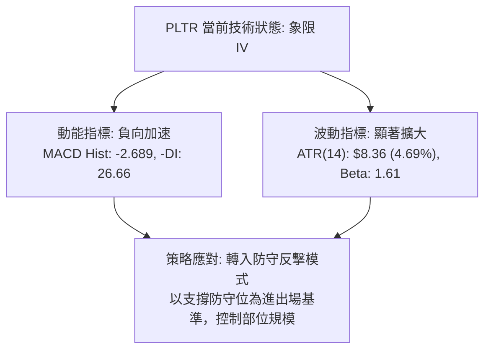
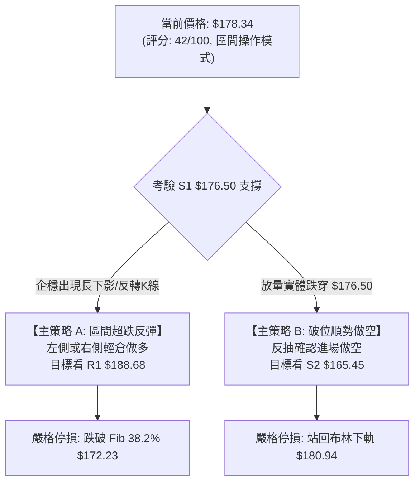
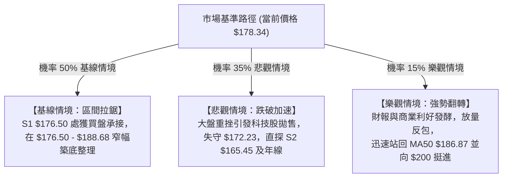

# PLTR 技術分析報告

> **報告日期**：2026-11-03 ｜ **語言**：繁體中文 ｜ **數據來源**：Yahoo Finance ｜ **當前價格**：$178.34 USD

---

## 目錄

| 章節 | 內容 |
|------|------|
| [1. 技術面概覽](#1-技術面概覽) | 訊號儀表板、核心指標、評分卡 |
| [2. 趨勢分析](#2-趨勢分析) | 多時框趨勢、長中短期走勢 |
| [3. 圖表形態分析](#3-圖表形態分析) | 形態識別、K線組合、目標價 |
| [4. 支撐與阻力](#4-支撐與阻力) | 關鍵價位、斐波那契回調 |
| [5. 技術指標深度解讀](#5-技術指標深度解讀) | MA/RSI/MACD/布林/成交量 |
| [6. 動能與波動率](#6-動能與波動率) | 動能評估、ATR、Beta |
| [7. 多時框架總結](#7-多時框架總結) | 時框架評分矩陣 |
| [8. 交易策略建議](#8-交易策略建議) | 多空策略、風險報酬比 |
| [9. 風險提示與監控](#9-風險提示與監控) | 監控指標、風險場景 |

---

## 1. 技術面概覽

### 🎯 技術訊號儀表板



### 📊 核心指標速覽表

| 指標類別 | 指標名稱 | 當前數值 | 訊號 | 解讀 |
|----------|----------|----------|------|------|
| **價格** | 當前收盤價 | $178.34 | 🔴 | 位於 52 週高低區間 67.5%，短期遭遇顯著拋壓 |
| **均線** | MA20 | $196.69 | 🔴 | 現價位於 MA20 下方 -9.33%，短期趨勢向下 |
| **均線** | MA50 | $186.87 | 🔴 | 現價位於 MA50 下方 -4.56%，跌破中期生命線 |
| **均線** | MA200 | $153.57 | 🟢 | 現價高於 MA200 +16.13%，長線牛市架構未被破壞 |
| **動能** | RSI(14) | 37.73 | 🟡 | 中性偏弱區間，尚未跌破 30 超賣線，無顯著背離 |
| **動能** | MACD 柱 | -2.689 | 🔴 | DIF 0.553 < DEA 3.242，零軸上方死叉擴大，空頭主導 |
| **動能** | Stoch %K / %D | 0.67 / 17.89 | 🟢 | 進入極度超賣區間，隱含短線技術性抽頭契機 |
| **趨勢** | ADX(14) | 20.74 | 🟡 | ADX < 25 表明處於弱趨勢或寬幅盤整，-DI(26.66) 領先 |
| **通道** | 布林帶寬 | $180.94 - $212.45 | 🔴 | 現價跌破布林下軌（%B 為 -0.08），呈現超跌外移態勢 |
| **量能** | 當日成交量 | 36,476,600 | 🔴 | 量比 1.52x（高於 20 日均量），大陰線伴隨放量，空方拋售明顯 |
| **波動** | ATR(14) | $8.36 | 🟡 | 佔股價 4.69%，單日波動幅度較大，風控需預留空間 |

### 🏆 技術評分卡

```
╔══════════════════════════════════════════════════════════════╗
║                技術評分卡 — PLTR (2026-11-03)               ║
╠══════════════════════════════════════════════════════════════╣
║ 趨勢強度 (ADX=20.74, 偏盤整)   ███████░░░░░░░░░░░░░  35/100 🔴 ║
║ 動能指標 (MACD死叉, Stoch超賣) ██████░░░░░░░░░░░░░░  30/100 🔴 ║
║ 支撐穩定度 (逼近 S1 $176.50)   ██████████░░░░░░░░░░  50/100 🟡 ║
║ 成交量配合 (帶量下破, OBV疲弱) ███████░░░░░░░░░░░░░  35/100 🔴 ║
║ 形態完整度 (頭部回跌測頸線)   ████████░░░░░░░░░░░░  40/100 🔴 ║
║ 均線排列 (MA20>50>200, 長期多) ████████████░░░░░░░░  62/100 🟢 ║
╠══════════════════════════════════════════════════════════════╣
║ 綜合評分 (六項算術平均)        ████████░░░░░░░░░░░░  42/100 🟡 ║
║ 綜合評級：中性偏空 / 區間防守（ADX<25 盤整格局）             ║
╚══════════════════════════════════════════════════════════════╝
```

*註：綜合評分 = (35 + 30 + 50 + 35 + 40 + 62) ÷ 6 = 252 ÷ 6 = 42/100。符合規則 18 算術平均定義。*

---

## 2. 趨勢分析

### 🌐 多時框趨勢分析



### 📈 長期趨勢 — 12個月走勢圖（Unicode）

依據月度歷史收盤價繪製之月線歷史軌跡：

```
PLTR 月線走勢圖（過去12個月收盤價）
價格軸 ($)
$210 ┤                                              
$200 ┤                                      ● (2025-10: $200.47)
$190 ┤                                  ●       ● (2026-08/09: ~$187)
$180 ┤                          ●               ● (2026-11: $178.34現價)
$170 ┤                  ●       
$160 ┤              ●       ●   
$150 ┤          ●               
$140 ┤      ●                   ● (2026-03: $146.28)
$130 ┤                                  
$120 ┤  ● (2025-04: $118.44)            ● (2026-06: $116.67低點)
$110 ┤                                  
     └─────────────────────────────────────────────────────────────
       11  12  01  02  03  04  05  06  07  08  09  10  11 (月份)
      (2025)                          (2026)
```

#### 月度走勢特徵分析表格

| 週期階段 | 起訖區間 | 區間收盤價變化 | 漲跌幅 | 走勢特徵與技術含義 |
|----------|----------|----------------|--------|--------------------|
| 2025 上半年主升浪 | 2024-11 至 2025-10 | $67.08 → $200.47 | +198.85% | 沿單邊均線推升，成交量持續放大，創歷史波段高點 |
| 2025 年底至 2026 年中洗盤 | 2025-11 至 2026-06 | $168.45 → $116.67 | -30.74% | 獲利了結盤湧現，於 2026-06 打出 $116.67 週線雙底架構 |
| 2026 Q3 強力拉升 | 2026-07 至 2026-09 | $123.06 → $187.05 | +52.00% | 商業客戶營收爆發，業績驅動巨量跳空回升，逼近前高 |
| 2026 Q4 高位震盪回落 | 2026-10 至 2026-11 | $184.11 → $178.34 | -3.13% | 衝擊 52 週新高 $212.94 後承壓，短線連續跌破 MA20 與 MA50 |

### 📊 中期趨勢（週線分析）

```
週線級別價格壓力與支撐階梯圖
$212.94 ─── 52W 高點 (2026-10-16 創出，形成短線雙重頂部壓力)
   │
$196.75 ─── 2026-10-23 週反彈遇阻點 (MA20 位置)
   │
$188.68 ─── R1 關鍵阻力 (多週成交密集帶)
   │
$178.34 ─── 【當前收盤價】 (跌破週線布林中軌，考驗下檔支撐)
   │
$176.50 ─── S1 近期波段低點支撐 (防守前哨站)
   │
$165.45 ─── S2 次級強支撐 (2026-09-11 週低點附近聚類)
   │
$153.57 ─── MA200 終極牛熊分水嶺
```

### ⚡ 趨勢強度評估（ADX 解讀）



#### ADX 指標強度對照表

| 指標變數 | 當前讀數 | 門檻區間 | 技術意涵 | 交易應對指導 |
|----------|----------|----------|----------|--------------|
| **ADX(14)** | **20.74** | < 25 (弱趨勢/震盪) | 趨勢強度疲弱，單邊突破容易演變為假突破 | 禁用順勢突破追單，宜採箱體邊界逆勢或支撐反彈策略 |
| **+DI (14)** | **15.88** | 參考線 20 | 多方動能明顯萎縮，多頭無力組織持續推升 | 多頭不可盲目重倉，多單需嚴設停損點 |
| **-DI (14)** | **26.66** | > 25 (強勢擴張) | 空方力量掌控日內定價權，拋壓未見衰竭 | 警惕下檔支撐 S1 被擊穿引發的滑點風險 |

---

## 3. 圖表形態分析

### 🔍 形態識別系統



#### 形態識別信心度評估表

| 形態名稱 | 信心度 | 判斷依據（嚴格引用歷史數據） | 形態完成度 | 目標價（附嚴謹計算式） |
|----------|--------|------------------------------|------------|------------------------|
| **短期雙頂 (M頭)** | **70%** | 2026-10-09 週高 $209.58 與 2026-10-16 週高 $212.94 形成雙峰，2026-10-30 收盤 $184.11 跌破頸線 $184.45 | **85%**（跌破頸線） | 依形態高度推算：頸線 $184.45 − ($212.94 − $184.45 = $28.49) = **$155.96**（接近 MA200 $153.57 與 Fib 50% $159.66） |
| **布林帶破軌超賣** | **85%** | 收盤價 $178.34 跌出布林下軌 $180.94 下方，%B 達 -0.08，伴隨 Stoch %K=0.67 | **100%**（已確認出軌） | 依均值回歸形態高度推算：下軌 $180.94 至中軌 $196.69 區間，第一回抽目標為下軌反壓 **$180.94**，次級目標為 R1 **$188.68** |

### 🕯️ 重要K線形態分析

依規則 19，嚴格採用數據源中「近10根日K」與「近8根週K」之真實 OHLCV 進行解讀：

#### 近 10 根日 K 線形態解讀表

| 日期 | 開盤價 | 最高價 | 最低價 | 收盤價 | K線形態名稱 | 形態專業解讀 | 訊號方向 |
|------|--------|--------|--------|--------|-------------|--------------|----------|
| 2026-10-20 | $192.44 | $196.11 | $189.42 | $192.60 | 窄幅十字星陀螺線 | 多空交戰拉鋸，成交量萎縮至 15.09M，變盤前兆 | 🟡 中性 |
| 2026-10-21 | $191.72 | $202.55 | $189.88 | $201.72 | 光腳長陽實體線 | 放量上攻長紅棒，盤中突破 $200 關卡，多方奪權 | 🟢 看多 |
| 2026-10-22 | $200.76 | $202.63 | $194.54 | $196.19 | 高位陰包陽流星線 | 開高走低留長上影線，高檔獲利回吐拋壓湧現 | 🔴 看空 |
| 2026-10-23 | $195.02 | $197.49 | $190.57 | $196.75 | 帶下影線小陽線 | 測試 $190 關卡獲得支撐，但成交量縮減至 17.66M | 🟡 中性 |
| 2026-10-26 | $197.90 | $200.05 | $192.91 | $198.84 | 溫和走高陽線 | 試圖收復整數關卡，但未能越過 10/22 高點 $202.63 | 🟢 看多 |
| 2026-10-27 | $198.12 | $201.83 | $196.79 | $198.73 | 上影高位紡錘線 | 衝高 $201.83 遭遇阻力，顯示 $200 以上賣壓沉重 | 🟡 中性 |
| 2026-10-28 | $197.01 | $198.74 | $193.13 | $196.81 | 連續縮量回撤陰線 | 低點 $193.13 逐日下移，多頭推升力道匱乏 | 🔴 看空 |
| 2026-10-29 | $198.37 | $198.51 | $190.36 | $196.42 | 長下影懸掛小陰線 | 盤中下探 $190.36 獲得低接買盤，但收盤無力翻紅 | 🔴 看空 |
| 2026-10-30 | $193.62 | $193.92 | $180.81 | $184.11 | **大陰破位長黑棒** | **向下跳空摜破布林下軌與 MA50，量能放大至 27.07M，確認頭部破位** | 🔴 極空 |
| 2026-11-02 | $186.52 | $187.55 | $178.13 | $178.34 | **光腳放量長大陰線** | **量能擴大至 36.47M，收在全日最低點附近，空頭動能完全釋放** | 🔴 極空 |

#### 近 8 根週 K 線形態解讀表

| 週結日期 | 開盤價 | 最高價 | 最低價 | 收盤價 | 週K線組合形態 | 形態專業解讀 | 訊號方向 |
|----------|--------|--------|--------|--------|---------------|--------------|----------|
| 2026-09-18 | $169.70 | $177.88 | $166.42 | $177.64 | 帶長下影破底翻陽線 | 探底 $166.42 後放量拔高，扭轉此前兩週跌勢 | 🟢 看多 |
| 2026-09-25 | $178.73 | $194.68 | $176.76 | $189.67 | 中流砥柱中陽線 | 向上越過多條均線，週成交量達 1.19 億股 | 🟢 看多 |
| 2026-10-02 | $186.23 | $194.78 | $184.81 | $188.75 | 高位縮量孕線十字 | 在高位進行整理，週量大幅萎縮至 86.97M | 🟡 中性 |
| 2026-10-09 | $189.45 | $209.58 | $187.63 | $209.05 | 突破創高大陽棒 | 放量強勢突破 $200 關卡，創波段收盤新高 | 🟢 看多 |
| 2026-10-16 | $208.90 | $212.94 | $184.45 | $186.03 | **長上影烏雲蓋頂巨陰** | **衝擊 52W 新高 $212.94 後暴挫近 27 美元，週振幅巨大，多頭力竭** | 🔴 極空 |
| 2026-10-23 | $186.99 | $202.63 | $186.15 | $196.75 | 弱勢反抽長陽抵抗 | 反抽未能越過前週實體中點，成交量縮減 | 🟡 中性 |
| 2026-10-30 | $197.90 | $201.83 | $180.81 | $184.11 | 陰包陽斷頭鍘刀週K | 跌破 10/16 低點 $184.45 頸線，週跌幅擴大 | 🔴 看空 |
| 2026-11-02 | $186.52 | $187.55 | $178.13 | $178.34 | 跳空低開延續陰棒 | 單日即消化 36.47M 籌碼，下探 $178 尋找支撐 | 🔴 看空 |

### 📉 ASCII 走勢形態示意圖

```
PLTR 日線雙頂破位與測試 S1 結構示意圖
$212.94 ─────────── 頂部2 (2026-10-16)
          /\           /\
         /  \         /  \   頂部1: $209.58 (2026-10-09)
        /    \       /    \
$196.69───────\─────/──────\──────────── MA20 / 布林中軌反壓
               \   /        \
$184.45─────────\─/──────────\────────── 雙頂頸線位 (已被擊穿)
                 V            \
$180.94────────────────────────\──────── 布林下軌破軌處
                                \
$178.34 ─────────────────────────● 現價 (2026-11-02 放量長陰)
                                  │
$176.50 ┄┄┄┄┄┄┄┄┄┄┄┄┄┄┄┄┄┄┄┄┄┄┄┄┄▼ 近期第一關鍵支撐 S1
```

### 🎯 形態目標價計算

根據經典技術形態量化規則，針對已確認與潛在的結構進行計算：

1. **雙頂 (M頭) 破位等幅回吐量度**：
   - 頂部最高點：$212.94
   - 頸線關鍵位：$184.45（2026-10-16 當週低點）
   - 形態垂直高度 $H = \$212.94 - \$184.45 = \$28.49$
   - 形態最小量度目標價：$\text{頸線} - H = \$184.45 - \$28.49 = \mathbf{\$155.96}$
   - *驗證說明*：此目標價精準指向斐波那契 50.0% 回調位 **$159.66** 與上升中之 MA200 **$153.57** 所構築的強支撐防護網。

2. **短線超跌超賣之對稱反抽目標（均值回歸）**：
   - 突破/跌破下軌之極限偏差值：$\text{布林下軌} - \text{現價} = \$180.94 - \$178.34 = \$2.60$
   - 若短線在 S1 **$176.50** 止跌啟動對稱反彈，第一反抽回補位為跌破點 **$180.94**；若進一步修復，反彈目標指向波段高點聚類阻力 R1 **$188.68**。

---

## 4. 支撐與阻力

### 🗺️ 關鍵價位分布圖（Unicode）

```
PLTR 價位結構分布圖（嚴格依據 OHLCV 聚類計算）
══════════════════════════════════════════════════════════════════
$212.94 ║██████████████████████████████║ 52W 歷史極值 / 斐波 0.0%
$198.88 ║████████████████████████      ║ 強阻力 R3 (密集成交區頂部)
$196.69 ║──────────────────────────────║ MA20 / 布林中軌反壓線
$194.68 ║██████████████████            ║ 阻力 R2 (反彈次高受阻點)
$188.68 ║████████████████████████      ║ 關鍵阻力 R1 (前波低點轉阻力)
$187.79 ║┄┄┄┄┄┄┄┄┄┄┄┄┄┄┄┄┄┄┄┄┄┄┄┄┄┄┄┄║ 斐波那契 23.6% 回調位
$180.94 ║──────────────────────────────║ 布林下軌動態位置
$178.34 ╠══════════════════════════════╣ ◄ 現價 ($178.34)
$176.50 ║▓▓▓▓▓▓▓▓▓▓▓▓▓▓▓▓▓▓            ║ 近期支撐 S1 (前波低點聚類)
$172.23 ║┄┄┄┄┄┄┄┄┄┄┄┄┄┄┄┄┄┄┄┄┄┄┄┄┄┄┄┄║ 斐波那契 38.2% 強回調位
$165.45 ║████████████████████████      ║ 次級強支撐 S2 (週線雙重底頸線)
$159.66 ║┄┄┄┄┄┄┄┄┄┄┄┄┄┄┄┄┄┄┄┄┄┄┄┄┄┄┄┄║ 斐波那契 50.0% 牛熊防線
$153.57 ║──────────────────────────────║ MA200 長期趨勢生命線
$148.07 ║██████████████████████████████║ 終極強支撐 S3 (年內籌碼底倉區)
$106.37 ║██████████████████████████████║ 52W 歷史低點 / 斐波 100.0%
══════════════════════════════════════════════════════════════════
```

### 🚧 阻力位分析表

*嚴格引用數據中「關鍵價位」之 R1、R2、R3 聚類數值：*

| 阻力級別 | 具體價位 | 距現價幅差 | 形成技術原因 | 突破難度評估 | 戰略重要性 |
|----------|----------|------------|--------------|--------------|------------|
| **R1** | **$188.68** | +5.80% | 近一年波段高點聚類、MA50 ($186.87) 與 Fib 23.6% ($187.79) 重疊共振帶 | 🟡 中等（需大盤配合放量） | ★★★★☆ 短期空翻多第一道生死關卡 |
| **R2** | **$194.68** | +9.16% | 2026-09-25 及 10-02 當週多次上攻遇阻之密集成交平台，接近 MA10 ($194.05) | 🔴 較高（套牢籌碼沉重） | ★★★☆☆ 中期修復反彈的獲利了結警戒區 |
| **R3** | **$198.88** | +11.52% | 逼近 $200 整數心理防線，MA20 ($196.69) 與 10-26 日 K 高點聚類壓力 | 🔴 極高（強空頭防線） | ★★★★★ 波段強弱分水嶺，未突破前結構偏空 |

### 🛡️ 支撐位分析表

*嚴格引用數據中「關鍵價位」之 S1、S2、S3 聚類數值：*

| 支撐級別 | 具體價位 | 距現價幅差 | 形成技術原因 | 守住機率評估 | 戰略重要性 |
|----------|----------|------------|--------------|--------------|------------|
| **S1** | **$176.50** | -1.03% | 近一年波段低點聚類，與 2026-09-18 週低點及 Fib 38.2% ($172.23) 形成防守緩衝區 | 🟡 55%（短線正受考驗） | ★★★★☆ 多方短線最後一道防線，破位將引發停損 |
| **S2** | **$165.45** | -7.23% | 2026-09-11 週線回踩低點聚類，強烈價值買盤與法人吸籌聚集區 | 🟢 75%（中期強防禦） | ★★★★★ 中期結構防守核心，多頭反攻跳板 |
| **S3** | **$148.07** | -16.97% | 接近斐波那契 61.8% ($147.08) 與 MA200 ($153.57) 構成的長期牛市底部結構 | 🟢 90%（長線極強固） | ★★★★★ 長期趨勢底線，跌破則牛市行情宣告終結 |

### 📐 斐波那契回調位分析

依據 52 週極值區間（低點 **$106.37** → 高點 **$212.94**，垂直落差 $106.57）計算：

```
斐波那契回調尺規分布 ($106.37 → $212.94)
0.0%  (52W High) ─────────────── $212.94 (歷史高點極限阻力)
23.6% 回調位     ─────────────── $187.79 (上方第一動態反壓，與 R1 共振)
【當前現價】     ═══════════════ $178.34 (處於 23.6% 與 38.2% 區間)
38.2% 回調位     ─────────────── $172.23 (黃金分割關鍵支撐，守護 S1)
50.0% 回調位     ─────────────── $159.66 (中度回撤強平衡點)
61.8% 回調位     ─────────────── $147.08 (深幅回撤極限，緊貼 S3 $148.07)
78.6% 回調位     ─────────────── $129.18 (牛市防禦崩潰警戒線)
100.0% (52W Low) ─────────────── $106.37 (52週起漲原點)
```

**深入解讀**：
- 當前價格 **$178.34** 精準落於 **23.6% ($187.79)** 與 **38.2% ($172.23)** 兩個關鍵回調位之間。
- 按照道氏理論與斐波那契原理，健康強勢的多頭回撤通常在 38.2%（**$172.23**）上方獲得承接。只要 PLTR 能在 S1（**$176.50**）至 Fib 38.2%（**$172.23**）區間止跌構築平台，整體的長期多頭結構並未被破壞，此處的回落僅屬於健康級別的牛市獲利回吐。
- 反之，若日線級別實體跌破 **$172.23**，則預告回撤深度將擴大至 50.0% 水平（**$159.66**），屆時將全面下探 S2（**$165.45**）甚至考驗年線 MA200（**$153.57**）。

---

## 5. 技術指標深度解讀

### 🎛️ 指標訊號總覽



### 📈 移動平均線排列分析



#### 各週期均線狀態詳細剖析

| 均線名稱 | 當前價位 | 現價相對偏離度 | 均線運行斜率 | 多空狀態 | 結構性技術意義 |
|----------|----------|----------------|--------------|----------|----------------|
| **MA 5** | $190.88 | -6.57% | 急促向下陡峭 | 🔴 極空 | 短線超跌嚴重，負乖離率過高，隨時引發技術性回抽 |
| **MA 10** | $194.05 | -8.10% | 向下加速開展 | 🔴 極空 | 短線第一道動態下壓阻力線 |
| **MA 20** | $196.69 | -9.33% | 高位拐頭向下 | 🔴 看空 | 短期月線生命線失守，轉化為強大反壓區 |
| **MA 50** | $186.87 | -4.56% | 由平轉微向下 | 🔴 看空 | 季線跌破，宣告過去一個半月進場籌碼全面套牢 |
| **MA 60** | $184.85 | -3.52% | 微幅向下走平 | 🔴 看空 | 與頸線位 $184.45 高度共振，構成密集阻力平台 |
| **MA 120** | $158.92 | +12.22% | 穩定向上爬升 | 🟢 看多 | 半年線持續上行，對標斐波那契 50.0% ($159.66) |
| **MA 200** | $153.57 | +16.13% | 強勢向上挺進 | 🟢 看多 | 牛熊分界線完好無損，大週期多頭趨勢堅不可摧 |
| **MA 240** | $157.61 | +13.15% | 向上平穩運行 | 🟢 看多 | 長期資本成本線，提供戰略級底部安全網 |

### 📉 RSI(14) 分析

當前 RSI(14) 讀數為 **37.73**（Wilder 計算法）。

```
RSI(14) 動能刻度尺
0 ═══════════ 30 ═══════════ 50 ═══════════ 70 ═══════════ 100
[ 超賣警報區 ]    [ 當前位置: 37.73 ]      [ 強勢區間 ]    [ 極度超買 ]
░░░░░░░░░░░░░▓▓▓▓▓▓▓░░░░░░░░░░░░░░░░░░░░░░░░░░░░░░░░░░░░░░░░
```

- **超買超賣狀態評估**：RSI 從 10 月中旬高點（週線級別達 76.3）快速回落至當前的 37.73，已進入 30–40 的次級超賣邊界，但尚未進入 30 以下的絕對鈍化區，顯示回調壓力尚未完全被買盤吸收。
- **背離判斷結論**：
  - *日線層面*：檢視近 20 根 K 棒走勢，價格從 10-21 高點 $202.55 回落至 11-02 低點 $178.13，RSI 亦同步由高位順勢下滑，**目前無底背離，亦無頂背離現象**（指標與價格呈現同向順跌，無結構分歧）。
  - *技術預警*：若後續價格跌破 S1 $176.50 創出新低，但 RSI 能在 35 以上止跌轉向，方能確認形成「標準日線底背離」。目前仍需等待動能衰竭確認。

### 📊 MACD(12, 26, 9) 訊號解讀



- **訊號解析**：MACD 快慢線在 10 月中旬形成高位死叉後持續向下發散。儘管快線（0.553）仍在零軸上方，顯示長線大格局未死，但負柱狀圖已擴展至 **-2.689**，表明短期修正動能處於空方主導的高峰期。
- **背離檢驗**：MACD 柱狀圖並未出現收窄痕跡，代表賣壓仍在加速釋放中，目前尚未具備「柱狀圖底背離」或「零軸反折」之右側翻多訊號。

### 📦 布林通道分析

```
布林通道 (20, 2) 結構示意圖
$212.45 ════════════════════════════════════════ 上軌 (壓力極限)
           \
$196.69 ──────────────────────────────────────── 中軌 (MA20 生命線反壓)
             \
$180.94 ┄┄┄┄┄┄\┄┄┄┄┄┄┄┄┄┄┄┄┄┄┄┄┄┄┄┄┄┄┄┄┄┄┄┄┄ 下軌 (通道支撐邊界)
               ▼
$178.34 ════════●═══════════════════════════════ 現價 (%B = -0.08，實體出軌)
```

- **通道寬度與走勢**：布林帶目前呈現喇叭口微幅擴張態勢。上軌位於 **$212.45**，中軌（MA20）位於 **$196.69**，下軌位於 **$180.94**。
- **%B 指標異常值解讀**：%B 讀數為 **-0.08**，小於 0 的數值代表價格已實體脫離布林通道下軌。依據統計概率分佈（95.44% 價格應收於帶內），此現象屬於統計學意義上的「極度超賣與乖離擴大」，通常預示著未來 1–3 個交易日內將出現技術性向通道內回抽或低檔橫盤整理。

### 💹 成交量分析（量價配合度）

```
成交量與均量對比圖
最新單日成交量 (2026-11-02):  ████████████████████  36.48M (量比 1.52x)
20日平均成交量:               █████████████░░░░░░░  24.00M
50日平均成交量:               █████████████░░░░░░░  24.80M
```

- **量價特徵**：最新交易日收出大陰線，同時單日成交量衝高至 **36,476,600 股**，量比高達 **1.52x**。放量下跌確認了破位性質為實質拋盤，機構法人存在避險調倉行為。
- **OBV（能量潮）趨勢**：數據明確標示「OBV < MA → 量能疲弱」。OBV 跌破其均線，代表主力資金呈現淨流出狀態，籌碼處於發散而非沉澱吸籌階段。在成交量縮減且 OBV 重新拐頭穿越均線前，不宜輕言「見底反轉」。

---

## 6. 動能與波動率

### ⚡ 動能評估

| 象限代號 | 動能維度 | 波動維度 | PLTR 當前狀態判定 | 技術與策略評估 |
|----------|----------|----------|-------------------|----------------|
| **象限 I** | 強動能 (多方) | 低波動 | 否 | 最佳趨勢單邊主升機會 |
| **象限 II** | 弱動能 (盤整) | 低波動 | 否 | 狹幅沉寂蓄勢，觀望等待方向 |
| **象限 III** | 強動能 (多方) | 高波動 | 否 | 加速趕頂或高風險博弈行情 |
| **象限 IV** | **弱/負動能 (空方)** | **高波動** | **✓ (當前所處象限)** | **短期避險為主，嚴禁盲目摸底，防範波動下殺** |



### 📊 ATR 波動率分析

- **ATR(14) 絕對值**：當前 ATR 為 **$8.36**，佔現價之百分比高達 **4.69%**。
- **波動特性解讀**：PLTR 展現出典型的高成長科技股與高 Beta 屬性，日均震盪幅度超過 8 美元，這意味著常規的小止損（如 1–2 美元）極易被市場雜訊打出場。
- **風控止損距建議**：
  - *極短線激進型（1.0x ATR）*：保護性止損間距為 **$8.36**。
  - *波段防禦型（1.5x ATR）*：保護性止損間距為 **$12.54**。
  - 當前若以 S1（**$176.50**）為基準操作反彈，停損若設於斐波那契 38.2%（**$172.23**），風險緩衝為 **$4.27**，約為 0.51x ATR，這要求交易者必須在關鍵支撐確認企穩後方可進場，以極限控制下檔曝險。

### 📐 Beta 與市場相關性

- **Beta 係數**：當前 Beta 值為 **1.61**。
- **市場連動分析**：
  - PLTR 具備相對於 S&P 500 指數 1.61 倍的放大波動特徵。在美股大盤（納斯達克與標普指數）受 AI 資本開支疑慮與宏觀利率壓制時，PLTR 的跌幅往往呈現放大倍數。
  - 由於 Beta 偏高，任何大盤指數層面的反彈都將賦予 PLTR 更具彈性的反彈幅度，但在空頭氛圍下，其回撤速度亦相當劇烈。

---

## 7. 多時框架總結

### 📋 時框架評分表

| 時框架 | 趨勢方向 | 動能狀態 | 均線排列特徵 | 關鍵圖表形態 | 綜合評分 | 操作建議方向 |
|--------|----------|----------|--------------|--------------|----------|--------------|
| **月線層級** | 🟢 強烈看多 | 🟢 處於強勢期 | MA200 向上發散，均線完好多頭 | 歷史級別 Cup and Handle 突破後的高位旗形 | **75/100** | 長線資金分批定投，無需恐慌 |
| **週線層級** | 🟡 震盪整理 | 🔴 頂部死叉初現 | 考驗 MA20 週線支撐，高位滯漲 | 雙頂 ($212.94/$209.58) 頸線回踩確認中 | **45/100** | 暫停追高，耐心等待週線落底指標修復 |
| **日線層級** | 🔴 短期破位 | 🔴 超賣但空方主導 | 跌破 MA20 及 MA50，均線形成上檔反壓 | 跌破布林下軌 (%B=-0.08) 呈現出軌狀態 | **35/100** | 嚴禁右側順勢追空，左側輕倉博弈防守反彈 |

### 🔲 綜合訊號矩陣

| 技術分析維度 | 短期（日線）訊號 | 中期（週線）訊號 | 長期（月線）訊號 | 多時框一致性評估 |
|--------------|------------------|------------------|------------------|------------------|
| **趨勢軌跡** | 🔴 空頭下挫 | 🟡 頂部盤整 | 🟢 堅定多頭 | 矛盾：長多背景下的短線深度修正 |
| **擺動動能** | 🟡 超賣醞釀反彈 | 🔴 動能頂背離消退 | 🟢 多頭動能充沛 | 中短線動能處於逆風狀態 |
| **量價結構** | 🔴 放量大陰殺跌 | 🔴 高位放量滯漲 | 🟢 底部籌碼鎖定良好 | 短期籌碼顯著鬆動，需要沉澱過程 |
| **重要支撐** | 🟡 正在考驗 S1 $176.50 | 🟢 依托 S2 $165.45 | 🟢 遠高於 MA200 $153.57 | 長期安全邊際巨大，短期支撐有防守價值 |

### ⚖️ 多時框收斂結論

> **依「嚴格要求 14」執行之多時框收斂定調**：
> 1. **行情屬性判定**：當前 ADX(14) 讀數為 **20.74**（嚴格小於 25），在技術量化框架下明確判定當前**屬於「寬幅盤整／弱趨勢行情」而非單邊趨勢行情**。
> 2. **優先級收斂原則**：由於 ADX < 25，單邊順勢突破訊號極易失效，分析框架**以日線布林通道上下軌及箱體邊界支撐（S1/S2）與阻力（R1）作為核心交易區間**。
> 3. **衝突化解與方向收斂**：長線 MA200 多頭提供了厚實的下檔安全墊，而短線日線級別雖然連收放量大陰線，但已造成布林下軌嚴重破軌（%B=-0.08）與隨機指標極度超賣（%K=0.67）。
> 4. **唯一方向性結論**：**【中性觀望，區間防守反彈】**。第 1 章技術評分卡總分為 **42/100**（落在 40–60 之區間操作帶），定調為「等待 S1 支撐確認後的區間超賣修復策略」，嚴禁在下軌外側盲目追空，亦不可盲目重倉抄底。

---

## 8. 交易策略建議

### 🗺️ 策略決策流程圖



### 🧭 策略路由

- **依據第 1 章綜合評分**：當前綜合評分為 **42/100**，落入 **40–60 區間操作帶**。
- **主策略方向**：**區間防守操作（等待突破確認，以布林下軌與 S1 支撐反彈為主，S1 破位空單為輔）**。

### 🎯 價格情境階梯（Price Scenarios）

*本階梯價位嚴格引用第 4 章「關鍵價位」之精確數值：*

| 觸發條件（觸發價位） | 第一目標位 | 後續延伸位 | 情境技術含義與應對要點 |
|----------------------|------------|------------|------------------------|
| **強勢向上突破 R1 ($188.68)** | **R2 ($194.68)** | **R3 ($198.88)** | 短線超跌修正完成，重回 MA50 上方，多頭扭轉頹勢，可順勢加碼 |
| **守住 S1 ($176.50) 現價區間震盪** | **布林下軌 ($180.94)** | **R1 ($188.68)** | 區間指標修復，超賣回歸，多空處於均值回歸平衡期 |
| **放量有效跌破 S1 ($176.50)** | **S2 ($165.45)** | **S3 ($148.07)** | 雙頂形態量度跌幅展開，下探考驗斐波那契 50% ($159.66) 及年線 |

### 📊 情境機率分佈

| 預期情境模式 | 預估機率 | 主要技術依據（嚴格引用指標數據） |
|--------------|----------|----------------------------------|
| **區間支撐反彈（情境 1）** | **50%** | Stoch %K=0.67 處於極度超賣，布林 %B=-0.08 嚴重出軌，S1 ($176.50) 具備波段低點聚類支撐力道 |
| **回落再探底破位（情境 2）** | **35%** | 最新日成交量放大至 36.48M (1.52x)，MACD 柱狀圖負向擴展至 -2.689，空方賣壓尚未完全衰竭 |
| **強勢 V 型反轉（情境 3）** | **15%** | ADX 僅 20.74 缺乏趨勢動能，OBV < MA 顯示資金仍呈流出狀態，短期直接攻克 R1 難度較高 |

### 🟢 主策略詳情

*註：風險報酬比嚴格依據規則 17 定義公式計算：做多 $(T_1 - \text{進場}) \div (\text{進場} - \text{止損})$；做空 $(\text{進場} - T_1) \div (\text{止損} - \text{進場})$。所有數值完全對應。*

| 策略要素 | 策略 A（主推：S1 支撐超跌反彈多單） | 策略 B（次選：S1 失守破位順勢空單） |
|----------|-------------------------------------|-------------------------------------|
| **進場條件** | 股價在 S1 獲得下影線支撐或日K收陽確認 | 股價實體收盤跌破 S1，隔日反抽確認無法收復 |
| **進場價格** | **$176.50**（S1 支撐位） | **$176.50**（S1 跌破後之反抽阻力） |
| **目標價 T1** | **$188.68**（R1 阻力位） | **$165.45**（S2 次級強支撐） |
| **目標價 T2** | **$194.68**（R2 阻力位） | **$159.66**（斐波那契 50.0% 回調位） |
| **止損價格** | **$172.23**（斐波那契 38.2% 回調位） | **$180.94**（布林通道下軌反壓位） |
| **風險報酬比** | **1 : 2.85（以 T1 計）**<br/>*(以 T2 計為 1 : 4.26)* | **1 : 2.49（以 T1 計）**<br/>*(以 T2 計為 1 : 3.79)* |
| **預估勝率** | **55%** | **45%** |
| **建議倉位** | **8% - 10%（防禦性低倉位）** | **5% - 8%（破位跟進倉位）** |

#### 數值驗證檢算
- **策略 A**：
  - 風險空間 = $\$176.50 - \$172.23 = \$4.27$
  - 獲利空間 T1 = $\$188.68 - \$176.50 = \$12.18$
  - 風險報酬比 (T1) = $12.18 \div 4.27 = \mathbf{2.85}$ $\rightarrow$ **1 : 2.85（以 T1 計）**
  - 獲利空間 T2 = $\$194.68 - \$176.50 = \$18.18$
  - 風險報酬比 (T2) = $18.18 \div 4.27 = \mathbf{4.26}$ $\rightarrow$ **（以 T2 計為 1 : 4.26）**
- **策略 B**：
  - 風險空間 = $\$180.94 - \$176.50 = \$4.44$
  - 獲利空間 T1 = $\$176.50 - \$165.45 = \$11.05$
  - 風險報酬比 (T1) = $11.05 \div 4.44 = \mathbf{2.49}$ $\rightarrow$ **1 : 2.49（以 T1 計）**
  - 獲利空間 T2 = $\$176.50 - \$159.66 = \$16.84$
  - 風險報酬比 (T2) = $16.84 \div 4.44 = \mathbf{3.79}$ $\rightarrow$ **（以 T2 計為 1 : 3.79）**

### 🔴 反向風險觸發點（對沖與風控提示）

1. **多頭策略 A 觸發對沖風控點**：
   - 若日 K 線收盤價**實體跌破 $172.23**（斐波那契 38.2% 回調位），表明超賣修復邏輯全面失敗，雙頂量度跌幅正式加速，多頭應無條件嚴格停損出場，不得凹單。
2. **空頭策略 B 觸發停損反轉點**：
   - 若股價帶量長陽**收復布林下軌 $180.94 並重返 $184.85 (MA60)** 之上，確認為假跌破洗盤，空頭部位必須立即停損平倉。

### ⭐ 整體訊號強度評星

```
做多訊號強度：★★☆☆☆  (2/5星 - 僅有極度超賣技術修復機會，缺乏均線配合)
做空訊號強度：★★★☆☆  (3/5星 - 破位放量動能充沛，但面臨嚴重超賣制約)
整體可信度：  ★★★☆☆  (3/5星 - 處於盤整與方向選擇分水嶺，雜訊較多)
```

---

## 9. 風險提示與監控

### ✅ 關鍵監控指標 Checklist

```
╔══════════════════════════════════════════════════════════════╗
║              PLTR 日常動態技術監控清單 (Checklist)           ║
╠══════════════════════════════════════════════════════════════╣
║ [ ] 監控點 1: S1 $176.50 能否獲得日線實體支撐（收盤不破）   ║
║ [ ] 監控點 2: 布林帶 %B 是否從 -0.08 重新回升至 0.00 以上   ║
║ [ ] 監控點 3: Stoch %K 能否自 0.67 形成低檔黃金交叉（上穿 %D）║
║ [ ] 監控點 4: 成交量是否從 36.48M 萎縮至 24M 均量線以下 (量縮) ║
║ [ ] 監控點 5: MACD 負柱狀圖是否縮短（當前 -2.689 為擴大狀態）║
║ [ ] 監控點 6: 上檔第一反彈阻力位 R1 $188.68 的試探與承壓狀況 ║
╚══════════════════════════════════════════════════════════════╝
```

### ⚠️ 風險場景分析



### 🛡️ 風險管理重要提醒

1. **基本面估值壓力與情緒共振**：
   PLTR 當前 Trailing P/E 高達 153.74，Forward P/E 為 75.88，P/S (TTM) 接近 69.62。在高估值背景下，市場對任何宏觀利率波動或科技巨頭資本支出（Capex）縮減極其敏感。一旦基本面情緒逆轉，技術面支撐可能遭遇非理性拋售衝擊。
2. **高 Beta 特性下的倉位管理**：
   PLTR Beta 值為 1.61，ATR 高達 $8.36（4.69%）。在目前 ADX 處於 20.74 盤整破位形態下，單筆交易的最大資金承擔風險應控制在總帳戶淨值的 1.0% 以內。以策略 A 止損幅度 $4.27 計算，建議總持倉暴露不宜超過 10%。
3. **跳空風險與衍生品避險**：
   近期日 K 連續出現大幅跳空，普通市價單停損容易產生較大滑點。建議波段持股者透過賣出虛值 Call（Covered Call）或配置保護性 Put 進行下檔尾部風險對沖。

---

## 📋 報告總結

```
╔══════════════════════════════════════════════════════════════╗
║                 PLTR 技術分析報告總結儀表板                  ║
╠══════════════════════════════════════════════════════════════╣
║ 報告日期：2026-11-03                                         ║
║ 當前價格：$178.34 USD (收盤價)                               ║
║ 分析評級：⚖️ 中性偏空 / 區間防守（技術評分：42/100）           ║
╠══════════════════════════════════════════════════════════════╣
║ 關鍵結論矩陣：                                               ║
║ ├─ 長期趨勢：🟢 完好多頭 (高於 MA200 $153.57 達 +16.13%)      ║
║ ├─ 中期趨勢：🟡 高位雙頂震盪回調，考驗週線頸線               ║
║ ├─ 短期趨勢：🔴 跌破 MA20/MA50，布林通道出軌 (%B=-0.08)       ║
║ ├─ 關鍵支撐：S1: $176.50 ｜ S2: $165.45 ｜ Fib 38.2%: $172.23 ║
║ ├─ 關鍵阻力：R1: $188.68 ｜ R2: $194.68 ｜ MA20: $196.69      ║
║ └─ 分析師目標共識：$212.50 (買入評級, 28 位分析師覆蓋)       ║
╠══════════════════════════════════════════════════════════════╣
║ 最優交易策略推薦：                                           ║
║ 1. 🥇 最佳機會（勝率較高）：策略 A (S1 $176.50 支撐博弈超跌反 ║
║    彈，目標 $188.68，止損 $172.23，風報比 1 : 2.85)         ║
║ 2. 🥈 次選機會（破位順勢）：策略 B (S1 失守後反抽做空，目標  ║
║    $165.45，止損 $180.94，風報比 1 : 2.49)                   ║
║ 3. 🥉 保守選擇：空倉觀望，等待日線等級出現底背離或重新放量站 ║
║    穩 MA50 ($186.87) 之後再行進場介入右側買點                ║
╚══════════════════════════════════════════════════════════════╝
```

---

> ⚠️ **免責聲明**：本報告為依據客觀量化技術指標與歷史走勢數據生成之專業技術分析報告，所有價位演算均基於既有市場資訊。本報告內容**僅供投資研究與學術探討參考**，**絕對不構成任何實質性投資建議或交易要約**。金融市場瞬息萬變，技術指標存在滯後性與失效風險，投資者進行交易決策時應獨立審慎評估，並自負盈虧風險。

---

*報告生成時間：2026-11-03 ｜ 數據來源：Yahoo Finance ｜ 分析框架：多時框架技術分析與量化動能模型*