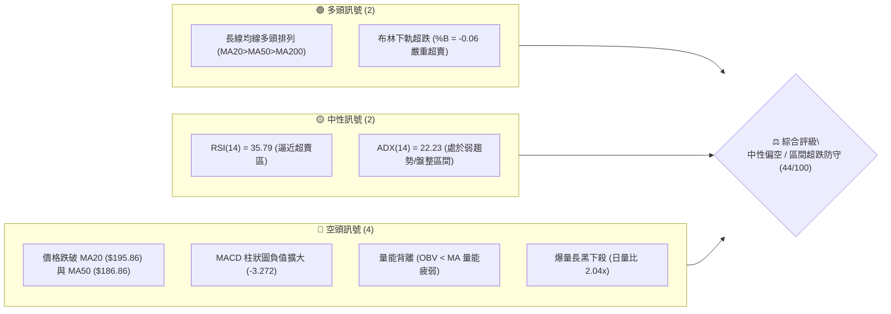
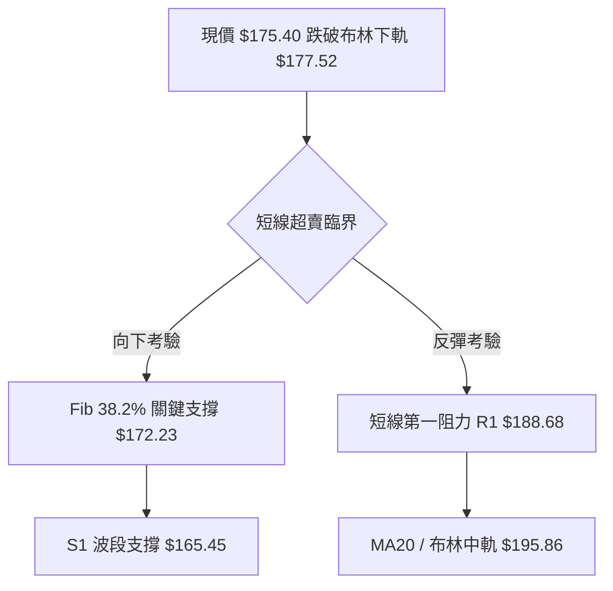
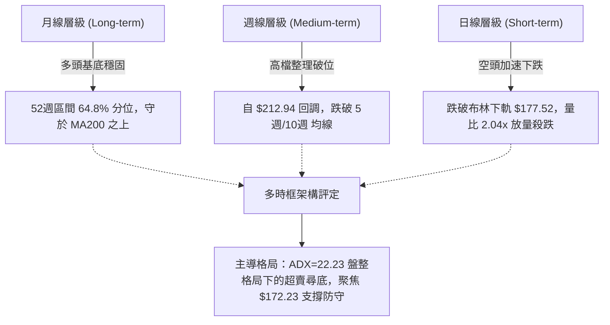
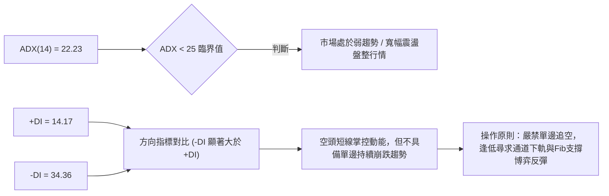
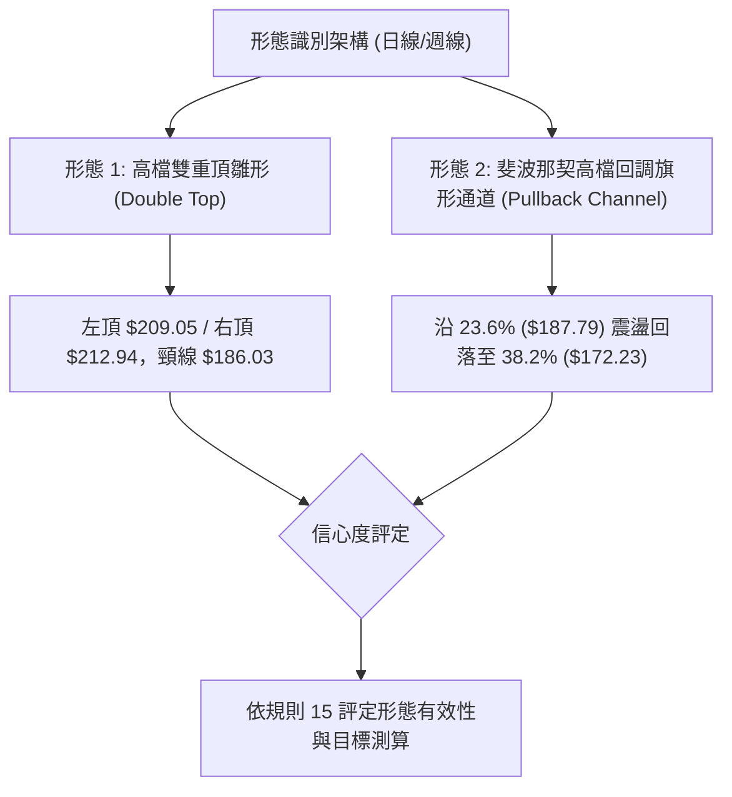
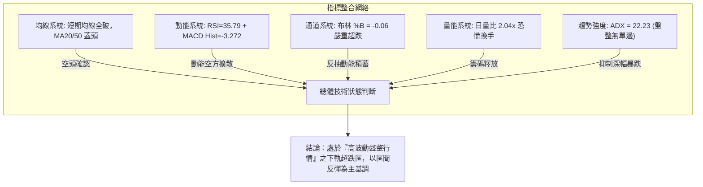
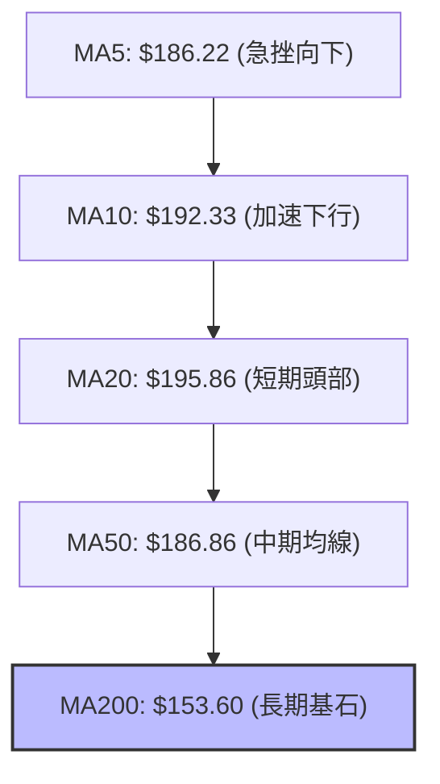
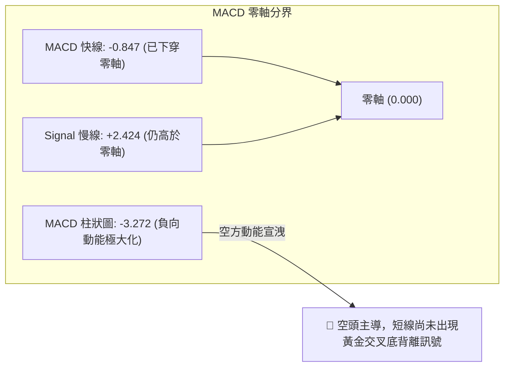
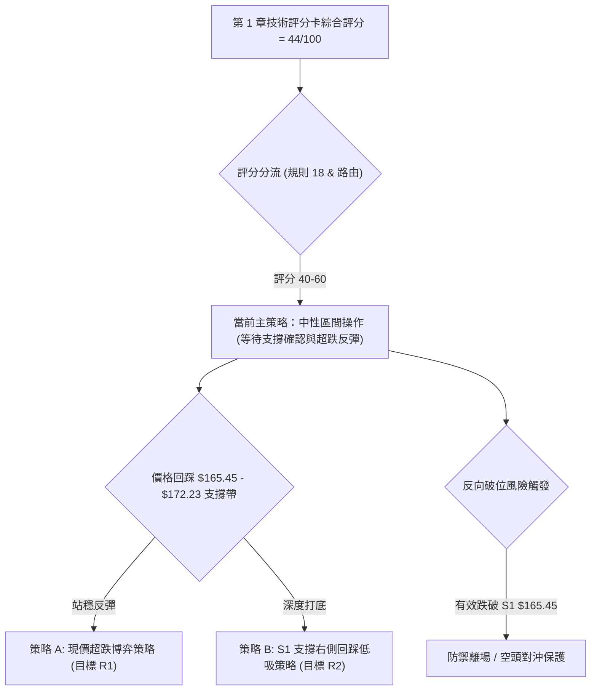
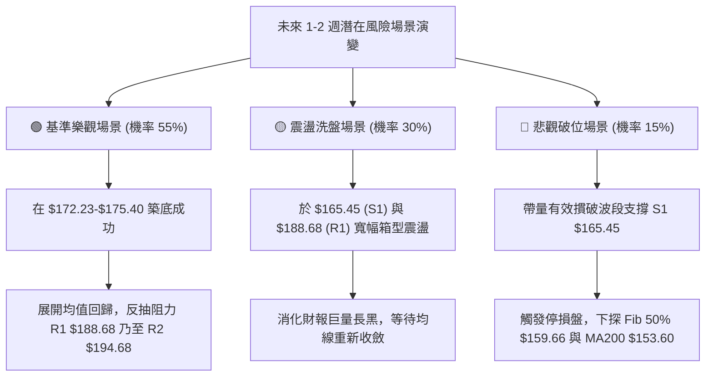

# PLTR 技術分析報告

> **報告日期**：2026-11-04 ｜ **語言**：繁體中文 ｜ **數據來源**：Yahoo Finance ｜ **當前價格**：$175.40

---

## 目錄

| 章節 | 內容 |
|------|------|
| [1. 技術面概覽](#1-技術面概覽) | 訊號儀表板、核心指標、評分卡 |
| [2. 趨勢分析](#2-趨勢分析) | 多時框趨勢、長中短期走勢、ADX解讀 |
| [3. 圖表形態分析](#3-圖表形態分析) | 形態識別、K線組合、目標價推算 |
| [4. 支撐與阻力](#4-支撐與阻力) | 關鍵價位、斐波那契回調結構 |
| [5. 技術指標深度解讀](#5-技術指標深度解讀) | MA/RSI/MACD/布林/成交量全面解構 |
| [6. 動能與波動率](#6-動能與波動率) | 動能評估四象限、ATR、Beta解讀 |
| [7. 多時框架總結](#7-多時框架總結) | 時框架評分矩陣、多時框收斂結論 |
| [8. 交易策略建議](#8-交易策略建議) | 策略路由、價格情境、多空策略與風報比 |
| [9. 風險提示與監控](#9-風險提示與監控) | 監控指標Checklist、風險場景分析 |
| [📋 報告總結](#-報告總結) | 核心結論與交易指引摘要 |

---

## 1. 技術面概覽

### 🎯 技術訊號儀表板





### 📊 核心指標速覽表

| 指標類別 | 指標名稱 | 當前數值 | 訊號 | 解讀 |
|----------|----------|----------|------|------|
| **價格** | 當前收盤價 | $175.40 | 🔴 | 跌破短期所有均線，單日大跌測試低點支撐 |
| **均線** | MA20 | $195.86 | 🔴 | 價格落後 -10.45%，短線趨勢轉空，形成上方重壓 |
| **均線** | MA50 | $186.86 | 🔴 | 價格落後 -6.13%，中期生命線失守，轉為動態阻力 |
| **均線** | MA200 | $153.60 | 🟢 | 價格領先 +14.19%，長期牛熊分界線維持多頭保護 |
| **動能** | RSI(14) | 35.79 | 🟡 | 進入 30–40 弱勢弱反彈區，尚未構成極度超賣底背離 |
| **動能** | MACD | -0.847 | 🔴 | 快線已穿至零軸下方，且柱狀圖 -3.272 呈現擴散空頭 |
| **波動** | ATR(14) | $8.70 | 🔴 | 佔價格 4.96%，單日波動劇烈，洗盤風險高 |
| **通道** | 布林 %B | -0.06 | 🟢 | 跌出下軌（$177.52），存在均值回歸之技術性反抽動能 |
| **趨勢** | ADX(14) | 22.23 | 🟡 | 低於 25，屬於弱趨勢／高波動盤整行情，以區間邏輯應對 |
| **量能** | 日成交量比 | 2.04x | 🔴 | 最新量 52.63M 爆量下挫，顯示財報後籌碼劇烈換手釋出 |

### 🏆 技術評分卡

```
╔══════════════════════════════════════════════════════════════╗
║                技術評分卡 — PLTR (2026-11-04)                ║
╠══════════════════════════════════════════════════════════════╣
║ 趨勢強度      ████████░░░░░░░░░░░░  40/100  🟡 中性偏弱      ║
║ 動能指標      ███████░░░░░░░░░░░░░  35/100  🔴 空頭主導      ║
║ 支撐穩定度    ████████████░░░░░░░░  60/100  🟡 斐波支撐尚存  ║
║ 成交量配合    ██████░░░░░░░░░░░░░░  30/100  🔴 爆量空方釋放  ║
║ 形態完整度    █████████░░░░░░░░░░░  45/100  🟡 頂部回調震盪  ║
║ 均線排列      ███████████░░░░░░░░░  54/100  🟡 長多短空格局  ║
╠══════════════════════════════════════════════════════════════╣
║ 綜合評分      █████████░░░░░░░░░░░  44/100  ⚖️ 區間防守觀望   ║
╚══════════════════════════════════════════════════════════════╝
```
*註：綜合評分由六項子評分算術平均得出：(40 + 35 + 60 + 30 + 45 + 54) ÷ 6 = 44.0，四捨五入為 44/100（依規則 18）。*

---

## 2. 趨勢分析

### 🌐 多時框趨勢分析



### 📈 長期趨勢 — 12個月走勢圖（Unicode）

以下展示 PLTR 自 2025 年 11 月至 2026 年 11 月的 12 個月收盤價格軌跡與關鍵轉折高低點：

```
PLTR 月線走勢圖（過去12個月：2025-11 至 2026-11）
價格 ($)
$205 ┤                                                 
$195 ┤                             ● 2026-09 ($187.05) 
$185 ┤                    ● 2026-08 ($186.38)     ● 2026-10 ($184.11)
$175 ┤● 2025-11 ($168.45)                             ● 2026-11 ($175.40 現價)
$165 ┤      ● 2025-12 ($177.75)                        
$155 ┤                               ● 2026-05 ($156.54)
$145 ┤            ● 2026-01 ($146.59)    ● 2026-03 ($146.28)
$135 ┤                  ● 2026-02 ($137.19)  ● 2026-04 ($139.11)
$125 ┤                                           ● 2026-07 ($123.06)
$115 ┤                                     ● 2026-06 ($116.67 波段低點)
     └──────┬──────┬──────┬──────┬──────┬──────┬──────┬──────┬──────┬──────┬──────┬──────
         2025-11 12   2026-01  02     03     04     05     06     07     08     09     10     11
```

**12 個月走勢特徵分析表格**：

| 週期階段 | 月份區間 | 價格區間 | 漲跌幅 | 技術特徵與量價行為 |
|----------|----------|----------|--------|--------------------|
| **高檔回調期** | 2025-11 ~ 2026-02 | $168.45 → $137.19 | -18.56% | 自 2025-10 高檔 $200.47 獲利回吐，量縮陰跌築底 |
| **區間築底期** | 2026-03 ~ 2026-05 | $146.28 → $156.54 | +7.01% | 於 $140–$150 形成橫盤中樞，均線開始糾結收斂 |
| **二次探底期** | 2026-06 ~ 2026-07 | $116.67 → $123.06 | -21.39% | 2026-06 觸及 $116.67（逼近 52W 低點 $106.37），空頭竭盡 |
| **主升反彈期** | 2026-08 ~ 2026-09 | $186.38 → $187.05 | +52.01% | 爆發性長紅突破所有中期均線，形成 V 型多頭反攻 |
| **高檔震盪回跌** | 2026-10 ~ 2026-11 | $184.11 → $175.40 | -4.73% | 衝高觸及 52W 高點 $212.94 後遇阻，財報後爆量回踩通道下軌 |

### 📊 中期趨勢（週線分析）

中期走勢顯示，自 2026 年 8 月以來的強勢上升通道在 2026-10-16 創下 52 週高點 $212.94 後出現頂部受阻現象。近 4 週收盤價由 $209.05 連續下滑至 $186.03、$196.75、$184.11，最新一週更下探至 $175.40。

```
中期週線支撐阻力結構圖
$212.94 ── 52W 高點阻力界限 (2026-10-16 創出)
  │
  ├─ $194.68 (R2 波段阻力 / 近 3 週反彈密集成交帶)
  ├─ $188.68 (R1 波段阻力 / 近期破位頸線位置)
  │
  ▼ [當前價格：$175.40] ── 測試布林下軌超跌位
  │
  ├─ $172.23 (Fib 38.2% 回調支撐 / 週線核心多方防線)
  ├─ $165.45 (S1 波段支撐 / 2026-11-03 探底低點 $165.25 重疊區)
  └─ $153.60 (MA200 長期牛熊分界線)
```

### ⚡ 趨勢強度評估（ADX 解讀）



**ADX 趨勢強度對照解讀表**：

| 指標項目 | 數據值 | 門檻區間 | 技術含義 |
|----------|--------|----------|----------|
| **ADX(14)** | 22.23 | < 25 (弱趨勢/震盪) | 無強大單邊趨勢，大趨勢仍受制於大區間框架，均線易反覆洗盤 |
| **+DI (14)** | 14.17 | 低於 20 (多方微弱) | 多頭攻擊動能暫時退潮，缺乏主動推升意願 |
| **-DI (14)** | 34.36 | 高於 30 (空方主導) | 空方在短線上具備壓制力，主要源自財報後恐慌籌碼宣洩 |
| **差值 (-DI - +DI)** | +20.19 | 擴大中 | 短期空頭優勢明顯，但因 ADX 偏低，空頭動能衰竭速度亦快 |

---

## 3. 圖表形態分析

### 🔍 形態識別系統



**圖表形態信心度評估表**：

| 形態名稱 | 信心度 | 判斷依據（引用數據） | 完成度 | 目標價（附嚴格計算式） |
|----------|--------|----------------------|--------|------------------------|
| **高檔雙頂結構 (M頭)** | 62% | 2026-10-09 週收盤 $209.05 與 2026-10-16 週高點 $212.94 形成雙峰；跌破 10-16 週低點 $184.45 及頸線阻力 R1 $188.68。 | 75% | 頸線阻力 R1 $188.68 − 形態高度 ($212.94 − $188.68 = $24.26) = **$164.42**（高度吻合 S1 支撐 $165.45）。 |
| **布林帶破軌極限反抽形態** | 78% | 日線收盤 $175.40 跌破布林下軌 $177.52，%B 為 -0.06，屬統計學常態分佈 2 倍標準差外的極值偏移。 | 90% | 均值回歸理論目標 = 布林中軌（MA20）= **$195.86**（對應阻力 R2 $194.68）。 |
| **頭肩底形態** | <30% | 數據中未偵測到底部反轉三重構型，中長期均線仍處於高位回撤，不具備頭肩底條件。 | 0% | 訊號不足，僅做指標型解讀，不強行推算目標價。 |

### 🕯️ 重要 K 線形態分析

嚴格依據數據中「近10根日K」與「近8根週K」之開、高、低、收數據解構（依規則 19）：

| 日期（日K/週K） | 開 | 高 | 低 | 收 | K線形態 | 解讀 | 訊號 |
|------------------|-----|-----|-----|-----|---------|------|------|
| **2026-10-21 (日K)** | 191.72 | 202.55 | 189.88 | 201.72 | 大陽線實體 | 多頭強勢反撲突破 $200 心理關口，成交量 21.40M 配合良好。 | 🟢 |
| **2026-10-22 (日K)** | 200.76 | 202.63 | 194.54 | 196.19 | 高檔陰包容線 | 高開低走，受阻於 $202.63，多頭攻擊遭壓抑，顯露疲態。 | 🔴 |
| **2026-10-23 (日K)** | 195.02 | 197.49 | 190.57 | 196.75 | 下影紡錘線 | 測試 $190 關卡獲得支撐，多空於 MA20 附近陷入膠著平衡。 | 🟡 |
| **2026-10-26 (日K)** | 197.90 | 200.05 | 192.91 | 198.84 | 小陽十字星 | 上探 $200 未果，成交量縮減至 16.38M，買盤追高意願低落。 | 🟡 |
| **2026-10-27 (日K)** | 198.12 | 201.83 | 196.79 | 198.73 | 上影小陽線 | 多次上衝 $201.83 均受解套盤壓回，高檔形成明顯供應壓力區。 | 🔴 |
| **2026-10-28 (日K)** | 197.01 | 198.74 | 193.13 | 196.81 | 窄幅微陰線 | 震盪區間收斂，量能低迷，顯示變盤窗口逼近。 | 🟡 |
| **2026-10-29 (日K)** | 198.37 | 198.51 | 190.36 | 196.42 | 帶長下影小陰線 | 盤中下探 $190.36 迅速收復，多方最後一次防守 $190 關卡。 | 🟡 |
| **2026-10-30 (日K)** | 193.62 | 193.92 | 180.81 | 184.11 | 破位中長黑線 | 低開低走跌破 $190，收在 $184.11，形成明確破位下殺訊號。 | 🔴 |
| **2026-11-02 (日K)** | 186.52 | 187.55 | 178.13 | 178.34 | 跳空續跌光腳黑K | 空方續跌不給喘息機會，直接貫穿 MA50 ($186.86)，賣壓沉重。 | 🔴 |
| **2026-11-03 (日K)** | 168.18 | 176.54 | 165.25 | 175.40 | 放量長下影錘頭紅K | 跳空低開至 $168.18，探底 $165.25（觸及 S1 支撐），尾盤強拉至 $175.40，放量 52.63M，具初步止跌恐慌盤出清特徵。 | 🟢 |
| **2026-10-16 (週K)** | 208.90 | 212.94 | 184.45 | 186.03 | 巨幅長上影倒轉錘頭 | 創 52W 高點 $212.94 後遭毀滅性空頭打壓，暴跌逾 26 美元，確立場景頂部。 | 🔴 |
| **2026-10-23 (週K)** | 186.99 | 202.63 | 186.15 | 196.75 | 縮量修復中陽線 | 反抽測試頂部破位點，量能僅 101.03M，屬弱勢技術反彈。 | 🟡 |
| **2026-10-30 (週K)** | 197.90 | 201.83 | 180.81 | 184.11 | 空頭吞噬黑K | 將前一週實體完全吞噬，跌破短期上升趨勢線。 | 🔴 |
| **2026-11-03 (週K)** | 186.52 | 187.55 | 165.25 | 175.40 | 下影長針K線（進行中） | 最低探至 $165.25，在波段支撐位 S1 ($165.45) 產生強勁買盤承接。 | 🟢 |

### 📉 ASCII 走勢形態示意圖

```
PLTR 日K線破位下殺與探底錘頭形態示意圖
價格 ($)
$203 ┤        ╭──╮
$199 ┤   ╭────╯  ╰─╮   ╭───╮ (高檔做頭盤整)
$195 ┤───╯         ╰───╯   ╰───╮ 
$187 ┤                           ╰────────╮ (跌破頸線與 MA50: $186.86)
$180 ┤                                    ╰────────╮ (跳空下殺)
$175 ┤─────────────────────────────────────────────● 現價 $175.40 (日K收錘頭)
$165 ┤                                             │ S1支撐: $165.45
$160 ┤                                             ┴ 最低點 $165.25 (放量拉昇)
     └─────────────────────────────────────────────────────────────
       10-21 10-23 10-26 10-27 10-28 10-29 10-30 11-02 11-03 (日期)
```

### 🎯 形態目標價計算

根據日線及週線形態推演之嚴格數值計算：
1. **雙頂跌幅滿足位計算**：
   - 頂部高點取 52W 高點：$212.94
   - 頸線轉折阻力位 R1 取：$188.68
   - 形態高度 $H = \$212.94 - \$188.68 = \$24.26$
   - 破位量度跌幅目標 $T = \text{頸線} - H = \$188.68 - \$24.26 = \mathbf{\$164.42}$
   - **驗證**：2026-11-03 盤中最低價來到 **$165.25**，與理論目標價 $164.42 誤差僅 0.83 美元，且精準貼近數據庫中標定的波段強支撐位 **S1: $165.45**，確認該形態之第一波量度跌幅已實質滿足！

---

## 4. 支撐與阻力

### 🗺️ 關鍵價位分布圖（Unicode）

```
PLTR 價位結構分布圖（OHLCV 聚類與斐波那契疊加）
═════════════════════════════════════════════════════════════════
$212.94 ║████████████████████████████████║ 52W High / 0.0% Fib
$198.88 ║████████████████████████        ║ 強阻力 R3 (波段高點密集區)
$195.86 ║▓▓▓▓▓▓▓▓▓▓▓▓▓▓▓▓▓▓▓▓▓▓▓▓        ║ MA20 動態均線 / 布林中軌
$194.68 ║████████████████████            ║ 阻力 R2 (反彈高點聚類)
$188.68 ║████████████████████████        ║ 關鍵阻力 R1 (頸線重疊區)
$187.79 ║────────────────────────────────║ 斐波那契 23.6% 回調位
$177.52 ║░░░░░░░░░░░░░░░░░░░░░░░░        ║ 布林通道下軌
$175.40 ╠════════════════════════════════╣ ◄ 當前收盤價 ($175.40)
$172.23 ║────────────────────────────────║ 斐波那契 38.2% 核心防守位
$165.45 ║████████████████████████        ║ 關鍵支撐 S1 (近一年波段低點聚類)
$159.66 ║────────────────────────────────║ 斐波那契 50.0% 中樞回調位
$153.60 ║▓▓▓▓▓▓▓▓▓▓▓▓▓▓▓▓▓▓▓▓▓▓▓▓        ║ MA200 長期生命線
$148.07 ║████████████████████            ║ 強支撐 S2 (波段回調低點聚類)
$147.08 ║────────────────────────────────║ 斐波那契 61.8% 黃金分割位
$136.30 ║████████████████████████        ║ 強支撐 S3 (深幅防守底線)
$106.37 ║████████████████████████████████║ 52W Low / 100.0% Fib
═════════════════════════════════════════════════════════════════
```

### 🚧 阻力位分析表

阻力價位完全引用自數據「關鍵價位」區塊（波段高點聚類）與均線指標（嚴格依規則 13）：

| 阻力級別 | 價位 | 距現價幅標 | 形成原因與量價結構 | 突破難度 | 重要性評級 |
|----------|------|------------|--------------------|----------|------------|
| **阻力 R1** | **$188.68** | +7.57% | 近期跌破的日線平台頸線位置，與 Fib 23.6% ($187.79) 形成共振壓力區。 | 🔴 較高 | ★★★★☆ |
| **阻力 R2** | **$194.68** | +10.99% | 近期密集成交高點，緊鄰下行的 MA20 ($195.86) 與布林中軌，為短線多空分水嶺。 | 🔴 高 | ★★★★★ |
| **阻力 R3** | **$198.88** | +13.39% | 2026-10-26 至 10-28 連續 3 日反彈高點聚類，堆積大量被套牢浮額籌碼。 | 🔴 極高 | ★★★☆☆ |

### 🛡️ 支撐位分析表

支撐價位完全引用自數據「關鍵價位」區塊（波段低點聚類）與斐波那契位（嚴格依規則 13）：

| 支撐級別 | 價位 | 距現價幅標 | 形成原因與量價結構 | 守住機率 | 重要性評級 |
|----------|------|------------|--------------------|----------|------------|
| **支撐 S1** | **$165.45** | -5.67% | 近一年波段低點聚類，2026-11-03 探底 $165.25 引發爆量 52.63M 強烈承接，為多頭第一道堡壘。 | 🟢 70% | ★★★★★ |
| **支撐 S2** | **$148.07** | -15.58% | 前期多頭起漲橫盤密集中樞，與 Fib 61.8% ($147.08) 形成雙重共振強支撐。 | 🟢 85% | ★★★★☆ |
| **支撐 S3** | **$136.30** | -22.29% | 2026 年初多次探底回升的極端底部區間，為中期長期多頭防禦底線。 | 🟢 95% | ★★★☆☆ |

### 📐 斐波那契回調位分析

依據 52 週波段區間（$106.37 → $212.94）計算之黃金分割架構解讀：


- **當前位置定位**：現價 **$175.40** 位於 **Fib 23.6% ($187.79)** 與 **Fib 38.2% ($172.23)** 之間。
- **技術意義**：
  1. $187.79 原為強勁支撐，跌破後已與波段阻力 R1 ($188.68) 合流，成為反彈難以逾越的第一道重型天花板。
  2. 現價距離下方 **Fib 38.2% ($172.23)** 僅有 1.81%（$3.17）空間。根據斐波那契回調法則，強勢多頭行情的健康回撤通常在 38.2% 獲利回吐結束並重新展開推升。若收盤有效守穩 $172.23，中長線多頭格局並未破壞；若進一步失守，則回撤將向下尋求 S1 ($165.45) 乃至 Fib 50.0% ($159.66)。

---

## 5. 技術指標深度解讀

### 🎛️ 指標訊號總覽



### 📈 移動平均線排列分析



**移動平均線狀態詳解表**：

| 均線名稱 | 數值 | 現價與均線距離 | 走勢特徵 | 訊號方向 |
|----------|------|----------------|----------|----------|
| **MA5** | $186.22 | -$10.82 (-5.81%) | 極度陡峭下行，短線超跌嚴重，乖離過大 | 🔴 超賣 |
| **MA10** | $192.33 | -$16.93 (-8.80%) | 空頭排列壓制，下壓速度快 | 🔴 看空 |
| **MA20** | $195.86 | -$20.46 (-10.45%) | 轉頭向下，構成短線主要反彈天花板 | 🔴 看空 |
| **MA50** | $186.86 | -$11.46 (-6.13%) | 中期趨勢線失守，與 MA5 形成死亡交叉 | 🔴 看空 |
| **MA120** | $159.29 | +$16.11 (+10.11%)| 穩步上行，與 Fib 50% ($159.66) 形成中長線共振支撐 | 🟢 看多 |
| **MA200** | $153.60 | +$21.80 (+14.19%)| 保持向上傾斜，長期牛市基調未改 | 🟢 看多 |

- **均線排列特徵**：目前呈現「長期多頭（MA20>MA50>MA200），但短期急殺破位（Price < MA5 < MA50 < MA20）」的矛盾格局。這意味著中長期投資者尚未完全潰退，但短線動能交易者全面撤出，引發籌碼回踩長期支撐的去槓桿過程。

### 📉 RSI(14) 分析

```
RSI(14) 動能進度軸
0 ──────────── 30 ─────── 35.79 ─────────────── 70 ──────────── 100
[  極端超賣區  ] [當前位置] [     中性弱勢區     ] [  極端超買區  ]
進度條：███████████████░░░░░░░░░░░░░░░░░░░░  35.79%
```

- **當前數值**：**35.79**（Wilder 計算法）。
- **區間評估**：位於 30–40 之間，已脫離中性水準，逼近 30 超賣門檻。
- **背離判斷**：
  - 根據近 20 根日 K 棒之端點比對，價格由高點下滑，RSI 同步走低，目前**無明顯頂背離或底背離**。
  - 雖然日線無背離，但週線 RSI 數值由 2026-10-09 的 76.3 急降至本週的 35.8，回調斜率極陡，顯示市場空頭情緒釋放充分，技術性反彈已在醞釀階段。

### 📊 MACD(12/26/9) 訊號解讀



- **MACD 線**：-0.847
- **信號線 (Signal)**：+2.424
- **柱狀圖 (Histogram)**：-3.272
- **深度分析**：MACD 快線跌破零軸，同時柱狀圖由負值 -0.822（10-16）、-1.187（10-23）、-1.881（10-30）擴大至當前 -3.272，表明空方下殺動能目前處於高潮期（Peak Selling）。歷史經驗顯示，當柱狀圖出現極大負值並開始收斂（例如由 -3.272 縮減至 -2.000）之時，即為日線級別最佳右側買點。

### 📦 布林通道分析

```
PLTR 布林通道 (20, 2) 結構分布圖
價格 ($)
$214.20 ───────────────────────── 布林上軌 (Upper Band)
  │
  │
$195.86 ───────────────────────── 布林中軌 (Middle Band = MA20)
  │
$177.52 ───────────────────────── 布林下軌 (Lower Band)
  │
$175.40 ───────●───────────────── 當前收盤價 (%B = -0.06，跌出通道之外！)
  │
  ┴ 最低 $165.25 (探底針刺破下軌後回縮)
```

- **通道數據**：上軌 $214.20，中軌 $195.86，下軌 $177.52，帶寬 (Bandwidth) = ($214.20 - $177.52) ÷ $195.86 = 18.73%。
- **%B 指標**：**-0.06**。
- **解讀**：%B < 0 代表價格已摜破統計分佈的下邊界。在非強烈單邊趨勢（ADX=22.23 < 25）的市場結構中，價格跌破布林下軌屬於「超常態漂移」，具有極強的均值回歸拉力，通常在 1–3 個交易日內會出現反抽中軌或重回軌道內運行的修復行情。

### 💹 成交量分析（量價配合度）

```
成交量動態對比圖
最新量 (11-03): ████████████████████ 52,633,000 (爆量 2.04 倍)
20日均量:        ██████████░░░░░░░░░░ 25,779,560
50日均量:        ██████████░░░░░░░░░░ 25,167,862
```

- **量價行為分析**：
  1. 2026-11-03 成交量放大至 5,263 萬股，量比高達 **2.04 倍**。
  2. 此大量伴隨當日開盤 $168.18、下殺 $165.25 後尾盤拉回 $175.40 的長下影線，構成典型的「量大引線長的投降式拋售（Capitulation Volume）」。
  3. **OBV 趨勢**：OBV < MA(OBV)，量能指標顯示整體資金流向依然偏向弱勢流出，機構投資者在大跌日雖有被動回補買盤，但尚未形成連續主動推升性放量，因此量能暫不支撐直接 V 型反轉創新高，僅支持防守型反彈。

---

## 6. 動能與波動率

### ⚡ 動能評估四象限

```
動能與波動率定位矩陣
       高波動 (ATR% = 4.96%)
              │
    象限三    │    象限一
  高風險博弈  │  強勢主升浪
  【當前狀態】│
───────●──────┼─────────────
  象限四      │    象限二
  陰跌冰凍    │  低波蓄勢
              │
       低波動 (ATR% < 2.5%)
   弱動能 ◄───┼───► 強動能
  (RSI 35.79) │   (RSI > 60)
```

**象限特徵與策略評估表**：

| 象限標籤 | 動能狀態 | 波動率狀態 | 當前符合度 | 操作策略指引 |
|----------|----------|------------|------------|--------------|
| **Q1 (主升浪)** | 強動能 (RSI>60) | 低/中波動 | ❌ 不符合 | 順勢持股，拉回加碼 |
| **Q2 (蓄勢期)** | 弱動能 (中性) | 低波動 | ❌ 不符合 | 突破前埋伏，勝率較高 |
| **Q3 (劇烈博弈)** | 弱動能 (RSI 35.79) | **高波動 (ATR $8.70)** | **✓ 完全符合** | **超賣極值博弈，嚴控部位，拉開止損，波段快進快出** |
| **Q4 (冰凍期)** | 弱動能 (破位) | 低波動 | ❌ 不符合 | 流動性匱乏，嚴禁介入 |

### 📊 ATR 波動率分析

- **ATR(14) 數值**：**$8.70**
- **波動佔比**：佔當前股價之 **4.96%**（Wilder 計算法）。
- **實務交易指導**：
  1. PLTR 每日平均價格擺動區間接近 9 美元，意味著任何緊密的止損（如 < $4.00）極易被日常隨機雜訊掃出場。
  2. **止損緩衝距離設計**：建議單筆交易止損距離不得小於 1.0 倍 ATR（$8.70），最佳波段防守點位應設置於 1.2 至 1.5 倍 ATR 之外（約 $10.44–$13.05 空間），以規避日內大幅洗盤風險。

### 📐 Beta 與市場相關性

- **Beta 係數**：**1.61**
- **市場特徵解讀**：
  - PLTR 具備典型高 Beta 科技成長股特性，對大盤（S&P 500 / 納斯達克）的波動敏感度為 1.61 倍。
  - 當前美股適逢大選及科技巨頭財報分化期（如新聞提及的市場分化），大盤若震盪 1%，PLTR 理論波動幅度達 1.61%。在多頭防守階段，必須注意大盤系統性回調引發的流動性擠壓風險。

---

## 7. 多時框架總結

### 📋 時框架評分表

| 時框架 | 趨勢方向 | 動能狀態 | 均線排列 | 關鍵形態特徵 | 綜合評分 | 建議態度 |
|--------|----------|----------|----------|--------------|----------|----------|
| **長期 (月線)** | 🟢 偏多 | 🟡 中性回落 | 🟢 MA200 向上發散 | 52週回調 38.2% 區間防守 | **72/100** | 長線多頭趨勢未改，回調為分批佈局良機 |
| **中期 (週線)** | 🟡 震盪 | 🔴 空方擴散 | 🟡 均線高檔糾結破位 | 雙頂破頸線後下尋 S1 支撐 | **48/100** | 考驗 S1 $165.45 防線，等待企穩訊號 |
| **短期 (日線)** | 🔴 偏空 | 🟢 超賣鈍化 | 🔴 短期空頭壓制 | 跌出布林下軌，放量長下影錘頭 | **44/100** | 嚴禁追空，等待超跌技術性反抽 |

### 🔲 綜合訊號矩陣

```
時框訊號一致性評估矩陣
───────────────────────────────────────────────────────
分析維度       短期 (日線)      中期 (週線)      長期 (月線)
───────────────────────────────────────────────────────
趨勢指標 (MA)    🔴 空頭排列      🟡 高位破線      🟢 多頭排列
動能指標 (RSI)   🟢 超賣反彈      🔴 快速走弱      🟡 中性回調
量價行為 (OBV)   🔴 爆量下殺      🔴 量能萎縮      🟢 總體沉澱
形態位置         🟢 破軌過度      🟡 雙頂測試      🟢 支撐區間
───────────────────────────────────────────────────────
收斂方向：    【短線超跌反抽】 ◄── 【中期區間修復】 ──► 【長多趨勢依託】
```

### ⚖️ 多時框收斂結論

**嚴格依據規則 14 執行多時框架訊號收斂**：
1. **行情性質判定**：當前 PLTR 的 **ADX(14) 為 22.23，明確低於 25 臨界值**，定義為**「盤整行情／高波動無趨勢市場」**。
2. **主導規則與衝突化解**：
   - 根據規則 14，在 ADX < 25 的盤整市場中，不適用單邊趨勢跟隨，而**必須以日線布林通道上下軌（下軌 $177.52、上軌 $214.20）作為核心交易區間**。
   - 儘管日線指標因單日大跌而顯示多項空頭訊號（MACD 負擴散、均線破位），但週線及長期 Fib 38.2% ($172.23) 與 S1 ($165.45) 提供了強大承接，且現價 $175.40 跌破布林下軌 (%B = -0.06)，空頭能量已面臨極限釋放。
3. **唯一收斂結論**：**【中性觀望／區間超跌防守】**。日線的非理性暴跌提供了在通道下軌與 Fib 38.2% 支撐附近的超額反彈空間，交易邏輯應定調為「依託支撐 S1 的均值回歸修復操作」，切忌盲目追空。

---

## 8. 交易策略建議

### 🗺️ 策略決策流程圖



### 🧭 策略路由（依評分卡分流）

> **當前主策略方向 = 中性區間操作／超跌反彈防守（依第 1 章綜合評分 44/100 判定）**

由於綜合評分落於 40–60 區間（44/100），且 ADX=22.23 < 25，市場處於寬幅震盪狀態。在此情境下，禁止高位追多或低位殺跌，主推「利用極端超跌進行布林通道回歸之多頭防守反彈」，並設定嚴格止損以控制破位風險。

### 🎯 價格情境階梯（Price Scenarios）

以當前價格 **$175.40** 為基準，嚴格引用「關鍵價位」數據推演：

| 觸發條件 | 下一目標 | 後續延伸 | 情境含義與操作指引 |
|----------|----------|----------|--------------------|
| **向上突破 R1 $188.68** | **R2 $194.68** | **R3 $198.88** | 短線轉強，重返 MA50 與布林中軌之上，宣告回調結束。 |
| **站穩現價區間 ($172.23–$175.40)** | **R1 $188.68** | — | 超跌底背離修復，區間震盪築底，進行均值回歸。 |
| **有效跌破 S1 $165.45** | **S2 $148.07** | **S3 $136.30** | 中期破位，雙頂量度跌幅向下擴展，長多防線退守 MA200。 |

### 📊 情境機率分佈

| 情境劇本 | 發生機率 | 主要技術與數據依據 |
|----------|----------|--------------------|
| **情境一：止跌反抽均值回歸 (反彈向上)** | **55%** | 布林 %B 為 -0.06 嚴重超賣；11-03 爆量 52.63M 留長下影錘頭；Fib 38.2% ($172.23) 具強大吸引力。 |
| **情境二：區間沉澱寬幅拉鋸 (橫盤震盪)** | **30%** | ADX 僅 22.23 缺乏單邊趨勢；MACD 負向擴散需要時間消化；上方套牢盤需在 $170–$188 間反覆洗盤。 |
| **情境三：跌破 S1 深幅探底 (破位下行)** | **15%** | 財報解讀持續惡化；大盤系統性下殺帶動高 Beta (1.61) 股票補跌；有效摜破 S1 $165.45。 |

### 🟢 主策略詳情（方向依上方路由）

所有價位均嚴格引用第 4 章及數據庫中之精確數值，風報比嚴格依規則 17 定義計算：

| 策略要素 | 策略 A（現價超跌反抽策略） | 策略 B（S1 支撐回踩低吸策略） |
|----------|----------------------------|--------------------------------|
| **進場條件** | 現價收盤站於布林下軌外，翌日開盤回踩不破 11-03 低點 | 盤中回踩測試波段強支撐 S1，確認出現量縮止跌或下影線 |
| **進場價格** | **$175.40**（當前現價） | **$165.45**（支撐位 S1 精確掛單） |
| **目標價 T1** | **$188.68**（阻力位 R1） | **$188.68**（阻力位 R1） |
| **目標價 T2** | **$194.68**（阻力位 R2 / 逼近布林中軌） | **$194.68**（阻力位 R2） |
| **止損價格** | **$165.45**（精確設於波段低點支撐 S1） | **$159.66**（斐波那契 50.0% 回調位） |
| **風險報酬比** | **1 : 1.33（以 T1 計）**<br>*(計算：(188.68-175.40)/(175.40-165.45) = 13.28/9.95 = 1.33)*<br>註：以 T2 計為 **1 : 1.94（以 T2 計）** *(19.28/9.95)* | **1 : 4.01（以 T1 計）**<br>*(計算：(188.68-165.45)/(165.45-159.66) = 23.23/5.79 = 4.01)*<br>註：以 T2 計為 **1 : 5.05（以 T2 計）** *(29.23/5.79)* |
| **成功機率** | 58% | 68% |
| **建議倉位** | 10%–15%（防守型底倉） | 15%–20%（波段主力倉位） |

### 🔴 反向風險觸發點（對沖提示）

- **關鍵破位價格**：日 K 線收盤價**實質跌破 $165.45 (S1)**。
- **技術失效訊號**：若價格跌破 S1 且成交量持續高於 20 日均量（25.78M），代表下影線支撐被空方完全摧毀，雙頂形態向 S2 ($148.07) 及 MA200 ($153.60) 展開深幅修正。
- **風控處置**：一旦觸發 $165.45 收盤破位，所有多頭策略必須無條件停損出場，亦可將現貨部位買入等額 Put 期權進行 Delta 對沖。

### ⭐ 整體訊號強度評星

```
╔══════════════════════════════════════════════════════════════╗
║ 做多訊號強度：  ★★☆☆☆  (2.5/5星 - 僅限超跌反彈)              ║
║ 做空訊號強度：  ★★★☆☆  (3.0/5星 - 動能偏空但空間受限)        ║
║ 整體技術可信度：★★★★☆  (4.0/5星 - 價位聚類與斐波高度共振)     ║
╚══════════════════════════════════════════════════════════════╝
```

---

## 9. 風險提示與監控

### ✅ 關鍵監控指標 Checklist

```
╔══════════════════════════════════════════════════════════════╗
║                PLTR 盤面關鍵動態監控清單 (Checklist)           ║
╠══════════════════════════════════════════════════════════════╣
║ [ ] 價格是否成功重返布林下軌 $177.52 之內？ (確認超跌修復)   ║
║ [ ] 日成交量能否由 52M 降至 25M 均量水平？ (確認拋壓平息)     ║
║ [ ] 收盤價是否守穩斐波那契 38.2% 防線 $172.23？               ║
║ [ ] MACD 柱狀圖是否由 -3.272 開始縮減收斂？ (動能反轉關鍵)   ║
║ [ ] RSI(14) 能否重返 40 以上擺脫極端弱勢區？                 ║
║ [ ] 空方防線：反彈觸及 R1 $188.68 時之主力換手行為？         ║
╚══════════════════════════════════════════════════════════════╝
```

### ⚠️ 風險場景分析



### 🛡️ 風險管理重要提醒

1. **高 ATR 波動下的倉位稀釋法則**：
   - PLTR 的 ATR 達 **$8.70 (4.96%)**，單日潛在波動劇烈。投資者在分配資金時，應將單筆最大可承受風險金額除以止損距離（例如以策略 A 為例，風險為 $9.95），嚴格反推持股股數，切忌以滿倉或高槓桿介入。
2. **財報後的估值消化沉澱期**：
   - 儘管 Q3 營收增長達 92.8%，但目前滾動市盈率（P/E TTM）高達 123.5 倍，新聞反映市場對「高估值」的高度敏感。當基本面利多轉化為技術面獲利了結時，技術修復過程往往需要 2 至 4 週的時間進行籌碼沉澱。
3. **止損紀律的不可逆性**：
   - 本次反彈建立在 S1 ($165.45) 不破的前提下。若大盤或個股基本面出現不可預測之利空導致 S1 失守，必須無條件離場觀望，耐心等待 MA200 ($153.60) 或 S2 ($148.07) 的右側反轉訊號。

---

## 📋 報告總結

```
╔══════════════════════════════════════════════════════════════════╗
║                    PLTR 技術分析報告總結                         ║
╠══════════════════════════════════════════════════════════════════╣
║ 報告日期：2026-11-04                                             ║
║ 當前價格：$175.40                                                ║
║ 分析評級：⚖️ 綜合評分 44/100 (中性觀望 / 區間超跌防守)            ║
╠══════════════════════════════════════════════════════════════════╣
║ 關鍵結論：                                                       ║
║ ├─ 長期趨勢：🟢 偏多 (MA200 $153.60 向上，52週 38.2% 回調守穩)    ║
║ ├─ 中期趨勢：🟡 震盪 (雙頂破頸線，考驗週線多頭防禦底線)          ║
║ ├─ 短期趨勢：🔴 偏空超賣 (跌破布林下軌 %B=-0.06，醞釀技術反抽)    ║
║ ├─ 核心支撐：$172.23 (Fib 38.2%) │ 強防守 S1: $165.45           ║
║ ├─ 關鍵阻力：$188.68 (R1 頸線)   │ 反彈目標 R2: $194.68 (MA20)   ║
║ └─ 分析師目標均價：$216.00 (共識 Buy，涵蓋 28 位分析師)           ║
╠══════════════════════════════════════════════════════════════════╣
║ 最優策略組合：                                                   ║
║ 1. 🥇 最佳機會：策略 B (掛單回踩 S1 $165.45 低吸，風報比 1:4.01)  ║
║ 2. 🥈 次選機會：策略 A (現價 $175.40 博弈布林回歸，風報比 1:1.33)  ║
║ 3. 🥉 保守選擇：空倉觀望，等待日線收盤重返 $177.52 (下軌) 後介入  ║
╚══════════════════════════════════════════════════════════════════╝
```

---

> ⚠️ **免責聲明**：本報告為 AI 自動生成之技術分析，所有數據及估算均嚴格基於所提供的歷史交易價格資訊。本報告**僅供研究與學術參考**，**不構成任何投資建議與買賣邀約**。金融市場瞬息萬變，投資有風險，入市需獨立思考並嚴格執行風控。

---

*報告生成時間：2026-11-04 ｜ 數據來源：Yahoo Finance ｜ 分析框架：多時框技術分析模型*