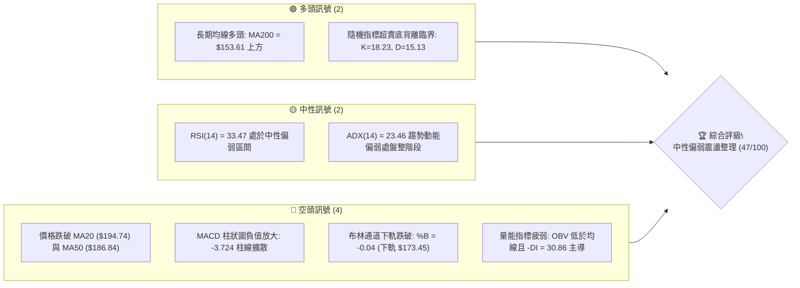
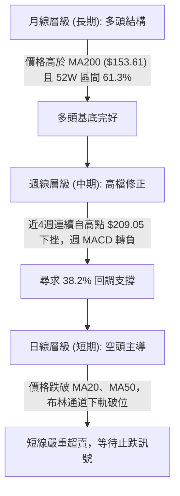
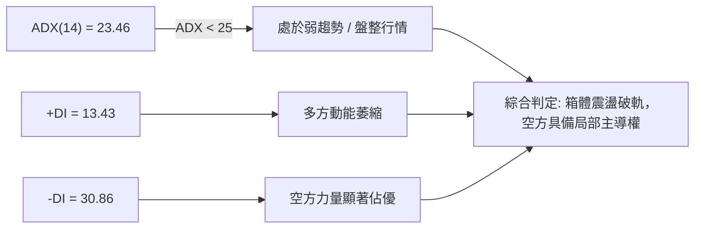
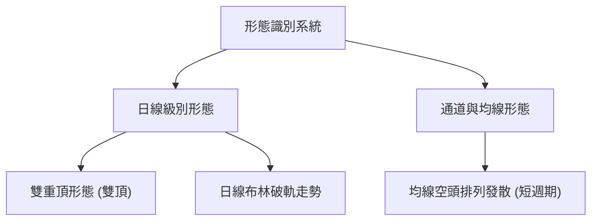
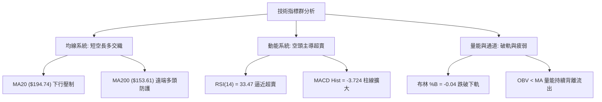
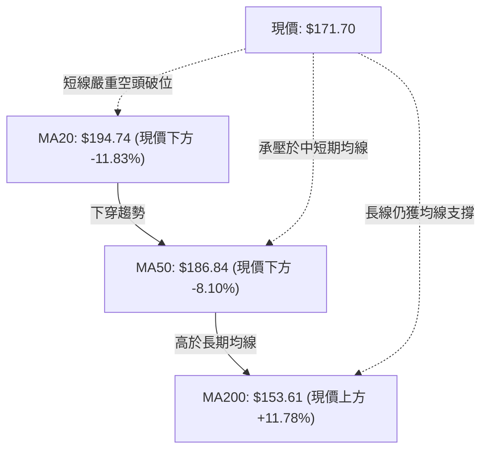
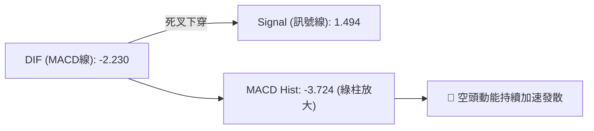
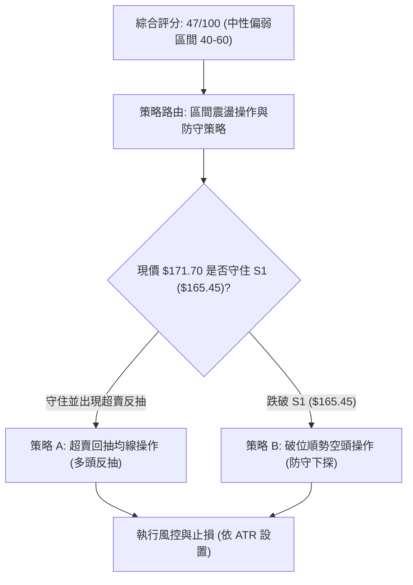
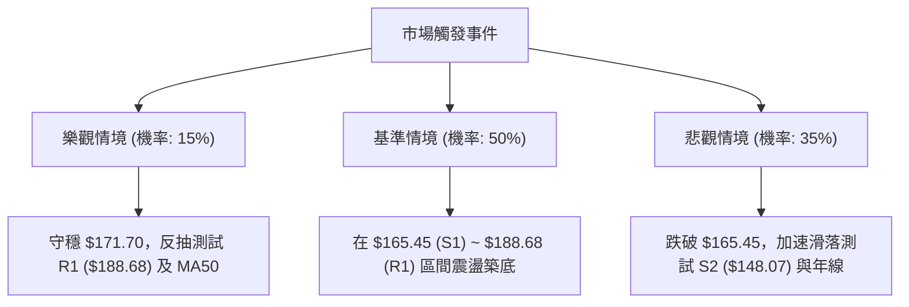

# PLTR 技術分析報告

> **報告日期**：2026-11-05 ｜ **語言**：繁體中文 ｜ **數據來源**：Yahoo Finance ｜ **當前價格**：$171.70

---

## 目錄

| 章節 | 內容 |
|------|------|
| [1. 技術面概覽](#1-技術面概覽) | 訊號儀表板、核心指標、評分卡 |
| [2. 趨勢分析](#2-趨勢分析) | 多時框趨勢、長中短期走勢 |
| [3. 圖表形態分析](#3-圖表形態分析) | 形態識別、K線組合、目標價 |
| [4. 支撐與阻力](#4-支撐與阻力) | 關鍵價位、斐波那契回調 |
| [5. 技術指標深度解讀](#5-技術指標深度解讀) | MA/RSI/MACD/布林/成交量 |
| [6. 動能與波動率](#6-動能與波動率) | 動能評估、ATR、Beta |
| [7. 多時框架總結](#7-多時框架總結) | 時框架評分矩陣 |
| [8. 交易策略建議](#8-交易策略建議) | 多空策略、風險報酬比 |
| [9. 風險提示與監控](#9-風險提示與監控) | 監控指標、風險場景 |

---

## 1. 技術面概覽

### 🎯 技術訊號儀表板



### 📊 核心指標速覽表

| 指標類別 | 指標名稱 | 當前數值 | 訊號 | 解讀 |
|----------|----------|----------|------|------|
| **價格** | 當前收盤價 | $171.70 | 🟡 | 位於52週區間 61.3%，跌破短期技術支撐位 |
| **均線** | MA20 | $194.74 | 🔴 | 價格低於 MA20 達 -11.83%，短線乖離偏大 |
| **均線** | MA50 | $186.84 | 🔴 | 跌破中期生命線，短中期下行壓力沉重 |
| **均線** | MA200 | $153.61 | 🟢 | 價格高於長期年線 +11.78%，大週期多頭架構完好 |
| **動能** | RSI(14) | 33.47 | 🟡 | 逼近 30 臨界超賣區，未見明顯底背離，中性偏弱 |
| **動能** | MACD(12,26,9) | -2.230 / Signal: 1.494 | 🔴 | MACD Hist 為 -3.724，空頭動能加速釋放 |
| **動能** | Stoch %K / %D | 18.23 / 15.13 | 🟢 | 雙線進入 20 以下超賣區，短線存在技術性反抽需求 |
| **趨勢** | ADX / ±DI | 23.46 (+DI: 13.43 / -DI: 30.86) | 🔴 | ADX < 25 屬震盪整理，但 -DI 遠高於 +DI 顯示空方佔優 |
| **通道** | Bollinger %B | -0.04 | 🔴 | 跌破下軌 ($173.45)，價格處於極度超賣擠壓狀態 |
| **量能** | 20日成交量比 | 1.31x (34.95M / 26.76M) | 🔴 | 放量下跌，且 OBV 低於均線，資金呈現持續淨流出 |
| **波動** | ATR(14) | $9.00 (5.24%) | 🟡 | 每日波動幅度達 5.24%，短線波動風險偏高 |

### 🏆 技術評分卡

```
╔══════════════════════════════════════════════════════════════╗
║                技術評分卡 — PLTR (2026-11-05)                ║
╠══════════════════════════════════════════════════════════════╣
║ 趨勢強度      ████████░░░░░░░░░░░░  40/100  🔴 空頭壓制       ║
║ 動能指標      ██████░░░░░░░░░░░░░░  30/100  🔴 動能疲弱       ║
║ 支撐穩定度    ████████████░░░░░░░░  60/100  🟡 斐波支撐測試   ║
║ 成交量配合    ████████░░░░░░░░░░░░  40/100  🔴 放量下行       ║
║ 形態完整度    ██████████░░░░░░░░░░  50/100  🟡 形態重整中     ║
║ 均線排列      ████████████░░░░░░░░  60/100  🟡 長多短空交織   ║
╠══════════════════════════════════════════════════════════════╣
║ 綜合評分      █████████░░░░░░░░░░░  47/100  ⚖️ 中性偏弱 (區間)║
╚══════════════════════════════════════════════════════════════╝
```
*(註：綜合評分由六項子評分算術平均：(40 + 30 + 60 + 40 + 50 + 60) / 6 = 46.67 ≈ 47/100)*

---

## 2. 趨勢分析

### 🌐 多時框趨勢分析



### 📈 長期趨勢 — 12個月走勢圖（Unicode）

```
PLTR 月線走勢圖（2025-11 至 2026-11）
價格軸 ($)
$205 ┤                                                 ● $200.47 (2025-10前高)
$190 ┤                                      ●      ●
$175 ┤  ● $168.45     ● $177.75                ●   ●  ● $171.70 (現價)
$160 ┤                               ●
$145 ┤            ● $146.59  ● $146.28
$130 ┤                ● $137.19  ● $139.11
$115 ┤                                   ● $116.67 (低點)
     └──────┬──────┬──────┬──────┬──────┬──────┬──────┬──────┬──────┬──────┬──────┬──────
          11/25  12/25  01/26  02/26  03/26  04/26  05/26  06/26  07/26  08/26  09/26  10/26
```

#### 走勢特徵分析表格

| 週期階段 | 起訖區間 | 價格變動 | 累積幅度 | 走勢特徵與量價結構 |
|----------|----------|----------|----------|--------------------|
| **第1階段：高檔震盪回落** | 2025-11 ~ 2026-02 | $168.45 → $137.19 | -18.56% | 測試自 $200 回調後的均線支撐，買盤逐步收斂 |
| **第2階段：築底二次探底** | 2026-03 ~ 2026-06 | $146.28 → $116.67 | -20.24% | 探測 52 週低點區間，於 $116.67 完成大級別回測 |
| **第3階段：強勁動能拉升** | 2026-07 ~ 2026-09 | $123.06 → $187.05 | +52.00% | 業績成長催化放量反彈，突破多道關鍵技術阻力 |
| **第4階段：高階震盪修正** | 2026-10 ~ 2026-11 | $184.11 → $171.70 | -6.74% | 觸及 52W 高點 $212.94 後回調，測試下檔買盤支撐 |

### 📊 中期趨勢（週線分析）

週線層級顯示 PLTR 在 2026 年 10 月 9 日該週創下收盤高點 $209.05（高點觸及 52W 高點 $212.94）後，展開連續 4 週的下修走勢。

```
中期週線支撐阻力結構示意圖
──────────────────────────────────────────────────────────
$212.94 ── [52週高點] ── 歷史強阻力區 (近期波段頂部)
  │
$198.88 ── [波段阻力 R3] ── 10月反彈次高點區域
  │
$188.68 ── [波段阻力 R1] ── 23.6% 斐波那契回調位 ($187.79) 聚類
  │
$171.70 ── [當前收盤價] ── 逼近 38.2% 回調位 ($172.23)
  │
$165.45 ── [近期關鍵支撐 S1] ── 8月突破平台低點聚類
  │
$148.07 ── [波段強支撐 S2] ── 61.8% 斐波那契回調位 ($147.08) 聚類
──────────────────────────────────────────────────────────
```

### ⚡ 趨勢強度評估（ADX 解讀）



#### ADX 強度對照與解讀

| 指標變數 | 當前讀數 | 臨界門檻 | 狀態判斷 | 市場意義與操作指引 |
|----------|----------|----------|----------|--------------------|
| **ADX (14)** | 23.46 | 25.00 | 弱趨勢 / 區間震盪 | 市場缺乏單邊持續趨勢，不宜盲目追空或重倉博單邊 |
| **+DI** | 13.43 | 20.00 | 極弱 | 買方動能顯著渙散，多方短線防守能力不足 |
| **-DI** | 30.86 | 25.00 | 強勢擴散 | 空方賣壓釋放，主導日線與小時級別下行路徑 |
| **DI 差值** | -17.43 | 0.00 | 空頭發散 | 短線由空頭掌控，需等待 -DI 收斂及 ADX 鈍化拐頭 |

---

## 3. 圖表形態分析

### 🔍 形態識別系統



#### 形態識別與信心度評估表

| 形態類別 | 信心度 | 判斷依據（引用數據） | 完成度 | 目標價（附計算式） |
|----------|--------|----------------------|--------|--------------------|
| **雙重頂 (M頂)** | 70% | 兩次高點分別為 2026-10-16 當週高點 $212.94 與 2026-10-22 日K高點 $202.63；跌破頸線 $186.03（10-16 週K收盤價） | 75% | 由形態推算目標價：$186.03 − ($212.94 − $186.03) = **$159.12**（接近 50% 斐波位 $159.66） |
| **布林極端破軌** | 85% | 最新收盤價 $171.70 低於布林下軌 $173.45，%B 達到 -0.04 | 100% | 指標型回歸：目標回抽布林中軌 **$194.74** 或 MA50 **$186.84** |
| **頭肩頂形態** | 35% | 缺乏清晰左肩與右肩對稱結構，數據中未偵測到標準對稱肩部 | 15% | 訊號不足，僅做指標型解讀，不設定幾何目標價 |

### 🕯️ 重要K線形態分析

嚴格依據近 10 根日 K 與近 8 根週 K 之開、高、低、收數據解讀：

| 日期（日K/週K） | 開 | 高 | 低 | 收 | K線形態 | 解讀 | 訊號 |
|---|---|---|---|---|---|---|---|
| **2026-10-16 (週K)** | 208.90 | 212.94 | 184.45 | 186.03 | 長陰線伴隨長上影 | 觸及 52W 高點後巨幅拉回，高檔獲利了結賣壓沉重 | 🔴 |
| **2026-10-23 (週K)** | 186.99 | 202.63 | 186.15 | 196.75 | 弱勢反彈陽線 | 反彈未觸及前週高點，買盤量能衰竭（101M） | 🟡 |
| **2026-10-30 (週K)** | 197.90 | 201.83 | 180.81 | 184.11 | 中陰破位線 | 實體跌破前週低點，確認反彈結束並開啟回調 | 🔴 |
| **2026-11-04 (週K)** | 186.52 | 187.55 | 164.60 | 171.70 | 長下影中陰線 | 週內最低下探至 $164.60，雖有買盤收斂但實體依舊偏弱 | 🔴 |
| **2026-10-30 (日K)** | 193.62 | 193.92 | 180.81 | 184.11 | 破位跳空大陰棒 | 跳空低開低走，跌破 20 日均線支撐，空頭確立突破 | 🔴 |
| **2026-11-02 (日K)** | 186.52 | 187.55 | 178.13 | 178.34 | 連續下挫中陰棒 | 開盤即為全日相對高點，成交量放大至 37.18M | 🔴 |
| **2026-11-03 (日K)** | 168.18 | 176.54 | 165.25 | 175.40 | 低開反彈長陽線 | 巨量（53.06M）下探 $165.25 後回拉，短線多頭初次抵抗 | 🟢 |
| **2026-11-04 (日K)** | 164.95 | 177.43 | 164.60 | 171.70 | 倒狀長上影小陽星 | 盤中反抽 $177.43 受阻，收盤回落至 $171.70，顯示上方拋壓強烈 | 🟡 |

### 📉 ASCII 走勢形態示意圖

```
雙重頂形態與日K破位走勢示意圖
$215 ┤           頂1 ($212.94)
$205 ┤            /\                    頂2 ($202.63)
$195 ┤           /  \      頸線 ($186.03)  /\
$185 ┤──────────/────\─────────▼─────────/──\────────────── 阻力區
$175 ┤                \                 /    \        ●現價 $171.70
$165 ┤                 \_______________/      \      /  低點支撐 $164.60
$155 ┤                                         \    /
$145 ┤                                          \  /  形態理論目標 ($159.12)
     └───────────────────────────────────────────▼─────────────────────
```

### 🎯 形態目標價計算

1. **雙重頂理論量幅測算**：
   - 頂部第一高點：2026-10-16 創下之 $212.94。
   - 頸線關鍵參考位：2026-10-16 當週收盤價 $186.03。
   - 形態高度：$212.94 − $186.03 = **$26.91**。
   - 下行理論目標價：頸線 $186.03 − 形態高度 $26.91 = **$159.12**。
   - *驗證吻合度*：此量度目標與 52 週斐波那契 50.0% 回調位 **$159.66** 具有高度重合性。
2. **反抽阻力測試目標**：
   - 若短線超賣觸發均值回歸，上方第一反抽頸線壓力為波段高點阻力 **$188.68** 與 MA50 **$186.84**。

---

## 4. 支撐與阻力

### 🗺️ 關鍵價位分布圖（Unicode）

```
PLTR 價位結構分布圖
══════════════════════════════════════════════════════════════════
$198.88 ║████████████████████████║ 強阻力 R3（近一年波段高點聚類）
$194.68 ║████████████████████    ║ 阻力 R2（MA20 與波段頸線密集帶）
$188.68 ║████████████████████████║ 關鍵阻力 R1（23.6% 斐波那契回調區）
$171.70 ╠════════════════════════╣ ◄ 當前收盤價（位於 38.2% 斐波位）
$165.45 ║▓▓▓▓▓▓▓▓▓▓▓▓▓▓▓▓        ║ 近期支撐 S1（波段低點聚類，近2日防守點）
$148.07 ║████████████████████████║ 強支撐 S2（61.8% 斐波那契黃金分割位）
$136.30 ║████████████████████████║ 極限強支撐 S3（波段密集底座，歷史支撐）
══════════════════════════════════════════════════════════════════
```

### 🚧 阻力位分析表

所有價位均嚴格取自數據之波段高點聚類：

| 阻力級別 | 價位 | 形成原因 | 突破難度 | 重要性 |
|----------|------|----------|----------|--------|
| **R1 (關鍵阻力)** | $188.68 | 近一年波段高點聚類，且與 23.6% 斐波位 ($187.79) 及 MA50 ($186.84) 重疊 | 🔴 極高 | ★★★★★ |
| **R2 (中期阻力)** | $194.68 | 密集籌碼下緣，與 MA20 ($194.74) 及布林中軌精確重合 | 🔴 高 | ★★★★☆ |
| **R3 (強阻力)** | $198.88 | 10月下旬盤整平台高點聚類，套牢籌碼峰密集區 | 🔴 極高 | ★★★★☆ |

### 🛡️ 支撐位分析表

所有價位均嚴格取自數據之波段低點聚類：

| 支撐級別 | 價位 | 形成原因 | 守住機率 | 重要性 |
|----------|------|----------|----------|--------|
| **S1 (近期支撐)** | $165.45 | 近一年波段低點聚類，與 2026-11-03 低點 ($165.25) 及 11-04 低點 ($164.60) 重合 | 🟡 60% | ★★★★☆ |
| **S2 (強支撐)** | $148.07 | 歷史波段密集成交低點，緊鄰 61.8% 斐波那契回調位 ($147.08) | 🟢 80% | ★★★★★ |
| **S3 (極限強支撐)** | $136.30 | 2026年上半年底部箱體平台核心聚類，長週期結構性底座 | 🟢 90% | ★★★★★ |

### 📐 斐波那契回調位分析

依據 52 週區間波段低點 $106.37 至波段高點 $212.94（振幅 $106.57）計算：

| 回調比例 | 價位 | 當前價相對位置 | 結構意義與多空攻防解讀 |
|----------|------|----------------|------------------------|
| **0.0% (52W High)** | $212.94 | 上方 +24.02% | 歷史級別頂部，多頭竭盡波段高點 |
| **23.6%** | $187.79 | 上方 +9.37% | 初步回調位，已由支撐轉化為極強反壓阻力 |
| **38.2%** | $172.23 | **現價緊鄰** ($171.70) | **核心防守位**：現價落於此線下方 -0.3%，處於爭奪邊界 |
| **50.0%** | $159.66 | 下方 -7.01% | 多空平衡分水嶺，緊鄰 MA120 ($159.61) 及年線 |
| **61.8%** | $147.08 | 下方 -14.34% | 黃金分割強支撐區，中長線買盤防禦重鎮 |
| **78.6%** | $129.18 | 下方 -24.76% | 深幅回撤防線，多頭結構遭到嚴重破壞之臨界點 |
| **100.0% (52W Low)**| $106.37 | 下方 -38.05% | 本輪波段起漲點，極限長週期基底 |

*解讀結論*：PLTR 收盤價 $171.70 目前正處於 **38.2% 回調位 ($172.23)** 與 **50.0% 回調位 ($159.66)** 之間的敏感帶，若跌破近期支撐 S1 ($165.45)，將直接開啟向 50.0% 斐波位 ($159.66) 尋求支撐的路徑。

---

## 5. 技術指標深度解讀

### 🎛️ 指標訊號總覽



### 📈 移動平均線排列分析



#### 均線矩陣詳細分析

| 均線名稱 | 數值 | 與現價乖離 | 排列狀態 | 走勢特徵與解讀 |
|----------|------|------------|----------|----------------|
| **MA 5** | $181.19 | -5.24% | 🔴 快速下傾 | 短線下殺斜率極大，對日K線構成直接動態下壓阻力 |
| **MA 10** | $189.33 | -9.31% | 🔴 下行發散 | 10日線加速下行，短線反彈的第一道強壓阻力位 |
| **MA 20** | $194.74 | -11.83% | 🔴 掉頭向下 | 月線級別轉弱，中期趨勢由升轉跌，與布林中軌同調 |
| **MA 50** | $186.84 | -8.10% | 🔴 走平下彎 | 中期生命線被有效擊穿，原多頭支撐全面轉換為反壓 |
| **MA 60** | $184.80 | -7.09% | 🔴 轉向走弱 | 季線跌破，中線持股成本全面套牢 |
| **MA 120** | $159.61 | +7.57% | 🟢 平緩上升 | 半年線持續向上，與斐波那契 50% 回調位 ($159.66) 形成強共振 |
| **MA 200** | $153.61 | +11.78% | 🟢 多頭上揚 | 決定牛熊格局之年線依然健康，長期牛市架構並未扭轉 |
| **MA 240** | $157.67 | +8.90% | 🟢 穩定支撐 | 長期成本線多頭排列完好，提供長線估值托底效應 |

### 📉 RSI(14) 分析

#### RSI 數值與強弱區間
```
RSI(14) 讀數: 33.47 (Wilder)
[0] ───────────── [30] ───●────────── [50] ─────────────────── [70] ───────────── [100]
                  超賣區  現價 (33.47)       中軸多空界線            超買區
進度條: ██████░░░░░░░░░░░░░░ 33.5%
```
- **數值解讀**：RSI(14) 處於 33.47，已進入中性偏弱的極端區域（接近 30 臨界超賣線），代表短線賣壓釋放充分，但尚未引發規模性多頭反轉。
- **背離判斷**：
  - *分析依據*：近 20 根 K 棒首尾價格自高點 $202.63 回落至 $171.70，RSI 亦由 60 以上同步滑落至 33.47。
  - *明確結論*：**當前無頂背離，亦無明顯底背離**。指標與價格走勢同步走低，屬於標準的價格動能釋放，尚未出現背離止跌訊號。

### 📊 MACD(12/26/9) 訊號解讀



- **MACD 線**：-2.230，跌入零軸下方，確認日線空頭市場格局。
- **Signal 線**：1.494，處於零軸上方但快速下彎，有下破零軸風險。
- **Histogram**：-3.724，柱狀圖負值持續擴大，顯示空方動能處於主導加速階段，尚未見到紅柱收斂或動能減弱的拐點。

### 📦 布林通道分析

```
布林通道當前結構示意圖 (帶寬: $42.58)
$216.03 ┼──────────────────────────────────── 布林上軌 (強阻力區)
         │
$194.74 ┼──────────────────────────────────── 布林中軌 (MA20，關鍵反壓)
         │
$173.45 ┼──────────────────────────────────── 布林下軌 (技術破位防守)
$171.70 ┼────● 現價 (收盤破下軌，%B = -0.04)
```

- **布林參數**：上軌 $216.03、中軌 $194.74、下軌 $173.45。
- **當前位置**：收盤價 $171.70 低於下軌 $173.45，布林極限值 **%B = -0.04**。
- **形態含義**：價格出現「破軌走勢」，通常意味著兩種市場情境：一是超賣極致帶來的反彈修正（均值回歸），二是沿著下軌向下「開口發散」的單邊下瀉行情。配合 ADX = 23.46 研判，此處出現單邊趨勢機率較小，更偏向超賣引發的均值回抽。

### 💹 成交量分析（量價配合度）

1. **量能放大背離**：最新成交量為 34,948,300 股，相較於 20 日均量 26,761,990 股放大至 **1.31 倍**；在 2026-11-03 下跌當日更爆出 53,062,500 股的巨量。價格持續破位伴隨放量，表明高位籌碼鬆動，機構賣壓強烈。
2. **OBV 趨勢驗證**：數據明確標示 **OBV < MA → 量能疲弱**。OBV 線持續下穿其移動平均線，資金面呈持續淨流出特徵，量價呈現標準的「量增價跌」負向配合，量能未能確認價格底部。

---

## 6. 動能與波動率

### ⚡ 動能評估四象限

```
              高動能 (High Momentum)
                   │
         Q3        │        Q1
   高風險 / 高收益 │   最強多頭機會
                   │
  ─────────────────┼──────────────────
                   │
         Q4        │        Q2
    當前狀態 (✓)   │   低波盤整修復
   弱動能 / 高波動 │   謹慎區間觀望
                   │
              低動能 (Low Momentum)
   (高波動 High Vol)    (低波動 Low Vol)
```

#### 動能四象限評估表

| 象限標記 | 動能維度 | 波動維度 | 當前狀態 | 評估含義與戰術定位 |
|----------|----------|----------|----------|--------------------|
| **Q1 (最佳機會)** | 強動能 (+DI高) | 低波動 (ATR收斂) | ─ | 典型突破上行初期，勝率與盈虧比俱佳 |
| **Q2 (謹慎觀望)** | 弱動能 (ADX<20) | 低波動 (通道擠壓) | ─ | 缺乏行情，多空雙方觀望，等待方向明朗 |
| **Q3 (強勢波動)** | 強動能 (單邊走勢) | 高波動 (ATR擴大) | ─ | 快速單邊行情，適合動能突破追隨交易 |
| **Q4 (風險警示)** | **弱動能 (空方佔優)** | **高波動 (ATR=5.24%)** | **✓ (當前所處象限)** | **弱勢震盪且伴隨劇烈下行破位波動，極易出現假突破，應避免重倉** |

### 📊 ATR 波動率分析

- **ATR(14) 數值**：**$9.00**（佔股價比例高達 **5.24%**，採用 Wilder 平滑算法）。
- **市場意義**：PLTR 目前日均震盪空間達 9 美元，屬於典型的高彈性、高波動成長股。
- **止損與倉位指導**：
  - 常規多頭止損距離應至少設置為 **1.0 ~ 1.5 倍 ATR**（即 $9.00 ~ $13.50），以防被日內劇烈雜訊清洗出場。
  - 單筆交易風險若控制在總資產 1.5%，基於 $9.00 的波動幅度，建議名義持倉部位不宜超過總資本的 **15% ~ 20%**。

### 📐 Beta 與市場相關性

- **Beta 係數**：**1.61**。
- **大盤相關性解讀**：PLTR 展現出顯著的高 Beta 特性，相較標普500指數（S&P 500）具有 1.61 倍的放大波動效應。當科技權重板塊或大盤指數回調時，PLTR 面臨更劇烈的去槓桿與估值下修壓力；相反地，一旦大盤企穩，該股具備極強的彈性反抽潛力。

---

## 7. 多時框架總結

### 📋 時框架評分表

| 時框架 | 趨勢方向 | 動能 | 均線排列 | 形態 | 綜合評分 | 建議 |
|--------|----------|------|----------|------|----------|------|
| **長期 (月線)** | 🟢 多頭趨勢 | 🟡 中性回落 | 🟢 MA200之上 (+11.78%) | 🟢 大箱體向上推進 | 65/100 | 長期投資者底倉持有，防守點看 $153.61 |
| **中期 (週線)** | 🟡 震盪回調 | 🔴 MACD柱轉負 | 🟡 測試MA50與頸線 | 🔴 雙頂雛形形成中 | 45/100 | 中線持股適度減磅，等待週線止跌信號 |
| **短期 (日線)** | 🔴 空頭下行 | 🔴 超賣放量破位 | 🔴 均線死叉壓制 (MA20/50) | 🔴 布林破下軌 | 35/100 | 嚴禁盲目追多，空頭主導，僅可輕倉博反抽 |

### 🔲 綜合訊號矩陣

```
訊號一致性矩陣
維度         短期 (日線)      中期 (週線)      長期 (月線)      矩陣權重收斂結論
────────────────────────────────────────────────────────────────────────────
均線系統     🔴 空頭破位      🟡 多空拉鋸      🟢 完整多頭      長多短空，回調至均線密集群
動能指標     🔴 空方發散      🔴 柱狀下穿      🟡 中性平穩      下行衝擊力處於釋放尾段
量能結構     🔴 放量下跌      🔴 資金外流      🟢 中樞沉澱      短期籌碼不穩，換手持續
通道形態     🔴 跌破下軌      🟡 震盪整理      🟢 通道中軌上    短期極度超賣，孕育均值回歸
────────────────────────────────────────────────────────────────────────────
綜合方向評定：47/100 ── 判定為【中性偏弱震盪整理，下檔尋求支撐】
```

### ⚖️ 多時框收斂結論

依據多時框收斂規則（嚴格要求 14）：
1. **行情屬性判定**：當前 ADX(14) 讀數為 **23.46 (< 25)**，明確定義為**盤整行情 / 弱趨勢震盪**，而非單邊流暢趨勢。
2. **優先級收斂原則**：在盤整震盪市場中，策略應以日線布林通道上下軌、斐波那契關鍵回調位及歷史支撐阻力為核心交易邊界，並由中長期均線（MA200 = $153.61）提供底線防護。
3. **最終方向性結論**：**中性觀望偏空防守（評分 47/100）**。
   - 儘管長週期維持多頭底座，但中期雙頂壓力與日線破軌下行構成直接壓制。日線訊號與週線下修同步，短線應順應空頭回調動能，防範向 S1 ($165.45) 甚至 S2 ($148.07) 的進一步下探，交易上不可盲目左側重倉接刀，耐心等待 38.2% ($172.23) ~ S1 ($165.45) 區域的築底訊號。

---

## 8. 交易策略建議

### 🗺️ 策略決策流程圖



### 🧭 策略路由（依評分卡分流）

> **當前主策略方向 = 中性震盪區間操作，偏空防守、博弈超賣反抽（依綜合評分 47/100）**
> 
> 依評分分流規則，綜合評分落在 40–60 區間，市場缺乏單邊趨勢，屬於典型的箱體整理與破軌修復期。操作上應嚴格以布林通道與波段支撐/阻力為邊界，採取「高拋低吸、破位停損、等待突破確認」的嚴格區間策略。

### 🎯 價格情境階梯（Price Scenarios）

價位嚴格引用第 4 章波段聚類及數據計算之真實數值：

| 觸發條件 | 下一目標 | 後續延伸 | 情境含義 |
|----------|----------|----------|----------|
| **向上突破 R1 $188.68** | R2 $194.68 | R3 $198.88 | 短線築底轉強，重回布林中軌，重啟中短期多頭 |
| **站穩現價區間 ($171.70)** | R1 $188.68 | — | 38.2% 斐波那契位有效抵抗，展開超賣均值修復 |
| **跌破支撐 S1 $165.45** | S2 $148.07 | S3 $136.30 | 中期結構實質轉弱，展開向 61.8% 斐波位深幅回調 |

### 📊 情境機率分佈

| 情境 | 機率 | 主要依據 |
|------|------|----------|
| **區間震盪與超賣回抽** | **50%** | ADX = 23.46 確認震盪格局，布林 %B = -0.04 極度超賣，Stoch K=18.23 觸底反彈需求 |
| **回落再探底 (跌破S1)** | **35%** | MACD 柱線 -3.724 負向放大，OBV 疲弱資金外流，-DI = 30.86 空頭實質主導 |
| **強勢反轉直接上攻** | **15%** | 價格受制於 MA20 ($194.74) 與 MA50 ($186.84) 重壓，短期缺乏巨量催化 |

### 🟢 主策略詳情（區間與分流策略）

*風險報酬比定義：(目標價 T1 − 進場價) ÷ (進場價 − 止損價)；做空時為：(進場價 − 目標價 T1) ÷ (止損價 − 進場價)*

| 策略要素 | 策略 A（多頭：超賣反抽） | 策略 B（空頭：破位順勢） |
|----------|--------------------------|--------------------------|
| **策略類型** | 逆勢左側短線反抽 | 順勢右側破位放空 |
| **進場條件** | 企穩於 S1 ($165.45) 上方，或盤中放量收復 38.2% 斐波位 | 實體日K跌破 S1 支撐位 $165.45 確認破位 |
| **進場價格** | **$171.70**（現價直接進場） | **$165.45**（破位觸發點） |
| **目標價 T1** | **$188.68**（波段阻力 R1） | **$148.07**（波段強支撐 S2） |
| **目標價 T2** | **$194.68**（波段阻力 R2） | **$136.30**（極限強支撐 S3） |
| **止損價格** | **$164.60**（近2日最低點） | **$172.23**（38.2% 斐波那契回調位） |
| **風險報酬比** | **1 : 2.39（以 T1 計）**<br>*(188.68−171.70)/(171.70−164.60) = 16.98/7.10* | **1 : 2.56（以 T1 計）**<br>*(165.45−148.07)/(172.23−165.45) = 17.38/6.78* |
| **風險報酬比 (T2)**| 1 : 3.24（以 T2 計，(194.68-171.70)/7.10） | 1 : 4.30（以 T2 計，(165.45-136.30)/6.78） |
| **成功機率** | 50% | 45% |
| **建議倉位** | **10% ~ 15%** (輕倉博弈) | **15% ~ 20%** (標準防守空單) |

### 🔴 反向風險觸發點（對沖提示）

- **多頭反抽全面推翻點**：若日K線收盤價有效跌破 **$164.60**，宣告超賣結構失效，空頭開啟主跌延伸浪，多單必須無條件止損离場，嚴禁硬抗。
- **空頭部位全面清倉點**：若價格強勢帶量突破波段阻力 R1 **$188.68** 並站穩 MA50，空頭格局將被徹底瓦解，應立即結束所有對沖及看空倉位。

### ⭐ 整體訊號強度評星

```
╔══════════════════════════════════════════════════════════════╗
║ 做多訊號強度：★★☆☆☆  (2.0/5星) — 僅具超賣反抽技術基礎       ║
║ 做空訊號強度：★★★☆☆  (3.0/5星) — 動能佔優但空間受均線擠壓   ║
║ 整體可信度：  ★★★☆☆  (3.0/5星) — 弱趨勢震盪，訊號多有反覆   ║
╚══════════════════════════════════════════════════════════════╝
```

---

## 9. 風險提示與監控

### ✅ 關鍵監控指標 Checklist

```
╔══════════════════════════════════════════════════════════════╗
║                   PLTR 關鍵風控監控清單                      ║
╠══════════════════════════════════════════════════════════════╣
║ [ ] 監控一：收盤價是否跌破支撐位 S1 ($165.45)                ║
║     └─ 跌破即觸發破位下行風險，直指 S2 ($148.07)             ║
║ [ ] 監控二：RSI(14) 能否在 30 臨界區形成底背離              ║
║     └─ 指標若破 30 下行，將進入恐慌踩踏階段                  ║
║ [ ] 監控三：MACD Hist (-3.724) 是否出現綠柱拐頭收斂          ║
║     └─ 柱狀圖收斂是左側多頭進場的最基礎條件                  ║
║ [ ] 監控四：成交量與 OBV 能否止跌放量配合                    ║
║     └─ 突破反抽必須配合成交量放大至 35M 以上                 ║
║ [ ] 監控五：大盤科技權重股波動與 Beta (1.61) 放大風險        ║
║     └─ 纳斯達克指數走弱將成倍放大 PLTR 回撤幅度              ║
╚══════════════════════════════════════════════════════════════╝
```

### ⚠️ 風險場景分析



### 🛡️ 風險管理重要提醒

1. **嚴禁左側無止損摸底**：目前日線級別 MACD 與 -DI 仍處於空方發散態勢，儘管布林指標顯示超賣，但超賣往往伴隨「鈍化下瀉」，進場必須預設明確止損（如 $164.60）。
2. **波動率自適應部位管理**：由於 ATR(14) 高達 $9.00（5.24%），單日震盪幅度極為劇烈。投資者切勿使用高倍槓桿衍生工具，現貨部位應嚴格控制在總投資組合的 15% 以內。
3. **長期均線生命線認知**：MA200 ($153.61) 是定義 PLTR 過去兩年超大牛市的最終防線。只要年線不破，中期的劇烈回調皆屬牛市架構內的高階洗盤，切忌在底部殺跌長線核心底倉。

---

## 📋 報告總結

```
╔══════════════════════════════════════════════════════════════╗
║                     PLTR 技術分析報告總結                    ║
╠══════════════════════════════════════════════════════════════╣
║ 報告日期：2026-11-05                                         ║
║ 當前價格：$171.70                                             ║
║ 分析評級：⚖️ 中性偏弱震盪整理 (評分: 47/100)                  ║
║                                                              ║
║ 關鍵結論：                                                   ║
║ ├─ 長期趨勢：🟢 完好多頭 (高於 MA200 $153.61 達 +11.78%)       ║
║ ├─ 中期趨勢：🔴 高檔承壓 (雙頂回調，測試 38.2% 斐波那契位)   ║
║ ├─ 短期趨勢：🔴 弱勢破位 (布林下軌破位，%B = -0.04 極端超賣)  ║
║ ├─ 關鍵支撐：S1 $165.45 ｜ S2 $148.07                        ║
║ ├─ 關鍵阻力：R1 $188.68 ｜ R2 $194.68                        ║
║ └─ 分析師目標價：均價 $217.97 (高 $273.00 / 低 $80.00)       ║
║                                                              ║
║ 最優策略組合：                                               ║
║ 1. 🥇 最佳機會：區間操作 ── 於現價 $171.70 輕倉博弈超賣反抽至║
║                 R1 $188.68，嚴格止損置於 $164.60 (風報比1:2.39)║
║ 2. 🥈 次選機會：順勢突破 ── 若有效跌破 S1 $165.45，順勢做空  ║
║                 下探 S2 $148.07，止損置於 $172.23 (風報比1:2.56)║
║ 3. 🥉 保守選擇：場外空倉觀望，等待日線 MACD 出現柱狀收斂或   ║
║                 回踩 MA200 ($153.61) 年線時再行大級別建倉    ║
╚══════════════════════════════════════════════════════════════╝
```

---

> ⚠️ **免責聲明**：本報告為技術分析研究，所有數據、圖表及估算均嚴格基於歷史量價資訊與客觀技術模型。本報告**僅供學術研究與交易架構參考**，**不構成任何要約、招攬或具體投資建議**。市場有風險，交易需依自身承受能力嚴格執行風控與止損。

---

*報告生成時間：2026-11-05 ｜ 數據來源：Yahoo Finance ｜ 分析框架：多時框技術分析體系*