# PLTR 技術分析報告

> **報告日期**：2026-11-06 ｜ **語言**：繁體中文 ｜ **數據來源**：Yahoo Finance ｜ **當前價格**：$154.99

---

## 目錄

| 章節 | 內容 |
|------|------|
| [1. 技術面概覽](#1-技術面概覽) | 訊號儀表板、核心指標、評分卡 |
| [2. 趨勢分析](#2-趨勢分析) | 多時框趨勢、長中短期走勢、12個月走勢圖 |
| [3. 圖表形態分析](#3-圖表形態分析) | 形態識別、K線組合、目標價推算 |
| [4. 支撐與阻力](#4-支撐與阻力) | 關鍵價位結構、斐波那契回調區間 |
| [5. 技術指標深度解讀](#5-技術指標深度解讀) | MA/RSI/MACD/布林通道/成交量配合 |
| [6. 動能與波動率](#6-動能與波動率) | 動能四象限、ATR 波動率、Beta 分析 |
| [7. 多時框架總結](#7-多時框架總結) | 時框架矩陣、多時框收斂結論 |
| [8. 交易策略建議](#8-交易策略建議) | 策略路由、主策略詳情、風險報酬比 |
| [9. 風險提示與監控](#9-風險提示與監控) | 監控清單、風險情境、風險管理原則 |
| [📋 報告總結](#-報告總結) | 核心總結儀表板與策略精要 |

---

## 1. 技術面概覽

### 🎯 技術訊號儀表板

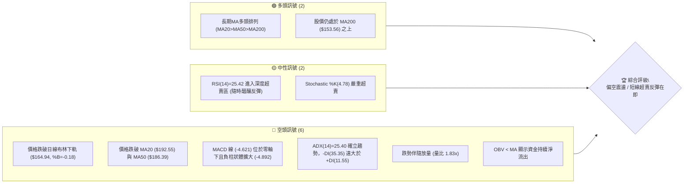

---

### 📊 核心指標速覽表

| 指標類別 | 指標名稱 | 當前數值 | 訊號 | 解讀 |
|----------|----------|----------|------|------|
| **價格** | 當前收盤價 | $154.99 | 🔴 | 跌破所有短期均線，逼近 52 週中軸區間 (45.6%) |
| **均線** | MA20 | $192.55 | 🔴 | 現價低於 MA20 達 -19.51%，短期下墜動能強烈 |
| **均線** | MA50 | $186.39 | 🔴 | 現價跌破中期生命線，自 10 月高點回調劇烈 |
| **均線** | MA200 | $153.56 | 🟢 | 現價高於 MA200 約 +0.93%，長期牛熊分界線面臨嚴峻考驗 |
| **動能** | RSI(14) | 25.42 | 🟡 | 進入極度超賣區間 (<30)，具技術性修復動能但尚未拐頭 |
| **動能** | MACD (12,26,9) | 柱狀: -4.892 | 🔴 | MACD 快線 -4.621 低於訊號線 0.271，空頭擴散 |
| **波動** | ATR(14) | $9.72 (6.27%) | 🔴 | 日間波動幅度顯著擴大，市場恐慌拋售情緒升溫 |
| **趨勢** | ADX(14) / ±DI | ADX: 25.40 | 🔴 | ADX>25 步入強趨勢行情，-DI (35.35) 壓制 +DI (11.55) |
| **量能** | 20日成交量比 | 1.83x | 🔴 | 伴隨放量下跌（49,779,900 股），機構調倉拋壓沉重 |

---

### 🏆 技術評分卡

```
╔══════════════════════════════════════════════════════════════════╗
║                技術評分卡 — PLTR (2026-11-06)                   ║
╠══════════════════════════════════════════════════════════════════╣
║ 趨勢強度 (Trend)     ████████░░░░░░░░░░░░  40/100  🔴 空頭強趨勢 ║
║ 動能指標 (Momentum)  ██████░░░░░░░░░░░░░░  30/100  🔴 深度超賣   ║
║ 支撐穩定度 (Support) ██████████░░░░░░░░░░  50/100  🟡 考驗MA200  ║
║ 成交量配合 (Volume)  ██████░░░░░░░░░░░░░░  30/100  🔴 放量下挫   ║
║ 形態完整度 (Pattern) ████████░░░░░░░░░░░░  40/100  🔴 頭部下破   ║
║ 均線排列 (MA Align)  ██████████░░░░░░░░░░  50/100  🟡 長多短空   ║
╠══════════════════════════════════════════════════════════════════╣
║ 綜合評分             ████████░░░░░░░░░░░░  40/100  偏空 / 觀望   ║
╚══════════════════════════════════════════════════════════════════╝
```
> **評分計算**：（40 + 30 + 50 + 30 + 40 + 50）÷ 6 = 40.0，依規則 18 四捨五入取整為 **40/100**。

---

## 2. 趨勢分析

### 🌐 多時框趨勢分析

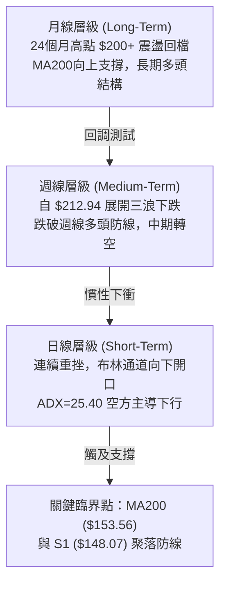

---

### 📈 長期趨勢 — 12個月走勢圖（Unicode）

依據 2025 年 11 月至 2026 年 11 月之 12 個月歷史收盤價繪製：

```
PLTR 月線走勢圖（過去12個月：2025-11 至 2026-11）
價格軸 ($)
$200 ┤                                  ● (2026-09 $187.05 / 2026-10 $184.11)
$180 ┤● (2025-11 $168.45)           ● (2026-08 $186.38)
$160 ┤  ● (2025-12 $177.75)   ● (2026-05 $156.54)
$150 ┤                                      ●← 現價 ($154.99)
$140 ┤    ● (2026-01 $146.59) ● (2026-03 $146.28)
$130 ┤      ● (2026-02 $137.19) ● (2026-04 $139.11)
$120 ┤                            ● (2026-07 $123.06)
$110 ┤                          ● (2026-06 $116.67 谷底)
     └───────────────────────────────────────────────────────────────
       11   12   01   02   03   04   05   06   07   08   09   10   11 (月份)
```

#### 走勢特徵分析表格

| 階段 | 時間區間 | 起訖價格 ($) | 漲跌幅 (%) | 趨勢特徵描述 |
|------|----------|--------------|------------|--------------|
| **第1階段** | 2025-11 ~ 2026-02 | $168.45 → $137.19 | -18.56% | 高位獲利了結，首波大幅度健康回檔 |
| **第2階段** | 2026-02 ~ 2026-05 | $137.19 → $156.54 | +14.10% | 構築箱型打底，震盪反彈修復估值 |
| **第3階段** | 2026-05 ~ 2026-06 | $156.54 → $116.67 | -25.47% | 恐慌拋售打出年度次低點，確認強支撐 |
| **第4階段** | 2026-06 ~ 2026-09 | $116.67 → $187.05 | +60.32% | 爆發性多頭主升浪，營收激增驅動強勢拉升 |
| **第5階段** | 2026-09 ~ 2026-11 | $187.05 → $154.99 | -17.14% | 觸及 52 週高點 $212.94 後出現急跌獲利回吐 |

---

### 📊 中期趨勢（週線分析）

從近 20 週數據觀察，PLTR 在 2026-10-09 週報收 $209.05（高點觸及 $212.94），週線 RSI 衝至 76.3 之極端超買區。隨後連續四週收黑：
1. **量價特徵**：2026-10-16 當週自最高點 $212.94 崩落收 $186.03，週成交量 1.25 億股；本週（截至 2026-11-05）成交量激增至 175,070,900 股，股價摜破 $160，呈現典型的週線級別主動性長黑賣壓。
2. **週線指標崩潰**：週線 MACD 柱狀體由 10 月初的 +1.204 迅速反轉至 -4.892，週線 RSI 跌至 25.4，顯示中期上漲動能遭到全面破壞。

```
中期週線阻力與支撐示意：
阻力 R3: $188.68 ═══════════════════════════════════ (近4週橫盤頸線區)
阻力 R2: $162.52 ----------------------------------- (反彈第一道波段阻力)
阻力 R1: $156.28 ┄┄┄┄┄┄┄┄┄┄┄┄┄┄┄┄┄┄┄┄┄┄┄┄┄┄┄┄┄┄┄┄┄┄┄ (前日跌破點)
現價   : $154.99  ◄ [股價處於 MA200 邊緣岌岌可危]
支撐 S1: $148.07 ┄┄┄┄┄┄┄┄┄┄┄┄┄┄┄┄┄┄┄┄┄┄┄┄┄┄┄┄┄┄┄┄┄┄┄ (波段回調密集成交區)
支撐 S2: $136.30 ----------------------------------- (中期前波結構平台)
支撐 S3: $131.63 ═══════════════════════════════════ (極限支撐防線)
```

---

### ⚡ 趨勢強度評估（ADX 解讀）

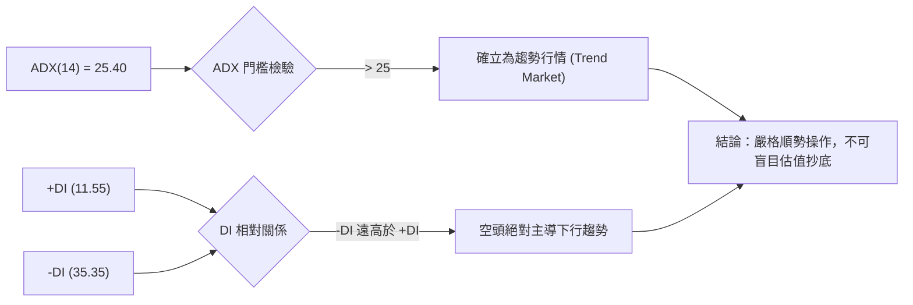

#### ADX 強度對照表

| 指標變數 | 當前數值 | 參考門檻 | 狀態解讀 |
|----------|----------|----------|----------|
| **ADX(14)** | **25.40** | > 25.0 | 剛越過強趨勢臨界線，確認擺脫 9-10 月高位震盪，進入單邊趨勢 |
| **+DI** | **11.55** | < 20.0 | 多方進攻意願極度低落，買盤缺乏持續性 |
| **-DI** | **35.35** | > 30.0 | 空方壓制力道強勁，主動型賣單持續推動價格下探 |
| **趨勢形態** | **空頭趨勢** | -DI 跨越 +DI | 當前為確立的日線級別空頭單邊波段 |

---

## 3. 圖表形態分析

### 🔍 形態識別系統

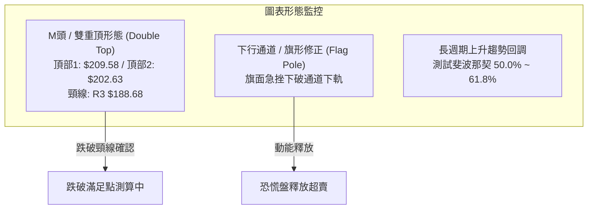

#### 形態識別與信心度評估表

| 形態名稱 | 信心度 (%) | 判斷依據（引用數據） | 完成度 (%) | 目標價（附計算式） |
|----------|------------|----------------------|------------|--------------------|
| **日線級別雙重頂** | 85% | 頂1 (2026-10-09高 $209.58)、頂2 (2026-10-23高 $202.63)；下破頸線 $188.68 (R3) | 100% (已破頸線) | 由雙頂形態高度推算：頸線 $188.68 − (頂1 $209.58 − 頸線 $188.68) = $188.68 − $20.90 = **$167.78** (已達成且跌破) |
| **頭肩頂形態** | 45% | 數據中未偵測到完整的左肩與右肩對稱對應結構 | N/A | 訊號不足，僅做指標型解讀（規則 15） |
| **下行通道下軌擊穿** | 75% | 價格以連四黑日K直接擊穿布林下軌 $164.94，目前處於通道外側 | 90% | 由通道幅度推算下測關鍵支撐位 **S1 $148.07** |

---

### 🕯️ 重要K線形態分析

依據規則 19，完全基於提供的近 10 根日 K 與近 8 根週 K 之實際 OHLC 數據進行客觀解讀：

#### 近 10 根日 K 線解讀

| 日期 | 開盤價 | 最高價 | 最低價 | 收盤價 | K線形態 | 技術解讀 | 訊號 |
|------|--------|--------|--------|--------|---------|----------|------|
| **2026-10-23** | $195.02 | $197.49 | $190.57 | $196.75 | 小陽線 | 高位橫盤整理，多空短線膠著 | 🟡 |
| **2026-10-26** | $197.90 | $200.05 | $192.91 | $198.84 | 衝高回落小陽 | 衝擊 $200 整數關卡受阻，留上影線 | 🟡 |
| **2026-10-27** | $198.12 | $201.83 | $196.79 | $198.73 | 墓碑型十字小陰 | 創波段反彈高點 $201.83 後迅速被壓回 | 🔴 |
| **2026-10-28** | $197.01 | $198.74 | $193.13 | $196.81 | 窄幅小陰十字 | 動能衰退，未能維持在 $198 之上 | 🔴 |
| **2026-10-29** | $198.37 | $198.51 | $190.36 | $196.42 | 下影小陰線 | 盤中下探 $190.36，空頭開始試探下檔承接力 | 🔴 |
| **2026-10-30** | $193.62 | $193.92 | $180.81 | $184.11 | 跳空長黑棒 | 跳空低開低走破位，跌破頸線 $188.68，放量 2,707 萬 | 🔴 |
| **2026-11-02** | $186.52 | $187.55 | $178.13 | $178.34 | 大黑實體棒 | 連續性破位，下破 $180，量能放大至 3,718 萬 | 🔴 |
| **2026-11-03** | $168.18 | $176.54 | $165.25 | $175.40 | 低開反彈陽線 | 重大跳空缺口（低開於 $168.18），爆出 5,306 萬鉅量 | 🟡 |
| **2026-11-04** | $164.95 | $177.43 | $164.60 | $171.70 | 衝高受阻流星小陰 | 反彈無力站上 $177.43，多頭反攻遭反撲 | 🔴 |
| **2026-11-05** | $166.71 | $167.25 | $152.60 | $154.99 | 光頭長陰棒 | 收在全日次低點 $154.99，摜破 $160，空頭宣洩 | 🔴 |

#### 近 8 根週 K 線解讀

| 週結日期 | 開盤價 | 最高價 | 最低價 | 收盤價 | 週K形態 | 技術解讀 | 訊號 |
|----------|--------|--------|--------|--------|---------|----------|------|
| **2026-09-18** | $169.70 | $177.88 | $166.42 | $177.64 | 中陽週棒 | 多頭波段推進，收復失土 | 🟢 |
| **2026-09-25** | $178.73 | $194.68 | $176.76 | $189.67 | 帶上影長陽 | 多頭大舉進攻，突破 $190 關卡 | 🟢 |
| **2026-10-02** | $186.23 | $194.78 | $184.81 | $188.75 | 孕線高位十字 | 高位換手，成交量縮減至 8,697 萬 | 🟡 |
| **2026-10-09** | $189.45 | $209.58 | $187.63 | $209.05 | 強勢長陽頂天 | 衝破 $200 創波段收盤新高，超買顯著 | 🟢 |
| **2026-10-16** | $208.90 | $212.94 | $184.45 | $186.03 | 高位長黑倒垂吞噬 | 觸及 52 週高點 $212.94 後單週暴跌 26.9 美元 | 🔴 |
| **2026-10-23** | $186.99 | $202.63 | $186.15 | $196.75 | 弱勢反彈陽線 | 試圖修復，但高點 $202.63 未過前高形成次高點 | 🟡 |
| **2026-10-30** | $197.90 | $201.83 | $180.81 | $184.11 | 破位回落中陰 | 跌破前週低點，確立雙頂回落結構 | 🔴 |
| **2026-11-05** | $186.52 | $187.55 | $152.60 | $154.99 | 恐慌巨陰棒 | 單週下挫逾 29 美元，週放量 1.75 億股，殺穿下軌 | 🔴 |

---

### 📉 ASCII 走勢形態示意圖

```
PLTR 日線雙頂破位與當前下殺形態結構：

$212.94 ┬                        ● (52W High: 10-16)
        │                       / \
$202.63 ┼                      /   \       ● (次高頂2: 10-23)
        │                     /     \     / \
$188.68 ┼───頸線 R3 ─────────●───────●───●───\───────────────── (跌破頸線確認破位)
        │            (10-02)       (10-16) \     \
$172.23 ┼ (38.2% 斐波回調)                  \     \
        │                                    \     \
$162.52 ┼───反彈阻力 R2 ──────────────────────\─────\────────────
        │                                      \     \
$154.99 ┼───現價 ───────────────────────────────\─────● (今日收盤)
$153.56 ┼───MA200 (牛熊分水嶺) ──────────────────\────┼─[目前在此爭奪]
        │                                          ▼
$148.07 ┴───波段強支撐 S1 ─────────────────────────────────────
```

---

### 🎯 形態目標價計算

1. **已達成之雙頂最小跌幅測算**：
   - 頂部 1 高點：$209.58
   - 頸線位置：$188.68 (即阻力位 R3)
   - 垂直高度：$209.58 − $188.68 = $20.90
   - 理論跌破目標價 = 頸線 $188.68 − 形態高度 $20.90 = **$167.78**。
   - **實況解讀**：現價 $154.99 已大幅跌破該理論滿足點，顯示市場並非單純形態修正，而是疊加機構獲利拋售的超跌行情。
2. **次級延伸跌幅測算（引用數據既定支撐）**：
   - 若 MA200 ($153.56) 失守，下一個理論支撐將直指「關鍵價位」中計算出的近一年低點聚類 **S1: $148.07**，極限回調目標為 **S2: $136.30**。

---

## 4. 支撐與阻力

### 🗺️ 關鍵價位分布圖（Unicode）

```
PLTR 價位結構分布圖（嚴格依據 OHLCV 既定價位繪製）
═════════════════════════════════════════════════════════════════
$188.68 ║██████████████████████████████║ 強阻力 R3 (雙頂頸線 / 密集成交)
$172.23 ║▓▓▓▓▓▓▓▓▓▓▓▓▓▓▓▓▓▓            ║ 斐波那契 38.2% 回調位
$162.52 ║████████████████████          ║ 阻力 R2 (反彈第一道壓力)
$159.66 ║▓▓▓▓▓▓▓▓▓▓▓▓▓▓▓▓              ║ 斐波那契 50.0% 平衡分水嶺
$156.28 ║████████████████████████      ║ 關鍵阻力 R1 (前日破位密集區)
$154.99 ╠══════════════════════════════╣ ◄ 當前收盤價 ($154.99)
$153.56 ║──────────────────────────────║ 關鍵均線 MA200 (多空最後防線)
$148.07 ║▓▓▓▓▓▓▓▓▓▓▓▓▓▓▓▓▓▓▓▓        ║ 近期強支撐 S1 (斐波 61.8% 重合帶)
$147.08 ║▓▓▓▓▓▓▓▓▓▓▓▓▓▓▓▓▓▓▓▓        ║ 斐波那契 61.8% 黃金分割位
$136.30 ║████████████████████████      ║ 強支撐 S2 (前期整理平台低點)
$131.63 ║██████████████████████████████║ 核心防線 S3 (年度波段防守極限)
═════════════════════════════════════════════════════════════════
```

---

### 🚧 阻力位分析表

所有阻力價位完全引用「關鍵價位」數據庫：

| 阻力級別 | 價位 | 形成原因 | 突破難度 | 重要性 |
|----------|------|----------|----------|--------|
| **R1** | **$156.28** | 近一年波段高點聚類、距離現價僅 +0.83%，為 11-05 跌破的直接短壓 | 🟡 中等 | 短線多頭反彈的第一道測試關卡，必須站回才可望止跌 |
| **R2** | **$162.52** | 近一年波段密集高點聚類 (+4.86%)、鄰近日線布林下軌 ($164.94) | 🔴 較高 | 空方防守要塞，短線解套賣壓聚集處 |
| **R3** | **$188.68** | 近一年波段巨量聚類 (+21.74%)，雙頂頸線與 MA50 ($186.39) 重疊區 | 🔴 極高 | 中期多空結構翻轉點，未重返此位前中期空頭格局不變 |

---

### 🛡️ 支撐位分析表

所有支撐價位完全引用「關鍵價位」數據庫：

| 支撐級別 | 價位 | 形成原因 | 守住機率 | 重要性 |
|----------|------|----------|----------|--------|
| **S1** | **$148.07** | 近一年波段低點聚類 (-4.46%)，與斐波那契 61.8% ($147.08) 形成支撐共振帶 | 🟢 70% | 短線最重要的多頭堡壘，跌破將引發新一輪停損拋補 |
| **S2** | **$136.30** | 近一年波段平台低點聚類 (-12.06%)，2026 年 2 月至 4 月之震盪底部 | 🟡 55% | 中期結構性強支撐，若觸及將提供絕佳左側進場盈虧比 |
| **S3** | **$131.63** | 近一年波段極限低點聚類 (-15.07%)，2025 年年中上升起點密集區 | 🟢 85% | 長期多頭不可失守之核心底線，失守意味著牛市結構破裂 |

---

### 📐 斐波那契回調位分析

依據 52 週區間 **$106.37（0.0% / 52W Low）→ $212.94（100.0% / 52W High）** 之回調計算：

| 斐波那契層級 | 精確價位 | 相對於當前價格 ($154.99) 之狀態與技術意義解讀 |
|--------------|----------|-----------------------------------------------|
| **0.0% (52W High)** | **$212.94** | 歷史極限阻力位，2026-10-16 留下長上影線之反轉點 |
| **23.6%** | **$187.79** | 淺幅回調位，與 R3 ($188.68) 共振，已於 10 月底被長黑摜破 |
| **38.2%** | **$172.23** | 弱勢修正支撐位，11-04 反彈高點 $177.43 受阻後失守轉為強壓 |
| **50.0%** | **$159.66** | 多空平衡分水嶺，現價已跌破此位（位於下方 -2.93%） |
| **61.8%** | **$147.08** | **黃金分割支撐位**，與波段支撐 **S1 ($148.07)** 構成強大緩衝支撐區間 |
| **78.6%** | **$129.18** | 深度回調極限位，鄰近 S3 ($131.63) |
| **100.0% (52W Low)**| **$106.37** | 年度絕對低點 |

> **當前落點解讀**：現價 **$154.99** 精確座落於 **50.0% ($159.66)** 與 **61.8% ($147.08)** 兩大關鍵分割位之間。50% 位置跌破意味著自 $106.37 起漲的多頭行情遭到腰斬級回撤，目前市場正加速尋求 61.8% 黃金分割共振帶（$147.08 ~ $148.07）之防守支撐。

---

## 5. 技術指標深度解讀

### 🎛️ 指標訊號總覽

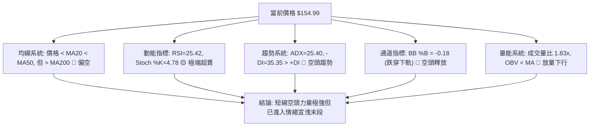

---

### 📈 移動平均線排列分析

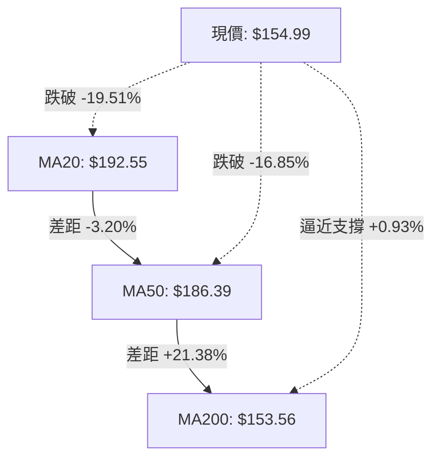

#### 移動平均線數據分析矩陣

| 均線名稱 | 當前價格 | 與現價乖離率 (%) | 均線走勢方向 | 技術面意涵解讀 |
|----------|----------|------------------|--------------|----------------|
| **MA 5** | $172.91 | -10.36% | ▼ 下行加速 | 超短期下壓極大，短線未收復 MA5 前不言底 |
| **MA 10** | $185.21 | -16.32% | ▼ 下行加速 | 短期空頭防線，空方主要進攻跑道 |
| **MA 20** | $192.55 | -19.51% | ▼ 拐頭向下 | 短期月均線走跌，布林中軌阻力重重 |
| **MA 50** | $186.39 | -16.85% | ▼ 走平轉下 | 中期生命線宣告失守，多頭趨勢嚴重受損 |
| **MA 60** | $184.53 | -16.01% | ▼ 走平轉跌 | 季線下彎，高檔套牢籌碼沉重 |
| **MA 120** | $159.78 | -3.00% | ▼ 走緩 | 半年線失守，長期多單開始出現停損 |
| **MA 200** | $153.56 | **+0.93%** | ▲ 向上緩行 | **長期年線多頭排列尚未破壞，為最後堡壘** |
| **MA 240** | $157.67 | -1.70% | ▼ 走緩 | 價格在長天期均線附近密集穿梭震盪 |

> **均線排列特徵**：儘管長期架構維持「多頭排列 MA20>MA50>MA200」，但由於價格以崩跌走勢直接打穿短期與中期均線，現價已來到 MA200 ($153.56) 咫尺之間，均線即將面臨死亡交叉收斂考驗。

---

### 📉 RSI(14) 分析

- **當前數值**：**25.42** (Wilder 計算)
- **數值進度條**：
  ```
  RSI(14) [25.42]: █████░░░░░░░░░░░░░░░  25.42%  🟢 超賣 (<30)
  ```
- **區間診斷**：RSI 跌入 30 以下之嚴重超賣區間，近 20 週數據顯示這是自 2026 年 6 月以來最低的動能水平。
- **背離分析判斷**：
  - 根據數據顯示：「RSI 背離：無明顯背離（僅比較近20根K棒首尾的價格與RSI方向）」。
  - **客觀結論**：目前為**無底背離狀態下的純粹指標超賣超跌**。這意味著空方動能是實質性宣洩，而非動能減弱的假摔，不可僅因超賣立即左側重倉做多。

---

### 📊 MACD(12,26,9) 訊號解讀

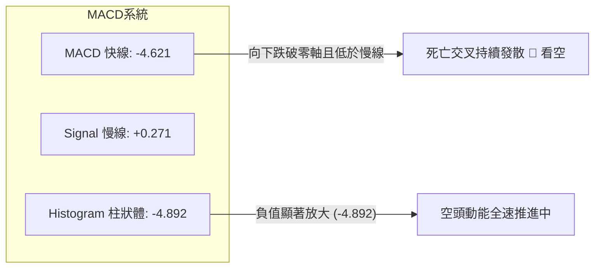

- **MACD 快線**：-4.621 跌入負值區間，創近 20 週新低。
- **Signal 訊號線**：+0.271 剛由正轉平，即將下穿零軸。
- **MACD 柱狀體**：-4.892 呈現大面積負柱放大態勢。
- **背離檢驗**：MACD 與價格同步創出近期新低，並無多頭底背離跡象，技術指標確認了這波跌勢的真實性與破壞力。

---

### 📦 布林通道分析

```
ASCII 布林通道走勢結構示意圖：

$220.16 ┬─────────────────────────────────────────────── BB 上軌
        │               ● (10-16 觸及高點 $212.94)
        │              / \
$192.55 ┼─────────────●───●───────────────────────────── BB 中軌 (MA20)
        │            /     \
$164.94 ┼───────────/───────●─────────────────────────── BB 下軌
        │          /         \
$154.99 ┼─────────/───────────● ◄─── 現價 (%B = -0.18，已跌出下軌外)
        │        /
$140.00 ┴───────●───────────────────────────────────────
```

- **通道參數**：上軌 **$220.16** ｜ 中軌(MA20) **$192.55** ｜ 下軌 **$164.94**
- **帶寬與位置**：
  - 帶寬 (Bandwidth) = ($220.16 − $164.94) ÷ $192.55 = 28.68%，通道開口劇烈擴大。
  - **布林 %B** = **-0.18**。數值小於 0 顯示股價已「跌破下軌外側」，形成極度極端的價格拉扯狀態，通常暗示極端賣壓宣洩後存在向中軌均值回歸的技術修復潛力。

---

### 💹 成交量分析（量價配合度）

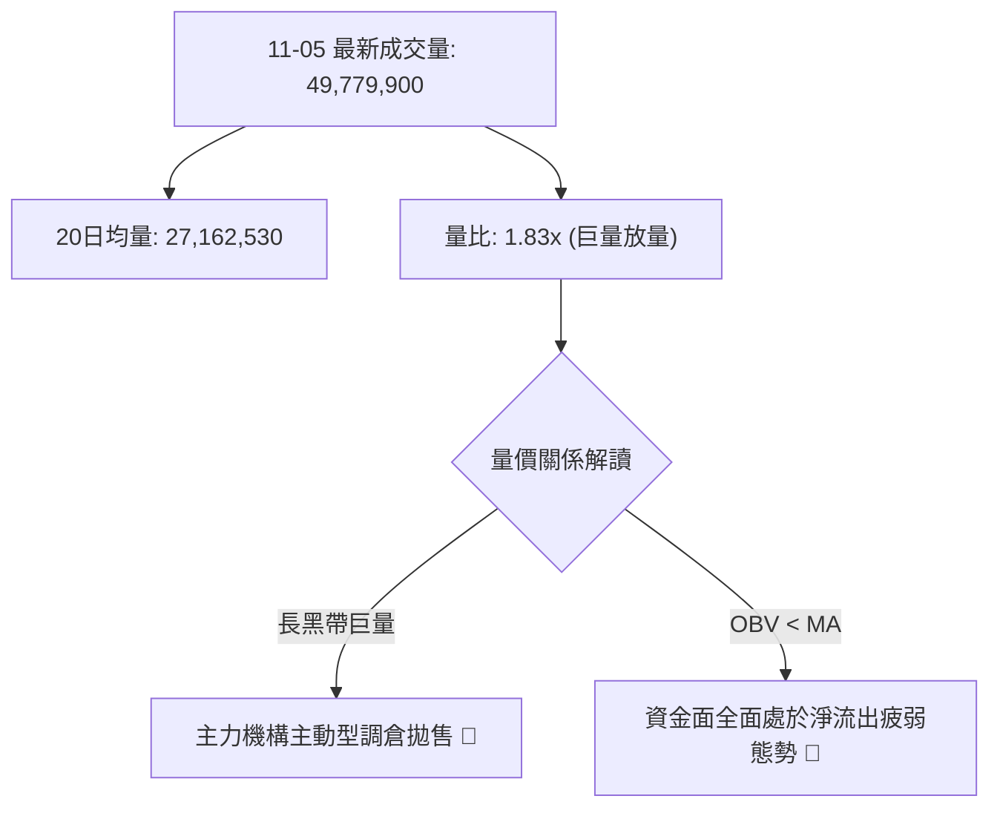

- **量能激增**：最新交易日成交量達到 49,779,900 股，相較於 20 日均量 27,162,530 股放大至 **1.83 倍**；50 日均量為 25,823,288 股。
- **OBV 能量潮狀態**：數據明確指出「OBV 趨勢：OBV < MA → 量能疲弱」，顯示自 10 月中旬觸頂以來，下跌帶量、反彈縮量，資金處於淨撤離階段，量能尚未出現「量縮止跌」的沉澱特徵。

---

## 6. 動能與波動率

### ⚡ 動能評估四象限

| 象限 | 動能強度 | 波動率水平 | 當前所屬狀態 | 操作與評估指引 |
|------|----------|------------|--------------|----------------|
| **Q1 (高動能·低波動)** | 強多頭 | 低波動 | 否 | 穩健單邊上升趨勢（非當前市場） |
| **Q2 (弱動能·低波動)** | 盤整中性 | 低波動 | 否 | 區間沉寂醞釀突破（非當前市場） |
| **Q3 (強動能·高波動)** | **強空頭** | **高波動** | **✓ [當前所屬]** | **空頭單邊擴散，恐慌性波動加劇，風險極高** |
| **Q4 (弱動能·高波動)** | 轉向分歧 | 高波動 | 否 | 頂底巨震混亂期（非當前市場） |

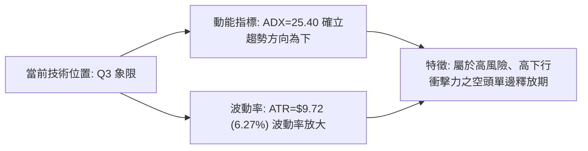

---

### 📊 ATR 波動率分析

- **當前 ATR(14)**：**$9.72**（依據 Wilder 計算，佔股價比率高達 **6.27%**）。
- **日內波動評估**：PLTR 目前屬於**極高波動**個股，單日振幅接近 10 美元。
- **止損距離建議**：
  - **一般震盪止損距離 (1.0 × ATR)**：**$9.72**。
  - **寬幅防洗盤止損距離 (1.5 × ATR)**：**$14.58**。
  - **保守交易止損距離 (2.0 × ATR)**：**$19.44**。
  - *實戰應用*：在當前 ATR 擴大背景下，所有進場策略必須適度縮減持倉規模（Position Sizing），避免被日內隨機雜訊掃出場。

---

### 📐 Beta 與市場相關性

- **Beta 係數**：**1.61**（高貝塔高彈性標的）。
- **市場敏感度分析**：PLTR 相對於標普 500 指數具備 1.61 倍的放大波動特徵。在科技股或大盤下挫週期中，其跌幅往往會被系統性放大；相反地，一旦科技板塊企穩回升，其反彈爆發力亦將顯著超越市場平均。
- **放空比率 (Short Interest)**：Short % Float 為 2.6%，Short Ratio 為 2.37 天，目前市場並不存在極端的放空擠壓（Short Squeeze）基礎，空方賣壓主要源自多頭部位的獲利回吐與主動撤離。

---

## 7. 多時框架總結

### 📋 時框架評分表

| 時框架 | 趨勢方向 | 動能狀態 | 均線排列狀況 | 形態特徵 | 綜合評分 | 操作建議方向 |
|--------|----------|----------|--------------|----------|----------|--------------|
| **短期 (日線)** | 🔴 強烈空頭 | RSI=25.42 (超賣) | 價格完全跌破 MA5/10/20 | 雙頂破位連黑放量 | 30/100 | 禁止逆勢抄底，等待短彈受阻 |
| **中期 (週線)** | 🔴 轉入下行 | MACD柱狀=-4.892 | 摜破週線中軌回測長期均線 | 巨陰長黑回吐前漲幅 | 40/100 | 等待 S1/S2 止跌形態確立 |
| **長期 (月線)** | 🟢 依舊多頭 | ADX 強趨勢回調 | MA20>MA50>MA200 (完好) | 52週區間中軸拉回 | 50/100 | 關注 MA200 牛熊分界線得失 |

---

### 🔲 綜合訊號矩陣

```
時框維度協同性檢驗矩陣：
┌─────────────┬──────────┬──────────┬──────────┬─────────────┐
│ 分析維度    │ 短期日線 │ 中期週線 │ 長期月線 │ 一致性評定  │
├─────────────┼──────────┼──────────┼──────────┼─────────────┤
│ 趨勢方向    │ 🔴 看空  │ 🔴 看空  │ 🟢 看多  │ ⚠️ 週期背離 │
│ 均線位置    │ 🔴 空頭  │ 🟡 中性  │ 🟢 多頭  │ ⚠️ 均線修復 │
│ 動能方向    │ 🔴 衰退  │ 🔴 衰退  │ 🟡 減弱  │ 🔴 高度一致 │
│ 量價健康度  │ 🔴 放量跌│ 🔴 帶量破│ 🟡 正常  │ 🔴 空方佔優 │
└─────────────┴──────────┴──────────┴──────────┴─────────────┘
```

---

### ⚖️ 多時框收斂結論

依據本報告**嚴格要求 14（多時框收斂規則）**進行最終裁決：
1. **行情屬性判定**：當前日線 **ADX(14) = 25.40**，數值大於 25.0，且 -DI (35.35) 呈現壓倒性優勢，明確確立當前為**趨勢行情（Trend Market）**，而非無方向的盤整震盪。
2. **時框優先級權衡**：
   - 在趨勢行情中，中長期（週線／MA50、MA200）方向居於主導地位。雖然月線級別 MA200 仍位於 $153.56，維持長期多頭排列底線；但**中期週線 MACD 崩跌、日線與週線連袂破位，顯示當前處於強烈的中期下修正趨勢**。
   - 日線層級跌破布林下軌且 RSI 跌至 25.42，僅能視為「趨勢下行中的嚴重超賣」，日線指標在此僅可用於「研判反抽壓力點以尋求空頭進場點」或「超跌部位的風險風控」，絕不可用日線超賣去推翻中期的空頭主趨勢。
3. **唯一方向性結論**：
   - **【偏空觀望 / 逢反彈順勢佈空】**（主策略方向全面鎖定偏空，綜合評分：**40/100**）。

---

## 8. 交易策略建議

### 🗺️ 策略決策流程圖

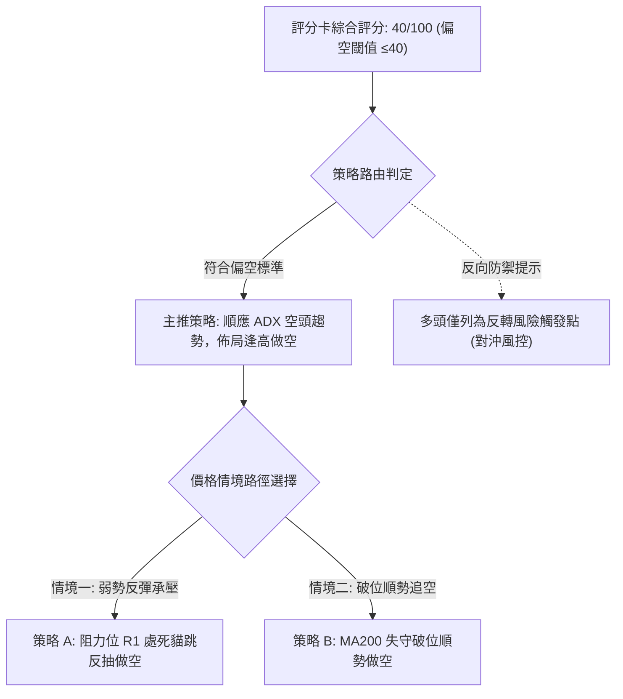

---

### 🧭 策略路由（依評分卡分流）

> **當前主策略方向 = 【主推空頭策略】（嚴格依據技術評分卡綜合評分：40/100 ≤ 40 執行，規則 18）**

因綜合評分達偏空臨界線（40/100），且 ADX>25 確立下行趨勢，本報告禁止在未見止跌信號前盲目逆勢做多，一切以順應空頭趨勢、逢反彈受阻放空為主策略。

---

### 🎯 價格情境階梯（Price Scenarios）

價位嚴格引用「關鍵價位」既定數據：

| 觸發條件 | 下一目標 | 後續延伸 | 情境含義解讀 |
|----------|----------|----------|--------------|
| **強勢突破 R1 $156.28** | R2 $162.52 | R3 $188.68 | 短線空頭回補，超賣引發技術性強彈，測試下降通道上緣 |
| **跌破 MA200 並失守 S1 $148.07** | S2 $136.30 | S3 $131.63 | 長期牛市防線崩潰，引發系統性基金拋補，中期全面轉空 |
| **跌破 S2 $136.30** | S3 $131.63 | 52W Low $106.37 | 嚴重結構性破壞，回撤年度漲勢的終極起漲防線 |

---

### 📊 情境機率分佈

| 情境類別 | 機率估計 (%) | 主要技術依據（完全引用指標狀態） |
|----------|--------------|-----------------------------------|
| **延續下行 / 摜破支撐** | **55%** | ADX=25.40 且 -DI=35.35，成交量放大至 1.83x，OBV<MA，空頭主導 |
| **超賣弱勢抽頭 / 遇阻回落** | **35%** | RSI=25.42 與 Stoch %K=4.78 極端超賣，現價貼近 MA200 ($153.56) 易有反抽 |
| **強勢反轉 / 重回多頭通道** | **10%** | 目前無底背離、均線全面下彎，短時間直接深 V 反轉難度極高 |

---

### 🟢 主策略詳情（偏空佈局）

所有進場、止損、目標價嚴格自既定價位挑選，並依規則 17 驗證風險報酬比：

| 策略要素 | 策略 A（反彈高空 — 逢阻力放空） | 策略 B（破位追空 — 破 MA200 放空） |
|----------|----------------------------------|------------------------------------|
| **進場條件** | 股價弱勢反彈測試阻力位 R1 遇阻回落 | 股價實體跌破 MA200 並失守支撐 S1 |
| **進場價格** | **$156.28** (即阻力位 R1) | **$148.07** (即支撐位 S1) |
| **目標價 T1** | **$148.07** (支撐位 S1) | **$136.30** (支撐位 S2) |
| **目標價 T2** | **$136.30** (支撐位 S2) | **$131.63** (支撐位 S3) |
| **止損價格** | **$162.52** (阻力位 R2) | **$156.28** (阻力位 R1) |
| **風險報酬比** | **1 : 1.32（以 T1 計）**<br/>*(以 T2 計為 1 : 3.20)* | **1 : 1.43（以 T1 計）**<br/>*(以 T2 計為 1 : 1.99)* |
| **成功機率** | **65%** | **60%** |
| **建議倉位** | 10% ~ 15% 總資金 | 8% ~ 10% 總資金 |

> **風險報酬比（RRR）驗證算式**（做空公式：(進場價 − 目標價) ÷ (止損價 − 進場價)）：
> - **策略 A**：(156.28 − 148.07) ÷ (162.52 − 156.28) = 8.21 ÷ 6.24 = **1.32** → **1 : 1.32**
>   - *T2 延伸*：(156.28 − 136.30) ÷ (162.52 − 156.28) = 19.98 ÷ 6.24 = 3.20 → 1 : 3.20
> - **策略 B**：(148.07 − 136.30) ÷ (156.28 − 148.07) = 11.77 ÷ 8.21 = **1.43** → **1 : 1.43**
>   - *T2 延伸*：(148.07 − 131.63) ÷ (156.28 − 148.07) = 16.44 ÷ 8.21 = 2.00 → 1 : 2.00

---

### 🔴 反向風險觸發點（對沖提示）

若出現以下情境，將宣告主空頭策略失效，空單必須立即無條件止損出場：
1. **關鍵點位被收復**：日線收盤價帶量突破 **R2: $162.52**，且日線連續 2 根 K 棒站穩其上。
2. **動能結構質變**：RSI(14) 重新站回 45 以上，且日線 MACD 出現向上黃金交叉收斂。
3. **長下影線確認**：在支撐 S1 ($148.07) 附近收出單日長下影線（下影長度 > 實體 2 倍），且成交量超越 5,000 萬股。

---

### ⭐ 整體訊號強度評星

```
做多訊號強度：★☆☆☆☆  (1/5星) ── 僅剩極度超賣與MA200微弱支撐
做空訊號強度：★★★★☆  (4/5星) ── 均線破位、ADX強趨勢、巨量殺跌
整體可信度：  ★★★★☆  (4/5星) ── 指標多維度相互驗證，共振度高
```

---

## 9. 風險提示與監控

### ✅ 關鍵監控指標 Checklist

```
╔══════════════════════════════════════════════════════════════════╗
║              PLTR 交易風險日常監控 Checklist                     ║
╠══════════════════════════════════════════════════════════════════╣
║ [ ] MA200 關鍵防線檢驗：收盤價是否有效跌破 $153.56             ║
║ [ ] 黃金分割支撐防守：S1 $148.07 是否出現主力護盤大單            ║
║ [ ] 波動率指標異動：ATR 是否自 $9.72 進一步放大 (突破 $12 代表恐慌)║
║ [ ] 動能底背離訊號：日線 RSI(14) 在跌破 $150 時是否拒絕破低    ║
║ [ ] 成交量縮減特徵：日成交量是否回落至 2,000 萬股以下 (量縮止跌) ║
║ [ ] 反彈第一壓驗證：盤中反抽能否攻克阻力位 R1 $156.28           ║
║ [ ] 隔夜跳空風險：期權引含波動率 (IV) 變化與盤後科技巨頭財報外溢 ║
╚══════════════════════════════════════════════════════════════════╝
```

---

### ⚠️ 風險場景分析

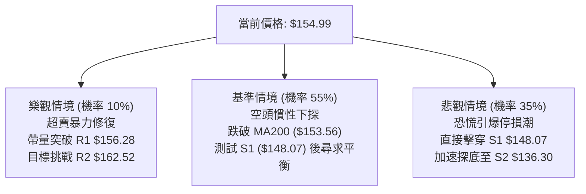

---

### 🛡️ 風險管理重要提醒

1. **倉位管理原則**：
   - 當前 ATR 高達 $9.72 (6.27%)，單日價格波動極具破壞力。建議單筆交易承受風險（Risk Capital）不得超過總資產的 **1.0% ~ 1.5%**。
   - 總持倉曝險部位不宜超過 **25%**，杜絕左側加碼攤平（Averaging Down）操作。
2. **高 Beta 防禦**：
   - PLTR Beta 達 1.61，極易受到 QQQ 或大盤指數日內劇烈波動影響。在美股盤前 CPI、利率決策或大盤重大變盤節點，應主動收緊止損位。
3. **技術破位紀律**：
   - 長期年線 MA200 ($153.56) 歷來是多頭信仰核心，若連續兩日收盤跌破該位，意味著機構投資者將啟動被動去槓桿，切不可抱持僥倖心理抗單。

---

## 📋 報告總結

```
╔══════════════════════════════════════════════════════════════════╗
║                    PLTR 技術分析報告總結                         ║
╠══════════════════════════════════════════════════════════════════╣
║ 報告日期：2026-11-06          當前價格：$154.99                  ║
║ 分析評級：⚖️ 偏空 / 觀望 (Bearish Bias)                         ║
║ 綜合技術評分：40 / 100        趨勢狀態：ADX 確立空頭趨勢         ║
╠══════════════════════════════════════════════════════════════════╣
║ 關鍵結構結論：                                                   ║
║ ├─ 長期趨勢：🟢 多頭回撤（MA200 $153.56 迎來最終生死決戰）     ║
║ ├─ 中期趨勢：🔴 雙頂成型（週線連黑放量，MACD 負向大幅擴散）     ║
║ ├─ 短期趨勢：🔴 單邊下挫（日線破下軌超賣，-DI 強烈主導）        ║
║ ├─ 關鍵阻力：R1: $156.28  │  R2: $162.52  │  R3: $188.68         ║
║ ├─ 關鍵支撐：S1: $148.07  │  S2: $136.30  │  S3: $131.63         ║
║ └─ 斐波焦點：當前處於 50.0% ($159.66) 與 61.8% ($147.08) 之間   ║
╠══════════════════════════════════════════════════════════════════╣
║ 最優策略組合指引：                                               ║
║ 1. 🥇 最佳機會（策略 A）：等待股價反彈至 R1 $156.28 受阻佈空，   ║
║      止損設於 R2 $162.52，目標下看 S1 $148.07 (RRR = 1 : 1.32)。║
║ 2. 🥈 次選機會（策略 B）：MA200 宣告破位後於 S1 $148.07 追空，   ║
║      止損設於 R1 $156.28，目標下看 S2 $136.30 (RRR = 1 : 1.43)。║
║ 3. 🥉 保守選擇（右側觀望）：空手者全面等待日線 RSI 走出超賣區且  ║
║      出現縮量築底 K 線前，不盲目接飛刀。                        ║
╚══════════════════════════════════════════════════════════════════╝
```

---

> ⚠️ **免責聲明**：本報告為技術分析研究，所有數據、圖表及價位推演均嚴格基於所提供之歷史價格與量化指標。本報告**僅供研究與學術參考**，**不構成任何要約、招攬或投資建議**。市場具有高風險，交易決策需審慎獨立評估，嚴格控制資本風險。

---

*報告生成時間：2026-11-06 ｜ 數據來源：Yahoo Finance ｜ 分析框架：多時框技術分析體系*