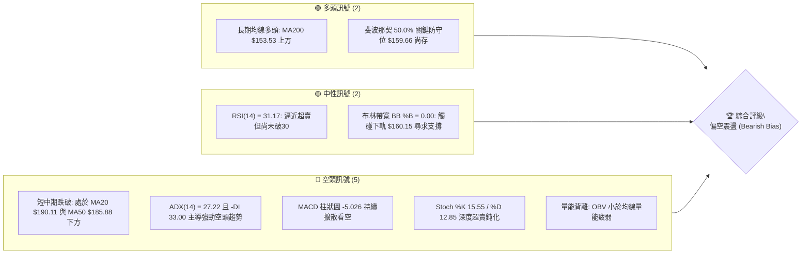
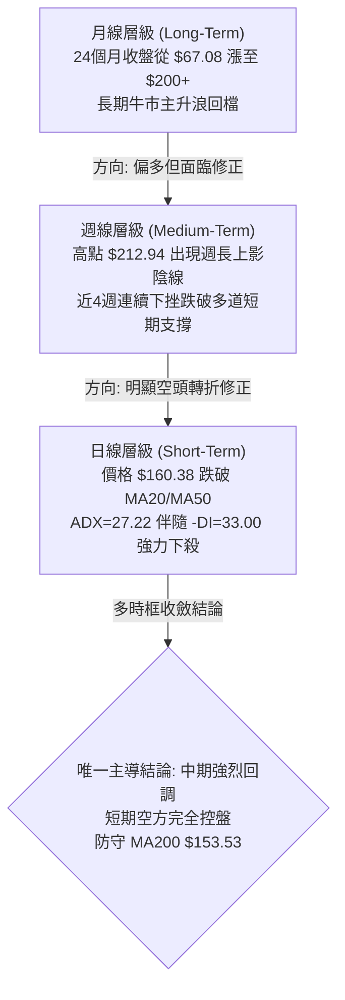
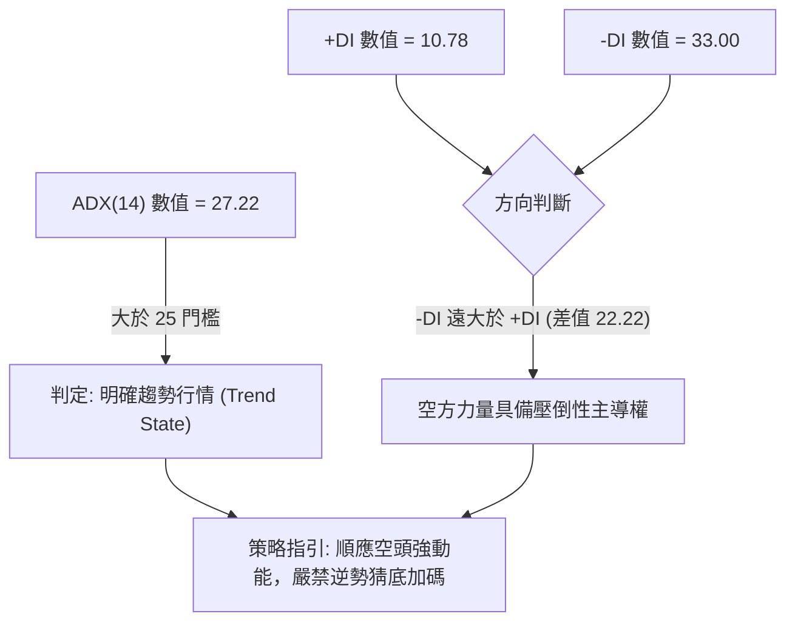
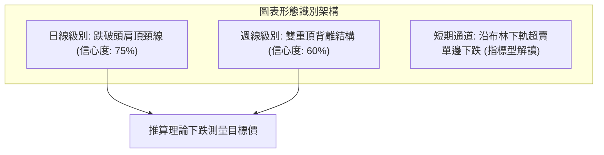
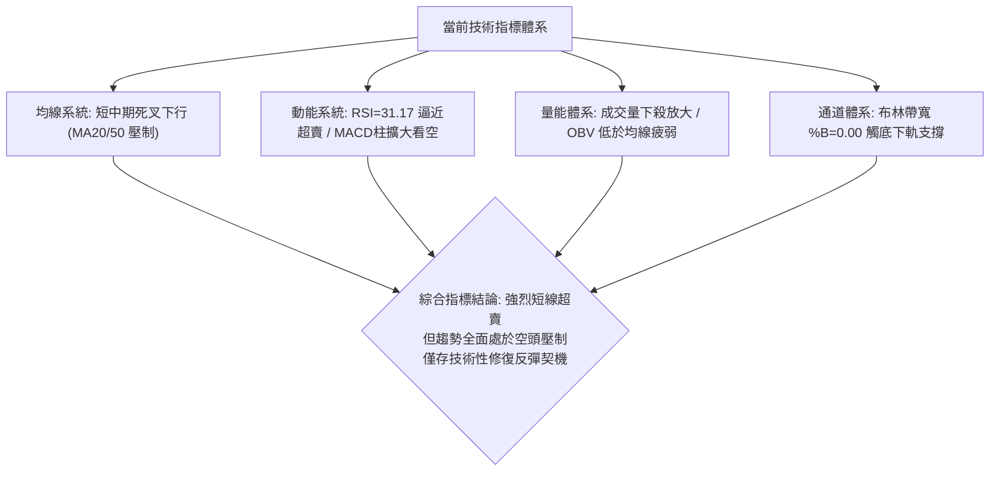
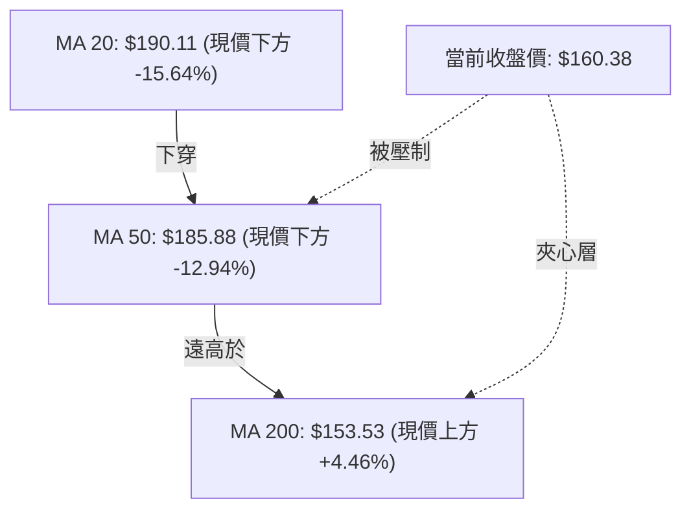
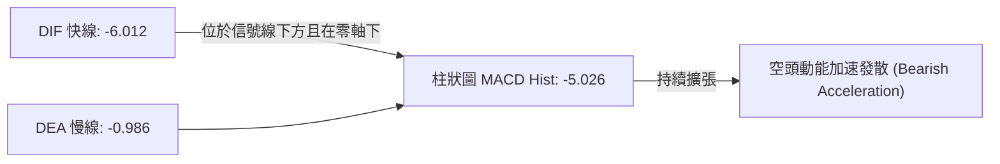
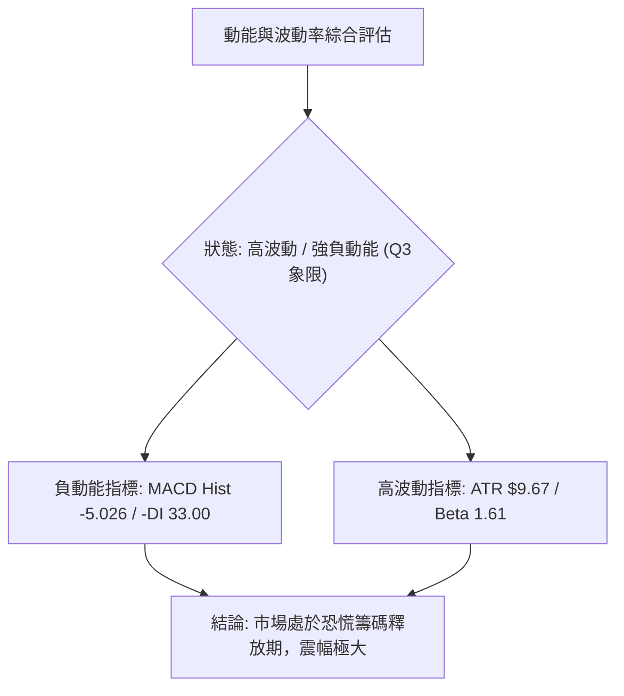
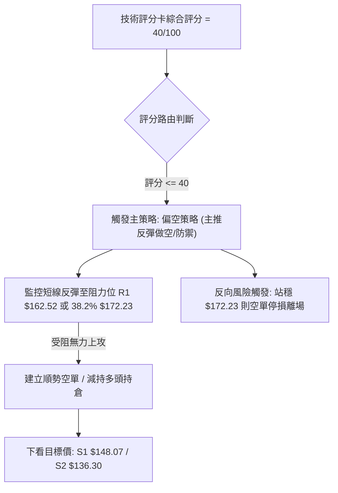
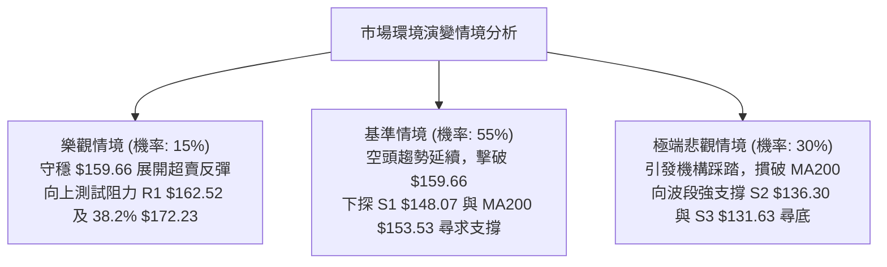

# PLTR 技術分析報告

> **報告日期**：2026-11-07 ｜ **語言**：繁體中文 ｜ **數據來源**：Yahoo Finance ｜ **當前價格**：$160.38

---

## 目錄

| 章節 | 內容 |
|------|------|
| [1. 技術面概覽](#1-技術面概覽) | 訊號儀表板、核心指標、評分卡 |
| [2. 趨勢分析](#2-趨勢分析) | 多時框趨勢、長中短期走勢、ADX強趨勢解讀 |
| [3. 圖表形態分析](#3-圖表形態分析) | 形態識別信心度、真實K線組合、目標價推算 |
| [4. 支撐與阻力](#4-支撐與阻力) | 關鍵價位結構、OHLCV聚類、斐波那契回調 |
| [5. 技術指標深度解讀](#5-技術指標深度解讀) | 均線系統、RSI/MACD背離檢視、布林下軌、量價結構 |
| [6. 動能與波動率](#6-動能與波動率) | 動能四象限、ATR波動風險、Beta市場暴露度 |
| [7. 多時框架總結](#7-多時框架總結) | 多時框收斂矩陣、趨勢主導優先級收斂 |
| [8. 交易策略建議](#8-交易策略建議) | 策略路由分流、精確點位與風險報酬比、風控情境 |
| [9. 風險提示與監控](#9-風險提示與監控) | 關鍵監控清單、多情境演繹、資金管理法則 |

---

## 1. 技術面概覽

### 🎯 技術訊號儀表板



### 📊 核心指標速覽表

| 指標類別 | 指標名稱 | 當前數值 | 訊號 | 解讀 |
| :--- | :--- | :--- | :---: | :--- |
| **價格** | 當前收盤價 | $160.38 | 🟡 | 位於52週區間 50.7%，剛好壓在斐波那契 50.0%（$159.66）臨界邊緣 |
| **短期均線** | MA20 | $190.11 | 🔴 | 現價低於 MA20 達 -15.64%，短線嚴重承壓 |
| **中期均線** | MA50 | $185.88 | 🔴 | 現價跌破中期生命線，且 MA5 與 MA10 加速下彎下穿中軌 |
| **長期均線** | MA200 | $153.53 | 🟢 | 現價高於 MA200 約 +4.46%，長期多頭底線尚未被擊穿 |
| **動能** | RSI(14) | 31.17 | 🟡 | 位於臨界邊緣，尚未跌入極端超賣區（<30），但無底背離確認 |
| **趨勢** | ADX / ±DI | 27.22 | 🔴 | ADX > 25 表明趨勢明確，-DI 33.00 遠高於 +DI 10.78，空方全面掌控 |
| **趨勢動能** | MACD Hist | -5.026 | 🔴 | MACD線（-6.012）位於訊號線（-0.986）下方且柱狀圖顯著為負 |
| **隨機指標** | Stoch %K / %D | 15.55 / 12.85 | 🔴 | 進入超賣鈍化區，顯示短期強烈賣壓仍在釋放 |
| **波動** | ATR(14) | $9.67 | 🔴 | ATR佔股價比達 6.03%，日波動幅度極大，短線劇烈洗盤 |
| **通道** | 布林通道 %B | 0.00 | 🟡 | 收盤恰貼近下軌 $160.15，隨時有技術性超賣抽腳或開口擴大風險 |
| **成交量** | OBV 趨勢 | OBV < MA | 🔴 | 量能持續疲弱，下殺伴隨成交量放大，反彈量能不足 |

### 🏆 技術評分卡

```
╔══════════════════════════════════════════════════════════════════════════════╗
║                    技術評分卡 — PLTR (2026-11-07)                            ║
╠══════════════════════════════════════════════════════════════════════════════╣
║ 評估維度            評分進度條                         分數     訊號強度     ║
╟──────────────────────────────────────────────────────────────────────────────╢
║ 趨勢強度 (ADX/DI)   ██████░░░░░░░░░░░░░░░░░░           30/100    🔴 空方主導  ║
║ 動能指標 (RSI/MACD) ██████░░░░░░░░░░░░░░░░░░           30/100    🔴 動能崩解  ║
║ 支撐穩定度 (S-Levels)██████████░░░░░░░░░░░░░░           50/100    🟡 考驗S1    ║
║ 成交量配合 (OBV/VOL)████████░░░░░░░░░░░░░░░░           40/100    🔴 量價背離  ║
║ 形態完整度 (K線/Pattern)██████░░░░░░░░░░░░░░░░░░       30/100    🔴 破位下殺  ║
║ 均線排列 (MA System)████████████░░░░░░░░░░░░           60/100    🟡 長多短空  ║
╠══════════════════════════════════════════════════════════════════════════════╣
║ 綜合評分            ████████░░░░░░░░░░░░░░░░           40/100    🔴 偏空震盪  ║
║ 評分公式依據        (30 + 30 + 50 + 40 + 30 + 60) ÷ 6 = 40.00 (規則18)       ║
╚══════════════════════════════════════════════════════════════════════════════╝
```

---

## 2. 趨勢分析

### 🌐 多時框趨勢分析

根據多時框收斂原則（規則 14），當前日線 ADX 為 27.22（> 25），市場處於典型的**空頭趨勢行情**。分析必須以中長期架構為主軸，並以日線尋找具備風控依據的進出場點。



### 📈 長期趨勢 — 12個月走勢圖（Unicode）

以下為根據 PLTR 過去 12 個月收盤數據（2025-12 至 2026-11）繪製之月線收盤價格軌跡：

```
PLTR 月線走勢圖（過去12個月收盤軌跡）
價格軸 ($)
$210 ┤                                              
$200 ┤                                        ●(2026-10: 184.11)
$190 ┤                                  ●(09: 187.05)
$180 ┤●(2025-12: 177.75)           ●(08: 186.38)
$170 ┤                                                    ●(2026-11: 160.38)
$160 ┤                         ●(05: 156.54)
$150 ┤          ●(01: 146.59)  ●(03: 146.28)
$140 ┤               ●(02: 137.19)  ●(04: 139.11)
$130 ┤                                      ●(07: 123.06)
$120 ┤                               ●(06: 116.67, 年中低點)
$110 ┤
     └───────────────────────────────────────────────────────────
      12月  01月  02月  03月  04月  05月  06月  07月  08月  09月  10月  11月
```

#### 長期月線走勢特徵分析表

| 階段時間 | 月度收盤變化 | 漲跌幅 (%) | 價量特徵與結構解讀 |
| :--- | :--- | :--- | :--- |
| **2025-12 至 2026-02** | $177.75 → $137.19 | -22.82% | 衝高 $200.47 後展開的第一波深度清洗，於 $137 附近尋得初步支撐。 |
| **2026-03 至 2026-05** | $146.28 → $156.54 | +7.01% | 區間震盪築底，多次測試 $140 支撐，多頭發動弱勢反彈。 |
| **2026-06 至 2026-07** | $116.67 → $123.06 | -21.39% | 市場劇烈洗盤，觸及 52 週低點區間（$106.37），空頭極致釋放後見底。 |
| **2026-08 至 2026-10** | $186.38 → $184.11 | +49.61% | 暴力主升浪推升，週成交量暴增至 4.35 億股，創下歷史最高收盤群。 |
| **2026-11 (截至06日)**| $184.11 → $160.38 | -12.89% | 財報利多出盡伴隨大盤回調，單週急跌並回測斐波那契 50.0% 關鍵位。 |

### 📊 中期趨勢（週線分析）

從週線級別檢視近 8 週價格行為：自 2026-10-16 創下 52 週高點 $212.94 之後，連續三週高點急劇下移（$212.94 → $202.63 → $201.83 → $187.55），且 2026-11-06 週下探最低 $152.60，單週成交量放大至 199,603,400 股，週 MACD 柱狀圖由正轉負並大幅擴大至 -5.026。

```
PLTR 週線波段結構示意圖
$212.94 ──┐ (2026-10-16 創下52週極值高點，帶長上影線陰線)
          │
          └──> $202.63 (次級反彈高點，多頭無力封閉失地)
               │
               └──> $187.55 (破位急殺，跌穿 MA20 與 MA50)
                    │
                    └──> 當前收盤: $160.38 (正考驗 50% 回調位 $159.66)
                         │
                         ▼ 近期低點測試: $152.60 (下方支撐 S1 為 $148.07)
```

### ⚡ 趨勢強度評估（ADX 解讀）



#### ADX 強度對照與解讀

| 指標變數 | 當前讀數 | 門檻區間 | 趨勢性質判定 | 操作意涵 |
| :--- | :--- | :--- | :--- | :--- |
| **ADX(14)** | **27.22** | 25.00 – 50.00 | **強趨勢行情** | 盤整策略失效，市場正處於單邊發散行情中。 |
| **+DI (14)** | **10.78** | < 20.00 | 多頭動能衰竭 | 多方買盤極度渙散，反彈缺乏持續性推力。 |
| **-DI (14)** | **33.00** | > 30.00 | 空頭主導強勁 | 空方賣壓沉重，價格呈現單邊下跌慣性。 |
| **差值 (-DI - +DI)**| **+22.22**| > 15.00 | 空方絕對強勢 | 逢反彈均為阻力，未見底部反轉訊號前不宜重倉做多。 |

---

## 3. 圖表形態分析

### 🔍 形態識別系統

依據規則 13 與 15，所有幾何形態均需基於實際數值與嚴格信心度評判：



#### 形態識別信心度與目標價計算表

| 形態名稱 | 信心度 | 判斷依據（引用數據） | 完成度 | 目標價（附嚴格計算式） |
| :--- | :---: | :--- | :---: | :--- |
| **日線頭肩頂 (Head & Shoulders Top)** | **75%** | 左肩高點 $194.68 (2026-09-25 週)，頭部 $212.94 (2026-10-16 週)，右肩高點 $202.63 (2026-10-23 週)。頸線以兩波回調低點連線約 **$184.81** 為準。2026-10-30 日K收盤 $184.11 正式有效擊穿頸線。 | **85%** | 由頭肩頂形態高度推算：<br/>形態高度 = 頭部 $212.94 − 頸線 $184.81 = **$28.13**。<br/>理論測量跌幅目標 = 頸線 $184.81 − 形態高度 $28.13 = **$156.68**。<br/>*(註：當前價格 $160.38 已極度逼近此理論目標價)* |
| **週線高位雙頂結構 (Double Top)** | **60%** | 第一頂 $209.05 (2026-10-09 週)，第二頂 $212.94 (2026-10-16 週)，中間回測頸線為 2026-09-18 週收盤 **$177.64**。2026-11-03 巨量長陰線跌穿該位。 | **70%** | 由雙頂形態高度推算：<br/>形態高度 = 高點 $212.94 − 頸線 $177.64 = **$35.30**。<br/>理論測量跌幅目標 = 頸線 $177.64 − 形態高度 $35.30 = **$142.34**。 |

### 🕯️ 重要K線形態分析

依據規則 19，嚴格採用數據源「近10根日K」與「近8根週K」之四價進行專業形態解讀：

#### 近10根日K形態解讀表

| 日期 (日K) | 開盤價 | 最高價 | 最低價 | 收盤價 | 成交量 | K線形態名稱 | 專業技術解讀 | 多空訊號 |
| :---: | :---: | :---: | :---: | :---: | :---: | :---: | :--- | :---: |
| **2026-10-26** | 197.90 | 200.05 | 192.91 | 198.84 | 16,380,400 | 高位窄幅小陽線 | 多空於 $200 整數關卡前陷入縮量膠著。 | 🟡 |
| **2026-10-27** | 198.12 | 201.83 | 196.79 | 198.73 | 19,907,300 | 衝高回落倒錘星 | 盤中上衝 $201.83 遭遇顯著解套拋壓，留上影線。 | 🔴 |
| **2026-10-28** | 197.01 | 198.74 | 193.13 | 196.81 | 20,821,300 | 漸進回落陰線 | 高點持續下移，多頭上攻力道明顯減弱。 | 🔴 |
| **2026-10-29** | 198.37 | 198.51 | 190.36 | 196.42 | 20,102,900 | 下影小陰線 | 盤中跌破 $191 獲短線逢低承接，但收盤仍受制。 | 🟡 |
| **2026-10-30** | 193.62 | 193.92 | 180.81 | 184.11 | 27,070,000 | **破位放量大陰線** | 跳空下行跌穿 MA20 與頸線支撐，空頭趨勢確立。 | 🔴 |
| **2026-11-02** | 186.52 | 187.55 | 178.13 | 178.34 | 37,183,900 | 放量中陰線 | 跌勢延續，賣壓湧現，連續跌破整數關卡。 | 🔴 |
| **2026-11-03** | 168.18 | 176.54 | 165.25 | 175.40 | 53,062,500 | **爆量長下影陽線** | 跳空開低爆出 5300 萬股巨量，多空劇烈換手。 | 🟡 |
| **2026-11-04** | 164.95 | 177.43 | 164.60 | 171.70 | 35,044,600 | 衝高受阻上影陰線 | 反抽受阻於前一日高點阻力，空頭再度下壓。 | 🔴 |
| **2026-11-05** | 166.71 | 167.25 | 152.60 | 154.99 | 50,014,300 | **放量下殺大陰線** | 再次暴跌創出本輪新低 $152.60，恐慌盤全面湧出。 | 🔴 |
| **2026-11-06** | 158.68 | 163.97 | 157.24 | 160.38 | 24,298,100 | **止跌孕線小陽線** | 實體收在昨日陰線腹部之內，下探未破前低，短線暫現企穩跡象。 | 🟢 |

#### 近8根週K形態解讀表

| 日期 (週末) | 開盤價 | 最高價 | 最低價 | 收盤價 | 成交量 | K線形態名稱 | 專業技術解讀 | 多空訊號 |
| :---: | :---: | :---: | :---: | :---: | :---: | :--- | :---: |
| **2026-09-18** | 169.70 | 177.88 | 166.42 | 177.64 | 144,450,500 | 突破中陽線 | 震盪突破前期阻力，奠定多頭攻勢。 | 🟢 |
| **2026-09-25** | 178.73 | 194.68 | 176.76 | 189.67 | 119,600,900 | 帶上影大陽線 | 強勢挑戰歷史新高，成交量穩健配合。 | 🟢 |
| **2026-10-02** | 186.23 | 194.78 | 184.81 | 188.75 | 86,973,500 | 高位十字星 | 量縮高位震盪，多空力量開始出現平衡分歧。 | 🟡 |
| **2026-10-09** | 189.45 | 209.58 | 187.63 | 209.05 | 130,578,300 | 放量衝高長陽線 | 強勢拉升站上 $200，週 RSI 達到 76.3 超買高位。 | 🟢 |
| **2026-10-16** | 208.90 | 212.94 | 184.45 | 186.03 | 125,244,900 | **避雷針/流星陰線** | 創歷史高點 $212.94 後巨幅倒灌重挫，構成頂部反轉。 | 🔴 |
| **2026-10-23** | 186.99 | 202.63 | 186.15 | 196.75 | 101,030,400 | 弱勢反彈中陽線 | 多方反撲無力突破上週高點，形成右肩雛形。 | 🟡 |
| **2026-10-30** | 197.90 | 201.83 | 180.81 | 184.11 | 104,281,900 | 高位破位陰線 | 跌破前週低點，確認頂部構築完成。 | 🔴 |
| **2026-11-06** | 186.52 | 187.55 | 152.60 | 160.38 | 199,603,400 | **放量急殺長下影陰** | 單週重挫近 24 美元，週量激增至近 2 億股，殺出恐慌籌碼。 | 🔴 |

### 📉 ASCII 走勢形態示意圖

```
PLTR 日線頭肩頂破位結構示意圖
       [頭部 $212.94]
            ▲
           ╱ ╲
 [左肩]   ╱   ╲   [右肩]
$194.68  ╱     ╲  $202.63
  ▲     ╱       ╲   ▲
 ╱ ╲   ╱         ╲ ╱ ╲
╱   ╲ ╱           V   ╲
─────V─────────────────╲──────── 頸線阻力位 ($184.81 - $184.11)
      $184.81           ╲
                         ╲ (放量破位下殺)
                          ╲
                           ▼ 當前價格: $160.38 (測試頭肩頂測量目標 $156.68)
                              最低打至: $152.60 (下方支撐 S1: $148.07)
```

### 🎯 形態目標價計算

1. **頭肩頂測量目標價（已基本滿足）**：
   - 頸線位置：$184.81
   - 頭部最高點：$212.94
   - 垂直高度：$212.94 - $184.81 = $28.13
   - 理論測量跌幅目標 = $184.81 - $28.13 = **$156.68**。
   - **實證狀態**：2026-11-05 盤中最低探至 $152.60，當前收盤為 $160.38，表明短線頭肩頂的第一目標價已實質達成，賣壓第一階段釋放完畢。
2. **週線雙頂測量目標價（中期潛在風險）**：
   - 頂部最高：$212.94
   - 頸線關鍵位：$177.64
   - 垂直高度：$212.94 - $177.64 = $35.30
   - 理論測量目標 = $177.64 - $35.30 = **$142.34**（此點位極度接近下方波段支撐 S2 的 $136.30 與斐波那契 61.8% 的 $147.08 區間）。

---

## 4. 支撐與阻力

### 🗺️ 關鍵價位分布圖（Unicode）

```
PLTR 價位結構分布圖 (由 OHLCV 聚類計算)
═════════════════════════════════════════════════════════════════
$194.68 ║██████████████████████████████║ 強波段阻力 R3 (+21.39%)
$188.68 ║████████████████████          ║ 中期密集阻力 R2 (+17.65%)
$162.52 ║██████████████████████████████║ 短線直接阻力 R1 (+1.33%)
$160.38 ╠══════════════════════════════╣ ◄ 當前收盤價 (現處於多空爭奪點)
$159.66 ╟┄┄┄┄┄┄┄┄┄┄┄┄┄┄┄┄┄┄┄┄┄┄┄┄┄┄┄┄╢ 斐波那契 50.0% 回調位 (-0.45%)
$148.07 ║▓▓▓▓▓▓▓▓▓▓▓▓▓▓▓▓              ║ 近一年關鍵波段支撐 S1 (-7.68%)
$136.30 ║██████████████████████████████║ 強結構性支撐 S2 (-15.01%)
$131.63 ║██████████████████████████████║ 極限防守支撐 S3 (-17.93%)
═════════════════════════════════════════════════════════════════
```

### 🚧 阻力位分析表

依據規則 13，阻力數值嚴格引用「關鍵價位」區塊之波段聚類點位：

| 阻力級別 | 價位 | 距現價幅幅 | 形成原因與籌碼解讀 | 突破難度 | 重要性評級 |
| :---: | :---: | :---: | :--- | :---: | :---: |
| **R1** | **$162.52** | +1.33% | 近期下殺過程中日K實體密集交界區，亦是 11-06 日K高點（$163.97）下方的首道短壓。 | 中等 | 🟡 次要阻力 |
| **R2** | **$188.68** | +17.65% | 跌破前的頭肩頂頸線區，聚集大量套牢盤，且與當前 MA20 ($190.11) 與 MA50 ($185.88) 形成死叉共振壓制。 | 極高 | 🔴 關鍵阻力 |
| **R3** | **$194.68** | +21.39% | 2026-09-25 週K波段高點聚類，屬於中期強反轉必須攻克的重兵防守線。 | 堅不可摧 | 🔴 極強阻力 |

### 🛡️ 支撐位分析表

依據規則 13，支撐數值嚴格引用「關鍵價位」區塊之波段聚類點位：

| 支撐級別 | 價位 | 距現價幅幅 | 形成原因與籌碼解讀 | 守住機率 | 重要性評級 |
| :---: | :---: | :---: | :--- | :---: | :---: |
| **S1** | **$148.07** | -7.68% | 近一年波段低點聚類，與斐波那契 61.8%（$147.08）以及長期 MA200（$153.53）構成寬幅護城河。 | 65% | 🟢 核心生命線 |
| **S2** | **$136.30** | -15.01% | 2025年年中多次築底的重要平台，2026-02 收盤價（$137.19）密集重疊區，籌碼沉澱極深。 | 80% | 🟢 強結構支撐 |
| **S3** | **$131.63** | -17.93% | 2025-05 月線級別突破起漲平台低點，屬於長期牛市極限防守點。 | 90% | 🟢 極限支撐 |

### 📐 斐波那契回調位分析

斐波那契回調區間基準：**52週低點 $106.37 → 52週高點 $212.94**，嚴格對照如下：

| 回調比例 | 對應價位 | 距離現價 (%) | 技術意義與當前博弈狀態解讀 |
| :---: | :---: | :---: | :--- |
| **0.0%** | **$212.94** | +32.77% | 52週最高點（2026-10-16 創出），波段頂部。 |
| **23.6%** | **$187.79** | +17.09% | 弱勢回調極限位，目前已被徹底摜破，轉化為強阻力（與 R2 重疊）。 |
| **38.2%** | **$172.23** | +7.39% | 多頭防禦次道防線，本週跌破後引發程式化停損賣壓。 |
| **50.0%** | **$159.66** | -0.45% | **多空中樞平衡點**。**現價 $160.38 恰落於此臨界點正上方**，技術面出現劇烈多空角力。 |
| **61.8%** | **$147.08** | -8.29% | **黃金分割防守位**。此處緊貼波段支撐 S1 ($148.07)，為多頭絕對不可失守之陣地。 |
| **78.6%** | **$129.18** | -19.45% | 深度回撤位，跌破代表中長期多頭行情徹底終結。 |
| **100.0%** | **$106.37** | -33.68% | 52週最低點，牛熊分界底線。 |

**回調位深度結論**：當前價格 $160.38 剛好夾在 **50.0% ($159.66)** 與 **38.2% ($172.23)** 之間，且距離 50.0% 僅差 $0.72。若跌破 $159.66，市場下行空間將直接向黃金分割位 61.8%（$147.08）以及 S1（$148.07）尋求支撐。

---

## 5. 技術指標深度解讀

### 🎛️ 指標訊號總覽



### 📈 移動平均線排列分析



#### 移動平均線各週期詳細狀態表

| 移動平均線 | 當前數值 | 偏離度 (%) | 斜率與方向 | 均線歷史軌跡解讀 |
| :---: | :---: | :---: | :---: | :--- |
| **MA 5** | **$168.16** | -4.63% | 急劇向下 (▼) | 短線殺跌速度極快，五日線構成短線壓制首道關卡。 |
| **MA 10** | **$181.57** | -11.67% | 加速向下 (▼) | 短期反彈強阻力區，空頭排列整齊。 |
| **MA 20** | **$190.11** | -15.64% | 轉折向下 (▼) | 布林中軌所在，跌破代表月線級別上漲趨勢終結。 |
| **MA 60** | **$184.22** | -12.94% | 走平下彎 (▼) | 中期季線防守潰敗，中長線持股成本鬆動。 |
| **MA 120** | **$159.99** | +0.24% | 緩慢向上 (▲) | 半年線與現價高度重疊，短線多空在此反覆爭奪。 |
| **MA 200** | **$153.53** | +4.46% | 穩健向上 (▲) | 年線多頭排列尚未破壞，為長期牛市最後防線。 |
| **MA 240** | **$157.69** | +1.70% | 穩定向上 (▲) | 長期均線架構維持上行斜率。 |

### 📉 RSI(14) 分析

- **當前讀數**：**31.17**（Wilder 計算法）
- **RSI 強度進度條**：
  ```
  超賣區 (0-30)       中性平衡區 (30-70)             超買區 (70-100)
  [████████████░░░░░░░░░░░░░░░░░░░░░░░░░░░░░░░░░░░░] 31.17%
  ```
- **超買超賣判定**：數值 31.17 處於臨界中性偏超賣區。雖然技術面已逼近 30 的極端超賣門檻，但尚未正式落入 30 以下，顯示空方動能仍在宣洩。
- **背離分析**：**無底背離**。檢驗近 20 根 K 棒的首尾表現，價格自 $200 以上連續暴跌至 $160.38，RSI 亦從 60 以上直線下滑至 31.17，兩者方向完全同步下跌，無任何底背離信號，表示下跌具備實質基本面或籌碼驅動，不可輕易視為誘空。

### 📊 MACD(12/26/9) 訊號解讀



- **MACD 快線**：-6.012
- **MACD 訊號線 (DEA)**：-0.986
- **MACD 柱狀圖 (Histogram)**：**-5.026**（🔴 強烈看空）
- **解讀**：DIF 已經大幅摜穿 DEA 與零軸，且柱狀圖讀數達 -5.026，負值呈現發散擴大態勢，週線 MACD 柱狀亦為 -5.026。這證明中短期動能正由空頭全面接管，未見收斂翻紅前，任何反彈均屬弱勢修復。

### 📦 布林通道分析

```
PLTR 布林通道 (20, 2) 結構示意圖
$220.08 ══════════════════════════════════ 上軌 (Upper Band)
        │
        │
$190.11 ────────────────────────────────── 中軌 MA20 (Middle Band)
        │
        │
$160.38 ──* 現價 ($160.38)
$160.15 ══════════════════════════════════ 下軌 (Lower Band)  %B = 0.00
```

- **上軌**：$220.08
- **中軌 (MA20)**：$190.11
- **下軌**：$160.15
- **布林 %B**：**0.00**（收盤價恰貼合在布林下軌 $160.15 之上，%B 為 0.00 代表價格已觸碰極限通道邊界）
- **通道寬度與開口分析**：通道帶寬高達 $59.93，開口大幅擴張。當價格沿著擴張的下軌運行且 %B 趨近於 0 時，此為典型的「帶軌下殺」單邊趨勢特徵。雖然短線有均值回歸的超賣反抽需求，但下軌開口若持續朝下，價格容易出現鈍化陰跌。

### 💹 成交量分析（量價配合度）

1. **量價背離與放量殺跌**：
   - 2026-11-03 日K下殺至 $165.25 時，成交量暴增至 53,062,500 股（相較 20 日均量 26,508,030 股暴增超過 2 倍）。
   - 2026-11-05 跌至 $152.60 時，成交量再次衝高至 50,014,300 股。
   - 2026-11-06 小幅收陽反彈至 $160.38 時，成交量卻萎縮至 24,298,100 股（量比僅 0.92x）。
   - **量價結構診斷**：**呈現經典的「放量下殺、縮量反彈」量價背離**。下殺有機構籌碼奪路而逃，而反彈缺乏主力買盤追價，量能配合度極差。
2. **OBV (能量潮) 趨勢解讀**：
   - 當前指標明確顯示：**OBV < MA**，能量潮均線空頭排列，量能疲弱無力，確認這波下跌由籌碼流出主導，而非假摔。

---

## 6. 動能與波動率

### ⚡ 動能評估四象限

| 象限 | 動能維度 | 波動維度 | 當前狀態判定 | 戰略應對方針 |
| :---: | :---: | :---: | :---: | :--- |
| **Q1 (最佳擴張)** | 動能強 (多頭) | 波動率低 | 不符合 | 適合穩健趨勢追隨做多。 |
| **Q2 (謹慎觀望)** | 動能弱 (多頭衰竭) | 波動率低 | 不符合 | 震盪洗盤，等待方向抉擇。 |
| **Q3 (極度危險)** | **動能強 (空頭主導)** | **波動率高 (ATR=9.67)** | **符合目前狀態 (✓)** | **空方能量爆發、日振幅高達 6% 以上，極高風險。應嚴控部位，禁止盲目加碼抄底。** |
| **Q4 (流動性陷阱)** | 動能弱 (無方向) | 波動率高 | 不符合 | 亂流震盪，容易雙向停損。 |



### 📊 ATR 波動率分析

- **ATR(14)**：**$9.67**
- **ATR 佔比**：**6.03%**（基於收盤價 $160.38 計算）
- **專業波動率解讀**：日均真實波動幅度接近 10 美元。這意味著正常的日間隨機雜訊波動區間即達到 ±$10。因此，任何交易策略若止損幅度小於 1 倍 ATR（約 $9.67），極易被盤中正常波動掃出場。
- **風控止損距離建議**：
  - **保守型波段**：止損距離需設定在 1.5 倍至 2.0 倍 ATR（約 **$14.50 – $19.34**）。
  - **短線防守型**：止損距離不得低於 1.0 倍 ATR（約 **$9.67**）。

### 📐 Beta 與市場相關性

- **Beta 係數**：**1.61**
- **市場特徵分析**：PLTR 展現出極強的高彈性科技成長股特徵，其相較標普500大盤具備 1.61 倍的放大波動效應。當前市場處於科技股殺估值與財報後利多出盡氛圍中，高 Beta 意味著大盤若微幅修正 1%，PLTR 理論回撤將擴大至 1.61%。高彈性造就了下殺的流暢度，也預示著未來反轉時將具備超越大盤的彈升速度。

---

## 7. 多時框架總結

### 📋 時框架評分表

| 時框架 | 趨勢方向 | 動能狀態 | 均線排列 | 形態特徵 | 綜合評分 | 戰略建議 |
| :---: | :---: | :---: | :---: | :---: | :---: | :--- |
| **短期 (日線)** | 🔴 強烈空頭 | 🔴 RSI=31.17, MACD負擴散 | 🔴 空頭排列 (破MA20/50) | 放量大陰線後孕線小陽反彈 | **30/100** | 逢反彈阻力減碼或建立防禦性空單 |
| **中期 (週線)** | 🔴 轉入修正 | 🔴 MACD柱轉負 (-5.026) | 🟡 考驗 MA20/MA50 支撐 | 避雷針後大陰下殺，雙頂雛形 | **40/100** | 等待回調尋求 S1 支撐確認，不追空 |
| **長期 (月線)** | 🟢 依然偏多 | 🟡 高位回檔超買修正 | 🟢 多頭排列 (MA200遠在下方)| 大級別牛市波段回踩 50% 位 | **60/100** | 核心長多底倉不動，防守線看 MA200 |

### 🔲 綜合訊號矩陣

```
┌─────────────────┬─────────────────┬─────────────────┬─────────────────┐
│     分析維度    │   短期 (日線)   │   中期 (週線)   │   長期 (月線)   │
├─────────────────┼─────────────────┼─────────────────┼─────────────────┤
│ 均線系統 (MA)   │  🔴 均線反壓    │  🟡 跌破均線群  │  🟢 多頭發散    │
│ 動能震盪 (Osc.) │  🔴 超賣鈍化    │  🔴 柱狀圖暴跌  │  🟡 漲勢趨緩    │
│ 量能架構 (Vol.) │  🔴 放量下殺    │  🔴 週量劇增    │  🟢 長線換手充裕│
│ 形態定位 (Pat.) │  🔴 跌破頸線    │  🔴 高位反轉    │  🟢 歷史高位震盪│
├─────────────────┼─────────────────┼─────────────────┼─────────────────┤
│ 時框總評結論    │   強烈看空      │   偏空修正      │   牛市回檔      │
└─────────────────┴─────────────────┴─────────────────┴─────────────────┘
```

### ⚖️ 多時框收斂結論

依據多時框收斂規則（規則 14）：
1. **趨勢/盤整判定**：日線 ADX 讀數為 **27.22 (> 25)**，且 -DI 達 **33.00**，行情已進入**高度明確的趨勢行情**。
2. **收斂優先級**：趨勢行情中，由中長期方向決定戰略底色，日線時框則尋求進場風控點。目前週線動能急速轉負、日線技術形態破位，空方力量占據絕對上風。
3. **唯一收斂結論**：**中期強烈回調中的【偏空震盪】**。主導操作方向以防範下行風險為主，多頭操作僅限於超賣技術反彈之輕倉博弈。

---

## 8. 交易策略建議

### 🗺️ 策略決策流程圖



### 🧭 策略路由（依評分卡分流）

**當前主策略方向 = 【偏空策略（主推反彈逢高做空／保護性對沖），多頭僅列為反轉風險提示】（依評分 40/100，規則 18 嚴格分流）**

### 🎯 價格情境階梯（Price Scenarios）

價位嚴格引用第 4 章聚類關鍵點位與斐波那契回調位：

| 觸發條件 | 下一目標 | 後續延伸 | 技術情境含義與籌碼博弈解讀 |
| :--- | :--- | :--- | :--- |
| **強勢向上突破 R1 $162.52** | 斐波那契 38.2% **$172.23** | 頸線阻力 R2 **$188.68** | 短線超賣反抽展開，考驗頭肩頂破位頸線之反壓有效性。 |
| **維持於現價 $160.38 震盪** | 斐波那契 50.0% **$159.66** | 布林下軌 **$160.15** | 多空於 50% 中樞激烈換手，尋求布林下軌暫時性支撐。 |
| **有效跌破 S1 $148.07** | 波段強支撐 S2 **$136.30** | 極限支撐 S3 **$131.63** | 空頭第二波主跌浪展開，下探 61.8% 黃金分割與長期均線平台。 |

### 📊 情境機率分佈

| 情境類型 | 機率估計 | 主要技術依據（引用指標狀態） |
| :---: | :---: | :--- |
| **回落 / 跌破再探底** | **55%** | **ADX=27.22 且 -DI=33.00 顯示空方動能強大；MACD柱狀圖達 -5.026 深度負值；OBV 疲弱確認資金出逃。** |
| **區間低位震盪築底** | **30%** | **布林 %B=0.00 觸底下軌 $160.15；RSI=31.17 逼近超賣；現價 $160.38 正處於 50.0% 回調位 ($159.66) 支撐。** |
| **強勢 V 型反轉反彈** | **15%** | **上方 MA20 ($190.11) 與 MA50 ($185.88) 形成死叉下壓，反彈面臨爆量套牢盤壓制，機率極低。** |

### 🟢 主策略詳情（偏空／對沖主導）

所有價位均嚴格取自數據庫計算數值，風險報酬比定義依規則 17 嚴格計算：
- 空頭風險報酬比 = (進場價 − 目標價 T1) ÷ (止損價 − 進場價)

| 策略要素 | 策略 A（順勢反彈逢高做空 - 首選） | 策略 B（跌破追空 - 次選） |
| :--- | :--- | :--- |
| **策略邏輯** | 趁技術指標超賣引發的反抽，於阻力位布局做空 | 跌破 50% 回調位與前低後順應趨勢追空 |
| **進場條件** | 股價反彈至 R1 阻力位受阻，日K留上影線 | 價格實體跌穿支撐 S1，空頭動能確認擴散 |
| **進場價格** | **$162.52**（取阻力位 R1） | **$148.07**（取支撐位 S1） |
| **目標價 T1** | **$148.07**（波段支撐 S1） | **$136.30**（強波段支撐 S2） |
| **目標價 T2** | **$136.30**（強波段支撐 S2） | **$131.63**（極限防守支撐 S3） |
| **止損價格** | **$172.23**（斐波那契 38.2% 回調位） | **$153.53**（長期 MA200 均線） |
| **風險報酬比** | **1 : 1.49（以 T1 計）**<br/>*(計算式: (162.52 - 148.07) ÷ (172.23 - 162.52) = 14.45 ÷ 9.71 = 1.49)*<br/>*另列: 1 : 2.70（以 T2 計，(162.52-136.30)÷9.71=2.70)* | **1 : 2.16（以 T1 計）**<br/>*(計算式: (148.07 - 136.30) ÷ (153.53 - 148.07) = 11.77 ÷ 5.46 = 2.16)*<br/>*另列: 1 : 3.01（以 T2 計，(148.07-131.63)÷5.46=3.01)* |
| **成功機率** | **65%** | **55%** |
| **建議倉位** | **總資金之 15%** | **總資金之 10%** |

### 🔴 反向風險觸發點（對沖與停損提示）

若出現以下情境，表明空頭趨勢遭破壞，主空策略必須全面終止：
1. **關鍵點位突破**：日線收盤價強勢站上 **$172.23**（斐波那契 38.2% 回調位）或進一步收復 **$184.81**（頸線），空方邏輯失效。
2. **指標反轉訊號**：日線 RSI 突破 50 中軸，且 MACD 柱狀圖在零軸下方出現連續兩根顯著收斂翻紅，伴隨成交量突破 20 日均量（> 26,508,030 股）。

### ⭐ 整體訊號強度評星

```
╔══════════════════════════════════════════════════════════════╗
║ 做多訊號強度：★☆☆☆☆  (1/5星 - 僅存嚴重超賣博弈機會)    ║
║ 做空訊號強度：★★★★☆  (4/5星 - 順應 ADX 強空頭趨勢)       ║
║ 整體可信度：  ★★★★☆  (4/5星 - 價位與形態多點精確共振)   ║
╚══════════════════════════════════════════════════════════════╝
```

---

## 9. 風險提示與監控

### ✅ 關鍵監控指標 Checklist

```
╔══════════════════════════════════════════════════════════════════════════════╗
║                     PLTR 技術面關鍵監控清單 (Checklist)                      ║
╠══════════════════════════════════════════════════════════════════════════════╣
║ [ ] 監控項 1: 收盤價是否跌破斐波那契 50.0% ($159.66)？                      ║
║     ↳ 若失守，代表下跌空間將直奔 S1 ($148.07)。                             ║
║ [ ] 監控項 2: 日線 RSI(14) 是否正式跌入 < 30 的極端超賣區？                 ║
║     ↳ 觀察是否引發技術性乖離修復反抽。                                       ║
║ [ ] 監控項 3: ADX 趨勢強度是否持續維持在 25 以上且 -DI > 30？                ║
║     ↳ 判定空頭單邊跌勢是否依然具備壓倒性主導權。                             ║
║ [ ] 監控項 4: 反彈時成交量是否大於 20日均量 (26,508,030 股)？                ║
║     ↳ 判斷反彈為「無量誘多」還是「主力真實增量回補」。                       ║
║ [ ] 監控項 5: MA200 ($153.53) 長期生命線之得失。                            ║
║     ↳ 多頭全年生死線，此處若失守將觸發機構停損潮。                           ║
╚══════════════════════════════════════════════════════════════════════════════╝
```

### ⚠️ 風險場景分析



### 🛡️ 風險管理重要提醒

1. **嚴禁逆勢重倉猜底**：當前 ADX 為 27.22 且 -DI 為 33.00，空頭具備極強的趨勢慣性。在日線 MACD 柱狀圖未顯著收斂、成交量未見結構性築底之前，切忌憑個人感覺盲目抄底。
2. **高波動率防禦（ATR風控）**：當前 ATR 高達 $9.67（6.03%），單日劇烈震盪乃常態。任何交易部位之最大單筆風險暴露金額，應嚴格限制在總投資組合淨資產的 1% 至 1.5% 以內，避免被日內極端假突破掃損。
3. **高估值引發的籌碼脆弱性**：PLTR 當前 Trailing P/E 達 112.94，P/S 達 53.02。在估值極度高昂的背景下，技術面破位極易放大基本面投資者的停利與停損意願，不可忽視籌碼多殺多的連鎖反應。

---

## 📋 報告總結

```
╔══════════════════════════════════════════════════════════════════════════════╗
║                       PLTR 技術分析報告總結                                  ║
╠══════════════════════════════════════════════════════════════════════════════╣
║ 報告日期：2026-11-07                                                         ║
║ 當前價格：$160.38                                                            ║
║ 綜合評分：40 / 100 (評分卡六項平均)                                         ║
║ 分析評級：⚖️ 偏空震盪 (Bearish Bias / Short-Term Breakdown)                 ║
╟──────────────────────────────────────────────────────────────────────────────╢
║ 關鍵結論：                                                                   ║
║ ├─ 長期趨勢：🟢 偏多但面臨深幅修正 (月線高位震盪，MA200 $153.53 仍在上行)    ║
║ ├─ 中期趨勢：🔴 空頭修正 (週線 $212.94 頂部確立，週 MACD 柱大幅負擴散)       ║
║ ├─ 短期趨勢：🔴 空頭主導 (ADX=27.22, -DI=33.00, 破 MA20 與 MA50 均線)        ║
║ ├─ 關鍵支撐：S1: $148.07 ｜ S2: $136.30 ｜ 50%回調位: $159.66               ║
║ ├─ 關鍵阻力：R1: $162.52 ｜ R2: $188.68 ｜ 38.2%回調位: $172.23              ║
║ └─ 分析師共識目標：$217.97 (共有28位分析師評估，最低 $80.00，最高 $273.00)  ║
╟──────────────────────────────────────────────────────────────────────────────╢
║ 最優策略組合 (依評分卡 40/100 路由分流)：                                    ║
║ 1. 🥇 最佳機會：策略 A (反彈至 R1 $162.52 受阻做空，止損 $172.23，目標 S1)   ║
║ 2. 🥈 次選機會：策略 B (跌破 S1 $148.07 順勢追空，下看 S2 $136.30)           ║
║ 3. 🥉 保守選擇：多頭現階段保持現金觀望，耐心等待價格於 S1/MA200 形成底背離    ║
╚══════════════════════════════════════════════════════════════════════════════╝
```

---

> ⚠️ **免責聲明**：本報告為技術分析研究，所有數據指標及價位均源自客觀歷史交易數據。本報告**僅供研究與學術參考**，**不構成任何買賣推薦與投資建議**。市場具有高度不確定性，金融交易存在重大虧損風險，投資人應獨立思考並自負盈虧。

---

*報告生成時間：2026-11-07 ｜ 數據來源：Yahoo Finance ｜ 分析框架：多時框技術分析體系*