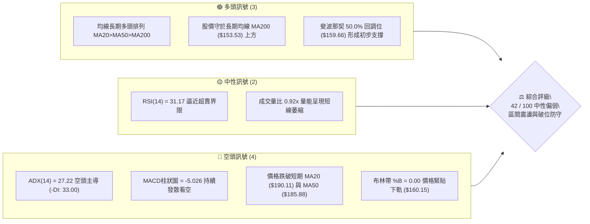
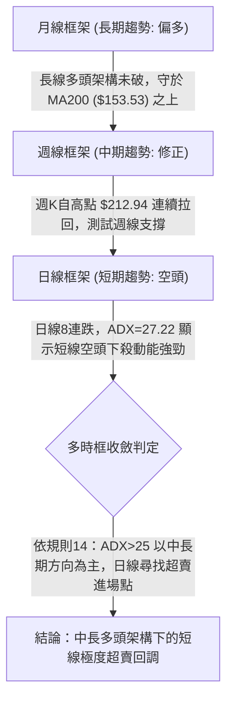
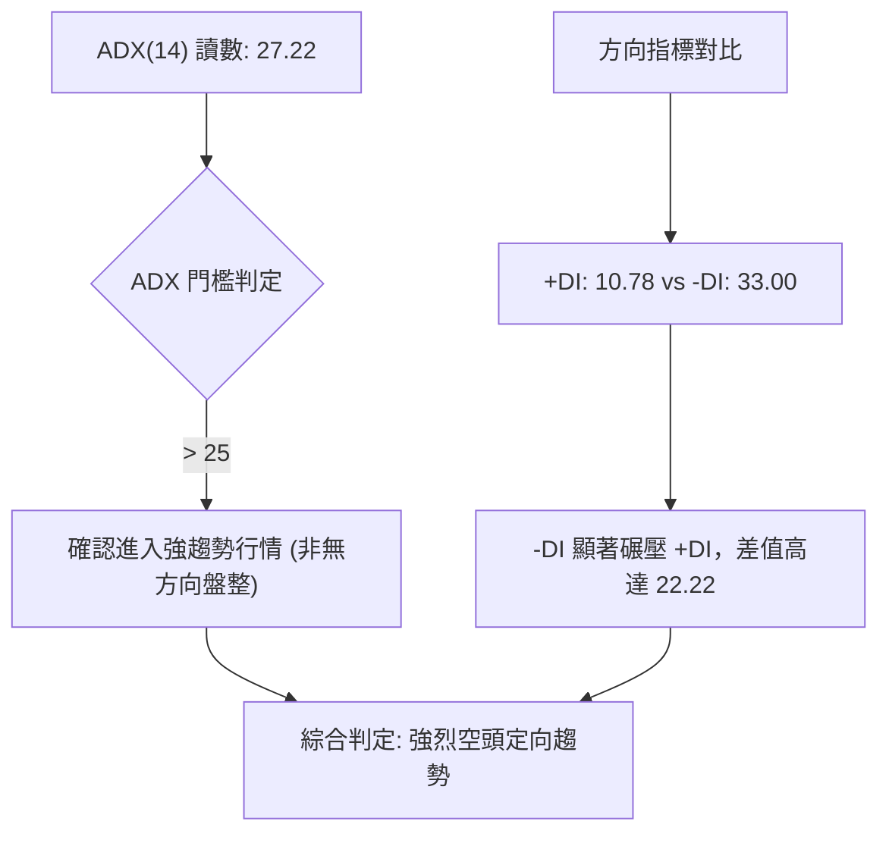
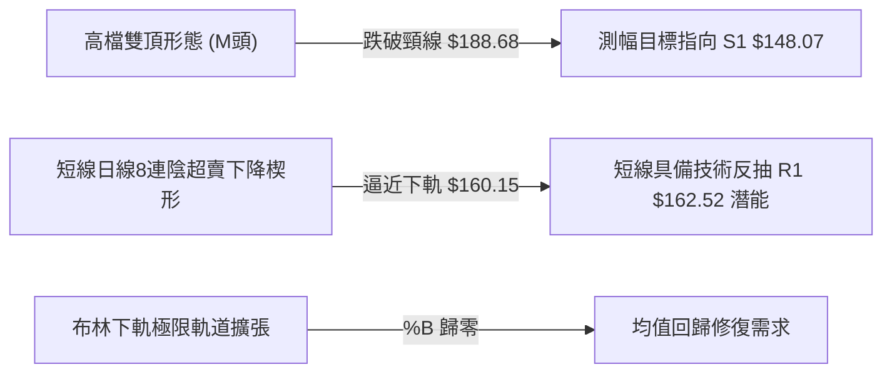
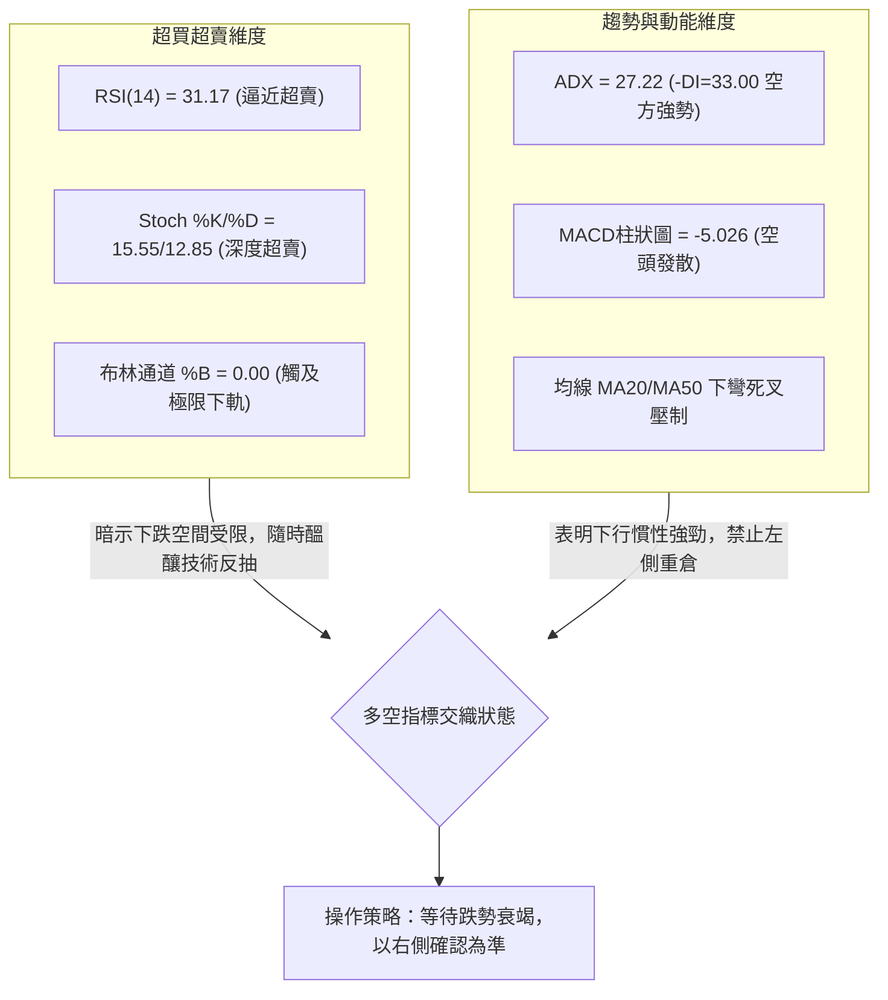
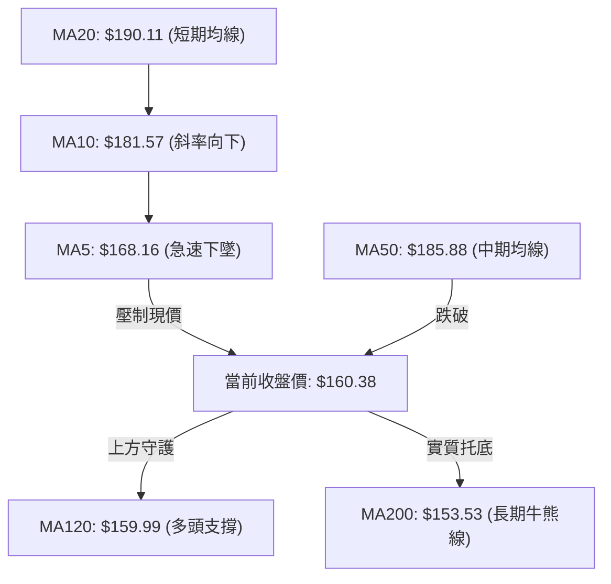
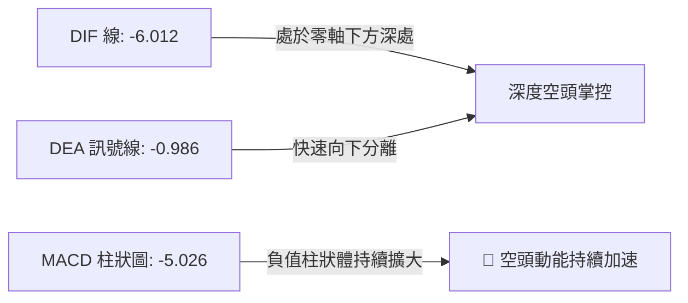
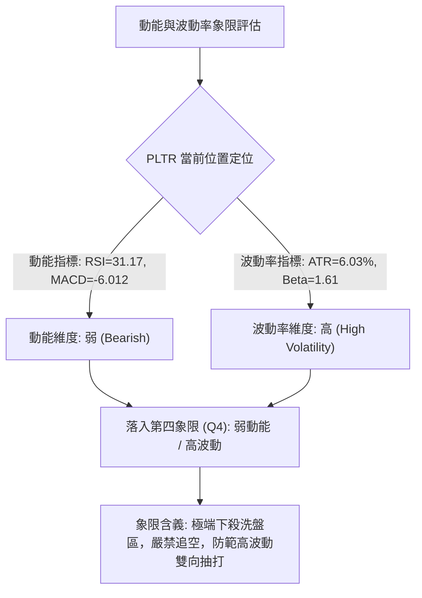
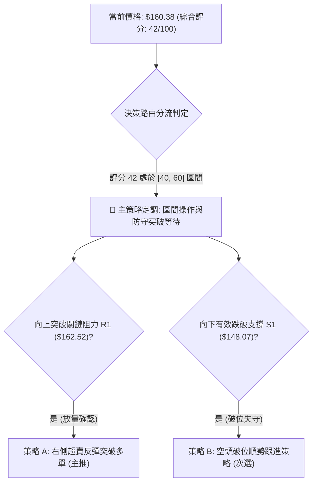
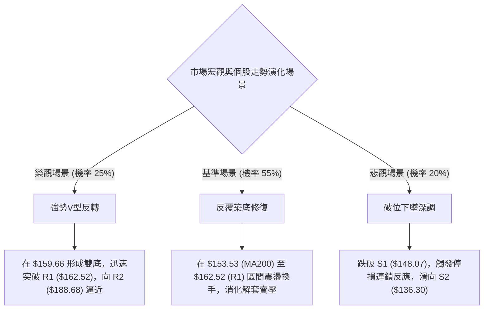

# PLTR 技術分析報告

> **報告日期**：2026-11-08 ｜ **語言**：繁體中文 ｜ **數據來源**：Yahoo Finance ｜ **當前價格**：$160.38

---

## 目錄

| 章節 | 內容 |
|------|------|
| [1. 技術面概覽](#1-技術面概覽) | 訊號儀表板、核心指標、評分卡 |
| [2. 趨勢分析](#2-趨勢分析) | 多時框趨勢、長中短期走勢 |
| [3. 圖表形態分析](#3-圖表形態分析) | 形態識別、K線組合、目標價 |
| [4. 支撐與阻力](#4-支撐與阻力) | 關鍵價位、斐波那契回調 |
| [5. 技術指標深度解讀](#5-技術指標深度解讀) | MA/RSI/MACD/布林/成交量 |
| [6. 動能與波動率](#6-動能與波動率) | 動能評估、ATR、Beta |
| [7. 多時框架總結](#7-多時框架總結) | 時框架評分矩陣 |
| [8. 交易策略建議](#8-交易策略建議) | 多空策略、風險報酬比 |
| [9. 風險提示與監控](#9-風險提示與監控) | 監控指標、風險場景 |

---

## 1. 技術面概覽

### 🎯 技術訊號儀表板



### 📊 核心指標速覽表

| 指標類別 | 指標名稱 | 當前數值 | 訊號 | 解讀 |
|:---|:---|:---|:---:|:---|
| **價格** | 當前價格 | $160.38 | 🟡 | 位於52週區間50.7%，短線8連跌後測試整數心理關卡 |
| **均線** | MA20 | $190.11 | 🔴 | 價格在MA20下方偏離 -15.64%，短線呈嚴重負乖離 |
| **均線** | MA50 | $185.88 | 🔴 | 價格失守中期生命線，短線下行壓力加劇 |
| **均線** | MA200 | $153.53 | 🟢 | 價格仍高於長期牛熊分界線 +4.46%，長期基底未破 |
| **動能** | RSI(14) | 31.17 | 🟡 | 逼近30超賣區，短線殺跌動能接近衰竭邊界 |
| **動能** | MACD(12,26,9) | -6.012 | 🔴 | DIF線與訊號線雙雙位於零軸下，柱狀圖 -5.026 深度看空 |
| **動能** | Stoch %K / %D | 15.55 / 12.85 | 🟢 | 隨機指標進入深度超賣區，具備技術性反彈契機 |
| **波動** | ATR(14) | $9.67 | 🔴 | 波動率佔價格 6.03%，日均震幅極大，風險溢價高 |

### 🏆 技術評分卡

```
技術評分卡 — PLTR (2026-11-08)
════════════════════════════════════════════════════
趨勢強度      ███████░░░░░░░░░░░░░  38/100  🔴 空頭主導強趨勢
動能指標      ██████░░░░░░░░░░░░░░  30/100  🔴 MACD深陷負值
支撐穩定度    ██████████░░░░░░░░░░  52/100  🟡 Fib 50% 與 MA120 交匯
成交量配合    ███████░░░░░░░░░░░░░  38/100  🔴 OBV疲弱，下殺伴隨放量
形態完整度    ████████░░░░░░░░░░░░  44/100  🟡 雙頂頸線跌破測試支撐
均線排列      ██████████░░░░░░░░░░  50/100  🟡 長多短空矛盾收斂中
════════════════════════════════════════════════════
綜合評分      ████████░░░░░░░░░░░░  42/100  🟡 中性偏弱（等待突破確認）
════════════════════════════════════════════════════
註：綜合評分由六項子指標算術平均嚴格計算：(38 + 30 + 52 + 38 + 44 + 50) / 6 = 42
```

---

## 2. 趨勢分析

### 🌐 多時框趨勢分析



### 📈 長期趨勢 — 12個月走勢圖（Unicode）

```
PLTR 月線收盤走勢圖（2025-11 至 2026-11）
價格軸 ($)
$210 ┤                                  ●(52W高點 $212.94)
$200 ┤                                ●
$190 ┤                        ●   ●
$180 ┤              ●   ●
$170 ┤  ●
$160 ┤════════════════════════════════════════════●←現價 $160.38
$150 ┤          ●       ●   ●
$140 ┤      ●       ●
$130 ┤
$120 ┤                      ●
$110 ┤
     └────┬───┬───┬───┬───┬───┬───┬───┬───┬───┬───┬───
        11/ 12/ 01/ 02/ 03/ 04/ 05/ 06/ 07/ 08/ 09/ 10/ 11/
        '25 '25 '26 '26 '26 '26 '26 '26 '26 '26 '26 '26 '26
```

#### 走勢特徵分析表格

| 階段 | 時間區間 | 起訖價格 ($) | 漲跌幅 (%) | 走勢特徵與結構意涵 |
|:---|:---|:---:|:---:|:---|
| **高檔回撤** | 2025-11 至 2026-02 | 168.45 → 137.19 | -18.56% | 前期自高位降溫，於 $137.00 附近尋求均線防守 |
| **橫盤築底** | 2026-03 至 2026-05 | 146.28 → 156.54 | +7.01% | 區間反覆震盪，筹碼逐步完成換手 |
| **極端洗盤** | 2026-06 至 2026-07 | 116.67 → 123.06 | -21.39% | 創下52週次低點 $112.93，清洗浮額後形成V型反轉基底 |
| **強勢主升** | 2026-08 至 2026-10 | 186.38 → 184.11 | -1.22% | 8月單週大漲爆量拉升至 $209.05，創下52W新高 $212.94 |
| **單邊急跌** | 2026-11 (至今) | 184.11 → 160.38 | -12.89% | 自高位快速回吐，連跌8天，直探50%回調位 $159.66 |

### 📊 中期趨勢（週線分析）

中期走勢呈現「高檔雙峰回挫」格局。自 2026-10-09 當週創下週收盤高點 $209.05 及次週歷史高點 $212.94 後，週K線連續出現長陰下殺。最新一週（2026-11-06）週線重挫 -12.89%，單週成交量放大至 199,603,400 股，週線 MACD 柱狀圖由正轉負至 -5.026，週 RSI 快速回落至 31.2。

```
週線關鍵壓力與支撐示意圖
═══════════════════════════════════════════════════════════
$212.94 ────── 52週歷史極值高點 (強阻力頂部)
  │
$188.68 ────── 週線雙頂頸線位 / R2 阻力區
  │
$162.52 ────── 近期反彈第一阻力 R1 (週線前波密集區)
  │
$160.38 ◄───── 當前價格 (測試週線斐波那契 50.0% 回調位 $159.66)
  │
$148.07 ────── 週線強支撐 S1 (對應 61.8% 斐波那契位 $147.08)
  │
$136.30 ────── 中期底部支撐 S2 (2026年上半年整理平台)
═══════════════════════════════════════════════════════════
```

### ⚡ 趨勢強度評估（ADX 解讀）



#### ADX 強度對照表

| 指標名稱 | 實際數值 | 參考標準區間 | 趨勢屬性判定 | 交易策略導向 |
|:---|:---:|:---:|:---:|:---|
| **ADX(14)** | 27.22 | > 25 (強趨勢) | 明確定向趨勢 | 順應主趨勢，禁止在未見反轉訊號前逆勢盲目做多 |
| **+DI(14)** | 10.78 | < 20 (極端弱勢) | 多方動能潰縮 | 多頭缺乏主動進攻意願 |
| **-DI(14)** | 33.00 | > 30 (強勢主導) | 空方完全控盤 | 賣盤釋放具備持續性 |

---

## 3. 圖表形態分析

### 🔍 形態識別系統



#### 形態識別與信心度評估表

| 形態名稱 | 信心度 | 判斷依據（嚴格引用數據） | 完成度 | 目標價（附嚴格計算式） |
|:---|:---:|:---|:---:|:---|
| **雙重頂 (Double Top)** | 70% | 兩次高點分別為 2026-10-09 當週 $209.58 與 2026-10-16 當週 $212.94，隨後跌破頸線位 R2 ($188.68) | 85% | 頸線 $188.68 − 形態高度 ($212.94 − $188.68 = $24.26) = **$164.42** (已達成，進一步下探指向 S1 $148.07) |
| **日線8連跌超賣延伸** | 65% | 價格自 2026-10-27 高點 $201.83 連續收黑8個交易日，11-06 最低探至 $157.24 | 90% | 由反彈至MA5推算：短期修正目標指向 MA5 **$168.16** |
| **多重幾何形態** | <50% | 數據中未偵測到頭肩底或大型對稱三角形幾何結構 | N/A（數據未提供） | 訊號不足，僅做指標型解讀（布林帶超賣測試） |

### 🕯️ 重要K線形態分析

嚴格依據數據中「近10根日K」與「近8根週K」之真實 OHLCV 進行解讀：

#### 近10根日K線形態分析表

| 日期（日K） | 開 | 高 | 低 | 收 | K線形態 | 解讀 | 訊號 |
|:---|:---:|:---:|:---:|:---:|:---|:---|:---:|
| 2026-10-26 | 197.90 | 200.05 | 192.91 | 198.84 | 紡錘小陽線 | 高檔震盪整理，多空拉鋸 | 🟡 |
| 2026-10-27 | 198.12 | 201.83 | 196.79 | 198.73 | 上影十字星 | 衝擊 $201.83 未果，見頂信號顯現 | 🔴 |
| 2026-10-28 | 197.01 | 198.74 | 193.13 | 196.81 | 小黑實體K | 承接無力，重心開始下移 | 🔴 |
| 2026-10-29 | 198.37 | 198.51 | 190.36 | 196.42 | 帶下影陰線 | 盤中下探 $190.36，空頭開始試探下檔 | 🔴 |
| 2026-10-30 | 193.62 | 193.92 | 180.81 | 184.11 | 光頭長黑實體 | 帶量長陰暴跌，實體破壞短期結構 | 🔴 |
| 2026-11-02 | 186.52 | 187.55 | 178.13 | 178.34 | 跳空續跌黑K | 跳空低開，成交量放大至37.18M，恐慌賣壓出籠 | 🔴 |
| 2026-11-03 | 168.18 | 176.54 | 165.25 | 175.40 | 長黑跳空反彈陰線 | 巨量53.06M洗盤，開低走高但仍收黑 | 🔴 |
| 2026-11-04 | 164.95 | 177.43 | 164.60 | 171.70 | 倒錘衝高回落K | 盤中反彈衝至 $177.43 遭空頭迎頭痛擊 | 🔴 |
| 2026-11-05 | 166.71 | 167.25 | 152.60 | 154.99 | 長下影爆量大陰線 | 暴跌探底至 $152.60，爆出50.01M大量，逢低買盤進場 | 🟡 |
| 2026-11-06 | 158.68 | 163.97 | 157.24 | 160.38 | 帶下影止跌小陽線 | 縮量至24.29M，收盤高於開盤，初步出現止跌企穩微光 | 🟢 |

#### 近8根週K線形態分析表

| 日期（週K） | 開 | 高 | 低 | 收 | K線形態 | 解讀 | 訊號 |
|:---|:---:|:---:|:---:|:---:|:---|:---|:---:|
| 2026-09-18 | 169.70 | 177.88 | 166.42 | 177.64 | 中陽實體推進 | 多頭突破整理，均線向上發散 | 🟢 |
| 2026-09-25 | 178.73 | 194.68 | 176.76 | 189.67 | 帶上影長陽線 | 試探前期阻力 R3 ($194.68)，多方氣勢如虹 | 🟢 |
| 2026-10-02 | 186.23 | 194.78 | 184.81 | 188.75 | 高檔縮量十字星 | 量能萎縮至86.97M，高檔動能出現停滯 | 🟡 |
| 2026-10-09 | 189.45 | 209.58 | 187.63 | 209.05 | 突破型大陽線 | 帶量突破兩百大關，創收盤新高 | 🟢 |
| 2026-10-16 | 208.90 | 212.94 | 184.45 | 186.03 | 長上影流星陰線 | 創52W歷史高 $212.94 後巨幅倒灌，標誌頂部確立 | 🔴 |
| 2026-10-23 | 186.99 | 202.63 | 186.15 | 196.75 | 弱勢反抽陽線 | 縮量反抽，未能化解流星陰線賣壓 | 🟡 |
| 2026-10-30 | 197.90 | 201.83 | 180.81 | 184.11 | 破位中長陰線 | 跌破高檔盤整帶下緣，確認M頭構築 | 🔴 |
| 2026-11-06 | 186.52 | 187.55 | 152.60 | 160.38 | 巨量長下影破位陰 | 週成交近2億股，深探 $152.60 後收回至 $160.38 | 🔴 |

### 📉 ASCII 走勢形態示意圖

```
PLTR 日K線近10日走勢形態與關鍵位示意
價格 ($)
$202 ┤      ╭─● (10-27 高點 $201.83)
$196 ┤  ●──╯   ╰──● (跌破 $194.68 R3)
$190 ┤              ╰──╮
$184 ┤                  ╰──● (10-30 長陰摜破 $188.68 R2頸線)
$178 ┤                      ╰──●
$172 ┤                          ╰──╮
$166 ┤                              ╰──● (11-04 衝高 $177.43 回落)
$160 ┤══════════════════════════════════●←現價 $160.38 (收復布林下軌)
$154 ┤                                  │
$152 ┤                                  ╰───● (11-05 探底針 $152.60)
     └───────────────────────────────────────────────
      10-26 10-28 10-30 11-02 11-03 11-04 11-05 11-06 (日期)
```

### 🎯 形態目標價計算

1. **雙重頂（M頭）形態目標測算**：
   - 第一頂高點：$209.58（2026-10-09 週K高點）
   - 第二頂高點：$212.94（2026-10-16 歷史高點）
   - 頸線位置：$188.68（波段高點聚類阻力 R2，亦為 10-30 週K收盤破位前之平台）
   - 形態垂直高度 $H = \$212.94 - \$188.68 = \$24.26$
   - **等距跌幅滿足點**：$\text{頸線 } \$188.68 - H (\$24.26) = \mathbf{\$164.42}$
   - *解讀*：當前價格 $160.38 已完全穿透並消化等距測幅目標（$164.42），空頭第一階段宣洩已告一段落，目前正尋求更深層級支撐。

---

## 4. 支撐與阻力

### 🗺️ 關鍵價位分布圖（Unicode）

```
PLTR 價位結構分布圖 (OHLCV 精確計算)
═══════════════════════════════════════════════════
$212.94 ║████████████████████████║ 52W 歷史極值高點 (0.0% Fib)
$194.68 ║████████████████████████║ 強阻力 R3 (密集套牢區頂部)
$188.68 ║████████████████████    ║ 阻力 R2 (雙頂頸線位 / 23.6% Fib $187.79)
$172.23 ║▓▓▓▓▓▓▓▓▓▓▓▓▓▓▓▓        ║ 斐波那契 38.2% 回調位
$162.52 ║████████████████████████║ 關鍵短期阻力 R1 (+1.33%)
$160.38 ╠════════════════════════╣ ◄ 當前市價 (布林下軌 $160.15)
$159.66 ║▓▓▓▓▓▓▓▓▓▓▓▓▓▓▓▓▓▓▓▓    ║ 斐波那契 50.0% 關鍵平衡位 (-0.45%)
$153.53 ║████████████████        ║ 長期生命線 MA200
$148.07 ║▓▓▓▓▓▓▓▓▓▓▓▓▓▓▓▓        ║ 近期強支撐 S1 (對應 61.8% Fib $147.08)
$136.30 ║████████████████████████║ 次級支撐 S2 (2026上半年大型底部)
$131.63 ║████████████████████████║ 極限強支撐 S3 (-17.93%)
$106.37 ║████████████████████████║ 52W 歷史低點 (100.0% Fib)
═══════════════════════════════════════════════════
```

### 🚧 阻力位分析表

價位嚴格引用自 OHLCV 波段高點聚類計算：

| 阻力級別 | 價位 | 距現價幅動 | 形成原因與籌碼意義 | 突破難度 | 重要性 |
|:---|:---:|:---:|:---|:---:|:---:|
| **R1** | $162.52 | +1.33% | 近期下殺過程中多次反彈受阻高點聚類，短線多空分水嶺 | 🟡 中等 | ★★★☆☆ |
| **R2** | $188.68 | +17.65% | 雙頂頸線破位點，與 23.6% 斐波那契 ($187.79) 高度共振 | 🔴 極高 | ★★★★★ |
| **R3** | $194.68 | +21.39% | 歷史天量密集換手套牢區，MA20 ($190.11) 上方重壓防線 | 🔴 極高 | ★★★★☆ |

### 🛡️ 支撐位分析表

價位嚴格引用自 OHLCV 波段低點聚類計算：

| 支撐級別 | 價位 | 距現價幅動 | 形成原因與籌碼意義 | 守住機率 | 重要性 |
|:---|:---:|:---:|:---|:---:|:---:|
| **S1** | $148.07 | -7.68% | 歷史波段密集成交低點，緊鄰黃金分割 61.8% ($147.08) | 🟢 65% | ★★★★★ |
| **S2** | $136.30 | -15.01% | 2026年3月至5月箱體築底平台低點，結構性買盤強烈 | 🟢 80% | ★★★★☆ |
| **S3** | $131.63 | -17.93% | 2025年5月跳空突破平台下沿，長期戰略防禦底線 | 🟢 90% | ★★★★☆ |

### 📐 斐波那契回調位分析

依據 52 週完整波動區間（高點 $212.94 → 低點 $106.37）精確劃分：

| 斐波那契回調比例 | 精確對應價位 | 距現價偏離度 | 技術分析意涵與現價位置判定 |
|:---|:---:|:---:|:---|
| **0.0% (52W High)** | $212.94 | +32.77% | 歷史頂部，強烈獲利回結區 |
| **23.6%** | $187.79 | +17.09% | 弱勢修正回調位，共振 R2 ($188.68) |
| **38.2%** | $172.23 | +7.39% | 強勢回調分水嶺，失守後宣告中級調整展開 |
| **50.0%** | **$159.66** | **-0.45%** | **◄ 現價 ($160.38) 緊密盤踞於此**。多空平衡關鍵中樞 |
| **61.8%** | $147.08 | -8.29% | 黃金分割強防禦位，緊扣支撐位 S1 ($148.07) |
| **78.6%** | $129.18 | -19.45% | 深幅回撤防線，多頭最後退守陣地 |
| **100.0% (52W Low)**| $106.37 | -33.68% | 52週絕對底部 |

**現價區間深度解讀**：
當前收盤價 **$160.38** 正好精確落在 **50.0% 回調位 ($159.66)** 與 **38.2% 回調位 ($172.23)** 之間，且與 50.0% 關鍵位僅差 $0.72（-0.45%）。在道氏與斐波那契理論中，50% 屬於市場心理平衡錨定點。若多方能在 $159.66 構建雙底，則具備向 38.2% ($172.23) 推進的反彈契機；若放量跌破，則下一道實質防線將直接下看 61.8% ($147.08) 與 S1 ($148.07)。

---

## 5. 技術指標深度解讀

### 🎛️ 指標訊號總覽



### 📈 移動平均線排列分析



#### 完整均線系統追蹤表

| 均線名稱 | 當前價位 ($) | 距現價差距 ($) | 偏離幅度 (%) | 當前趨勢與斜率特徵 |
|:---|:---:|:---:|:---:|:---|
| **MA 5** | $168.16 | -7.78 | -4.63% | ▼ 急速下墜，第一動態反壓 |
| **MA 10** | $181.57 | -21.19 | -11.67% | ▼ 加速下滑，空頭反撲阻力 |
| **MA 20** | $190.11 | -29.73 | -15.64% | ▼ 短期生命線下彎，嚴重負乖離 |
| **MA 60** | $184.22 | -23.84 | -12.94% | ▼ 中期下彎，跌破中期趨勢線 |
| **MA 120** | $159.99 | +0.39 | +0.24% | ▲ 緩步向上，現價剛好黏合於此（僅高 $0.39） |
| **MA 200** | $153.53 | +6.85 | +4.46% | ▲ 向上發散，長期牛市架構核心支撐 |
| **MA 240** | $157.69 | +2.69 | +1.70% | ▲ 向上攀升，年線支撐強勁 |

**均線結構綜合解讀**：
整體均線架構呈現典型的「長多短空矛盾體」。長期系統（MA120 $159.99、MA200 $153.53、MA240 $157.69）全部呈現正斜率，且現價穩居 MA200 牛熊分界線之上；但短中期系統（MA5 至 MA60）全線死叉倒灌，現價對 MA20 產生高達 -15.64% 的極端負乖離，顯示短線殺跌過猛，隨時具備向 MA5 ($168.16) 修復乖離的需求。

### 📉 RSI(14) 分析

- **當前數值**：**31.17**（Wilder 計算方法）
- **指標區間進度條**：
  ```
  超賣 [0] ─────────── [30] ────── [50] ────────────── [70] ─────────── [100] 超買
  ████████████░░░░░░░░░░░░░░░░░░░░░░░░░░░░░░░░░░░░░░░░░  31.17% (位於中性偏超賣臨界)
  ```
- **背離客觀研判**：
  - *嚴格比對近20根K棒首尾*：價格由高位拉回，RSI 同步自高點下滑至 31.17，二者方向一致。
  - *結論*：**無明顯背離**（既無頂背離、亦無底背離）。此波下跌為純粹的動能釋放，尚未出現指標拒絕破底的底背離買訊。

### 📊 MACD(12,26,9) 訊號解讀



- **MACD 線**：-6.012
- **MACD Signal (訊號線)**：-0.986
- **MACD 柱狀圖**：-5.026
- **綜合研判**：快慢線雙雙在零軸下方運行，柱狀圖目前仍以 -5.026 的深幅負值發散，表明空頭動能雖然面臨超賣，但在日線級別尚未出現收腳或金叉跡象，右側做多訊號仍未確立。

### 📦 布林通道分析

```
PLTR 布林通道 (20, 2) 價位結構圖
═════════════════════════════════════════════════════════════
$220.08 ─────────────────────────────────────── 上軌 (Upper Band)
          │
          │     通道帶寬: $59.93 (極度擴張狀態)
          │
$190.11 ─────────────────────────────────────── 中軌 / MA20 (Middle Band)
          │
          │     下半軌弱勢滑落區
          │
$160.38 ◄══════════════════════════════════════ 現價 (收盤貼近下軌)
$160.15 ─────────────────────────────────────── 下軌 (Lower Band)
═════════════════════════════════════════════════════════════
```

- **BB 上軌**：$220.08
- **BB 中軌 (MA20)**：$190.11
- **BB 下軌**：$160.15
- **BB %B 數值**：**0.00**（現價 $160.38 幾乎完全壓在下軌 $160.15 之上）
- **形態含義**：%B 觸及 0.00 代表價格已觸及常態波動區間的極限下沿。布林帶通道開口劇烈擴大，呈現典型「沿下軌單邊滑落」的空頭行進特徵，唯有收盤站穩下軌之上方能阻止通道進一步向下開口。

### 💹 成交量分析（量價配合度）

- **最新日成交量**：24,298,100 股
- **20日平均量**：26,508,030 股（量比：**0.92x**）
- **50日平均量**：25,499,152 股
- **OBV 能量潮趨勢**：**OBV < MA**，量能疲弱。
- **量價行為解讀**：
  1. *恐慌釋放*：在 11-03 錄得 53.06M 巨量、11-05 錄得 50.01M 大量，顯示下殺破位時機構性停損盤與被動平倉盤集中釋出。
  2. *拋壓減弱*：11-06 成交量驟降至 24.30M（低於20日均量），量比縮至 0.92x，顯示空頭主動性拋盤在 $160.00 整數關卡附近已出現初步衰竭跡象。

---

## 6. 動能與波動率

### ⚡ 動能評估四象限



#### 動能評估四象限狀態表

| 象限標籤 | 動能狀態 | 波動率狀態 | 當前股票狀態 | 戰略評估與應對方針 |
|:---:|:---:|:---:|:---:|:---|
| **Q1** | 強動能 | 低波動 | — | 穩定多頭主升趨勢，最佳持股機會 |
| **Q2** | 弱動能 | 低波動 | — | 沉悶無序窄幅盤整，資金使用效率低，謹慎觀望 |
| **Q3** | 強動能 | 高波動 | — | 狂熱噴發多頭或極速投機行情，高風險高收益 |
| **Q4** | **弱動能** | **高波動** | **✓ PLTR 目前落點** | **空頭釋放恐慌期，短線洗盤劇烈，需提防高 ATR 導致的停損風險** |

### 📊 ATR 波動率分析

- **ATR(14) 讀數**：**$9.67**（佔當前股價比例高達 **6.03%**，Wilder 演算法）
- **歷史波動意涵**：日均波動接近 $10 美元，代表單日正常價格震盪即可達 ±3% 至 ±6%，市場定價處於高度敏感情緒中。
- **風控與停損設定建議**：
  - *超短線波段停損（1.0x ATR）*：距離進場點需保留至少 **$9.67** 之緩衝空間。
  - *標準波段交易（1.5x ATR）*：需保留約 **$14.51** 空間，以規避盤中無序雜訊引發的假突破。
  - *部位規模控制*：因 ATR 高達 6.03%，單筆交易曝險部位不宜超過總資本的 8%–10%。

### 📐 Beta 與市場相關性

- **Beta 係數**：**1.61**
- **市場特徵解讀**：PLTR 展現極高彈性之科技股特徵，理論上對標普500與那斯達克指數的波動放大 1.61 倍。在大盤回調期，此類高 Beta 標的往往首當其衝遭遇流動性拋售；反之，一旦大盤止跌反彈，其反彈爆發力亦將顯著超越大盤。

---

## 7. 多時框架總結

### 📋 時框架評分表

| 時框架 | 趨勢方向 | 動能狀態 | 均線排列特徵 | 圖表形態特徵 | 綜合評分 | 建議方針 |
|:---|:---:|:---:|:---|:---|:---:|:---|
| **月線 (長期)** | 🟢 偏多 | 🟡 中性降溫 | 價格守穩在上升年線 ($157.69) 與 MA200 之上 | 52週大箱體多頭推升架構 | 68/100 | 長期核心部位持有，不輕易殺低 |
| **週線 (中期)** | 🟡 修正 | 🔴 走弱發散 | 跌破 MA50 ($185.88)，測試長期均線 | 雙頂高檔破位，測試斐波 50% 支撐 | 45/100 | 減倉觀望，耐心等待中期止跌K線 |
| **日線 (短期)** | 🔴 偏空 | 🔴 極度超賣 | MA5 至 MA60 全線空頭下彎壓制 | 連續8日收黑，布林下軌破位尋底 | 32/100 | 禁止追空，右側交易者靜待反轉訊號 |

### 🔲 綜合訊號矩陣

```
時框架訊號交叉驗證矩陣
┌──────────────┬──────────────┬──────────────┬──────────────┐
│ 分析維度     │ 短期 (日線)  │ 中期 (週線)  │ 長期 (月線)  │
├──────────────┼──────────────┼──────────────┼──────────────┤
│ 均線系統     │ 🔴 空頭壓制  │ 🟡 破位整理  │ 🟢 多頭向上  │
│ 動能 (RSI)   │ 🟡 超賣 (31) │ 🟡 偏弱 (31) │ 🟢 健康偏強  │
│ MACD 狀態    │ 🔴 負向發散  │ 🔴 綠柱擴張  │ 🟢 零軸上方  │
│ 趨勢 (ADX)   │ 🔴 空方定向  │ 🟡 趨勢衰竭  │ 🟢 多頭主導  │
│ 量能結構     │ 🟢 縮量止跌  │ 🔴 週放量破位│ 🟢 累計放量  │
└──────────────┴──────────────┴──────────────┴──────────────┘
```

### ⚖️ 多時框收斂結論

嚴格遵照**多時框收斂規則（嚴格要求 14）**：
1. **趨勢/盤整判定**：當前日線 ADX(14) 為 **27.22 (> 25)**，系統確立當前處於**強趨勢定向行情**，而非無方向的盤整震盪。
2. **時框優先級權重收斂**：在 ADX > 25 的條件下，必須**以中長期（週線、MA50 $185.88、MA200 $153.53）方向為主導**，日線層級僅作為尋找進場時機的微觀工具。
3. **矛盾消解與最終定調**：
   - 儘管日線層級呈現單邊空頭殺跌（8連陰且 -DI 達 33.00），但價格已殺至長期核心支撐帶（MA120 $159.99、MA200 $153.53、50.0% 斐波那契回調位 $159.66）。
   - 中長期的多頭防禦基底並未瓦解，日線空頭趨勢正步入超賣與支撐共振帶。
   - **唯一方向性結論**：**中性偏弱觀望，等待區間支撐確認（42/100）**。嚴格禁止在日線布林下軌追空；整體交易方針確立為「**以防守 S1 與 Fib 50% 為基準的區間操作與突破等待**」，此結論完全收斂並貫穿第8章之主策略。

---

## 8. 交易策略建議

### 🗺️ 策略決策流程圖



### 🧭 策略路由（依評分卡分流）

> **當前主策略方向 = 中性區間操作，等待支撐確認與關鍵位突破（依評分 42/100）**
> 
> *分流依據*：依據規則 18，綜合評分為 42/100（介於 40–60 之中性區間）。不實施激進單邊猜頂或抄底，以布林下軌 $160.15 / 斐波 50% $159.66 至阻力位 R1 $162.52 為核心防線，採取「突破確認後跟進」的區間防禦策略。

### 🎯 價格情境階梯（Price Scenarios）

價位嚴格引用自數據之真實計算值：

| 觸發條件 | 下一目標 | 後續延伸 | 技術與市場含義 |
|:---|:---:|:---:|:---|
| **向上突破 R1 ($162.52)** | **R2 ($188.68)** | **R3 ($194.68)** | 日線連跌走勢終結，展開向雙頂頸線位的大級別超賣修復行情 |
| **守穩 $159.66–$160.38** | **R1 ($162.52)** | — | 在 50.0% 斐波那契回調位完成築底，維持低位窄幅震盪消化賣壓 |
| **向下跌破 S1 ($148.07)** | **S2 ($136.30)** | **S3 ($131.63)** | 宣告 61.8% 黃金防線失守，長期均線支撐破裂，下探上半年箱體 |

### 📊 情境機率分佈

| 演化情境 | 機率估計 (%) | 核心依據（嚴格引用技術數據） |
|:---|:---:|:---|
| **超賣止跌 / 區間回升** | **55%** | RSI 逼近超賣 (31.17)、Stoch 深度超賣 (15.55/12.85)、現價緊扣 Fib 50% ($159.66) 與 MA120 ($159.99) |
| **低位區間橫盤震盪** | **30%** | 最新成交量縮小至 24.30M (量比 0.92x)、OBV 疲軟，多方尚需時間重新聚攏動能 |
| **跌破支撐 / 加速探底** | **15%** | ADX 高達 27.22 且 -DI(33.00) 佔據主導，若大盤重挫可能引發流動性破位跌向 S1 |

### 🟢 主策略詳情（區間操作與突破導向）

嚴格依據規則 17 計算風險報酬比：$\text{風險報酬比} = (\text{目標價 } T1 - \text{進場價}) \div (\text{進場價} - \text{止損價})$。

| 策略要素 | 策略 A（右側超賣反彈突破多單 — 主推） | 策略 B（跌破關鍵防禦順勢做空 — 次選） |
|:---|:---|:---|
| **進場條件** | 日K收盤有效突破 R1，確認8連跌終結 | 日K實體收盤放量跌破支撐位 S1 |
| **進場價格** | **$162.52**（精確對應 R1） | **$148.07**（精確對應 S1） |
| **目標價 T1** | **$188.68**（精確對應 R2） | **$136.30**（精確對應 S2） |
| **目標價 T2** | **$194.68**（精確對應 R3） | **$131.63**（精確對應 S3） |
| **止損價格** | **$148.07**（精確對應 S1 關鍵支撐） | **$159.66**（精確對應 50.0% Fib 反壓） |
| **風險報酬比** | **1 : 1.81（以 T1 計）**<br>計算式：$(188.68 - 162.52) \div (162.52 - 148.07) = 26.16 \div 14.45 = 1.81$<br>另註：**1 : 2.23（以 T2 計）** [$(194.68 - 162.52) \div 14.45$] | **1 : 1.02（以 T1 計）**<br>計算式：$(148.07 - 136.30) \div (159.66 - 148.07) = 11.77 \div 11.59 = 1.02$<br>另註：**1 : 1.42（以 T2 計）** [$(148.07 - 131.63) \div 11.59$] |
| **成功機率** | **55%** | **45%** |
| **建議倉位** | **10% – 15%**（分批進場） | **5% – 8%**（嚴格防守） |

### 🔴 反向風險觸發點（對沖與失效提示）

供風控與倉位保護參考，以下為推翻主策略之關鍵閥值：
1. **多頭策略失效閥值**：若多單進場後，價格無力上攻且實體跌破 **$148.07 (S1)**，代表長期均線 MA200 ($153.53) 失守，中期頭部完全壓制，多單必須無條件止損出局。
2. **空頭策略失效閥值**：若市場出現強烈軋空，收盤強勢站回 **$162.52 (R1)** 乃至 MA5 ($168.16) 之上，空單必須立刻停損對沖，嚴防 V 型報復性反彈。

### ⭐ 整體訊號強度評星

```
做多訊號強度：★★☆☆☆  (2.5/5星 — 短線超賣但趨勢未扭轉)
做空訊號強度：★★★☆☆  (3.0/5星 — 動能強勁但逼近核心支撐帶)
整體可信度：  ★★★★☆  (4.0/5星 — 指標與價位共振度高)
```

---

## 9. 風險提示與監控

### ✅ 關鍵監控指標 Checklist

```
╔══════════════════════════════════════════════════════════════╗
║                PLTR 每日盤後關鍵技術監控清單                  ║
╠══════════════════════════════════════════════════════════════╣
║ [ ] 1. 收盤價是否守穩 50.0% 斐波那契回調位 $159.66 之上？     ║
║ [ ] 2. 日K線是否突破短期下降壓制線 MA5 ($168.16)？          ║
║ [ ] 3. RSI(14) 是否脫離 30 臨界區並向上金叉其移動平均？     ║
║ [ ] 4. MACD 綠色柱狀圖是否由 -5.026 出現首根收斂（收腳）？   ║
║ [ ] 5. 日成交量是否能站回 20日均量 (26.50M) 之上形成量增？   ║
║ [ ] 6. 布林通道 %B 是否自 0.00 回升至 0.20 以上脫離下軌？    ║
║ [ ] 7. 長期生命線 MA200 ($153.53) 是否具備強勁低接買盤？      ║
╚══════════════════════════════════════════════════════════════╝
```

### ⚠️ 風險場景分析



### 🛡️ 風險管理重要提醒

1. **極高 ATR 波動下的部位控制**：
   PLTR 當前日 ATR 高達 **$9.67 (6.03%)**，意味著任何無避險的單一頭寸在短短數日內均可能承受超過 10% 的帳面回撤。投資者切忌以全額保證金或滿倉操作，單一部位建議控制在整體投資組合的 **10% 以內**。
2. **高 Beta 屬性引發的系統性外溢風險**：
   本股 Beta 高達 **1.61**，其走勢極度依賴美股科技大盤與 AI 板塊的風險偏好。在納斯達克指數尚未止跌企穩前，個股的任何技術反彈均應優先視為「防守性減倉」或「嚴設移動停利的超短線交易」，嚴格杜絕長線加槓桿抗單行為。

---

## 📋 報告總結

```
╔══════════════════════════════════════════════════════════════╗
║                PLTR 技術分析報告總結                          ║
╠══════════════════════════════════════════════════════════════╣
║ 報告日期：2026-11-08                                         ║
║ 當前價格：$160.38                                            ║
║ 綜合評分：42 / 100 (六項指標算術平均)                         ║
║ 分析評級：⚖️ 中性偏弱（區間防守與突破等待）                 ║
║                                                              ║
║ 關鍵技術維度結論：                                           ║
║ ├─ 長期趨勢：🟢 偏多（收盤價高於 MA200 $153.53達 +4.46%）    ║
║ ├─ 中期趨勢：🟡 修正（高檔雙頂破位，週線連三陰下探）         ║
║ ├─ 短期趨勢：🔴 偏空（8連跌尋底，ADX=27.22 空頭主導）        ║
║ ├─ 關鍵支撐：S1 $148.07 ｜ 50% Fib $159.66 ｜ MA200 $153.53  ║
║ ├─ 關鍵阻力：R1 $162.52 ｜ R2 $188.68 ｜ R3 $194.68          ║
║ └─ 華爾街目標：平均 $222.25（高 $273.00 / 低 $80.00）        ║
║                                                              ║
║ 最優策略組合建議：                                           ║
║ 1. 🥇 最佳機會：右側等待收盤突破 R1 $162.52，進場佈局向 R2   ║
║    $188.68 挺進之超賣反彈多單（風報比 1:1.81，以 T1 計）。   ║
║ 2. 🥈 防守應對：若回測跌破 S1 $148.07，啟動順勢追空或多頭停 ║
║    損，下看 S2 $136.30（風報比 1:1.02，以 T1 計）。          ║
║ 3. 🥉 保守選擇：空倉觀望，等待日線 MACD 柱狀圖收腳與 RSI 站 ║
║    上 40 確立右側拐點再行定奪。                              ║
╚══════════════════════════════════════════════════════════════╝
```

---

> ⚠️ **免責聲明**：本報告為依據客觀量化技術指標與圖表幾何結構自動生成之研究報告，所有引述之支撐位、阻力位、均線與回調數據均嚴格提取自歷史價格數據庫。本報告**僅供學術研究與投資架構參考**，**不構成任何要約、招攬或具體買賣建議**。金融市場瞬息萬變，高 Beta 科技標的具備實質本金虧損風險，投資人應自行承擔所有決策後果。

---

*報告生成時間：2026-11-08 ｜ 數據來源：Yahoo Finance ｜ 分析框架：多時框技術分析*